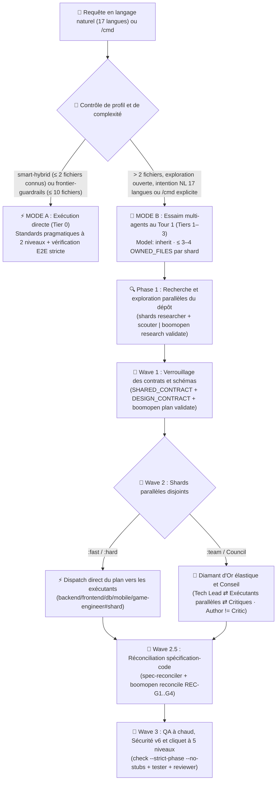

<div align="center">
  <h1>⚡ BoomOpen Workflow Kit Pro v5.5</h1>
  <p><strong>Orchestration multi-agents et contrôles CLI déterministes sur Antigravity, Claude Code, OpenAI Codex, Cursor et GitHub Copilot.</strong></p>

  <p>
    <a href="https://boomopen.com"></a>
    <a href="https://github.com/Kennyboom/BoomOpen-Workflow-Kit-Pro/releases"></a>
    <a href="#platforms"></a>
    <a href="#cli"></a>
    <a href="#skills"></a>
    <a href="https://nodejs.org/">= 18.0.0" /></a>
    <a href="../LICENSE"></a>
  </p>

  <p>
    <a href="../README.md">English</a> •
    <a href="./README.vi.md">Tiếng Việt</a> •
    <a href="./README.zh-CN.md">简体中文</a> •
    <a href="./README.zh-TW.md">繁體中文</a> •
    <a href="./README.ja.md">日本語</a> •
    <a href="./README.ko.md">한국어</a> •
    <a href="./README.es.md">Español</a> •
    <b>Français</b> •
    <a href="./README.de.md">Deutsch</a><br/>
    <a href="./README.pt-BR.md">Português (BR)</a> •
    <a href="./README.ru.md">Русский</a> •
    <a href="./README.hi.md">हिन्दी</a> •
    <a href="./README.ar.md">العربية</a> •
    <a href="./README.id.md">Bahasa Indonesia</a> •
    <a href="./README.th.md">ไทย</a> •
    <a href="./README.tr.md">Türkçe</a> •
    <a href="./README.it.md">Italiano</a>
  </p>

  <p>
    <a href="https://boomopen.com"><b>🌐 boomopen.com (15 langues)</b></a> •
    <a href="#trailer"><b>🎬 Bande-annonce</b></a> •
    <a href="#why-boomopen"><b>⚡ Pourquoi BoomOpen</b></a> •
    <a href="#architecture"><b>🏗️ Architecture</b></a> •
    <a href="#quickstart"><b>🚀 Démarrage rapide</b></a> •
    <a href="#cli"><b>🛠️ 14 contrôles CLI</b></a> •
    <a href="#settings"><b>🎛️ Profils &amp; réglages</b></a> •
    <a href="#commands"><b>🎯 36 commandes</b></a> •
    <a href="#agents"><b>🤖 22 agents &amp; 18 équipes</b></a> •
    <a href="#skills"><b>📚 1 462 skills</b></a>
  </p>
</div>

---

<a id="trailer"></a>

## 🎬 Bande-annonce de Lancement et Explorateur Web Interactif (`boomopen.com`)

<div align="center">
  <a href="https://github.com/Kennyboom/BoomOpen-Workflow-Kit-Pro/raw/main/assets/media/boomopen_v55_trailer_en.mp4">
    
  </a>
  <p>
    ▶️ <a href="https://github.com/Kennyboom/BoomOpen-Workflow-Kit-Pro/raw/main/assets/media/boomopen_v55_trailer_en.mp4"><b>Visionner la bande-annonce Full HD 1080p (MP4 avec voix off studio)</b></a> • 🌐 <a href="https://boomopen.com"><b>Explorer le Playground CLI des 14 commandes et les catalogues interactifs sur boomopen.com (15 langues)</b></a>
  </p>
</div>

---

<a id="why-boomopen"></a>
<a id="-what-is-boomopen-workflow-kit"></a>

## ⚡ Pourquoi BoomOpen Workflow Kit ?

**Les limites des assistants de code IA bruts :** Sans cadre d'orchestration, un agent unique se dégrade dès qu'une tâche traverse plusieurs fichiers, domaines ou sessions. L'exploration séquentielle sature la fenêtre de contexte principale, des sous-agents non coordonnés écrasent les mêmes fichiers ou livrent des modules orphelins non raccordés, le code généré laisse passer des stubs `TODO` silencieux ou des types `any`, l'auto-relecture par un seul modèle manque ses propres angles morts (`Author == Critic`), et les chantiers multi-phases dérivent par rapport aux spécifications initiales.

**La réponse d'ingénierie BoomOpen :** BoomOpen installe un harnais unifié d'orchestration et de vérification déterministe sur **Antigravity (Gemini)**, **Claude Code**, **OpenAI Codex**, **Cursor** et **GitHub Copilot**, avec **zéro dépendance npm à l'exécution**. Avec le profil **`smart-hybrid`** activé par défaut, les retouches ciblées (`≤ 2` fichiers) s'exécutent en direct sans surcoût, tandis que les développements multi-fichiers, la recherche approfondie, l'architecture et les **`36` commandes slash (`93` fichiers)** découpent le travail dès le Tour 1 entre **22 agents spécialisés** et **18 équipes contradictoires à 3 rôles** — verrouillés par **14 contrôles CLI `boomopen` locaux** et appuyés par **`1,462` skills à la demande** (`22` Core + `1,440` dédupliquées une seule fois dans `~/.agents/skills_library`).

### ⚖️ Sans BoomOpen vs. Avec BoomOpen v5.5

| Mode de défaillance technique | Sans BoomOpen (IDE IA standard) | Avec BoomOpen Workflow Kit Pro v5.5 |
|:------------------------------|:--------------------------------|:------------------------------------|
| **Saturation de la fenêtre de contexte** | L'agent principal lit 15 à 30 fichiers en série avant d'écrire une seule ligne | **Essaim élastique dès le Tour 1 (`role#shard`)** : Délègue l'exploration en lecture seule et découpe par domaine (`≤ 3–4` fichiers/shard) + réutilisation à chaud (`0s`, `send_message`) |
| **Écrasements parallèles et câblage cassé** | Les agents parallèles écrasent les fichiers partagés, divergent sur les routes `/api` ou créent des modules morts | **Verrous Contract-First + Réconciliation Wave 2.5** : Fige `SHARED_CONTRACT` en Wave 1 + `OWNED_FILES` disjoints, vérifiés par `boomopen reconcile` (`REC-G1..G4`) |
| **Recherche superficielle et plans flous** | Réponses complaisantes à point de vue unique, affirmations non sourcées, plans en prose libre | **Spécifications en 6 blocs validées** : Contradicteur `:team` + validateurs CLI `< 50ms` (`boomopen research`, `design`, `plan`) |
| **Stubs silencieux, `any` et tests biaisés** | L'agent déclare la tâche terminée en laissant des `// TODO`, `any` explicites, `console.log` ou tests `.skip` | **Contrôle statique pragmatique à 2 niveaux** : `boomopen check --strict-phase --no-stubs` impose `0` `any`, `0` stub et des fichiers cohérents (`400/500` lignes) |
| **Dérive multi-sessions et régressions** | Le compactage du contexte efface les contraintes de phase et casse des fonctionnalités déjà validées | **Cliquet qualité à 5 niveaux et rollback** : `.boomopen/project-ledger.json` avec garde SHA-256 anti-dérive, `/autopilot`, `/audit` et `rollback --yes` atomique |
| **Angles morts d'un modèle unique** | Le même modèle écrit et relit son propre code (`Author == Critic`) | **Conducteur multi-moteurs (`/conduct`)** : Conseils parallèles et pipelines inter-familles sur Claude Code, Codex, Antigravity, Cursor et Copilot |
| **Dérive sur 5 IDE et arbre Git pollué** | Fichiers de règles dispersés par IDE, gigaoctets de skills dupliquées et specs temporaires dans `git status` | **Synchronisation unifiée et Git propre** : 14 points d'entrée synchronisés en `< 10ms`, 1 `~/.agents/skills_library` partagée (`0` token au repos) et routage vers Brain Artifacts |

---

<a id="architecture"></a>
<a id="-smart-hybrid-architecture-v55"></a>

## 🏗️ Architecture Smart-Hybrid (v5.5)



---

<a id="pillars"></a>

## 🧠 6 Piliers d'Ingénierie Fondamentaux

1. **🌐 Compilation native sur 5 IDE et coffre dédupliqué (`platforms/*`)** :
   - Compile **22 agents spécialisés** et **93 fichiers de commandes/référence** dans les formats natifs de chaque IDE : **Antigravity** (bundle `--as-plugin` + `3` scripts Python exécutables pour `run_workflow` : `audit_fanout.py`, `review_fanout.py`, `research_fanout.py`), **Claude Code** (shards `isolation: worktree`, commandes `/plan:hard`, hooks optionnels `PreToolUse` et `Stop`/`PreCompact`), **OpenAI Codex** (`22` rôles TOML avec bacs à sable OS `read-only` pour éclaireurs/critiques + `87` skills `$boomopen-*`), **Cursor** (règles `.mdc` + hook optionnel `beforeShellExecution`) et **GitHub Copilot** (agents `.agent.md`).
   - Relie une seule fois les `1,440` skills de bibliothèque dans `~/.agents/skills_library` pour les 5 IDE (~80 % d'espace disque économisé, `0` surcharge de tokens au Tour 1).
2. **🎯 Essaim élastique dynamique à 4 paliers (`role#shard`) et réutilisation à chaud** :
   - Dimensionne automatiquement de **Tier 0** (`0` sous-agent pour `≤ 2` fichiers connus) → **Tier 1** (`2–3` shards) → **Tier 2** (`4–6` shards) → **Tier 3** (`7–8+` shards, configurable jusqu'à `16`), en plafonnant la charge cognitive à **`≤ 3–4 OWNED_FILES` par sous-agent** et en réutilisant les sessions actives via `role#shard → conversationId` (`send_message`).
3. **🤝 Exécution Contract-First en 3 vagues + Réconciliation Wave 2.5 (`REC-G1..G4`)** :
   - La Wave 1 verrouille `SHARED_CONTRACT` (schémas API/DTO) et `DESIGN_CONTRACT` (CSS `@theme` OKLCH + props TypeScript) avant le dispatch parallèle de la Wave 2. La Wave 2.5 exécute `boomopen reconcile` + `spec-reconciler` pour détecter les fichiers îlots non raccordés (`REC-G1`), les écarts de routes frontend/backend (`REC-G2`), les sous-clauses `[SC-*]` omises (`REC-G3`) et les clés manquantes dans `.env.example` (`REC-G4`), puis génère les vagues correctives via `boomopen cook amend-plan`.
4. **🏛️ Autopilote multi-sessions (`/autopilot`) et audit multi-cycles à état (`/audit`)** :
   - Compile les dossiers de spécifications dans `.boomopen/project-ledger.json` avec détection de dérive SHA-256, points de sauvegarde Git avant chaque phase (`boomopen ledger rollback --yes`) et un **cliquet qualité de phase à 5 niveaux** (`G1 check --strict-phase --no-stubs` → `G2 cliquet monotone de tests` → `G3 reconcile --strict` → `G4 revue Author != Critic` → `G5 ledger verify`). Après construction, `/audit` pilote des cycles supervisés couvrant RTM, flux verticaux et Sécurité v6 (`.boomopen/audit-ledger.json` + `boomopen audit rollback --yes`).
5. **🎼 Conducteur multi-moteurs et Conseil parallèle (`boomopen conduct`)** :
   - Coordonne simultanément Claude Code, OpenAI Codex, Antigravity, Cursor et Copilot au sein de **Conseils parallèles sur 6 tâches** (`research`, `brainstorm`, `plan`, `design`, `review`, `debug` → synthèse en 4 parties `COUNCIL-SYNTHESIS.md`) ou de **Pipelines inter-familles** où aucun modèle n'évalue sa propre production (`Author != Critic`).
6. **📏 Standards de code pragmatiques à 2 niveaux et diagnostic racine SPIE v3.0** :
   - **Niveau 1 (Tolérance zéro)** : Responsabilité unique, `0` `any` explicite, `0` `console.log` de débogage dans le code applicatif, frontières async/API typées avec `try/catch`, constantes `SCREAMING_SNAKE_CASE`. **Niveau 2 (Cohésion d'abord)** : Cible de `~200–350` lignes (`400` souple / `500` plafond strict ; tests/types/docs exemptés). Chaque anomalie passe par 3 hypothèses classées et une chaîne causale **5-Whys (SPIE v3.0)**, tandis que les artefacts transitoires sont routés vers Brain Artifacts (`100 %` arbre Git propre).

---

<a id="platforms"></a>
<a id="-supported-ai-platforms"></a>

## 💻 5 Plateformes de Développement IA Prises en Charge

| Plateforme | Support | Point(s) d'entrée synchronisés | Intégration native par plateforme |
|:-----------|:-------:|:-------------------------------|:----------------------------------|
| **Antigravity (Gemini)** | ✅ v5.5 | `~/.gemini/GEMINI.md` | `invoke_subagent`, fan-out Python `run_workflow`, boucle externe `/goal`, bundle `--as-plugin`, `--with-hooks` optionnel, Brain Artifacts |
| **Claude Code** | ✅ v5.5 | `~/.claude/CLAUDE.md` | Shards parallèles `Task`/`Agent` (`isolation: worktree`), commandes `/plan:hard`, hooks optionnels `PreToolUse` et `Stop`/`PreCompact` |
| **OpenAI Codex** | ✅ v5.5 | `~/.codex/AGENTS.md` et `CODEX.md` | `22` rôles TOML dans `~/.codex/agents/boomopen/` avec `sandbox_mode = "read-only"` OS pour éclaireurs/relecteurs + `87` skills `$boomopen-*` |
| **Cursor** | ✅ v5.5 | `~/.cursor/rules/boomopen-workflow-kit.mdc` | Règles `.mdc` permanentes, `CURSOR.md`, routage de sous-agents et `.cursor/hooks.json` optionnel (`beforeShellExecution`) |
| **GitHub Copilot** | ✅ v5.5 | `~/.copilot/copilot-instructions.md` | Agent compilé `boomopen-workflow-kit.agent.md` pour VS Code, dispatch `runSubagent` et `COPILOT.md` |

---

<a id="quickstart"></a>
<a id="-quick-start--installation"></a>

## 🚀 Démarrage Rapide et Installation (Via Git Uniquement — Zéro Dépendance Runtime)

```bash
# 1. Cloner le dépôt (distribué uniquement sur GitHub — jamais publié sur npm)
git clone https://github.com/Kennyboom/BoomOpen-Workflow-Kit-Pro.git
cd BoomOpen-Workflow-Kit-Pro

# 2. Installer pour votre IDE IA (profil par défaut : smart-hybrid) ou sur les 5 IDE d'un coup
npm run install:all                                 # Installe et synchronise les 5 IDE + ~/.agents/skills_library partagée
npm run install:antigravity                         # Google Antigravity 2.0 (ajouter --as-plugin ou --with-hooks au besoin)
node cli/install.js install claude --with-hooks     # Claude Code + hooks optionnels PreToolUse et Stop/PreCompact
npm run install:codex                               # OpenAI Codex CLI + bacs à sable OS read-only pour scouts/reviewers
npm run install:cursor                              # Cursor (passer --with-hooks pour la garde beforeShellExecution)
npm run install:copilot                             # GitHub Copilot (VS Code .agent.md + copilot-instructions.md)

# 3. Vérifier l'intégrité et lier optionnellement `boomopen` dans le PATH global
npm run doctor
npm link
boomopen settings status
```

> **Installation et désinstallation sûres et non destructives** : Suivies par manifestes SHA-256 (`~/.boomopen/manifests/<tool>.json`). Vos règles personnelles existantes dans `GEMINI.md` / `CLAUDE.md` sont préservées hors des balises du kit avec sauvegarde automatique ; `boomopen uninstall <tool|--all>` retire proprement les fichiers non modifiés du kit sans toucher à vos propres fichiers.

---

<a id="cli"></a>

## 🛠️ 14 Sous-commandes CLI Sans Dépendance (`boomopen`)

S'exécute localement en `< 50ms` sur Node.js `>= 18` avec **zéro dépendance npm à l'exécution** et **zéro appel réseau** :

| Sous-commande | Options et syntaxe clés | Contrôles déterministes et rôle |
|:--------------|:------------------------|:--------------------------------|
| **`install` / `uninstall` / `list`** | `<tool\|--all> [--with-hooks] [--as-plugin]` | Installateur à manifeste SHA-256, liaison `~/.agents/skills_library`, hooks de sécurité optionnels et désinstallation propre |
| **`doctor`** | `[--source-only]` | Audit en lecture seule en 30 points des 5 bundles IDE, `93` fichiers commandes, `72` fichiers équipes, `1,462` skills et réglages |
| **`settings`** | `status \| preset <name> \| set <k> <v> \| --ui` | Gère 5 profils + `22` clés (`--project` pour `./.boomopen.json`) ou ouvre l'interface Web durcie par CSP (`127.0.0.1:4567`) |
| **`research`** | `<validate\|brief> <file.md> [--mode brainstorm]` | Impose **`RES-G1..G4`** (`≥ 4` sources triangulées, matrice de contradictions, risques pre-mortem) et compile `HANDOFF_BRIEF` |
| **`design`** | `<validate\|contract> <DESIGN.md> [--json]` | Impose **`DESIGN-G1..G4`** (spec en 6 blocs, tokens OKLCH, matrice UI à 5 états, WCAG 2.2 AA) et génère `DESIGN_CONTRACT` |
| **`plan`** | `<validate\|compile> <PLAN.md> [--sync-ledger]` | Impose **`PLAN-G1..G5`** (DAG acyclique, `OWNED_FILES ≤ 4`/shard disjoints, `SHARED_CONTRACT`) et synchronise le registre |
| **`cook`** | `<state\|packets\|verify-wave\|preflight\|amend-plan>` | Impose **`COOK-G1..G4`** : état fast-forward en 5 étapes, paquets Wave à 5 champs, verrous d'écriture Git et vagues delta |
| **`reconcile`** | `<dir> [--plan <PLAN.md>] [--strict]` | Wave 2.5 **`REC-G1..G4`** : détecte les modules îlots, dérives de routes `/api`, clauses `[SC-*]` omises et manques `.env.example` |
| **`check`** | `[path] --strict-phase --no-stubs [--ignore <dir>]` | Contrôle statique à 2 niveaux : budgets `400/500` lignes, `0` `any` explicite, `0` `console.log` de debug, `0` stub/`TODO`/`.skip` |
| **`ledger`** | `<init\|from-plan\|status\|next\|verify\|rollback>` | Automate DAG multi-sessions `.boomopen/project-ledger.json`, garde SHA-256 anti-dérive et `rollback --yes` atomique |
| **`audit`** | `<init\|slice\|record\|approve\|verify-fix\|rollback>` | Registre d'audit multi-cycles post-livraison (`.boomopen/audit-ledger.json`), cliquet de résorption et `rollback --yes` |
| **`conduct`** | `<probe\|council\|dispatch\|status> [--dry-run]` | Conducteur multi-moteurs et Conseil parallèle sur 6 tâches (`Author != Critic` sur 5 IDE → `COUNCIL-SYNTHESIS.md`) |

---

<a id="settings"></a>
<a id="-unified-settings--mode-selection-settings"></a>

## 🎛️ Centre de Contrôle Unifié et 5 Profils (`/settings`)

Pilotez **`20` clés énumérées + `2` seuils de lignes personnalisables** globalement (`~/.boomopen/settings.json`) ou par dépôt (`./.boomopen.json`), synchronisés à chaud dans les 14 fichiers d'entrée IDE en `< 10ms` :

| Profil (`Preset`) | Mode d'exécution (`execution.mode`) | `/cmd` par défaut | Routage NL 17 langues (`naturalLanguageResearchTrigger`) | Standards de code | Usage recommandé |
|:------------------|:------------------------------------|:-----------------:|:--------------------------------------------------------:|:-----------------:|:-----------------|
| **⚡ `smart-hybrid`** *(Par défaut)* | **`auto`** (`≤ 2` fichiers en direct ; `> 2` fichiers ou `/cmd` → Essaim Mode B) | `auto` | **`auto_team`** *(Route recherche/idéation/revue NL vers `:team` et les workflows en 17 langues)* | `pragmatic` (`400/500`L) | Expérience par défaut : routage d'intention en langage naturel + découpage parallèle dès le Tour 1 |
| **🛡️ `frontier-guardrails`** *(Léger optionnel)* | **`mode_a`** (`≤ 10` fichiers en direct ; point d'entrée `< 2.5 KB` / `~600` tokens) | `auto` | **`off`** *(Commandes `/cmd` explicites uniquement — zéro interception NL)* | `pragmatic` (`400/500`L) | Mode direct quotidien ultra-léger `< 2.5 KB` avec contrôles 2 niveaux et E2E stricts *(alias `carbon-guardrails` supporté)* |
| **🚀 `solo-fast`** | **`mode_a`** (`≤ 10` fichiers en direct ; plafond prudent de `3` shards) | `fast` | `off` | `relaxed` (`600/800`L) | Prototypage rapide, petits scripts, correctifs urgents et sobriété en tokens |
| **🧠 `deep-architect`** | **`mode_b`** *(Orchestrateur Mode B strict ; max `12` shards)* | `hard` | `auto_hard` + recherche `council` / revue `cross_family` | `strict` (`300/400`L) | Architecture système complexe, conception greenfield et refontes inter-modules |
| **🔺 `adversarial-team`** | **`team`** *(Diamant d'Or élastique `:team` ; `hyper_swarm` max `12`)* | `team` | **`auto_team`** + recherche, plan et revue en `council` | `strict` (`300/400`L) | Mises en production critiques, audits de sécurité et consensus multi-moteurs |

```bash
# Changer de profil ou ajuster une clé via le chat (/settings), l'interface Web locale (--ui) ou la CLI :
boomopen settings --ui                                      # Ouvrir le Centre de Contrôle Web local sur http://127.0.0.1:4567
boomopen settings preset smart-hybrid                       # Par défaut : Mode A/B auto + routage NL en 17 langues
boomopen settings preset frontier-guardrails                # Optionnel : Mode A léger < 2.5 KB (alias : carbon-guardrails)
boomopen settings set engines.reviewer cross_family         # Imposer un relecteur d'une autre famille (Author != Critic)
cd path/to/your/repo && boomopen settings mode team --project # Surcharge locale au dépôt dans ./.boomopen.json
boomopen settings reset                                     # Restaurer la configuration smart-hybrid par défaut
```

---

<a id="commands"></a>
<a id="-slash-commands-reference"></a>

## 🎯 Référence des 36 Commandes Slash (`93` Fichiers = `87` Workflows + `6` `_ref/`)

Exprimez votre besoin naturellement dans **l'une des 17 langues prises en charge** sous `smart-hybrid` ou invoquez explicitement l'une des **36 commandes slash canoniques** :

| Catégorie | Commande | Variantes | Rôle et livrables déterministes |
|:----------|:---------|:----------|:--------------------------------|
| **Orchestration et autonomie** | **`/cook`** | `:fast`, `:hard`, `:team` | Développement de fonctionnalité de bout en bout sans plan préalable (Scout → Plan contractuel → Shards parallèles → Wave 2.5 Reconcile → QA) |
| | **`/code`** | `:fast`, `:hard`, `:team` | Exécute directement un `PLAN-{task}.md` validé sur les shards Wave 1–3 sans relancer `/plan` |
| | **`/autopilot`** | `:init`, `:run`, `:audit` | Orchestrateur multi-sessions de la spec à la production via `.boomopen/project-ledger.json` et **cliquet qualité à 5 niveaux** |
| | **`/conduct`** | `:council`, `:pipeline` | Conseil parallèle multi-moteurs (`COUNCIL-SYNTHESIS.md`) et pipeline inter-familles sur 5 IDE (`--dry-run` inclus) |
| | **`/orchestrate`** / **`/auto`** | — | Coordination sur mesure d'essaims multi-domaines (`/orchestrate`) ou exécution autonome intégrale (`/auto`) |
| **Architecture, design et recherche** | **`/plan`** | `:fast`, `:hard`, `:team` | Plan `PLAN-{task}.md` à 5 contrôles figeant `SHARED_CONTRACT`, `OWNED_FILES ≤ 4`/shard disjoints et critères Given/When/Then |
| | **`/architect`** | — | Dossier d'architecture pur : diagrammes C4, ADR, schémas BDD, contrats API, écrans et couverture (zéro code écrit) |
| | **`/design`** / **`/ui-ux-pro-max`** | `:fast`, `:hard`, `:team` | Spec UI/UX `DESIGN-{task}.md` en 6 blocs + `DESIGN_CONTRACT` (tokens OKLCH `@theme`, matrice 5 états, 50+ styles et aperçu HTML) |
| | **`/research`** | `:fast`, `:hard`, `:team` | Recherche approfondie à 5 prismes (`RESEARCH-{topic}.md`, triangulation `RES-G1..G4` ≥ 4 sources, contradictions et `HANDOFF_BRIEF`) |
| | **`/brainstorm`** / **`/ask`** | `:fast`, `:hard`, `:team` | Idéation stratégique sans complaisance (`BRAINSTORM-{topic}.md` avec pre-mortem et matrice MCDA) et Q&R sourcée (`/ask`) |
| **Qualité, audit, debug et sécurité** | **`/review`** | `:fast`, `:hard`, `:team` | Revue contradictoire multi-axes de code, architecture, sécurité et performance (`Author != Critic`, enchaînement vers `/fix`) |
| | **`/audit`** / **`/deep-audit`** | `:run`, `:fix`, `:auto` | Audit global post-build multi-cycles (`/audit` avec registre) et audit logique pré-code en 10 dimensions (`/deep-audit`) |
| | **`/security-audit`** | — | Analyse OWASP Top 10 + LLM/Agentic Top 10 (`security_scan.py` v6), modélisation STRIDE, auth et chaîne d'approvisionnement |
| | **`/debug`** / **`/fix`** | `:fast`, `:hard`, `:team` | Diagnostic racine à 3 hypothèses + **5-Whys (SPIE v3.0)** (`DEBUG-{issue}.md`) et correction TDD fail-first (`/fix`) |
| | **`/test`** / **`/performance`** / **`/refactor`** | `:fast`, `:hard`, `:team` | Shards QA sans contournement de tests (`/test`), optimisation Core Web Vitals / BDD / bundles (`/performance`) et `/refactor` mesuré |
| **Git, releases, docs et session** | **`/onboard`** / **`/init`** | — | Cartographie brownfield `ARCHITECTURE-MAP.md` en lecture seule en 60s (`/onboard`, sans collision avec `/init`) et bootstrap (`/init`) |
| | **`/pr`** / **`/release`** | —, `:review` | Contrôle qualité/réconciliation pré-PR + `gh pr create` / revue contradictoire de diff (`/pr:review`), et `/release` sémantique |
| | **`/deploy`** / **`/rollback`** | `:check`, `:preview`, `:production`, `:rollback` | Contrôles pré-déploiement, déploiements preview/production (`/deploy`) et reprise d'urgence graduée par sévérité (`/rollback`) |
| | **`/docs`** / **`/report`** | `:core`, `:business`, `:audit` / `:fast..:team` | Documentation `./documents/` ancrée dans le code (`/docs`) et rapports d'avancement fondés sur la télémétrie CLI (`/report`) |
| | **`/settings`** / **`/status`** / **`/next`** | — | Centre de Contrôle Unifié (`/settings`), tableau de bord du registre/essaim (`/status`) et guide de prochaine étape (`/next`) |
| | **`/preview`** / **`/save`** / **`/recap`** | — | Gestion du serveur de dev local (`/preview`), sauvegarde d'état de session (`/save`) et reprise de contexte en `< 5s` (`/recap`) |

### 🌙 Playbook Nocturne pour Projets Multi-Phases (`/autopilot` et `/goal`)

| Workflow | Plateforme cible et moteur | Continuité du contexte | Garanties qualité et conformité spec |
|:---------|:---------------------------|:-----------------------|:-------------------------------------|
| **`/autopilot` (+ `--with-hooks`)** | Les 5 IDE (associer `--with-hooks` sur **Claude Code**, **Antigravity** et **Cursor**) | Les hooks `Stop` et `PreCompact` (`stop-quality-gate.mjs`) + `.boomopen/project-ledger.json` conservent la progression malgré les compactages | Impose le **cliquet qualité à 5 niveaux** (`G1..G5`), `reconcile` en Wave 2.5 et `boomopen ledger rollback --yes` |
| **`/goal` + `/autopilot` + `/audit`** | Boucle externe persistante d'**Antigravity 2.0** pour les dossiers `docs/` volumineux | L'exécuteur natif **`/goal`** d'Antigravity enchaîne les phases jusqu'à ce que tout le registre soit `VERIFIED` | Valide chaque phase sur les 5 contrôles + réconciliation Wave 2.5, puis lance le Cycle 1 de **`/audit`** |

```text
/goal Utilise /autopilot pour lire toute la documentation projet dans docs/, initialiser .boomopen/project-ledger.json et implémenter de manière autonome chaque phase dans l'ordre (chaque phase doit valider les 5 contrôles et Wave 2.5 reconcile). Une fois 100 % des phases validées, exécute le Cycle 1 de /audit puis arrête-toi avec un rapport de synthèse pour relecture.
```

---

<a id="agents"></a>
<a id="-22-specialist-agents--18-golden-triangle-teams"></a>

## 🤖 22 Agents Spécialisés et 18 Équipes Contradictoires à 3 Rôles

Chaque sous-agent hérite du modèle de votre session (`Model: "inherit"` — `flash_lite` est strictement interdit) et s'articule en **18 équipes Golden Diamond / Triangle** (`Tech Lead` ⇄ `Exécutants parallèles par shard` ⇄ `Relecteurs/Critiques indépendants`) :

| Domaine | Agents spécialisés (`agents/*.md`, compilés par IDE) | Équipes de revue à 3 rôles (`agents/teams/*-team/`, `72` fichiers) |
|:--------|:-----------------------------------------------------|:-------------------------------------------------------------------|
| **Ingénierie et exécution** | `backend-engineer`, `frontend-engineer`, `mobile-engineer`, `game-engineer`, `database-architect`, `devops-engineer` | `backend-team`, `frontend-team`, `fullstack-team`, `mobile-team`, `game-team`, `database-team`, `devops-team` |
| **Architecture et produit** | `tech-lead`, `planner`, `brainstormer`, `business-analyst`, `project-manager`, `designer` | `planning-team`, `brainstorm-team`, `project-team`, `design-team` |
| **Qualité, réconciliation et sécurité** | `debugger`, `tester`, `reviewer`, `spec-reconciler`, `security-engineer`, `performance-engineer` | `debug-team`, `qa-team`, `security-team`, `performance-team` |
| **Recherche et documentation** | `researcher`, `scouter`, `docs-manager`, `reporter` | `research-team`, `docs-team`, `report-team` |

---

<a id="skills"></a>
<a id="-1460-skills-vault-22-core--1440-niche-library-skills"></a>

## 📚 Coffre de 1 462 Skills à la Demande (`22` Core + `1,440` en Bibliothèque)

Indexées sur **19 domaines d'ingénierie** dans `matrix-skills/compact-index.json`, dédupliquées une seule fois dans `~/.agents/skills_library` et chargées par **résolution progressive O(1) en 2 étapes** (vérification Core `skills/` → index `compact-index.json` → chargement du `SKILL.md` ciblé uniquement dans le shard concerné, `0` token au repos) :

| Palier / Domaine d'ingénierie | Skills | Capacités et gabarits représentatifs | Chargement |
|:------------------------------|:------:|:-------------------------------------|:-----------|
| **⚡ Workflow et qualité Core (`skills/`)** | **22** | `clean-code`, `debugger`, `plan-writing`, `brainstorming`, `deep-research`, `design-spec`, `frontend-design`, `frontend-architecture`, `api-patterns`, `database-design`, `tdd-workflow`, `testing-patterns`, `webapp-testing`, `security-auditor` (`security_scan.py` v6), `app-builder` (**15 gabarits de projets** dont **`mcp-server`**, **`ai-agent-worker`**, `nextjs-saas`, `monorepo-turborepo`, `python-fastapi`, `flutter-app`), `skill-seeker` | Prêt dès le Tour 1 |
| **🤖 IA, SDK agentiques, MCP et données** | **340+** | FastMCP (`StreamableHTTP`), OpenAI Agents SDK, Claude Agent SDK, Google ADK, Vercel AI SDK, LangGraph, RAG, BigQuery, dbt | À la demande (`compact-index.json`) |
| **🌐 Web, Backend, API et bases de données** | **380+** | React 19, Next.js 15 RSC, Tailwind CSS v4, TanStack Start/Router/Query, Hono RPC + Zod OpenAPI, Rust Axum/SQLx, Drizzle, Postgres/RLS | À la demande (`compact-index.json`) |
| **☁️ Cloud, DevOps, QA et sécurité** | **300+** | Cloudflare Workers/Durable Objects/D1, Docker/K8s, Terraform, Playwright, Vitest + MSW v2, Better Auth (Passkeys), OWASP LLM Top 10 | À la demande (`compact-index.json`) |
| **🎨 UI/UX, moteurs de jeu et mobile** | **420+** | Design Tokens OKLCH, WCAG 2.2 AA, Motion, Unity 6 DOTS/ECS, Godot 4, Unreal 5, WebGPU/Three.js, Phaser/PixiJS, Tauri v2, SwiftUI, Flutter, React Native | À la demande (`compact-index.json`) |

---

## 📂 Structure du Dépôt

```text
BoomOpen-Workflow-Kit-Pro/
├── agents/                  # 22 agents spécialisés (compilés par IDE) + 18 équipes à 3 rôles (72 fichiers)
├── cli/                     # 14 sous-commandes CLI Node.js sans dépendance + 33 suites de tests node:test
├── commands/                # 36 commandes slash réparties sur 87 workflows + 6 protocoles _ref/ (93 fichiers)
├── documents/               # Documentation d'architecture, de domaine, du code source et des standards à 2 niveaux
├── i18n/                    # 16 README complets traduits (17 langues au total avec le README.md racine)
├── matrix-skills/           # 19 catalogues YAML métier + compact-index.json O(1) (1,462 skills indexées)
├── platforms/               # 5 bundles IDE, hooks de garde optionnels, 3 scripts Antigravity run_workflow/*.py et rôles TOML Codex
├── rules/                   # 7 modules de règles Mode B à la demande (CORE, PHASES, AGENTS, TEAMS, SKILLS, ERRORS, REFERENCE)
├── scripts/                 # Utilitaires multiplateformes de vérification et de session (checklist.py, verify_all.py, auto_preview.py, session_manager.py)
├── skills/                  # 22 skills Core + 15 gabarits app-builder + scripts d'audit Security v6 / UX / Perf
├── skills_library/          # 1,440 skills de bibliothèque liées une seule fois vers ~/.agents/skills_library
├── web/                     # Vitrine WebGL en 15 langues et catalogues interactifs propulsant https://boomopen.com
└── GEMINI.md | CLAUDE.md | CODEX.md | COPILOT.md | CURSOR.md | AGENT.md
```

---

## 📄 Licence et Sécurité

- **Site officiel** : [https://boomopen.com](https://boomopen.com)
- **Licence** : Le code source du kit, la CLI, les règles, les agents et la documentation sont publiés sous [Licence MIT](../LICENSE) (Copyright © 2026 **BoomOpen Labs**). Les skills tierces dans `skills_library/` conservent leurs licences d'origine — voir [THIRD_PARTY_NOTICES.md](../THIRD_PARTY_NOTICES.md).
- **Politique de sécurité** : Consultez [SECURITY.md](../SECURITY.md) pour la protection par manifestes SHA-256, l'isolation des hooks optionnels et le signalement de vulnérabilités.
