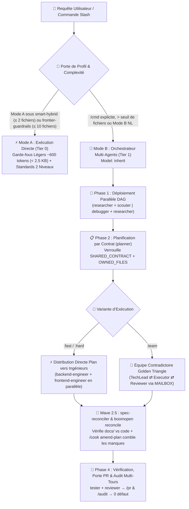

<div align="center">
  <h1>⚡ BoomOpen Workflow Kit v5.5.0</h1>
  <p><strong>Système d&#39;Exploitation IA Smart-Hybrid Multiplateforme — 22 Agents Spécialistes, 18 Équipes Triangle d&#39;Or &amp; Coffre de 1 462 Compétences à la Demande</strong></p>

  <p>
    <a href="https://github.com/Kennyboom/BoomOpen-Workflow-Kit-Pro/releases"></a>
    <a href="#platforms"></a>
    <a href="#agents"></a>
    <a href="#skills"></a>
    <a href="https://nodejs.org/">=18.0.0" /></a>
    <a href="../LICENSE"></a>
  </p>

  <p>
    <a href="../README.md">🇬🇧 English</a> • <a href="./README.vi.md">🇻🇳 Tiếng Việt</a> • <a href="./README.zh-CN.md">🇨🇳 简体中文</a> • <a href="./README.zh-TW.md">🇹🇼 繁體中文</a> • <a href="./README.ja.md">🇯🇵 日本語</a> • <a href="./README.ko.md">🇰🇷 한국어</a> • <a href="./README.es.md">🇪🇸 Español</a> • <b>🇫🇷 Français</b> • <a href="./README.de.md">🇩🇪 Deutsch</a><br/>
    <a href="./README.pt-BR.md">🇧🇷 Português</a> • <a href="./README.ru.md">🇷🇺 Русский</a> • <a href="./README.hi.md">🇮🇳 हिन्दी</a> • <a href="./README.ar.md">🇸🇦 العربية</a> • <a href="./README.id.md">🇮🇩 Bahasa Indonesia</a> • <a href="./README.th.md">🇹🇭 ไทย</a> • <a href="./README.tr.md">🇹🇷 Türkçe</a> • <a href="./README.it.md">🇮🇹 Italiano</a>
  </p>

  <p>
    <a href="https://boomopen.com">🌐 Website</a> • <a href="#overview"><b>🌟 Aperçu</b></a> • <a href="#architecture"><b>🏗️ Architecture</b></a> • <a href="#quickstart"><b>🚀 Démarrage</b></a> • <a href="#settings"><b>🎛️ Profils &amp; Réglages</b></a> • <a href="#commands"><b>🎯 36 Commandes</b></a> • <a href="#agents"><b>🤖 22 Agents &amp; 18 Équipes</b></a> • <a href="#skills"><b>📚 1 462 Compétences</b></a>
  </p>
</div>

---

## 🎬 Bande-Annonce Officielle de Lancement (Full HD 1080p)

<div align="center">
  <a href="https://github.com/Kennyboom/BoomOpen-Workflow-Kit-Pro/raw/main/assets/media/boomopen_v55_trailer_en.mp4">
    
  </a>
  <p>
    ▶️ <a href="https://github.com/Kennyboom/BoomOpen-Workflow-Kit-Pro/raw/main/assets/media/boomopen_v55_trailer_en.mp4"><b>Cliquez ici pour regarder / diffuser la Bande-Annonce Officielle en Full HD 1080p (MP4 avec voix-off studio)</b></a>
  </p>
</div>

---

<a id="overview"></a>

## 🌟 Qu’est-ce que BoomOpen Workflow Kit v5.5 ?

**BoomOpen Workflow Kit v5.5 (Multi-Platform Unified & Smart-Hybrid Edition)** est un système d’exploitation multi-agents open-source qui transforme un assistant de codage IA individuel en une organisation d’ingénierie orchestrée réunissant **22 agents spécialistes**, **18 équipes contradictoires Golden Triangle (72 fichiers d’équipe)**, **36 commandes slash (93 fichiers de commandes : 87 workflows + 6 `_ref/`)**, **14 commandes CLI** et **1 462 compétences à la demande (22 clés + 1 440 spécialisées, dédupliquées entre IDE via `~/.agents/skills_library`)**.

Contrairement aux surcouches lourdes qui gonflent le contexte à chaque tour, BoomOpen v5.5 embarque **`⚡ smart-hybrid` comme profil par défaut lors d’une installation neuve** (Essaim Élastique Proactif dès le Tour 1 + Routage en Langage Naturel en 17 Langues sur les 5 IDE) — tout en proposant le profil léger optionnel **`🛡️ frontier-guardrails` (`< 2.5 KB` / `~600 tokens`, Mode A direct)** — activant le **Sharding d’Essaim Élastique à 4 Niveaux (`role#shard`)**, l’**Auto-Réconciliation Spécification-Code Wave 2.5 (`boomopen reconcile` + `spec-reconciler`)**, l’**Audit Multi-Tours (`/audit` & `boomopen audit`)**, la **Cartographie Brownfield en 60s (`/onboard`)**, les **Portes PR & Release (`/pr`, `/pr:review`, `/release`)**, l’**Autopilote Multi-Sessions (`/autopilot`)** et le **Conducteur Multi-Moteurs (`/conduct`)** :
- **⚡ `smart-hybrid` par Défaut : Essaim Proactif au Tour 1 + Routage NL en 17 Langues** : Dès une installation fraîche (et restauré par `boomopen settings reset`), les micro-éditions connues (`≤ 2` fichiers) s’exécutent directement en Mode A, tandis que les tâches multi-fichiers, recherches approfondies, idéations, planifications et workflows `/cmd` explicites (**`/onboard`**, **`/pr` + `/pr:review`**, **`/release`**, etc.) lancent immédiatement des fragments parallèles au Tour 1 (`role#shard`, `<= 3–4 OWNED_FILES`/shard) avec **Déploiement Parallèle DAG**, **Distribution Directe du Plan**, **Verrouillage par Contrat (`SHARED_CONTRACT` + `OWNED_FILES`)**, **Réconciliation Wave 2.5 (`boomopen reconcile`, `spec-reconciler` et `/cook amend-plan` comblant modules isolés, parité routes/env et clauses `[SC-*]`)** et **Réutilisation à Chaud (`send_message`)**.
- **🛡️ Mode A Léger Optionnel `frontier-guardrails` (`< 2.5 KB` / `~600 tokens`)** : Vous préférez le Mode A direct natif jusqu’à `≤ 10` fichiers avec `naturalLanguageResearchTrigger = off` (aucun déclenchement en langage naturel) ? Basculez en `< 10ms` via `boomopen settings preset frontier-guardrails` (`carbon-guardrails` est conservé comme alias rétrocompatible).
- **🏛️ Autopilote Multi-Sessions (`/autopilot`), Audit Multi-Tours (`/audit`, avec rollback) & Conseil Multi-Moteurs (`/conduct`)** : Ingère les spécifications dans `.boomopen/project-ledger.json` (avec `boomopen ledger rollback`) et un cliquet qualité à 4 couches (`boomopen check --strict-phase --no-stubs`) ; puis pilote l’audit post-achèvement (`/audit` & `boomopen audit`, avec `audit rollback`) couvrant RTM, flux vertical UI→API→DB et **Moteur Anti-Fuites 2 Couches `security_scan.py` v6** jusqu’à 0 anomalie.
- **📚 Coffre Dédupliqué de 1 462 Compétences à Coût Repos Zéro** : Mutualisé dans `~/.agents/skills_library` et indexé dans `matrix-skills/compact-index.json` pour une recherche `O(1)` en 2 étapes, incluant les modèles **`mcp-server`** et **`ai-agent-worker`**.

---

<a id="architecture"></a>

## 🏗️ Architecture Hybride-Intelligente (v5.5)



---

<a id="pillars"></a>

## 🧠 Les 6 Piliers Fondamentaux & Fonctionnalités Natives 2026

1. **🌐 Parité Unifiée sur 5 Plateformes & Intégrations Natives 2026 (`platforms/*`)** :
   - Prise en charge native pour **Antigravity (Gemini)** (packaging plugin natif `install antigravity --as-plugin` et orchestration Python `run_workflow`), **Claude Code** (`/plan:hard` + hooks de qualité/continuité `PreCompact`/`Stop` + garde `Bash|PowerShell`), **OpenAI Codex** (sandboxing `read-only` pour l’exploration/revue et profils TOML), **Cursor** et **GitHub Copilot**.
2. **📏 Standards de Code Pragmatiques à 2 Niveaux (Anti-Fragmentation)** :
   - **Niveau 1 — Qualité & Sécurité Strictes (Tolérance Zéro)** : Responsabilité Unique, **AUCUN `any` explicite**, **AUCUN `console.log` de débogage oublié**, `try/catch` + erreurs typées aux frontières async/API, constantes `SCREAMING_SNAKE_CASE`, DRY (`≥ 3`) et imports triés.
   - **Niveau 2 — Directives Structurelles Flexibles (Cohésion d’Abord)** : Fichiers cohésifs de `~200–350 lignes` (plafond souple `400` / découpage strict `500` ; tests, types et docs exemptés) ; fonctions logiques `~20–40 lignes` (`~40–80` UI/Handlers).
3. **🎯 Sharding Élastique (`role#shard`) & Auto-Réconciliation Wave 2.5 (`spec-reconciler`)** :
   - Dès que `PLAN-{feature}.md` existe, l’Orchestrateur assigne directement aux fragments (`<= 3–4 OWNED_FILES`/shard) et les réutilise à chaud via `send_message` en **0s**. En **Wave 2.5**, `spec-reconciler` et `boomopen reconcile` (`REC-G1..G4`) résorbent tout écart vis-à-vis de `docs/` avant clôture.
4. **🤝 Contrats Parallèles, Portes PR/Release & Audit Multi-Tours `/audit` (v6)** :
   - `SHARED_CONTRACT` + `OWNED_FILES` éliminent les conflits ; `/onboard` cartographie un dépôt existant en 60s ; `/pr` (`/pr:review`) et `/release` sécurisent Pull Requests et versions sémantiques ; et `/audit` exécute le Moteur Anti-Fuites 2 Couches v6 jusqu’à zéro constat.
5. **🔍 Débogage 5-Whys (SPIE v3.0) & Arbre Git 100% Propre** :
   - `debugger` trace chaque bug via 3 hypothèses et une chaîne causale **5-Whys**. Les artefacts transitoires (`PLAN`, `DEBUG`, `TEST`, `REVIEW`, `AUDIT`, `ARCHITECTURE-MAP`, `MAILBOX`) vont dans `<appDataDir>\brain\<conversation-id>\` (ou `./reports/`), gardant Git propre.
6. **🩺 Suite CLI de 14 Commandes & Index Dédupliqué O(1)** :
   - `npm run doctor` valide les 5 plateformes, **22 agents**, **72 fichiers d’équipe (18 équipes)**, **93 fichiers de commandes (36 commandes : 87 workflows + 6 `_ref/`)** et **`1 462` compétences** mutualisées via `~/.agents/skills_library`. Les **14 commandes CLI** (`research`, `design`, `plan`, `cook`, `reconcile`, `audit` avec `audit rollback`, `ledger` avec `ledger rollback`, `conduct`, `check`, `doctor`, `settings`, `install` avec `--as-plugin`, `uninstall`, `list`) assurent une conformité déterministe.

---

<a id="platforms"></a>

## 💻 Plateformes IA Supportées

| Plateforme | Niveau de Support | Point d’Entrée Global & Fonctions Natives 2026 | Chemin d’Installation du Framework |
|----------|:-------------:|-------------------|------------------------|
| **Antigravity (Gemini)** | ✅ Natif v5.5 | `~/.gemini/GEMINI.md` (`--as-plugin`, `run_workflow` & `/goal`) | `~/.gemini/config/skills/boomopen-workflow-kit/` |
| **Claude Code** | ✅ Natif v5.5 | `~/.claude/CLAUDE.md` (hooks `PreCompact`/`Stop` & garde `Bash\|PowerShell`) | `~/.claude/skills/boomopen-workflow-kit/` |
| **OpenAI Codex** | ✅ Natif v5.5 | `~/.codex/CODEX.md` & `AGENTS.md` (sandbox `read-only` & rôles TOML) | `~/.codex/skills/boomopen-workflow-kit/` |
| **Cursor** | ✅ Natif v5.5 | `~/.cursor/rules/boomopen-workflow-kit.mdc` (`smart-hybrid` ou `< 2.5 KB` sous `frontier-guardrails`) | `~/.cursor/skills/boomopen-workflow-kit/` |
| **GitHub Copilot** | ✅ Natif v5.5 | `~/.copilot/COPILOT.md` (agent personnalisé & sous-agents) | `~/.copilot/skills/boomopen-workflow-kit/` |

---

<a id="quickstart"></a>

## 🚀 Démarrage Rapide & Installation

```bash
# 1. Cloner le dépôt
git clone https://github.com/Kennyboom/BoomOpen-Workflow-Kit-Pro.git
cd BoomOpen-Workflow-Kit-Pro

# 2. Installer pour votre assistant IA (déduplique les compétences via ~/.agents/skills_library)
npm run install:antigravity                        # Antigravity (Gemini) standard
node cli/install.js install antigravity --as-plugin # Antigravity en mode plugin natif
npm run install:claude                             # Claude Code (hooks PreCompact/Stop + garde Bash|PowerShell)
npm run install:codex                              # OpenAI Codex (avec sandboxing read-only)
npm run install:cursor                             # Cursor
npm run install:copilot                            # GitHub Copilot
npm run install:all                                # Installer sur les 5 plateformes simultanément

# 3. Vérifier l’installation et tester les 14 commandes CLI (dont rollback)
npm run doctor
npm link
boomopen research validate path/to/RESEARCH.md
boomopen design validate path/to/DESIGN.md
boomopen plan validate path/to/PLAN.md
boomopen cook preflight path/to/PLAN.md
boomopen reconcile path/to/your/project --plan path/to/PLAN.md   # Réconciliation Wave 2.5 (REC-G1..G4)
boomopen audit init --docs docs/prd.md,docs/arch.md              # Audit multi-tours (supporte audit rollback)
boomopen check path/to/your/project --strict-phase --no-stubs    # Longueur, any, console.log, zéro stub
boomopen ledger status                                           # État du registre (supporte boomopen ledger rollback)
boomopen conduct probe
```

> Le kit **n’est pas publié sur npm** : installez-le uniquement depuis ce dépôt (`npm link` relie ce clone local sans rien télécharger depuis npm).

---

<a id="settings"></a>

## 🎛️ Paramètres Unifiés & 5 Profils Prédéfinis (`/settings`)

BoomOpen v5.5 intègre un **Centre de Contrôle Unifié à Latence Zéro** synchronisant **5 profils prédéfinis** et 20 paramètres énumérés (+ 2 limites de lignes) sur les **5 plateformes** en `< 10ms` (**0ms au Tour 1** par injection AOT `<!-- BOOMOPEN-SETTINGS-START -->`), avec **`⚡ smart-hybrid` activé par défaut lors d’une installation neuve** :

| Profil Prédéfini (`Preset`) | Mode (`execution.mode`) | Variante `/cmd` | Déclencheur Langage Naturel (`naturalLanguageResearchTrigger`) | Standards (`codingStandards`) | Cas d’Usage Idéal |
|:---|:---|:---:|:---:|:---:|:---|
| **⚡ `smart-hybrid`** *(Recommandé par Défaut)* | **`auto`** (`≤ 2` fichiers → Mode A Direct ; `> 2` fichiers ou `/cmd` → Mode B) | `auto` | **`auto_team`** *(Route la recherche/idéation NL vers `/research:team` / `/brainstorm:team`)* | `pragmatic` (`400/500` lignes) | Par défaut sur installation fraîche (et restauré via `boomopen settings reset`) : routage NL proactif en 17 langues + essaim au Tour 1 sur les 5 IDE |
| **🛡️ `frontier-guardrails`** *(Mode A Léger Optionnel)* | **`mode_a`** (`mode_a <= 10` fichiers directs ; garde-fous `< 2.5 KB` / `~600 tokens` ; alias `carbon-guardrails` rétrocompatible) | `auto` | **`off`** *(Zéro détournement NL — actif uniquement sur `/cmd` explicite)* | `pragmatic` (`400/500` lignes) | Mode A léger optionnel (`boomopen settings preset frontier-guardrails`) alliant exécution directe `< 2.5 KB` et portes E2E strictes |
| **🚀 `solo-fast`** | **`mode_a`** *(Force l’exécution directe en solo, 0s sous-agent)* | `fast` | `off` *(Réponse directe sauf si `/brainstorm` est saisi)* | `relaxed` (`600/800` lignes) | Correctifs urgents, prototypage rapide, scripts et économie de tokens |
| **🧠 `deep-architect`** | **`mode_b`** *(Force l’Orchestrateur Multi-Agents sur chaque tâche)* | `hard` | `auto_hard` *(Route vers `/research:hard` / `/brainstorm:hard`)* | `strict` (`300/400` lignes) | Architecture complexe, conception greenfield et refonte multi-domaines |
| **🔺 `adversarial-team`** | **`team`** *(Force le Triangle d’Or à 3 agents `:team`)* | `team` | **`auto_team`** *(Revue contradictoire à 3 agents via `MAILBOX`)* | `strict` (`300/400` lignes) | Production critique, audits de sécurité et livraisons zéro défaut |

> **⚡ `smart-hybrid` (Par Défaut) vs 🛡️ `frontier-guardrails` (Mode A Léger Optionnel)** : Sur toute nouvelle installation, BoomOpen active `smart-hybrid` par défaut (et `boomopen settings reset` restaure ce profil). Pour basculer vers le Mode A léger optionnel (`< 2.5 KB` / `~600 tokens`, `mode_a <= 10` fichiers, `naturalLanguageResearchTrigger = off`), exécutez `boomopen settings preset frontier-guardrails` (l’alias rétrocompatible `carbon-guardrails` reste pris en charge).

### Trois Façons de Changer de Mode (Chat `/settings`, Web UI & CLI)

```bash
# 1. Commande Slash dans le Chat
/settings                                     # Ouvrir le menu interactif (ask_question UI)
/settings preset smart-hybrid                 # Profil recommandé par défaut (Mode A/B auto + routage NL en 17 langues)
/settings preset frontier-guardrails          # Mode A léger optionnel < 2.5 KB / ~600 tokens (alias : carbon-guardrails)
/settings preset solo-fast                    # Exécution directe rapide (Mode A)
/settings preset deep-architect               # Orchestrateur Multi-Agents (Mode B)
/settings preset adversarial-team             # Équipe Golden Triangle (:team)
/settings mode auto | mode_a | mode_b | team  # Changer directement le mode d’exécution

# 2. Interface Web Locale (http://127.0.0.1:4567) & Terminal CLI
boomopen settings --ui
boomopen settings preset smart-hybrid         # Appliquer globalement et synchroniser les 5 IDE
boomopen settings preset frontier-guardrails  # Activer le Mode A léger optionnel (alias : carbon-guardrails)
cd path/to/your/project && boomopen settings set execution.mode mode_a --project
boomopen settings reset                       # Restaurer le profil par défaut smart-hybrid
```

---

<a id="commands"></a>

## 🎯 Référence des Commandes Slash (36 Commandes / 93 Fichiers : 87 Workflows + 6 `_ref/`)

| Commande | Variantes / Sous-commandes | Objectif Principal |
|---------|----------|-----------------|
| **`/onboard`** | — | **Cartographie Brownfield en 60s** : Génère `ARCHITECTURE-MAP.md` (stack, points d’entrée, flux de données, zones à risque et commandes build/test) sans conflit `/init` ni pollution Git |
| **`/cook`** | `:fast`, `:hard`, `:team`, `amend-plan` | Développement complet (Recherche → Plan → Code Parallèle → **Wave 2.5 `reconcile`** → Test → Revue) |
| **`/code`** | `:fast`, `:hard`, `:team` | Exécuter l’implémentation directement depuis un `PLAN-{feature}.md` existant |
| **`/plan`** | `:fast`, `:hard`, `:team` | Créer des plans avec `SHARED_CONTRACT`, `OWNED_FILES` et critères Given/When/Then (dont `/plan:hard` sur Claude Code) |
| **`/fix`** | `:fast`, `:hard`, `:team` | Résolution de bugs à la racine avec vérification par test de régression |
| **`/debug`** | `:fast`, `:hard`, `:team` | Investigation via 3 hypothèses + **5-Whys (SPIE v3.0)** (`DEBUG-{issue}.md`) |
| **`/test`** | `:fast`, `:hard`, `:team` | Exécution parallèle DAG des suites de tests + repérage des cas limites (`tester` + `scouter`) |
| **`/review`** | `:fast`, `:hard`, `:team` | Audit parallèle à 4 dimensions (Architecture, Qualité, Sécurité OWASP, Performance) |
| **`/pr`** | `:review` (`/pr:review`) | **Porte Pré-PR & Revue Contradictoire** : Vérifie `check`, `reconcile` et tests avant `gh pr create`, ou audite les hunks en parallèle via `/pr:review` (`gh pr view` / `gh pr diff`) |
| **`/release`** | — | **Préparation de Release Sémantique** : Audit Conventional Commits, synthèse `CHANGELOG.md`, portes `doctor`/`check`/`test`/`test:pack` et `gh release create` validé par l’humain |
| **`/audit`** | `:run`, `:fix`, `:auto` | **Audit Multi-Tours Post-Achèvement** : Couverture RTM, flux vertical & Moteur Anti-Fuites v6 avec correction par fragments (`boomopen audit` / `audit rollback`) |
| **`/design`** | `:fast`, `:hard`, `:team` | Architecture système, schéma de base de données et spécification UI/UX (`DESIGN.md`) |
| **`/docs`** | `:core`, `:business`, `:audit` | Générer ou synchroniser la documentation structurée à 2 niveaux (`./documents/`) |
| **`/deploy`** | `:check`, `:preview`, `:production`, `:rollback` | Contrôles pré-déploiement, environnements preview, production et rollback sécurisé |
| **`/research`** | `:fast`, `:hard`, `:team` | Moteur autonome de recherche (triangulation 4 sources, 3 vagues et conseil à 3 vecteurs) |
| **`/brainstorm`** | `:fast`, `:hard`, `:team` | Découverte socratique des besoins, analyse des compromis et idéation |
| **`/report`** | `:fast`, `:hard`, `:team` | Rapports de synthèse exécutifs et techniques avec métriques et diagrammes |
| **`/autopilot`** | `:init`, `:run`, `:audit` | Orchestrateur autonome multi-sessions avec `.boomopen/project-ledger.json` (`ledger rollback`) et cliquet 4 couches |
| **`/conduct`** | `:council`, `:pipeline` | Conducteur multi-moteurs et conseil parallèle (`boomopen conduct`) avec consensus en 4 parties |
| **`/orchestrate`** | — | Orchestration personnalisée de pipelines multi-agents sur plusieurs domaines |
| **`/settings`** | `preset`, `mode`, `set`, `ui` | Centre de Contrôle Unifié : 5 profils, 20 paramètres + 2 limites de lignes ou UI Web (`--ui`) |
| **`/save` / `/recap`** | — | Sauvegarder la session (`SESSION-HANDOVER.md`) et restaurer le contexte en `< 5s` (ainsi que `/ask`, `/status`, `/next`, etc. soit 36 commandes) |

---

## 🌙 Guide Nocturne pour Grands Projets Multi-Phases (`/autopilot` vs `/goal` + `/autopilot` + `/audit`)

- **Boucle Externe selon la Plateforme** : **`/goal`** est la **boucle externe native d’Antigravity (Gemini)** qui relance et poursuit automatiquement au-delà de ~70% de contexte, tandis que **`/autopilot` associé aux hooks `Stop` / `PreCompact`** assure la continuité multi-sessions autonome sur **Claude Code et OpenAI Codex**.

| Approche | Portée & Continuité par Plateforme | Garanties Registre, Portes & Audit | Cas Idéal |
|:---|:---|:---|:---|
| **`/autopilot` (+ hooks Claude/Codex)** | Exécution sur une session ou continuité multi-sessions pilotée par les hooks `Stop`/`PreCompact` sur Claude Code & Codex | `.boomopen/project-ledger.json` (`ledger rollback`), 5 portes qualité et réconciliation Wave 2.5 | Développement par phases et exécution autonome multi-sessions sur Claude Code / Codex |
| **`/goal` + `/autopilot` + `/audit`** *(Antigravity)* | **`/goal` agit comme boucle externe native d’Antigravity** sur toutes les phases durant la nuit | `project-ledger.json` + **5 portes** + **Wave 2.5 `reconcile`** + **Tour 1 `/audit`** (`audit rollback`) à 100% d’achèvement | Construction nocturne autonome de bout en bout depuis `docs/` sur Antigravity |

**📋 Prompt nocturne prêt à copier (préfixez avec `/goal` sur Antigravity ; démarrez par `/autopilot` sur Claude Code / Codex) :**

```text
/goal /autopilot Lis toutes les spécifications dans `docs/`, initialise .boomopen/project-ledger.json
et implémente de façon autonome chaque phase de bout en bout selon le PLAN initial approuvé.
Chaque phase doit valider les 5 portes de vérification, Wave 2.5 boomopen reconcile et boomopen check --strict-phase --no-stubs.
Une fois 100% des phases terminées, lance le Tour 1 de /audit et arrête-toi avec le rapport pour revue.
```

---

<a id="agents"></a>

## 🤖 22 Agents Spécialistes & 18 Équipes Golden Triangle (72 Fichiers)

| Catégorie | Agents Spécialistes (`agents/*.md`) | Équipes Golden Triangle (`agents/teams/*-team/`) |
|----------|-----------------------------------|------------------------------------------------|
| **Ingénierie & Exécution** | `backend-engineer`, `frontend-engineer`, `mobile-engineer`, `game-engineer`, `database-architect`, `devops-engineer` | `backend-team`, `frontend-team`, `fullstack-team`, `mobile-team`, `game-team`, `database-team`, `devops-team` |
| **Architecture & Planification** | `tech-lead`, `planner`, `brainstormer`, `business-analyst`, `project-manager`, `designer` | `planning-team`, `brainstorm-team`, `project-team`, `design-team` |
| **Qualité, Sécurité & Débogage** | `debugger`, `tester`, `reviewer`, **`spec-reconciler`**, `security-engineer`, `performance-engineer` | `debug-team`, `qa-team`, `security-team`, `performance-team` |
| **Recherche & Connaissances** | `researcher`, `scouter`, `docs-manager`, `reporter` | `research-team`, `docs-team`, `report-team` |

---

<a id="skills"></a>

## 📚 Coffre de 1 462 Compétences (22 Clés + 1 440 dans `~/.agents/skills_library`)

BoomOpen intègre `1,462` compétences curées et dédupliquées dans `~/.agents/skills_library` avec **0 coût de tokens au repos** grâce à la **Résolution Progressive O(1) en 2 Étapes** (`<skills>` → `matrix-skills/compact-index.json` → chargement ciblé de `SKILL.md` à la demande) :

| Niveau / Domaine de Compétence | Nombre | Compétences & Modèles 2026 Représentatifs | Mécanisme de Chargement |
|:---|:---:|:---|:---|
| **⚡ Niveau 1 : Compétences Clés (`skills/`)** | **22** | `clean-code`, `debugger`, `plan-writing`, `brainstorming`, `frontend-design`, `frontend-architecture`, `design-spec`, `api-patterns`, `database-design`, `testing-patterns`, `skill-seeker` | Pré-indexé dans `<skills>` pour un accès immédiat au Tour 1 |
| **🎨 Design UI/UX, Motion & Systèmes de Design** | **42** | Anti-AI-Slop Visual Craft, palettes OKLCH & Bento Grids, Motion v12 + CSS View Transitions, primitives headless (`cmdk`/`vaul`/`sonner`), Figma MCP + W3C DTCG Tokens, WCAG 2.2 AA/AAA, iOS 18 HIG & Material 3 Expressive | À la demande via `compact-index.json` (`matrix-skills/design.yaml`) |
| **🌐 Web, Backend & Données Edge** | **390+** | React 19 & Next.js 15, Tailwind v4, TanStack Start, Hono RPC + Zod OpenAPI, Rust Axum/Tokio/SQLx, Supabase RLS, Drizzle + Neon/Turso | À la demande via `compact-index.json` (`~/.agents/skills_library`) |
| **🤖 IA, SDKs Agents, MCP & Données** | **320+** | **Modèles `mcp-server` & `ai-agent-worker`**, MCP FastMCP (`StreamableHTTP`), OpenAI/Claude Agents SDK, Google ADK, RAG, BigQuery, dbt | À la demande via `compact-index.json` (`~/.agents/skills_library`) |
| **☁️ Cloud, DevOps, Tests & Sécurité** | **300+** | Cloudflare Workers/D1/R2/Durable Objects, Terraform/OpenTofu, Docker/K8s GitOps, Vitest + MSW v2, Better Auth, audit OWASP LLM 2025 | À la demande via `compact-index.json` (`~/.agents/skills_library`) |
| **📱 Mobile, Moteurs de Jeux & Web 3D** | **410+** | Unity 6 DOTS/ECS, Godot 4, WebGPU/WGSL & Three.js TSL, Colyseus Netcode, Tauri v2, SwiftUI, Kotlin, React Native, Flutter | À la demande via `compact-index.json` (`~/.agents/skills_library`) |

---

## 📂 Structure du Dépôt

```text
BoomOpen-Workflow-Kit-Pro/
├── agents/                  # 22 Agents Spécialistes (dont spec-reconciler) + 18 Équipes Golden Triangle (54 rôles + 18 _team.md, 72 fichiers)
├── cli/                     # Suite CLI de 14 commandes : install (--as-plugin), doctor, checker, settings, research, design, plan, cook, reconcile, audit (rollback), ledger (rollback) & conductor
├── commands/                # 87 workflows (36 commandes Slash : /onboard, /pr, /pr:review, /release, /audit, /autopilot, etc.) + 6 _ref/ (93 fichiers)
├── documents/               # Documentation à 2 niveaux (Architecture, Domaine, Base de Code & Standards)
├── i18n/                    # Documentation multilingue (16 traductions complètes du README)
├── matrix-skills/           # Matrices YAML de compétences par domaine + compact-index.json précompilé (1 462 compétences)
├── platforms/               # Modèles unifiés et hooks pour les 5 plateformes (antigravity/, claude/, codex/, copilot/, cursor/)
├── rules/                   # Règles Mode B chargées à la demande (CORE, PHASES, AGENTS, TEAMS, SKILLS, ERRORS, REFERENCE)
├── scripts/                 # Scripts Python de vérification et sécurité (security_scan.py v6, checklist.py, verify_all.py, etc.)
├── skills/                  # 22 Compétences Clés (clean-code, debugger, plan-writing, frontend-design, etc.)
├── skills_library/          # 1 440 compétences dédupliquées via ~/.agents/skills_library (dont mcp-server & ai-agent-worker)
└── GEMINI.md | CLAUDE.md | CODEX.md | COPILOT.md | CURSOR.md | AGENT.md
```

---

## 📄 Licence & Sécurité

- **Licence** : Distribué sous [Licence MIT](../LICENSE). Copyright © 2026 **BoomOpen Labs**. Les skills tierces de `skills_library/` conservent leurs licences d’origine — voir [THIRD_PARTY_NOTICES.md](../THIRD_PARTY_NOTICES.md).
- **Politique de Sécurité** : Consultez [SECURITY.md](../SECURITY.md) pour les garde-fous de sécurité intégrés et le signalement de vulnérabilités.
