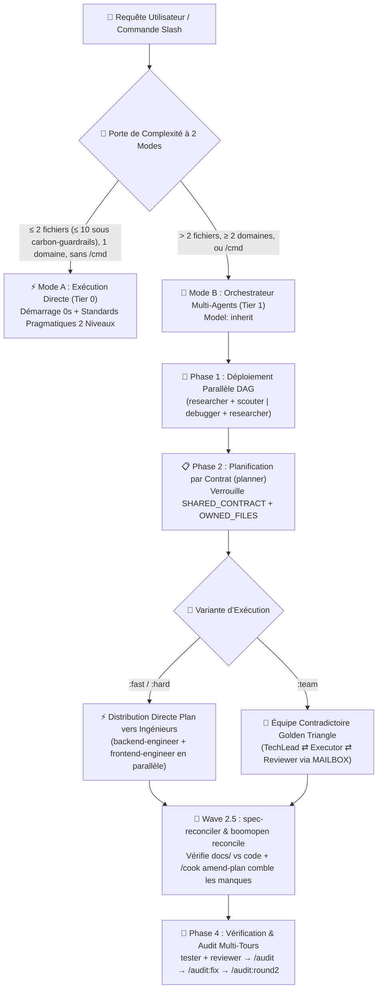

<div align="center">
  <h1>⚡ BoomOpen Workflow Kit v5.5.0</h1>
  <p><strong>Système d&#39;Exploitation IA Smart-Hybrid Multiplateforme — 22 Agents Spécialistes, 18 Équipes Triangle d&#39;Or &amp; Coffre de 1 460+ Compétences à la Demande</strong></p>

  <p>
    <a href="https://github.com/Kennyboom/BoomOpen-Workflow-Kit-Pro/releases"></a>
    <a href="#platforms"></a>
    <a href="#agents"></a>
    <a href="#skills"></a>
    <a href="https://nodejs.org/">=18.0.0" /></a>
    <a href="../LICENSE"></a>
  </p>

  <p>
    <a href="../README.md">🇬🇧 English</a> • <a href="./README.vi.md">🇻🇳 Tiếng Việt</a> • <a href="./README.zh-CN.md">🇨🇳 简体中文</a> • <a href="./README.zh-TW.md">🇹🇼 繁體中文</a> • <a href="./README.ja.md">🇯🇵 日本語</a> • <a href="./README.ko.md">🇰🇷 한국어</a> • <a href="./README.es.md">🇪🇸 Español</a> • <b>🇫🇷 Français</b> • <a href="./README.de.md">🇩🇪 Deutsch</a><br/>
    <a href="./README.pt-BR.md">🇧🇷 Português</a> • <a href="./README.ru.md">🇷🇺 Русский</a> • <a href="./README.hi.md">🇮🇳 हिन्दी</a> • <a href="./README.ar.md">🇸🇦 العربية</a> • <a href="./README.id.md">🇮🇩 Bahasa Indonesia</a> • <a href="./README.th.md">🇹🇭 ไทย</a> • <a href="./README.tr.md">🇹🇷 Türkçe</a> • <a href="./README.it.md">🇮🇹 Italiano</a>
  </p>
</div>

---

## 🎬 Bande-Annonce Officielle de Lancement (Full HD 1080p)

<div align="center">
  <a href="https://github.com/Kennyboom/BoomOpen-Workflow-Kit-Pro/raw/main/assets/media/boomopen_v55_trailer_en.mp4">
    
  </a>
  <p>
    ▶️ <a href="https://github.com/Kennyboom/BoomOpen-Workflow-Kit-Pro/raw/main/assets/media/boomopen_v55_trailer_en.mp4"><b>Cliquez ici pour regarder / diffuser la Bande-Annonce Officielle en Full HD 1080p (MP4 avec voix-off studio)</b></a>
  </p>
</div>

---

## 🌟 Qu’est-ce que BoomOpen Workflow Kit v5.5 ?

**BoomOpen Workflow Kit v5.5 (Multi-Platform Unified & Smart-Hybrid Edition)** est un système d’exploitation multi-agents open-source qui transforme un assistant de codage IA unique en une organisation d’ingénierie orchestrée réunissant **22 agents spécialistes**, **18 équipes contradictoires Golden Triangle (72 fichiers d’équipe)**, **33 commandes slash (89 fichiers de workflows et référence)**, **22 compétences clés** et **1 440 compétences spécialisées (1 462 compétences au total)**.

Contrairement aux surcouches lourdes qui gonflent le contexte à chaque tour, BoomOpen v5.5 réunit une **Porte Proactive Sous-agents dès le Tour 1**, le **Routage en Langage Naturel en 17 Langues**, le **Sharding d’Essaim Élastique à 4 Niveaux (`role#shard`)**, l’**Auto-Réconciliation Spécification-Code Wave 2.5 (`boomopen reconcile` + `spec-reconciler`)**, l’**Audit Multi-Tours Post-Achèvement (`/audit`, `/audit:round2`, `/audit:fix`)**, l’**Autopilote Multi-Sessions (`/autopilot`, `/autopilot:audit`)** et le **Conducteur Multi-Moteurs (`/conduct`)** :
- **🚀 Sous-agents Parallèles dès le Tour 1, Réconciliation Wave 2.5 & Mode B** : L’exploration ouverte (`> 2` fichiers), les fonctionnalités multi-domaines (`≥ 2` domaines), les requêtes en langage naturel dans **les 17 langues supportées** ou les commandes `/cmd` lancent immédiatement des fragments parallèles (`role#shard`, `<= 3–4 OWNED_FILES`/shard) avec **Déploiement Parallèle DAG**, **Distribution Directe du Plan**, **Verrouillage par Contrat (`SHARED_CONTRACT` + `OWNED_FILES`)**, **Réconciliation Wave 2.5 (`boomopen reconcile`, `spec-reconciler` et `/cook amend-plan` vérifiant `docs/` face au code réel pour combler modules isolés, parité routes/env et clauses `[SC-*]`)** et **Réutilisation à Chaud (`send_message`)**.
- **🏛️ Autopilote Multi-Sessions (`/autopilot`), Audit Multi-Tours (`/audit`) & Moteur Anti-Fuites 2 Couches v6** : Ingère vos spécifications dans un registre immuable `.boomopen/project-ledger.json` protégé par SHA-256 et un cliquet qualité à 4 couches (`boomopen check --strict-phase --no-stubs`) ; exécute ensuite un audit post-achèvement multi-tours (`/audit` et `/autopilot:audit` → `.boomopen/audit-ledger.json`) : Tour 1 exhaustif (couverture RTM, flux vertical UI→API→DB et **Moteur de Sécurité Anti-Fuites à 2 Couches `security_scan.py` v6**) → revue utilisateur → `/audit:fix` → `/audit:round2` jusqu’à 0 anomalie.
- **⚡ Mode A — Exécution Micro-Directe sur Cibles Connues (0s à froid)** : Les Q&A simples et micro-éditions dont les **`≤ 2` fichiers cibles sont déjà connus au Tour 1** (jusqu’à `≤ 10` fichiers sous `carbon-guardrails`) sont exécutées et vérifiées **directement** selon les **Standards Pragmatiques à 2 Niveaux**.
- **📚 Coffre de 1 462 Compétences sans Gonflement du Contexte** : **22 Compétences Clés (`skills/`)** et **1 440 Compétences Spécialisées (`skills_library/`)** précompilées dans `matrix-skills/compact-index.json` pour une recherche `O(1)` en 2 étapes sans saturer la fenêtre de prompt.

---

## 🏗️ Architecture Hybride-Intelligente (v5.5)



---

<a id="pillars"></a>

## 🧠 Les 6 Piliers Fondamentaux de la v5.5

1. **🌐 Parité Unifiée sur 5 Plateformes (`platforms/*`)** :
   - Installation native de premier ordre pour **Antigravity (Gemini)**, **Claude Code**, **OpenAI Codex**, **Cursor** et **GitHub Copilot** depuis une architecture unique.
2. **📏 Standards de Code Pragmatiques à 2 Niveaux (Anti-Fragmentation)** :
   - **Niveau 1 — Qualité & Sécurité Strictes (Tolérance Zéro)** : Responsabilité Unique, **AUCUN `any` explicite**, **AUCUN `console.log` de débogage oublié**, `try/catch` + erreurs typées aux frontières async/API, constantes `SCREAMING_SNAKE_CASE`, DRY (`≥ 3`) et imports triés.
   - **Niveau 2 — Directives Structurelles Flexibles (Cohésion d’Abord)** : Fichiers cohésifs de `~200–350 lignes` (plafond souple `400` / découpage strict `500` ; tests, types et docs exemptés) ; fonctions logiques `~20–40 lignes` (`~40–80` UI/Handlers).
3. **🎯 Sharding Élastique (`role#shard`) & Auto-Réconciliation Wave 2.5 (`spec-reconciler`)** :
   - Dès que `PLAN-{feature}.md` existe, l’Orchestrateur assigne directement aux fragments (`<= 3–4 OWNED_FILES`/shard) et les réutilise à chaud via `send_message` avec **0s de latence**.
   - En **Wave 2.5**, `spec-reconciler` et `boomopen reconcile` (`REC-G1..G4`) confrontent les exigences de `docs/` à l’implémentation réelle et complètent toute fonctionnalité manquante ou module non raccordé via `/cook amend-plan` avant la clôture de phase.
4. **🤝 Contrats Parallèles & Audit Multi-Tours `/audit` (Moteur Anti-Fuites v6)** :
   - `SHARED_CONTRACT` + `OWNED_FILES` éliminent les conflits d’écriture. En fin de projet, `/audit` lance le Tour 1 en lecture seule (RTM, flux vertical et **Moteur de Sécurité Anti-Fuites 2 Couches v6**), attend votre feu vert, exécute `/audit:fix` puis relance `/audit:round2` jusqu’à zéro constat.
5. **🔍 Débogage 5-Whys (SPIE v3.0) & Arbre Git 100% Propre** :
   - `debugger` trace chaque bug via 3 hypothèses et une chaîne causale **5-Whys**. Les artefacts transitoires (`PLAN`, `DEBUG`, `TEST`, `REVIEW`, `AUDIT`, `MAILBOX`) vont dans `<appDataDir>\brain\<conversation-id>\` pour garder Git 100% propre.
6. **🩺 Suite CLI de 14 Commandes & Index O(1)** :
   - `npm run doctor` valide les 5 plateformes, **22 agents**, **72 fichiers d’équipe (18 équipes)**, **89 fichiers de commandes (33 commandes + 6 `_ref/`)** et `1 462` compétences. Les **14 commandes CLI** (`research`, `design`, `plan`, `cook`, `reconcile`, `audit`, `ledger`, `conduct`, `check`, `doctor`, `settings`, `install`, `uninstall`, `list`) pilotent la conformité de bout en bout.

---

<a id="platforms"></a>

## 💻 Plateformes IA Supportées

| Plateforme | Niveau de Support | Point d’Entrée Global | Chemin d’Installation du Framework |
|----------|:-------------:|-------------------|------------------------|
| **Antigravity (Gemini)** | ✅ Natif v5.5 | `~/.gemini/GEMINI.md` | `~/.gemini/config/skills/boomopen-workflow-kit/` |
| **Claude Code** | ✅ Natif v5.5 | `~/.claude/CLAUDE.md` | `~/.claude/skills/boomopen-workflow-kit/` |
| **OpenAI Codex** | ✅ Natif v5.5 | `~/.codex/CODEX.md` & `AGENTS.md` | `~/.codex/skills/boomopen-workflow-kit/` |
| **Cursor** | ✅ Natif v5.5 | `~/.cursor/rules/boomopen-workflow-kit.mdc` | `~/.cursor/skills/boomopen-workflow-kit/` |
| **GitHub Copilot** | ✅ Natif v5.5 | `~/.copilot/COPILOT.md` | `~/.copilot/skills/boomopen-workflow-kit/` |

---

## 🚀 Démarrage Rapide & Installation

```bash
# 1. Cloner le dépôt
git clone https://github.com/Kennyboom/BoomOpen-Workflow-Kit-Pro.git
cd BoomOpen-Workflow-Kit-Pro

# 2. Installer pour votre assistant IA (choisir un outil ou --all)
npm run install:antigravity   # Antigravity (Gemini)
npm run install:claude        # Claude Code
npm run install:codex         # OpenAI Codex
npm run install:cursor        # Cursor
npm run install:copilot       # GitHub Copilot
npm run install:all           # Installer sur les 5 plateformes simultanément

# 3. Vérifier l’installation et tester les portes CLI (14 commandes)
npm run doctor
npm link
boomopen research validate path/to/RESEARCH.md
boomopen design validate path/to/DESIGN.md
boomopen plan validate path/to/PLAN.md
boomopen cook preflight path/to/PLAN.md
boomopen reconcile path/to/your/project --plan path/to/PLAN.md   # Réconciliation Wave 2.5 (REC-G1..G4)
boomopen audit init --docs docs/prd.md,docs/arch.md              # Initialiser l’audit multi-tours
boomopen check path/to/your/project --strict-phase --no-stubs    # Longueur, any, console.log, zéro stub
boomopen ledger status
boomopen conduct probe
```

> Le kit **n’est pas publié sur npm** : installez-le uniquement depuis ce dépôt (`npm link` relie ce clone local sans rien télécharger depuis npm).

---

## 🎛️ Paramètres Unifiés & 5 Profils Prédéfinis (`/settings`)

BoomOpen v5.5 intègre un **Centre de Contrôle Unifié à Latence Zéro** synchronisant **5 profils prédéfinis** et 20 paramètres énumérés (+ 2 limites de lignes) sur les **5 plateformes** en `< 10ms` (**0ms au Tour 1**) :

| Profil Prédéfini (`Preset`) | Mode (`execution.mode`) | Variante `/cmd` | Déclencheur Langage Naturel (`naturalLanguageResearchTrigger`) | Standards (`codingStandards`) | Cas d’Usage Idéal |
|:---|:---|:---:|:---:|:---:|:---|
| **⚡ `smart-hybrid`** *(Recommandé)* | **`auto`** (`≤ 2` fichiers → Mode A ; `> 2` ou `/cmd` → Mode B) | `auto` | **`auto_team`** *(Route vers `/research:team` / `/brainstorm:team`)* | `pragmatic` (`400/500` lignes) | Ingénierie quotidienne : rapide sur les petites tâches, profond sur l’architecture |
| **🛡️ `carbon-guardrails`** | **`mode_a`** (`≤ 10` fichiers directs ; Carbon dirige l’exploration et l’édition) | `auto` | **`off`** *(Zéro détournement NL — actif uniquement sur `/cmd` explicite)* | `pragmatic` (`400/500` lignes) | Laisser Antigravity Orchestrator Carbon piloter le quotidien avec garde-fous E2E et 400/500L |
| **🚀 `solo-fast`** | **`mode_a`** *(Force l’exécution directe en solo, 0s sous-agent)* | `fast` | `off` *(Réponse directe sauf si `/brainstorm` est saisi)* | `relaxed` (`600/800` lignes) | Correctifs urgents, prototypage rapide, scripts et économie de tokens |
| **🧠 `deep-architect`** | **`mode_b`** *(Force l’Orchestrateur Multi-Agents sur chaque tâche)* | `hard` | `auto_hard` *(Route vers `/research:hard` / `/brainstorm:hard`)* | `strict` (`300/400` lignes) | Architecture complexe, conception greenfield et refonte multi-domaines |
| **🔺 `adversarial-team`** | **`team`** *(Force le Triangle d’Or à 3 agents `:team`)* | `team` | **`auto_team`** *(Revue contradictoire à 3 agents via `MAILBOX`)* | `strict` (`300/400` lignes) | Production critique, audits de sécurité et livraisons zéro défaut |

> **🛡️ Comment fonctionne `carbon-guardrails` ?** Antigravity Orchestrator Carbon mène l’exploration et les éditions quotidiennes (`mode_a`, `≤ 10` fichiers directs), tandis que BoomOpen applique les standards `pragmatic` (`400/500` lignes, sans `any`), la vérification `strict_e2e` et les garde-fous explicites sur `/cmd` uniquement, sans jamais détourner vos requêtes en langage naturel.

### Trois Façons de Changer de Mode (Chat `/settings`, Web UI & CLI)

```bash
# 1. Commande Slash dans le Chat
/settings                                     # Ouvrir le menu interactif (ask_question UI)
/settings preset smart-hybrid                 # Profil recommandé par défaut
/settings preset carbon-guardrails            # Carbon aux commandes + garde-fous Pragmatic & E2E
/settings preset solo-fast                    # Exécution directe rapide (Mode A)
/settings preset deep-architect               # Orchestrateur Multi-Agents (Mode B)
/settings preset adversarial-team             # Équipe Golden Triangle (:team)
/settings mode auto | mode_a | mode_b | team  # Changer directement le mode d’exécution

# 2. Interface Web Locale (http://127.0.0.1:4567) & Terminal CLI
boomopen settings --ui
boomopen settings preset carbon-guardrails
cd path/to/your/project && boomopen settings set execution.mode mode_a --project
```

---

## 🎯 Référence des Commandes Slash (33 Commandes / 89 Fichiers)

| Commande | Variantes / Sous-commandes | Objectif Principal |
|---------|----------|-----------------|
| **`/cook`** | `:fast`, `:hard`, `:team`, `amend-plan` | Développement complet (Recherche → Plan → Code Parallèle → **Wave 2.5 `reconcile`** → Test → Revue) |
| **`/code`** | `:fast`, `:hard`, `:team` | Exécuter l’implémentation directement depuis un `PLAN-{feature}.md` existant |
| **`/plan`** | `:fast`, `:hard`, `:team` | Créer des plans avec `SHARED_CONTRACT`, `OWNED_FILES` et critères Given/When/Then |
| **`/fix`** | `:fast`, `:hard`, `:team` | Résolution de bugs à la racine avec vérification par test de régression |
| **`/debug`** | `:fast`, `:hard`, `:team` | Investigation via 3 hypothèses + **5-Whys (SPIE v3.0)** (`DEBUG-{issue}.md`) |
| **`/test`** | `:fast`, `:hard`, `:team` | Exécution parallèle DAG des suites de tests + repérage des cas limites (`tester` + `scouter`) |
| **`/review`** | `:fast`, `:hard`, `:team` | Audit parallèle à 4 dimensions (Architecture, Qualité, Sécurité OWASP, Performance) |
| **`/audit`** | `:run`, `:fix`, `:round2`, `:auto` | **Audit Multi-Tours Post-Achèvement** : Tour 1 complet (RTM, flux vertical & Moteur Anti-Fuites v6) → validation → `/audit:fix` → `/audit:round2` jusqu’à 0 anomalie |
| **`/design`** | `:fast`, `:hard`, `:team` | Architecture système, schéma de base de données et spécification UI/UX (`DESIGN.md`) |
| **`/docs`** | `:core`, `:business`, `:audit` | Générer ou synchroniser la documentation structurée à 2 niveaux (`./documents/`) |
| **`/deploy`** | `:check`, `:preview`, `:production`, `:rollback` | Contrôles pré-déploiement, environnements preview, production et rollback sécurisé |
| **`/research`** | `:fast`, `:hard`, `:team` | Moteur autonome de recherche (triangulation 4 sources, 3 vagues et conseil à 3 vecteurs) |
| **`/brainstorm`** | `:fast`, `:hard`, `:team` | Découverte socratique des besoins, analyse des compromis et idéation |
| **`/report`** | `:fast`, `:hard`, `:team` | Rapports de synthèse exécutifs et techniques avec métriques et diagrammes |
| **`/autopilot`** | `:init`, `:run`, `:audit` | Orchestrateur autonome multi-sessions avec `.boomopen/project-ledger.json` et cliquet 4 couches (`/autopilot:audit` pour l’audit final) |
| **`/conduct`** | `:council`, `:pipeline` | Conducteur multi-moteurs et conseil parallèle (`boomopen conduct`) avec consensus en 4 parties |
| **`/orchestrate`** | — | Orchestration personnalisée de pipelines multi-agents sur plusieurs domaines |
| **`/settings`** | `preset`, `mode`, `set`, `ui` | Centre de Contrôle Unifié : 5 profils, 20 paramètres + 2 limites de lignes ou UI Web (`--ui`) |
| **`/save` / `/recap`** | — | Sauvegarder la session (`SESSION-HANDOVER.md`) et restaurer le contexte en `< 5s` |

---

## 🌙 Guide Nocturne pour Grands Projets Multi-Phases (`/autopilot` vs `/goal` + `/autopilot` + `/audit`)

Pour bâtir un grand projet multi-phases pendant la nuit sans interruption prématurée, associez **`/goal` + `/autopilot` + `/audit`** plutôt qu’un `/autopilot` isolé :

| Approche | Portée & Comportement | Garanties Registre, Portes & Audit | Cas Idéal |
|:---|:---|:---|:---|
| **`/autopilot` seul** | S’exécute sur une session ; s’arrête proprement vers ~70% de contexte et marque une pause à l’approbation du `PLAN` initial | Suivi `.boomopen/project-ledger.json` et vérification standard par phase | Travail interactif de jour ou phases ciblées |
| **`/goal` + `/autopilot` + `/audit`** | **`/goal` pilote de manière persistante toutes les phases durant la nuit** pendant que `/autopilot` maintient la rigueur du registre | Suivi `project-ledger.json` + **5 portes** (`research`, `design`, `plan`, `cook`, `check`) + **Wave 2.5 `reconcile`** + **Tour 1 `/audit`** (puis `/audit:fix` → `/audit:round2` au réveil) | Construction nocturne autonome de bout en bout depuis `docs/` |

**📋 Prompt nocturne prêt à copier :**

```text
/goal /autopilot Lis toutes les spécifications dans `docs/`, initialise .boomopen/project-ledger.json
et construis toutes les phases de bout en bout selon le PLAN initial approuvé.
À chaque phase, exécute impérativement :
1) Implémentation parallèle par contrat (SHARED_CONTRACT + OWNED_FILES)
2) Wave 2.5 spec-reconciler avec boomopen reconcile (rattrapage des écarts face à docs/, modules isolés et parité routes/env)
3) boomopen check --strict-phase --no-stubs et passage complet des tests E2E avant de valider la phase
Une fois toutes les phases terminées, lance le Tour 1 de /audit (/autopilot:audit) et produis le rapport prêt pour revue et /audit:fix.
```

---

<a id="agents"></a>

## 🤖 22 Agents Spécialistes & 18 Équipes Golden Triangle

| Catégorie | Agents Spécialistes (`agents/*.md`) | Équipes Golden Triangle (`agents/teams/*-team/`) |
|----------|-----------------------------------|------------------------------------------------|
| **Ingénierie & Exécution** | `backend-engineer`, `frontend-engineer`, `mobile-engineer`, `game-engineer`, `database-architect`, `devops-engineer` | `backend-team`, `frontend-team`, `fullstack-team`, `mobile-team`, `game-team`, `database-team`, `devops-team` |
| **Architecture & Planification** | `tech-lead`, `planner`, `brainstormer`, `business-analyst`, `project-manager`, `designer` | `planning-team`, `brainstorm-team`, `project-team`, `design-team` |
| **Qualité, Sécurité & Débogage** | `debugger`, `tester`, `reviewer`, **`spec-reconciler`**, `security-engineer`, `performance-engineer` | `debug-team`, `qa-team`, `security-team`, `performance-team` |
| **Recherche & Connaissances** | `researcher`, `scouter`, `docs-manager`, `reporter` | `research-team`, `docs-team`, `report-team` |

---

<a id="skills"></a>

## 📚 Coffre de 1 460+ Compétences (22 Clés + 1 440 de Bibliothèque)

BoomOpen intègre `1 462` compétences curées avec **0 coût de tokens au repos** grâce à la **Résolution Progressive O(1) en 2 Étapes** (`<skills>` → `matrix-skills/compact-index.json` → chargement ciblé de `SKILL.md` à la demande) :

| Niveau / Domaine de Compétence | Nombre | Compétences et Capacités Représentatives | Mécanisme de Chargement |
|:---|:---:|:---|:---|
| **⚡ Niveau 1 : Compétences Clés (`skills/`)** | **22** | `clean-code`, `debugger`, `plan-writing`, `brainstorming`, `frontend-design`, `frontend-architecture`, `design-spec`, `api-patterns`, `database-design`, `testing-patterns`, `skill-seeker` | Pré-indexé dans `<skills>` pour un accès immédiat au Tour 1 |
| **🎨 Design UI/UX, Motion & Systèmes de Design** | **42** | Anti-AI-Slop Visual Craft, palettes OKLCH & Bento Grids, Motion v12 + CSS View Transitions, primitives headless (`cmdk`/`vaul`/`sonner`), Figma MCP + W3C DTCG Tokens, WCAG 2.2 AA/AAA, iOS 18 HIG & Material 3 Expressive | À la demande via `compact-index.json` (`matrix-skills/design.yaml`) |
| **🌐 Web, Backend & Systèmes Distribués** | **390+** | Next.js/React 19, FastAPI, NestJS, microservices Go/Rust, GraphQL, gRPC, architecture événementielle Redis/Kafka, SaaS multi-locataire | À la demande via `compact-index.json` (`skills_library/`) |
| **🤖 IA, Agents LLM & Ingénierie des Données** | **320+** | Pipelines RAG, serveurs LangGraph/MCP, prompt engineering, Vertex AI, analytique BigQuery, dbt, Spark, bases vectorielles | À la demande via `compact-index.json` (`skills_library/`) |
| **☁️ Cloud, DevOps, Kubernetes & Sécurité** | **300+** | Terraform/OpenTofu, AWS/GCP/Azure, Docker/K8s GitOps, CI/CD, audit OWASP Top 10, authentification Zero-Trust | À la demande via `compact-index.json` (`skills_library/`) |
| **📱 Mobile, Moteurs de Jeux & Domaines Spécialisés** | **410+** | iOS Swift/SwiftUI, Android Kotlin, React Native, Flutter, Unity 6, Unreal Engine 5, Godot 4, WebGL/Three.js, Finance Quantitative, Web3 | À la demande via `compact-index.json` (`skills_library/`) |

---

## 📂 Structure du Dépôt

```text
BoomOpen-Workflow-Kit-Pro/
├── agents/                  # 22 Agents Spécialistes (dont spec-reconciler) + 18 Équipes Golden Triangle (54 rôles + 18 _team.md, 72 fichiers)
├── cli/                     # Suite CLI de 14 commandes : install, doctor, checker, settings, research, design, plan, cook, reconcile, audit, ledger & conductor
├── commands/                # 83 workflows Slash (33 commandes : :fast/:hard/:team, :run/:fix/:round2/:auto, :init/:run/:audit, etc.) + 6 _ref/ (89 fichiers)
├── documents/               # Documentation à 2 niveaux (Architecture, Domaine, Base de Code & Standards)
├── i18n/                    # Documentation multilingue (16 traductions complètes du README)
├── matrix-skills/           # Matrices YAML de compétences par domaine + compact-index.json précompilé (1 462 compétences)
├── platforms/               # Modèles unifiés pour les 5 plateformes (antigravity/, claude/, codex/, copilot/, cursor/)
├── rules/                   # Règles Mode B chargées à la demande (CORE, PHASES, AGENTS, TEAMS, SKILLS, ERRORS, REFERENCE)
├── scripts/                 # Scripts Python de vérification et sécurité (security_scan.py v6, checklist.py, verify_all.py, etc.)
├── skills/                  # 22 Compétences Clés (clean-code, debugger, plan-writing, frontend-design, etc.)
├── skills_library/          # 1 440 compétences spécialisées chargées à la demande en 2 étapes
└── GEMINI.md | CLAUDE.md | CODEX.md | COPILOT.md | CURSOR.md | AGENT.md
```

---

## 📄 Licence & Sécurité

- **Licence** : Distribué sous [Licence MIT](../LICENSE). Copyright © 2026 **BoomOpen Labs**. Les skills tierces de `skills_library/` conservent leurs licences d’origine — voir [THIRD_PARTY_NOTICES.md](../THIRD_PARTY_NOTICES.md).
- **Politique de Sécurité** : Consultez [SECURITY.md](../SECURITY.md) pour les garde-fous de sécurité intégrés et le signalement de vulnérabilités.
