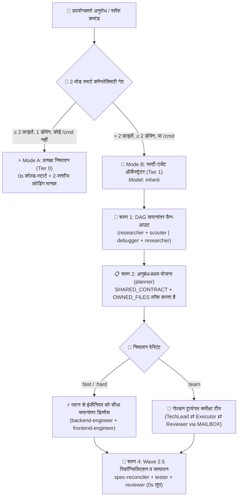

<div align="center">
  <h1>⚡ BoomOpen Workflow Kit v5.5.0</h1>
  <p><strong>मल्टी-प्लेटफ़ॉर्म स्मार्ट-हाइब्रिड AI वर्कफ़ोर्स OS — 22 विशेषज्ञ एजेंट, 18 गोल्डन ट्रायंगल टीमें और 1,460+ ऑन-डिमांड स्किल्स वॉल्ट</strong></p>

  <p>
    <a href="https://github.com/Kennyboom/BoomOpen-Workflow-Kit-Pro/releases"></a>
    <a href="#platforms"></a>
    <a href="#agents"></a>
    <a href="#skills"></a>
    <a href="https://nodejs.org/">=18.0.0" /></a>
    <a href="../LICENSE"></a>
  </p>

  <p>
    <a href="../README.md">🇬🇧 English</a> • <a href="./README.vi.md">🇻🇳 Tiếng Việt</a> • <a href="./README.zh-CN.md">🇨🇳 简体中文</a> • <a href="./README.zh-TW.md">🇹🇼 繁體中文</a> • <a href="./README.ja.md">🇯🇵 日本語</a> • <a href="./README.ko.md">🇰🇷 한국어</a> • <a href="./README.es.md">🇪🇸 Español</a> • <a href="./README.fr.md">🇫🇷 Français</a> • <a href="./README.de.md">🇩🇪 Deutsch</a><br/>
    <a href="./README.pt-BR.md">🇧🇷 Português</a> • <a href="./README.ru.md">🇷🇺 Русский</a> • <b>🇮🇳 हिन्दी</b> • <a href="./README.ar.md">🇸🇦 العربية</a> • <a href="./README.id.md">🇮🇩 Bahasa Indonesia</a> • <a href="./README.th.md">🇹🇭 ไทย</a> • <a href="./README.tr.md">🇹🇷 Türkçe</a> • <a href="./README.it.md">🇮🇹 Italiano</a>
  </p>
</div>

---

## 🎬 आधिकारिक लॉन्च ट्रेलर (Full HD 1080p)

<div align="center">
  <a href="https://github.com/Kennyboom/BoomOpen-Workflow-Kit-Pro/raw/main/assets/media/boomopen_v55_trailer_en.mp4">
    
  </a>
  <p>
    ▶️ <a href="https://github.com/Kennyboom/BoomOpen-Workflow-Kit-Pro/raw/main/assets/media/boomopen_v55_trailer_en.mp4"><b>Full HD 1080p आधिकारिक लॉन्च ट्रेलर देखने / स्ट्रीम करने के लिए यहाँ क्लिक करें (स्टूडियो वॉयसओवर के साथ MP4)</b></a>
  </p>
</div>

---

## 🌟 BoomOpen Workflow Kit v5.5 क्या है?

**BoomOpen Workflow Kit v5.5 (Multi-Platform Unified & Smart-Hybrid Edition)** एक ओपन-सोर्स मल्टी-एजेंट ऑपरेटिंग सिस्टम है जो एक सिंगल AI कोडिंग असिस्टेंट को **22 विशेषज्ञ एजेंटों**, **18 गोल्डन ट्रायंगल टीमों (`72` टीम फ़ाइलें)**, **33 स्लैश कमांड (`89` कमांड और संदर्भ फ़ाइलें)**, **14 CLI कमांड**, **22 कोर स्किल्स** और **1,440 लाइब्रेरी स्किल्स (`skills_library/`)** के समन्वित इंजीनियरिंग संगठन में बदल देता है।

भारी रैपर्स के विपरीत, BoomOpen v5.5 **प्रोएक्टिव सब-एजेंट फ़र्स्ट गेट**, **17-भाषा नेचुरल-लैंग्वेज रूटिंग**, **4-स्तरीय इलास्टिक स्वार्म शार्डिंग (`role#shard`)**, **Wave 2.5 Spec-to-Code ऑटो-रिकॉन्सिलिएशन (`boomopen reconcile`)**, **मल्टी-राउंड पोस्ट-कम्प्लीशन ऑडिट (`/audit` व `boomopen audit`)**, **मल्टी-सेशन प्रोजेक्ट ऑटोपायलट (`/autopilot`)** और **क्रॉस-इंजन कंडक्टर (`/conduct`)** को एक साथ लाता है:
- **🚀 टर्न-1 समानांतर सब-एजेंट, Wave 2.5 और Mode B ऑर्केस्ट्रेशन**: बड़ी खोज (`> 2` फ़ाइलें), मल्टी-डोमेन कार्य (`≥ 2` डोमेन), **सभी 17 समर्थित भाषाओं** में प्राकृतिक-भाषा अनुरोध या स्पष्ट `/cmd` कमांड तुरंत टर्न 1 पर समानांतर शार्ड्स (`role#shard`, `<= 3–4 OWNED_FILES`) लॉन्च करते हैं — **DAG फैन-आउट**, **सीधे प्लान-टू-एग्जीक्यूटर डिस्पैच**, **अनुबंध लॉक (`SHARED_CONTRACT` + `OWNED_FILES`)**, **Wave 2.5 ऑटो-रिकॉन्सिलिएशन (`boomopen reconcile` + `spec-reconciler` + `/cook amend-plan`)** और **वॉर्म रीयूज़ (`role#shard -> conversationId` `send_message` द्वारा)** के साथ।
- **🏛️ मल्टी-सेशन ऑटोपायलट (`/autopilot`), मल्टी-राउंड ऑडिट (`/audit`) और काउंसिल (`/conduct`)**: SHA-256 सुरक्षा के साथ `.boomopen/project-ledger.json` और 4-स्तरीय गेट (`boomopen check --strict-phase --no-stubs`); और पूरा प्रोजेक्ट बनने के बाद मल्टी-राउंड ऑडिट (`/audit` → `/audit:fix` → `/audit:round2` `.boomopen/audit-ledger.json` पर) जो RTM कवरेज, UI→API→DB फ्लो और **2-स्तरीय एंटी-लीकेज सुरक्षा इंजन (`security_scan.py` v6)** की जांच करता है।
- **⚡ Mode A — ज्ञात-लक्ष्य माइक्रो-डायरेक्ट (0s कोल्ड-स्टार्ट)**: सरल Q&A और ऐसे छोटे बदलाव जहाँ **सटीक `≤ 2` फ़ाइलें टर्न 1 पर ज्ञात हों**, सीधे **व्यावहारिक 2-स्तरीय कोडिंग मानकों** और **सतत परीक्षण एवं बग निवारण** के साथ पूरे किए जाते हैं।
- **📚 ज़ीरो कॉन्टेक्स्ट ब्लोट के साथ 1,462 स्किल्स वॉल्ट**: **22 कोर स्किल्स (`skills/`)** और **1,440 लाइब्रेरी स्किल्स (`skills_library/`)** `matrix-skills/compact-index.json` में प्री-इंडेक्स्ड हैं ताकि `O(1)` 2-चरणीय लुकअप से प्रॉम्प्ट विंडो भरे बिना तुरंत विशेषज्ञता मिले।

---

## 🏗️ स्मार्ट-हाइब्रिड आर्किटेक्चर (v5.5)



---

<a id="pillars"></a>

## 🧠 v5.5 के 6 मुख्य स्तंभ

1. **🌐 5 प्लेटफ़ॉर्म पर एकीकृत समानता (`platforms/*`)**:
   - एक ही आर्किटेक्चर से **Google Antigravity 2.0 (Gemini)**, **Claude Code**, **OpenAI Codex**, **Cursor**, और **GitHub Copilot** के लिए नेटिव इंस्टॉलेशन।
2. **📏 व्यावहारिक 2-स्तरीय कोडिंग मानक (एंटी-फ्रैगमेंटेशन)**:
   - **स्तर 1 — शून्य सहनशीलता**: Single Responsibility, **स्पष्ट `any` वर्जित**, **डीबग `console.log` छोड़ना वर्जित**, async/API सीमाओं पर `try/catch` + टाइप्ड एरर, `SCREAMING_SNAKE_CASE` स्थिरांक, DRY (`≥ 3`) और क्रमबद्ध इम्पोर्ट्स।
   - **स्तर 2 — लचीले संरचनात्मक दिशानिर्देश**: एकल उद्देश्य फ़ाइलें `~200–350 पंक्तियाँ`, सॉफ्ट सीमा `400` और हार्ड स्प्लिट `>500 पंक्तियाँ` (टेस्ट, टाइप्स व डॉक्स मुक्त)। लॉजिक फ़ंक्शन `~20–40 पंक्तियाँ` (UI/हैंडलर `~40–80 पंक्तियाँ`)।
3. **🎯 4-स्तरीय शार्डिंग (`role#shard`), सीधा प्लान डिस्पैच और वॉर्म रीयूज़ (`send_message`)**:
   - `PLAN-{feature}.md` बनते ही ऑर्केस्ट्रेटर अनावश्यक `tech-lead` के बिना **सीधे** डोमेन शार्ड्स (`<= 3–4 OWNED_FILES`) को काम सौंपता है और `role#shard → conversationId` से **0s कोल्ड-स्टार्ट** में पुनः उपयोग करता है।
4. **🤝 अनुबंध-प्रथम समानांतर डिस्पैच (`SHARED_CONTRACT` + `OWNED_FILES`) व Wave 2.5 (`spec-reconciler`)**:
   - कोडिंग से पहले API, DTO और अनन्य फ़ाइल स्वामित्व लॉक होता है; **Wave 2.5** में `boomopen reconcile`, `spec-reconciler` और `/cook amend-plan` मिलकर `docs/` बनाम वास्तविक कोड की जांच कर छूटे हुए `[SC-*]` आइटम, आइलैंड मॉड्यूल और रूट/env अंतर भरते हैं।
5. **🔍 5-Whys (SPIE v3.0) डीबगिंग, मल्टी-राउंड `/audit` और 100% स्वच्छ Git ट्री**:
   - `debugger` 3 परिकल्पनाओं + **5-Whys** से मूल कारण खोजता है; `/audit` 2-स्तरीय एंटी-लीकेज सुरक्षा इंजन (`security_scan.py` v6) से जांच करता है। अस्थायी रिपोर्ट `<appDataDir>\brain\<conversation-id>\` में रहती हैं।
6. **🩺 14-कमांड CLI सूट और O(1) स्किल इंडेक्स**:
   - `npm run doctor` सभी 5 प्लेटफ़ॉर्म, **22 एजेंट**, **72 टीम फ़ाइलें** (18 फ़ोल्डर), **89 कमांड फ़ाइलें** (`83` वर्कफ़्लो + `6` `_ref/`) और `compact-index.json` (`1,462` स्किल्स) जांचता है। 14 CLI कमांड (`research`, `design`, `plan`, `cook`, `reconcile`, `audit`, `ledger`, `conduct`, `check`, `doctor`, `settings`, `install`, `uninstall`, `list`) कठोर सत्यापन सुनिश्चित करते हैं।

---

## 🔍 Wave 2.5 ऑटो-रिकॉन्सिलिएशन व मल्टी-राउंड ऑडिट (`/audit`)

- **🔄 Wave 2.5 Spec-to-Code ऑटो-रिकॉन्सिलिएशन (`boomopen reconcile` + `spec-reconciler` + `/cook amend-plan`)**: किसी भी चरण को बंद करने से पहले `spec-reconciler` `docs/` और `PLAN` की तुलना वास्तविक कार्यान्वयन (`REC-G1..G4`) से करता है, और छूटी हुई आवश्यकताओं (`[SC-*]`), अलग-थलग शार्ड्स व रूट/env विसंगतियों को `/cook amend-plan` से पूरा करता है।
- **🛡️ मल्टी-राउंड पोस्ट-कम्प्लीशन `/audit` व 2-स्तरीय एंटी-लीकेज सुरक्षा इंजन v6**:
  1. **राउंड 1 (`/audit` या `/autopilot:audit`)**: केवल-पढ़ने योग्य पूर्ण ऑडिट (RTM विनिर्देश कवरेज, UI→API→DB वर्टिकल फ्लो, तथा सीक्रेट्स/PII/इंजेक्शन लीक के लिए `security_scan.py` v6 स्कैन)।
  2. **उपयोगकर्ता समीक्षा**: आप `AUDIT-{project}-r1.md` की समीक्षा करके सुधारों को मंज़ूरी देते हैं।
  3. **सुधार और राउंड 2 (`/audit:fix` → `/audit:round2`)**: टकराव-रहित शार्ड्स रिग्रेशन लॉक के साथ स्वीकृत बग ठीक करते हैं और `.boomopen/audit-ledger.json` में **0 त्रुटियाँ** आने तक `/audit:round2` चलाते हैं।

---

<a id="platforms"></a>

## 💻 समर्थित AI प्लेटफ़ॉर्म

| प्लेटफ़ॉर्म | समर्थन स्तर | ग्लोबल एंट्रीपॉइंट | फ्रेमवर्क इंस्टॉल पथ |
|----------|:-------------:|-------------------|------------------------|
| **Antigravity (Gemini)** | ✅ नेटिव v5.5 | `~/.gemini/GEMINI.md` | `~/.gemini/config/skills/boomopen-workflow-kit/` |
| **Claude Code** | ✅ नेटिव v5.5 | `~/.claude/CLAUDE.md` | `~/.claude/skills/boomopen-workflow-kit/` |
| **OpenAI Codex** | ✅ नेटिव v5.5 | `~/.codex/CODEX.md` & `AGENTS.md` | `~/.codex/skills/boomopen-workflow-kit/` |
| **Cursor** | ✅ नेटिव v5.5 | `~/.cursor/rules/boomopen-workflow-kit.mdc` | `~/.cursor/skills/boomopen-workflow-kit/` |
| **GitHub Copilot** | ✅ नेटिव v5.5 | `~/.copilot/COPILOT.md` | `~/.copilot/skills/boomopen-workflow-kit/` |

---

## 🚀 त्वरित शुरुआत और इंस्टॉलेशन

```bash
# 1. क्लोन करें और अपने AI असिस्टेंट के लिए इंस्टॉल करें (या सभी 5 के लिए --all)
git clone https://github.com/Kennyboom/BoomOpen-Workflow-Kit-Pro.git
cd BoomOpen-Workflow-Kit-Pro
npm run install:antigravity   # या: install:claude | install:codex | install:cursor | install:copilot | install:all

# 2. इंस्टॉलेशन जांचें और 14-कमांड CLI का उपयोग करें
npm run doctor
npm link
boomopen research validate path/to/RESEARCH.md
boomopen design validate path/to/DESIGN.md
boomopen plan validate path/to/PLAN.md
boomopen cook preflight path/to/PLAN.md
boomopen reconcile path/to/your/project --plan path/to/PLAN.md
boomopen audit init --docs docs/prd.md,docs/arch.md
boomopen check path/to/your/project --strict-phase --no-stubs
boomopen ledger status
boomopen conduct probe
```

> यह किट **npm पर प्रकाशित नहीं है** — इसे केवल इसी रिपॉज़िटरी से इंस्टॉल करें (`npm link` PATH में `boomopen` जोड़ता है)। हटाने के लिए: `boomopen uninstall <tool>`।

---

## 🎛️ एकीकृत सेटिंग्स और 5 प्रीसेट प्रोफ़ाइल (`/settings`)

BoomOpen v5.5 सभी **5 प्लेटफ़ॉर्म** पर `< 10ms` (**0ms टर्न-1 लेटेंसी**) में **20 enum कुंजियाँ + 2 लाइन सीमाएँ** प्रबंधित करता है, अब **5 वन-क्लिक प्रीसेट प्रोफ़ाइल** के साथ:

| प्रीसेट (`Preset`) | मोड (`execution.mode`) | डिफ़ॉल्ट वेरिएंट | NL ट्रिगर (`naturalLanguageResearchTrigger`) | कोडिंग मानक | सर्वोत्तम उपयोग |
|:---|:---|:---:|:---:|:---:|:---|
| **⚡ `smart-hybrid`** *(डिफ़ॉल्ट)* | **`auto`** (`≤ 2 फ़ाइलें` → Mode A; `> 2` या `/cmd` → Mode B) | `auto` | **`auto_team`** *(NL रिसर्च/आइडिया को स्वतः `/research:team` / `/brainstorm:team` पर भेजता है)* | `pragmatic` (`400/500`) | दैनिक फुल-स्टैक इंजीनियरिंग — छोटे कार्यों में तेज़, जटिल आर्किटेक्चर में गहरा |
| **🛡️ `carbon-guardrails`** | **`mode_a`** *(Antigravity Carbon सीधे `≤ 10 फ़ाइलें` तक नेतृत्व करता है)* | `auto` | `off` *(कोई NL हाइजैकिंग नहीं; BoomOpen केवल स्पष्ट `/cmd` पर सक्रिय)* | `pragmatic` (`400/500`) | **Antigravity Orchestrator Carbon** दैनिक खोज व बदलाव संभाले, जबकि BoomOpen `400/500` लाइन नियम, `strict_e2e` और `/cmd` गार्डरेल्स लागू रखे |
| **🚀 `solo-fast`** | **`mode_a`** *(प्रत्यक्ष सोलो निष्पादन, 0s सब-एजेंट)* | `fast` | `off` *(सीधा चैट उत्तर जब तक `/brainstorm` न हो)* | `relaxed` (`600/800`) | तत्काल हॉटफ़िक्स, तेज़ प्रोटोटाइप और न्यूनतम टोकन खर्च |
| **🧠 `deep-architect`** | **`mode_b`** *(हर कार्य पर मल्टी-एजेंट ऑर्केस्ट्रेटर)* | `hard` | `auto_hard` *(स्वतः 5-लेंस `/research:hard` / `/brainstorm:hard`)* | `strict` (`300/400`) | जटिल सिस्टम आर्किटेक्चर, नए प्रोजेक्ट और मल्टी-डोमेन रिफैक्टरिंग |
| **🔺 `adversarial-team`** | **`team`** *(3-एजेंट गोल्डन ट्रायंगल `:team` अनिवार्य)* | `team` | **`auto_team`** *(`MAILBOX` के माध्यम से 3-एजेंट क्रॉस-रिव्यू)* | `strict` (`300/400`) | मिशन-क्रिटिकल प्रोडक्शन कोड, सुरक्षा ऑडिट और ज़ीरो-डिफेक्ट रिलीज़ |

```bash
# चैट (/settings) | वेब डैशबोर्ड (boomopen settings --ui) | टर्मिनल CLI
/settings                                     # इंटरैक्टिव मेनू खोलें (ask_question UI)
/settings preset carbon-guardrails            # Carbon लीड + BoomOpen गार्डरेल्स चुनें
/settings preset smart-hybrid                 # डिफ़ॉल्ट Smart-Hybrid चुनें
/settings mode auto | mode_a | mode_b | team  # निष्पादन मोड सीधे बदलें
boomopen settings preset carbon-guardrails    # ग्लोबल स्तर पर लागू कर 5 प्लेटफ़ॉर्म सिंक करें
boomopen settings set execution.mode mode_a --project   # केवल वर्तमान प्रोजेक्ट ./.boomopen.json में लिखें
```

---

## 🌙 ओवरनाइट बड़े मल्टी-फ़ेज़ प्रोजेक्ट गाइड (`/autopilot` बनाम `/goal` + `/autopilot` + `/audit`)

| रणनीति | सेशन और कॉन्टेक्स्ट दायरा | प्लान व गुणवत्ता नियंत्रण | कब उपयोग करें |
|:---|:---|:---|:---|
| **अकेला `/autopilot`** | सिंगल-सेशन — **~70% कॉन्टेक्स्ट** पर साफ़ रुकता है और प्रारंभिक **`PLAN` अनुमोदन पर पॉज़** करता है | `.boomopen/project-ledger.json`, 5 गेट्स, Wave 2.5 `reconcile` और `/audit` चलाता है, पर हर चरण पर मैन्युअल रीज़्यूम चाहिए | मध्यम कार्य या जब आप प्रत्येक चरण की मैन्युअल समीक्षा करना चाहते हों |
| **`/goal` + `/autopilot` + `/audit`** *(रात भर के लिए अनुशंसित)* | **`/goal` रात भर कई चरणों को स्वतः आगे बढ़ाता है** और बिना बीच में रुके अगले चरण चलाता है | `/autopilot` अपरिवर्तनीय `project-ledger.json`, 5 गुणवत्ता गेट्स, Wave 2.5 `reconcile` और अंत में **राउंड 1 `/audit`** सुनिश्चित करता है | बड़े मल्टी-डॉक्यूमेंट प्रोजेक्ट जिन्हें आप रात भर स्वायत्त रूप से बनाकर सुबह ऑडिट रिपोर्ट देखना चाहते हैं |

**तैयार कॉपी-पेस्ट ओवरनाइट प्रॉम्प्ट:**

```text
/goal docs/ में मौजूद विनिर्देशों से /autopilot का उपयोग करके पूरा प्रोजेक्ट शुरू से अंत तक बनाएं।
.boomopen/project-ledger.json को इनिशियलाइज़ और अपडेट रखें, बिना किसी आवश्यकता को छोड़े PLAN को चरणों में निष्पादित करें,
हर चरण के अंत में Wave 2.5 ऑटो-रिकॉन्सिलिएशन (boomopen reconcile) और सत्यापन गेट्स चलाएं,
और सभी चरण पूरे होने पर सुबह मेरी समीक्षा के लिए राउंड 1 /audit चलाकर पूर्ण रिपोर्ट तैयार करें।
```

---

## 🎯 स्लैश कमांड संदर्भ (33 कमांड / 89 फ़ाइलें)

| कमांड | वेरिएंट | मुख्य उद्देश्य |
|---------|----------|-----------------|
| **`/cook`** | `:fast`, `:hard`, `:team`, `amend-plan` | एंड-टू-एंड फ़ीचर विकास (रिसर्च → प्लान → समानांतर कोड → Wave 2.5 → रिव्यू) |
| **`/code`** | `:fast`, `:hard`, `:team` | मौजूदा `PLAN-{feature}.md` से सीधे कोड कार्यान्वयन |
| **`/plan`** | `:fast`, `:hard`, `:team` | `SHARED_CONTRACT`, `OWNED_FILES` और Given/When/Then के साथ ब्लूप्रिंट |
| **`/fix`** | `:fast`, `:hard`, `:team` | अनिवार्य रिग्रेशन टेस्ट सत्यापन के साथ मूल-कारण बग समाधान |
| **`/debug`** | `:fast`, `:hard`, `:team` | 3-परिकल्पना + **5-Whys (SPIE v3.0)** मूल-कारण जांच (`DEBUG-{issue}.md`) |
| **`/test`** | `:fast`, `:hard`, `:team` | DAG समानांतर टेस्ट निष्पादन + छूटे हुए एज-केस खोज (`tester` + `scouter`) |
| **`/review`** | `:fast`, `:hard`, `:team` | 4-आयामी समानांतर ऑडिट (आर्किटेक्चर, कोड गुणवत्ता, OWASP सुरक्षा, प्रदर्शन) |
| **`/audit`** | `:run`, `:fix`, `:round2`, `:auto` | मल्टी-राउंड पोस्ट-कम्प्लीशन ऑडिट (RTM कवरेज, UI→API→DB फ्लो, 2-स्तरीय एंटी-लीकेज v6, `/audit:fix` व 0 त्रुटियों तक `/audit:round2`) |
| **`/design`** | `:fast`, `:hard`, `:team` | सिस्टम आर्किटेक्चर, डेटाबेस स्कीमा और UI/UX विनिर्देश (`DESIGN.md`) |
| **`/docs`** | `:core`, `:business`, `:audit` | 2-स्तरीय आर्किटेक्चर और बिज़नेस दस्तावेज़ जनरेट या सिंक करना (`./documents/`) |
| **`/deploy`** | `:check`, `:preview`, `:production`, `:rollback` | प्री-डिप्लॉयमेंट गेट्स, प्रीव्यू, प्रोडक्शन रोलआउट और सुरक्षित रोलबैक |
| **`/research`** | `:fast`, `:hard`, `:team` | स्वायत्त डीप-रिसर्च इंजन (4-स्रोत त्रिकोणीकरण, 3-वेव खोज, 3-वेक्टर काउंसिल) |
| **`/brainstorm`** | `:fast`, `:hard`, `:team` | सुकराती आवश्यकता खोज, ट्रेड-ऑफ विश्लेषण और विचार मंथन |
| **`/report`** | `:fast`, `:hard`, `:team` | मेट्रिक्स और आरेखों के साथ कार्यकारी एवं तकनीकी सारांश रिपोर्ट |
| **`/autopilot`** | `:init`, `:run`, `:audit` | `.boomopen/project-ledger.json` और 4-स्तरीय गेट के साथ मल्टी-सेशन स्वायत्त ऑर्केस्ट्रेटर |
| **`/conduct`** | `:council`, `:pipeline` | क्रॉस-इंजन कंडक्टर और मल्टी-इंजन काउंसिल (`boomopen conduct`) 4-भाग संश्लेषण के साथ |
| **`/orchestrate`** | — | कई डोमेन में कस्टम मल्टी-एजेंट पाइपलाइन ऑर्केस्ट्रेशन |
| **`/settings`** | `preset`, `mode`, `set`, `ui` | यूनिफाइड कंट्रोल सेंटर: 20 कुंजियाँ + 2 सीमाएँ, **5 प्रीसेट** या वेब UI (`--ui`) |
| **`/save` / `/recap`** | — | सेशन स्थिति (`SESSION-HANDOVER.md`) सहेजें और `< 5s` में संदर्भ बहाल करें |

---

<a id="agents"></a>

## 🤖 22 विशेषज्ञ एजेंट और 18 गोल्डन ट्रायंगल टीमें (`72` फ़ाइलें)

| श्रेणी | विशेषज्ञ एजेंट (`agents/*.md`) | गोल्डन ट्रायंगल टीमें (`agents/teams/*-team/`) |
|----------|-----------------------------------|------------------------------------------------|
| **इंजीनियरिंग और निष्पादन** | `backend-engineer`, `frontend-engineer`, `mobile-engineer`, `game-engineer`, `database-architect`, `devops-engineer` | `backend-team`, `frontend-team`, `fullstack-team`, `mobile-team`, `game-team`, `database-team`, `devops-team` |
| **आर्किटेक्चर और योजना** | `tech-lead`, `planner`, `brainstormer`, `business-analyst`, `project-manager`, `designer` | `planning-team`, `brainstorm-team`, `project-team`, `design-team` |
| **गुणवत्ता, सुरक्षा और डीबगिंग** | `debugger`, `tester`, `reviewer`, **`spec-reconciler`**, `security-engineer`, `performance-engineer` | `debug-team`, `qa-team`, `security-team`, `performance-team` |
| **अनुसंधान और ज्ञान** | `researcher`, `scouter`, `docs-manager`, `reporter` | `research-team`, `docs-team`, `report-team` |

---

<a id="skills"></a>

## 📚 1,462 स्किल्स वॉल्ट (22 कोर + 1,440 लाइब्रेरी स्किल्स)

**2-चरणीय O(1) प्रोग्रेसिव स्किल लुकअप** (`<skills>` → `matrix-skills/compact-index.json` → ऑन-डिमांड `SKILL.md`) द्वारा **0 निष्क्रिय टोकन खर्च**:

| स्किल डोमेन | संख्या | प्रमुख क्षमताएँ | लोडिंग |
|:---|:---:|:---|:---|
| **⚡ स्तर 1: कोर (`skills/`)** | **22** | `clean-code`, `debugger`, `plan-writing`, `brainstorming`, `frontend-design`, `design-spec`, `api-patterns`, `database-design`, `testing-patterns`, `skill-seeker` | `<skills>` में प्री-इंडेक्स्ड |
| **🎨 UI/UX डिज़ाइन और मोशन** | **42** | Anti-AI-Slop Craft, OKLCH, Bento Grids, Motion v12, Figma MCP + W3C DTCG, WCAG 2.2 AA/AAA, iOS 18 HIG व Material 3 | `compact-index.json` |
| **🌐 वेब, बैकएंड और एज** | **390+** | React 19, Next.js 15, Tailwind v4, TanStack, Hono RPC + Zod OpenAPI, Rust Axum, Supabase RLS, Drizzle + Neon/Turso | `skills_library/` |
| **🤖 AI, LLM एजेंट्स और डेटा** | **320+** | FastMCP 2025, OpenAI/Claude/Google ADK, Vercel AI SDK v4, RAG, BigQuery, dbt, Spark | `skills_library/` |
| **☁️ क्लाउड, DevOps और सुरक्षा** | **300+** | Cloudflare Workers/D1/R2, Terraform/OpenTofu, Docker/K8s, Vitest + MSW v2, Better Auth, OWASP LLM 2025 | `skills_library/` |
| **📱 मोबाइल, गेम्स और 3D वेब** | **410+** | Unity 6 DOTS, Godot 4, WebGPU/Three.js TSL, Colyseus, Tauri v2, SwiftUI, Kotlin, React Native, Flutter | `skills_library/` |

---

## 📂 रिपॉजिटरी संरचना

```text
BoomOpen-Workflow-Kit-Pro/
├── agents/                  # 22 विशेषज्ञ एजेंट (spec-reconciler सहित) + 18 गोल्डन ट्रायंगल टीमें (72 फ़ाइलें)
├── cli/                     # 14 CLI कमांड: install, doctor, checker, settings, research, design, plan, cook, reconcile, audit, ledger & conductor
├── commands/                # 83 स्लैश कमांड वर्कफ़्लो (33 कमांड) + 6 _ref/ प्रोटोकॉल (89 फ़ाइलें)
├── documents/               # 2-स्तरीय आर्किटेक्चर, डोमेन, सोर्स-बेस और कोडिंग मानक दस्तावेज़
├── i18n/                    # 16 पूर्ण स्थानीयकृत README अनुवाद
├── matrix-skills/           # डोमेन YAML मैट्रिक्स + compact-index.json (1,462 स्किल्स)
├── platforms/               # सभी 5 प्लेटफ़ॉर्म के लिए एकीकृत टेम्पलेट्स (antigravity/, claude/, codex/, copilot/, cursor/)
├── rules/                   # Mode B ऑन-डिमांड नियम (CORE, PHASES, AGENTS, TEAMS, SKILLS, ERRORS, REFERENCE)
├── scripts/                 # Python ऑटोमेशन और सत्यापन स्क्रिप्ट्स (checklist.py, verify_all.py आदि)
├── skills/                  # 22 कोर स्किल्स
├── skills_library/          # ऑन-डिमांड लोड होने वाली 1,440 विशिष्ट स्किल्स
└── GEMINI.md | CLAUDE.md | CODEX.md | COPILOT.md | CURSOR.md | AGENT.md
```

---

## 📄 लाइसेंस और सुरक्षा

- **लाइसेंस**: [MIT लाइसेंस](../LICENSE) के अंतर्गत वितरित। कॉपीराइट © 2026 **BoomOpen Labs**। `skills_library/` में तृतीय-पक्ष skills अपने मूल लाइसेंस बनाए रखती हैं — देखें [THIRD_PARTY_NOTICES.md](../THIRD_PARTY_NOTICES.md)।
- **सुरक्षा नीति**: अंतर्निहित सुरक्षा गार्डरेल्स और वल्नरेबिलिटी रिपोर्टिंग के लिए [SECURITY.md](../SECURITY.md) देखें।
