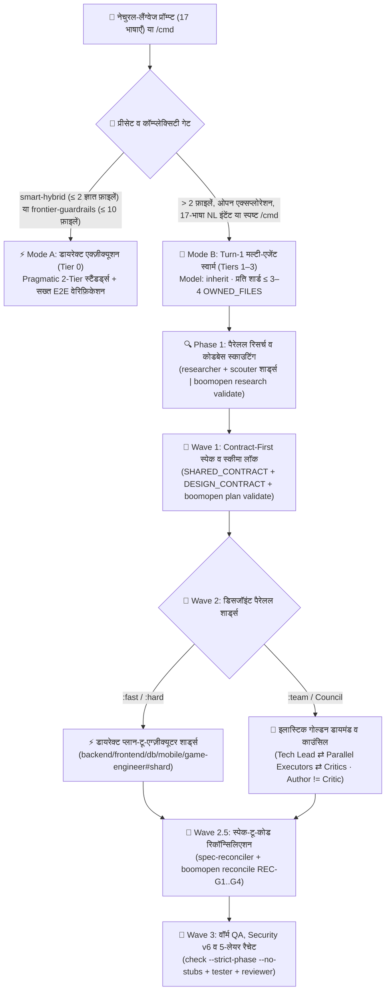

<div align="center">
  <h1>⚡ BoomOpen Workflow Kit Pro v5.5</h1>
  <p><strong>Antigravity, Claude Code, OpenAI Codex, Cursor और GitHub Copilot के लिए मल्टी-एजेंट वर्कफ़्लो ऑर्केस्ट्रेशन और डिटरमिनिस्टिक CLI वेरिफ़िकेशन गेट्स।</strong></p>

  <p>
    <a href="https://boomopen.com"></a>
    <a href="https://github.com/Kennyboom/BoomOpen-Workflow-Kit-Pro/releases"></a>
    <a href="#platforms"></a>
    <a href="#cli"></a>
    <a href="#skills"></a>
    <a href="https://nodejs.org/">= 18.0.0" /></a>
    <a href="../LICENSE"></a>
  </p>

  <p>
    <a href="../README.md">English</a> •
    <a href="./README.vi.md">Tiếng Việt</a> •
    <a href="./README.zh-CN.md">简体中文</a> •
    <a href="./README.zh-TW.md">繁體中文</a> •
    <a href="./README.ja.md">日本語</a> •
    <a href="./README.ko.md">한국어</a> •
    <a href="./README.es.md">Español</a> •
    <a href="./README.fr.md">Français</a> •
    <a href="./README.de.md">Deutsch</a><br/>
    <a href="./README.pt-BR.md">Português (BR)</a> •
    <a href="./README.ru.md">Русский</a> •
    <b>हिन्दी</b> •
    <a href="./README.ar.md">العربية</a> •
    <a href="./README.id.md">Bahasa Indonesia</a> •
    <a href="./README.th.md">ไทย</a> •
    <a href="./README.tr.md">Türkçe</a> •
    <a href="./README.it.md">Italiano</a>
  </p>

  <p>
    <a href="https://boomopen.com"><b>🌐 boomopen.com (15 भाषाएँ)</b></a> •
    <a href="#trailer"><b>🎬 लॉन्च ट्रेलर</b></a> •
    <a href="#why-boomopen"><b>⚡ BoomOpen क्यों</b></a> •
    <a href="#architecture"><b>🏗️ आर्किटेक्चर</b></a> •
    <a href="#quickstart"><b>🚀 क्विक स्टार्ट</b></a> •
    <a href="#cli"><b>🛠️ 14 CLI गेट्स</b></a> •
    <a href="#settings"><b>🎛️ प्रीसेट व सेटिंग्स</b></a> •
    <a href="#commands"><b>🎯 36 कमांड्स</b></a> •
    <a href="#agents"><b>🤖 22 एजेंट व 18 टीमें</b></a> •
    <a href="#skills"><b>📚 1,462 स्किल्स</b></a>
  </p>
</div>

---

<a id="trailer"></a>

## 🎬 आधिकारिक लॉन्च ट्रेलर और इंटरैक्टिव वेब एक्सप्लोरर (`boomopen.com`)

<div align="center">
  <a href="https://github.com/Kennyboom/BoomOpen-Workflow-Kit-Pro/raw/main/assets/media/boomopen_v55_trailer_en.mp4">
    
  </a>
  <p>
    ▶️ <a href="https://github.com/Kennyboom/BoomOpen-Workflow-Kit-Pro/raw/main/assets/media/boomopen_v55_trailer_en.mp4"><b>Full HD 1080p लॉन्च ट्रेलर स्ट्रीम करें (स्टूडियो वॉयसओवर के साथ MP4)</b></a> • 🌐 <a href="https://boomopen.com"><b>boomopen.com पर लाइव 14-कमांड CLI प्लेग्राउंड और सर्चेबल कैटलॉग देखें (15 भाषाएँ)</b></a>
  </p>
</div>

---

<a id="why-boomopen"></a>
<a id="-what-is-boomopen-workflow-kit"></a>

## ⚡ BoomOpen Workflow Kit क्यों?

**सामान्य AI कोडिंग असिस्टेंट्स की समस्या:** डिफ़ॉल्ट रूप से सिंगल-एजेंट कोडिंग टूल्स तब कमज़ोर पड़ने लगते हैं जब इंजीनियरिंग काम कई फ़ाइलों, डोमेन या सेशंस में फैल जाता है। एक-एक करके फ़ाइलें पढ़ने से मुख्य कॉन्टेक्स्ट विंडो भर जाती है, बिना समन्वय वाले सब-एजेंट साझा फ़ाइलों को ओवरराइट कर देते हैं या डिस्कनेक्टेड "island" मॉड्यूल छोड़ देते हैं, जनरेट किए गए कोड में चुपचाप `TODO` स्टब्स या `any` टाइप एस्केप रह जाते हैं, एक ही मॉडल द्वारा खुद के कोड का रिव्यू (`Author == Critic`) अपने ब्लाइंड स्पॉट्स पकड़ नहीं पाता, और मल्टी-फ़ेज़ बिल्ड्स मूल स्पेसिफ़िकेशन से भटक जाते हैं।

**BoomOpen इसे कैसे हल करता है:** BoomOpen **शून्य रनटाइम npm डिपेंडेंसी** के साथ **Antigravity (Gemini)**, **Claude Code**, **OpenAI Codex**, **Cursor** और **GitHub Copilot** पर एक यूनिफ़ाइड ऑर्केस्ट्रेशन और वेरिफ़िकेशन हार्नेस इंस्टॉल करता है। डिफ़ॉल्ट रूप से सक्रिय **`smart-hybrid`** प्रीसेट में `≤ 2` फ़ाइलों वाले बदलाव बिना किसी ओवरहेड के सीधे चलते हैं, जबकि मल्टी-फ़ाइल बिल्ड्स, डीप रिसर्च, आर्किटेक्चर प्लानिंग और **`36` स्लैश कमांड्स (`93` फ़ाइलें)** टर्न 1 पर ही **22 स्पेशलिस्ट एजेंट्स** और **18 एडवर्सरियल 3-रोल टीमों** के बीच काम को स्वतः शार्ड कर देते हैं — जिसे **14 लोकल `boomopen` CLI गेट्स** वेरिफ़ाई करते हैं और **`1,462` ऑन-डिमांड स्किल्स** (`22` Core + `~/.agents/skills_library` में एक बार डी-डुप्लिकेट की गईं `1,440` लाइब्रेरी स्किल्स) सपोर्ट करती हैं।

### ⚖️ BoomOpen के बिना बनाम BoomOpen v5.5 के साथ

| इंजीनियरिंग विफलता मोड | BoomOpen के बिना (सामान्य AI IDE) | BoomOpen Workflow Kit Pro v5.5 के साथ |
|:-------------------------|:------------------------------|:------------------------------------|
| **कॉन्टेक्स्ट विंडो ब्लोट** | मुख्य एजेंट एक लाइन कोड लिखने से पहले क्रमानुसार 15–30 फ़ाइलें पढ़ता है | **Turn-1 इलास्टिक स्वार्म (`role#shard`)**: रीड-ओनली स्काउट्स व डोमेन शार्ड्स (`≤ 3–4` फ़ाइलें/शार्ड) + `0s` वॉर्म रीयूज़ (`send_message`) |
| **पैरेलल ओवरराइट और टूटी वायरिंग** | समानांतर एजेंट साझा फ़ाइलें बिगाड़ते हैं, बेमेल `/api` रूट्स बनाते हैं या डेड मॉड्यूल छोड़ते हैं | **Contract-First लॉक्स + Wave 2.5 Reconcile**: Wave 1 `SHARED_CONTRACT` + अलग-अलग `OWNED_FILES` लॉक, `boomopen reconcile` (`REC-G1..G4`) से सत्यापित |
| **सतही रिसर्च और अस्पष्ट प्लान** | एकतरफ़ा जवाब ("शानदार आइडिया!"), बिना जाँचे दावे और अनस्ट्रक्चर्ड प्लान | **एविडेंस-गेटेड 6-ब्लॉक स्पेक्स**: एडवर्सरियल `:team` Devil's Advocate + `< 50ms` CLI वैलिडेटर्स (`boomopen research`, `design`, `plan`) |
| **साइलेंट स्टब्स, `any` और टेस्ट गेमिंग** | एजेंट `// TODO`, स्पष्ट `any`, `console.log` या `.skip` टेस्ट छोड़कर काम पूरा घोषित कर देता है | **Pragmatic 2-Tier स्टैटिक गेट**: `boomopen check --strict-phase --no-stubs` शून्य `any`, शून्य स्टब्स और सुसंगत `400/500`-लाइन फ़ाइलें लागू करता है |
| **मल्टी-सेशन ड्रिफ़्ट और रिग्रेशन** | कॉन्टेक्स्ट कॉम्पैक्शन पुराने फ़ेज़ के नियम मिटा देता है जिससे पहले से पास फ़ीचर्स टूट जाते हैं | **5-लेयर फ़ेज़ रैचेट और रोलबैक**: `.boomopen/project-ledger.json` SHA-256 स्पेक-ड्रिफ़्ट गार्ड, `/autopilot`, `/audit` और एटॉमिक `rollback --yes` |
| **सिंगल-मॉडल ब्लाइंड स्पॉट्स** | एक ही मॉडल अपना लिखा कोड खुद रिव्यू करता है (`Author == Critic`) | **Cross-Engine Conductor (`/conduct`)**: Claude Code, Codex, Antigravity, Cursor व Copilot के बीच पैरेलल मल्टी-इंजन काउंसिल और क्रॉस-फ़ैमिली पाइपलाइन |
| **5-IDE कॉन्फ़िग ड्रिफ़्ट व गंदा Git ट्री** | हर IDE की अलग प्रॉम्प्ट फ़ाइलें, गीगाबाइट्स में डुप्लिकेट स्किल्स और `git status` में अस्थायी फ़ाइलें | **यूनिफ़ाइड सिंक और क्लीन Git**: `< 10ms` में 14 एंट्री फ़ाइलें सिंक, 1 साझा `~/.agents/skills_library` (`0` आइडल टोकन) और Brain Artifacts राउटिंग |

---

<a id="architecture"></a>
<a id="-smart-hybrid-architecture-v55"></a>

## 🏗️ Smart-Hybrid आर्किटेक्चर (v5.5)



---

<a id="pillars"></a>

## 🧠 6 मुख्य इंजीनियरिंग स्तंभ

1. **🌐 5-IDE नेटिव कम्पाइलेशन और डी-डुप्लिकेटेड वॉल्ट (`platforms/*`)**:
   - **22 स्पेशलिस्ट एजेंट्स** और **93 कमांड/रेफ़रेंस फ़ाइलों** को हर IDE के नेटिव फ़ॉर्मेट में कम्पाइल करता है: **Antigravity** (`--as-plugin` बंडल + `3` एक्ज़ीक्यूटेबल `run_workflow` Python स्क्रिप्ट्स: `audit_fanout.py`, `review_fanout.py`, `research_fanout.py`), **Claude Code** (`isolation: worktree` शार्ड्स, `/plan:hard` कोलन कमांड्स, ऑप्ट-इन `PreToolUse` व `Stop`/`PreCompact` हुक्स), **OpenAI Codex** (OS `read-only` स्काउट/क्रिटिक सैंडबॉक्स वाले `22` TOML रोल्स + `87` `$boomopen-*` स्किल्स), **Cursor** (`.mdc` रूल्स + वैकल्पिक `beforeShellExecution` हुक) और **GitHub Copilot** (`.agent.md` प्रॉम्प्ट एजेंट्स)।
   - सभी 5 IDEs के लिए `1,440` लाइब्रेरी स्किल्स को `~/.agents/skills_library` में केवल एक बार लिंक करता है (~80% डिस्क बचत, `0` Turn-1 टोकन ब्लोट)।
2. **🎯 4-टियर डायनामिक इलास्टिक स्वार्म (`role#shard`) और स्कोप्ड वॉर्म रीयूज़**:
   - **Tier 0** (`≤ 2` ज्ञात फ़ाइलों पर `0` सब-एजेंट) → **Tier 1** (`2–3` शार्ड्स) → **Tier 2** (`4–6` शार्ड्स) → **Tier 3** (`7–8+` शार्ड्स, `16` तक कॉन्फ़िगरेबल) तक स्वतः स्केल होता है, प्रति सब-एजेंट कॉग्निटिव लोड को **`≤ 3–4 OWNED_FILES`** तक सीमित रखता है और `role#shard → conversationId` (`send_message`) के ज़रिए सक्रिय सेशंस का पुनः उपयोग करता है।
3. **🤝 3-वेव Contract-First एक्ज़ीक्यूशन + Wave 2.5 रिकॉन्सिलिएशन (`REC-G1..G4`)**:
   - Wave 2 में समानांतर इंजीनियर्स भेजने से पहले Wave 1 में `SHARED_CONTRACT` (API स्कीमा/DTOs) और `DESIGN_CONTRACT` (OKLCH `@theme` CSS + TypeScript props) लॉक किए जाते हैं। Wave 2.5 में `boomopen reconcile` + `spec-reconciler` बिना जुड़े island मॉड्यूल्स (`REC-G1`), फ्रंटएंड/बैकएंड रूट बेमेल (`REC-G2`), छूटे हुए `[SC-*]` सब-क्लॉज़ (`REC-G3`) और अनुपस्थित `.env.example` कुंजियाँ (`REC-G4`) पकड़कर `boomopen cook amend-plan` से डेल्टा वेव जोड़ते हैं।
4. **🏛️ मल्टी-सेशन ऑटोपायलट (`/autopilot`) और स्टेटफ़ुल मल्टी-राउंड ऑडिट (`/audit`)**:
   - मल्टी-डॉक स्पेक्स को SHA-256 ड्रिफ़्ट डिटेक्शन और प्री-फ़ेज़ Git चेकपॉइंट्स (`boomopen ledger rollback --yes`) के साथ `.boomopen/project-ledger.json` में कम्पाइल करता है और सख्त **5-लेयर फ़ेज़ क्वालिटी रैचेट** (`G1 check --strict-phase --no-stubs` → `G2` मोनोटोनिक टेस्ट रैचेट → `G3 reconcile --strict` → `G4 Author != Critic` रिव्यू → `G5 ledger verify`) लागू करता है। बिल्ड के बाद `/audit` मानव-अनुमोदित मल्टी-राउंड RTM, वर्टिकल फ़्लो और Security v6 ऑडिट (`.boomopen/audit-ledger.json` + `boomopen audit rollback --yes`) चलाता है।
5. **🎼 Cross-Engine Conductor और मल्टी-इंजन काउंसिल (`boomopen conduct`)**:
   - Claude Code, OpenAI Codex, Antigravity, Cursor और Copilot को एक साथ **6-टास्क पैरेलल काउंसिल्स** (`research`, `brainstorm`, `plan`, `design`, `review`, `debug` → 4-भाग `COUNCIL-SYNTHESIS.md`) या **क्रॉस-फ़ैमिली रोल पाइपलाइंस** में चलाता है जहाँ कोई भी मॉडल अपने खुद के आउटपुट की जाँच नहीं करता (`Author != Critic`)।
6. **📏 Pragmatic 2-Tier कोडिंग स्टैंडर्ड्स और SPIE v3.0 रूट-कॉज़ डीबगिंग**:
   - **Tier 1 (Zero Tolerance)**: सिंगल रिस्पॉन्सिबिलिटी, `0` स्पष्ट `any`, ऐप कोड में `0` डीबग `console.log`, टाइप्ड `try/catch` बाउंड्रीज़, `SCREAMING_SNAKE_CASE` कॉन्स्टेंट्स। **Tier 2 (Cohesion First)**: `~200–350` लाइन लक्ष्य (`400` सॉफ़्ट / `500` हार्ड स्प्लिट; टेस्ट/टाइप्स/डॉक्स मुक्त)। बग्स के लिए 3 रैंक्ड परिकल्पनाएँ और **5-Whys (SPIE v3.0)** कॉज़ल ट्रेस चलता है, जबकि अस्थायी स्पेक्स Brain Artifacts में जाते हैं (`100%` साफ़ Git वर्किंग ट्री)।

---

<a id="platforms"></a>
<a id="-supported-ai-platforms"></a>

## 💻 5 समर्थित AI कोडिंग प्लेटफ़ॉर्म

| प्लेटफ़ॉर्म | सपोर्ट | सिंक्ड एंट्रीपॉइंट(स) | नेटिव प्लेटफ़ॉर्म इंटीग्रेशन |
|:---------|:-------:|:---------------------|:----------------------------|
| **Antigravity (Gemini)** | ✅ v5.5 | `~/.gemini/GEMINI.md` | `invoke_subagent`, `run_workflow` Python फैन-आउट, `/goal` आउटर लूप, `--as-plugin` बंडल, ऑप्ट-इन `--with-hooks`, Brain Artifacts |
| **Claude Code** | ✅ v5.5 | `~/.claude/CLAUDE.md` | पैरेलल `Task`/`Agent` शार्ड्स (`isolation: worktree`), `/plan:hard` कोलन कमांड्स, ऑप्ट-इन `PreToolUse` व `Stop`/`PreCompact` हुक्स |
| **OpenAI Codex** | ✅ v5.5 | `~/.codex/AGENTS.md` व `CODEX.md` | `~/.codex/agents/boomopen/` में `22` TOML रोल्स, स्काउट्स/रिव्यूअर्स के लिए OS `sandbox_mode = "read-only"` + `87` `$boomopen-*` स्किल्स |
| **Cursor** | ✅ v5.5 | `~/.cursor/rules/boomopen-workflow-kit.mdc` | ऑलवेज़-ऑन `.mdc` फ्रंटमैटर रूल्स, `CURSOR.md`, सब-एजेंट राउटिंग व ऑप्ट-इन `.cursor/hooks.json` (`beforeShellExecution`) |
| **GitHub Copilot** | ✅ v5.5 | `~/.copilot/copilot-instructions.md` | VS Code कम्पाइल्ड `boomopen-workflow-kit.agent.md` प्रॉम्प्ट एजेंट, `runSubagent` डिस्पैच व `COPILOT.md` |

---

<a id="quickstart"></a>
<a id="-quick-start--installation"></a>

## 🚀 क्विक स्टार्ट और इंस्टॉलेशन (केवल Git — शून्य रनटाइम डिपेंडेंसी)

```bash
# 1. रिपॉज़िटरी क्लोन करें (केवल GitHub के माध्यम से वितरित — npm पर कभी पब्लिश नहीं किया गया)
git clone https://github.com/Kennyboom/BoomOpen-Workflow-Kit-Pro.git
cd BoomOpen-Workflow-Kit-Pro

# 2. अपने AI IDE के लिए इंस्टॉल करें (डिफ़ॉल्ट प्रीसेट: smart-hybrid) या सभी 5 IDEs में एक साथ
npm run install:all                                 # सभी 5 IDEs + साझा ~/.agents/skills_library इंस्टॉल व सिंक करें
npm run install:antigravity                         # Google Antigravity 2.0 (या --as-plugin / --with-hooks जोड़ें)
node cli/install.js install claude --with-hooks     # Claude Code + ऑप्ट-इन PreToolUse व Stop/PreCompact हुक्स
npm run install:codex                               # OpenAI Codex CLI + OS read-only स्काउट/रिव्यूअर सैंडबॉक्स
npm run install:cursor                              # Cursor (beforeShellExecution गार्ड के लिए --with-hooks दें)
npm run install:copilot                             # GitHub Copilot (VS Code .agent.md + copilot-instructions.md)

# 3. हेल्थ वेरिफ़ाई करें और वैकल्पिक रूप से `boomopen` को ग्लोबल PATH में लिंक करें
npm run doctor
npm link
boomopen settings status
```

> **सुरक्षित नॉन-डिस्ट्रक्टिव इंस्टॉल व अनइंस्टॉल**: SHA-256 मैनिफ़ेस्ट (`~/.boomopen/manifests/<tool>.json`) द्वारा ट्रैक किया जाता है। `GEMINI.md` / `CLAUDE.md` में आपके मौजूदा व्यक्तिगत नियम किट मार्कर्स के बाहर पूरी तरह सुरक्षित रहते हैं और उनका ऑटो-बैकअप बनता है; `boomopen uninstall <tool|--all>` आपकी निजी फ़ाइलों को छुए बिना केवल किट की अपरिवर्तित फ़ाइलें साफ़ हटाता है।

---

<a id="cli"></a>

## 🛠️ 14 ज़ीरो-डिपेंडेंसी CLI सबकमांड्स (`boomopen`)

Node.js `>= 18` पर **शून्य npm रनटाइम डिपेंडेंसी** और **शून्य नेटवर्क कॉल्स** के साथ लोकली `< 50ms` में चलता है:

| सबकमांड | मुख्य फ़्लैग्स व सिंटैक्स | डिटरमिनिस्टिक गेट्स और उद्देश्य |
|:-----------|:-------------------|:------------------------------|
| **`install` / `uninstall` / `list`** | `<tool\|--all> [--with-hooks] [--as-plugin]` | SHA-256 मैनिफ़ेस्ट इंस्टॉलर, साझा `~/.agents/skills_library` लिंकर, ऑप्ट-इन सेफ़्टी हुक्स व क्लीन अनइंस्टॉलर |
| **`doctor`** | `[--source-only]` | सभी 5 IDE बंडल्स, `93` कमांड फ़ाइलों, `72` टीम फ़ाइलों, `1,462` स्किल्स और सिंक्ड सेटिंग्स का रीड-ओनली 30-पॉइंट ऑडिट |
| **`settings`** | `status \| preset <name> \| set <k> <v> \| --ui` | 5 प्रीसेट + `22` कॉन्फ़िग कुंजियाँ प्रबंधित करें (`./.boomopen.json` हेतु `--project`) या CSP-हार्डन्ड Web UI (`127.0.0.1:4567`) खोलें |
| **`research`** | `<validate\|brief> <file.md> [--mode brainstorm]` | **`RES-G1..G4`** लागू करता है (`≥ 4` सत्यापित स्रोत, कॉन्ट्राडिक्शन मैट्रिक्स, प्री-मॉर्टम जोखिम) और `HANDOFF_BRIEF` बनाता है |
| **`design`** | `<validate\|contract> <DESIGN.md> [--json]` | **`DESIGN-G1..G4`** लागू करता है (6-ब्लॉक स्पेक, OKLCH टोकन्स, 5-स्टेट UI मैट्रिक्स, WCAG 2.2 AA) व `DESIGN_CONTRACT` जनरेट करता है |
| **`plan`** | `<validate\|compile> <PLAN.md> [--sync-ledger]` | **`PLAN-G1..G5`** लागू करता है (अचक्रीय DAG, अलग-अलग `OWNED_FILES ≤ 4`/शार्ड, `SHARED_CONTRACT`) और लेजर सिंक करता है |
| **`cook`** | `<state\|packets\|verify-wave\|preflight\|amend-plan>` | **`COOK-G1..G4`** लागू करता है: 5-स्टेज फ़ास्ट-फ़ॉरवर्ड स्टेट, 5-फ़ील्ड वेव हैंडऑफ़ पैकेट्स, Git राइट-लॉक जाँच व डेल्टा वेव्स |
| **`reconcile`** | `<dir> [--plan <PLAN.md>] [--strict]` | Wave 2.5 **`REC-G1..G4`**: बिना जुड़े island मॉड्यूल्स, `/api` रूट ड्रिफ़्ट, छूटे `[SC-*]` क्लॉज़ और `.env.example` अंतर पकड़ता है |
| **`check`** | `[path] --strict-phase --no-stubs [--ignore <dir>]` | Pragmatic 2-Tier स्टैटिक गेट: `400/500`-लाइन बजट, `0` स्पष्ट `any`, `0` डीबग `console.log`, `0` स्टब्स/`TODO`/`.skip` |
| **`ledger`** | `<init\|from-plan\|status\|next\|verify\|rollback>` | मल्टी-सेशन `.boomopen/project-ledger.json` DAG स्टेट मशीन, SHA-256 स्पेक-ड्रिफ़्ट गार्ड और एटॉमिक `rollback --yes` |
| **`audit`** | `<init\|slice\|record\|approve\|verify-fix\|rollback>` | स्टेटफ़ुल मल्टी-राउंड पोस्ट-कम्प्लीशन ऑडिट लेजर (`.boomopen/audit-ledger.json`), बर्न-डाउन रैचेट व `rollback --yes` |
| **`conduct`** | `<probe\|council\|dispatch\|status> [--dry-run]` | क्रॉस-इंजन कंडक्टर और 6-टास्क पैरेलल मल्टी-इंजन काउंसिल (5 IDEs के पार `Author != Critic` → `COUNCIL-SYNTHESIS.md`) |

---

<a id="settings"></a>
<a id="-unified-settings--mode-selection-settings"></a>

## 🎛️ यूनिफ़ाइड कंट्रोल सेंटर और 5 प्रीसेट्स (`/settings`)

ग्लोबल स्तर (`~/.boomopen/settings.json`) या प्रति रिपॉज़िटरी (`./.boomopen.json`) पर **`20` enum कुंजियाँ + `2` कस्टम लाइन-लिमिट कुंजियाँ** प्रबंधित करें, जो `< 10ms` में सभी 14 IDE एंट्री फ़ाइलों में हॉट-सिंक होती हैं:

| प्रीसेट प्रोफ़ाइल | एक्ज़ीक्यूशन मोड (`execution.mode`) | डिफ़ॉल्ट `/cmd` | 17-भाषा NL राउटिंग (`naturalLanguageResearchTrigger`) | कोडिंग स्टैंडर्ड्स | सर्वोत्तम उपयोग |
|:---------------|:----------------------------------|:--------------:|:---------------------------------------------------------:|:----------------:|:--------------|
| **⚡ `smart-hybrid`** *(Default)* | **`auto`** (`≤ 2` फ़ाइलें सीधे; `> 2` फ़ाइलें या `/cmd` → Mode B स्वार्म) | `auto` | **`auto_team`** *(17 भाषाओं में NL रिसर्च/आइडिएशन/रिव्यू को `:team` व वर्कफ़्लो पर भेजता है)* | `pragmatic` (`400/500`L) | डिफ़ॉल्ट आउट-ऑफ़-द-बॉक्स अनुभव: नेचुरल-लैंग्वेज इंटेंट राउटिंग + ऑटोमैटिक Turn-1 पैरेलल शार्डिंग |
| **🛡️ `frontier-guardrails`** *(Slim Opt-In)* | **`mode_a`** (`≤ 10` फ़ाइलें सीधे; `< 2.5 KB` / `~600`-टोकन एंट्रीपॉइंट) | `auto` | **`off`** *(केवल स्पष्ट `/cmd` — शून्य NL इंटरसेप्शन)* | `pragmatic` (`400/500`L) | सख्त 2-Tier और E2E गेट्स के साथ अल्ट्रा-स्लिम `< 2.5 KB` दैनिक डायरेक्ट मोड *(`carbon-guardrails` उपनाम समर्थित)* |
| **🚀 `solo-fast`** | **`mode_a`** (`≤ 10` फ़ाइलें सीधे; अधिकतम `3` शार्ड्स) | `fast` | `off` | `relaxed` (`600/800`L) | तेज़ प्रोटोटाइपिंग, छोटी स्क्रिप्ट्स, अर्जेन्ट हॉटफ़िक्स और न्यूनतम टोकन खर्च |
| **🧠 `deep-architect`** | **`mode_b`** *(सख्त Mode B ऑर्केस्ट्रेटर; अधिकतम `12` शार्ड्स)* | `hard` | `auto_hard` + `council` रिसर्च / `cross_family` रिव्यू | `strict` (`300/400`L) | जटिल सिस्टम आर्किटेक्चर, ग्रीनफ़ील्ड डिज़ाइन और क्रॉस-मॉड्यूल रिफ़ैक्टरिंग |
| **🔺 `adversarial-team`** | **`team`** *(इलास्टिक गोल्डन डायमंड `:team`; `hyper_swarm` अधिकतम `12`)* | `team` | **`auto_team`** + `council` रिसर्च, प्लानिंग व रिव्यू | `strict` (`300/400`L) | मिशन-क्रिटिकल प्रोडक्शन रिलीज़, सिक्योरिटी ऑडिट और मल्टी-इंजन कंसेंसस |

```bash
# चैट (/settings), लोकल Web UI (--ui) या CLI के ज़रिए प्रीसेट बदलें या कुंजियाँ कस्टमाइज़ करें:
boomopen settings --ui                                      # http://127.0.0.1:4567 पर लोकल वेब कंट्रोल सेंटर खोलें
boomopen settings preset smart-hybrid                       # डिफ़ॉल्ट: Auto Mode A/B + 17-भाषा NL वर्कफ़्लो राउटिंग
boomopen settings preset frontier-guardrails                # ऑप्ट-इन: < 2.5 KB स्लिम Mode A (alias: carbon-guardrails)
boomopen settings set engines.reviewer cross_family         # क्रॉस-फ़ैमिली Reviewer लागू करें (Author != Critic)
cd path/to/your/repo && boomopen settings mode team --project # रिपो-स्कोप्ड ./.boomopen.json ओवरराइड
boomopen settings reset                                     # डिफ़ॉल्ट smart-hybrid कॉन्फ़िगरेशन रीस्टोर करें
```

---

<a id="commands"></a>
<a id="-slash-commands-reference"></a>

## 🎯 सभी 36 स्लैश कमांड्स संदर्भ (`93` फ़ाइलें = `87` वर्कफ़्लो + `6` `_ref/`)

`smart-hybrid` के अंतर्गत **समर्थित 17 भाषाओं में से किसी में भी** स्वाभाविक रूप से निर्देश दें या **36 कैननिकल स्लैश कमांड्स** में से किसी को भी सीधे चलाएँ:

| श्रेणी | कमांड | वेरिएंट्स | उद्देश्य और डिटरमिनिस्टिक डिलीवरेबल्स |
|:---------|:--------|:---------|:-------------------------------------|
| **ऑर्केस्ट्रेशन और ऑटोनॉमी** | **`/cook`** | `:fast`, `:hard`, `:team` | बिना पूर्व प्लान के एंड-टू-एंड फ़ीचर बिल्डर (Scout → Contract Plan → Parallel Shards → Wave 2.5 Reconcile → QA) |
| | **`/code`** | `:fast`, `:hard`, `:team` | दोबारा `/plan` चलाए बिना स्वीकृत `PLAN-{task}.md` को सीधे Wave 1–3 शार्ड्स पर लागू करें |
| | **`/autopilot`** | `:init`, `:run`, `:audit` | `.boomopen/project-ledger.json` व **5-लेयर फ़ेज़ क्वालिटी रैचेट** के ज़रिए मल्टी-सेशन स्पेक-टू-प्रोडक्शन ऑर्केस्ट्रेटर |
| | **`/conduct`** | `:council`, `:pipeline` | 5 IDEs पर मल्टी-इंजन पैरेलल काउंसिल (`COUNCIL-SYNTHESIS.md`) व क्रॉस-फ़ैमिली रोल पाइपलाइन (`--dry-run` समर्थित) |
| | **`/orchestrate`** / **`/auto`** | — | कस्टम मल्टी-डोमेन स्वार्म समन्वय (`/orchestrate`) या पूर्ण एंड-टू-एंड ऑटोनॉमस एक्ज़ीक्यूशन (`/auto`) |
| **आर्किटेक्चर, डिज़ाइन और रिसर्च** | **`/plan`** | `:fast`, `:hard`, `:team` | `SHARED_CONTRACT`, अलग-अलग `OWNED_FILES ≤ 4`/शार्ड व Given/When/Then शर्तें लॉक करने वाला 5-गेट `PLAN-{task}.md` ब्लूप्रिंट |
| | **`/architect`** | — | केवल-डिज़ाइन सिस्टम ब्लूप्रिंट: C4 डायग्राम्स, ADRs, DB स्कीमा, API कॉन्ट्रैक्ट्स, स्क्रीन स्पेक्स व कवरेज ऑडिट (शून्य कोड लेखन) |
| | **`/design`** / **`/ui-ux-pro-max`** | `:fast`, `:hard`, `:team` | 6-ब्लॉक UI/UX `DESIGN-{task}.md` + `DESIGN_CONTRACT` (`@theme` OKLCH टोकन्स, 5-स्टेट UI मैट्रिक्स, 50+ स्टाइल्स व लाइव HTML प्रीव्यू) |
| | **`/research`** | `:fast`, `:hard`, `:team` | 5-लेंस डीप रिसर्च (`RESEARCH-{topic}.md`, `RES-G1..G4` ≥ 4-स्रोत सत्यापन, कॉन्ट्राडिक्शन टेबल व `HANDOFF_BRIEF`) |
| | **`/brainstorm`** / **`/ask`** | `:fast`, `:hard`, `:team` | एंटी-सिकोफ़ैंसी रणनीतिक आइडिएशन (प्री-मॉर्टम व MCDA मैट्रिक्स सहित `BRAINSTORM-{topic}.md`) और प्रमाण-आधारित Q&A (`/ask`) |
| **क्वालिटी, ऑडिट, डीबग और सिक्योरिटी** | **`/review`** | `:fast`, `:hard`, `:team` | मल्टी-लेंस एडवर्सरियल कोड, आर्किटेक्चर, सिक्योरिटी और परफ़ॉर्मेंस रिव्यू (`Author != Critic`, `/fix` पर 1-क्लिक प्रोसीड) |
| | **`/audit`** / **`/deep-audit`** | `:run`, `:fix`, `:auto` | बिल्ड के बाद मल्टी-राउंड पूरे प्रोजेक्ट का ऑडिट (`/audit` लेजर) व कोड से पहले 10-आयामी स्पेक लॉजिक ऑडिट (`/deep-audit`) |
| | **`/security-audit`** | — | OWASP Top 10 + LLM/Agentic Top 10 स्कैन (`security_scan.py` v6), STRIDE थ्रेट मॉडलिंग, ऑथ और सप्लाई-चेन रिपोर्ट |
| | **`/debug`** / **`/fix`** | `:fast`, `:hard`, `:team` | 3-परिकल्पना + **5-Whys (SPIE v3.0)** रूट-कॉज़ ट्रेस (`DEBUG-{issue}.md`) और फ़ेल-फ़र्स्ट TDD बग समाधान (`/fix`) |
| | **`/test`** / **`/performance`** / **`/refactor`** | `:fast`, `:hard`, `:team` | ज़ीरो-टेस्ट-गेमिंग QA शार्ड्स (`/test`), Core Web Vitals / DB / बंडल ट्यूनिंग (`/performance`) और मेट्रिक-सत्यापित `/refactor` |
| **Git, रिलीज़, डॉक्स और सेशन ऑप्स** | **`/onboard`** / **`/init`** | — | 60-सेकंड रीड-ओनली ब्राउनफ़ील्ड `ARCHITECTURE-MAP.md` (`/onboard`, शून्य `/init` टकराव) और ग्रीनफ़ील्ड बूटस्ट्रैप (`/init`) |
| | **`/pr`** / **`/release`** | —, `:review` | प्री-PR क्वालिटी व reconcile गेट + `gh pr create` / एडवर्सरियल डिफ़ रिव्यू (`/pr:review`), और पैरिटी-गेटेड सेमांटिक `/release` |
| | **`/deploy`** / **`/rollback`** | `:check`, `:preview`, `:production`, `:rollback` | डिप्लॉयमेंट रेडीनेस गेट्स, प्रीव्यू/प्रोडक्शन रोलआउट (`/deploy`) और गंभीरता-आधारित आपातकालीन रिकवरी (`/rollback`) |
| | **`/docs`** / **`/report`** | `:core`, `:business`, `:audit` / `:fast..:team` | सोर्स-कोड पर आधारित `./documents/` डॉक्यूमेंटेशन सूट (`/docs`) और ज़ीरो-फ़िक्शन CLI टेलीमेट्री स्टेटस रिपोर्ट्स (`/report`) |
| | **`/settings`** / **`/status`** / **`/next`** | — | यूनिफ़ाइड कंट्रोल सेंटर (`/settings`), लाइव लेजर/स्वार्म हेल्थ बोर्ड (`/status`) और स्मार्ट नेक्स्ट-स्टेप नेविगेटर (`/next`) |
| | **`/preview`** / **`/save`** / **`/recap`** | — | लोकल डेव-सर्वर लाइफ़साइकल मैनेजर (`/preview`), सेशन स्टेट सेव करना (`/save`) और `< 5s` में कॉन्टेक्स्ट रिकवरी (`/recap`) |

### 🌙 ओवरनाइट मल्टी-फ़ेज़ प्रोजेक्ट प्लेबुक (`/autopilot` व `/goal`)

| वर्कफ़्लो | टार्गेट प्लेटफ़ॉर्म व रनर | कॉन्टेक्स्ट निरंतरता | क्वालिटी और स्पेक गारंटी |
|:---------|:-------------------------|:-------------------|:--------------------------|
| **`/autopilot` (+ `--with-hooks`)** | सभी 5 IDEs (**Claude Code**, **Antigravity** व **Cursor** पर `--with-hooks` के साथ जोड़ें) | `Stop` व `PreCompact` हुक्स (`stop-quality-gate.mjs`) + `.boomopen/project-ledger.json` कॉम्पैक्शन के पार कर्सर सुरक्षित रखते हैं | **5-लेयर फ़ेज़ क्वालिटी रैचेट** (`G1..G5`), Wave 2.5 `reconcile` और `boomopen ledger rollback --yes` लागू करता है |
| **`/goal` + `/autopilot` + `/audit`** | बड़े `docs/` स्पेक्स के लिए **Antigravity 2.0** पर्सिस्टेंट आउटर लूप | Antigravity का नेटिव **`/goal`** रनर तब तक सभी फ़ेज़ चलाता है जब तक हर लेजर फ़ेज़ `VERIFIED` न हो जाए | हर फ़ेज़ को सभी 5 गेट्स + Wave 2.5 रिकॉन्सिलिएशन से गुज़ारता है, फिर **`/audit`** का Round 1 चलाता है |

```text
/goal /autopilot का उपयोग करके docs/ के सभी प्रोजेक्ट दस्तावेज़ पढ़ें, .boomopen/project-ledger.json इनिशियलाइज़ करें, और क्रमानुसार हर फ़ेज़ को स्वायत्त रूप से इम्प्लीमेंट करें (हर फ़ेज़ को सभी 5 वेरिफ़िकेशन गेट्स और Wave 2.5 reconcile पास करना अनिवार्य है)। जब 100% फ़ेज़ पास हो जाएँ, तब /audit का Round 1 चलाएँ और मेरी समीक्षा के लिए सारांश रिपोर्ट के साथ रुकें।
```

---

<a id="agents"></a>
<a id="-22-specialist-agents--18-golden-triangle-teams"></a>

## 🤖 22 स्पेशलिस्ट एजेंट्स और 18 एडवर्सरियल 3-रोल टीमें

हर सब-एजेंट आपके सेशन मॉडल को इनहेरिट करता है (`Model: "inherit"` — `flash_lite` सख्त वर्जित है) और **18 गोल्डन डायमंड / ट्रायंगल टीमों** (`Tech Lead` ⇄ `Parallel Shard Executors` ⇄ `Independent Reviewers/Critics`) में काम करता है:

| डोमेन | स्पेशलिस्ट एजेंट्स (`agents/*.md`, प्रति IDE कम्पाइल्ड) | 3-रोल रिव्यू टीमें (`agents/teams/*-team/`, `72` फ़ाइलें) |
|:-------|:----------------------------------------------------|:---------------------------------------------------------|
| **इंजीनियरिंग और एक्ज़ीक्यूशन** | `backend-engineer`, `frontend-engineer`, `mobile-engineer`, `game-engineer`, `database-architect`, `devops-engineer` | `backend-team`, `frontend-team`, `fullstack-team`, `mobile-team`, `game-team`, `database-team`, `devops-team` |
| **आर्किटेक्चर और प्रोडक्ट** | `tech-lead`, `planner`, `brainstormer`, `business-analyst`, `project-manager`, `designer` | `planning-team`, `brainstorm-team`, `project-team`, `design-team` |
| **क्वालिटी, Reconcile और सिक्योरिटी** | `debugger`, `tester`, `reviewer`, `spec-reconciler`, `security-engineer`, `performance-engineer` | `debug-team`, `qa-team`, `security-team`, `performance-team` |
| **रिसर्च और डॉक्यूमेंटेशन** | `researcher`, `scouter`, `docs-manager`, `reporter` | `research-team`, `docs-team`, `report-team` |

---

<a id="skills"></a>
<a id="-1460-skills-vault-22-core--1440-niche-library-skills"></a>

## 📚 1,462-स्किल ऑन-डिमांड वॉल्ट (`22` Core + `1,440` लाइब्रेरी स्किल्स)

`matrix-skills/compact-index.json` में **19 इंजीनियरिंग डोमेन** में इंडेक्स किया गया, `~/.agents/skills_library` में एक बार डी-डुप्लिकेट किया गया, और **2-स्टेप O(1) प्रोग्रेसिव रेज़ोल्यूशन** (`skills/` Core जाँच → `compact-index.json` लुकअप → केवल संबंधित शार्ड में मैच हुई `SKILL.md` लोड, `0` आइडल टोकन) द्वारा लोड होता है:

| टियर / इंजीनियरिंग डोमेन | स्किल्स | प्रमुख क्षमताएँ और प्रोजेक्ट टेम्पलेट्स | लोडिंग |
|:--------------------------|:------:|:----------------------------------------|:--------|
| **⚡ Core वर्कफ़्लो और क्वालिटी (`skills/`)** | **22** | `clean-code`, `debugger`, `plan-writing`, `brainstorming`, `deep-research`, `design-spec`, `frontend-design`, `frontend-architecture`, `api-patterns`, `database-design`, `tdd-workflow`, `testing-patterns`, `webapp-testing`, `security-auditor` (`security_scan.py` v6), `app-builder` (**15 प्रोजेक्ट टेम्पलेट्स** जिनमें **`mcp-server`**, **`ai-agent-worker`**, `nextjs-saas`, `monorepo-turborepo`, `python-fastapi`, `flutter-app` शामिल हैं), `skill-seeker` | Turn 1 पर तैयार |
| **🤖 AI, एजेंटिक SDKs, MCP और डेटा** | **340+** | FastMCP (`StreamableHTTP`), OpenAI Agents SDK, Claude Agent SDK, Google ADK, Vercel AI SDK, LangGraph, RAG, BigQuery, dbt | ऑन-डिमांड (`compact-index.json`) |
| **🌐 वेब, बैकएंड, API और डेटाबेस** | **380+** | React 19, Next.js 15 RSC, Tailwind CSS v4, TanStack Start/Router/Query, Hono RPC + Zod OpenAPI, Rust Axum/SQLx, Drizzle, Postgres/RLS | ऑन-डिमांड (`compact-index.json`) |
| **☁️ क्लाउड, DevOps, QA और सिक्योरिटी** | **300+** | Cloudflare Workers/Durable Objects/D1, Docker/K8s, Terraform, Playwright, Vitest + MSW v2, Better Auth (Passkeys), OWASP LLM Top 10 | ऑन-डिमांड (`compact-index.json`) |
| **🎨 UI/UX, गेम इंजन्स और मोबाइल** | **420+** | OKLCH डिज़ाइन टोकन्स, WCAG 2.2 AA, Motion, Unity 6 DOTS/ECS, Godot 4, Unreal 5, WebGPU/Three.js, Phaser/PixiJS, Tauri v2, SwiftUI, Flutter, React Native | ऑन-डिमांड (`compact-index.json`) |

---

## 📂 रिपॉज़िटरी संरचना

```text
BoomOpen-Workflow-Kit-Pro/
├── agents/                  # 22 स्पेशलिस्ट एजेंट्स (प्रति IDE कम्पाइल्ड) + 18 3-रोल टीमें (72 फ़ाइलें)
├── cli/                     # 14 ज़ीरो-डिपेंडेंसी Node.js CLI सबकमांड्स + 33 node:test सूट
├── commands/                # 87 वर्कफ़्लो फ़ाइलों में 36 स्लैश कमांड्स + 6 _ref/ प्रोटोकॉल (93 फ़ाइलें)
├── documents/               # आर्किटेक्चर, डोमेन, सोर्स-बेस और Pragmatic 2-Tier कोडिंग स्टैंडर्ड्स डॉक्स
├── i18n/                    # 16 पूर्ण लोकलाइज़्ड README (रूट README.md सहित कुल 17 भाषाएँ)
├── matrix-skills/           # 19 डोमेन YAML कैटलॉग + O(1) compact-index.json (1,462 इंडेक्स्ड स्किल्स)
├── platforms/               # 5 IDE बंडल्स, ऑप्ट-इन गार्ड हुक्स, 3 Antigravity run_workflow/*.py व Codex TOML रोल्स
├── rules/                   # 7 ऑन-डिमांड Mode B रूल मॉड्यूल्स (CORE, PHASES, AGENTS, TEAMS, SKILLS, ERRORS, REFERENCE)
├── scripts/                 # क्रॉस-प्लेटफ़ॉर्म वेरिफ़िकेशन व सेशन हेल्पर्स (checklist.py, verify_all.py, auto_preview.py, session_manager.py)
├── skills/                  # 22 Core स्किल्स + 15 app-builder प्रोजेक्ट टेम्पलेट्स + Security v6 / UX / Perf ऑडिट स्क्रिप्ट्स
├── skills_library/          # साझा ~/.agents/skills_library में एक बार लिंक की गईं 1,440 लाइब्रेरी स्किल्स
├── web/                     # https://boomopen.com को संचालित करने वाला 15-भाषा Cosmic WebGL शोकेस व सर्चेबल कैटलॉग
└── GEMINI.md | CLAUDE.md | CODEX.md | COPILOT.md | CURSOR.md | AGENT.md
```

---

## 📄 लाइसेंस और सिक्योरिटी

- **आधिकारिक वेबसाइट**: [https://boomopen.com](https://boomopen.com)
- **लाइसेंस**: किट का सोर्स कोड, CLI, रूल्स, एजेंट्स और डॉक्यूमेंटेशन [MIT License](../LICENSE) के अंतर्गत जारी किए गए हैं (Copyright © 2026 **BoomOpen Labs**)। `skills_library/` में शामिल थर्ड-पार्टी स्किल्स अपने मूल अपस्ट्रीम लाइसेंस बनाए रखती हैं — देखें [THIRD_PARTY_NOTICES.md](../THIRD_PARTY_NOTICES.md)।
- **सिक्योरिटी पॉलिसी**: SHA-256 मैनिफ़ेस्ट सुरक्षा, ऑप्ट-इन हुक सैंडबॉक्सिंग और वल्नरेबिलिटी रिपोर्टिंग के लिए [SECURITY.md](../SECURITY.md) देखें।
