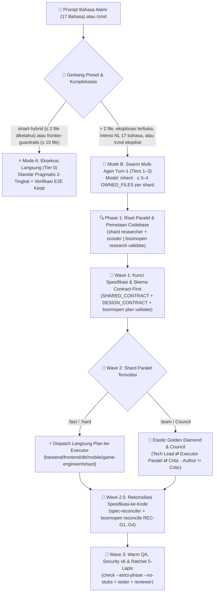

<div align="center">
  <h1>⚡ BoomOpen Workflow Kit Pro v5.5</h1>
  <p><strong>Orkestrasi workflow multi-agen dan gerbang verifikasi CLI deterministik lintas Antigravity, Claude Code, OpenAI Codex, Cursor, dan GitHub Copilot.</strong></p>

  <p>
    <a href="https://boomopen.com"></a>
    <a href="https://github.com/Kennyboom/BoomOpen-Workflow-Kit-Pro/releases"></a>
    <a href="#platforms"></a>
    <a href="#cli"></a>
    <a href="#skills"></a>
    <a href="https://nodejs.org/">= 18.0.0" /></a>
    <a href="../LICENSE"></a>
  </p>

  <p>
    <a href="../README.md">English</a> •
    <a href="./README.vi.md">Tiếng Việt</a> •
    <a href="./README.zh-CN.md">简体中文</a> •
    <a href="./README.zh-TW.md">繁體中文</a> •
    <a href="./README.ja.md">日本語</a> •
    <a href="./README.ko.md">한국어</a> •
    <a href="./README.es.md">Español</a> •
    <a href="./README.fr.md">Français</a> •
    <a href="./README.de.md">Deutsch</a><br/>
    <a href="./README.pt-BR.md">Português (BR)</a> •
    <a href="./README.ru.md">Русский</a> •
    <a href="./README.hi.md">हिन्दी</a> •
    <a href="./README.ar.md">العربية</a> •
    <b>Bahasa Indonesia</b> •
    <a href="./README.th.md">ไทย</a> •
    <a href="./README.tr.md">Türkçe</a> •
    <a href="./README.it.md">Italiano</a>
  </p>

  <p>
    <a href="https://boomopen.com"><b>🌐 boomopen.com (15 Bahasa)</b></a> •
    <a href="#trailer"><b>🎬 Trailer Peluncuran</b></a> •
    <a href="#why-boomopen"><b>⚡ Mengapa BoomOpen</b></a> •
    <a href="#architecture"><b>🏗️ Arsitektur</b></a> •
    <a href="#quickstart"><b>🚀 Mulai Cepat</b></a> •
    <a href="#cli"><b>🛠️ 14 Gerbang CLI</b></a> •
    <a href="#settings"><b>🎛️ Preset &amp; Pengaturan</b></a> •
    <a href="#commands"><b>🎯 36 Perintah</b></a> •
    <a href="#agents"><b>🤖 22 Agen &amp; 18 Tim</b></a> •
    <a href="#skills"><b>📚 1.462 Skill</b></a>
  </p>
</div>

---

<a id="trailer"></a>

## 🎬 Trailer Peluncuran Resmi & Web Explorer Interaktif (`boomopen.com`)

<div align="center">
  <a href="https://github.com/Kennyboom/BoomOpen-Workflow-Kit-Pro/raw/main/assets/media/boomopen_v55_trailer_en.mp4">
    
  </a>
  <p>
    ▶️ <a href="https://github.com/Kennyboom/BoomOpen-Workflow-Kit-Pro/raw/main/assets/media/boomopen_v55_trailer_en.mp4"><b>Streaming Trailer Peluncuran Full HD 1080p (MP4 dengan Voiceover Studio)</b></a> • 🌐 <a href="https://boomopen.com"><b>Coba Playground CLI 14 Perintah &amp; Katalog Interaktif di boomopen.com (15 Bahasa)</b></a>
  </p>
</div>

---

<a id="why-boomopen"></a>
<a id="-what-is-boomopen-workflow-kit"></a>

## ⚡ Mengapa BoomOpen Workflow Kit?

**Masalah pada Asisten Coding AI Standar:** Tanpa lapisan kontrol, asisten coding agen-tunggal mulai kehilangan presisi begitu pekerjaan melintasi banyak file, domain, atau sesi. Eksplorasi file secara sekuensial memenuhi context window utama, sub-agent paralel yang tidak terkoordinasi saling menimpa file bersama atau meninggalkan modul terisolasi ("island") tanpa integrasi, kode yang dihasilkan lolos membawa stub `TODO` tersembunyi atau pelarian tipe `any`, review oleh model tunggal melewatkan blind spot-nya sendiri (`Author == Critic`), dan implementasi multi-fase perlahan menyimpang dari spesifikasi awal.

**Solusi BoomOpen:** BoomOpen memasang satu harness orkestrasi dan verifikasi terpadu di **Antigravity (Gemini)**, **Claude Code**, **OpenAI Codex**, **Cursor**, dan **GitHub Copilot** dengan **nol dependensi runtime npm**. Dengan preset bawaan **`smart-hybrid`**, perubahan `≤ 2` file dieksekusi langsung tanpa overhead, sementara pengembangan multi-file, riset mendalam, perencanaan arsitektur, dan **`36` perintah slash (`93` file)** secara otomatis membagi beban kerja pada Turn 1 ke **22 agen spesialis** dan **18 tim adversarial 3-peran** — dikawal oleh **14 gerbang CLI lokal `boomopen`** serta didukung **`1.462` skill on-demand** (`22` Core + `1.440` terdeduplikasi tunggal di `~/.agents/skills_library`).

### ⚖️ Tanpa BoomOpen vs. Dengan BoomOpen v5.5

| Mode Kegagalan Rekayasa | Tanpa BoomOpen (AI IDE Standar) | Dengan BoomOpen Workflow Kit Pro v5.5 |
|:------------------------|:--------------------------------|:--------------------------------------|
| **Pembengkakan Context Window** | Agen utama membaca 15–30 file secara berurutan sebelum menulis satu baris kode | **Swarm Elastis Turn-1 (`role#shard`)**: Mengerahkan scout read-only & shard per domain (`≤ 3–4` file/shard) + Warm Reuse `0d` (`send_message`) |
| **Konflik Tulis Paralel & Integrasi Putus** | Agen paralel menimpa file bersama, membuat rute `/api` yang tidak cocok, atau meninggalkan modul mati | **Kunci Contract-First + Reconcile Wave 2.5**: Mengunci `SHARED_CONTRACT` Wave 1 + `OWNED_FILES` terpisah, diverifikasi oleh `boomopen reconcile` (`REC-G1..G4`) |
| **Riset Dangkal & Rencana Kabur** | Jawaban satu sudut pandang yang sekadar mengiyakan, klaim tanpa verifikasi, rencana naratif bebas | **Spesifikasi 6-Blok Berbasis Bukti**: Devil's Advocate adversarial `:team` + validator CLI `< 50ms` (`boomopen research`, `design`, `plan`) |
| **Stub Tersembunyi, `any` & Manipulasi Tes** | Agen menyatakan tugas selesai sambil menyisakan `// TODO`, `any` eksplisit, `console.log`, atau tes `.skip` | **Gerbang Statis Pragmatis 2-Tingkat**: `boomopen check --strict-phase --no-stubs` menegakkan `0` `any`, `0` stub, dan batas file kohesif `400/500` baris |
| **Penyimpangan Multi-Sesi & Regresi** | Kompresi konteks menghapus batasan fase sehingga merusak fitur yang sebelumnya sudah lulus tes | **Phase Ratchet 5-Lapis & Rollback**: Penjaga spesifikasi SHA-256 `.boomopen/project-ledger.json`, `/autopilot`, `/audit`, dan `rollback --yes` atomik |
| **Blind Spot Model Tunggal** | Model yang sama menulis sekaligus me-review kodenya sendiri (`Author == Critic`) | **Konduktor Lintas-Engine (`/conduct`)**: Dewan Multi-Engine paralel & pipeline lintas keluarga model di Claude Code, Codex, Antigravity, Cursor & Copilot |
| **Konfigurasi 5 IDE Menyimpang & Git Kotor** | File prompt terpisah di tiap IDE, duplikasi skill bergigabyte, spesifikasi sementara mengotori `git status` | **Sinkronisasi Terpadu & Git Bersih**: 14 file entrypoint disinkronkan dalam `< 10ms`, 1 `~/.agents/skills_library` bersama (`0` token idle), dan perutean Brain Artifacts |

---

<a id="architecture"></a>
<a id="-smart-hybrid-architecture-v55"></a>

## 🏗️ Arsitektur Smart-Hybrid (v5.5)



---

<a id="pillars"></a>

## 🧠 6 Pilar Rekayasa Utama

1. **🌐 Kompilasi Native 5-IDE & Vault Terdeduplikasi (`platforms/*`)**:
   - Mengompilasi **22 agen spesialis** dan **93 file perintah/referensi** ke format native masing-masing IDE: **Antigravity** (bundel `--as-plugin` + `3` skrip Python `run_workflow` siap pakai: `audit_fanout.py`, `review_fanout.py`, `research_fanout.py`), **Claude Code** (shard `isolation: worktree`, perintah titik dua `/plan:hard`, hook opsional `PreToolUse` & `Stop`/`PreCompact`), **OpenAI Codex** (`22` peran TOML dengan sandbox OS `read-only` untuk scout/critic + `87` skill `$boomopen-*`), **Cursor** (aturan `.mdc` + hook opsional `beforeShellExecution`), dan **GitHub Copilot** (prompt agent `.agent.md`).
   - Menautkan seluruh `1.440` skill pustaka satu kali ke `~/.agents/skills_library` lintas kelima IDE (~80% penghematan disk, `0` pembengkakan token Turn 1).
2. **🎯 Swarm Elastis Dinamis 4-Tingkat (`role#shard`) & Scoped Warm Reuse**:
   - Menskalakan otomatis dari **Tier 0** (`0` sub-agent untuk `≤ 2` file yang sudah diketahui) → **Tier 1** (`2–3` shard) → **Tier 2** (`4–6` shard) → **Tier 3** (`7–8+` shard, dapat dikonfigurasi hingga `16`), membatasi beban kognitif pada **`≤ 3–4 OWNED_FILES` per sub-agent**, serta menggunakan ulang sesi aktif melalui `role#shard → conversationId` (`send_message`).
3. **🤝 Eksekusi Contract-First 3-Wave + Rekonsiliasi Wave 2.5 (`REC-G1..G4`)**:
   - Wave 1 mengunci `SHARED_CONTRACT` (skema API/DTO) dan `DESIGN_CONTRACT` (CSS `@theme` OKLCH + TypeScript props) sebelum Wave 2 mengerahkan engineer paralel. Wave 2.5 menjalankan `boomopen reconcile` + `spec-reconciler` untuk menangkap file island yang belum terhubung (`REC-G1`), ketidakcocokan rute frontend/backend (`REC-G2`), sub-klausul `[SC-*]` yang terlewat (`REC-G3`), dan kunci `.env.example` yang belum tercatat (`REC-G4`), lalu otomatis menambahkan gelombang delta via `boomopen cook amend-plan`.
4. **🏛️ Autopilot Multi-Sesi (`/autopilot`) & Audit Multi-Putaran Stateful (`/audit`)**:
   - Mengompilasi spesifikasi multi-dokumen ke `.boomopen/project-ledger.json` dengan deteksi penyimpangan SHA-256, checkpoint Git pra-fase (`boomopen ledger rollback --yes`), dan **Phase Quality Ratchet 5-Lapis** ketat (`G1 check --strict-phase --no-stubs` → `G2 ratchet tes monotonik` → `G3 reconcile --strict` → `G4 review Author != Critic` → `G5 ledger verify`). Pasca-build, `/audit` menjalankan audit RTM, alur vertikal, dan Security v6 multi-putaran dengan persetujuan manusia (`.boomopen/audit-ledger.json` + `boomopen audit rollback --yes`).
5. **🎼 Konduktor Lintas-Engine & Dewan Multi-Engine (`boomopen conduct`)**:
   - Mengorkestrasi Claude Code, OpenAI Codex, Antigravity, Cursor, dan Copilot secara bersamaan dalam **Dewan Paralel 6-Tugas** (`research`, `brainstorm`, `plan`, `design`, `review`, `debug` → `COUNCIL-SYNTHESIS.md` 4-bagian) atau **Pipeline Peran Lintas Keluarga Model** sehingga tidak ada model yang menilai outputnya sendiri (`Author != Critic`).
6. **📏 Standar Coding Pragmatis 2-Tingkat & Debugging Akar Masalah SPIE v3.0**:
   - **Tier 1 (Toleransi Nol)**: Tanggung jawab tunggal, `0` `any` eksplisit, `0` `console.log` debug pada kode aplikasi, batas `try/catch` bertipe, konstanta `SCREAMING_SNAKE_CASE`. **Tier 2 (Kohesi Utama)**: Target `~200–350` baris (`400` batas lunak / `500` batas pemecahan keras; tes/tipe/dokumen dikecualikan). Setiap bug ditelusuri melalui 3 hipotesis terperingkat dan rantai kausal **5-Whys (SPIE v3.0)**, sembari mengarahkan spesifikasi sementara ke Brain Artifacts (`100%` working tree Git tetap bersih).

---

<a id="platforms"></a>
<a id="-supported-ai-platforms"></a>

## 💻 5 Platform Coding AI yang Didukung

| Platform | Dukungan | Entrypoint Tersinkronisasi | Integrasi Native Platform |
|:---------|:--------:|:---------------------------|:--------------------------|
| **Antigravity (Gemini)** | ✅ v5.5 | `~/.gemini/GEMINI.md` | `invoke_subagent`, fan-out Python `run_workflow`, outer loop `/goal`, bundel `--as-plugin`, opsional `--with-hooks`, Brain Artifacts |
| **Claude Code** | ✅ v5.5 | `~/.claude/CLAUDE.md` | Shard `Task`/`Agent` paralel (`isolation: worktree`), perintah titik dua `/plan:hard`, hook opsional `PreToolUse` & `Stop`/`PreCompact` |
| **OpenAI Codex** | ✅ v5.5 | `~/.codex/AGENTS.md` & `CODEX.md` | `22` peran TOML di `~/.codex/agents/boomopen/` dengan OS `sandbox_mode = "read-only"` bagi scout/reviewer + `87` skill `$boomopen-*` |
| **Cursor** | ✅ v5.5 | `~/.cursor/rules/boomopen-workflow-kit.mdc` | Aturan frontmatter `.mdc` aktif-selalu, `CURSOR.md`, perutean sub-agent & opsional `.cursor/hooks.json` (`beforeShellExecution`) |
| **GitHub Copilot** | ✅ v5.5 | `~/.copilot/copilot-instructions.md` | Prompt agent VS Code terkompilasi `boomopen-workflow-kit.agent.md`, dispatch `runSubagent` & `COPILOT.md` |

---

<a id="quickstart"></a>
<a id="-quick-start--installation"></a>

## 🚀 Mulai Cepat & Instalasi (Hanya via Git — Nol Dependensi Runtime)

```bash
# 1. Clone repositori (didistribusikan hanya lewat GitHub — tidak pernah dipublikasikan di npm)
git clone https://github.com/Kennyboom/BoomOpen-Workflow-Kit-Pro.git
cd BoomOpen-Workflow-Kit-Pro

# 2. Instal untuk IDE AI Anda (preset bawaan: smart-hybrid) atau di kelima IDE sekaligus
npm run install:all                                 # Instal & sinkronkan 5 IDE + ~/.agents/skills_library bersama
npm run install:antigravity                         # Google Antigravity 2.0 (atau tambahkan --as-plugin / --with-hooks)
node cli/install.js install claude --with-hooks     # Claude Code + hook opsional PreToolUse & Stop/PreCompact
npm run install:codex                               # OpenAI Codex CLI + sandbox OS read-only scout/reviewer
npm run install:cursor                              # Cursor (tambahkan --with-hooks untuk penjaga beforeShellExecution)
npm run install:copilot                             # GitHub Copilot (VS Code .agent.md + copilot-instructions.md)

# 3. Verifikasi kesehatan instalasi & opsional tautkan `boomopen` ke PATH global Anda
npm run doctor
npm link
boomopen settings status
```

> **Instalasi & Uninstall Non-Destruktif yang Aman**: Dilacak melalui manifest SHA-256 (`~/.boomopen/manifests/<tool>.json`). Aturan pribadi yang sudah ada di `GEMINI.md` / `CLAUDE.md` tetap dipertahankan di luar penanda kit serta dicadangkan otomatis; `boomopen uninstall <tool|--all>` menghapus file kit yang tidak dimodifikasi secara bersih tanpa menyentuh file pribadi Anda.

---

<a id="cli"></a>

## 🛠️ 14 Sub-perintah CLI Tanpa Dependensi (`boomopen`)

Berjalan secara lokal dalam `< 50ms` di Node.js `>= 18` dengan **nol dependensi runtime npm** dan **nol panggilan jaringan**:

| Sub-perintah | Flag & Sintaks Utama | Gerbang Deterministik & Kegunaan |
|:-------------|:---------------------|:---------------------------------|
| **`install` / `uninstall` / `list`** | `<tool\|--all> [--with-hooks] [--as-plugin]` | Installer berbasis manifest SHA-256, penaut `~/.agents/skills_library` bersama, hook keamanan opsional & uninstaller bersih |
| **`doctor`** | `[--source-only]` | Audit read-only 30 poin untuk bundel 5 IDE, `93` file perintah, `72` file tim, `1.462` skill & sinkronisasi pengaturan |
| **`settings`** | `status \| preset <name> \| set <k> <v> \| --ui` | Kelola 5 preset + `22` kunci konfigurasi (`--project` untuk `./.boomopen.json`) atau buka Web UI berpelindung CSP (`127.0.0.1:4567`) |
| **`research`** | `<validate\|brief> <file.md> [--mode brainstorm]` | Menegakkan **`RES-G1..G4`** (`≥ 4` sumber tertriangulasi, matriks kontradiksi, risiko pre-mortem) & mengompilasi `HANDOFF_BRIEF` |
| **`design`** | `<validate\|contract> <DESIGN.md> [--json]` | Menegakkan **`DESIGN-G1..G4`** (spesifikasi 6-Blok, token OKLCH, Matriks UI 5-State, WCAG 2.2 AA) & menghasilkan `DESIGN_CONTRACT` |
| **`plan`** | `<validate\|compile> <PLAN.md> [--sync-ledger]` | Menegakkan **`PLAN-G1..G5`** (DAG asiklik, `OWNED_FILES ≤ 4`/shard terpisah, `SHARED_CONTRACT`) & menyinkronkan ledger |
| **`cook`** | `<state\|packets\|verify-wave\|preflight\|amend-plan>` | Menegakkan **`COOK-G1..G4`**: deteksi state fast-forward 5 tahap, Wave Handoff Packet 5-Field, cek kunci tulis Git & gelombang delta |
| **`reconcile`** | `<dir> [--plan <PLAN.md>] [--strict]` | Wave 2.5 **`REC-G1..G4`**: mendeteksi modul island belum terhubung, selisih rute `/api`, klausul `[SC-*]` terlewat & celah `.env.example` |
| **`check`** | `[path] --strict-phase --no-stubs [--ignore <dir>]` | Gerbang statis Pragmatis 2-Tingkat: batas `400/500` baris, `0` `any` eksplisit, `0` `console.log` debug, `0` stub/`TODO`/`.skip` |
| **`ledger`** | `<init\|from-plan\|status\|next\|verify\|rollback>` | State machine DAG multi-sesi `.boomopen/project-ledger.json`, penjaga penyimpangan SHA-256 & `rollback --yes` atomik |
| **`audit`** | `<init\|slice\|record\|approve\|verify-fix\|rollback>` | Ledger audit pasca-implementasi multi-putaran stateful (`.boomopen/audit-ledger.json`), ratchet burn-down & `rollback --yes` |
| **`conduct`** | `<probe\|council\|dispatch\|status> [--dry-run]` | Konduktor lintas-engine & Dewan Multi-Engine paralel 6-tugas (`Author != Critic` lintas 5 IDE → `COUNCIL-SYNTHESIS.md`) |

---

<a id="settings"></a>
<a id="-unified-settings--mode-selection-settings"></a>

## 🎛️ Pusat Kontrol Terpadu & 5 Preset (`/settings`)

Kelola **`20` kunci enum + `2` kunci batas baris kustom** secara global (`~/.boomopen/settings.json`) atau per repositori (`./.boomopen.json`), tersinkronisasi langsung ke seluruh 14 file entrypoint IDE dalam `< 10ms`:

| Profil Preset | Mode Eksekusi (`execution.mode`) | `/cmd` Default | Perutean NL 17 Bahasa (`naturalLanguageResearchTrigger`) | Standar Coding | Paling Tepat Digunakan Untuk |
|:--------------|:---------------------------------|:--------------:|:--------------------------------------------------------:|:--------------:|:-----------------------------|
| **⚡ `smart-hybrid`** *(Default)* | **`auto`** (`≤ 2` file langsung; `> 2` file atau `/cmd` → Swarm Mode B) | `auto` | **`auto_team`** *(Mengarahkan riset/ide/review NL ke `:team` & workflow di 17 bahasa)* | `pragmatic` (`400/500`L) | Pengalaman bawaan siap pakai: perutean intensi bahasa alami + sharding paralel otomatis sejak Turn 1 |
| **🛡️ `frontier-guardrails`** *(Ramping Opsional)* | **`mode_a`** (`≤ 10` file langsung; entrypoint `< 2.5 KB` / `~600` token) | `auto` | **`off`** *(Hanya `/cmd` eksplisit — nol intersepsi bahasa alami)* | `pragmatic` (`400/500`L) | Mode langsung harian super-ramping `< 2.5 KB` dengan gerbang 2-Tingkat & E2E ketat *(alias `carbon-guardrails` didukung)* |
| **🚀 `solo-fast`** | **`mode_a`** (`≤ 10` file langsung; konservatif maks. `3` shard) | `fast` | `off` | `relaxed` (`600/800`L) | Prototipe cepat, skrip kecil, hotfix mendesak & penghematan token |
| **🧠 `deep-architect`** | **`mode_b`** *(Orkestrator Mode B ketat; maks. `12` shard)* | `hard` | `auto_hard` + riset `council` / review `cross_family` | `strict` (`300/400`L) | Arsitektur sistem kompleks, desain greenfield & refactoring lintas modul |
| **🔺 `adversarial-team`** | **`team`** *(Elastic Golden Diamond `:team`; `hyper_swarm` maks. `12`)* | `team` | **`auto_team`** + riset, perencanaan & review `council` | `strict` (`300/400`L) | Rilis produksi kritikal, audit keamanan & konsensus multi-engine |

```bash
# Ganti preset atau sesuaikan kunci via Chat (/settings), Web UI Lokal (--ui), atau CLI:
boomopen settings --ui                                      # Buka Web Control Center Lokal di http://127.0.0.1:4567
boomopen settings preset smart-hybrid                       # Default: Auto Mode A/B + perutean workflow NL 17 bahasa
boomopen settings preset frontier-guardrails                # Opsional: Mode A ramping < 2.5 KB (alias: carbon-guardrails)
boomopen settings set engines.reviewer cross_family         # Wajibkan Reviewer lintas keluarga model (Author != Critic)
cd path/to/your/repo && boomopen settings mode team --project # Override ./.boomopen.json khusus repositori
boomopen settings reset                                     # Kembalikan konfigurasi bawaan smart-hybrid
```

---

<a id="commands"></a>
<a id="-slash-commands-reference"></a>

## 🎯 Referensi Lengkap 36 Perintah Slash (`93` File = `87` Workflow + `6` `_ref/`)

Gunakan bahasa alami dalam **salah satu dari 17 bahasa yang didukung** pada mode `smart-hybrid`, atau panggil salah satu dari **36 perintah slash kanonik** secara eksplisit:

| Kategori | Perintah | Varian | Kegunaan & Deliverable Deterministik |
|:---------|:---------|:-------|:-------------------------------------|
| **Orkestrasi & Otonomi** | **`/cook`** | `:fast`, `:hard`, `:team` | Pembuatan fitur end-to-end saat belum ada rencana (Scout → Contract Plan → Shard Paralel → Reconcile Wave 2.5 → QA) |
| | **`/code`** | `:fast`, `:hard`, `:team` | Mengeksekusi `PLAN-{task}.md` yang sudah disetujui langsung di shard Wave 1–3 tanpa mengulang `/plan` |
| | **`/autopilot`** | `:init`, `:run`, `:audit` | Orkestrator spesifikasi-ke-produksi multi-sesi via `.boomopen/project-ledger.json` & **Phase Quality Ratchet 5-Lapis** |
| | **`/conduct`** | `:council`, `:pipeline` | Dewan paralel multi-engine (`COUNCIL-SYNTHESIS.md`) & pipeline peran lintas keluarga model di 5 IDE (mendukung `--dry-run`) |
| | **`/orchestrate`** / **`/auto`** | — | Koordinasi swarm multi-domain kustom (`/orchestrate`) atau eksekusi otonom penuh ujung-ke-ujung (`/auto`) |
| **Arsitektur, Desain & Riset** | **`/plan`** | `:fast`, `:hard`, `:team` | Cetak biru 5-Gerbang `PLAN-{task}.md` yang mengunci `SHARED_CONTRACT`, `OWNED_FILES ≤ 4`/shard terpisah & kriteria Given/When/Then |
| | **`/architect`** | — | Cetak biru sistem khusus desain: diagram C4, ADR, skema DB, kontrak API, spesifikasi layar & audit cakupan (tanpa menulis kode) |
| | **`/design`** / **`/ui-ux-pro-max`** | `:fast`, `:hard`, `:team` | Spesifikasi UI/UX 6-Blok `DESIGN-{task}.md` + `DESIGN_CONTRACT` (token OKLCH `@theme`, Matriks UI 5-State, 50+ gaya & live preview HTML) |
| | **`/research`** | `:fast`, `:hard`, `:team` | Deep Research 5-Lensa (`RESEARCH-{topic}.md`, triangulasi `≥ 4` sumber `RES-G1..G4`, tabel kontradiksi & `HANDOFF_BRIEF`) |
| | **`/brainstorm`** / **`/ask`** | `:fast`, `:hard`, `:team` | Eksplorasi ide strategis anti-basa-basi (`BRAINSTORM-{topic}.md` dengan pre-mortem & matriks MCDA) serta tanya-jawab berbasis bukti (`/ask`) |
| **Kualitas, Audit, Debug & Keamanan** | **`/review`** | `:fast`, `:hard`, `:team` | Review adversarial multi-lensa atas kode, arsitektur, keamanan & performa (`Author != Critic`, lanjut 1-klik ke `/fix`) |
| | **`/audit`** / **`/deep-audit`** | `:run`, `:fix`, `:auto` | Audit proyek menyeluruh multi-putaran pasca-build (ledger `/audit`) & audit logika spesifikasi 10-dimensi pra-kode (`/deep-audit`) |
| | **`/security-audit`** | — | Pemindaian OWASP Top 10 + LLM/Agentic Top 10 (`security_scan.py` v6), pemodelan ancaman STRIDE, laporan autentikasi & rantai pasok |
| | **`/debug`** / **`/fix`** | `:fast`, `:hard`, `:team` | Penelusuran akar masalah 3-Hipotesis + **5-Whys (SPIE v3.0)** (`DEBUG-{issue}.md`) & perbaikan bug TDD fail-first (`/fix`) |
| | **`/test`** / **`/performance`** / **`/refactor`** | `:fast`, `:hard`, `:team` | Shard QA bebas manipulasi tes (`/test`), optimasi Core Web Vitals / DB / ukuran bundel (`/performance`), dan `/refactor` terverifikasi metrik |
| **Git, Rilis, Dokumen & Operasi Sesi** | **`/onboard`** / **`/init`** | — | Pemetaan brownfield read-only 60 detik `ARCHITECTURE-MAP.md` (`/onboard`, nol bentrok `/init`) & inisialisasi greenfield (`/init`) |
| | **`/pr`** / **`/release`** | —, `:review` | Gerbang kualitas & rekonsiliasi pra-PR + `gh pr create` / review diff adversarial (`/pr:review`), serta `/release` semantik berpenjaga paritas |
| | **`/deploy`** / **`/rollback`** | `:check`, `:preview`, `:production`, `:rollback` | Gerbang kesiapan deployment, peluncuran preview/produksi (`/deploy`), dan pemulihan darurat sesuai tingkat keparahan (`/rollback`) |
| | **`/docs`** / **`/report`** | `:core`, `:business`, `:audit` / `:fast..:team` | Dokumentasi `./documents/` berbasis kode sumber nyata (`/docs`) dan laporan status telemetri CLI bebas fiksi (`/report`) |
| | **`/settings`** / **`/status`** / **`/next`** | — | Pusat Kontrol Terpadu (`/settings`), papan kesehatan ledger/swarm langsung (`/status`), dan navigator langkah berikutnya (`/next`) |
| | **`/preview`** / **`/save`** / **`/recap`** | — | Pengelola siklus server dev lokal (`/preview`), penyimpanan state sesi (`/save`), dan pemulihan konteks `< 5d` (`/recap`) |

### 🌙 Playbook Proyek Multi-Fase Semalaman (`/autopilot` & `/goal`)

| Workflow | Platform Target & Runner | Kontinuitas Konteks | Jaminan Kualitas & Spesifikasi |
|:---------|:-------------------------|:--------------------|:-------------------------------|
| **`/autopilot` (+ `--with-hooks`)** | Kelima IDE (padukan dengan `--with-hooks` di **Claude Code**, **Antigravity** & **Cursor**) | Hook `Stop` & `PreCompact` (`stop-quality-gate.mjs`) + `.boomopen/project-ledger.json` menjaga posisi progres melintasi kompresi konteks | Menegakkan **Phase Quality Ratchet 5-Lapis** (`G1..G5`), `reconcile` Wave 2.5, dan `boomopen ledger rollback --yes` |
| **`/goal` + `/autopilot` + `/audit`** | Outer loop persisten **Antigravity 2.0** untuk spesifikasi `docs/` berskala besar | Runner native **`/goal`** di Antigravity mengulang eksekusi antar fase hingga setiap fase di ledger berstatus `VERIFIED` | Menjalankan setiap fase melewati 5 gerbang + rekonsiliasi Wave 2.5, lalu mengeksekusi Putaran 1 **`/audit`** |

```text
/goal Use /autopilot to read all project documentation in docs/, initialize .boomopen/project-ledger.json, and autonomously implement every phase sequentially (every phase must pass all 5 verification gates and Wave 2.5 reconcile). Once 100% of phases pass, run Round 1 of /audit and stop with a summary report for my review.
```

---

<a id="agents"></a>
<a id="-22-specialist-agents--18-golden-triangle-teams"></a>

## 🤖 22 Agen Spesialis & 18 Tim Adversarial 3-Peran

Setiap sub-agent mewarisi model sesi aktif Anda (`Model: "inherit"` — penggunaan `flash_lite` dilarang keras) dan dipasangkan ke dalam **18 tim Golden Diamond / Triangle** (`Tech Lead` ⇄ `Parallel Shard Executors` ⇄ `Independent Reviewers/Critics`):

| Domain | Agen Spesialis (`agents/*.md`, dikompilasi per IDE) | Tim Review 3-Peran (`agents/teams/*-team/`, `72` file) |
|:-------|:----------------------------------------------------|:-------------------------------------------------------|
| **Rekayasa & Eksekusi** | `backend-engineer`, `frontend-engineer`, `mobile-engineer`, `game-engineer`, `database-architect`, `devops-engineer` | `backend-team`, `frontend-team`, `fullstack-team`, `mobile-team`, `game-team`, `database-team`, `devops-team` |
| **Arsitektur & Produk** | `tech-lead`, `planner`, `brainstormer`, `business-analyst`, `project-manager`, `designer` | `planning-team`, `brainstorm-team`, `project-team`, `design-team` |
| **Kualitas, Rekonsiliasi & Keamanan** | `debugger`, `tester`, `reviewer`, `spec-reconciler`, `security-engineer`, `performance-engineer` | `debug-team`, `qa-team`, `security-team`, `performance-team` |
| **Riset & Dokumentasi** | `researcher`, `scouter`, `docs-manager`, `reporter` | `research-team`, `docs-team`, `report-team` |

---

<a id="skills"></a>
<a id="-1460-skills-vault-22-core--1440-niche-library-skills"></a>

## 📚 Vault 1.462 Skill On-Demand (`22` Core + `1.440` Library Skills)

Terindeks di **19 domain rekayasa** dalam `matrix-skills/compact-index.json`, dideduplikasi satu kali ke `~/.agents/skills_library`, dan dimuat melalui **Resolusi Progresif O(1) 2-Langkah** (cek Core `skills/` → pencarian `compact-index.json` → muat `SKILL.md` yang cocok hanya ke shard yang ditugaskan, `0` token saat idle):

| Tingkat / Domain Rekayasa | Skill | Kapabilitas Utama & Scaffold Proyek | Pemuatan |
|:--------------------------|:-----:|:------------------------------------|:---------|
| **⚡ Workflow Inti & Kualitas (`skills/`)** | **22** | `clean-code`, `debugger`, `plan-writing`, `brainstorming`, `deep-research`, `design-spec`, `frontend-design`, `frontend-architecture`, `api-patterns`, `database-design`, `tdd-workflow`, `testing-patterns`, `webapp-testing`, `security-auditor` (`security_scan.py` v6), `app-builder` (**15 template proyek** termasuk **`mcp-server`**, **`ai-agent-worker`**, `nextjs-saas`, `monorepo-turborepo`, `python-fastapi`, `flutter-app`), `skill-seeker` | Siap sejak Turn 1 |
| **🤖 AI, Agentic SDK, MCP & Data** | **340+** | FastMCP (`StreamableHTTP`), OpenAI Agents SDK, Claude Agent SDK, Google ADK, Vercel AI SDK, LangGraph, RAG, BigQuery, dbt | On-demand (`compact-index.json`) |
| **🌐 Web, Backend, API & Database** | **380+** | React 19, Next.js 15 RSC, Tailwind CSS v4, TanStack Start/Router/Query, Hono RPC + Zod OpenAPI, Rust Axum/SQLx, Drizzle, Postgres/RLS | On-demand (`compact-index.json`) |
| **☁️ Cloud, DevOps, QA & Keamanan** | **300+** | Cloudflare Workers/Durable Objects/D1, Docker/K8s, Terraform, Playwright, Vitest + MSW v2, Better Auth (Passkeys), OWASP LLM Top 10 | On-demand (`compact-index.json`) |
| **🎨 UI/UX, Game Engine & Mobile** | **420+** | Token Desain OKLCH, WCAG 2.2 AA, Motion, Unity 6 DOTS/ECS, Godot 4, Unreal 5, WebGPU/Three.js, Phaser/PixiJS, Tauri v2, SwiftUI, Flutter, React Native | On-demand (`compact-index.json`) |

---

## 📂 Struktur Repositori

```text
BoomOpen-Workflow-Kit-Pro/
├── agents/                  # 22 Agen Spesialis (dikompilasi per IDE) + 18 Tim 3-Peran (72 file)
├── cli/                     # 14 Sub-perintah CLI Node.js Tanpa Dependensi + 33 suite pengujian node:test
├── commands/                # 36 Perintah Slash dalam 87 file workflow + 6 protokol _ref/ (93 file)
├── documents/               # Dokumentasi arsitektur, domain, basis kode & standar coding Pragmatis 2-Tingkat
├── i18n/                    # 16 README terjemahan penuh (total 17 bahasa bersama README.md utama)
├── matrix-skills/           # 19 katalog YAML per domain + compact-index.json O(1) (1.462 skill terindeks)
├── platforms/               # Bundel 5 IDE, hook keamanan opsional, 3 skrip Antigravity run_workflow/*.py & peran TOML Codex
├── rules/                   # 7 modul aturan Mode B on-demand (CORE, PHASES, AGENTS, TEAMS, SKILLS, ERRORS, REFERENCE)
├── scripts/                 # Utilitas verifikasi & sesi lintas platform (checklist.py, verify_all.py, auto_preview.py, session_manager.py)
├── skills/                  # 22 Core Skills + 15 template proyek app-builder + skrip audit Security v6 / UX / Perf
├── skills_library/          # 1.440 skill pustaka yang ditautkan satu kali ke ~/.agents/skills_library bersama
├── web/                     # Showcase WebGL 15 bahasa & katalog interaktif yang menggerakkan https://boomopen.com
└── GEMINI.md | CLAUDE.md | CODEX.md | COPILOT.md | CURSOR.md | AGENT.md
```

---

## 📄 Lisensi & Keamanan

- **Situs Web Resmi**: [https://boomopen.com](https://boomopen.com)
- **Lisensi**: Kode sumber kit, CLI, aturan, agen, dan dokumentasi dirilis di bawah [MIT License](../LICENSE) (Hak Cipta © 2026 **BoomOpen Labs**). Skill pihak ketiga di dalam `skills_library/` tetap mempertahankan lisensi upstream aslinya — lihat [THIRD_PARTY_NOTICES.md](../THIRD_PARTY_NOTICES.md).
- **Kebijakan Keamanan**: Lihat [SECURITY.md](../SECURITY.md) untuk perlindungan manifest SHA-256, sandboxing hook opsional, dan prosedur pelaporan kerentanan.
