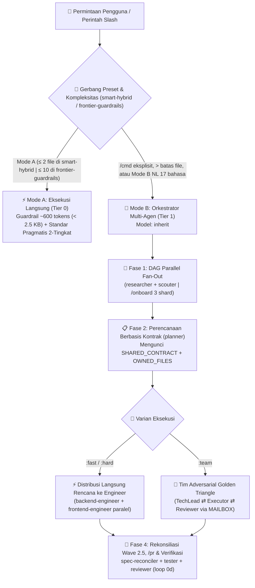

<div align="center">
  <h1>⚡ BoomOpen Workflow Kit v5.5.0</h1>
  <p><strong>Sistem Operasi Workforce AI Smart-Hybrid Multi-Platform — 22 Agen Spesialis, 18 Tim Golden Triangle &amp; Gudang 1.462 Skill Sesuai Permintaan</strong></p>

  <p>
    <a href="https://github.com/Kennyboom/BoomOpen-Workflow-Kit-Pro/releases"></a>
    <a href="#platforms"></a>
    <a href="#agents"></a>
    <a href="#skills"></a>
    <a href="https://nodejs.org/">=18.0.0" /></a>
    <a href="../LICENSE"></a>
  </p>

  <p>
    <a href="../README.md">🇬🇧 English</a> • <a href="./README.vi.md">🇻🇳 Tiếng Việt</a> • <a href="./README.zh-CN.md">🇨🇳 简体中文</a> • <a href="./README.zh-TW.md">🇹🇼 繁體中文</a> • <a href="./README.ja.md">🇯🇵 日本語</a> • <a href="./README.ko.md">🇰🇷 한국어</a> • <a href="./README.es.md">🇪🇸 Español</a> • <a href="./README.fr.md">🇫🇷 Français</a> • <a href="./README.de.md">🇩🇪 Deutsch</a><br/>
    <a href="./README.pt-BR.md">🇧🇷 Português</a> • <a href="./README.ru.md">🇷🇺 Русский</a> • <a href="./README.hi.md">🇮🇳 हिन्दी</a> • <a href="./README.ar.md">🇸🇦 العربية</a> • <b>🇮🇩 Bahasa Indonesia</b> • <a href="./README.th.md">🇹🇭 ไทย</a> • <a href="./README.tr.md">🇹🇷 Türkçe</a> • <a href="./README.it.md">🇮🇹 Italiano</a>
  </p>

  <p>
    <a href="https://boomopen.com">🌐 Website</a> •
    <a href="#pillars"><b>🧠 6 Pilar</b></a> •
    <a href="#platforms"><b>💻 5 Platform</b></a> •
    <a href="#settings"><b>🎛️ 5 Preset</b></a> •
    <a href="#commands"><b>🎯 36 Perintah</b></a> •
    <a href="#agents"><b>🤖 22 Agen &amp; 18 Tim</b></a> •
    <a href="#skills"><b>📚 1.462 Skill</b></a>
  </p>
</div>

---

## 🎬 Trailer Peluncuran Resmi (Full HD 1080p)

<div align="center">
  <a href="https://github.com/Kennyboom/BoomOpen-Workflow-Kit-Pro/raw/main/assets/media/boomopen_v55_trailer_en.mp4">
    
  </a>
  <p>
    ▶️ <a href="https://github.com/Kennyboom/BoomOpen-Workflow-Kit-Pro/raw/main/assets/media/boomopen_v55_trailer_en.mp4"><b>Klik di sini untuk menonton / streaming Trailer Peluncuran Resmi Full HD 1080p (MP4 dengan sulih suara studio)</b></a>
  </p>
</div>

---

## 🌟 Apa itu BoomOpen Workflow Kit v5.5?

**BoomOpen Workflow Kit v5.5 (Frontier-Guardrails & Multi-Platform Smart-Hybrid Edition)** adalah sistem operasi multi-agen sumber terbuka (open-source) yang mengubah satu asisten coding AI menjadi organisasi rekayasa terkoordinasi yang terdiri dari **22 agen spesialis**, **18 tim Golden Triangle (`72` file tim)**, **36 perintah slash (`93` file perintah: `87` alur kerja + `6` di `_ref/`)**, **14 perintah CLI**, **22 skill inti (Core Skills)**, dan **1.440 skill pustaka khusus (`1.462` skill terdeduplikasi via `~/.agents/skills_library`)**.

Tidak seperti template kaku atau wrapper berat yang memicu pembengkakan konteks di setiap giliran, BoomOpen v5.5 hadir secara bawaan dengan **`⚡ smart-hybrid`** (Kawanan Elastis Proaktif Giliran-1 + Perutean Bahasa Alami 17 Bahasa di kelima IDE) pada instalasi baru — sekaligus menyediakan preset Mode A ramping opsional **`🛡️ frontier-guardrails`** (`< 2.5 KB` / `~600 tokens`) — membuka **Sharding Kawanan Elastis 4-Tingkat (`role#shard`)**, **Onboarding Brownfield 60 Detik (`/onboard`)**, **Gerbang PR & Rilis (`/pr`, `/pr:review`, `/release`)**, **Rekonsiliasi Otomatis Spec-to-Code Wave 2.5 (`boomopen reconcile`)**, **Audit Pasca-Penyelesaian Multi-Putaran (`/audit` & `boomopen audit`)**, **Autopilot Proyek Multi-Sesi (`/autopilot`)**, dan **Konduktor Lintas-Engine (`/conduct`)**:
- **⚡ Preset Bawaan `smart-hybrid` — Kawanan Proaktif + Perutean 17 Bahasa**: Pada instalasi baru (dan dipulihkan oleh `boomopen settings reset`), pengeditan mikro yang sudah jelas (`≤ 2` file) dieksekusi langsung di Mode A, sedangkan tugas multi-file, riset mendalam, pencarian ide, perencanaan, dan perintah `/cmd` eksplisit (**`/onboard`**, **`/pr` + `/pr:review`**, **`/release`**, dll.) otomatis meluncurkan shard sub-agen paralel pada Giliran 1 (`role#shard`, `<= 3–4 OWNED_FILES`/shard) dengan **DAG Parallel Fan-Out**, **Direct Plan-to-Executor Dispatch**, **Kunci Kontrak (`SHARED_CONTRACT` + `OWNED_FILES`)**, **Rekonsiliasi Wave 2.5 (`boomopen reconcile` + `spec-reconciler` + `/cook amend-plan`)**, dan **Penggunaan Ulang Hangat (`send_message`)**.
- **🛡️ Preset Mode A Ramping Opsional `frontier-guardrails` (`< 2.5 KB` / `~600 tokens`)**: Lebih suka Mode A langsung native hingga `≤ 10` file tanpa pemicu bahasa alami (`naturalLanguageResearchTrigger = off`)? Beralih dalam `< 10ms` melalui `boomopen settings preset frontier-guardrails` (alias kompatibel mundur `carbon-guardrails` tetap didukung) sembari tetap menegakkan standar kode 2-tingkat dan verifikasi `strict_e2e`.
- **🏛️ Autopilot Multi-Sesi (`/autopilot`), Audit Multi-Putaran (`/audit`) & Dewan Multi-Engine (`/conduct`)**: Mengolah spesifikasi ke `.boomopen/project-ledger.json` dengan penjaga SHA-256, gerbang 4 lapis (`boomopen check --strict-phase --no-stubs`), dan pemulihan aman `boomopen ledger rollback`; menjalankan audit menyeluruh pasca-penyelesaian (`/audit`, `boomopen audit rollback`) via `.boomopen/audit-ledger.json` mencakup RTM, aliran vertikal UI→API→DB, serta **Mesin Keamanan Anti-Kebocoran 2-Lapis (`security_scan.py` v6)**.
- **🗺️ Siklus Rekayasa Lengkap (`/onboard` → `/cook` → `/pr` → `/release`)**: Petakan kode yang sudah ada dalam 60 detik lewat `/onboard` (`ARCHITECTURE-MAP.md`), validasi serta buka Pull Request terstruktur lewat `/pr` dan `/pr:review`, lalu siapkan rilis SemVer bebas cacat lewat `/release`.
- **📚 Gudang 1.462 Skill Terdeduplikasi Tanpa Pembengkakan Konteks**: Menggabungkan **22 Core Skills (`skills/`)** dan **1.440 Library Skills** yang dibagikan sekali di `~/.agents/skills_library` (termasuk template `mcp-server` & `ai-agent-worker`), terindeks di `matrix-skills/compact-index.json` untuk pencarian `O(1)` 2 langkah.

---

## 🏗️ Arsitektur Smart-Hybrid (v5.5)



---

<a id="pillars"></a>

## 🧠 6 Pilar Utama v5.5

1. **🌐 Paritas Terpadu di 5 Platform (`platforms/*`)**:
   - Instalasi native kelas satu untuk **Antigravity (Gemini)**, **Claude Code**, **OpenAI Codex**, **Cursor**, dan **GitHub Copilot** dengan entrypoint AOT berlatensi nol (serta mode ramping opsional `< 2.5 KB` / `~600 tokens`) dan gudang bersama `~/.agents/skills_library`.
2. **📏 Standar Pengkodean Pragmatis 2-Tingkat (Anti-Fragmentasi)**:
   - **Tingkat 1 — Toleransi Nol**: Tanggung Jawab Tunggal, **DILARANG `any` eksplisit**, **DILARANG meninggalkan `console.log` debug**, wajib `try/catch` + error bertipe di batas async/API, konstanta `SCREAMING_SNAKE_CASE`, DRY (`≥ 3`), dan import rapi.
   - **Tingkat 2 — Panduan Struktural Fleksibel**: File kohesif menargetkan `~200–350 baris` dengan batas lunak `400` dan pemisahan keras `>500 baris` (file test, tipe, dan dokumen dikecualikan). Fungsi logika `~20–40 baris` (`~40–80` untuk UI/Handler).
3. **🎯 Sharding 4-Tingkat (`role#shard`), Distribusi Langsung & Penggunaan Ulang Hangat (`send_message`)**:
   - Setelah `PLAN-{feature}.md` tersedia, Orkestrator mengirim tugas **langsung** ke shard engineer (`<= 3–4 OWNED_FILES`) tanpa perantara `tech-lead`, menggunakan ulang sesi (`role#shard → conversationId`) dengan **cold-start 0 detik**.
4. **🤝 Distribusi Paralel Berbasis Kontrak (`SHARED_CONTRACT` + `OWNED_FILES`) & Wave 2.5 (`spec-reconciler`)**:
   - Mengunci endpoint API, skema DTO, dan kepemilikan file sebelum eksekusi paralel; pada **Wave 2.5**, `boomopen reconcile`, `spec-reconciler`, dan `/cook amend-plan` memverifikasi `docs/` terhadap kode nyata (`REC-G1..G4`) untuk menangkap shard terisolasi ("pulau"), selisih rute/env, dan celah `[SC-*]`.
5. **🔍 Debugging 5-Whys (SPIE v3.0), Audit Multi-Putaran (`/audit`) & Pohon Git 100% Bersih**:
   - `debugger` melacak 3 hipotesis + rantai **5-Whys**; `/audit` menjalankan audit progresif dengan Mesin Keamanan Anti-Kebocoran 2-Lapis (`security_scan.py` v6) dan dukungan `boomopen audit rollback`. Artefak sementara diarahkan ke `<appDataDir>\brain\<conversation-id>\` (atau `./reports/`).
6. **🩺 Rangkaian CLI 14 Perintah & Indeks Skill O(1)**:
   - `npm run doctor` memvalidasi 5 platform, **22 agen**, **72 file tim** (18 folder), **93 file perintah** (`87` alur kerja untuk **36 perintah** + `6` di `_ref/`), dan `compact-index.json` (`1.462` skill). Ke-**14 perintah CLI** (`research`, `design`, `plan`, `cook`, `reconcile`, `audit`, `ledger`, `conduct`, `check`, `doctor`, `settings`, `install`, `uninstall`, `list` — termasuk `ledger rollback`, `audit rollback`, dan `install antigravity --as-plugin`) menjamin gerbang verifikasi deterministik.

---

<a id="platforms"></a>

## 💻 Platform AI yang Didukung & Fitur Native 2026

| Platform | Dukungan | Entrypoint Global | Sorotan Fitur Native 2026 di v5.5 |
|----------|:--------:|-------------------|-----------------------------------|
| **Antigravity (Gemini)** | ✅ Native v5.5 | `~/.gemini/GEMINI.md` | Bundel plugin native via `install antigravity --as-plugin`, orkestrasi Python `run_workflow`, loop luar `/goal` & hook `--with-hooks` |
| **Claude Code** | ✅ Native v5.5 | `~/.claude/CLAUDE.md` | Alur `/plan:hard`, hook kualitas `PreCompact` + `Stop`, penjaga `PreToolUse` (`Bash\|PowerShell`) & sub-agen `Task`/`Explore` |
| **OpenAI Codex** | ✅ Native v5.5 | `~/.codex/CODEX.md` & `AGENTS.md` | Peran TOML `~/.codex/agents/boomopen/*.toml` dengan sandbox `read-only` untuk scout/reviewer & kontinuitas hook `Stop` |
| **Cursor** | ✅ Native v5.5 | `~/.cursor/rules/boomopen-workflow-kit.mdc` | Guardrail ramping `< 2.5 KB`, hook `beforeShellExecution` (`--with-hooks`) & gudang bersama `~/.agents/skills_library` |
| **GitHub Copilot** | ✅ Native v5.5 | `~/.copilot/COPILOT.md` | Agen kustom `boomopen-workflow-kit.agent.md`, guardrail `< 2.5 KB` & akses `O(1)` ke `1.462` skill |

---

## 🚀 Mulai Cepat & Instalasi

```bash
# 1. Clone repositori dan instal untuk asisten Anda (atau --all untuk 5 platform)
git clone https://github.com/Kennyboom/BoomOpen-Workflow-Kit-Pro.git
cd BoomOpen-Workflow-Kit-Pro
npm run install:antigravity   # atau: install:claude | install:codex | install:cursor | install:copilot | install:all

# Opsi plugin native & hook keamanan/kualitas 2026:
node cli/install.js install antigravity --as-plugin   # Paketkan sebagai plugin native Antigravity
node cli/install.js install claude --with-hooks       # Aktifkan penjaga Bash|PowerShell + hook PreCompact/Stop

# 2. Verifikasi instalasi dan gunakan 14 perintah CLI
npm run doctor
npm link
boomopen research validate path/to/RESEARCH.md
boomopen design validate path/to/DESIGN.md
boomopen plan validate path/to/PLAN.md
boomopen cook preflight path/to/PLAN.md
boomopen reconcile path/to/your/project --plan path/to/PLAN.md
boomopen audit init --docs docs/prd.md,docs/arch.md   # Rollback aman: boomopen audit rollback
boomopen check path/to/your/project --strict-phase --no-stubs
boomopen ledger status                                # Rollback fase: boomopen ledger rollback
boomopen conduct probe
```

> Kit ini **tidak dipublikasikan di npm** — instal hanya dari repositori ini (`npm link` menambahkan `boomopen` ke PATH). Untuk mencopot tanpa menghapus file pribadi Anda: `boomopen uninstall <tool>`.

---

<a id="settings"></a>

## 🎛️ Pengaturan Terpadu & 5 Profil Preset (`/settings`)

BoomOpen v5.5 mengelola **20 kunci pengaturan + 2 batas baris** di **5 platform** dalam `< 10ms` (**latensi Turn-1 0ms** via injeksi AOT `<!-- BOOMOPEN-SETTINGS-START -->`), dengan **`⚡ smart-hybrid`** sebagai preset bawaan pada instalasi baru (dipulihkan lewat `boomopen settings reset`) dan **`🛡️ frontier-guardrails`** sebagai preset Mode A ramping opsional:

| Profil (`Preset`) | Mode (`execution.mode`) | Varian Default | Pemicu NL (`naturalLanguageResearchTrigger`) | Standar Kode | Penggunaan Terbaik |
|:---|:---|:---:|:---:|:---:|:---|
| **⚡ `smart-hybrid`** *(Default Direkomendasikan)* | **`auto`** (`≤ 2 file` → Mode A Langsung; `> 2 file` atau `/cmd` → Mode B) | `auto` | **`auto_team`** *(Otomatis arahkan riset/ide NL ke `/research:team` / `/brainstorm:team`)* | `pragmatic` (`400/500`) | Bawaan instalasi baru (`boomopen settings reset`) — perutean NL 17 bahasa + sharding kawanan Giliran-1 di atas 2 file di kelima IDE |
| **🛡️ `frontier-guardrails`** *(Mode A Ramping Opsional)* | **`mode_a`** *(Langsung hingga `≤ 10 file`; guardrail ramping `< 2.5 KB` / `~600 tokens`)* | `auto` | **`off`** *(Tanpa pembajakan NL; workflow hanya via `/cmd` eksplisit)* | `pragmatic` (`400/500`) | Mode A ramping opsional `< 2.5 KB` (`~600 tokens`) dengan standar `400/500` baris & verifikasi `strict_e2e` *(alias kompatibel mundur: `carbon-guardrails`)* |
| **🚀 `solo-fast`** | **`mode_a`** *(Eksekusi solo langsung, latensi sub-agen 0d)* | `fast` | `off` *(Balasan langsung kecuali mengetik `/brainstorm`)* | `relaxed` (`600/800`) | Hotfix mendesak, prototipe cepat, skrip & hemat token maksimal |
| **🧠 `deep-architect`** | **`mode_b`** *(Orkestrator Multi-Agen di setiap tugas)* | `hard` | `auto_hard` *(Otomatis jalankan `/research:hard` / `/brainstorm:hard` 5-Lensa)* | `strict` (`300/400`) | Arsitektur sistem kompleks, proyek baru & refactoring lintas domain |
| **🔺 `adversarial-team`** | **`team`** *(Tim Golden Triangle 3-Agen `:team` wajib)* | `team` | **`auto_team`** *(Debat & tinjauan silang 3-Agen via `MAILBOX`)* | `strict` (`300/400`) | Kode produksi kritis, audit keamanan & rilis zero-defect |

```bash
# Di Chat (/settings) | Dashboard Web (boomopen settings --ui) | Terminal CLI
/settings                                     # Menu interaktif (ask_question UI)
/settings preset smart-hybrid                 # Default Direkomendasikan (Auto Mode A/B + perutean NL 17 bahasa)
/settings preset frontier-guardrails          # Mode A Ramping Opsional < 2.5 KB / ~600 tokens (alias: carbon-guardrails)
/settings preset solo-fast                    # Mode A solo cepat
/settings preset deep-architect               # Mode B Orkestrator Multi-Agen
/settings preset adversarial-team             # Tim Golden Triangle 3-Agen (:team)
/settings mode auto | mode_a | mode_b | team  # Ubah mode eksekusi langsung
boomopen settings --ui                        # Buka Web Control Center lokal (http://127.0.0.1:4567)
boomopen settings status                      # Lihat pengaturan aktif & status sinkronisasi 5 platform
boomopen settings preset smart-hybrid         # Terapkan preset smart-hybrid global & sinkronkan 5 platform
boomopen settings preset frontier-guardrails  # Beralih ke preset Mode A ramping opsional
cd path/to/your/project && boomopen settings set execution.mode mode_a --project
boomopen settings reset                       # Pulihkan pengaturan bawaan smart-hybrid yang direkomendasikan
```

---

## 🌙 Panduan Proyek Multi-Fase Semalaman (`/autopilot` vs `/goal` + `/autopilot` + `/audit`)

> **Kontinuitas Native per Platform**: **`/goal`** adalah loop luar native **Antigravity (Gemini)** untuk pengerjaan lintas reset konteks semalaman, sedangkan **`/autopilot` + hook `Stop` / `PreCompact`** (`--with-hooks`) menggerakkan kontinuitas multi-sesi pada **Claude Code** dan **OpenAI Codex** (dilengkapi pemulihan aman `boomopen ledger rollback` & `boomopen audit rollback`).

| Pendekatan | Cakupan Sesi & Konteks | Kontrol Rencana & Kualitas | Kapan Digunakan |
|:---|:---|:---|:---|
| **`/autopilot` (+ hook `Stop`/`PreCompact` di Claude Code & Codex)** | Di Claude Code/Codex, hook menyimpan progres sebelum pemadatan konteks dan menguji gerbang saat berhenti; tanpa hook berhenti rapi di **~70% konteks** | Menjaga `.boomopen/project-ledger.json`, 5 gerbang, Wave 2.5 `reconcile`, `ledger rollback`, dan `/audit` | Eksekusi multi-sesi berkelanjutan di Claude Code/Codex atau tinjauan bertahap per fase |
| **`/goal` + `/autopilot` + `/audit`** *(Native di Antigravity)* | **`/goal` bertindak sebagai loop luar native Antigravity**, mendorong banyak fase semalaman melintasi reset konteks | `/autopilot` menegakkan `project-ledger.json`, 5 gerbang kualitas, rekonsiliasi Wave 2.5 (`reconcile`), dan **Putaran 1 `/audit`** saat selesai 100% | Proyek besar multi-dokumen yang dijalankan otonom semalaman di Antigravity hingga audit lengkap |

**Prompt semalaman siap salin (Antigravity):**

```text
/goal Bangun seluruh proyek dari awal hingga selesai berdasarkan spesifikasi di docs/ menggunakan /autopilot.
Inisialisasi dan pelihara .boomopen/project-ledger.json, jalankan PLAN per fase tanpa melewatkan persyaratan,
jalankan rekonsiliasi Wave 2.5 (boomopen reconcile) serta 5 gerbang verifikasi di setiap akhir fase,
lalu setelah 100% fase selesai jalankan Putaran 1 /audit untuk menyiapkan laporan lengkap bagi tinjauan saya di pagi hari.
```

---

<a id="commands"></a>

## 🎯 Referensi Perintah Slash (36 Perintah / 93 File)

*(Mencakup `87` file alur kerja di `commands/*.md` untuk **36 perintah dasar** — selain tabel utama di bawah, tersedia utilitas cepat `/ask`, `/status`, `/next`, `/init`, `/auto`, `/architect`, `/refactor`, `/performance`, `/security-audit`, `/deep-audit`, `/preview`, `/rollback`, `/ui-ux-pro-max` — ditambah `6` protokol referensi di `commands/_ref/`.)*

| Perintah | Varian | Tujuan Utama |
|---------|----------|-----------------|
| **`/onboard`** | — | Onboarding brownfield 60 detik: menghasilkan `ARCHITECTURE-MAP.md` (stack, entrypoint, alur data, hotspot risiko & gerbang; bebas bentrok dengan `/init`) |
| **`/cook`** | `:fast`, `:hard`, `:team`, `amend-plan` | Pengembangan fitur ujung-ke-ujung (Riset → Rencana → Kode Paralel → Wave 2.5 → Tinjauan) |
| **`/code`** | `:fast`, `:hard`, `:team` | Eksekusi implementasi langsung dari `PLAN-{feature}.md` yang ada |
| **`/plan`** | `:fast`, `:hard`, `:team` | Membuat cetak biru dengan `SHARED_CONTRACT`, `OWNED_FILES` & kriteria Given/When/Then (termasuk `/plan:hard` di Claude Code) |
| **`/fix`** | `:fast`, `:hard`, `:team` | Penyelesaian bug akar masalah dengan verifikasi uji regresi wajib |
| **`/debug`** | `:fast`, `:hard`, `:team` | Investigasi 3-Hipotesis + rantai kausal **5-Whys (SPIE v3.0)** (`DEBUG-{issue}.md`) |
| **`/test`** | `:fast`, `:hard`, `:team` | Eksekusi paralel DAG pengujian + pencarian edge-case yang terlewat (`tester` + `scouter`) |
| **`/review`** | `:fast`, `:hard`, `:team` | Audit paralel 4 arah (Arsitektur, Kualitas Kode, Keamanan OWASP, Performa) |
| **`/pr`** | `/pr`, `/pr:review` | Gerbang pra-PR (`boomopen check` + `reconcile` + tes diff), kebersihan branch, pembuatan `gh pr create` terstruktur & tinjauan PR mendalam |
| **`/release`** | — | Persiapan Semantic Release: audit Conventional Commits, sintesis `CHANGELOG.md`, gerbang `doctor`/`check`/`test`/`test:pack` & `gh release create` |
| **`/audit`** | `:run`, `:fix`, `:auto` | Audit pasca-penyelesaian multi-putaran (RTM, alur UI→API→DB, Anti-Kebocoran 2-Lapis v6, `/audit:fix` & `boomopen audit rollback`) |
| **`/design`** | `:fast`, `:hard`, `:team` | Arsitektur sistem, skema database, dan spesifikasi UI/UX 6-blok (`DESIGN.md`) |
| **`/docs`** | `:core`, `:business`, `:audit` | Membuat atau menyinkronkan dokumentasi arsitektur & bisnis 2-tingkat (`./documents/`) |
| **`/deploy`** | `:check`, `:preview`, `:production`, `:rollback` | Gerbang pra-deploy, lingkungan preview, rilis produksi & rollback aman |
| **`/research`** | `:fast`, `:hard`, `:team` | Mesin Riset Mendalam Otonom (triangulasi 4 sumber, 3 gelombang & dewan 3 vektor) |
| **`/brainstorm`** | `:fast`, `:hard`, `:team` | Penemuan kebutuhan metode Sokrates, analisis trade-off MCDA & pencarian ide |
| **`/report`** | `:fast`, `:hard`, `:team` | Laporan sintesis eksekutif & teknis dengan metrik dan diagram |
| **`/autopilot`** | `:init`, `:run`, `:audit` | Orkestrator proyek otonom multi-sesi via `.boomopen/project-ledger.json`, gerbang 4 lapis & `ledger rollback` |
| **`/conduct`** | `:council`, `:pipeline` | Konduktor lintas-engine & dewan paralel (`boomopen conduct`) dengan sintesis konsensus 4 bagian |
| **`/orchestrate`** | — | Orkestrasi pipeline multi-agen khusus lintas berbagai domain dan shard |
| **`/settings`** | `preset`, `mode`, `set`, `ui` | Pusat Kontrol Terpadu: 20 kunci + 2 batas baris, **5 preset** (`smart-hybrid` default) atau Web UI (`--ui`) |
| **`/save` / `/recap`** | — | Menyimpan status sesi (`SESSION-HANDOVER.md`) dan memulihkan konteks dalam `< 5 detik` |

---

<a id="agents"></a>

## 🤖 22 Agen Spesialis & 18 Tim Golden Triangle (`72` File)

| Kategori | Agen Spesialis (`agents/*.md`) | Tim Golden Triangle (`agents/teams/*-team/`) |
|----------|-----------------------------------|------------------------------------------------|
| **Rekayasa & Eksekusi** | `backend-engineer`, `frontend-engineer`, `mobile-engineer`, `game-engineer`, `database-architect`, `devops-engineer` | `backend-team`, `frontend-team`, `fullstack-team`, `mobile-team`, `game-team`, `database-team`, `devops-team` |
| **Arsitektur & Perencanaan** | `tech-lead`, `planner`, `brainstormer`, `business-analyst`, `project-manager`, `designer` | `planning-team`, `brainstorm-team`, `project-team`, `design-team` |
| **Kualitas, Keamanan & Debugging** | `debugger`, `tester`, `reviewer`, **`spec-reconciler`**, `security-engineer`, `performance-engineer` | `debug-team`, `qa-team`, `security-team`, `performance-team` |
| **Riset & Pengetahuan** | `researcher`, `scouter`, `docs-manager`, `reporter` | `research-team`, `docs-team`, `report-team` |

---

<a id="skills"></a>

## 📚 Gudang 1.462 Skill (22 Skill Inti + 1.440 Terdeduplikasi di `~/.agents/skills_library`)

Dirancang untuk **0 beban token saat idle** dan **penyimpanan bebas duplikat lintas IDE** melalui `~/.agents/skills_library` + **Resolusi Skill Progresif O(1) 2 Langkah** (`<skills>` → `matrix-skills/compact-index.json` → `SKILL.md` sesuai permintaan):

| Domain Skill | Jumlah | Kemampuan Utama & Template 2026 | Pemuatan |
|:---|:---:|:---|:---|
| **⚡ Tier 1: Inti (`skills/`)** | **22** | `clean-code`, `debugger`, `plan-writing`, `brainstorming`, `frontend-design`, `design-spec`, `api-patterns`, `database-design`, `testing-patterns`, `skill-seeker` | Terindeks di `<skills>` |
| **🎨 Desain UI/UX & Motion** | **42** | Anti-AI-Slop Craft, OKLCH, Bento Grids, Motion v12, Figma MCP + W3C DTCG, WCAG 2.2 AA/AAA, iOS 18 HIG & Material 3 | `compact-index.json` |
| **🌐 Web, Backend & Edge** | **390+** | React 19, Next.js 15, Tailwind v4, TanStack, Hono RPC + Zod OpenAPI, Rust Axum, Supabase RLS, Drizzle + Neon/Turso | `~/.agents/skills_library` |
| **🤖 AI, MCP & Agent Workers** | **320+** | Template **`mcp-server`** & **`ai-agent-worker`**, FastMCP 2025, OpenAI/Claude/Google ADK, Vercel AI SDK v4, RAG, BigQuery, dbt | `~/.agents/skills_library` |
| **☁️ Cloud, DevOps & Keamanan** | **300+** | Cloudflare Workers/D1/R2, Terraform/OpenTofu, Docker/K8s, Vitest + MSW v2, Better Auth, OWASP LLM 2025 | `~/.agents/skills_library` |
| **📱 Mobile, Game & 3D Web** | **410+** | Unity 6 DOTS, Godot 4, WebGPU/Three.js TSL, Colyseus, Tauri v2, SwiftUI, Kotlin, React Native, Flutter | `~/.agents/skills_library` |

---

## 📂 Struktur Repositori

```text
BoomOpen-Workflow-Kit-Pro/
├── agents/                  # 22 Agen Spesialis (termasuk spec-reconciler) + 18 Tim (72 file)
├── cli/                     # 14 perintah CLI: install (--as-plugin/--with-hooks), uninstall, list, doctor, check, settings, research, design, plan, cook, reconcile, audit (rollback), ledger (rollback) & conduct
├── commands/                # 87 alur kerja perintah Slash (36 perintah: /onboard, /pr, /release, /cook, dll.) + 6 protokol _ref/ (93 file)
├── documents/               # Dokumentasi 2-tingkat (Arsitektur, Domain, Basis Kode & Standar)
├── i18n/                    # 16 terjemahan README lengkap
├── matrix-skills/           # Matriks YAML + compact-index.json terkompilasi (1.462 skill)
├── platforms/               # Template terpadu untuk 5 platform (antigravity/, claude/, codex/, copilot/, cursor/)
├── rules/                   # Aturan Mode B sesuai permintaan (CORE, PHASES, AGENTS, TEAMS, SKILLS, ERRORS, REFERENCE)
├── scripts/                 # Skrip otomatisasi & verifikasi Python (checklist.py, security_scan.py, dll.)
├── skills/                  # 22 Skill Inti
├── skills_library/          # 1.440 skill khusus terdeduplikasi via ~/.agents/skills_library (termasuk mcp-server & ai-agent-worker)
└── GEMINI.md | CLAUDE.md | CODEX.md | COPILOT.md | CURSOR.md | AGENT.md
```

---

## 📄 Lisensi & Keamanan

- **Lisensi**: Didistribusikan di bawah [Lisensi MIT](../LICENSE). Hak Cipta © 2026 **BoomOpen Labs**. Skill pihak ketiga di `skills_library/` tetap memakai lisensi aslinya — lihat [THIRD_PARTY_NOTICES.md](../THIRD_PARTY_NOTICES.md).
- **Kebijakan Keamanan**: Lihat [SECURITY.md](../SECURITY.md) untuk perlindungan keamanan bawaan dan panduan pelaporan kerentanan.
