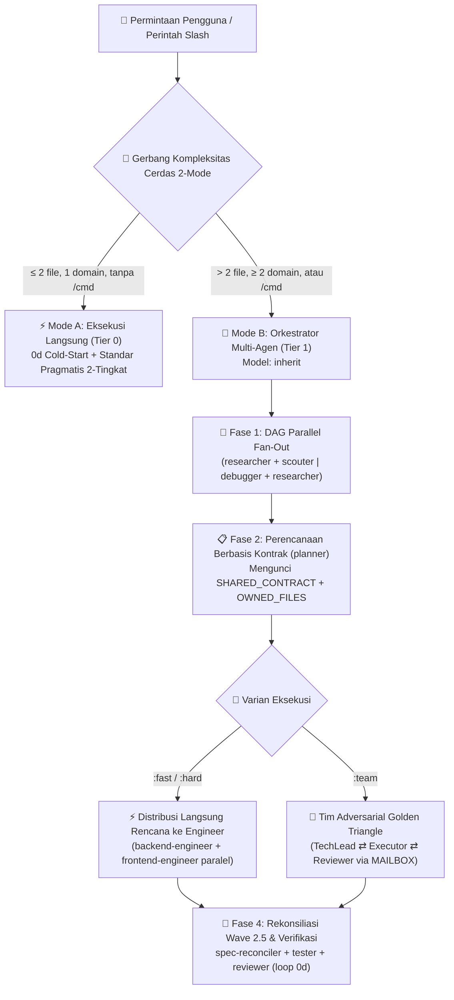

<div align="center">
  <h1>⚡ BoomOpen Workflow Kit v5.5.0</h1>
  <p><strong>Sistem Operasi Workforce AI Smart-Hybrid Multi-Platform — 22 Agen Spesialis, 18 Tim Golden Triangle &amp; Gudang 1.460+ Skill Sesuai Permintaan</strong></p>

  <p>
    <a href="https://github.com/Kennyboom/BoomOpen-Workflow-Kit-Pro/releases"></a>
    <a href="#platforms"></a>
    <a href="#agents"></a>
    <a href="#skills"></a>
    <a href="https://nodejs.org/">=18.0.0" /></a>
    <a href="../LICENSE"></a>
  </p>

  <p>
    <a href="../README.md">🇬🇧 English</a> • <a href="./README.vi.md">🇻🇳 Tiếng Việt</a> • <a href="./README.zh-CN.md">🇨🇳 简体中文</a> • <a href="./README.zh-TW.md">🇹🇼 繁體中文</a> • <a href="./README.ja.md">🇯🇵 日本語</a> • <a href="./README.ko.md">🇰🇷 한국어</a> • <a href="./README.es.md">🇪🇸 Español</a> • <a href="./README.fr.md">🇫🇷 Français</a> • <a href="./README.de.md">🇩🇪 Deutsch</a><br/>
    <a href="./README.pt-BR.md">🇧🇷 Português</a> • <a href="./README.ru.md">🇷🇺 Русский</a> • <a href="./README.hi.md">🇮🇳 हिन्दी</a> • <a href="./README.ar.md">🇸🇦 العربية</a> • <b>🇮🇩 Bahasa Indonesia</b> • <a href="./README.th.md">🇹🇭 ไทย</a> • <a href="./README.tr.md">🇹🇷 Türkçe</a> • <a href="./README.it.md">🇮🇹 Italiano</a>
  </p>
</div>

---

## 🎬 Trailer Peluncuran Resmi (Full HD 1080p)

<div align="center">
  <a href="https://github.com/Kennyboom/BoomOpen-Workflow-Kit-Pro/raw/main/assets/media/boomopen_v55_trailer_en.mp4">
    
  </a>
  <p>
    ▶️ <a href="https://github.com/Kennyboom/BoomOpen-Workflow-Kit-Pro/raw/main/assets/media/boomopen_v55_trailer_en.mp4"><b>Klik di sini untuk menonton / streaming Trailer Peluncuran Resmi Full HD 1080p (MP4 dengan sulih suara studio)</b></a>
  </p>
</div>

---

## 🌟 Apa itu BoomOpen Workflow Kit v5.5?

**BoomOpen Workflow Kit v5.5 (Multi-Platform Unified & Smart-Hybrid Edition)** adalah sistem operasi multi-agen sumber terbuka (open-source) yang mengubah satu asisten coding AI menjadi organisasi rekayasa terkoordinasi yang terdiri dari **22 agen spesialis**, **18 tim Golden Triangle (`72` file tim)**, **33 perintah slash (`89` file perintah & referensi)**, **14 perintah CLI**, **22 skill inti (Core Skills)**, dan **1.440 skill pustaka khusus (`skills_library/`)**.

Tidak seperti template kaku atau wrapper berat yang memicu pembengkakan konteks di setiap giliran, BoomOpen v5.5 menggabungkan **Proactive Sub-agent First Gate**, **Perutean Bahasa Alami 17 Bahasa**, **Sharding Kawanan Elastis 4-Tingkat (`role#shard`)**, **Rekonsiliasi Otomatis Spec-to-Code Wave 2.5 (`boomopen reconcile`)**, **Audit Pasca-Penyelesaian Multi-Putaran (`/audit` & `boomopen audit`)**, **Autopilot Proyek Multi-Sesi (`/autopilot`)**, dan **Konduktor Lintas-Engine (`/conduct`)**:
- **🚀 Sub-agen Paralel Giliran-1, Wave 2.5 & Orkestrasi Mode B**: Eksplorasi terbuka (`> 2` file), fitur lintas domain (`≥ 2` domain), niat bahasa alami di **17 bahasa yang didukung**, atau perintah `/cmd` eksplisit langsung meluncurkan shard paralel (`role#shard`, `<= 3–4 OWNED_FILES`/shard) dengan **DAG Parallel Fan-Out**, **Direct Plan-to-Executor Dispatch**, **Kunci Kontrak (`SHARED_CONTRACT` + `OWNED_FILES`)**, **Rekonsiliasi Wave 2.5 (`boomopen reconcile` + `spec-reconciler` + `/cook amend-plan`)**, dan **Penggunaan Ulang Hangat (`role#shard -> conversationId` via `send_message`)**.
- **🏛️ Autopilot Multi-Sesi (`/autopilot`), Audit Multi-Putaran (`/audit`) & Dewan Multi-Engine (`/conduct`)**: Mengolah dokumen spesifikasi ke `.boomopen/project-ledger.json` dengan penjaga SHA-256 dan gerbang 4 lapis (`boomopen check --strict-phase --no-stubs`); menjalankan audit proyek menyeluruh pasca-penyelesaian (`/audit` → `/audit:fix` → `/audit:round2` melalui `.boomopen/audit-ledger.json`) mencakup RTM, aliran vertikal UI→API→DB, serta **Mesin Keamanan Anti-Kebocoran 2-Lapis (`security_scan.py` v6)**.
- **⚡ Mode A — Eksekusi Mikro-Langsung Target Diketahui (0d Cold-Start)**: Tanya jawab dan edit kecil saat **tepat `≤ 2` file target sudah diketahui pada Giliran 1** langsung dieksekusi dengan **Standar Pengkodean Pragmatis 2-Tingkat** dan **Pengujian & Perbaikan Bug Persisten**.
- **📚 Gudang 1.462 Skill Tanpa Pembengkakan Konteks**: Menggabungkan **22 Core Skills (`skills/`)** dan **1.440 Library Skills (`skills_library/`)** di `matrix-skills/compact-index.json` untuk pencarian `O(1)` 2 langkah tanpa memenuhi jendela prompt.

---

## 🏗️ Arsitektur Smart-Hybrid (v5.5)



---

<a id="pillars"></a>

## 🧠 6 Pilar Utama v5.5

1. **🌐 Paritas Terpadu di 5 Platform (`platforms/*`)**:
   - Instalasi native kelas satu untuk **Google Antigravity 2.0 (Gemini)**, **Claude Code**, **OpenAI Codex**, **Cursor**, dan **GitHub Copilot** dari satu arsitektur terpadu.
2. **📏 Standar Pengkodean Pragmatis 2-Tingkat (Anti-Fragmentasi)**:
   - **Tingkat 1 — Toleransi Nol**: Tanggung Jawab Tunggal, **DILARANG `any` eksplisit**, **DILARANG meninggalkan `console.log` debug**, wajib `try/catch` + error bertipe di batas async/API, konstanta `SCREAMING_SNAKE_CASE`, DRY (`≥ 3`), dan import rapi.
   - **Tingkat 2 — Panduan Struktural Fleksibel**: File kohesif menargetkan `~200–350 baris` dengan batas lunak `400` dan pemisahan keras `>500 baris` (file test, tipe, dan dokumen dikecualikan). Fungsi logika `~20–40 baris` (`~40–80` untuk UI/Handler).
3. **🎯 Sharding 4-Tingkat (`role#shard`), Distribusi Langsung & Penggunaan Ulang Hangat (`send_message`)**:
   - Setelah `PLAN-{feature}.md` tersedia, Orkestrator mengirim tugas **langsung** ke shard engineer (`<= 3–4 OWNED_FILES`) tanpa perantara `tech-lead`, menggunakan ulang sesi (`role#shard → conversationId`) dengan **cold-start 0 detik**.
4. **🤝 Distribusi Paralel Berbasis Kontrak (`SHARED_CONTRACT` + `OWNED_FILES`) & Wave 2.5 (`spec-reconciler`)**:
   - Mengunci endpoint API, skema DTO, dan kepemilikan file sebelum eksekusi paralel; pada **Wave 2.5**, `boomopen reconcile`, `spec-reconciler`, dan `/cook amend-plan` memverifikasi `docs/` terhadap kode nyata untuk menangkap shard terisolasi ("pulau"), selisih rute/env, dan celah `[SC-*]`.
5. **🔍 Debugging 5-Whys (SPIE v3.0), Audit Multi-Putaran (`/audit`) & Pohon Git 100% Bersih**:
   - `debugger` melacak 3 hipotesis + rantai **5-Whys**; `/audit` menjalankan audit progresif dengan Mesin Keamanan Anti-Kebocoran 2-Lapis (`security_scan.py` v6). Artefak sementara diarahkan ke `<appDataDir>\brain\<conversation-id>\`.
6. **🩺 Rangkaian CLI 14 Perintah & Indeks Keahlian O(1)**:
   - `npm run doctor` memvalidasi 5 platform, **22 agen**, **72 file tim** (18 folder), **89 file perintah** (`83` alur kerja + `6` di `_ref/`), dan `compact-index.json` (`1.462` keahlian). Ke-14 perintah CLI (`research`, `design`, `plan`, `cook`, `reconcile`, `audit`, `ledger`, `conduct`, `check`, `doctor`, `settings`, `install`, `uninstall`, `list`) menjamin kompilasi deterministik dan gerbang verifikasi ketat.

---

## 🔍 Rekonsiliasi Otomatis Wave 2.5 & Audit Multi-Putaran (`/audit`)

- **🔄 Wave 2.5 Spec-to-Code Auto-Reconciliation (`boomopen reconcile` + `spec-reconciler` + `/cook amend-plan`)**: Sebelum menutup fase atau gelombang, `spec-reconciler` membandingkan persyaratan di `docs/` dan `PLAN` dengan implementasi aktual (`REC-G1..G4`), mendeteksi persyaratan `[SC-*]` yang terlewat, modul terputus, dan paritas rute/env, lalu menambal kekurangannya melalui `/cook amend-plan`.
- **🛡️ Audit Pasca-Penyelesaian Multi-Putaran (`/audit`) & Mesin Keamanan Anti-Kebocoran 2-Lapis v6**:
  1. **Putaran 1 (`/audit` atau `/autopilot:audit`)**: Audit penuh mode baca-saja (cakupan RTM, aliran vertikal UI→API→DB, serta pemindaian `security_scan.py` v6 untuk kebocoran rahasia/PII/injeksi).
  2. **Tinjauan Pengguna**: Anda meninjau laporan `AUDIT-{project}-r1.md` dan menyetujui item perbaikan.
  3. **Perbaikan & Putaran 2 (`/audit:fix` → `/audit:round2`)**: Shard bebas bentrokan memperbaiki temuan yang disetujui dengan kunci uji regresi lalu memicu `/audit:round2` hingga **0 temuan** tercatat di `.boomopen/audit-ledger.json`.

---

<a id="platforms"></a>

## 💻 Platform AI yang Didukung

| Platform | Tingkat Dukungan | Entrypoint Global | Jalur Instalasi Framework |
|----------|:-------------:|-------------------|------------------------|
| **Antigravity (Gemini)** | ✅ Native v5.5 | `~/.gemini/GEMINI.md` | `~/.gemini/config/skills/boomopen-workflow-kit/` |
| **Claude Code** | ✅ Native v5.5 | `~/.claude/CLAUDE.md` | `~/.claude/skills/boomopen-workflow-kit/` |
| **OpenAI Codex** | ✅ Native v5.5 | `~/.codex/CODEX.md` & `AGENTS.md` | `~/.codex/skills/boomopen-workflow-kit/` |
| **Cursor** | ✅ Native v5.5 | `~/.cursor/rules/boomopen-workflow-kit.mdc` | `~/.cursor/skills/boomopen-workflow-kit/` |
| **GitHub Copilot** | ✅ Native v5.5 | `~/.copilot/COPILOT.md` | `~/.copilot/skills/boomopen-workflow-kit/` |

---

## 🚀 Mulai Cepat & Instalasi

```bash
# 1. Clone repositori dan instal untuk asisten Anda (atau --all untuk 5 platform)
git clone https://github.com/Kennyboom/BoomOpen-Workflow-Kit-Pro.git
cd BoomOpen-Workflow-Kit-Pro
npm run install:antigravity   # atau: install:claude | install:codex | install:cursor | install:copilot | install:all

# 2. Verifikasi instalasi dan gunakan 14 perintah CLI
npm run doctor
npm link
boomopen research validate path/to/RESEARCH.md
boomopen design validate path/to/DESIGN.md
boomopen plan validate path/to/PLAN.md
boomopen cook preflight path/to/PLAN.md
boomopen reconcile path/to/your/project --plan path/to/PLAN.md
boomopen audit init --docs docs/prd.md,docs/arch.md
boomopen check path/to/your/project --strict-phase --no-stubs
boomopen ledger status
boomopen conduct probe
```

> Kit ini **tidak dipublikasikan di npm** — instal hanya dari repositori ini (`npm link` menambahkan `boomopen` ke PATH). Untuk mencopot: `boomopen uninstall <tool>`.

---

## 🎛️ Pengaturan Terpadu & 5 Profil Preset (`/settings`)

BoomOpen v5.5 mengelola **20 kunci pengaturan + 2 batas baris** di **5 platform** dalam `< 10ms` (**latensi Turn-1 0ms**), kini hadir dengan **5 profil preset sekali klik**:

| Profil (`Preset`) | Mode (`execution.mode`) | Varian Default | Pemicu NL (`naturalLanguageResearchTrigger`) | Standar Kode | Penggunaan Terbaik |
|:---|:---|:---:|:---:|:---:|:---|
| **⚡ `smart-hybrid`** *(Default)* | **`auto`** (`≤ 2 file` → Mode A; `> 2` atau `/cmd` → Mode B) | `auto` | **`auto_team`** *(Otomatis arahkan riset/ide NL ke `/research:team` / `/brainstorm:team`)* | `pragmatic` (`400/500`) | Rekayasa full-stack harian — cepat untuk tugas kecil, mendalam di arsitektur |
| **🛡️ `carbon-guardrails`** | **`mode_a`** *(Antigravity Carbon memimpin langsung hingga `≤ 10 file`)* | `auto` | `off` *(Tanpa pembajakan NL; workflow BoomOpen hanya via `/cmd` eksplisit)* | `pragmatic` (`400/500`) | Biarkan **Antigravity Orchestrator Carbon** memimpin eksplorasi/edit harian sementara BoomOpen menegakkan batas `400/500` baris, `strict_e2e` & pagar `/cmd` |
| **🚀 `solo-fast`** | **`mode_a`** *(Eksekusi solo langsung, latensi sub-agen 0d)* | `fast` | `off` *(Balasan langsung kecuali mengetik `/brainstorm`)* | `relaxed` (`600/800`) | Hotfix mendesak, prototipe cepat, skrip & hemat token maksimal |
| **🧠 `deep-architect`** | **`mode_b`** *(Orkestrator Multi-Agen di setiap tugas)* | `hard` | `auto_hard` *(Otomatis jalankan `/research:hard` / `/brainstorm:hard` 5-Lensa)* | `strict` (`300/400`) | Arsitektur sistem kompleks, proyek baru & refactoring lintas domain |
| **🔺 `adversarial-team`** | **`team`** *(Tim Golden Triangle 3-Agen `:team` wajib)* | `team` | **`auto_team`** *(Debat & tinjauan silang 3-Agen via `MAILBOX`)* | `strict` (`300/400`) | Kode produksi kritis, audit keamanan & rilis zero-defect |

```bash
# Di Chat (/settings) | Dashboard Web (boomopen settings --ui) | Terminal CLI
/settings                                     # Menu interaktif (ask_question UI)
/settings preset carbon-guardrails            # Aktifkan mode Carbon memimpin + Guardrails BoomOpen
/settings preset smart-hybrid                 # Default Smart-Hybrid
/settings mode auto | mode_a | mode_b | team  # Ubah mode eksekusi langsung
boomopen settings preset carbon-guardrails    # Terapkan global & sinkronkan 5 platform
boomopen settings set execution.mode mode_a --project   # Tulis ./.boomopen.json di proyek saat ini
```

---

## 🌙 Panduan Proyek Besar Multi-Fase Semalaman (`/autopilot` vs `/goal` + `/autopilot` + `/audit`)

| Pendekatan | Cakupan Sesi & Konteks | Kontrol Rencana & Kualitas | Kapan Digunakan |
|:---|:---|:---|:---|
| **`/autopilot` saja** | Sesi tunggal — berhenti rapi sekitar **~70% konteks** dan **menjeda untuk persetujuan `PLAN` awal** | Menjaga `.boomopen/project-ledger.json`, 5 gerbang, Wave 2.5 `reconcile`, dan `/audit`, tetapi perlu dilanjutkan manual antar-fase | Tugas menengah atau eksekusi bertahap dengan tinjauan langsung per fase |
| **`/goal` + `/autopilot` + `/audit`** *(Direkomendasikan semalaman)* | **`/goal` mendorong pengerjaan otomatis melintasi banyak fase semalaman** melewati batas reset konteks tanpa berhenti di tengah | `/autopilot` menjamin pelacakan imutabel di `project-ledger.json`, 5 gerbang kualitas, rekonsiliasi Wave 2.5 (`reconcile`), dan **Putaran 1 `/audit`** di akhir | Proyek besar multi-dokumen yang dijalankan otonom semalaman hingga audit lengkap |

**Prompt semalaman siap salin:**

```text
/goal Bangun seluruh proyek dari awal hingga selesai berdasarkan spesifikasi di docs/ menggunakan /autopilot.
Inisialisasi dan pelihara .boomopen/project-ledger.json, setujui dan jalankan PLAN per fase tanpa melewatkan persyaratan,
jalankan rekonsiliasi Wave 2.5 (boomopen reconcile) serta gerbang verifikasi di setiap akhir fase,
lalu setelah semua fase selesai jalankan Putaran 1 /audit untuk menyiapkan laporan lengkap bagi tinjauan saya di pagi hari.
```

---

## 🎯 Referensi Perintah Slash (33 Perintah / 89 File)

| Perintah | Varian | Tujuan Utama |
|---------|----------|-----------------|
| **`/cook`** | `:fast`, `:hard`, `:team`, `amend-plan` | Pengembangan fitur ujung-ke-ujung (Riset → Rencana → Kode Paralel → Wave 2.5 → Tinjauan) |
| **`/code`** | `:fast`, `:hard`, `:team` | Eksekusi implementasi langsung dari `PLAN-{feature}.md` yang ada |
| **`/plan`** | `:fast`, `:hard`, `:team` | Membuat cetak biru dengan `SHARED_CONTRACT`, `OWNED_FILES` & kriteria Given/When/Then |
| **`/fix`** | `:fast`, `:hard`, `:team` | Penyelesaian bug akar masalah dengan verifikasi uji regresi wajib |
| **`/debug`** | `:fast`, `:hard`, `:team` | Investigasi 3-Hipotesis + rantai kausal **5-Whys (SPIE v3.0)** (`DEBUG-{issue}.md`) |
| **`/test`** | `:fast`, `:hard`, `:team` | Eksekusi paralel DAG pengujian + pencarian edge-case yang terlewat (`tester` + `scouter`) |
| **`/review`** | `:fast`, `:hard`, `:team` | Audit paralel 4 arah (Arsitektur, Kualitas Kode, Keamanan OWASP, Performa) |
| **`/audit`** | `:run`, `:fix`, `:round2`, `:auto` | Audit pasca-penyelesaian multi-putaran (RTM, alur UI→API→DB, Anti-Kebocoran 2-Lapis v6, perbaikan `/audit:fix` & audit ulang `/audit:round2` hingga 0 temuan) |
| **`/design`** | `:fast`, `:hard`, `:team` | Arsitektur sistem, skema database, dan spesifikasi UI/UX (`DESIGN.md`) |
| **`/docs`** | `:core`, `:business`, `:audit` | Membuat atau menyinkronkan dokumentasi arsitektur & bisnis 2-tingkat (`./documents/`) |
| **`/deploy`** | `:check`, `:preview`, `:production`, `:rollback` | Gerbang pra-deploy, lingkungan preview, rilis produksi & rollback aman |
| **`/research`** | `:fast`, `:hard`, `:team` | Mesin Riset Mendalam Otonom (triangulasi 4 sumber, 3 gelombang & dewan 3 vektor) |
| **`/brainstorm`** | `:fast`, `:hard`, `:team` | Penemuan kebutuhan metode Sokrates, analisis trade-off & pencarian ide |
| **`/report`** | `:fast`, `:hard`, `:team` | Laporan sintesis eksekutif & teknis dengan metrik dan diagram |
| **`/autopilot`** | `:init`, `:run`, `:audit` | Orkestrator proyek otonom multi-sesi via `.boomopen/project-ledger.json` & gerbang 4 lapis |
| **`/conduct`** | `:council`, `:pipeline` | Konduktor lintas-engine & dewan paralel (`boomopen conduct`) dengan sintesis konsensus 4 bagian |
| **`/orchestrate`** | — | Orkestrasi pipeline multi-agen khusus lintas berbagai domain |
| **`/settings`** | `preset`, `mode`, `set`, `ui` | Pusat Kontrol Terpadu: 20 kunci + 2 batas baris, **5 preset**, atau Web UI (`--ui`) |
| **`/save` / `/recap`** | — | Menyimpan status sesi (`SESSION-HANDOVER.md`) dan memulihkan konteks dalam `< 5 detik` |

---

<a id="agents"></a>

## 🤖 22 Agen Spesialis & 18 Tim Golden Triangle (`72` File)

| Kategori | Agen Spesialis (`agents/*.md`) | Tim Golden Triangle (`agents/teams/*-team/`) |
|----------|-----------------------------------|------------------------------------------------|
| **Rekayasa & Eksekusi** | `backend-engineer`, `frontend-engineer`, `mobile-engineer`, `game-engineer`, `database-architect`, `devops-engineer` | `backend-team`, `frontend-team`, `fullstack-team`, `mobile-team`, `game-team`, `database-team`, `devops-team` |
| **Arsitektur & Perencanaan** | `tech-lead`, `planner`, `brainstormer`, `business-analyst`, `project-manager`, `designer` | `planning-team`, `brainstorm-team`, `project-team`, `design-team` |
| **Kualitas, Keamanan & Debugging** | `debugger`, `tester`, `reviewer`, **`spec-reconciler`**, `security-engineer`, `performance-engineer` | `debug-team`, `qa-team`, `security-team`, `performance-team` |
| **Riset & Pengetahuan** | `researcher`, `scouter`, `docs-manager`, `reporter` | `research-team`, `docs-team`, `report-team` |

---

<a id="skills"></a>

## 📚 Gudang 1.462 Skill (22 Skill Inti + 1.440 Skill Pustaka)

Dirancang untuk **0 beban token saat idle** melalui **Resolusi Skill Progresif O(1) 2 Langkah** (`<skills>` → `matrix-skills/compact-index.json` → `SKILL.md` sesuai permintaan):

| Domain Skill | Jumlah | Kemampuan Utama | Pemuatan |
|:---|:---:|:---|:---|
| **⚡ Tier 1: Inti (`skills/`)** | **22** | `clean-code`, `debugger`, `plan-writing`, `brainstorming`, `frontend-design`, `design-spec`, `api-patterns`, `database-design`, `testing-patterns`, `skill-seeker` | Terindeks di `<skills>` |
| **🎨 Desain UI/UX & Motion** | **42** | Anti-AI-Slop Craft, OKLCH, Bento Grids, Motion v12, Figma MCP + W3C DTCG, WCAG 2.2 AA/AAA, iOS 18 HIG & Material 3 | `compact-index.json` |
| **🌐 Web, Backend & Edge** | **390+** | React 19, Next.js 15, Tailwind v4, TanStack, Hono RPC + Zod OpenAPI, Rust Axum, Supabase RLS, Drizzle + Neon/Turso | `skills_library/` |
| **🤖 AI, Agen LLM & Data** | **320+** | FastMCP 2025, OpenAI/Claude/Google ADK, Vercel AI SDK v4, RAG, BigQuery, dbt, Spark | `skills_library/` |
| **☁️ Cloud, DevOps & Keamanan** | **300+** | Cloudflare Workers/D1/R2, Terraform/OpenTofu, Docker/K8s, Vitest + MSW v2, Better Auth, OWASP LLM 2025 | `skills_library/` |
| **📱 Mobile, Game & 3D Web** | **410+** | Unity 6 DOTS, Godot 4, WebGPU/Three.js TSL, Colyseus, Tauri v2, SwiftUI, Kotlin, React Native, Flutter | `skills_library/` |

---

## 📂 Struktur Repositori

```text
BoomOpen-Workflow-Kit-Pro/
├── agents/                  # 22 Agen Spesialis (termasuk spec-reconciler) + 18 Tim (72 file)
├── cli/                     # 14 perintah CLI: install, doctor, checker, settings, research, design, plan, cook, reconcile, audit, ledger & conductor
├── commands/                # 83 alur kerja perintah Slash (33 perintah) + 6 protokol _ref/ (89 file)
├── documents/               # Dokumentasi 2-tingkat (Arsitektur, Domain, Basis Kode & Standar)
├── i18n/                    # 16 terjemahan README lengkap
├── matrix-skills/           # Matriks YAML + compact-index.json terkompilasi (1.462 skill)
├── platforms/               # Template terpadu untuk 5 platform (antigravity/, claude/, codex/, copilot/, cursor/)
├── rules/                   # Aturan Mode B sesuai permintaan (CORE, PHASES, AGENTS, TEAMS, SKILLS, ERRORS, REFERENCE)
├── scripts/                 # Skrip otomatisasi & verifikasi Python (checklist.py, verify_all.py, dll.)
├── skills/                  # 22 Skill Inti
├── skills_library/          # 1.440 skill khusus yang dimuat sesuai permintaan
└── GEMINI.md | CLAUDE.md | CODEX.md | COPILOT.md | CURSOR.md | AGENT.md
```

---

## 📄 Lisensi & Keamanan

- **Lisensi**: Didistribusikan di bawah [Lisensi MIT](../LICENSE). Hak Cipta © 2026 **BoomOpen Labs**. Skill pihak ketiga di `skills_library/` tetap memakai lisensi aslinya — lihat [THIRD_PARTY_NOTICES.md](../THIRD_PARTY_NOTICES.md).
- **Kebijakan Keamanan**: Lihat [SECURITY.md](../SECURITY.md) untuk perlindungan keamanan bawaan dan panduan pelaporan kerentanan.
