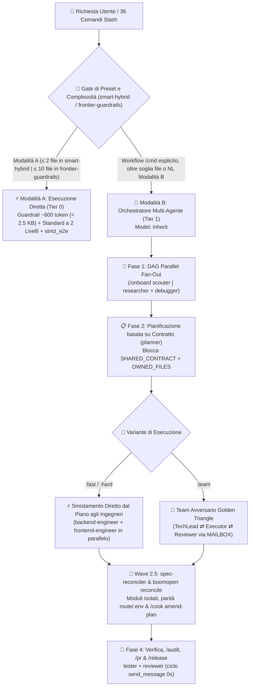

<div align="center">
  <h1>⚡ BoomOpen Workflow Kit v5.5.0</h1>
  <p><strong>Sistema Operativo IA Smart-Hybrid Multi-Piattaforma — 22 Agenti Specialisti, 18 Team Triangolo d&#39;Oro e Caveau di 1.462 Competenze On-Demand</strong></p>

  <p>
    <a href="https://github.com/Kennyboom/BoomOpen-Workflow-Kit-Pro/releases"></a>
    <a href="#platforms"></a>
    <a href="#agents"></a>
    <a href="#skills"></a>
    <a href="https://nodejs.org/">=18.0.0" /></a>
    <a href="../LICENSE"></a>
  </p>

  <p>
    <a href="../README.md">🇬🇧 English</a> • <a href="./README.vi.md">🇻🇳 Tiếng Việt</a> • <a href="./README.zh-CN.md">🇨🇳 简体中文</a> • <a href="./README.zh-TW.md">🇹🇼 繁體中文</a> • <a href="./README.ja.md">🇯🇵 日本語</a> • <a href="./README.ko.md">🇰🇷 한국어</a> • <a href="./README.es.md">🇪🇸 Español</a> • <a href="./README.fr.md">🇫🇷 Français</a> • <a href="./README.de.md">🇩🇪 Deutsch</a><br/>
    <a href="./README.pt-BR.md">🇧🇷 Português</a> • <a href="./README.ru.md">🇷🇺 Русский</a> • <a href="./README.hi.md">🇮🇳 हिन्दी</a> • <a href="./README.ar.md">🇸🇦 العربية</a> • <a href="./README.id.md">🇮🇩 Bahasa Indonesia</a> • <a href="./README.th.md">🇹🇭 ไทย</a> • <a href="./README.tr.md">🇹🇷 Türkçe</a> • <b>🇮🇹 Italiano</b>
  </p>

  <p>
    <a href="https://boomopen.com">🌐 Website</a> •
    <a href="#pillars"><b>🧠 6 Pilastri</b></a> •
    <a href="#platforms"><b>💻 5 Piattaforme</b></a> •
    <a href="#settings"><b>🎛️ 5 Preset</b></a> •
    <a href="#commands"><b>🎯 36 Comandi Slash</b></a> •
    <a href="#agents"><b>🤖 22 Agenti &amp; 18 Team</b></a> •
    <a href="#skills"><b>📚 1.462 Competenze</b></a>
  </p>
</div>

---

## 🎬 Trailer Ufficiale di Lancio (Full HD 1080p)

<div align="center">
  <a href="https://github.com/Kennyboom/BoomOpen-Workflow-Kit-Pro/raw/main/assets/media/boomopen_v55_trailer_en.mp4">
    
  </a>
  <p>
    ▶️ <a href="https://github.com/Kennyboom/BoomOpen-Workflow-Kit-Pro/raw/main/assets/media/boomopen_v55_trailer_en.mp4"><b>Clicca qui per guardare / riprodurre il Trailer Ufficiale in Full HD 1080p (MP4 con voiceover da studio)</b></a>
  </p>
</div>

---

## 🌟 Cos’è BoomOpen Workflow Kit v5.5?

**BoomOpen Workflow Kit v5.5 (Frontier-Guardrails & Multi-Platform Smart-Hybrid Edition)** è un sistema operativo multi-agente open-source che trasforma un singolo assistente di programmazione AI in un’organizzazione di ingegneria del software coordinata composta da **22 agenti specialisti** (incluso `spec-reconciler`), **18 team avversari Golden Triangle (`72` file di team)**, **36 comandi slash (`93` file di comando = `87` workflow + `6` protocolli `_ref/`)**, **14 comandi CLI**, **22 competenze chiave (`skills/`)** e **1.440 competenze specialistiche (`skills_library/`)** (**1.462** competenze indicizzate `1,462`, deduplicate tramite `~/.agents/skills_library` su **5 piattaforme**).

A differenza dei template rigidi o dei wrapper pesanti che gonfiano il contesto a ogni turno, sulle nuove installazioni BoomOpen v5.5 adotta come predefinito il preset **`⚡ smart-hybrid`** (sciame elastico proattivo al Turno 1 + routing in linguaggio naturale in 17 lingue su tutti i 5 IDE; ripristinabile con `boomopen settings reset`), offrendo al contempo il preset opzionale Slim Modalità A **`🛡️ frontier-guardrails`** (`< 2.5 KB` / `~600 tokens`, `mode_a <= 10 files`, `naturalLanguageResearchTrigger = off`) e abilitando **Sharding Elastico dello Sciame a 4 Livelli (`role#shard`)**, **Mappatura Architetturale Brownfield in 60s (`/onboard`)**, **Gate Pre-PR e Preparazione Rilasci (`/pr`, `/release`)**, **Auto-Riconciliazione Spec-to-Code Wave 2.5 (`boomopen reconcile`)**, **Audit Multi-Round Post-Completamento (`/audit`)**, **Autopilota Progetto Multi-Sessione (`/autopilot`)** e **Conduttore Multi-Motore (`/conduct`)**:
- **⚡ Preset Predefinito `smart-hybrid` — Sciame Proattivo al Turno 1 e Routing in 17 Lingue**: Nelle nuove installazioni le micro-modifiche note (`≤ 2` file) vengono eseguite direttamente in Modalità A, mentre task multi-file, ricerca approfondita, ideazione, pianificazione e workflow `/cmd` espliciti (**`/onboard`**, **`/pr` + `/pr:review`**, **`/release`**, ecc.) avviano automaticamente shard paralleli al Turno 1 (`role#shard`, `<= 3–4 OWNED_FILES`/shard) con **DAG Parallel Fan-Out**, **Blocchi File per Contratto (`SHARED_CONTRACT` + `OWNED_FILES`)**, **Auto-Riconciliazione Wave 2.5 (`boomopen reconcile` + `/cook amend-plan`)** e **Riutilizzo a Caldo (`send_message`)**.
- **🛡️ Preset Snello Opzionale `frontier-guardrails` (`< 2.5 KB` / `~600 tokens` Slim Modalità A)**: Preferisci la Modalità A diretta nativa fino a `≤ 10` file (`mode_a <= 10 files`) con verifica `strict_e2e` e zero attivazione in linguaggio naturale (`naturalLanguageResearchTrigger = off`)? Passa in `< 10ms` tramite `boomopen settings preset frontier-guardrails` (l’alias retrocompatibile `carbon-guardrails` è preservato).
- **🗺️ Ciclo di Vita Ingegneristico Completo (`/onboard`, `/pr`, `/release`, `/autopilot`, `/audit`, `/conduct`)**: Genera in 60 secondi `ARCHITECTURE-MAP.md` su repository esistenti con **`/onboard`** (zero collisioni con `/init` e zero clutter nel repo); applica gate pre-PR e review strutturate con **`/pr`** (`/pr:review`); prepara rilasci semantici e `CHANGELOG.md` con **`/release`**; governa progetti multi-fase con `.boomopen/project-ledger.json` (`ledger rollback`), `.boomopen/audit-ledger.json` (`audit rollback` + `security_scan.py` v6) e consigli multi-motore `/conduct`.
- **📚 Caveau di 1.462 Competenze Deduplicate + Template Pronti**: Precompilato in `matrix-skills/compact-index.json` per ricerca `O(1)` in 2 passaggi e condiviso via `~/.agents/skills_library` senza duplicazioni su disco, inclusi i template **`mcp-server`** e **`ai-agent-worker`**.

---

## 🏗️ Architettura Smart-Hybrid & Frontier-Guardrails (v5.5)



---

<a id="pillars"></a>

## 🧠 I 6 Pilastri Fondamentali della v5.5

1. **🌐 Parità Unificata su 5 Piattaforme con Funzionalità Native 2026 (`platforms/*`)**:
   - Installazione nativa per **Antigravity (Gemini)** (`--as-plugin` & orchestrazione Python `run_workflow`), **Claude Code** (`/plan:hard`, hook di qualità `PreCompact`/`Stop` & guardia `Bash|PowerShell`), **OpenAI Codex** (agenti `.toml` con sandbox `read-only`), **Cursor** e **GitHub Copilot**, con libreria condivisa `~/.agents/skills_library`.
2. **📏 Standard di Codifica Pragmatici a 2 Livelli (Anti-Frammentazione)**:
   - **Livello 1 (Tolleranza Zero)**: Singola Responsabilità, **VIETATO `any` esplicito**, **VIETATO lasciare `console.log` di debug**, `try/catch` + errori tipizzati ai confini async/API, costanti `SCREAMING_SNAKE_CASE`, DRY (`≥ 3`) e import ordinati.
   - **Livello 2 (Coesione Prima di Tutto)**: File mirati a `~200–350 righe` con tetto flessibile `~400–450 righe` (divisione obbligatoria solo oltre `>500 righe` o più domini; test/tipi/docs esenti). Funzioni `~20–40 righe` (`~40–80 righe` per UI/Handler).
3. **🎯 Sharding Elastico a 4 Livelli (`role#shard`), Smistamento Diretto e Riutilizzo a Caldo (`send_message`)**:
   - Creato `PLAN-{feature}.md`, i task vengono assegnati **direttamente** agli shard ingegneristici (`<= 3–4 OWNED_FILES`/shard) e riutilizzati via `send_message` con **0s di latenza** e **100% del contesto preservato**.
4. **🤝 Esecuzione Parallela basata su Contratto (`SHARED_CONTRACT` + `OWNED_FILES`) e Riconciliazione Wave 2.5**:
   - API/DTO e proprietà dei file vengono bloccati prima del codice parallelo; poi Wave 2.5 esegue `boomopen reconcile` + `spec-reconciler` (`REC-G1..G4`) per intercettare moduli isolati, discrepanze route/`.env` e clausole `[SC-*]` omesse generando delta wave con `/cook amend-plan`.
5. **🔍 5-Whys (SPIE v3.0), `/audit` Multi-Round, Checkpoint Git e Sicurezza Anti-Leakage v6**:
   - `debugger` traccia 3 ipotesi + 5-Whys; `/audit` (`R1` → approvazione utente → `/audit:fix` → `/audit:round2`) integra `security_scan.py` v6, supporta rollback sicuri (`boomopen ledger rollback`, `boomopen audit rollback`) e mantiene l’albero Git pulito al 100% tramite `<appDataDir>\brain\<conversation-id>\`.
6. **🩺 Suite CLI Integrata a 14 Comandi (`research`, `design`, `plan`, `cook`, `reconcile`, `audit`, `ledger`, `conduct`, `check`, `doctor`, `settings`, `install`, `uninstall`, `list`)**:
   - `npm run doctor` verifica 5 piattaforme, **22 agenti**, **18 team (`72` file di team)**, **36 comandi (`93` file = `87` workflow + `6` `_ref/`)** e `matrix-skills/compact-index.json` (`1,462` competenze); `reconcile`, `audit` (`audit rollback`), `ledger` (`ledger rollback`), `check --strict-phase --no-stubs`, `install antigravity --as-plugin` e `conduct` applicano gate deterministici sull’intero ciclo di vita.

---

<a id="platforms"></a>

## 💻 Piattaforme AI Supportate & Funzionalità Native 2026

| Piattaforma | Livello di Supporto | Entrypoint Globale | Percorso Framework & Capacità Native 2026 |
|----------|:-------------:|-------------------|------------------------|
| **Antigravity (Gemini)** | ✅ Nativo v5.5 | `~/.gemini/GEMINI.md` | `~/.gemini/config/skills/boomopen-workflow-kit/` • Bundle plugin `--as-plugin`, orchestrazione Python `run_workflow` & ciclo esterno `/goal` |
| **Claude Code** | ✅ Nativo v5.5 | `~/.claude/CLAUDE.md` | `~/.claude/skills/boomopen-workflow-kit/` • `/plan:hard`, hook di qualità `PreCompact`/`Stop` & guardia `Bash\|PowerShell` (`--with-hooks`) |
| **OpenAI Codex** | ✅ Nativo v5.5 | `~/.codex/CODEX.md` & `AGENTS.md` | `~/.codex/skills/boomopen-workflow-kit/` • 22 ruoli `.toml` registrati con sandbox `read-only` per shard di ricerca e review |
| **Cursor** | ✅ Nativo v5.5 | `~/.cursor/rules/boomopen-workflow-kit.mdc` | `~/.cursor/skills/boomopen-workflow-kit/` • Regola `.mdc` snella `< 2.5 KB`, `--with-hooks` & libreria condivisa `~/.agents/skills_library` |
| **GitHub Copilot** | ✅ Nativo v5.5 | `~/.copilot/COPILOT.md` | `~/.copilot/skills/boomopen-workflow-kit/` • Profilo `.agent.md` nativo & deduplicazione tramite `~/.agents/skills_library` |

---

## 🚀 Avvio Rapido e Installazione

```bash
# 1. Clona il repository
git clone https://github.com/Kennyboom/BoomOpen-Workflow-Kit-Pro.git
cd BoomOpen-Workflow-Kit-Pro

# 2. Installa per il tuo assistente AI (condivide automaticamente ~/.agents/skills_library)
npm run install:antigravity                        # Google Antigravity 2.0 (Gemini)
node cli/install.js install antigravity --as-plugin # Opzionale: pacchetto plugin nativo Antigravity
node cli/install.js install claude --with-hooks    # Anthropic Claude Code (+ hook PreCompact/Stop & Bash|PowerShell guard)
npm run install:codex                              # OpenAI Codex CLI (+ 22 agenti & sandbox read-only)
npm run install:cursor                             # Cursor AI Editor
npm run install:copilot                            # GitHub Copilot (VS Code)
npm run install:all                                # Installa su tutte le 5 piattaforme contemporaneamente

# 3. Verifica l’installazione ed esegui i 14 comandi CLI
npm run doctor
npm link
boomopen research validate path/to/RESEARCH.md
boomopen design validate path/to/DESIGN.md
boomopen plan validate path/to/PLAN.md
boomopen cook preflight path/to/PLAN.md
boomopen reconcile path/to/your/project --plan path/to/PLAN.md   # Riconciliazione Wave 2.5 (REC-G1..G4)
boomopen audit init --docs docs/prd.md,docs/arch.md              # Registro audit multi-round (supporta boomopen audit rollback)
boomopen check path/to/your/project --strict-phase --no-stubs
boomopen ledger status                                           # Stato fasi multi-sessione (supporta boomopen ledger rollback)
boomopen conduct probe
```

> Il kit **non è pubblicato su npm**: installalo solo da questo repository. Facoltativo: `npm link` aggiunge il comando `boomopen` al tuo PATH (nessun download da npm).

---

<a id="settings"></a>

## 🎛️ Impostazioni Unificate e Selezione Modalità (`/settings` Control Center)

BoomOpen v5.5 include un **Centro di Controllo Unificato a Latenza Zero** per gestire modalità di esecuzione, **5 profili predefiniti (Preset)** e 20 impostazioni (+ 2 limiti di righe) su tutte le **5 piattaforme** in `< 10ms` (**0ms di latenza al Turno 1**). Sulle nuove installazioni **`⚡ smart-hybrid`** è il **preset predefinito consigliato** (ripristinato da `boomopen settings reset`), mentre **`🛡️ frontier-guardrails`** (`< 2.5 KB` / `~600 tokens`, `mode_a <= 10 files`, `naturalLanguageResearchTrigger = off`, con alias retrocompatibile `carbon-guardrails`) è il **preset opzionale Slim Modalità A** (`boomopen settings preset frontier-guardrails`):

| Profilo (`Preset`) | Modalità di Esecuzione (`execution.mode`) | Variante Predefinita | Ricerca in Linguaggio Naturale (`naturalLanguageResearchTrigger`) | Standard di Codice (`codingStandards`) | Utilizzo Ideale |
|:---|:---|:---:|:---:|:---:|:---|
| **⚡ `smart-hybrid`** *(Consigliato Predefinito)* | **`auto`** (`≤ 2 file` → Mode A; `> 2 file` o `/cmd` → Mode B) | `auto` | **`auto_team`** *(Indirizza ricerca/ideazione a `/research:team` / `/brainstorm:team`)* | `pragmatic` (`400/500` righe) | Predefinito sulle nuove installazioni (`boomopen settings reset`) — routing NL proattivo in 17 lingue e sharding automatico al Turno 1 oltre 2 file su tutti i 5 IDE |
| **🛡️ `frontier-guardrails`** *(Slim Modalità A Opzionale)* | **`mode_a`** *(Fino a `≤ 10 file` diretti; guardrail snelli `< 2.5 KB` / `~600 tokens` + `strict_e2e`; alias `carbon-guardrails` supportato)* | `auto` | **`off`** *(Solo `/cmd` espliciti — zero intercettazioni in linguaggio naturale)* | `pragmatic` (`400/500` righe) | Velocità diretta Modalità A opzionale (`< 2.5 KB` / `~600 tokens`) con gate di qualità rigorosi `strict_e2e` |
| **🚀 `solo-fast`** | **`mode_a`** *(Forza l’esecuzione diretta in solitaria, 0s di latenza sub-agent)* | `fast` | `off` *(Risposta diretta in chat salvo digitazione di `/brainstorm`)* | `relaxed` (`600/800` righe) | Hotfix urgenti, prototipazione rapida, script e massimo risparmio di token |
| **🧠 `deep-architect`** | **`mode_b`** *(Forza l’Orchestratore Multi-Agente Mode B su ogni attività)* | `hard` | `auto_hard` *(Avvia automaticamente `/research:hard` / `/brainstorm:hard`)* | `strict` (`300/400` righe) | Architettura di sistemi complessi, progetti greenfield e refactoring multi-dominio |
| **🔺 `adversarial-team`** | **`team`** *(Forza il team avversario a 3 agenti Golden Triangle `:team`)* | `team` | **`auto_team`** *(Dibattito e revisione incrociata a 3 agenti via `MAILBOX`)* | `strict` (`300/400` righe) | Codice di produzione mission-critical, audit di sicurezza e rilasci zero-defect |

### Tre Modi per Cambiare Modalità (Chat `/settings`, Dashboard Web Locale e CLI)

```bash
# 1. Comando Slash in Chat (Menu interattivo o comando rapido)
/settings                                     # Apri il menu interattivo (ask_question UI)
/settings preset smart-hybrid                 # Predefinito consigliato (Auto Mode A/B + routing NL in 17 lingue)
/settings preset frontier-guardrails          # Slim Modalità A opzionale (≤10 file, <2.5 KB / ~600 tokens; alias carbon-guardrails)
/settings preset solo-fast                    # Passa all’esecuzione diretta veloce (Mode A)
/settings preset deep-architect               # Passa all’Orchestratore Multi-Agente (Mode B)
/settings preset adversarial-team             # Passa al team Golden Triangle a 3 agenti (:team)
/settings mode auto | mode_a | mode_b | team  # Sovrascrivi direttamente la modalità di esecuzione

# 2. Dashboard Web Locale del Centro di Controllo (http://127.0.0.1:4567)
boomopen settings --ui

# 3. Terminale CLI (Globale ~/.boomopen/settings.json e Progetto ./.boomopen.json)
boomopen settings status
boomopen settings preset smart-hybrid                     # Applica il preset predefinito e sincronizza i 5 IDE
boomopen settings preset frontier-guardrails              # Passa al preset opzionale Slim Modalità A (< 2.5 KB)
cd path/to/your/project
boomopen settings set execution.mode mode_a --project
boomopen settings reset                                   # Ripristina le impostazioni predefinite smart-hybrid
```

> `--project` scrive sempre `./.boomopen.json` nella cartella da cui lo esegui: eseguilo nel tuo progetto, non nel clone del kit. Senza `npm link`, sostituisci `boomopen` con `node /path/to/BoomOpen-Workflow-Kit-Pro/cli/install.js`.

---

## 🌙 Guida Notturna per Grandi Progetti Multi-Fase (`/autopilot` vs `/goal` + `/autopilot` + `/audit`)

> **Nota sulla Continuità per Piattaforma**: **`/goal`** è il ciclo esterno nativo (*native outer loop*) di **Antigravity (Gemini)**; su **Claude Code** e **OpenAI Codex**, la continuità autonoma multi-sessione è alimentata da **`/autopilot`** combinato con gli hook di qualità **`Stop` / `PreCompact`** (`--with-hooks`) e dal registro `.boomopen/project-ledger.json`!

| Aspetto | `/autopilot` (+ hook `Stop`/`PreCompact` su Claude Code & Codex) | `/goal` + `/autopilot` + `/audit` *(Ciclo Esterno Nativo su Antigravity)* |
|:---|:---|:---|
| **Ingestione & Registro** | Compila `docs/` in `project-ledger.json` + `PLAN` con controlli SHA-256 e `ledger rollback` | Stesso registro e `PLAN`, con `/goal` come runner esterno persistente fino al completamento totale |
| **Continuità Multi-Sessione** | Gli hook `PreCompact`/`Stop` preservano lo stato delle fasi e verificano i gate alla compattazione | Reset/ripresa automatica al ~70% del contesto; esegue `reconcile` fino al 100% di `project-ledger.json` |
| **Verifica Post-Completamento** | Applica `check --strict-phase --no-stubs` e `/autopilot:audit` a fine fase | Chiude con il ciclo `/audit` completo (Round 1 → report per approvazione → `/audit:fix` → `/audit:round2` + Sicurezza v6) |

### Prompt Pronto da Copiare per Progetti Notturni Multi-Fase

```text
/goal Usa /autopilot per leggere tutte le specifiche in docs/ e completare il progetto in tutte le sue fasi:
1. Inizializza e verifica project-ledger.json e i piani PLAN assicurando una copertura del 100% dei requisiti.
2. Implementa ogni fase con shard paralleli, esegui test reali e verifica il Wave 2.5 con reconcile + spec-reconciler al termine di ogni fase.
3. Al completamento di tutte le fasi, esegui /audit (Round 1 + Sicurezza v6) e presenta tutti i risultati nel report in attesa della mia approvazione prima di applicare modifiche.
```

---

<a id="commands"></a>

## 🎯 Riferimento Comandi Slash (36 Comandi / 93 File)

| Comando | Varianti | Scopo Principale |
|---------|----------|-----------------|
| **`/onboard`** | — | Mappatura architetturale brownfield in 60s (`ARCHITECTURE-MAP.md`: entrypoint, flussi dati, hotspot di rischio e gate di test; zero collisioni `/init`) |
| **`/cook`** | `:fast`, `:hard`, `:team`, `amend-plan` | Sviluppo completo end-to-end (Ricerca/Scout → Piano → Codice Parallelo → Wave 2.5 `reconcile` → Test → Revisione) |
| **`/code`** | `:fast`, `:hard`, `:team` | Esegue l’implementazione direttamente a partire da un `PLAN-{feature}.md` esistente |
| **`/plan`** | `:fast`, `:hard`, `:team` | Crea blueprint di implementazione con `SHARED_CONTRACT`, `OWNED_FILES` e criteri Given/When/Then (incluso `/plan:hard` su Claude Code) |
| **`/fix`** | `:fast`, `:hard`, `:team` | Risoluzione dei bug alla radice con verifica obbligatoria tramite test di regressione |
| **`/debug`** | `:fast`, `:hard`, `:team` | Indagine della causa radice con 3 ipotesi + catena causale **5-Whys (SPIE v3.0)** (`DEBUG-{issue}.md`) |
| **`/test`** | `:fast`, `:hard`, `:team` | Esecuzione parallela DAG delle suite di test + ricerca di casi limite non coperti (`tester` + `scouter`) |
| **`/review`** | `:fast`, `:hard`, `:team` | Audit parallelo a 4 dimensioni (Architettura, Qualità del Codice, Sicurezza OWASP, Prestazioni) |
| **`/pr`** | `create`, `:review` (`/pr:review`) | Gate rigoroso pre-PR (`check`, `reconcile`, diff test), igiene branch/commit e creazione `gh pr create` o revisione `/pr:review` |
| **`/audit`** | `:run`, `:round2`, `:fix`, `:auto` | Audit multi-round post-completamento: Round 1 → revisione utente → `/audit:fix` → `/audit:round2` (Sicurezza v6, RTM e `audit rollback`) |
| **`/design`** | `:fast`, `:hard`, `:team` | Architettura di sistema, schema del database e specifiche UI/UX (`DESIGN.md`) |
| **`/docs`** | `:core`, `:business`, `:audit` | Genera o sincronizza la documentazione strutturata a 2 livelli di architettura e business (`./documents/`) |
| **`/release`** | `patch`, `minor`, `major` | Preparazione rilascio semantico: audit Conventional Commits, sintesi `CHANGELOG.md`, gate (`doctor`, `check`, `test`, `test:pack`) e `gh release create` |
| **`/deploy`** | `:check`, `:preview`, `:production`, `:rollback` | Controlli pre-deploy, ambienti di anteprima, rilascio in produzione e rollback sicuro |
| **`/research`** | `:fast`, `:hard`, `:team` | Motore autonomo di ricerca approfondita (triangolazione a 4 fonti, ricerca a 3 ondate e consiglio a 3 vettori) |
| **`/brainstorm`** | `:fast`, `:hard`, `:team` | Scoperta socratica dei requisiti, analisi dei trade-off e ideazione |
| **`/report`** | `:fast`, `:hard`, `:team` | Report di sintesi esecutivi e tecnici completi di metriche e diagrammi |
| **`/autopilot`** | `:init`, `:run`, `:audit` | Orchestratore autonomo multi-sessione con `.boomopen/project-ledger.json`, ratchet a 4 livelli e `ledger rollback` |
| **`/conduct`** | `:council`, `:pipeline` | Conduttore multi-motore e consiglio parallelo (`boomopen conduct`) con sintesi di consenso in 4 parti |
| **`/orchestrate`** | — | Orchestrazione personalizzata di pipeline multi-agente attraverso più domini |
| **`/settings`** | `preset`, `mode`, `set`, `ui` | Centro di Controllo Unificato: cambia modalità, scegli tra **5 preset** (`smart-hybrid` predefinito, `frontier-guardrails` opzionale) o apri Web UI (`--ui`) |
| **`/save` / `/recap`** | — | Salva lo stato della sessione (`SESSION-HANDOVER.md`) e ripristina l’intero contesto in `< 5s` |

---

<a id="agents"></a>

## 🤖 22 Agenti Specialisti e 18 Team Golden Triangle (72 File)

| Categoria | Agenti Specialisti (`agents/*.md`) | Team Golden Triangle (`agents/teams/*-team/`) |
|----------|-----------------------------------|------------------------------------------------|
| **Ingegneria ed Esecuzione** | `backend-engineer`, `frontend-engineer`, `mobile-engineer`, `game-engineer`, `database-architect`, `devops-engineer` | `backend-team`, `frontend-team`, `fullstack-team`, `mobile-team`, `game-team`, `database-team`, `devops-team` |
| **Architettura e Pianificazione** | `tech-lead`, `planner`, `brainstormer`, `business-analyst`, `project-manager`, `designer` | `planning-team`, `brainstorm-team`, `project-team`, `design-team` |
| **Qualità, Sicurezza, Debug & Riconciliazione** | `debugger`, `tester`, `reviewer`, `spec-reconciler`, `security-engineer`, `performance-engineer` | `debug-team`, `qa-team`, `security-team`, `performance-team` |
| **Ricerca e Conoscenza** | `researcher`, `scouter`, `docs-manager`, `reporter` | `research-team`, `docs-team`, `report-team` |

---

<a id="skills"></a>

## 📚 Caveau di 1.462 Competenze (22 Core + 1.440 di Libreria)

BoomOpen include **1.462 competenze indicizzate** (`1,462` voci) deduplicate su disco tramite **`~/.agents/skills_library`** e progettate per **0 consumo di token a riposo** tramite **Risoluzione Progressiva O(1) in 2 Passaggi** (`<skills>` → `matrix-skills/compact-index.json` → caricamento mirato di `SKILL.md` su richiesta):

| Livello / Dominio di Competenza | Numero | Competenze e Capacità Rappresentative | Meccanismo di Caricamento |
|:---|:---:|:---|:---|
| **⚡ Livello 1: Competenze Core (`skills/`)** | **22** | `clean-code`, `debugger`, `plan-writing`, `brainstorming`, `frontend-design`, `frontend-architecture`, `design-spec`, `api-patterns`, `database-design`, `testing-patterns`, `skill-seeker` | Pre-indicizzato in `<skills>` per accesso istantaneo al Turno 1 |
| **🎨 Design UI/UX, Motion e Design System** | **42** | Anti-AI-Slop Visual Craft, palette OKLCH e Bento Grids, Motion v12 + CSS View Transitions, primitive headless (`cmdk`/`vaul`/`sonner`), Figma MCP + W3C DTCG Tokens, WCAG 2.2 AA/AAA, iOS 18 HIG e Material 3 Expressive | Su richiesta via `compact-index.json` (`matrix-skills/design.yaml`) |
| **🌐 Web, Backend e Sistemi Distribuiti** | **390+** | Next.js 15/React 19, Hono RPC, FastAPI, NestJS, Go/Rust Axum, GraphQL, gRPC, Redis/Kafka, Supabase RLS, SaaS multi-tenant | Su richiesta via `~/.agents/skills_library` |
| **🤖 IA, Agenti LLM, MCP e Data Engineering** | **320+** | Template **`mcp-server`** e **`ai-agent-worker`**, MCP FastMCP (`StreamableHTTP`), OpenAI/Claude/Google ADK, pipeline RAG, LangGraph, BigQuery, dbt | Su richiesta via `~/.agents/skills_library` |
| **☁️ Cloud, DevOps, Kubernetes e Sicurezza** | **300+** | Cloudflare Workers/D1/R2/DO, Terraform/OpenTofu, AWS/GCP/Azure, Docker/K8s GitOps, Sicurezza a 2 Livelli v6 e OWASP LLM Top 10 | Su richiesta via `~/.agents/skills_library` |
| **📱 Mobile, Game Engine e Domini Specializzati** | **410+** | Tauri v2, SwiftUI, Kotlin, React Native, Flutter, Unity 6 DOTS, Unreal Engine 5, Godot 4, WebGPU/Three.js TSL, Colyseus | Su richiesta via `~/.agents/skills_library` |

---

## 📂 Struttura del Repository

```text
BoomOpen-Workflow-Kit-Pro/
├── agents/                  # 22 Agenti Specialisti + 18 Team Golden Triangle (54 file di ruolo + 18 _team.md = 72 file)
├── cli/                     # Suite CLI a 14 Comandi: install, uninstall, list, doctor, check, settings, research, design, plan, cook, reconcile, audit, ledger & conduct
├── commands/                # 36 comandi Slash (87 workflow: /onboard, /pr, /pr:review, /release, /audit, /autopilot, /conduct, ecc.) + 6 protocolli _ref/ (93 file)
├── documents/               # Documentazione a 2 livelli di Architettura, Dominio, Codice Sorgente e Standard
├── i18n/                    # Documentazione multilingue (16 traduzioni complete del README)
├── matrix-skills/           # Matrici YAML delle competenze per dominio + compact-index.json precompilato (1.462 competenze)
├── platforms/               # Template unificati per le 5 piattaforme (antigravity/, claude/, codex/, copilot/, cursor/) + hook e plugin
├── rules/                   # Regole Modalità B caricate su richiesta (CORE, PHASES, AGENTS, TEAMS, SKILLS, ERRORS, REFERENCE)
├── scripts/                 # Script Python di automazione e verifica (checklist.py, verify_all.py, security_scan.py, ecc.)
├── skills/                  # 22 Competenze Chiave (clean-code, debugger, plan-writing, frontend-design, ecc.)
├── skills_library/          # 1.440 competenze deduplicate tramite ~/.agents/skills_library (inclusi i template mcp-server & ai-agent-worker)
└── GEMINI.md | CLAUDE.md | CODEX.md | COPILOT.md | CURSOR.md | AGENT.md
```

---

## 📄 Licenza e Sicurezza

- **Licenza**: Distribuito sotto [Licenza MIT](../LICENSE). Copyright © 2026 **BoomOpen Labs**. Le skill di terze parti in `skills_library/` mantengono le loro licenze originali: vedi [THIRD_PARTY_NOTICES.md](../THIRD_PARTY_NOTICES.md).
- **Politica di Sicurezza**: Consulta [SECURITY.md](../SECURITY.md) per le protezioni di sicurezza integrate e le linee guida sulla segnalazione delle vulnerabilità.
