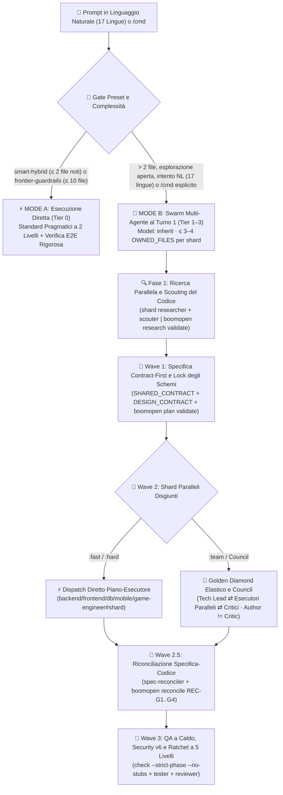

<div align="center">
  <h1>⚡ BoomOpen Workflow Kit Pro v5.5</h1>
  <p><strong>Orchestrazione multi-agente e controlli deterministici da CLI per Antigravity, Claude Code, OpenAI Codex, Cursor e GitHub Copilot.</strong></p>

  <p>
    <a href="https://boomopen.com"></a>
    <a href="https://github.com/Kennyboom/BoomOpen-Workflow-Kit-Pro/releases"></a>
    <a href="#platforms"></a>
    <a href="#cli"></a>
    <a href="#skills"></a>
    <a href="https://nodejs.org/">= 18.0.0" /></a>
    <a href="../LICENSE"></a>
  </p>

  <p>
    <a href="../README.md">English</a> •
    <a href="./README.vi.md">Tiếng Việt</a> •
    <a href="./README.zh-CN.md">简体中文</a> •
    <a href="./README.zh-TW.md">繁體中文</a> •
    <a href="./README.ja.md">日本語</a> •
    <a href="./README.ko.md">한국어</a> •
    <a href="./README.es.md">Español</a> •
    <a href="./README.fr.md">Français</a> •
    <a href="./README.de.md">Deutsch</a><br/>
    <a href="./README.pt-BR.md">Português (BR)</a> •
    <a href="./README.ru.md">Русский</a> •
    <a href="./README.hi.md">हिन्दी</a> •
    <a href="./README.ar.md">العربية</a> •
    <a href="./README.id.md">Bahasa Indonesia</a> •
    <a href="./README.th.md">ไทย</a> •
    <a href="./README.tr.md">Türkçe</a> •
    <b>Italiano</b>
  </p>

  <p>
    <a href="https://boomopen.com"><b>🌐 boomopen.com (15 Lingue)</b></a> •
    <a href="#trailer"><b>🎬 Video di Lancio</b></a> •
    <a href="#why-boomopen"><b>⚡ Perché BoomOpen</b></a> •
    <a href="#architecture"><b>🏗️ Architettura</b></a> •
    <a href="#quickstart"><b>🚀 Avvio Rapido</b></a> •
    <a href="#cli"><b>🛠️ 14 Gate CLI</b></a> •
    <a href="#settings"><b>🎛️ Preset e Impostazioni</b></a> •
    <a href="#commands"><b>🎯 36 Comandi</b></a> •
    <a href="#agents"><b>🤖 22 Agenti e 18 Team</b></a> •
    <a href="#skills"><b>📚 1.462 Skill</b></a>
  </p>
</div>

---

<a id="trailer"></a>

## 🎬 Video di Lancio ed Esploratore Web Interattivo (`boomopen.com`)

<div align="center">
  <a href="https://github.com/Kennyboom/BoomOpen-Workflow-Kit-Pro/raw/main/assets/media/boomopen_v55_trailer_en.mp4">
    
  </a>
  <p>
    ▶️ <a href="https://github.com/Kennyboom/BoomOpen-Workflow-Kit-Pro/raw/main/assets/media/boomopen_v55_trailer_en.mp4"><b>Riproduci il Video di Lancio in Full HD 1080p (MP4 con voce narrante da studio)</b></a> • 🌐 <a href="https://boomopen.com"><b>Prova il Playground CLI a 14 Comandi e i Cataloghi Ricercabili su boomopen.com (15 Lingue)</b></a>
  </p>
</div>

---

<a id="why-boomopen"></a>
<a id="-what-is-boomopen-workflow-kit"></a>

## ⚡ Perché BoomOpen Workflow Kit?

**I Limiti degli Assistenti di Codifica Tradizionali:** Senza una struttura di coordinamento, gli strumenti AI a singolo agente perdono affidabilità appena il lavoro coinvolge più file, domini applicativi o sessioni. L'esplorazione sequenziale dei file satura la finestra di contesto principale, sotto-agenti non coordinati sovrascrivono file condivisi o lasciano moduli isolati non collegati, il codice generato introduce silenziosamente `TODO` stub o forzature di tipo `any`, le revisioni eseguite dallo stesso modello ignorano i propri punti ciechi (`Author == Critic`) e gli sviluppi multi-fase divergono dalle specifiche iniziali.

**Come Risolve BoomOpen:** BoomOpen installa un layer unificato di orchestrazione multi-agente e controlli deterministici da CLI su **Antigravity (Gemini)**, **Claude Code**, **OpenAI Codex**, **Cursor** e **GitHub Copilot**, con **zero dipendenze npm a runtime**. Con il profilo predefinito **`smart-hybrid`**, le modifiche mirate su `≤ 2` file noti vengono eseguite direttamente senza overhead, mentre sviluppi multi-file, ricerche approfondite, pianificazione architetturale e **`36` comandi slash (`93` file)** suddividono automaticamente il carico fin dal Turno 1 tra **22 agenti specialisti** e **18 team avversariali a 3 ruoli** — verificati da **14 gate locali della CLI `boomopen`** e supportati da **`1.462` skill on-demand** (`22` Core + `1.440` deduplicate una sola volta in `~/.agents/skills_library`).

### ⚖️ Senza BoomOpen vs. Con BoomOpen v5.5

| Criticità Ingegneristica | Senza BoomOpen (IDE AI Standard) | Con BoomOpen Workflow Kit Pro v5.5 |
|:-------------------------|:---------------------------------|:-----------------------------------|
| **Saturazione della Finestra di Contesto** | L'agente principale legge 15–30 file in sequenza prima di scrivere una riga di codice | **Swarm Elastico al Turno 1 (`role#shard`)**: Avvia scout in sola lettura e shard di dominio (`≤ 3–4` file/shard) + riutilizzo a caldo in `0s` (`send_message`) |
| **Sovrascritture Parallele e Moduli Scollegati** | Agenti paralleli sovrascrivono file comuni, creano route `/api` incoerenti o lasciano moduli orfani | **Lock Contract-First + Riconciliazione Wave 2.5**: Blocca `SHARED_CONTRACT` in Wave 1 + `OWNED_FILES` disgiunti, verificati da `boomopen reconcile` (`REC-G1..G4`) |
| **Ricerche Superficiali e Piani Generici** | Risposte accondiscendenti a prospettiva singola, ipotesi non verificate e piani discorsivi | **Specifiche a 6 Blocchi Basate su Evidenze**: Devil's Advocate `:team` + validatori CLI in `< 50ms` (`boomopen research`, `design`, `plan`) |
| **Stub Silenziosi, `any` e Test Aggirati** | L'agente dichiara concluso il task lasciando `// TODO`, `any` espliciti, `console.log` o test `.skip` | **Gate Statico Pragmatico a 2 Livelli**: `boomopen check --strict-phase --no-stubs` impone `0` `any`, `0` stub e file coesi entro `400/500` righe |
| **Deriva Multi-Sessione e Regressioni** | La compattazione del contesto cancella i vincoli delle fasi precedenti rompendo feature già validate | **Ratchet di Qualità a 5 Livelli e Rollback**: `.boomopen/project-ledger.json` con controllo SHA-256, `/autopilot`, `/audit` e `rollback --yes` atomico |
| **Punti Ciechi del Singolo Modello** | Lo stesso modello scrive e revisiona il proprio codice (`Author == Critic`) | **Conductor Multi-Engine (`/conduct`)**: Council paralleli e pipeline cross-family tra Claude Code, Codex, Antigravity, Cursor e Copilot |
| **Frammentazione su 5 IDE e Git Sporco** | File di istruzioni separati per IDE, gigabyte di skill duplicate e file temporanei in `git status` | **Sync Unificato e Git Pulito**: 14 file di ingresso sincronizzati in `< 10ms`, unica `~/.agents/skills_library` (`0` token inattivi) e Brain Artifacts |

---

<a id="architecture"></a>
<a id="-smart-hybrid-architecture-v55"></a>

## 🏗️ Architettura Smart-Hybrid (v5.5)



---

<a id="pillars"></a>

## 🧠 6 Pilastri Architetturali

1. **🌐 Compilazione Nativa per 5 IDE e Vault Deduplicato (`platforms/*`)**:
   - Compila **22 agenti specialisti** e **93 file di comando e riferimento** nei formati nativi di ciascun IDE: **Antigravity** (bundle `--as-plugin` + `3` script Python eseguibili tramite `run_workflow`: `audit_fanout.py`, `review_fanout.py`, `research_fanout.py`), **Claude Code** (shard con `isolation: worktree`, comandi `/plan:hard`, hook opzionali `PreToolUse` e `Stop`/`PreCompact`), **OpenAI Codex** (`22` ruoli TOML con sandbox di sistema `read-only` per scout/revisori + `87` skill `$boomopen-*`), **Cursor** (regole `.mdc` + hook opzionale `beforeShellExecution`) e **GitHub Copilot** (agenti `.agent.md`).
   - Collega tutte le `1.440` skill di libreria una sola volta in `~/.agents/skills_library` per tutti i 5 IDE (~80% di spazio su disco risparmiato e `0` consumo di token al Turno 1).
2. **🎯 Swarm Elastico Dinamico a 4 Tier (`role#shard`) e Riutilizzo Sessioni a Caldo**:
   - Scala automaticamente da **Tier 0** (`0` sotto-agenti per `≤ 2` file noti) → **Tier 1** (`2–3` shard) → **Tier 2** (`4–6` shard) → **Tier 3** (`7–8+` shard, configurabile fino a `16`), limitando il carico cognitivo a **`≤ 3–4 OWNED_FILES` per sotto-agente** e riutilizzando le sessioni attive tramite `role#shard → conversationId` (`send_message`).
3. **🤝 Esecuzione Contract-First in 3 Wave + Riconciliazione Wave 2.5 (`REC-G1..G4`)**:
   - La Wave 1 congela `SHARED_CONTRACT` (schemi API/DTO) e `DESIGN_CONTRACT` (CSS `@theme` OKLCH + prop TypeScript) prima che la Wave 2 avvii gli sviluppatori in parallelo. La Wave 2.5 esegue `boomopen reconcile` + `spec-reconciler` per intercettare file isola non importati (`REC-G1`), disallineamenti di route frontend/backend (`REC-G2`), clausole `[SC-*]` omesse (`REC-G3`) e variabili mancanti in `.env.example` (`REC-G4`), generando wave correttive tramite `boomopen cook amend-plan`.
4. **🏛️ Autopilot Multi-Sessione (`/autopilot`) e Audit Multi-Round Stateful (`/audit`)**:
   - Compila specifiche multi-documento in `.boomopen/project-ledger.json` con rilevamento SHA-256 delle modifiche, checkpoint Git pre-fase (`boomopen ledger rollback --yes`) e un **Ratchet di Qualità a 5 Livelli** (`G1 check --strict-phase --no-stubs` → `G2 ratchet monotono dei test` → `G3 reconcile --strict` → `G4 review Author != Critic` → `G5 ledger verify`). A fine sviluppo, `/audit` coordina round di verifica con approvazione umana su matrice RTM, flussi verticali e Security v6 (`.boomopen/audit-ledger.json` + `boomopen audit rollback --yes`).
5. **🎼 Conductor Cross-Engine e Council Multi-Modello (`boomopen conduct`)**:
   - Coordina simultaneamente Claude Code, OpenAI Codex, Antigravity, Cursor e Copilot in **Council Paralleli su 6 Task** (`research`, `brainstorm`, `plan`, `design`, `review`, `debug` → `COUNCIL-SYNTHESIS.md` in 4 sezioni) oppure in **Pipeline Cross-Family** dove nessun modello valuta il proprio output (`Author != Critic`).
6. **📏 Standard di Codifica Pragmatici a 2 Livelli e Debug Causale SPIE v3.0**:
   - **Livello 1 (Tolleranza Zero)**: Singola responsabilità, `0` `any` espliciti, `0` `console.log` di debug nel codice applicativo, blocchi `try/catch` tipizzati ai confini asincroni e costanti `SCREAMING_SNAKE_CASE`. **Livello 2 (Coesione Prima dei Tagli Meccanici)**: Target `~200–350` righe (`400` soglia flessibile / `500` massima; test, tipi e documentazione esclusi). Il debug applica 3 ipotesi ordinate e analisi **5-Whys (SPIE v3.0)** salvando i report temporanei nei Brain Artifacts (`100%` working tree Git pulito).

---

<a id="platforms"></a>
<a id="-supported-ai-platforms"></a>

## 💻 5 Piattaforme di Sviluppo AI Supportate

| Piattaforma | Supporto | Entrypoint Sincronizzati | Integrazione Nativa con la Piattaforma |
|:------------|:--------:|:-------------------------|:---------------------------------------|
| **Antigravity (Gemini)** | ✅ v5.5 | `~/.gemini/GEMINI.md` | `invoke_subagent`, fan-out Python `run_workflow`, ciclo esterno `/goal`, bundle `--as-plugin`, `--with-hooks` opzionale e Brain Artifacts |
| **Claude Code** | ✅ v5.5 | `~/.claude/CLAUDE.md` | Shard paralleli `Task`/`Agent` (`isolation: worktree`), comandi `/plan:hard`, hook opzionali `PreToolUse` e `Stop`/`PreCompact` |
| **OpenAI Codex** | ✅ v5.5 | `~/.codex/AGENTS.md` e `CODEX.md` | `22` ruoli TOML in `~/.codex/agents/boomopen/` con `sandbox_mode = "read-only"` a livello OS per scout/revisori + `87` skill `$boomopen-*` |
| **Cursor** | ✅ v5.5 | `~/.cursor/rules/boomopen-workflow-kit.mdc` | Regole frontmatter `.mdc` sempre attive, `CURSOR.md`, routing dei sotto-agenti e `.cursor/hooks.json` opzionale (`beforeShellExecution`) |
| **GitHub Copilot** | ✅ v5.5 | `~/.copilot/copilot-instructions.md` | Agente compilato VS Code `boomopen-workflow-kit.agent.md`, dispatch tramite `runSubagent` e `COPILOT.md` |

---

<a id="quickstart"></a>
<a id="-quick-start--installation"></a>

## 🚀 Avvio Rapido e Installazione (Solo Git — Zero Dipendenze a Runtime)

```bash
# 1. Clona il repository (distribuito esclusivamente via GitHub — non pubblicato su npm)
git clone https://github.com/Kennyboom/BoomOpen-Workflow-Kit-Pro.git
cd BoomOpen-Workflow-Kit-Pro

# 2. Installa per il tuo IDE AI (preset predefinito: smart-hybrid) oppure su tutti i 5 IDE insieme
npm run install:all                                 # Installa e sincronizza tutti i 5 IDE + ~/.agents/skills_library condivisa
npm run install:antigravity                         # Google Antigravity 2.0 (aggiungi --as-plugin / --with-hooks se richiesto)
node cli/install.js install claude --with-hooks     # Claude Code + hook opzionali PreToolUse e Stop/PreCompact
npm run install:codex                               # OpenAI Codex CLI + sandbox OS read-only per scout e revisori
npm run install:cursor                              # Cursor (passa --with-hooks per la guardia beforeShellExecution)
npm run install:copilot                             # GitHub Copilot (.agent.md per VS Code + copilot-instructions.md)

# 3. Verifica l'integrità e collega opzionalmente `boomopen` nel PATH globale
npm run doctor
npm link
boomopen settings status
```

> **Installazione e Disinstallazione Non Distruttive**: Tracciate tramite manifest SHA-256 (`~/.boomopen/manifests/<tool>.json`). Le regole personali presenti in `GEMINI.md` / `CLAUDE.md` fuori dai delimitatori del kit vengono preservate con backup automatico; `boomopen uninstall <tool|--all>` rimuove in modo pulito i soli file non modificati del kit lasciando intatti i tuoi file.

---

<a id="cli"></a>

## 🛠️ 14 Sottocomandi CLI Senza Dipendenze (`boomopen`)

Esecuzione locale in `< 50ms` su Node.js `>= 18` con **zero dipendenze npm a runtime** e **zero chiamate di rete**:

| Sottocomando | Flag e Sintassi Principale | Gate Deterministici e Scopo |
|:-------------|:---------------------------|:----------------------------|
| **`install` / `uninstall` / `list`** | `<tool\|--all> [--with-hooks] [--as-plugin]` | Installer con manifest SHA-256, collegamento unico a `~/.agents/skills_library`, hook opzionali e rimozione pulita |
| **`doctor`** | `[--source-only]` | Audit in sola lettura su 30 controlli per i 5 bundle IDE, `93` file comando, `72` file team, `1.462` skill e impostazioni |
| **`settings`** | `status \| preset <name> \| set <k> <v> \| --ui` | Gestione dei 5 preset + `22` chiavi (`--project` per `./.boomopen.json`) o Web UI locale protetta da CSP (`127.0.0.1:4567`) |
| **`research`** | `<validate\|brief> <file.md> [--mode brainstorm]` | Applica **`RES-G1..G4`** (`≥ 4` fonti triangolate, matrice delle contraddizioni, rischi pre-mortem) e compila `HANDOFF_BRIEF` |
| **`design`** | `<validate\|contract> <DESIGN.md> [--json]` | Applica **`DESIGN-G1..G4`** (specifica a 6 blocchi, token OKLCH, Matrice UI a 5 Stati, WCAG 2.2 AA) ed emette `DESIGN_CONTRACT` |
| **`plan`** | `<validate\|compile> <PLAN.md> [--sync-ledger]` | Applica **`PLAN-G1..G5`** (DAG aciclico, `OWNED_FILES ≤ 4` disgiunti per shard, `SHARED_CONTRACT`) e sincronizza il ledger |
| **`cook`** | `<state\|packets\|verify-wave\|preflight\|amend-plan>` | Applica **`COOK-G1..G4`**: stato fast-forward a 5 stadi, pacchetti handoff a 5 campi, controllo write-lock Git e delta wave |
| **`reconcile`** | `<dir> [--plan <PLAN.md>] [--strict]` | Wave 2.5 **`REC-G1..G4`**: rileva moduli isola non collegati, disallineamenti route `/api`, clausole `[SC-*]` saltate e `.env.example` |
| **`check`** | `[path] --strict-phase --no-stubs [--ignore <dir>]` | Gate statico a 2 Livelli: budget `400/500` righe, `0` `any` espliciti, `0` `console.log` di debug, `0` stub/`TODO`/`.skip` |
| **`ledger`** | `<init\|from-plan\|status\|next\|verify\|rollback>` | Macchina a stati DAG multi-sessione `.boomopen/project-ledger.json`, guardia SHA-256 sulle specifiche e `rollback --yes` atomico |
| **`audit`** | `<init\|slice\|record\|approve\|verify-fix\|rollback>` | Ledger stateful per audit multi-round post-rilascio (`.boomopen/audit-ledger.json`), burn-down ratchet e `rollback --yes` |
| **`conduct`** | `<probe\|council\|dispatch\|status> [--dry-run]` | Conductor cross-engine e Council parallelo su 6 task (`Author != Critic` tra i 5 IDE → `COUNCIL-SYNTHESIS.md`) |

---

<a id="settings"></a>
<a id="-unified-settings--mode-selection-settings"></a>

## 🎛️ Centro di Controllo Unificato e 5 Preset (`/settings`)

Gestisci **`20` chiavi enum + `2` soglie personalizzate di righe** a livello globale (`~/.boomopen/settings.json`) o per singolo repository (`./.boomopen.json`), sincronizzate in `< 10ms` su tutti i 14 file di ingresso IDE:

| Profilo Preset | Modalità di Esecuzione (`execution.mode`) | `/cmd` Predef. | Routing NL in 17 Lingue (`naturalLanguageResearchTrigger`) | Standard Codice | Ambito Consigliato |
|:---------------|:------------------------------------------|:--------------:|:----------------------------------------------------------:|:---------------:|:-------------------|
| **⚡ `smart-hybrid`** *(Default / Predefinito)* | **`auto`** (`≤ 2` file diretto; `> 2` file o `/cmd` → Swarm Mode B) | `auto` | **`auto_team`** *(Indirizza ricerca/ideazione/review NL su `:team` e workflow in 17 lingue)* | `pragmatic` (`400/500`L) | Esperienza predefinita pronta all'uso: routing naturale degli intenti + sharding parallelo al Turno 1 |
| **🛡️ `frontier-guardrails`** *(Slim Opt-In)* | **`mode_a`** (`≤ 10` file diretto; entrypoint `< 2.5 KB` / `~600` token) | `auto` | **`off`** *(Solo `/cmd` espliciti — nessuna intercettazione NL)* | `pragmatic` (`400/500`L) | Modalità diretta quotidiana ultra-compatta (`< 2.5 KB`) con gate 2-Tier ed E2E *(alias `carbon-guardrails`)* |
| **🚀 `solo-fast`** | **`mode_a`** (`≤ 10` file diretto; limite conservativo di `3` shard) | `fast` | `off` | `relaxed` (`600/800`L) | Prototipazione rapida, piccoli script, hotfix urgenti e consumo minimo di token |
| **🧠 `deep-architect`** | **`mode_b`** *(Orchestratore Mode B rigoroso; max `12` shard)* | `hard` | `auto_hard` + ricerca `council` / review `cross_family` | `strict` (`300/400`L) | Architetture distribuite complesse, progetti greenfield e refactoring cross-modulo |
| **🔺 `adversarial-team`** | **`team`** *(Golden Diamond Elastico `:team`; `hyper_swarm` max `12`)* | `team` | **`auto_team`** + ricerca, piano e review in `council` | `strict` (`300/400`L) | Rilasci mission-critical in produzione, security audit e consenso multi-engine |

```bash
# Cambia preset o personalizza i parametri via Chat (/settings), Web UI Locale (--ui) o CLI:
boomopen settings --ui                                      # Avvia il Centro di Controllo Web su http://127.0.0.1:4567
boomopen settings preset smart-hybrid                       # Predefinito: Mode A/B automatico + routing NL in 17 lingue
boomopen settings preset frontier-guardrails                # Opzionale: Mode A compatto < 2.5 KB (alias: carbon-guardrails)
boomopen settings set engines.reviewer cross_family         # Impone un Reviewer di famiglia diversa (Author != Critic)
cd path/to/your/repo && boomopen settings mode team --project # Override locale di repository in ./.boomopen.json
boomopen settings reset                                     # Ripristina la configurazione predefinita smart-hybrid
```

---

<a id="commands"></a>
<a id="-slash-commands-reference"></a>

## 🎯 Riferimento Completo dei 36 Comandi Slash (`93` File = `87` Workflow + `6` `_ref/`)

Scrivi normalmente in **una qualsiasi delle 17 lingue supportate** con `smart-hybrid` oppure invoca in modo esplicito uno dei **36 comandi slash canonici**:

| Categoria | Comando | Varianti | Scopo e Deliverable Deterministici |
|:----------|:--------|:---------|:-----------------------------------|
| **Orchestrazione e Autonomia** | **`/cook`** | `:fast`, `:hard`, `:team` | Sviluppo feature end-to-end senza piano esistente (Scout → Piano Contract-First → Shard Paralleli → Wave 2.5 Reconcile → QA) |
| | **`/code`** | `:fast`, `:hard`, `:team` | Esegue direttamente un `PLAN-{task}.md` approvato lungo gli shard delle Wave 1–3 senza rieseguire `/plan` |
| | **`/autopilot`** | `:init`, `:run`, `:audit` | Orchestratore multi-sessione da specifica a produzione tramite `.boomopen/project-ledger.json` e **Ratchet a 5 Livelli** |
| | **`/conduct`** | `:council`, `:pipeline` | Council parallelo multi-engine (`COUNCIL-SYNTHESIS.md`) e pipeline di ruoli cross-family sui 5 IDE (`--dry-run` incluso) |
| | **`/orchestrate`** / **`/auto`** | — | Coordinamento personalizzato di swarm multi-dominio (`/orchestrate`) o esecuzione autonoma completa end-to-end (`/auto`) |
| **Architettura, Design e Ricerca** | **`/plan`** | `:fast`, `:hard`, `:team` | Blueprint `PLAN-{task}.md` a 5 gate con lock su `SHARED_CONTRACT`, `OWNED_FILES ≤ 4`/shard e criteri Given/When/Then |
| | **`/architect`** | — | Blueprint architetturale puro: diagrammi C4, ADR, schemi DB, contratti API, specifiche schermate e copertura (zero codice scritto) |
| | **`/design`** / **`/ui-ux-pro-max`** | `:fast`, `:hard`, `:team` | Specifica UI/UX a 6 blocchi `DESIGN-{task}.md` + `DESIGN_CONTRACT` (token OKLCH `@theme`, Matrice UI a 5 Stati, 50+ stili e preview HTML) |
| | **`/research`** | `:fast`, `:hard`, `:team` | Ricerca Approfondita a 5 Lenti (`RESEARCH-{topic}.md`, triangolazione `RES-G1..G4` su `≥ 4` fonti, contraddizioni e `HANDOFF_BRIEF`) |
| | **`/brainstorm`** / **`/ask`** | `:fast`, `:hard`, `:team` | Ideazione strategica anti-accondiscendenza (`BRAINSTORM-{topic}.md` con pre-mortem e matrice MCDA) e Q&A verificato (`/ask`) |
| **Qualità, Audit, Debug e Sicurezza** | **`/review`** | `:fast`, `:hard`, `:team` | Code review avversariale multi-prospettiva su architettura, sicurezza e performance (`Author != Critic`, passaggio rapido a `/fix`) |
| | **`/audit`** / **`/deep-audit`** | `:run`, `:fix`, `:auto` | Audit multi-round dell'intero progetto post-sviluppo (ledger `/audit`) e audit logico pre-codice su 10 dimensioni (`/deep-audit`) |
| | **`/security-audit`** | — | Scansione OWASP Top 10 + LLM/Agentic Top 10 (`security_scan.py` v6), threat modeling STRIDE, autenticazione e supply chain |
| | **`/debug`** / **`/fix`** | `:fast`, `:hard`, `:team` | Analisi della causa radice con 3 ipotesi + **5-Whys (SPIE v3.0)** (`DEBUG-{issue}.md`) e risoluzione bug TDD fail-first (`/fix`) |
| | **`/test`** / **`/performance`** / **`/refactor`** | `:fast`, `:hard`, `:team` | Shard QA senza manipolazione dei test (`/test`), ottimizzazione Core Web Vitals / DB / bundle (`/performance`) e `/refactor` misurato |
| **Git, Release, Docs e Sessioni** | **`/onboard`** / **`/init`** | — | Mappa `ARCHITECTURE-MAP.md` in sola lettura in 60s per codebase esistenti (`/onboard`, zero conflitti con `/init`) e bootstrap (`/init`) |
| | **`/pr`** / **`/release`** | —, `:review` | Gate di qualità e riconciliazione pre-PR + `gh pr create` / review avversariale del diff (`/pr:review`) e `/release` semantico |
| | **`/deploy`** / **`/rollback`** | `:check`, `:preview`, `:production`, `:rollback` | Controlli di prontezza al rilascio, rollout preview/produzione (`/deploy`) e ripristino d'emergenza per gravità (`/rollback`) |
| | **`/docs`** / **`/report`** | `:core`, `:business`, `:audit` / `:fast..:team` | Documentazione `./documents/` ancorata al codice sorgente (`/docs`) e report basati su telemetria reale da CLI (`/report`) |
| | **`/settings`** / **`/status`** / **`/next`** | — | Centro di Controllo Unificato (`/settings`), stato in tempo reale di ledger e swarm (`/status`) e guida al passo successivo (`/next`) |
| | **`/preview`** / **`/save`** / **`/recap`** | — | Gestione del dev server locale (`/preview`), salvataggio stato sessione (`/save`) e ripristino contesto in `< 5s` (`/recap`) |

### 🌙 Playbook Notturno per Progetti Multi-Fase (`/autopilot` e `/goal`)

| Workflow | Piattaforma e Runner | Continuità del Contesto | Garanzie di Qualità e Aderenza alle Specifiche |
|:---------|:---------------------|:------------------------|:-----------------------------------------------|
| **`/autopilot` (+ `--with-hooks`)** | Tutti i 5 IDE (abbinato a `--with-hooks` su **Claude Code**, **Antigravity** e **Cursor**) | Gli hook `Stop` e `PreCompact` (`stop-quality-gate.mjs`) + `.boomopen/project-ledger.json` mantengono il cursore tra le compattazioni | Impone il **Ratchet di Qualità a 5 Livelli** (`G1..G5`), `reconcile` in Wave 2.5 e `boomopen ledger rollback --yes` |
| **`/goal` + `/autopilot` + `/audit`** | Ciclo esterno persistente di **Antigravity 2.0** per specifiche estese in `docs/` | Il runner nativo **`/goal`** di Antigravity itera sulle fasi finché ogni fase del ledger raggiunge lo stato `VERIFIED` | Valida ogni fase sui 5 gate + riconciliazione Wave 2.5, quindi esegue il Round 1 di **`/audit`** |

```text
/goal Usa /autopilot per leggere tutta la documentazione di progetto in docs/, inizializzare .boomopen/project-ledger.json e implementare in autonomia ogni fase in sequenza (ogni fase deve superare tutti i 5 gate di verifica e il reconcile della Wave 2.5). Una volta completato il 100% delle fasi, esegui il Round 1 di /audit e fermati lasciando un report di sintesi per la mia revisione.
```

---

<a id="agents"></a>
<a id="-22-specialist-agents--18-golden-triangle-teams"></a>

## 🤖 22 Agenti Specialisti e 18 Team Avversariali a 3 Ruoli

Ogni sotto-agente eredita il modello della sessione attiva (`Model: "inherit"` — `flash_lite` è tassativamente vietato) e opera in **18 team Golden Diamond / Triangle** (`Tech Lead` ⇄ `Esecutori Paralleli di Shard` ⇄ `Revisori/Critici Indipendenti`):

| Dominio | Agenti Specialisti (`agents/*.md`, compilati per IDE) | Team di Revisione a 3 Ruoli (`agents/teams/*-team/`, `72` file) |
|:--------|:------------------------------------------------------|:----------------------------------------------------------------|
| **Ingegneria ed Esecuzione** | `backend-engineer`, `frontend-engineer`, `mobile-engineer`, `game-engineer`, `database-architect`, `devops-engineer` | `backend-team`, `frontend-team`, `fullstack-team`, `mobile-team`, `game-team`, `database-team`, `devops-team` |
| **Architettura e Prodotto** | `tech-lead`, `planner`, `brainstormer`, `business-analyst`, `project-manager`, `designer` | `planning-team`, `brainstorm-team`, `project-team`, `design-team` |
| **Qualità, Riconciliazione e Sicurezza** | `debugger`, `tester`, `reviewer`, `spec-reconciler`, `security-engineer`, `performance-engineer` | `debug-team`, `qa-team`, `security-team`, `performance-team` |
| **Ricerca e Documentazione** | `researcher`, `scouter`, `docs-manager`, `reporter` | `research-team`, `docs-team`, `report-team` |

---

<a id="skills"></a>
<a id="-1460-skills-vault-22-core--1440-niche-library-skills"></a>

## 📚 Vault On-Demand da 1.462 Skill (`22` Core + `1.440` Skill di Libreria)

Indicizzate su **19 domini ingegneristici** in `matrix-skills/compact-index.json`, deduplicate una sola volta in `~/.agents/skills_library` e caricate tramite **Risoluzione Progressiva O(1) a 2 Passi** (verifica Core in `skills/` → lookup in `compact-index.json` → caricamento del solo `SKILL.md` pertinente nello shard assegnato, `0` token inattivi):

| Livello / Dominio Ingegneristico | Skill | Capacità Rappresentative e Template | Caricamento |
|:---------------------------------|:-----:|:------------------------------------|:------------|
| **⚡ Workflow Core e Qualità (`skills/`)** | **22** | `clean-code`, `debugger`, `plan-writing`, `brainstorming`, `deep-research`, `design-spec`, `frontend-design`, `frontend-architecture`, `api-patterns`, `database-design`, `tdd-workflow`, `testing-patterns`, `webapp-testing`, `security-auditor` (`security_scan.py` v6), `app-builder` (**15 template di progetto** tra cui **`mcp-server`**, **`ai-agent-worker`**, `nextjs-saas`, `monorepo-turborepo`, `python-fastapi`, `flutter-app`), `skill-seeker` | Pronte al Turno 1 |
| **🤖 AI, Agentic SDK, MCP e Dati** | **340+** | FastMCP (`StreamableHTTP`), OpenAI Agents SDK, Claude Agent SDK, Google ADK, Vercel AI SDK, LangGraph, RAG, BigQuery, dbt | On-demand (`compact-index.json`) |
| **🌐 Web, Backend, API e Database** | **380+** | React 19, Next.js 15 RSC, Tailwind CSS v4, TanStack Start/Router/Query, Hono RPC + Zod OpenAPI, Rust Axum/SQLx, Drizzle, Postgres/RLS | On-demand (`compact-index.json`) |
| **☁️ Cloud, DevOps, QA e Sicurezza** | **300+** | Cloudflare Workers/Durable Objects/D1, Docker/K8s, Terraform, Playwright, Vitest + MSW v2, Better Auth (Passkeys), OWASP LLM Top 10 | On-demand (`compact-index.json`) |
| **🎨 UI/UX, Game Engine e Mobile** | **420+** | OKLCH Design Tokens, WCAG 2.2 AA, Motion, Unity 6 DOTS/ECS, Godot 4, Unreal 5, WebGPU/Three.js, Phaser/PixiJS, Tauri v2, SwiftUI, Flutter, React Native | On-demand (`compact-index.json`) |

---

## 📂 Struttura del Repository

```text
BoomOpen-Workflow-Kit-Pro/
├── agents/                  # 22 Agenti Specialisti (compilati per IDE) + 18 Team a 3 Ruoli (72 file)
├── cli/                     # 14 Sottocomandi CLI Node.js senza dipendenze + 33 suite di test node:test
├── commands/                # 36 Comandi Slash distribuiti in 87 workflow + 6 protocolli _ref/ (93 file)
├── documents/               # Documentazione di architettura, dominio, codebase e standard Pragmatici a 2 Livelli
├── i18n/                    # 16 README localizzati completi (17 lingue totali incluso il README.md principale)
├── matrix-skills/           # 19 cataloghi YAML di dominio + compact-index.json O(1) (1.462 skill indicizzate)
├── platforms/               # 5 bundle IDE, hook opzionali di guardia, 3 script Antigravity run_workflow/*.py e ruoli TOML Codex
├── rules/                   # 7 moduli di regole Mode B caricati on-demand (CORE, PHASES, AGENTS, TEAMS, SKILLS, ERRORS, REFERENCE)
├── scripts/                 # Script multipiattaforma di verifica e sessione (checklist.py, verify_all.py, auto_preview.py, session_manager.py)
├── skills/                  # 22 Core Skill + 15 template di progetto app-builder + script di audit Security v6 / UX / Perf
├── skills_library/          # 1.440 skill di libreria collegate una sola volta nella ~/.agents/skills_library condivisa
├── web/                     # Portale WebGL in 15 lingue e cataloghi ricercabili alla base di https://boomopen.com
└── GEMINI.md | CLAUDE.md | CODEX.md | COPILOT.md | CURSOR.md | AGENT.md
```

---

## 📄 Licenza e Sicurezza

- **Sito Ufficiale**: [https://boomopen.com](https://boomopen.com)
- **Licenza**: Il codice sorgente del kit, la CLI, le regole, gli agenti e la documentazione sono rilasciati sotto [Licenza MIT](../LICENSE) (Copyright © 2026 **BoomOpen Labs**). Le skill di terze parti in `skills_library/` mantengono le rispettive licenze originali — consulta [THIRD_PARTY_NOTICES.md](../THIRD_PARTY_NOTICES.md).
- **Politica di Sicurezza**: Consulta [SECURITY.md](../SECURITY.md) per la protezione tramite manifest SHA-256, il sandboxing degli hook opzionali e la segnalazione delle vulnerabilità.
