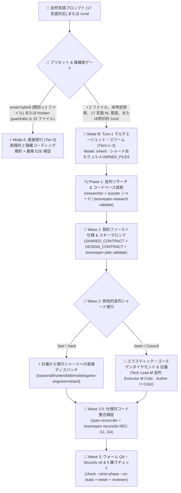

<div align="center">
  <h1>⚡ BoomOpen Workflow Kit Pro v5.5</h1>
  <p><strong>Antigravity、Claude Code、OpenAI Codex、Cursor、GitHub Copilot を横断するマルチエージェント・オーケストレーションと決定論的CLI品質ゲート。</strong></p>

  <p>
    <a href="https://boomopen.com"></a>
    <a href="https://github.com/Kennyboom/BoomOpen-Workflow-Kit-Pro/releases"></a>
    <a href="#platforms"></a>
    <a href="#cli"></a>
    <a href="#skills"></a>
    <a href="https://nodejs.org/">= 18.0.0" /></a>
    <a href="../LICENSE"></a>
  </p>

  <p>
    <a href="../README.md">English</a> •
    <a href="./README.vi.md">Tiếng Việt</a> •
    <a href="./README.zh-CN.md">简体中文</a> •
    <a href="./README.zh-TW.md">繁體中文</a> •
    <b>日本語</b> •
    <a href="./README.ko.md">한국어</a> •
    <a href="./README.es.md">Español</a> •
    <a href="./README.fr.md">Français</a> •
    <a href="./README.de.md">Deutsch</a><br/>
    <a href="./README.pt-BR.md">Português (BR)</a> •
    <a href="./README.ru.md">Русский</a> •
    <a href="./README.hi.md">हिन्दी</a> •
    <a href="./README.ar.md">العربية</a> •
    <a href="./README.id.md">Bahasa Indonesia</a> •
    <a href="./README.th.md">ไทย</a> •
    <a href="./README.tr.md">Türkçe</a> •
    <a href="./README.it.md">Italiano</a>
  </p>

  <p>
    <a href="https://boomopen.com"><b>🌐 boomopen.com (15 言語対応)</b></a> •
    <a href="#trailer"><b>🎬 公式トレーラー</b></a> •
    <a href="#why-boomopen"><b>⚡ 設計背景</b></a> •
    <a href="#architecture"><b>🏗️ アーキテクチャ</b></a> •
    <a href="#quickstart"><b>🚀 クイックスタート</b></a> •
    <a href="#cli"><b>🛠️ 14 CLI 品質ゲート</b></a> •
    <a href="#settings"><b>🎛️ プリセット &amp; 設定</b></a> •
    <a href="#commands"><b>🎯 36 コマンド</b></a> •
    <a href="#agents"><b>🤖 22 エージェント &amp; 18 チーム</b></a> •
    <a href="#skills"><b>📚 1,462 スキル</b></a>
  </p>
</div>

---

<a id="trailer"></a>

## 🎬 公式ローンチトレーラー & インタラクティブ Web エクスプローラー (`boomopen.com`)

<div align="center">
  <a href="https://github.com/Kennyboom/BoomOpen-Workflow-Kit-Pro/raw/main/assets/media/boomopen_v55_trailer_en.mp4">
    
  </a>
  <p>
    ▶️ <a href="https://github.com/Kennyboom/BoomOpen-Workflow-Kit-Pro/raw/main/assets/media/boomopen_v55_trailer_en.mp4"><b>Full HD 1080p 公式トレーラーを再生 (スタジオ音声付き MP4)</b></a> • 🌐 <a href="https://boomopen.com"><b>14 コマンドのライブ CLI プレイグラウンドと検索カタログを boomopen.com で試す (15 言語対応)</b></a>
  </p>
</div>

---

<a id="why-boomopen"></a>
<a id="-what-is-boomopen-workflow-kit"></a>

## ⚡ なぜ BoomOpen Workflow Kit なのか？

**素の AI コーディング支援ツールが抱える構造的課題：** 単一エージェント前提のツールは、変更対象が複数ファイル・複数ドメイン・複数セッションに跨がった途端に精度が低下します。逐次的なファイル探索がメインのコンテキストウィンドウを圧迫し、統制のない並列サブエージェントは共有ファイルを上書きしたり未接続の「孤立（island）モジュール」を残したりします。さらに `TODO` スタブや `any` 型を残したまま完了と報告する問題、作成者自身がレビューする構造上の盲点（`Author == Critic`）、複数フェーズ開発における当初仕様からの乖離が頻発します。

**BoomOpen のアプローチ：** BoomOpen は **Antigravity (Gemini)**、**Claude Code**、**OpenAI Codex**、**Cursor**、**GitHub Copilot** の 5 環境に共通のオーケストレーション基盤と検証ハーネスを **ランタイム npm 依存ゼロ** で導入します。既定の **`smart-hybrid`** プリセットでは、`≤ 2` ファイルの既知ターゲット修正をオーバーヘッドゼロで直接実行する一方、複数ファイル開発・深層リサーチ・設計・**`36` 個のスラッシュコマンド（`93` ファイル）** では Turn 1 から **22 名の専門エージェント** と **18 組の対抗レビュー型 3 ロールチーム** へ並列シャード分割を実行します。全工程は **14 個のローカル `boomopen` CLI 品質ゲート** で機械的に検証され、**`1,462` 個のオンデマンドスキル**（コア `22` + `~/.agents/skills_library` に重複排除されたライブラリ `1,440`）が待機トークンゼロで支えます。

### ⚖️ BoomOpen 未導入時 vs. BoomOpen v5.5 導入時

| エンジニアリング上の失敗モード | 未導入時（素の AI IDE） | BoomOpen Workflow Kit Pro v5.5 導入時 |
|:-------------------------------|:------------------------|:--------------------------------------|
| **コンテキストウィンドウの肥大化** | 1 行書く前にメインエージェントが 15〜30 ファイルを直列読み込み | **Turn-1 エラスティック・スワーム (`role#shard`)**：読み取り専用スカウトとドメイン別シャード（`≤ 3–4` ファイル/shard）へ分散 + `0秒` ウォーム再利用（`send_message`） |
| **並列上書きと結合の不整合** | 並列エージェントによる共有ファイルの上書き、`/api` ルート不一致、未接続モジュールの放置 | **契約ファーストのロック + Wave 2.5 Reconcile**：Wave 1 で `SHARED_CONTRACT` と排他的 `OWNED_FILES` を固定し、`boomopen reconcile`（`REC-G1..G4`）で結合検証 |
| **表層的な調査と曖昧な計画** | 単一視点の迎合的回答、裏付けのない主張、自由記述の計画書 | **根拠ゲート付き 6 ブロック仕様**：`:team` の Devil's Advocate 反証 + `< 50ms` の CLI バリデータ（`boomopen research`・`design`・`plan`） |
| **暗黙のスタブ・`any`・テスト形骸化** | `// TODO`、明示的な `any`、`console.log`、`.skip` テストを残したまま完了申告 | **実践的 2 階層静的ゲート**：`boomopen check --strict-phase --no-stubs` により `any` ゼロ、スタブゼロ、`400/500` 行の凝集度予算を強制 |
| **複数セッション間の仕様乖離と回帰** | コンテキスト圧縮でフェーズ制約が消え、既存機能が破損 | **5 層フェーズラチェット & ロールバック**：`.boomopen/project-ledger.json` の SHA-256 仕様乖離検知、`/autopilot`、`/audit`、原子的 `rollback --yes` |
| **単一モデルの盲点** | 同一モデルが実装と自己レビューを兼任（`Author == Critic`） | **クロスエンジン・コンダクター (`/conduct`)**：Claude Code・Codex・Antigravity・Cursor・Copilot を横断する並列マルチエンジン合議と異種モデル間パイプライン |
| **5 IDE 間の設定乖離と Git 作業ツリー汚染** | IDE ごとの個別プロンプト管理、数 GB の重複スキル、`git status` に残る一時仕様書 | **統合同期 & クリーンな Git ツリー**：14 エントリーファイルを `< 10ms` で同期、共有 `~/.agents/skills_library`（待機トークン `0`）、Brain Artifacts 分離出力 |

---

<a id="architecture"></a>
<a id="-smart-hybrid-architecture-v55"></a>

## 🏗️ スマートハイブリッド・アーキテクチャ (v5.5)



---

<a id="pillars"></a>

## 🧠 6 つのコア・エンジニアリング基盤

1. **🌐 5 IDE ネイティブコンパイル & 重複排除スキルボールト (`platforms/*`)**：
   - **22 名の専門エージェント** と **93 個のコマンド／リファレンスファイル** を各 IDE のネイティブ形式へ変換します：**Antigravity**（`--as-plugin` バンドル + 実行可能な `3` 本の `run_workflow` Python スクリプト：`audit_fanout.py`、`review_fanout.py`、`research_fanout.py`）、**Claude Code**（`isolation: worktree` シャード、`/plan:hard` コロン構文コマンド、オプトイン `PreToolUse` & `Stop`/`PreCompact` フック）、**OpenAI Codex**（OS レベル `read-only` スカウト／レビュアー用サンドボックス付き `22` 個の TOML ロール + `87` 個の `$boomopen-*` スキル）、**Cursor**（`.mdc` ルール + オプトイン `beforeShellExecution` フック）、**GitHub Copilot**（`.agent.md` プロンプトエージェント）。
   - `1,440` 個のライブラリスキルを全 5 IDE で単一の `~/.agents/skills_library` にリンクし、ディスク使用量を約 80% 削減しつつ Turn-1 のトークン消費を `0` に保ちます。
2. **🎯 4 段階の動的エラスティック・スワーム (`role#shard`) & スコープ付きウォーム再利用**：
   - **Tier 0**（既知 `≤ 2` ファイルはサブエージェント `0`）→ **Tier 1**（`2–3` シャード）→ **Tier 2**（`4–6` シャード）→ **Tier 3**（`7–8+` シャード、最大 `16` まで設定可）へ自動スケールします。1 サブエージェントあたりの認知負荷を **`≤ 3–4 OWNED_FILES`** に制限し、`role#shard → conversationId`（`send_message`）で稼働中セッションを再利用します。
3. **🤝 3-Wave 契約ファースト実行 + Wave 2.5 仕様対コード整合 (`REC-G1..G4`)**：
   - Wave 1 で `SHARED_CONTRACT`（API スキーマ／DTO）と `DESIGN_CONTRACT`（OKLCH `@theme` CSS + TypeScript Props）を確定してから、Wave 2 で並列エンジニアを起動します。Wave 2.5 では `boomopen reconcile` と `spec-reconciler` が未接続の孤立ファイル（`REC-G1`）、フロントエンド／バックエンド間のルート不一致（`REC-G2`）、未実装の `[SC-*]` サブ条項（`REC-G3`）、`.env.example` のキー漏れ（`REC-G4`）を検出し、`boomopen cook amend-plan` で差分 Wave を自動追記します。
4. **🏛️ マルチセッション・オートパイロット (`/autopilot`) & ステートフル多段階監査 (`/audit`)**：
   - 複数の仕様ドキュメントを `.boomopen/project-ledger.json` にコンパイルし、SHA-256 仕様ドリフト検知、フェーズ前 Git チェックポイント（`boomopen ledger rollback --yes`）、および **5 層フェーズ品質ラチェット**（`G1 check --strict-phase --no-stubs` → `G2 単調増加テストラチェット` → `G3 reconcile --strict` → `G4 Author != Critic レビュー` → `G5 ledger verify`）を適用します。実装完了後は `/audit` が人間承認ゲート付きの複数ラウンド RTM・縦断フロー・Security v6 監査（`.boomopen/audit-ledger.json` + `boomopen audit rollback --yes`）を実行します。
5. **🎼 クロスエンジン・コンダクター & マルチエンジン合議 (`boomopen conduct`)**：
   - Claude Code、OpenAI Codex、Antigravity、Cursor、Copilot を同時に編成し、**6 タスク対応の並列合議（Council）**（`research`、`brainstorm`、`plan`、`design`、`review`、`debug` → 4 部構成 `COUNCIL-SYNTHESIS.md`）や、自身の出力を自己採点させない **異種モデル間ロールパイプライン**（`Author != Critic`）を実行します。
6. **📏 実践的 2 階層コーディング規約 & SPIE v3.0 根本原因デバッグ**：
   - **Tier 1（ゼロトレランス）**：単一責任原則、明示的な `any` `0` 件、アプリ本番コード内のデバッグ用 `console.log` `0` 件、型付き `try/catch` 境界、`SCREAMING_SNAKE_CASE` 定数。**Tier 2（凝集度優先）**：目安 `~200–350` 行（ソフト上限 `400` 行／ハード分割 `500` 行。テスト・型定義・ドキュメントは対象外）。不具合解析では優先度付き 3 仮説と **5-Whys (SPIE v3.0)** 因果追跡を実施し、一時仕様書は Brain Artifacts に出力して Git 作業ツリーを `100%` クリーンに保ちます。

---

<a id="platforms"></a>
<a id="-supported-ai-platforms"></a>

## 💻 対応する 5 つの AI コーディングプラットフォーム

| プラットフォーム | 対応版 | 同期エントリーポイント | ネイティブ統合機能 |
|:-----------------|:------:|:-----------------------|:-------------------|
| **Antigravity (Gemini)** | ✅ v5.5 | `~/.gemini/GEMINI.md` | `invoke_subagent`、`run_workflow` Python 並列ファンアウト、`/goal` 外側ループ、`--as-plugin` バンドル、オプトイン `--with-hooks`、Brain Artifacts |
| **Claude Code** | ✅ v5.5 | `~/.claude/CLAUDE.md` | 並列 `Task`/`Agent` シャード（`isolation: worktree`）、`/plan:hard` コロン構文、オプトイン `PreToolUse` & `Stop`/`PreCompact` フック |
| **OpenAI Codex** | ✅ v5.5 | `~/.codex/AGENTS.md` & `CODEX.md` | `~/.codex/agents/boomopen/` 配下の `22` TOML ロール（スカウト／レビュアー向け OS `sandbox_mode = "read-only"`）+ `87` 個の `$boomopen-*` スキル |
| **Cursor** | ✅ v5.5 | `~/.cursor/rules/boomopen-workflow-kit.mdc` | 常時有効 `.mdc` フロントマタールール、`CURSOR.md`、サブエージェントルーティング、オプトイン `.cursor/hooks.json`（`beforeShellExecution`） |
| **GitHub Copilot** | ✅ v5.5 | `~/.copilot/copilot-instructions.md` | VS Code 用コンパイル済み `boomopen-workflow-kit.agent.md` プロンプトエージェント、`runSubagent` ディスパッチ、`COPILOT.md` |

---

<a id="quickstart"></a>
<a id="-quick-start--installation"></a>

## 🚀 クイックスタート & インストール（Git のみ — ランタイム依存ゼロ）

```bash
# 1. リポジトリをクローン（GitHub 配布のみ — npm レジストリには非公開）
git clone https://github.com/Kennyboom/BoomOpen-Workflow-Kit-Pro.git
cd BoomOpen-Workflow-Kit-Pro

# 2. 使用中の AI IDE 向け、または全 5 IDE 一括でインストール（既定プリセット: smart-hybrid）
npm run install:all                                 # 全 5 IDE へ導入・同期 + 共有 ~/.agents/skills_library リンク
npm run install:antigravity                         # Google Antigravity 2.0 (--as-plugin / --with-hooks 追加可)
node cli/install.js install claude --with-hooks     # Claude Code + オプトイン PreToolUse & Stop/PreCompact フック
npm run install:codex                               # OpenAI Codex CLI + OS read-only スカウト/レビュアー用サンドボックス
npm run install:cursor                              # Cursor (--with-hooks 指定で beforeShellExecution ガード有効化)
npm run install:copilot                             # GitHub Copilot (VS Code .agent.md + copilot-instructions.md)

# 3. 健全性チェック & 任意でグローバル PATH に `boomopen` をリンク
npm run doctor
npm link
boomopen settings status
```

> **非破壊インストール & クリーンアンインストール**：SHA-256 マニフェスト（`~/.boomopen/manifests/<tool>.json`）で管理されます。`GEMINI.md` や `CLAUDE.md` 内の既存個人ルールはキットマーカー外でそのまま保持・自動バックアップされ、`boomopen uninstall <tool|--all>` は個人ファイルを一切損なわずに未変更のキット資産のみを安全に削除します。

---

<a id="cli"></a>

## 🛠️ ランタイム依存ゼロの 14 CLI サブコマンド (`boomopen`)

Node.js `>= 18` 環境で **ランタイム npm 依存ゼロ**・**外部通信ゼロ** のままローカル `< 50ms` で動作します：

| サブコマンド | 主なフラグ & 構文 | 決定論的ゲートと役割 |
|:-------------|:------------------|:---------------------|
| **`install` / `uninstall` / `list`** | `<tool\|--all> [--with-hooks] [--as-plugin]` | SHA-256 マニフェスト導入、共有 `~/.agents/skills_library` リンク作成、オプトイン安全フック、クリーン削除 |
| **`doctor`** | `[--source-only]` | 全 5 IDE バンドル、`93` コマンドファイル、`72` チームファイル、`1,462` スキル、同期設定の読み取り専用 30 項目監査 |
| **`settings`** | `status \| preset <name> \| set <k> <v> \| --ui` | 5 プリセット + `22` 設定キーの管理（`--project` で `./.boomopen.json` 対応）および CSP 強化済み Web UI（`127.0.0.1:4567`）起動 |
| **`research`** | `<validate\|brief> <file.md> [--mode brainstorm]` | **`RES-G1..G4`**（`≥ 4` 情報源の三角測量、矛盾マトリクス、事前検死リスク）を検証し `HANDOFF_BRIEF` を生成 |
| **`design`** | `<validate\|contract> <DESIGN.md> [--json]` | **`DESIGN-G1..G4`**（6 ブロック仕様、OKLCH トークン、5 状態 UI マトリクス、WCAG 2.2 AA）を検証し `DESIGN_CONTRACT` を出力 |
| **`plan`** | `<validate\|compile> <PLAN.md> [--sync-ledger]` | **`PLAN-G1..G5`**（非巡回 DAG、排他的 `OWNED_FILES ≤ 4`/shard、`SHARED_CONTRACT`）を検証し台帳と同期 |
| **`cook`** | `<state\|packets\|verify-wave\|preflight\|amend-plan>` | **`COOK-G1..G4`** 強制：5 段階ファストフォワード状態判定、5 項目 Wave Handoff Packet 生成、Git 書き込みロック検証、差分 Wave 追記 |
| **`reconcile`** | `<dir> [--plan <PLAN.md>] [--strict]` | Wave 2.5 **`REC-G1..G4`**：未接続の孤立モジュール、`/api` ルート乖離、`[SC-*]` 条項漏れ、`.env.example` 欠落を検出 |
| **`check`** | `[path] --strict-phase --no-stubs [--ignore <dir>]` | 実践的 2 階層静的ゲート：`400/500` 行予算、明示的 `any` `0` 件、デバッグ `console.log` `0` 件、スタブ／`TODO`／`.skip` `0` 件 |
| **`ledger`** | `<init\|from-plan\|status\|next\|verify\|rollback>` | マルチセッション `.boomopen/project-ledger.json` DAG ステートマシン、SHA-256 仕様ドリフト保護、原子的 `rollback --yes` |
| **`audit`** | `<init\|slice\|record\|approve\|verify-fix\|rollback>` | ステートフル多段階完成後監査台帳（`.boomopen/audit-ledger.json`）、残件バーンダウンラチェット、`rollback --yes` |
| **`conduct`** | `<probe\|council\|dispatch\|status> [--dry-run]` | クロスエンジン・コンダクター & 6 タスク並列マルチエンジン合議（5 IDE 横断 `Author != Critic` → `COUNCIL-SYNTHESIS.md`） |

---

<a id="settings"></a>
<a id="-unified-settings--mode-selection-settings"></a>

## 🎛️ 統合コントロールセンター & 5 つのプリセット (`/settings`)

グローバル（`~/.boomopen/settings.json`）またはリポジトリ単位（`./.boomopen.json`）で **`20` 個の列挙型キー + `2` 個の行数上限キー** を管理し、全 14 個の IDE エントリーファイルを `< 10ms` でホット同期します：

| プリセットプロファイル | 実行モード (`execution.mode`) | 既定 `/cmd` | 17 言語 NL ルーティング (`naturalLanguageResearchTrigger`) | コーディング規約 | 推奨ユースケース |
|:-----------------------|:------------------------------|:-----------:|:----------------------------------------------------------:|:----------------:|:-----------------|
| **⚡ `smart-hybrid`** *(デフォルト)* | **`auto`**（`≤ 2` ファイル直接実行、`> 2` ファイルまたは `/cmd` → Mode B スワーム） | `auto` | **`auto_team`** *(17 言語の NL リサーチ／構想／レビューを `:team` や各ワークフローへ自動分岐)* | `pragmatic` (`400/500`行) | 標準構成：自然言語の意図ルーティング + Turn-1 自動並列シャード分割 |
| **🛡️ `frontier-guardrails`** *(軽量オプトイン)* | **`mode_a`**（`≤ 10` ファイル直接実行、`< 2.5 KB` / `~600` トークン入口） | `auto` | **`off`** *(明示的な `/cmd` のみ起動 — NL 自動分岐なし)* | `pragmatic` (`400/500`行) | `< 2.5 KB` の超軽量日常 Mode A 運用 + 厳格な 2 階層規約 & E2E ゲート *(`carbon-guardrails` エイリアス対応)* |
| **🚀 `solo-fast`** | **`mode_a`**（`≤ 10` ファイル直接実行、最大 `3` シャードの控えめ編成） | `fast` | `off` | `relaxed` (`600/800`行) | 高速プロトタイピング、小規模スクリプト、緊急ホットフィックス、トークン節約 |
| **🧠 `deep-architect`** | **`mode_b`** *(厳格 Mode B オーケストレーター、最大 `12` シャード)* | `hard` | `auto_hard` + `council` リサーチ / `cross_family` レビュー | `strict` (`300/400`行) | 複雑なシステムアーキテクチャ設計、新規設計、モジュール横断リファクタリング |
| **🔺 `adversarial-team`** | **`team`** *(エラスティック・ゴールデンダイヤモンド `:team`、`hyper_swarm` 最大 `12`)* | `team` | **`auto_team`** + `council` リサーチ・計画・レビュー | `strict` (`300/400`行) | ミッションクリティカルな本番リリース、セキュリティ監査、マルチエンジン合意形成 |

```bash
# チャット (/settings)、ローカル Web UI (--ui)、または CLI からプリセットや個別キーを切り替え:
boomopen settings --ui                                      # http://127.0.0.1:4567 でローカル Web コントロールセンターを起動
boomopen settings preset smart-hybrid                       # デフォルト: Auto Mode A/B + 17 言語 NL ワークフロールーティング
boomopen settings preset frontier-guardrails                # オプトイン: < 2.5 KB 軽量 Mode A (エイリアス: carbon-guardrails)
boomopen settings set engines.reviewer cross_family         # 異種モデルによる Reviewer を強制 (Author != Critic)
cd path/to/your/repo && boomopen settings mode team --project # リポジトリ単位の ./.boomopen.json オーバーライド
boomopen settings reset                                     # 既定の smart-hybrid 設定へ復元
```

---

<a id="commands"></a>
<a id="-slash-commands-reference"></a>

## 🎯 全 36 スラッシュコマンド・リファレンス（`93` ファイル = `87` ワークフロー + `6` `_ref/`）

`smart-hybrid` 環境下で **対応 17 言語の自然言語** から呼び出すか、以下の **36 個の正規スラッシュコマンド** を直接実行できます：

| カテゴリ | コマンド | バリアント | 用途と決定論的成果物 |
|:---------|:---------|:-----------|:---------------------|
| **オーケストレーション & 自律実行** | **`/cook`** | `:fast`, `:hard`, `:team` | 計画未作成からの一気通貫開発（Scout → 契約 Plan → 並列シャード → Wave 2.5 Reconcile → QA） |
| | **`/code`** | `:fast`, `:hard`, `:team` | 承認済み `PLAN-{task}.md` を再計画なしで Wave 1–3 シャードへ直接ディスパッチして実装 |
| | **`/autopilot`** | `:init`, `:run`, `:audit` | `.boomopen/project-ledger.json` と **5 層フェーズ品質ラチェット** によるマルチセッション自律実装 |
| | **`/conduct`** | `:council`, `:pipeline` | 5 IDE 横断のマルチエンジン並列合議（`COUNCIL-SYNTHESIS.md`）と異種モデル間パイプライン（`--dry-run` 対応） |
| | **`/orchestrate`** / **`/auto`** | — | カスタム複数ドメイン・スワーム編成（`/orchestrate`）または完全自律エンドツーエンド実行（`/auto`） |
| **アーキテクチャ・UI/UX・リサーチ** | **`/plan`** | `:fast`, `:hard`, `:team` | `SHARED_CONTRACT`、排他的 `OWNED_FILES ≤ 4`/shard、Given/When/Then 基準を固定する 5 ゲート `PLAN-{task}.md` |
| | **`/architect`** | — | 設計専用のシステム青写真：C4 図、ADR、DB スキーマ、API 契約、画面仕様、網羅性監査（コード変更ゼロ） |
| | **`/design`** / **`/ui-ux-pro-max`** | `:fast`, `:hard`, `:team` | 6 ブロック UI/UX `DESIGN-{task}.md` + `DESIGN_CONTRACT`（`@theme` OKLCH トークン、5 状態 UI マトリクス、50+ スタイル & HTML プレビュー） |
| | **`/research`** | `:fast`, `:hard`, `:team` | 5 レンズ深層リサーチ（`RESEARCH-{topic}.md`、`RES-G1..G4` 4 情報源以上の三角測量、矛盾表、`HANDOFF_BRIEF`） |
| | **`/brainstorm`** / **`/ask`** | `:fast`, `:hard`, `:team` | 迎合排除の戦略ブレスト（事前検死 & MCDA 評価付き `BRAINSTORM-{topic}.md`）と根拠ゲート付き Q&A（`/ask`） |
| **品質・監査・デバッグ・セキュリティ** | **`/review`** | `:fast`, `:hard`, `:team` | 多視点の対抗コード・設計・セキュリティ・性能レビュー（`Author != Critic`、`/fix` へ即連携可能） |
| | **`/audit`** / **`/deep-audit`** | `:run`, `:fix`, `:auto` | 実装後の複数ラウンド全プロジェクト監査（`/audit` 台帳）と実装前の 10 次元仕様ロジック監査（`/deep-audit`） |
| | **`/security-audit`** | — | OWASP Top 10 + LLM/Agentic Top 10 スキャン（`security_scan.py` v6）、STRIDE 脅威分析、認証・サプライチェーン監査 |
| | **`/debug`** / **`/fix`** | `:fast`, `:hard`, `:team` | 3 仮説 + **5-Whys (SPIE v3.0)** 根本原因追跡（`DEBUG-{issue}.md`）と失敗再現テスト先行の TDD 修正（`/fix`） |
| | **`/test`** / **`/performance`** / **`/refactor`** | `:fast`, `:hard`, `:team` | テスト形骸化ゼロの QA シャード（`/test`）、Core Web Vitals／DB／バンドル最適化（`/performance`）、指標検証付き `/refactor` |
| **Git・リリース・ドキュメント・運用** | **`/onboard`** / **`/init`** | — | 60 秒読み取り専用の既存コード解析 `ARCHITECTURE-MAP.md`（`/onboard`、`/init` 競合なし）と新規プロジェクト初期化（`/init`） |
| | **`/pr`** / **`/release`** | —, `:review` | PR 前の品質・整合ゲート + `gh pr create`／対抗差分レビュー（`/pr:review`）、および整合性ゲート付きセマンティック `/release` |
| | **`/deploy`** / **`/rollback`** | `:check`, `:preview`, `:production`, `:rollback` | デプロイ準備ゲート、プレビュー／本番ロールアウト（`/deploy`）、重大度別の緊急復旧（`/rollback`） |
| | **`/docs`** / **`/report`** | `:core`, `:business`, `:audit` / `:fast..:team` | ソースコード準拠の `./documents/` 文書群生成（`/docs`）と CLI 実測テレメトリに基づくステータスレポート（`/report`） |
| | **`/settings`** / **`/status`** / **`/next`** | — | 統合コントロールセンター（`/settings`）、台帳・スワーム稼働ダッシュボード（`/status`）、次工程ナビゲーター（`/next`） |
| | **`/preview`** / **`/save`** / **`/recap`** | — | ローカル開発サーバー管理（`/preview`）、セッション状態保存（`/save`）、`< 5秒` のコンテキスト復元（`/recap`） |

### 🌙 夜間マルチフェーズ自律開発プレイブック (`/autopilot` & `/goal`)

| ワークフロー | 対象プラットフォーム & 実行基盤 | コンテキスト継続性 | 品質・仕様整合の保証 |
|:-------------|:--------------------------------|:-------------------|:---------------------|
| **`/autopilot` (+ `--with-hooks`)** | 全 5 IDE 対応（**Claude Code**・**Antigravity**・**Cursor** では `--with-hooks` 併用推奨） | `Stop` & `PreCompact` フック（`stop-quality-gate.mjs`）と `.boomopen/project-ledger.json` がコンテキスト圧縮後も進捗カーソルを保持 | **5 層フェーズ品質ラチェット**（`G1..G5`）、Wave 2.5 `reconcile`、`boomopen ledger rollback --yes` を強制 |
| **`/goal` + `/autopilot` + `/audit`** | 大規模な `docs/` 仕様群に対する **Antigravity 2.0** 永続外側ループ | Antigravity ネイティブの **`/goal`** ランナーが全フェーズ `VERIFIED` 到達までフェーズ間を自動反復 | 全フェーズで 5 ゲート + Wave 2.5 整合検証を通過後、**`/audit`** Round 1 を自動実行 |

```text
/goal Use /autopilot to read all project documentation in docs/, initialize .boomopen/project-ledger.json, and autonomously implement every phase sequentially (every phase must pass all 5 verification gates and Wave 2.5 reconcile). Once 100% of phases pass, run Round 1 of /audit and stop with a summary report for my review.
```

---

<a id="agents"></a>
<a id="-22-specialist-agents--18-golden-triangle-teams"></a>

## 🤖 22 名の専門エージェント & 18 組の対抗 3 ロールチーム

すべてのサブエージェントはセッションのモデルを継承し（`Model: "inherit"` — `flash_lite` は厳禁）、**18 組のゴールデンダイヤモンド／トライアングル・チーム**（`Tech Lead` ⇄ `並列シャード Executor` ⇄ `独立 Reviewer/Critic`）を構成します：

| ドメイン | 専門エージェント (`agents/*.md`, IDE 別にコンパイル) | 3 ロールレビューチーム (`agents/teams/*-team/`, `72` ファイル) |
|:---------|:-----------------------------------------------------|:---------------------------------------------------------------|
| **エンジニアリング & 実装** | `backend-engineer`, `frontend-engineer`, `mobile-engineer`, `game-engineer`, `database-architect`, `devops-engineer` | `backend-team`, `frontend-team`, `fullstack-team`, `mobile-team`, `game-team`, `database-team`, `devops-team` |
| **アーキテクチャ & プロダクト** | `tech-lead`, `planner`, `brainstormer`, `business-analyst`, `project-manager`, `designer` | `planning-team`, `brainstorm-team`, `project-team`, `design-team` |
| **品質・整合検証 & セキュリティ** | `debugger`, `tester`, `reviewer`, `spec-reconciler`, `security-engineer`, `performance-engineer` | `debug-team`, `qa-team`, `security-team`, `performance-team` |
| **リサーチ & ドキュメント** | `researcher`, `scouter`, `docs-manager`, `reporter` | `research-team`, `docs-team`, `report-team` |

---

<a id="skills"></a>
<a id="-1460-skills-vault-22-core--1440-niche-library-skills"></a>

## 📚 1,462 オンデマンド・スキルボールト（コア `22` + ライブラリ `1,440`）

**19 のエンジニアリング領域** にわたり `matrix-skills/compact-index.json` でインデックス化され、`~/.agents/skills_library` に一度だけ重複排除リンクされます。**2 ステップ O(1) 段階解決**（`skills/` コア確認 → `compact-index.json` 検索 → 一致した `SKILL.md` のみを担当シャードへ注入）により、待機トークン消費 `0` で動作します：

| 階層 / エンジニアリング領域 | スキル数 | 代表的な機能 & スキャフォールド | 読み込み方式 |
|:----------------------------|:--------:|:--------------------------------|:-------------|
| **⚡ コアワークフロー & 品質 (`skills/`)** | **22** | `clean-code`, `debugger`, `plan-writing`, `brainstorming`, `deep-research`, `design-spec`, `frontend-design`, `frontend-architecture`, `api-patterns`, `database-design`, `tdd-workflow`, `testing-patterns`, `webapp-testing`, `security-auditor` (`security_scan.py` v6), `app-builder` (**`mcp-server`**・**`ai-agent-worker`**・`nextjs-saas`・`monorepo-turborepo`・`python-fastapi`・`flutter-app` を含む **15 プロジェクトテンプレート**), `skill-seeker` | Turn 1 から即応可能 |
| **🤖 AI・Agentic SDK・MCP & データ基盤** | **340+** | FastMCP (`StreamableHTTP`), OpenAI Agents SDK, Claude Agent SDK, Google ADK, Vercel AI SDK, LangGraph, RAG, BigQuery, dbt | オンデマンド (`compact-index.json`) |
| **🌐 Web・バックエンド・API & DB** | **380+** | React 19, Next.js 15 RSC, Tailwind CSS v4, TanStack Start/Router/Query, Hono RPC + Zod OpenAPI, Rust Axum/SQLx, Drizzle, Postgres/RLS | オンデマンド (`compact-index.json`) |
| **☁️ クラウド・DevOps・QA & セキュリティ** | **300+** | Cloudflare Workers/Durable Objects/D1, Docker/K8s, Terraform, Playwright, Vitest + MSW v2, Better Auth (Passkeys), OWASP LLM Top 10 | オンデマンド (`compact-index.json`) |
| **🎨 UI/UX・ゲームエンジン & モバイル** | **420+** | OKLCH デザイントークン, WCAG 2.2 AA, Motion, Unity 6 DOTS/ECS, Godot 4, Unreal 5, WebGPU/Three.js, Phaser/PixiJS, Tauri v2, SwiftUI, Flutter, React Native | オンデマンド (`compact-index.json`) |

---

## 📂 リポジトリ構成

```text
BoomOpen-Workflow-Kit-Pro/
├── agents/                  # 22 名の専門エージェント (IDE 別にコンパイル) + 18 組の 3 ロールチーム (72 ファイル)
├── cli/                     # ランタイム依存ゼロの Node.js 14 CLI サブコマンド + 33 本の node:test スイート
├── commands/                # 87 ワークフローファイル + 6 _ref/ プロトコルで構成される 36 スラッシュコマンド (93 ファイル)
├── documents/               # アーキテクチャ、ドメイン、ソース基盤、実践的 2 階層コーディング規約ドキュメント
├── i18n/                    # 16 言語の完全ローカライズ README (ルート README.md と合わせ全 17 言語)
├── matrix-skills/           # 19 領域の YAML カタログ + O(1) compact-index.json (1,462 インデックス済みスキル)
├── platforms/               # 5 IDE バンドル、オプトイン保護フック、3 本の Antigravity run_workflow/*.py、Codex TOML ロール
├── rules/                   # 7 つのオンデマンド Mode B ルールモジュール (CORE, PHASES, AGENTS, TEAMS, SKILLS, ERRORS, REFERENCE)
├── scripts/                 # クロスプラットフォーム検証 & セッション補助 (checklist.py, verify_all.py, auto_preview.py, session_manager.py)
├── skills/                  # 22 コアスキル + 15 個の app-builder テンプレート + Security v6 / UX / Perf 監査スクリプト
├── skills_library/          # 共有 ~/.agents/skills_library へ一度だけリンクされる 1,440 ライブラリスキル
├── web/                     # https://boomopen.com を駆動する 15 言語対応 WebGL ショーケース & 検索カタログ
└── GEMINI.md | CLAUDE.md | CODEX.md | COPILOT.md | CURSOR.md | AGENT.md
```

---

## 📄 ライセンス & セキュリティ

- **公式 Web サイト**：[https://boomopen.com](https://boomopen.com)
- **ライセンス**：本キットのソースコード、CLI、ルール、エージェント定義、およびドキュメントは [MIT License](../LICENSE)（Copyright © 2026 **BoomOpen Labs**）の下で公開されています。`skills_library/` 内のサードパーティ製スキルは各配布元のライセンスが適用されます。詳細は [THIRD_PARTY_NOTICES.md](../THIRD_PARTY_NOTICES.md) を参照してください。
- **セキュリティポリシー**：SHA-256 マニフェスト保護、オプトインフックのサンドボックス機構、および脆弱性の報告手順については [SECURITY.md](../SECURITY.md) を参照してください。
