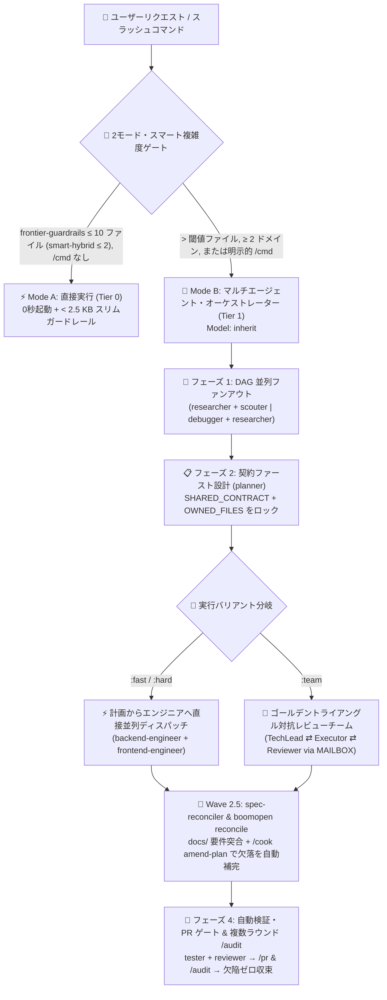

<div align="center">
  <h1>⚡ BoomOpen Workflow Kit v5.5.0</h1>
  <p><strong>マルチプラットフォーム対応 スマートハイブリッド AI 開発 OS — 22 名の専門エージェント、18 組のゴールデントライアングル・チーム &amp; 1,462 オンデマンドスキル宝庫</strong></p>

  <p>
    <a href="https://github.com/Kennyboom/BoomOpen-Workflow-Kit-Pro/releases"></a>
    <a href="#platforms"></a>
    <a href="#agents"></a>
    <a href="#skills"></a>
    <a href="https://nodejs.org/">=18.0.0" /></a>
    <a href="../LICENSE"></a>
  </p>

  <p>
    <a href="../README.md">🇬🇧 English</a> • <a href="./README.vi.md">🇻🇳 Tiếng Việt</a> • <a href="./README.zh-CN.md">🇨🇳 简体中文</a> • <a href="./README.zh-TW.md">🇹🇼 繁體中文</a> • <b>🇯🇵 日本語</b> • <a href="./README.ko.md">🇰🇷 한국어</a> • <a href="./README.es.md">🇪🇸 Español</a> • <a href="./README.fr.md">🇫🇷 Français</a> • <a href="./README.de.md">🇩🇪 Deutsch</a><br/>
    <a href="./README.pt-BR.md">🇧🇷 Português</a> • <a href="./README.ru.md">🇷🇺 Русский</a> • <a href="./README.hi.md">🇮🇳 हिन्दी</a> • <a href="./README.ar.md">🇸🇦 العربية</a> • <a href="./README.id.md">🇮🇩 Bahasa Indonesia</a> • <a href="./README.th.md">🇹🇭 ไทย</a> • <a href="./README.tr.md">🇹🇷 Türkçe</a> • <a href="./README.it.md">🇮🇹 Italiano</a>
  </p>

  <p>
    <a href="https://boomopen.com">🌐 Website</a> • <a href="#overview"><b>🌟 概要</b></a> • <a href="#architecture"><b>🏗️ アーキテクチャ</b></a> • <a href="#quickstart"><b>🚀 クイックスタート</b></a> • <a href="#settings"><b>🎛️ プリセット &amp; 設定</b></a> • <a href="#commands"><b>🎯 36 コマンド</b></a> • <a href="#agents"><b>🤖 22 エージェント &amp; 18 チーム</b></a> • <a href="#skills"><b>📚 1,462 スキル宝庫</b></a>
  </p>
</div>

---

## 🎬 公式ローンチトレーラー (Full HD 1080p)

<div align="center">
  <a href="https://github.com/Kennyboom/BoomOpen-Workflow-Kit-Pro/raw/main/assets/media/boomopen_v55_trailer_en.mp4">
    
  </a>
  <p>
    ▶️ <a href="https://github.com/Kennyboom/BoomOpen-Workflow-Kit-Pro/raw/main/assets/media/boomopen_v55_trailer_en.mp4"><b>ここをクリックして Full HD 1080p 公式トレーラーを再生・ストリーミング (スタジオ音声付き MP4)</b></a>
  </p>
</div>

---

<a id="overview"></a>

## 🌟 BoomOpen Workflow Kit v5.5 とは？

**BoomOpen Workflow Kit v5.5（Multi-Platform Unified & Smart-Hybrid Edition）** は、単一の AI コーディングアシスタントを **22 名の専門エージェント（Specialist Agents）**、**18 組のゴールデントライアングル・チーム（72 チームファイル）**、**36 のスラッシュコマンド（93 コマンドファイル：87 ワークフロー + `_ref/` 6 ファイル）**、**14 個の CLI コマンド**、および **1,462 のオンデマンドスキル宝庫（22 コアスキル + 1,440 専門ライブラリスキル、`~/.agents/skills_library` により全 IDE 間で重複排除）** へと進化させるオープンソースのマルチエージェント OS です。

毎回コールドスタート遅延やコンテキスト肥大化を招く重いラッパーとは異なり、BoomOpen v5.5 は全 **5 大 IDE 共通の `< 2.5 KB` スリムガードレール（既定推奨 `frontier-guardrails`）**、**Turn-1 サブエージェント優先ゲート**、**17 言語自然言語ルーティング**、**4 段階エラスティック・スワーム分割（`role#shard`）**、**Wave 2.5 仕様対コード自動整合（`boomopen reconcile` + `spec-reconciler`）**、**複数ラウンド完成後監査（`/audit` & `boomopen audit`）**、**60 秒ブラウンフィールド構造解析（`/onboard`）**、**PR / リリース品質ゲート（`/pr`・`/pr:review`・`/release`）**、**マルチセッション自律操縦（`/autopilot`）**、および **クロスエンジン・コンダクター（`/conduct`）** を統合しています：
- **🛡️ `frontier-guardrails` 既定推奨 & Mode A ゼロ遅延実行**：`< 2.5 KB` の軽量エントリーポイントにより、フロンティアモデル自身が `≤ 10` ファイルまでの日常開発を 0 秒遅延で直接主導（`smart-hybrid` では `≤ 2` ファイル）。同時に **実践的 2 階層コーディング規約** と **徹底 E2E 検証** を常時強制し、自然言語の誤爆（NL ハイジャック）をゼロに抑えます。
- **🚀 Turn-1 並列サブエージェント、Wave 2.5 自動整合 & Mode B オーケストレーション**：複数ドメイン開発や明示的な `/cmd` 実行時には、Turn 1 で並列シャード（`role#shard`、各 `<= 3–4 OWNED_FILES`）を起動。**DAG 並列ファンアウト**、**計画から実行役への直接ディスパッチ**、**契約ファーストのファイルロック（`SHARED_CONTRACT` + `OWNED_FILES`）**、**Wave 2.5 仕様対コード自動整合（`boomopen reconcile`・`spec-reconciler`・`/cook amend-plan` が孤立モジュール、ルート/環境変数不整合、`[SC-*]` 漏れを自動補完）**、および **ウォーム再利用（`send_message`）** を実行します。
- **🏛️ マルチセッション `/autopilot`、複数ラウンド `/audit`（ロールバック対応）& クロスエンジン合議 `/conduct`**：仕様書群を不変台帳 `.boomopen/project-ledger.json`（`boomopen ledger rollback` 対応）に取り込み、4 層ゼロ漏れゲート（`boomopen check --strict-phase --no-stubs`）で完遂。完成後は **多段階プロジェクト監査（`/audit` / `boomopen audit`、`audit rollback` 対応）** が RTM 要件網羅率・UI→API→DB 縦断フロー・**2 層アンチリーケージエンジン `security_scan.py` v6** を検査し、承認後のシャード修正で指摘 0 件まで収束させます。
- **📚 重複排除された 1,462 スキル宝庫（待機トークン 0）**：`~/.agents/skills_library` で全 IDE 間のディスク重複を排除し、`matrix-skills/compact-index.json` による `O(1)` 2 ステップ検索で `mcp-server` や `ai-agent-worker` テンプレートを含む 2026 年最新スタック知識をオンデマンド注入します。

---

<a id="architecture"></a>

## 🏗️ スマートハイブリッド・アーキテクチャ (v5.5)



---

<a id="pillars"></a>

## 🧠 v5.5 の 6 つのコアピラー & 2026 ネイティブ基盤機能

1. **🌐 5 大プラットフォーム完全統合 & 2026 ネイティブ機能 (`platforms/*`)**：
   - **Antigravity (Gemini)**（ネイティブプラグイン化 `install antigravity --as-plugin` & Python 動的オーケストレーション `run_workflow`）、**Claude Code**（`/plan:hard` 深層設計 + `PreCompact`/`Stop` 品質・継続フック + `Bash|PowerShell` 安全ガード）、**OpenAI Codex**（探索・監査ロール向け `read-only` サンドボックス & TOML エージェント定義）、**Cursor**、**GitHub Copilot** を単一アーキテクチャでネイティブ統合します。
2. **📏 実践的 2 階層コーディング規約（Pragmatic 2-Tier Coding Standards）**：
   - **Tier 1 — 厳格な品質・安全ルール（ゼロトレランス）**：単一責任原則、**明示的な `any` の完全禁止**、**本番コードでのデバッグ用 `console.log` 放置禁止**、非同期/API 境界での `try/catch` + 型付きエラー処理、`SCREAMING_SNAKE_CASE` 定数、DRY（`≥ 3`）、クリーンな import 整理。
   - **Tier 2 — 柔軟な構造ガイドライン（凝集度優先）**：ファイル行数は `~200–350 行`（`400` ソフト上限 / `500` ハード分割。テスト・型定義・ドキュメントは除外）、関数はロジック `~20–40 行` / UI `~40–80 行` が目安です。
3. **🎯 4 段階エラスティック・スワーム分割 (`role#shard`) & Wave 2.5 自動整合 (`spec-reconciler`)**：
   - `PLAN-{feature}.md` 作成後は各シャード（`<= 3–4 OWNED_FILES`）へ直接ディスパッチし、`role#shard → conversationId` レジストリ経由の `send_message` で **0 秒ウォーム再利用** を実現。実装直後の **Wave 2.5** では `spec-reconciler` と `boomopen reconcile`（`REC-G1..G4`）が未接続モジュールや欠落要件を自動検知・補完します。
4. **🤝 契約ファースト並列ディスパッチ、PR/リリースゲート & 多段階 `/audit`（v6）**：
   - `SHARED_CONTRACT` + `OWNED_FILES` で書き込み衝突を防止。`/onboard` で既存リポジトリを 60 秒で可視化し、`/pr`（`/pr:review`）と `/release` で PR・セマンティックリリース前の厳格ゲートを強制し、`/audit` で 2 層アンチリーケージ v6 を含む完成後監査を実行します。
5. **🔍 5-Whys (SPIE v3.0) 根本原因デバッグ & 100% クリーンな Git ツリー**：
   - `debugger` は 3 仮説検証と 5-Whys 因果チェーンで原因を特定。一時成果物（`PLAN`、`DEBUG`、`TEST`、`REVIEW`、`AUDIT`、`ARCHITECTURE-MAP`、`MAILBOX`）は `<appDataDir>\brain\<conversation-id>\`（他 IDE では `./reports/`）に出力され、Git 作業ツリーを清潔に保ちます。
6. **🩺 組み込み 14 コマンド CLI スイート & 重複排除 O(1) スキルインデックス**：
   - `npm run doctor` は 5 プラットフォーム資産、**22 エージェント**、**72 チームファイル（18 チーム）**、**93 コマンドファイル（36 コマンド：87 ワークフロー + `_ref/` 6 ファイル）**、および `~/.agents/skills_library` 共有の **`1,462` スキル** を検証。`research`、`design`、`plan`、`cook`、`reconcile`、`audit`（`audit rollback` 含む）、`ledger`（`ledger rollback` 含む）、`conduct`、`check`、`doctor`、`settings`、`install`（`--as-plugin` 対応）、`uninstall`、`list` の **14 CLI コマンド** が開発全工程を確定的に支えます。

---

<a id="platforms"></a>

## 💻 サポート対象の AI プラットフォーム

| プラットフォーム | サポートレベル | グローバルエントリー & 2026 ネイティブ機能 | フレームワークインストールパス |
|----------|:-------------:|-------------------|------------------------|
| **Antigravity (Gemini)** | ✅ ネイティブ v5.5 | `~/.gemini/GEMINI.md`（`--as-plugin`・`run_workflow`・`/goal` 対応） | `~/.gemini/config/skills/boomopen-workflow-kit/` |
| **Claude Code** | ✅ ネイティブ v5.5 | `~/.claude/CLAUDE.md`（`PreCompact`/`Stop` フック & `Bash\|PowerShell` ガード） | `~/.claude/skills/boomopen-workflow-kit/` |
| **OpenAI Codex** | ✅ ネイティブ v5.5 | `~/.codex/CODEX.md` & `AGENTS.md`（`read-only` サンドボックス & TOML ロール） | `~/.codex/skills/boomopen-workflow-kit/` |
| **Cursor** | ✅ ネイティブ v5.5 | `~/.cursor/rules/boomopen-workflow-kit.mdc`（`< 2.5 KB` スリムルール） | `~/.cursor/skills/boomopen-workflow-kit/` |
| **GitHub Copilot** | ✅ ネイティブ v5.5 | `~/.copilot/COPILOT.md`（カスタムエージェント & サブエージェント連携） | `~/.copilot/skills/boomopen-workflow-kit/` |

---

<a id="quickstart"></a>

## 🚀 クイックスタート & インストール

```bash
# 1. リポジトリをクローン
git clone https://github.com/Kennyboom/BoomOpen-Workflow-Kit-Pro.git
cd BoomOpen-Workflow-Kit-Pro

# 2. お使いの AI アシスタント向けにインストール（~/.agents/skills_library でスキル自動共有）
npm run install:antigravity                        # Antigravity (Gemini) 標準インストール
node cli/install.js install antigravity --as-plugin # Antigravity ネイティブプラグインとして導入
npm run install:claude                             # Claude Code (PreCompact/Stop + Bash|PowerShell フック付)
npm run install:codex                              # OpenAI Codex (read-only サンドボックス設定付)
npm run install:cursor                             # Cursor
npm run install:copilot                            # GitHub Copilot
npm run install:all                                # 全 5 プラットフォームに一括インストール

# 3. 検証 & 14 CLI コマンドの主要ゲート・ロールバック機能
npm run doctor
npm link
boomopen research validate path/to/RESEARCH.md
boomopen design validate path/to/DESIGN.md
boomopen plan validate path/to/PLAN.md
boomopen cook preflight path/to/PLAN.md
boomopen reconcile path/to/your/project --plan path/to/PLAN.md   # Wave 2.5 仕様対コード整合 (REC-G1..G4)
boomopen audit init --docs docs/prd.md,docs/arch.md              # 複数ラウンド完成後監査 (audit rollback 対応)
boomopen check path/to/your/project --strict-phase --no-stubs    # 行数・any・console.log・スタブ検査
boomopen ledger status                                           # 台帳確認 (boomopen ledger rollback 対応)
boomopen conduct probe
```

> このキットは **npm に公開されていません**。必ずこのリポジトリからインストールしてください（`npm link` はローカルクローンをリンクするだけで npm から何もダウンロードしません）。

---

<a id="settings"></a>

## 🎛️ 統合設定と 5 つのプリセット (`/settings` コントロールセンター)

BoomOpen v5.5 の**ゼロレイテンシ統合コントロールセンター**は、**5 種類のワンクリックプリセット**と 20 個の列挙型設定（+ 行数制限 2 キー）を全 **5 プラットフォーム**へ `< 10ms`（ターン 1 レイテンシ **0ms**、`< 2.5 KB` スリムガードレール注入）で同期します：

| プリセット (`Preset`) | 実行モード (`execution.mode`) | 既定バリアント | 自然言語トリガー (`naturalLanguageResearchTrigger`) | コード規約 (`codingStandards`) | 推奨ユースケース |
|:---|:---|:---:|:---:|:---:|:---|
| **🛡️ `frontier-guardrails`** *(推奨デフォルト)* | **`mode_a`**（`≤ 10` ファイルを直接実行、`< 2.5 KB` スリムガードレール、`carbon-guardrails` エイリアス対応） | `auto` | **`off`** *(自然言語ハイジャックなし・明示的 `/cmd` 時のみ発火)* | `pragmatic` (`400/500` 行) | 全 5 大 IDE での日常開発の既定値：最新モデルが自律主導しつつ規約と厳格 E2E 検証を強制 |
| **⚡ `smart-hybrid`** | **`auto`**（`≤ 2` ファイルは Mode A、`> 2` または `/cmd` は Mode B） | `auto` | **`auto_team`** *(`/research:team` / `/brainstorm:team` へ自動分岐)* | `pragmatic` (`400/500` 行) | フルオートのマルチエージェント編成と 17 言語自然言語ルーティングを活用したい場合 |
| **🚀 `solo-fast`** | **`mode_a`**（サブエージェントなしの高速直接実行を強制） | `fast` | `off` *(`/brainstorm` 指定時以外はチャットで直接回答)* | `relaxed` (`600/800` 行) | 緊急ホットフィックス、迅速なプロトタイピング、スクリプト作成、トークン節約 |
| **🧠 `deep-architect`** | **`mode_b`**（全タスクで Mode B マルチエージェント編成を強制） | `hard` | `auto_hard` *(`/research:hard` / `/brainstorm:hard` 5レンズ調査)* | `strict` (`300/400` 行) | 複雑なシステムアーキテクチャ設計、新規構築、多層リファクタリング |
| **🔺 `adversarial-team`** | **`team`**（全ワークフローで 3 エージェント `:team` 体制を強制） | `team` | **`auto_team`** *(`MAILBOX` 経由の 3 エージェント相互検証)* | `strict` (`300/400` 行) | ミッションクリティカルな本番コード、セキュリティ監査、ゼロ欠陥リリース |

> **🛡️ `frontier-guardrails`（既定推奨）の仕組み**：全 5 大 IDE で `< 2.5 KB` の軽量ガードレールのみを常駐させ、フロンティアモデルが日常の探索・編集（`mode_a`・`≤ 10` ファイル直接実行）を主導します。BoomOpen は `pragmatic`（`400/500` 行、`any` 禁止）規約、`strict_e2e` 検証、および明示的 `/cmd` ワークフローのみを適用します（従来の `carbon-guardrails` も互換エイリアスとしてそのまま利用可能）。

### モード切り替えの 3 つの方法（チャット `/settings`、Web UI、CLI）

```bash
# 1. チャット内スラッシュコマンド
/settings                                     # 対話型選択メニューを開く (ask_question UI)
/settings preset frontier-guardrails          # Frontier-Guardrails 推奨デフォルト (carbon-guardrails エイリアス可)
/settings preset smart-hybrid                 # Smart-Hybrid 自動マルチエージェント分岐
/settings preset solo-fast                    # Mode A ソロ高速実行
/settings preset deep-architect               # Mode B マルチエージェント編成
/settings preset adversarial-team             # ゴールデントライアングル 3 エージェント (:team)
/settings mode auto | mode_a | mode_b | team  # 実行モードを個別指定

# 2. ローカル Web コントロールセンター (http://127.0.0.1:4567) & ターミナル CLI
boomopen settings --ui
boomopen settings preset frontier-guardrails
cd path/to/your/project && boomopen settings set execution.mode mode_a --project
```

---

<a id="commands"></a>

## 🎯 スラッシュコマンド一覧（36 コマンド / 93 ファイル：87 ワークフロー + 6 `_ref/`）

| コマンド | バリアント / サブコマンド | 主な用途 |
|---------|----------|-----------------|
| **`/onboard`** | — | **60 秒ブラウンフィールド構造解析**：既存コードベースの技術構成・エントリーポイント・データフロー・高リスク箇所・検証コマンドを `ARCHITECTURE-MAP.md` に要約（`/init` 競合ゼロ・リポジトリ汚染ゼロ） |
| **`/cook`** | `:fast`, `:hard`, `:team`, `amend-plan` | エンドツーエンド開発（調査 → 計画 → 並列実装 → **Wave 2.5 `reconcile`** → テスト → レビュー） |
| **`/code`** | `:fast`, `:hard`, `:team` | 既存の `PLAN-{feature}.md` に基づく直接実装と検証 |
| **`/plan`** | `:fast`, `:hard`, `:team` | `SHARED_CONTRACT`、`OWNED_FILES`、Given/When/Then 基準を含む実装計画作成（Claude Code `/plan:hard` 対応） |
| **`/fix`** | `:fast`, `:hard`, `:team` | 根本原因のバグ修正と必須回帰テストによる検証 |
| **`/debug`** | `:fast`, `:hard`, `:team` | 3 仮説検証 + **5-Whys (SPIE v3.0)** による根本原因調査（`DEBUG-{issue}.md`） |
| **`/test`** | `:fast`, `:hard`, `:team` | DAG 並列ファンアウトによるテスト実行 + 未カバー境界ケース探索（`tester` + `scouter`） |
| **`/review`** | `:fast`, `:hard`, `:team` | 4 方向並列監査（アーキテクチャ、コード品質、OWASP セキュリティ、パフォーマンス） |
| **`/pr`** | `:review` (`/pr:review`) | **PR 品質ゲート & 対抗ハンクレビュー**：`check`・`reconcile`・差分テスト通過後に `gh pr create` を作成、または `/pr:review` で `gh pr view`/`gh pr diff` を 3 視点並列監査 |
| **`/release`** | — | **セマンティックリリース準備**：前回タグ以降の Conventional Commits 監査、`CHANGELOG.md` 合成、`doctor`/`check`/`test`/`test:pack` 検証、承認制 `gh release create` |
| **`/audit`** | `:run`, `:fix`, `:auto` | **複数ラウンド完成後プロジェクト監査**：RTM 網羅率・縦断フロー・2 層アンチリーケージ v6 を検査し、承認後にシャード修正（`boomopen audit` / `audit rollback`） |
| **`/design`** | `:fast`, `:hard`, `:team` | システムアーキテクチャ、DB スキーマ、UI/UX 仕様書の策定（`DESIGN.md`） |
| **`/docs`** | `:core`, `:business`, `:audit` | 2 階層構造のアーキテクチャ・ビジネスドキュメントの生成と同期（`./documents/`） |
| **`/deploy`** | `:check`, `:preview`, `:production`, `:rollback` | デプロイ前ゲートチェック、プレビュー環境、本番ロールアウト、安全ロールバック |
| **`/research`** | `:fast`, `:hard`, `:team` | 自律型ディープリサーチ（4 ソーストライアンギュレーション、3 ウェーブ検索、3 ベクトル合議） |
| **`/brainstorm`** | `:fast`, `:hard`, `:team` | ソクラテス式対話による要件定義、トレードオフ分析、アイデア創出 |
| **`/report`** | `:fast`, `:hard`, `:team` | メトリクスと図表を含む技術・エグゼクティブレポートの作成 |
| **`/autopilot`** | `:init`, `:run`, `:audit` | `.boomopen/project-ledger.json`（`ledger rollback` 対応）と 4 層フェーズラチェットによるマルチセッション自律オーケストレーター |
| **`/conduct`** | `:council`, `:pipeline` | クロスエンジン・コンダクター & 並列マルチエンジン合議（`boomopen conduct`） |
| **`/orchestrate`** | — | 複数ドメインにまたがるカスタム・マルチエージェントパイプラインの編成 |
| **`/settings`** | `preset`, `mode`, `set`, `ui` | 統合コントロールセンター：5 プリセット・20 列挙型 + 2 行数制限設定・Web UI（`--ui`） |
| **`/save` / `/recap`** | — | セッション状態（`SESSION-HANDOVER.md`）の保存と `< 5秒` での文脈復元（他に `/ask`・`/status`・`/next` 等計 36 コマンド） |

---

## 🌙 大規模マルチフェーズ・夜間自律構築ガイド (`/autopilot` vs `/goal` + `/autopilot` + `/audit`)

- **プラットフォーム別の外側継続ループ**：**`/goal`** は **Antigravity (Gemini) ネイティブの外側ループ** としてコンテキスト約 70% 到達時も自動でセッションを跨いで推進します。一方 **Claude Code と OpenAI Codex** では、**`/autopilot` + `Stop` / `PreCompact` 品質・継続フック** が複数セッションにまたがる自律継続と台帳引き継ぎを担います。

| 運用モード | 持続範囲 & プラットフォーム挙動 | 台帳・品質ゲート・整合・監査 | 適したシーン |
|:---|:---|:---|:---|
| **単発 `/autopilot` (+ Claude/Codex フック)** | 単一セッション実行、または Claude Code / Codex の `Stop`・`PreCompact` フックで安全に状態圧縮・再開 | `.boomopen/project-ledger.json`（`ledger rollback` 対応）、5 検証ゲート、Wave 2.5 整合 | 日中の段階開発、および Claude Code / Codex でのマルチセッション自律構築 |
| **`/goal` + `/autopilot` + `/audit`** *(Antigravity)* | **Antigravity の `/goal` が外側ループとして全フェーズ完了まで夜間も連続駆動** | 台帳追跡 + **5 ゲート** + **Wave 2.5 `reconcile`** + 全完了後の **Round 1 `/audit`**（`audit rollback` 対応） | Antigravity 上での複数仕様書（`docs/`）からの一晩フルシステム自律構築 |

**📋 そのままコピーして使える夜間自律構築プロンプト例（Antigravity は先頭に `/goal` を付与、Claude Code / Codex は `/autopilot` から開始）：**

```text
/goal /autopilot `docs/` 内の全仕様書を読み込み、.boomopen/project-ledger.json を初期化して、
承認済みの初期 PLAN に沿って全フェーズを端から端まで自律実装してください。
各フェーズでは 5 つの検証ゲート、Wave 2.5 boomopen reconcile、boomopen check --strict-phase --no-stubs を 100% 通過させること。
全フェーズ完了後に Round 1 の /audit を実行し、レビュー待ちの監査レポートを出力して停止してください。
```

---

<a id="agents"></a>

## 🤖 22 名の専門エージェント & 18 組のゴールデントライアングル・チーム（72 ファイル）

| カテゴリ | 専門エージェント (`agents/*.md`) | ゴールデントライアングル・チーム (`agents/teams/*-team/`) |
|----------|-----------------------------------|------------------------------------------------|
| **エンジニアリング & 実装** | `backend-engineer`, `frontend-engineer`, `mobile-engineer`, `game-engineer`, `database-architect`, `devops-engineer` | `backend-team`, `frontend-team`, `fullstack-team`, `mobile-team`, `game-team`, `database-team`, `devops-team` |
| **アーキテクチャ & 計画** | `tech-lead`, `planner`, `brainstormer`, `business-analyst`, `project-manager`, `designer` | `planning-team`, `brainstorm-team`, `project-team`, `design-team` |
| **品質・セキュリティ & デバッグ** | `debugger`, `tester`, `reviewer`, **`spec-reconciler`**, `security-engineer`, `performance-engineer` | `debug-team`, `qa-team`, `security-team`, `performance-team` |
| **リサーチ & ナレッジ** | `researcher`, `scouter`, `docs-manager`, `reporter` | `research-team`, `docs-team`, `report-team` |

---

<a id="skills"></a>

## 📚 1,462 スキル宝庫（22 コア + 1,440 専門ライブラリ、`~/.agents/skills_library` 共有）

BoomOpen は `1,462` の精選スキルを搭載し、共有ボールト `~/.agents/skills_library` で IDE 間の重複を排除するとともに、**2 ステップ O(1) オンデマンド検索**（`<skills>` コア確認 → `matrix-skills/compact-index.json` 検索 → 必要な `SKILL.md` のみ読み込み）により **待機時トークン消費ゼロ** を実現しています：

| スキル階層 / ドメイン | 数 | 代表的な 2026 スキル & テンプレート | 読み込み方式 |
|:---|:---:|:---|:---|
| **⚡ Tier 1: コアスキル (`skills/`)** | **22** | `clean-code`, `debugger`, `plan-writing`, `brainstorming`, `frontend-design`, `frontend-architecture`, `design-spec`, `api-patterns`, `database-design`, `testing-patterns`, `skill-seeker` | `<skills>` に事前登録、Turn 1 で即座に利用可能 |
| **🎨 UI/UX クラフト・モーション & デザインシステム** | **42** | Anti-AI-Slop Visual Craft、OKLCH 色空間 & Bento Grid、Motion v12 + CSS View Transitions、ヘッドレス UI (`cmdk`/`vaul`/`sonner`)、Figma MCP + W3C DTCG トークン、WCAG 2.2 AA/AAA、iOS 18 HIG & Material 3 Expressive | `compact-index.json` 経由のオンデマンド読み込み (`matrix-skills/design.yaml`) |
| **🌐 Web・バックエンド & エッジデータ基盤** | **390+** | React 19 & Next.js 15、Tailwind v4、TanStack Start、Hono RPC + Zod OpenAPI、Rust Axum/Tokio/SQLx、Supabase RLS、Drizzle + Neon/Turso | `compact-index.json` 経由のオンデマンド読み込み (`~/.agents/skills_library`) |
| **🤖 AI エージェント SDK・MCP & データ基盤** | **320+** | **`mcp-server` & `ai-agent-worker` テンプレート**、MCP FastMCP (`StreamableHTTP`)、OpenAI/Claude Agents SDK、Google ADK、RAG、BigQuery、dbt | `compact-index.json` 経由のオンデマンド読み込み (`~/.agents/skills_library`) |
| **☁️ クラウド・DevOps・テスト & セキュリティ** | **300+** | Cloudflare Workers/D1/R2/Durable Objects、Terraform/OpenTofu、Docker/K8s GitOps、Vitest + MSW v2、Better Auth、OWASP LLM 2025 監査 | `compact-index.json` 経由のオンデマンド読み込み (`~/.agents/skills_library`) |
| **📱 モバイル・ゲームエンジン & 3D Web** | **410+** | Unity 6 DOTS/ECS、Godot 4、WebGPU/WGSL & Three.js TSL、Colyseus Netcode、Tauri v2、SwiftUI、Kotlin、React Native、Flutter | `compact-index.json` 経由のオンデマンド読み込み (`~/.agents/skills_library`) |

---

## 📂 リポジトリ構成

```text
BoomOpen-Workflow-Kit-Pro/
├── agents/                  # 22 専門エージェント定義 (spec-reconciler 含む) + 18 チーム (54 ロール + 18 _team.md、計 72 ファイル)
├── cli/                     # 14 CLI コマンド: install (--as-plugin), doctor, checker, settings, research, design, plan, cook, reconcile, audit (rollback), ledger (rollback) & conductor
├── commands/                # 87 ワークフロー (36 スラッシュコマンド: /onboard, /pr, /pr:review, /release, /audit, /autopilot 等) + 6 _ref/ (計 93 ファイル)
├── documents/               # 2階層アーキテクチャ、ドメイン、ソースベース、コーディング規約ドキュメント
├── i18n/                    # 多言語ドキュメント（主要 16 言語の完全翻訳版 README）
├── matrix-skills/           # ドメイン別 YAML スキルマトリクス + 事前コンパイル済み compact-index.json (1,462 スキル)
├── platforms/               # 5大プラットフォーム統合テンプレート & フック (antigravity/, claude/, codex/, copilot/, cursor/)
├── rules/                   # Mode B オンデマンドルール (CORE, PHASES, AGENTS, TEAMS, SKILLS, ERRORS, REFERENCE)
├── scripts/                 # Python 自動検証スクリプト (security_scan.py v6, checklist.py, verify_all.py など)
├── skills/                  # 22 のコアスキル (clean-code, debugger, plan-writing, frontend-design など)
├── skills_library/          # ~/.agents/skills_library で重複排除される 1,440 専門スキル (mcp-server, ai-agent-worker 含む)
└── GEMINI.md | CLAUDE.md | CODEX.md | COPILOT.md | CURSOR.md | AGENT.md
```

---

## 📄 ライセンス & セキュリティ

- **ライセンス**：[MIT License](../LICENSE) の下で配布されています。Copyright © 2026 **BoomOpen Labs**。`skills_library/` のサードパーティ製スキルは元のライセンスに従います。[THIRD_PARTY_NOTICES.md](../THIRD_PARTY_NOTICES.md) を参照してください。
- **セキュリティポリシー**：組み込みのセキュリティ保護機能と脆弱性の報告手順については、[SECURITY.md](../SECURITY.md) をご覧ください。
