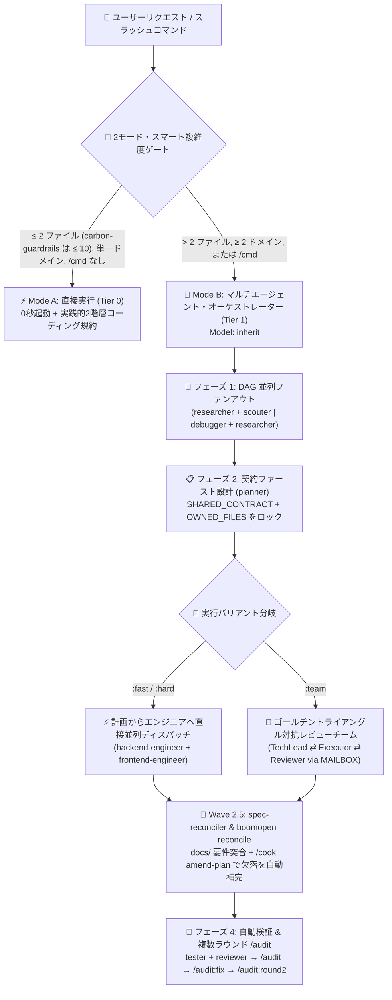

<div align="center">
  <h1>⚡ BoomOpen Workflow Kit v5.5.0</h1>
  <p><strong>マルチプラットフォーム対応 スマートハイブリッド AI 開発 OS — 22 名の専門エージェント、18 組のゴールデントライアングル・チーム &amp; 1,460+ オンデマンドスキル宝庫</strong></p>

  <p>
    <a href="https://github.com/Kennyboom/BoomOpen-Workflow-Kit-Pro/releases"></a>
    <a href="#platforms"></a>
    <a href="#agents"></a>
    <a href="#skills"></a>
    <a href="https://nodejs.org/">=18.0.0" /></a>
    <a href="../LICENSE"></a>
  </p>

  <p>
    <a href="../README.md">🇬🇧 English</a> • <a href="./README.vi.md">🇻🇳 Tiếng Việt</a> • <a href="./README.zh-CN.md">🇨🇳 简体中文</a> • <a href="./README.zh-TW.md">🇹🇼 繁體中文</a> • <b>🇯🇵 日本語</b> • <a href="./README.ko.md">🇰🇷 한국어</a> • <a href="./README.es.md">🇪🇸 Español</a> • <a href="./README.fr.md">🇫🇷 Français</a> • <a href="./README.de.md">🇩🇪 Deutsch</a><br/>
    <a href="./README.pt-BR.md">🇧🇷 Português</a> • <a href="./README.ru.md">🇷🇺 Русский</a> • <a href="./README.hi.md">🇮🇳 हिन्दी</a> • <a href="./README.ar.md">🇸🇦 العربية</a> • <a href="./README.id.md">🇮🇩 Bahasa Indonesia</a> • <a href="./README.th.md">🇹🇭 ไทย</a> • <a href="./README.tr.md">🇹🇷 Türkçe</a> • <a href="./README.it.md">🇮🇹 Italiano</a>
  </p>
</div>

---

## 🎬 公式ローンチトレーラー (Full HD 1080p)

<div align="center">
  <a href="https://github.com/Kennyboom/BoomOpen-Workflow-Kit-Pro/raw/main/assets/media/boomopen_v55_trailer_en.mp4">
    
  </a>
  <p>
    ▶️ <a href="https://github.com/Kennyboom/BoomOpen-Workflow-Kit-Pro/raw/main/assets/media/boomopen_v55_trailer_en.mp4"><b>ここをクリックして Full HD 1080p 公式トレーラーを再生・ストリーミング (スタジオ音声付き MP4)</b></a>
  </p>
</div>

---

## 🌟 BoomOpen Workflow Kit v5.5 とは？

**BoomOpen Workflow Kit v5.5（Multi-Platform Unified & Smart-Hybrid Edition）** は、単一の AI コーディングアシスタントを **22 名の専門エージェント（Specialist Agents）**、**18 組のゴールデントライアングル・チーム（72 チームファイル）**、**33 のスラッシュコマンド（89 コマンド & 参照ファイル）**、**22 個のコアスキル**、および **1,440 の専門ライブラリスキル（計 1,462 スキル）** から成るエンジニアリング組織へと進化させるオープンソースのマルチエージェント OS です。

簡単な質問にも毎回コールドスタート遅延やコンテキスト肥大化を招く重いラッパーとは異なり、BoomOpen v5.5 は **Turn-1 サブエージェント優先ゲート**、**17 言語対応の自然言語ワークフロールーティング**、**4 段階エラスティック・スワーム分割（`role#shard`）**、**Wave 2.5 仕様対コード自動整合（`boomopen reconcile` + `spec-reconciler`）**、**複数ラウンド完成後監査（`/audit`・`/audit:round2`・`/audit:fix`）**、**マルチセッション自律操縦（`/autopilot`・`/autopilot:audit`）**、および **クロスエンジン・コンダクター（`/conduct`）** を統合しています：
- **🚀 Turn-1 並列サブエージェント、Wave 2.5 自動整合 & Mode B オーケストレーション**：対象未特定のコード探索（`> 2` ファイル）、複数ドメイン開発（`≥ 2` ドメイン）、**全 17 対応言語**での自然言語ワークフロー要求、または明示的な `/cmd` 実行時には、Turn 1 で即座に並列シャード（`role#shard`、各 `<= 3–4 OWNED_FILES`）を起動。**DAG 並列ファンアウト**、**計画から実行役への直接ディスパッチ**、**契約ファーストのファイルロック（`SHARED_CONTRACT` + `OWNED_FILES`）**、**Wave 2.5 仕様対コード自動整合（`boomopen reconcile`・`spec-reconciler`・`/cook amend-plan` が `docs/` 要件と実装の差分、孤立モジュール、ルート/環境変数不整合、`[SC-*]` 漏れを自動補完）**、および **ウォーム再利用（`send_message`）** を実行します。
- **🏛️ マルチセッション `/autopilot`、複数ラウンド `/audit` & 2 層漏洩防止エンジン v6**：複数ドキュメントの仕様を不変台帳 `.boomopen/project-ledger.json` に取り込み、SHA-256 改ざん検知と 4 層ゼロ漏れゲート（`boomopen check --strict-phase --no-stubs`）で完遂。完成後は **多段階プロジェクト監査（`/audit` / `/autopilot:audit` → `.boomopen/audit-ledger.json`）** により、Round 1 包括監査（RTM 要件網羅率・UI→API→DB 縦断フロー・**2 層アンチリーケージ・セキュリティエンジン `security_scan.py` v6**）→ ユーザー承認 → `/audit:fix` → `/audit:round2` を検出 0 件まで反復します。
- **⚡ Mode A — 既知ターゲットのマイクロ直接実行（コールドスタート 0 秒）**：単純な Q&A や、**Turn 1 時点で編集対象の `≤ 2` ファイルが確定している**小規模修正（`carbon-guardrails` では `≤ 10` ファイル直接実行）は、**実践的 2 階層コーディング規約**と **徹底検証ルール** のもとで即座に直接実行・検証します。
- **📚 コンテキスト肥大化ゼロの 1,462 スキル宝庫**：**22 コアスキル (`skills/`)** と **1,440 ライブラリスキル (`skills_library/`)** を `matrix-skills/compact-index.json` に事前コンパイル。`O(1)` の 2 ステップ検索により、プロンプトを圧迫せず全領域の専門知識を即座に注入します。

---

## 🏗️ スマートハイブリッド・アーキテクチャ (v5.5)



---

<a id="pillars"></a>

## 🧠 v5.5 の 6 つのコアピラー（柱）

1. **🌐 5 大プラットフォーム完全統合サポート (`platforms/*`)**：
   - 単一の統合アーキテクチャから **Antigravity (Gemini)**、**Claude Code**、**OpenAI Codex**、**Cursor**、**GitHub Copilot** の 5 大 AI ツールをネイティブサポートします。
2. **📏 実践的 2 階層コーディング規約（Pragmatic 2-Tier Coding Standards）**：
   - **Tier 1 — 厳格な品質・安全ルール（ゼロトレランス）**：単一責任原則、**明示的な `any` の完全禁止**、**本番コードでのデバッグ用 `console.log` 放置禁止**、非同期/API 境界での `try/catch` + 型付きエラー処理、`SCREAMING_SNAKE_CASE` 定数、DRY（`≥ 3`）、クリーンな import 整理。
   - **Tier 2 — 柔軟な構造ガイドライン（凝集度優先）**：ファイル行数は `~200–350 行`（`400` ソフト上限 / `500` ハード分割。テスト・型定義・ドキュメントは除外）、関数はロジック `~20–40 行` / UI `~40–80 行` が目安です。
3. **🎯 4 段階エラスティック・スワーム分割 (`role#shard`) & Wave 2.5 自動整合 (`spec-reconciler`)**：
   - `PLAN-{feature}.md` 作成後はエンジニア各シャード（`<= 3–4 OWNED_FILES`）へ直接ディスパッチし、セッションレジストリ（`role#shard → conversationId`）経由の `send_message` で **0 秒ウォーム再利用** を実現します。
   - 並列実装直後の **Wave 2.5** では、`spec-reconciler` と `boomopen reconcile`（`REC-G1..G4`）が `docs/` 要件とコードの整合性を検査し、未接続モジュールや欠落機能を `/cook amend-plan` で自動補完してからフェーズ完了を許可します。
4. **🤝 契約ファースト並列ディスパッチ & 多段階 `/audit`（2 層セキュリティ v6）**：
   - `SHARED_CONTRACT` + `OWNED_FILES` で書き込み衝突を防止。完了後は `/audit` が Round 1 読み取り専用スキャン（RTM 要件照合 + 縦断フロー + **2 層アンチリーケージ・セキュリティエンジン v6**）を実行し、ユーザー確認 → `/audit:fix` → `/audit:round2` で指摘 0 件まで収束させます。
5. **🔍 5-Whys (SPIE v3.0) 根本原因デバッグ & 100% クリーンな Git ツリー**：
   - `debugger` は 3 仮説検証と 5-Whys 因果チェーンで原因を特定。一時成果物（`PLAN`、`DEBUG`、`TEST`、`REVIEW`、`AUDIT`、`MAILBOX`）は `<appDataDir>\brain\<conversation-id>\` に出力され、Git 作業ツリーを清潔に保ちます。
6. **🩺 組み込み 14 コマンド CLI スイート & O(1) スキルインデックス**：
   - `npm run doctor` は 5 プラットフォーム資産、**22 エージェント**、**72 チームファイル（18 チーム）**、**89 コマンドファイル（33 コマンド + `_ref/` 6 ファイル）**、および `1,462` スキルを検証。`research`、`design`、`plan`、`cook`、`reconcile`、`audit`、`ledger`、`conduct`、`check`、`doctor`、`settings`、`install`、`uninstall`、`list` の **14 CLI コマンド** が開発全工程を確定的に検証します。

---

<a id="platforms"></a>

## 💻 サポート対象の AI プラットフォーム

| プラットフォーム | サポートレベル | グローバルエントリーポイント | フレームワークインストールパス |
|----------|:-------------:|-------------------|------------------------|
| **Antigravity (Gemini)** | ✅ ネイティブ v5.5 | `~/.gemini/GEMINI.md` | `~/.gemini/config/skills/boomopen-workflow-kit/` |
| **Claude Code** | ✅ ネイティブ v5.5 | `~/.claude/CLAUDE.md` | `~/.claude/skills/boomopen-workflow-kit/` |
| **OpenAI Codex** | ✅ ネイティブ v5.5 | `~/.codex/CODEX.md` & `AGENTS.md` | `~/.codex/skills/boomopen-workflow-kit/` |
| **Cursor** | ✅ ネイティブ v5.5 | `~/.cursor/rules/boomopen-workflow-kit.mdc` | `~/.cursor/skills/boomopen-workflow-kit/` |
| **GitHub Copilot** | ✅ ネイティブ v5.5 | `~/.copilot/COPILOT.md` | `~/.copilot/skills/boomopen-workflow-kit/` |

---

## 🚀 クイックスタート & インストール

```bash
# 1. リポジトリをクローン
git clone https://github.com/Kennyboom/BoomOpen-Workflow-Kit-Pro.git
cd BoomOpen-Workflow-Kit-Pro

# 2. お使いの AI アシスタント向けにインストール（1つ選択、または --all）
npm run install:antigravity   # Antigravity (Gemini)
npm run install:claude        # Claude Code
npm run install:codex         # OpenAI Codex
npm run install:cursor        # Cursor
npm run install:copilot       # GitHub Copilot
npm run install:all           # 全 5 プラットフォームに一括インストール

# 3. 検証 & 14 CLI コマンドの主要ゲート実行
npm run doctor
npm link
boomopen research validate path/to/RESEARCH.md
boomopen design validate path/to/DESIGN.md
boomopen plan validate path/to/PLAN.md
boomopen cook preflight path/to/PLAN.md
boomopen reconcile path/to/your/project --plan path/to/PLAN.md   # Wave 2.5 仕様対コード整合 (REC-G1..G4)
boomopen audit init --docs docs/prd.md,docs/arch.md              # 複数ラウンド完成後監査の初期化
boomopen check path/to/your/project --strict-phase --no-stubs    # 行数・any・console.log・スタブ検査
boomopen ledger status
boomopen conduct probe
```

> このキットは **npm に公開されていません**。必ずこのリポジトリからインストールしてください（`npm link` はローカルクローンをリンクするだけで npm から何もダウンロードしません）。

---

## 🎛️ 統合設定と 5 つのプリセット (`/settings` コントロールセンター)

BoomOpen v5.5 の**ゼロレイテンシ統合コントロールセンター**は、**5 種類のワンクリックプリセット**と 20 個の列挙型設定（+ 行数制限 2 キー）を全 **5 プラットフォーム**へ `< 10ms`（ターン 1 レイテンシ **0ms**）で同期します：

| プリセット (`Preset`) | 実行モード (`execution.mode`) | 既定バリアント | 自然言語トリガー (`naturalLanguageResearchTrigger`) | コード規約 (`codingStandards`) | 推奨ユースケース |
|:---|:---|:---:|:---:|:---:|:---|
| **⚡ `smart-hybrid`** *(推奨デフォルト)* | **`auto`**（`≤ 2` ファイルは Mode A、`> 2` または `/cmd` は Mode B） | `auto` | **`auto_team`** *(`/research:team` / `/brainstorm:team` へ自動分岐)* | `pragmatic` (`400/500` 行) | 日常のフルスタック開発：小規模は高速、大規模は深掘り |
| **🛡️ `carbon-guardrails`** | **`mode_a`**（`≤ 10` ファイルを直接実行、Carbon が日常探索・編集を主導） | `auto` | **`off`** *(自然言語ハイジャックなし・明示的 `/cmd` 時のみ発火)* | `pragmatic` (`400/500` 行) | Antigravity Orchestrator Carbon で自律探索しつつ厳格 E2E 検証と規約を強制したい場合 |
| **🚀 `solo-fast`** | **`mode_a`**（サブエージェントなしの高速直接実行を強制） | `fast` | `off` *(`/brainstorm` 指定時以外はチャットで直接回答)* | `relaxed` (`600/800` 行) | 緊急ホットフィックス、迅速なプロトタイピング、トークン節約 |
| **🧠 `deep-architect`** | **`mode_b`**（全タスクで Mode B マルチエージェント編成を強制） | `hard` | `auto_hard` *(`/research:hard` / `/brainstorm:hard` 5レンズ調査)* | `strict` (`300/400` 行) | 複雑なシステムアーキテクチャ設計、新規構築、多層リファクタリング |
| **🔺 `adversarial-team`** | **`team`**（全ワークフローで 3 エージェント `:team` 体制を強制） | `team` | **`auto_team`** *(`MAILBOX` 経由の 3 エージェント相互検証)* | `strict` (`300/400` 行) | ミッションクリティカルな本番コード、セキュリティ監査、ゼロ欠陥リリース |

> **🛡️ `carbon-guardrails` の仕組み**：Antigravity Orchestrator Carbon が日常の探索・マルチファイル編集（`mode_a`・`≤ 10` ファイル直接実行）を主導し、BoomOpen は `pragmatic`（ソフト `400` / ハード `500` 行、`any` 禁止）規約、`strict_e2e` 検証、および明示的 `/cmd` ガードレールのみを適用して自然言語の誤爆（NL ハイジャック）を防ぎます。

### モード切り替えの 3 つの方法（チャット `/settings`、Web UI、CLI）

```bash
# 1. チャット内スラッシュコマンド
/settings                                     # 対話型選択メニューを開く (ask_question UI)
/settings preset smart-hybrid                 # Smart-Hybrid 推奨デフォルト
/settings preset carbon-guardrails            # Carbon 主導 + Pragmatic/E2E ガードレール
/settings preset solo-fast                    # Mode A ソロ高速実行
/settings preset deep-architect               # Mode B マルチエージェント編成
/settings preset adversarial-team             # ゴールデントライアングル 3 エージェント (:team)
/settings mode auto | mode_a | mode_b | team  # 実行モードを個別指定

# 2. ローカル Web コントロールセンター (http://127.0.0.1:4567) & ターミナル CLI
boomopen settings --ui
boomopen settings preset carbon-guardrails
cd path/to/your/project && boomopen settings set execution.mode mode_a --project
```

---

## 🎯 スラッシュコマンド一覧（33 コマンド / 89 ファイル）

| コマンド | バリアント / サブコマンド | 主な用途 |
|---------|----------|-----------------|
| **`/cook`** | `:fast`, `:hard`, `:team`, `amend-plan` | エンドツーエンド開発（調査 → 計画 → 並列実装 → **Wave 2.5 `reconcile`** → テスト → レビュー） |
| **`/code`** | `:fast`, `:hard`, `:team` | 既存の `PLAN-{feature}.md` に基づく直接実装と検証 |
| **`/plan`** | `:fast`, `:hard`, `:team` | `SHARED_CONTRACT`、`OWNED_FILES`、Given/When/Then 基準を含む実装計画作成 |
| **`/fix`** | `:fast`, `:hard`, `:team` | 根本原因のバグ修正と必須回帰テストによる検証 |
| **`/debug`** | `:fast`, `:hard`, `:team` | 3 仮説検証 + **5-Whys (SPIE v3.0)** による根本原因調査（`DEBUG-{issue}.md`） |
| **`/test`** | `:fast`, `:hard`, `:team` | DAG 並列ファンアウトによるテスト実行 + 未カバー境界ケース探索（`tester` + `scouter`） |
| **`/review`** | `:fast`, `:hard`, `:team` | 4 方向並列監査（アーキテクチャ、コード品質、OWASP セキュリティ、パフォーマンス） |
| **`/audit`** | `:run`, `:fix`, `:round2`, `:auto` | **複数ラウンド完成後プロジェクト監査**：Round 1 包括監査（RTM・縦断フロー・2 層アンチリーケージ v6）→ 承認 → `/audit:fix` → `/audit:round2` で 0 件まで収束 |
| **`/design`** | `:fast`, `:hard`, `:team` | システムアーキテクチャ、DB スキーマ、UI/UX 仕様書の策定（`DESIGN.md`） |
| **`/docs`** | `:core`, `:business`, `:audit` | 2 階層構造のアーキテクチャ・ビジネスドキュメントの生成と同期（`./documents/`） |
| **`/deploy`** | `:check`, `:preview`, `:production`, `:rollback` | デプロイ前ゲートチェック、プレビュー環境、本番ロールアウト、安全ロールバック |
| **`/research`** | `:fast`, `:hard`, `:team` | 自律型ディープリサーチ（4 ソーストライアンギュレーション、3 ウェーブ検索、3 ベクトル合議） |
| **`/brainstorm`** | `:fast`, `:hard`, `:team` | ソクラテス式対話による要件定義、トレードオフ分析、アイデア創出 |
| **`/report`** | `:fast`, `:hard`, `:team` | メトリクスと図表を含む技術・エグゼクティブレポートの作成 |
| **`/autopilot`** | `:init`, `:run`, `:audit` | `.boomopen/project-ledger.json` と 4 層フェーズラチェットによるマルチセッション自律オーケストレーター（`/autopilot:audit` で完成後監査へ接続） |
| **`/conduct`** | `:council`, `:pipeline` | クロスエンジン・コンダクター & 並列マルチエンジン合議（`boomopen conduct`） |
| **`/orchestrate`** | — | 複数ドメインにまたがるカスタム・マルチエージェントパイプラインの編成 |
| **`/settings`** | `preset`, `mode`, `set`, `ui` | 統合コントロールセンター：5 プリセット・20 列挙型 + 2 行数制限設定・Web UI（`--ui`） |
| **`/save` / `/recap`** | — | セッション状態（`SESSION-HANDOVER.md`）の保存と `< 5秒` での文脈復元 |

---

## 🌙 大規模マルチフェーズ・夜間自律構築ガイド (`/autopilot` vs `/goal` + `/autopilot` + `/audit`)

一晩かけて複数フェーズの大型プロジェクトを自律構築する場合は、単発の `/autopilot` ではなく **`/goal` + `/autopilot` + `/audit`** の組み合わせを推奨します：

| 運用モード | 持続範囲 & 挙動 | 台帳・品質ゲート・整合・監査 | 適したシーン |
|:---|:---|:---|:---|
| **単発 `/autopilot`** | 単一セッション内で動作し、コンテキスト約 70% で安全停止。初期 `PLAN` 承認ゲートで一旦待機 | `.boomopen/project-ledger.json` による 1〜数フェーズの計画実行と品質検査 | 日中のインタラクティブな段階開発・小〜中規模フェーズ |
| **`/goal` + `/autopilot` + `/audit`** | **`/goal` が全フェーズ完了まで夜間も途切れず駆動**し、`/autopilot` の台帳構造を毎フェーズ引き継ぐ | 台帳追跡 + **5 ゲート**（`research`, `design`, `plan`, `cook`, `check`）+ **Wave 2.5 `reconcile`** + **Round 1 `/audit`**（起床後に `/audit:fix` → `/audit:round2` で仕上げ） | 複数仕様書（`docs/`）からの一晩でのフルシステム自律構築 |

**📋 そのままコピーして使える夜間自律構築プロンプト例：**

```text
/goal /autopilot `docs/` 内の全仕様書を読み込み、.boomopen/project-ledger.json を初期化して、
承認済みの初期 PLAN に沿って全フェーズを端から端まで構築してください。
各フェーズでは以下を必須実行すること：
1) Contract-First 並列実装（SHARED_CONTRACT + OWNED_FILES）
2) Wave 2.5 spec-reconciler による boomopen reconcile（docs/ 要件との差分・未接続モジュール・ルート/環境変数を補完）
3) boomopen check --strict-phase --no-stubs と E2E テスト全通過でフェーズ確定
全フェーズ完了後に Round 1 の /audit（/autopilot:audit）を実行し、修正承認待ちのレポートを作成して完了してください。
```

---

<a id="agents"></a>

## 🤖 22 名の専門エージェント & 18 組のゴールデントライアングル・チーム

| カテゴリ | 専門エージェント (`agents/*.md`) | ゴールデントライアングル・チーム (`agents/teams/*-team/`) |
|----------|-----------------------------------|------------------------------------------------|
| **エンジニアリング & 実装** | `backend-engineer`, `frontend-engineer`, `mobile-engineer`, `game-engineer`, `database-architect`, `devops-engineer` | `backend-team`, `frontend-team`, `fullstack-team`, `mobile-team`, `game-team`, `database-team`, `devops-team` |
| **アーキテクチャ & 計画** | `tech-lead`, `planner`, `brainstormer`, `business-analyst`, `project-manager`, `designer` | `planning-team`, `brainstorm-team`, `project-team`, `design-team` |
| **品質・セキュリティ & デバッグ** | `debugger`, `tester`, `reviewer`, **`spec-reconciler`**, `security-engineer`, `performance-engineer` | `debug-team`, `qa-team`, `security-team`, `performance-team` |
| **リサーチ & ナレッジ** | `researcher`, `scouter`, `docs-manager`, `reporter` | `research-team`, `docs-team`, `report-team` |

---

<a id="skills"></a>

## 📚 1,460+ スキル宝庫（22 コアスキル + 1,440 専門ライブラリスキル）

BoomOpen は `1,462` の精選スキルを搭載し、**2 ステップ O(1) オンデマンド検索**（`<skills>` コア確認 → `matrix-skills/compact-index.json` 検索 → 必要な `SKILL.md` のみ読み込み）により **待機時トークン消費ゼロ** を実現しています：

| スキル階層 / ドメイン | 数 | 代表的なスキル & 専門領域 | 読み込み方式 |
|:---|:---:|:---|:---|
| **⚡ Tier 1: コアスキル (`skills/`)** | **22** | `clean-code`, `debugger`, `plan-writing`, `brainstorming`, `frontend-design`, `frontend-architecture`, `design-spec`, `api-patterns`, `database-design`, `testing-patterns`, `skill-seeker` | `<skills>` に事前登録、Turn 1 で即座に利用可能 |
| **🎨 UI/UX クラフト・モーション & デザインシステム** | **42** | Anti-AI-Slop Visual Craft、OKLCH 色空間 & Bento Grid、Motion v12 + CSS View Transitions、ヘッドレス UI (`cmdk`/`vaul`/`sonner`)、Figma MCP + W3C DTCG トークン、WCAG 2.2 AA/AAA、iOS 18 HIG & Material 3 Expressive | `compact-index.json` 経由のオンデマンド読み込み (`matrix-skills/design.yaml`) |
| **🌐 Web・バックエンド & 分散システム** | **390+** | Next.js/React 19、FastAPI、NestJS、Go/Rust マイクロサービス、GraphQL、gRPC、Redis/Kafka イベント駆動設計、マルチテナント SaaS | `compact-index.json` 経由のオンデマンド読み込み (`skills_library/`) |
| **🤖 AI・LLM エージェント & データ基盤** | **320+** | RAG パイプライン、LangGraph/MCP サーバー、プロンプト設計、Vertex AI、BigQuery 分析、dbt、Spark、ベクトル DB | `compact-index.json` 経由のオンデマンド読み込み (`skills_library/`) |
| **☁️ クラウド・DevOps・K8s & セキュリティ** | **300+** | Terraform/OpenTofu、AWS/GCP/Azure 設計、Docker/K8s GitOps、CI/CD、OWASP Top 10 監査、ゼロトラスト認証 | `compact-index.json` 経由のオンデマンド読み込み (`skills_library/`) |
| **📱 モバイル・ゲームエンジン & 専門領域** | **410+** | iOS Swift/SwiftUI、Android Kotlin、React Native、Flutter、Unity 6、Unreal Engine 5、Godot 4、WebGL/Three.js、クオンツ金融、Web3 | `compact-index.json` 経由のオンデマンド読み込み (`skills_library/`) |

---

## 📂 リポジトリ構成

```text
BoomOpen-Workflow-Kit-Pro/
├── agents/                  # 22 の専門エージェント定義 (spec-reconciler 含む) + 18 チーム (54 ロール + 18 _team.md、計 72 ファイル)
├── cli/                     # 14 CLI コマンド: install, doctor, checker, settings, research, design, plan, cook, reconcile, audit, ledger & conductor
├── commands/                # 83 スラッシュコマンドワークフロー (33 コマンド: :fast/:hard/:team, :run/:fix/:round2/:auto, :init/:run/:audit 等) + 6 _ref/ (計 89 ファイル)
├── documents/               # 2階層アーキテクチャ、ドメイン、ソースベース、コーディング規約ドキュメント
├── i18n/                    # 多言語ドキュメント（主要 16 言語の完全翻訳版 README）
├── matrix-skills/           # ドメイン別 YAML スキルマトリクス + 事前コンパイル済み compact-index.json (1,462 スキル)
├── platforms/               # 5大プラットフォーム統合テンプレート (antigravity/, claude/, codex/, copilot/, cursor/)
├── rules/                   # Mode B オンデマンドルール (CORE, PHASES, AGENTS, TEAMS, SKILLS, ERRORS, REFERENCE)
├── scripts/                 # Python 自動検証スクリプト (security_scan.py v6, checklist.py, verify_all.py など)
├── skills/                  # 22 のコアスキル (clean-code, debugger, plan-writing, frontend-design など)
├── skills_library/          # 2ステップ高速検索でオンデマンド読み込みされる 1,440 の専門スキルライブラリ
└── GEMINI.md | CLAUDE.md | CODEX.md | COPILOT.md | CURSOR.md | AGENT.md
```

---

## 📄 ライセンス & セキュリティ

- **ライセンス**：[MIT License](../LICENSE) の下で配布されています。Copyright © 2026 **BoomOpen Labs**。 `skills_library/` のサードパーティ製スキルは元のライセンスに従います。[THIRD_PARTY_NOTICES.md](../THIRD_PARTY_NOTICES.md) を参照してください。
- **セキュリティポリシー**：組み込みのセキュリティ保護機能と脆弱性の報告手順については、[SECURITY.md](../SECURITY.md) をご覧ください。
