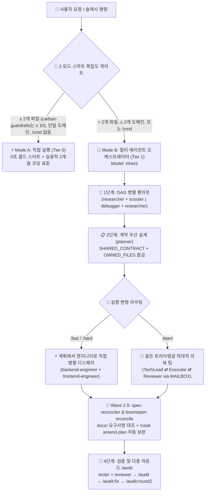

<div align="center">
  <h1>⚡ BoomOpen Workflow Kit v5.5.0</h1>
  <p><strong>멀티 플랫폼 스마트 하이브리드 AI 개발 OS — 22명 전문 에이전트, 18개 골든 트라이앵글 팀 &amp; 1,460+ 온디맨드 스킬 볼트</strong></p>

  <p>
    <a href="https://github.com/Kennyboom/BoomOpen-Workflow-Kit-Pro/releases"></a>
    <a href="#platforms"></a>
    <a href="#agents"></a>
    <a href="#skills"></a>
    <a href="https://nodejs.org/">=18.0.0" /></a>
    <a href="../LICENSE"></a>
  </p>

  <p>
    <a href="../README.md">🇬🇧 English</a> • <a href="./README.vi.md">🇻🇳 Tiếng Việt</a> • <a href="./README.zh-CN.md">🇨🇳 简体中文</a> • <a href="./README.zh-TW.md">🇹🇼 繁體中文</a> • <a href="./README.ja.md">🇯🇵 日本語</a> • <b>🇰🇷 한국어</b> • <a href="./README.es.md">🇪🇸 Español</a> • <a href="./README.fr.md">🇫🇷 Français</a> • <a href="./README.de.md">🇩🇪 Deutsch</a><br/>
    <a href="./README.pt-BR.md">🇧🇷 Português</a> • <a href="./README.ru.md">🇷🇺 Русский</a> • <a href="./README.hi.md">🇮🇳 हिन्दी</a> • <a href="./README.ar.md">🇸🇦 العربية</a> • <a href="./README.id.md">🇮🇩 Bahasa Indonesia</a> • <a href="./README.th.md">🇹🇭 ไทย</a> • <a href="./README.tr.md">🇹🇷 Türkçe</a> • <a href="./README.it.md">🇮🇹 Italiano</a>
  </p>
</div>

---

## 🎬 공식 런칭 트레일러 (Full HD 1080p)

<div align="center">
  <a href="https://github.com/Kennyboom/BoomOpen-Workflow-Kit-Pro/raw/main/assets/media/boomopen_v55_trailer_en.mp4">
    
  </a>
  <p>
    ▶️ <a href="https://github.com/Kennyboom/BoomOpen-Workflow-Kit-Pro/raw/main/assets/media/boomopen_v55_trailer_en.mp4"><b>여기를 클릭하여 Full HD 1080p 공식 런칭 트레일러 재생 / 스트리밍 (스튜디오 보이스오버 MP4)</b></a>
  </p>
</div>

---

## 🌟 BoomOpen Workflow Kit v5.5란 무엇인가요?

**BoomOpen Workflow Kit v5.5 (Multi-Platform Unified & Smart-Hybrid Edition)**는 단일 AI 코딩 어시스턴트를 **22명의 전문 에이전트(Specialist Agents)**, **18개의 골든 트라이앵글 팀(72개 팀 파일)**, **33개 슬래시 명령어(89개 명령 및 참조 파일)**, **22개의 코어 스킬**, 그리고 **1,440개의 전문 라이브러리 스킬(총 1,462개 스킬)**로 구성된 엔지니어링 조직으로 전환하는 오픈소스 멀티 에이전트 운영체제입니다.

매 턴마다 콜드 스타트 지연과 컨텍스트 팽창을 유발하는 무거운 래퍼들과 달리, BoomOpen v5.5는 **턴-1 서브 에이전트 우선 게이트**, **17개 국어 자연어 워크플로우 라우팅**, **4단계 탄력적 스웜 샤딩(`role#shard`)**, **Wave 2.5 명세-코드 자동 정합(`boomopen reconcile` + `spec-reconciler`)**, **다중 라운드 완료 후 프로젝트 감사(`/audit`, `/audit:round2`, `/audit:fix`)**, **멀티 세션 오토파일럿(`/autopilot`, `/autopilot:audit`)**, 그리고 **크로스 엔진 컨덕터(`/conduct`)**를 통합합니다:
- **🚀 턴-1 병렬 서브 에이전트, Wave 2.5 자동 정합 & Mode B 오케스트레이션**: 범위 미확정 탐색(`> 2`개 파일), 다중 도메인 기능(`≥ 2`개 도메인), **17개 언어** 자연어 워크플로우 요청 또는 명시적 `/cmd` 호출 시 턴 1에서 즉시 병렬 샤드(`role#shard`, 샤드당 `<= 3–4 OWNED_FILES`)를 실행합니다. **DAG 병렬 팬아웃**, **계획-실행자 직접 디스패치**, **계약 우선 파일 잠금(`SHARED_CONTRACT` + `OWNED_FILES`)**, **Wave 2.5 명세-코드 자동 정합(`boomopen reconcile`·`spec-reconciler`·`/cook amend-plan`이 `docs/` 요구사항 대비 누락 기능, 고립 모듈, 라우트/환경변수 불일치 및 `[SC-*]` 누락을 자동 보완)**, **웜 재사용(`send_message`)**을 지원합니다.
- **🏛️ 멀티 세션 `/autopilot`, 다중 라운드 `/audit` & 2계층 유출 방지 보안 엔진 v6**: 다중 문서를 불변 원장 `.boomopen/project-ledger.json`으로 수집해 SHA-256 변조 방지 및 4계층 품질 래칫(`boomopen check --strict-phase --no-stubs`)으로 완수합니다. 완료 후에는 **다중 라운드 프로젝트 감사(`/audit` / `/autopilot:audit` → `.boomopen/audit-ledger.json`)**가 1라운드 종합 감사(RTM 명세 커버리지·UI→API→DB 수직 흐름·**2계층 유출 방지 보안 엔진 `security_scan.py` v6**) → 사용자 검토 승인 → `/audit:fix` → `/audit:round2`를 결함 0건까지 반복합니다.
- **⚡ Mode A — 알려진 대상 마이크로 직접 실행 (0초 콜드 스타트)**: 단순 Q&A나 **턴 1에서 정확한 `≤ 2`개 대상 파일이 이미 특정된** 미세 수정(`carbon-guardrails` 프리셋에서는 `≤ 10`개 파일 직접 실행)은 **실용적 2계층 코딩 표준**과 **지속적 검증 규칙** 아래 즉시 직접 실행·검증합니다.
- **📚 컨텍스트 낭비 없는 1,462 대규모 스킬 볼트**: **22개 코어 스킬(`skills/`)**과 **1,440개 라이브러리 스킬(`skills_library/`)**을 `matrix-skills/compact-index.json`에 사전 컴파일해 `O(1)` 2단계 조회로 프롬프트 오염 없이 전문 지식을 즉시 주입합니다.

---

## 🏗️ 스마트 하이브리드 아키텍처 (v5.5)



---

<a id="pillars"></a>

## 🧠 v5.5의 6대 핵심 기둥

1. **🌐 5대 플랫폼 완벽 통합 지원 (`platforms/*`)**:
   - 단일 통합 아키텍처에서 **Antigravity (Gemini)**, **Claude Code**, **OpenAI Codex**, **Cursor**, **GitHub Copilot** 등 5대 AI 플랫폼을 네이티브로 지원합니다.
2. **📏 실용적 2계층 코딩 표준 (Pragmatic 2-Tier Coding Standards)**:
   - **Tier 1 — 엄격한 품질 및 안전 규칙 (무관용 원칙)**: 단일 책임 원칙, **명시적 `any` 절대 금지**, **프로덕션 내 디버그 `console.log` 방치 금지**, 비동기/API 경계 `try/catch` + 타입 에러 처리, `SCREAMING_SNAKE_CASE` 상수, DRY(`≥ 3`), 깔끔한 import 정렬.
   - **Tier 2 — 유연한 구조 가이드라인 (응집도 우선)**: 파일 길이 `~200–350줄`(소프트 `400줄` / 하드 `500줄` 분할; 테스트·타입·문서 제외), 함수 로직 `~20–40줄` / UI `~40–80줄` 권장.
3. **🎯 4단계 탄력적 스웜 샤딩 (`role#shard`) & Wave 2.5 자동 정합 (`spec-reconciler`)**:
   - `PLAN-{feature}.md` 생성 후 도메인 엔지니어 샤드(`<= 3–4 OWNED_FILES`)에 직접 디스패치하며, 세션 레지스트리(`role#shard → conversationId`) 기반 `send_message`로 **0초 웜 재사용**을 수행합니다.
   - 병렬 구현 직후 **Wave 2.5**에서 `spec-reconciler`와 `boomopen reconcile`(`REC-G1..G4`)이 `docs/` 명세와 실제 구현의 차이를 검증해, 누락된 기능·고립 모듈·라우트/환경변수 불일치를 `/cook amend-plan`으로 자동 보완한 뒤 단계를 종료합니다.
4. **🤝 계약 우선 병렬 디스패치 & 다중 라운드 `/audit` (2계층 보안 엔진 v6)**:
   - `SHARED_CONTRACT` + `OWNED_FILES`로 쓰기 충돌을 방지하고, 완료 후 `/audit`이 1라운드 읽기 전용 스캔(RTM 명세 커버리지 + 수직 흐름 + **2계층 유출 방지 보안 엔진 v6**) → 사용자 승인 → `/audit:fix` → `/audit:round2`를 무결점 상태까지 반복합니다.
5. **🔍 5-Whys (SPIE v3.0) 근본 원인 디버깅 & 100% 깨끗한 Git 트리**:
   - `debugger`가 3대 가설과 5-Whys 인과 체인으로 원인을 추적하며, 임시 산출물(`PLAN`, `DEBUG`, `TEST`, `REVIEW`, `AUDIT`, `MAILBOX`)은 `<appDataDir>\brain\<conversation-id>\`에 저장되어 Git 작업 트리를 깨끗하게 유지합니다.
6. **🩺 내장 14개 CLI 명령 스위트 & O(1) 스킬 인덱스**:
   - `npm run doctor`는 5개 플랫폼 번들, **22개 에이전트**, **72개 팀 파일(18개 팀)**, **89개 명령 파일(33개 명령 + `_ref/` 6개)** 및 `1,462`개 스킬을 검증합니다. `research`, `design`, `plan`, `cook`, `reconcile`, `audit`, `ledger`, `conduct`, `check`, `doctor`, `settings`, `install`, `uninstall`, `list` 등 **14개 CLI 명령**이 전 과정을 결정론적으로 검증합니다.

---

<a id="platforms"></a>

## 💻 지원되는 AI 플랫폼

| 플랫폼 | 지원 수준 | 글로벌 엔트리포인트 | 프레임워크 설치 경로 |
|----------|:-------------:|-------------------|------------------------|
| **Antigravity (Gemini)** | ✅ 네이티브 v5.5 | `~/.gemini/GEMINI.md` | `~/.gemini/config/skills/boomopen-workflow-kit/` |
| **Claude Code** | ✅ 네이티브 v5.5 | `~/.claude/CLAUDE.md` | `~/.claude/skills/boomopen-workflow-kit/` |
| **OpenAI Codex** | ✅ 네이티브 v5.5 | `~/.codex/CODEX.md` & `AGENTS.md` | `~/.codex/skills/boomopen-workflow-kit/` |
| **Cursor** | ✅ 네이티브 v5.5 | `~/.cursor/rules/boomopen-workflow-kit.mdc` | `~/.cursor/skills/boomopen-workflow-kit/` |
| **GitHub Copilot** | ✅ 네이티브 v5.5 | `~/.copilot/COPILOT.md` | `~/.copilot/skills/boomopen-workflow-kit/` |

---

## 🚀 빠른 시작 및 설치 방법

```bash
# 1. 저장소 클론
git clone https://github.com/Kennyboom/BoomOpen-Workflow-Kit-Pro.git
cd BoomOpen-Workflow-Kit-Pro

# 2. 사용 중인 AI 어시스턴트에 맞게 설치 (하나 선택 또는 --all)
npm run install:antigravity   # Antigravity (Gemini)
npm run install:claude        # Claude Code
npm run install:codex         # OpenAI Codex
npm run install:cursor        # Cursor
npm run install:copilot       # GitHub Copilot
npm run install:all           # 5개 플랫폼 전체 일괄 설치

# 3. 설치 검증 및 주요 14개 CLI 게이트 실행
npm run doctor
npm link
boomopen research validate path/to/RESEARCH.md
boomopen design validate path/to/DESIGN.md
boomopen plan validate path/to/PLAN.md
boomopen cook preflight path/to/PLAN.md
boomopen reconcile path/to/your/project --plan path/to/PLAN.md   # Wave 2.5 명세-코드 정합 (REC-G1..G4)
boomopen audit init --docs docs/prd.md,docs/arch.md              # 다중 라운드 완료 후 프로젝트 감사 초기화
boomopen check path/to/your/project --strict-phase --no-stubs    # 줄 수, any, console.log, 스텁 검사
boomopen ledger status
boomopen conduct probe
```

> 이 키트는 **npm에 게시되지 않았습니다** — 반드시 이 저장소에서 설치하세요(`npm link`는 로컬 복제본을 PATH에 연결할 뿐 npm에서 내려받지 않습니다).

---

## 🎛️ 통합 설정 및 5가지 원클릭 프리셋 (`/settings` 컨트롤 센터)

BoomOpen v5.5의 **제로 레이턴시 통합 컨트롤 센터**는 **5가지 원클릭 프리셋**과 20개 열거형 설정(+ 줄 수 제한 2개 키)을 **5개 플랫폼** 전체에 `< 10ms`(첫 턴 지연 **0ms**)로 동기화합니다:

| 프리셋 (`Preset`) | 실행 모드 (`execution.mode`) | 기본 변형 | 자연어 트리거 (`naturalLanguageResearchTrigger`) | 코딩 표준 (`codingStandards`) | 권장 사용 환경 |
|:---|:---|:---:|:---:|:---:|:---|
| **⚡ `smart-hybrid`** *(기본 권장)* | **`auto`** (`≤ 2`개 파일 → Mode A; `> 2` 또는 `/cmd` → Mode B) | `auto` | **`auto_team`** *(`/research:team` / `/brainstorm:team` 자동 라우팅)* | `pragmatic` (`400/500`줄) | 일상적인 풀스택 개발 — 소규모는 고속, 대규모는 심층 분석 |
| **🛡️ `carbon-guardrails`** | **`mode_a`** (`≤ 10`개 파일 직접 실행, Carbon이 일상 탐색·편집 주도) | `auto` | **`off`** *(자연어 가로채기 없음 — 명시적 `/cmd` 입력 시에만 실행)* | `pragmatic` (`400/500`줄) | Antigravity Orchestrator Carbon의 자율 탐색에 400/500줄 표준과 엄격 E2E 가드레일을 결합할 때 |
| **🚀 `solo-fast`** | **`mode_a`** *(서브 에이전트 없이 직접 고속 실행 강제)* | `fast` | `off` *(`/brainstorm` 입력 시에만 실행, 기본은 즉시 답변)* | `relaxed` (`600/800`줄) | 긴급 핫픽스, 빠른 프로토타이핑, 스크립트 및 토큰 절약 |
| **🧠 `deep-architect`** | **`mode_b`** *(모든 작업에 Mode B 멀티 에이전트 오케스트레이션 강제)* | `hard` | `auto_hard` *(`/research:hard` / `/brainstorm:hard` 5-렌즈 심층 리서치)* | `strict` (`300/400`줄) | 복잡한 시스템 아키텍처 설계, 신규 프로젝트 및 다중 도메인 리팩토링 |
| **🔺 `adversarial-team`** | **`team`** *(모든 워크플로우에 3-에이전트 `:team` 강제)* | `team` | **`auto_team`** *(`MAILBOX` 기반 3-에이전트 교차 검증)* | `strict` (`300/400`줄) | 미션 크리티컬 프로덕션 코드, 보안 감사 및 무결점 릴리스 |

> **🛡️ `carbon-guardrails` 상세 설명**: Antigravity Orchestrator Carbon이 일상 탐색 및 다중 파일 편집(`mode_a`, `≤ 10`개 파일 직접 처리)을 주도하고, BoomOpen은 `pragmatic`(소프트 `400` / 하드 `500`줄, `any` 금지) 코딩 표준, `strict_e2e` 검증 및 명시적 `/cmd` 가드레일만 적용하여 자연어 오작동(NL 하이재킹)을 원천 차단합니다.

### 모드 전환 및 설정 변경의 3가지 방법 (채팅 `/settings`, 웹 UI, CLI)

```bash
# 1. 채팅창 슬래시 명령어
/settings                                     # 대화형 선택 메뉴 열기 (ask_question UI)
/settings preset smart-hybrid                 # Smart-Hybrid 기본 권장 모드
/settings preset carbon-guardrails            # Carbon 주도 + Pragmatic/E2E 가드레일 모드
/settings preset solo-fast                    # Mode A 단일 에이전트 고속 실행
/settings preset deep-architect               # Mode B 멀티 에이전트 오케스트레이터
/settings preset adversarial-team             # 골든 트라이앵글 3-에이전트 팀 (:team)
/settings mode auto | mode_a | mode_b | team  # 실행 모드 직접 지정

# 2. 로컬 웹 컨트롤 센터 (http://127.0.0.1:4567) 및 터미널 CLI
boomopen settings --ui
boomopen settings preset carbon-guardrails
cd path/to/your/project && boomopen settings set execution.mode mode_a --project
```

---

## 🎯 슬래시 명령어 레퍼런스 (33개 명령 / 89개 파일)

| 명령어 | 변형 / 하위 명령 | 주요 목적 |
|---------|----------|-----------------|
| **`/cook`** | `:fast`, `:hard`, `:team`, `amend-plan` | 엔드투엔드 기능 개발 (리서치 → 계획 → 병렬 코딩 → **Wave 2.5 `reconcile`** → 테스트 → 리뷰) |
| **`/code`** | `:fast`, `:hard`, `:team` | 기존 `PLAN-{feature}.md`를 기반으로 즉시 코드 구현 및 검증 수행 |
| **`/plan`** | `:fast`, `:hard`, `:team` | `SHARED_CONTRACT`, `OWNED_FILES` 및 Given/When/Then 기준을 포함한 구현 청사진 작성 |
| **`/fix`** | `:fast`, `:hard`, `:team` | 근본 원인 버그 수정 및 필수 회귀 테스트 검증 |
| **`/debug`** | `:fast`, `:hard`, `:team` | 3대 가설 검증 + **5-Whys (SPIE v3.0)** 근본 원인 조사 (`DEBUG-{issue}.md`) |
| **`/test`** | `:fast`, `:hard`, `:team` | DAG 병렬 팬아웃 테스트 실행 + 미적용 엣지 케이스 탐색 (`tester` + `scouter`) |
| **`/review`** | `:fast`, `:hard`, `:team` | 4방향 병렬 코드 감사 (아키텍처, 코드 품질, OWASP 보안, 성능) |
| **`/audit`** | `:run`, `:fix`, `:round2`, `:auto` | **다중 라운드 완료 후 프로젝트 감사**: 1라운드 종합 감사(RTM·수직 흐름·2계층 유출 방지 보안 v6) → 사용자 검토 → `/audit:fix` → `/audit:round2` 결함 0건까지 반복 |
| **`/design`** | `:fast`, `:hard`, `:team` | 시스템 아키텍처, 데이터베이스 스키마 및 UI/UX 명세서 작성 (`DESIGN.md`) |
| **`/docs`** | `:core`, `:business`, `:audit` | 2계층 구조의 아키텍처 및 비즈니스 문서 생성·동기화 (`./documents/`) |
| **`/deploy`** | `:check`, `:preview`, `:production`, `:rollback` | 배포 전 준비 상태 점검, 프리뷰 환경, 프로덕션 롤아웃 및 안전 롤백 |
| **`/research`** | `:fast`, `:hard`, `:team` | 자율 딥 리서치 엔진 (4대 소스 삼각 검증, 3웨이브 검색 및 3벡터 위원회) |
| **`/brainstorm`** | `:fast`, `:hard`, `:team` | 소크라테스식 요구사항 탐색, 트레이드오프 분석 및 아이디어 도출 |
| **`/report`** | `:fast`, `:hard`, `:team` | 지표 및 다이어그램이 포함된 기술·경영 종합 보고서 생성 |
| **`/autopilot`** | `:init`, `:run`, `:audit` | `.boomopen/project-ledger.json` 및 4계층 래칫 기반 다중 세션 자율 오케스트레이터 (`/autopilot:audit`로 완료 후 감사 연계) |
| **`/conduct`** | `:council`, `:pipeline` | 크로스 엔진 컨덕터 및 병렬 멀티 엔진 위원회 (`boomopen conduct`) |
| **`/orchestrate`** | — | 여러 도메인에 걸친 맞춤형 멀티 에이전트 파이프라인 오케스트레이션 |
| **`/settings`** | `preset`, `mode`, `set`, `ui` | 통합 컨트롤 센터: 5개 프리셋, 20개 열거형 + 2개 줄 제한 설정, 웹 UI(`--ui`) 실행 |
| **`/save` / `/recap`** | — | 세션 상태(`SESSION-HANDOVER.md`) 저장 및 `< 5초` 이내 전체 컨텍스트 복원 |

---

## 🌙 대규모 다중 단계 야간 자율 구축 가이드 (`/autopilot` vs `/goal` + `/autopilot` + `/audit`)

하룻밤 동안 여러 단계의 대규모 프로젝트를 자율 구축하려면 단독 `/autopilot` 대신 **`/goal` + `/autopilot` + `/audit`** 조합을 사용하세요:

| 실행 방식 | 지속 범위 및 동작 | 원장 · 게이트 · 정합 · 감사 보장 | 적합한 상황 |
|:---|:---|:---|:---|
| **단독 `/autopilot`** | 단일 세션 내에서 동작하며 컨텍스트 ~70% 시점에 안전 정지. 초기 `PLAN` 승인 단계에서 일시 정지 | `.boomopen/project-ledger.json` 기반 1~수 개 단계의 계획 실행 및 품질 검사 | 주간 대화형 단계별 개발 및 소·중규모 기능 단위 |
| **`/goal` + `/autopilot` + `/audit`** | **`/goal`이 모든 단계 완료까지 야간에도 끊기지 않고 구동**하며, 매 단계 `/autopilot` 원장 규율을 유지 | 원장 추적 + **5대 게이트**(`research`, `design`, `plan`, `cook`, `check`) + **Wave 2.5 `reconcile`** + **1라운드 `/audit`**(이후 `/audit:fix` → `/audit:round2`로 마무리) | `docs/` 다중 명세서 기반의 야간 전체 프로젝트 무인 구축 |

**📋 바로 복사해 쓰는 야간 자율 구축 프롬프트 예시:**

```text
/goal /autopilot `docs/` 폴더의 모든 명세 문서를 읽고 .boomopen/project-ledger.json을 초기화한 뒤,
승인된 초기 PLAN에 따라 전체 단계를 끝까지 구축하세요.
모든 단계마다 다음을 반드시 실행해야 합니다:
1) 계약 우선 병렬 구현 (SHARED_CONTRACT + OWNED_FILES)
2) Wave 2.5 spec-reconciler를 통한 boomopen reconcile (docs/ 요구사항 누락, 고립 모듈, 라우트/환경변수 불일치 자동 보완)
3) boomopen check --strict-phase --no-stubs 및 E2E 테스트 전체 통과 후 단계 확정
모든 단계 완료 후 1라운드 /audit(/autopilot:audit)을 실행하고 사용자 승인 대기 감사 보고서를 생성한 뒤 종료하세요.
```

---

<a id="agents"></a>

## 🤖 22명의 전문 에이전트 & 18개의 골든 트라이앵글 팀

| 카테고리 | 전문 에이전트 (`agents/*.md`) | 골든 트라이앵글 팀 (`agents/teams/*-team/`) |
|----------|-----------------------------------|------------------------------------------------|
| **엔지니어링 및 실행** | `backend-engineer`, `frontend-engineer`, `mobile-engineer`, `game-engineer`, `database-architect`, `devops-engineer` | `backend-team`, `frontend-team`, `fullstack-team`, `mobile-team`, `game-team`, `database-team`, `devops-team` |
| **아키텍처 및 기획** | `tech-lead`, `planner`, `brainstormer`, `business-analyst`, `project-manager`, `designer` | `planning-team`, `brainstorm-team`, `project-team`, `design-team` |
| **품질, 보안 및 디버깅** | `debugger`, `tester`, `reviewer`, **`spec-reconciler`**, `security-engineer`, `performance-engineer` | `debug-team`, `qa-team`, `security-team`, `performance-team` |
| **리서치 및 지식 관리** | `researcher`, `scouter`, `docs-manager`, `reporter` | `research-team`, `docs-team`, `report-team` |

---

<a id="skills"></a>

## 📚 1,460+ 스킬 볼트 (22개 코어 스킬 + 1,440 전문 라이브러리 스킬)

BoomOpen은 `1,462`개의 큐레이션된 엔지니어링 스킬을 탑재하고 있으며, **2단계 O(1) 점진적 스킬 조회**(`<skills>` 코어 확인 → `matrix-skills/compact-index.json` 검색 → 필요한 `SKILL.md`만 온디맨드 로드)를 통해 **유휴 토큰 소모 0**을 달성합니다:

| 스킬 계층 / 도메인 | 개수 | 대표 스킬 및 핵심 역량 | 로딩 메커니즘 |
|:---|:---:|:---|:---|
| **⚡ Tier 1: 코어 스킬 (`skills/`)** | **22** | `clean-code`, `debugger`, `plan-writing`, `brainstorming`, `frontend-design`, `frontend-architecture`, `design-spec`, `api-patterns`, `database-design`, `testing-patterns`, `skill-seeker` | `<skills>`에 사전 인덱싱되어 Turn 1 즉시 사용 |
| **🎨 UI/UX 크래프트, 모션 & 디자인 시스템** | **42** | Anti-AI-Slop Visual Craft, OKLCH 색공간 & Bento Grid, Motion v12 + CSS View Transitions, 헤드리스 프리미티브(`cmdk`/`vaul`/`sonner`), Figma MCP + W3C DTCG 토큰, WCAG 2.2 AA/AAA, iOS 18 HIG & Material 3 Expressive | `compact-index.json` 기반 온디맨드 로드 (`matrix-skills/design.yaml`) |
| **🌐 웹, 백엔드 & 분산 시스템** | **390+** | Next.js/React 19, FastAPI, NestJS, Go/Rust 마이크로서비스, GraphQL, gRPC, Redis/Kafka 이벤트 기반 아키텍처, 멀티테넌트 SaaS | `compact-index.json` 기반 온디맨드 로드 (`skills_library/`) |
| **🤖 AI, LLM 에이전트 & 데이터 엔지니어링** | **320+** | RAG 파이프라인, LangGraph/MCP 서버, 프롬프트 엔지니어링, Vertex AI, BigQuery 분석, dbt, Spark, 벡터 DB | `compact-index.json` 기반 온디맨드 로드 (`skills_library/`) |
| **☁️ 클라우드, DevOps, K8s & 보안** | **300+** | Terraform/OpenTofu, AWS/GCP/Azure 아키텍처, Docker/K8s GitOps, CI/CD, OWASP Top 10 감사, 제로 트러스트 인증 | `compact-index.json` 기반 온디맨드 로드 (`skills_library/`) |
| **📱 모바일, 게임 엔진 & 특화 도메인** | **410+** | iOS Swift/SwiftUI, Android Kotlin, React Native, Flutter, Unity 6, Unreal Engine 5, Godot 4, WebGL/Three.js, 퀀트 금융, Web3 | `compact-index.json` 기반 온디맨드 로드 (`skills_library/`) |

---

## 📂 저장소 구조

```text
BoomOpen-Workflow-Kit-Pro/
├── agents/                  # 22개 전문 에이전트 (spec-reconciler 포함) + 18개 팀 (54개 역할 + 18개 _team.md, 총 72개 파일)
├── cli/                     # 14개 CLI 명령: install, doctor, checker, settings, research, design, plan, cook, reconcile, audit, ledger & conductor
├── commands/                # 83개 슬래시 명령 워크플로우 (33개 명령: :fast/:hard/:team, :run/:fix/:round2/:auto, :init/:run/:audit 등) + 6개 _ref/ (총 89개 파일)
├── documents/               # 2계층 아키텍처, 도메인, 소스 베이스 및 코딩 표준 문서
├── i18n/                    # 다국어 문서 디렉토리 (주요 16개 언어 전체 번역 README)
├── matrix-skills/           # 도메인별 YAML 스킬 매트릭스 + 사전 컴파일된 compact-index.json (1,462 스킬)
├── platforms/               # 5대 플랫폼 통합 템플릿 (antigravity/, claude/, codex/, copilot/, cursor/)
├── rules/                   # Mode B 온디맨드 규칙 (CORE, PHASES, AGENTS, TEAMS, SKILLS, ERRORS, REFERENCE)
├── scripts/                 # Python 자동 검증 스크립트 (security_scan.py v6, checklist.py, verify_all.py 등)
├── skills/                  # 22개 코어 스킬 (clean-code, debugger, plan-writing, frontend-design 등)
├── skills_library/          # 2단계 고속 조회로 온디맨드 로드되는 1,440 전문 스킬 라이브러리
└── GEMINI.md | CLAUDE.md | CODEX.md | COPILOT.md | CURSOR.md | AGENT.md
```

---

## 📄 라이선스 및 보안

- **라이선스**: [MIT 라이선스](../LICENSE)에 따라 배포됩니다. Copyright © 2026 **BoomOpen Labs**. `skills_library/`의 서드파티 스킬은 원래 라이선스를 따릅니다. [THIRD_PARTY_NOTICES.md](../THIRD_PARTY_NOTICES.md)를 참고하세요.
- **보안 정책**: 내장된 보안 가드레일 및 취약점 제보 절차는 [SECURITY.md](../SECURITY.md)를 참조하세요.
