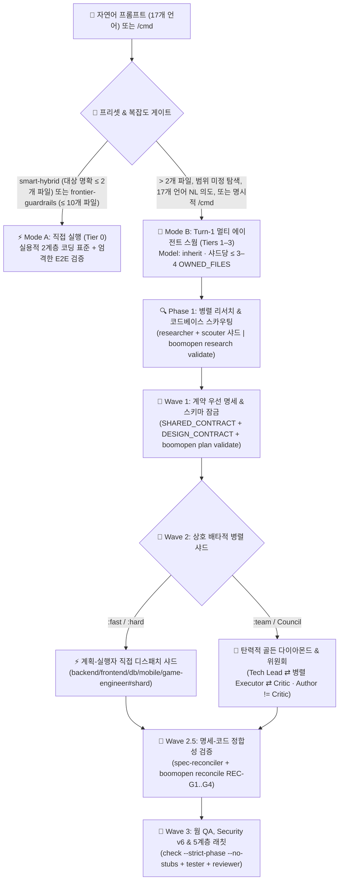

<div align="center">
  <h1>⚡ BoomOpen Workflow Kit Pro v5.5</h1>
  <p><strong>Antigravity, Claude Code, OpenAI Codex, Cursor, GitHub Copilot 전반에서 동작하는 멀티 에이전트 워크플로우 오케스트레이션 및 결정론적 CLI 검증 게이트.</strong></p>

  <p>
    <a href="https://boomopen.com"></a>
    <a href="https://github.com/Kennyboom/BoomOpen-Workflow-Kit-Pro/releases"></a>
    <a href="#platforms"></a>
    <a href="#cli"></a>
    <a href="#skills"></a>
    <a href="https://nodejs.org/">= 18.0.0" /></a>
    <a href="../LICENSE"></a>
  </p>

  <p>
    <a href="../README.md">English</a> •
    <a href="./README.vi.md">Tiếng Việt</a> •
    <a href="./README.zh-CN.md">简体中文</a> •
    <a href="./README.zh-TW.md">繁體中文</a> •
    <a href="./README.ja.md">日本語</a> •
    <b>한국어</b> •
    <a href="./README.es.md">Español</a> •
    <a href="./README.fr.md">Français</a> •
    <a href="./README.de.md">Deutsch</a><br/>
    <a href="./README.pt-BR.md">Português (BR)</a> •
    <a href="./README.ru.md">Русский</a> •
    <a href="./README.hi.md">हिन्दी</a> •
    <a href="./README.ar.md">العربية</a> •
    <a href="./README.id.md">Bahasa Indonesia</a> •
    <a href="./README.th.md">ไทย</a> •
    <a href="./README.tr.md">Türkçe</a> •
    <a href="./README.it.md">Italiano</a>
  </p>

  <p>
    <a href="https://boomopen.com"><b>🌐 boomopen.com (15개 언어)</b></a> •
    <a href="#trailer"><b>🎬 공식 트레일러</b></a> •
    <a href="#why-boomopen"><b>⚡ 도입 배경</b></a> •
    <a href="#architecture"><b>🏗️ 아키텍처</b></a> •
    <a href="#quickstart"><b>🚀 빠른 시작</b></a> •
    <a href="#cli"><b>🛠️ 14개 CLI 게이트</b></a> •
    <a href="#settings"><b>🎛️ 프리셋 &amp; 설정</b></a> •
    <a href="#commands"><b>🎯 36개 명령어</b></a> •
    <a href="#agents"><b>🤖 22 에이전트 &amp; 18 팀</b></a> •
    <a href="#skills"><b>📚 1,462개 스킬</b></a>
  </p>
</div>

---

<a id="trailer"></a>

## 🎬 공식 런칭 트레일러 & 인터랙티브 웹 익스플로러 (`boomopen.com`)

<div align="center">
  <a href="https://github.com/Kennyboom/BoomOpen-Workflow-Kit-Pro/raw/main/assets/media/boomopen_v55_trailer_en.mp4">
    
  </a>
  <p>
    ▶️ <a href="https://github.com/Kennyboom/BoomOpen-Workflow-Kit-Pro/raw/main/assets/media/boomopen_v55_trailer_en.mp4"><b>Full HD 1080p 공식 트레일러 스트리밍 (스튜디오 보이스오버 MP4)</b></a> • 🌐 <a href="https://boomopen.com"><b>boomopen.com에서 14개 명령어 라이브 CLI 플레이그라운드 및 검색 카탈로그 체험 (15개 언어)</b></a>
  </p>
</div>

---

<a id="why-boomopen"></a>
<a id="-what-is-boomopen-workflow-kit"></a>

## ⚡ 왜 BoomOpen Workflow Kit인가?

**순정 AI 코딩 도구의 구조적 한계:** 단일 에이전트 기반 코딩 도구는 작업 범위가 여러 파일, 도메인, 세션으로 확장되는 순간 급격히 무너집니다. 순차적 파일 탐색이 메인 컨텍스트 윈도우를 오염시키고, 조율되지 않은 병렬 서브 에이전트는 공유 파일을 덮어쓰거나 연결되지 않은 고립(island) 모듈을 남깁니다. 또한 `TODO` 스텁이나 `any` 타입 우회를 남겨둔 채 완료를 선언하고, 작성 모델이 스스로 리뷰하면서 자기 사각지대를 놓치며(`Author == Critic`), 다중 단계 구현 과정에서 초기 명세로부터 점차 이탈합니다.

**BoomOpen의 해결 방식:** BoomOpen은 **런타임 npm 의존성 제로**로 **Antigravity (Gemini)**, **Claude Code**, **OpenAI Codex**, **Cursor**, **GitHub Copilot**에 단일 오케스트레이션 및 검증 하네스를 설치합니다. 기본 활성화된 **`smart-hybrid`** 프리셋에서는 `≤ 2`개 파일 수정은 오버헤드 없이 즉시 직접 실행하고, 다중 파일 구현·심층 리서치·아키텍처 설계 및 **`36`개 슬래시 명령어(`93`개 파일)** 호출 시 Turn 1에서 **22개 전문 에이전트**와 **18개 적대적 3역할 팀**으로 작업을 자동 샤딩합니다. 모든 단계는 **14개 로컬 `boomopen` CLI 검증 게이트**로 강제되며, **`1,462`개 온디맨드 스킬**(코어 `22`개 + `~/.agents/skills_library`에 단일 중복 제거된 라이브러리 `1,440`개)이 유휴 토큰 소모 없이 뒷받침합니다.

### ⚖️ BoomOpen 미적용 vs. BoomOpen v5.5 적용

| 엔지니어링 실패 유형 | BoomOpen 미적용 (순정 AI IDE) | BoomOpen Workflow Kit Pro v5.5 적용 |
|:---------------------|:------------------------------|:------------------------------------|
| **컨텍스트 윈도우 비대화** | 코드 한 줄 작성 전에 메인 에이전트가 15~30개 파일을 순차 탐색 | **Turn-1 탄력적 스웜 (`role#shard`)**: 읽기 전용 스카우트 및 도메인 샤드(`≤ 3–4`개 파일/샤드) 병렬 배치 + `0초` 웜 재사용(`send_message`) |
| **병렬 덮어쓰기 및 배선 누락** | 병렬 에이전트가 공유 파일을 덮어쓰거나 불일치한 `/api` 라우트 및 고립 모듈 방치 | **계약 우선 잠금 + Wave 2.5 Reconcile**: Wave 1 `SHARED_CONTRACT` + 상호 배타적 `OWNED_FILES` 잠금 후 `boomopen reconcile`(`REC-G1..G4`) 검증 |
| **피상적 리서치와 모호한 계획** | 단일 관점의 동조형 답변, 교차 검증 없는 주장, 자유 서술형 계획서 | **근거 게이트 기반 6블록 명세**: 적대적 `:team` 반론 검증(Devil's Advocate) + `< 50ms` CLI 검증기(`boomopen research`, `design`, `plan`) |
| **암묵적 스텁, `any` 및 테스트 우회** | `// TODO`, 명시적 `any`, `console.log`, `.skip` 테스트를 남긴 채 완료 보고 | **실용적 2계층 정적 게이트**: `boomopen check --strict-phase --no-stubs`로 `any` `0`건, 스텁 `0`건, 응집도 중심 `400/500`줄 예산 강제 |
| **다중 세션 명세 이탈 및 회귀 버그** | 컨텍스트 압축 과정에서 단계별 제약이 유실되어 기존 통과 기능 파손 | **5계층 품질 래칫 & 롤백**: `.boomopen/project-ledger.json` SHA-256 명세 이탈 방지, `/autopilot`, `/audit`, 원자적 `rollback --yes` |
| **단일 모델 사각지대** | 동일 모델이 직접 작성한 코드를 스스로 리뷰 (`Author == Critic`) | **크로스 엔진 컨덕터 (`/conduct`)**: Claude Code, Codex, Antigravity, Cursor, Copilot 간 병렬 멀티 엔진 위원회 및 이종 모델 파이프라인 |
| **5개 IDE 설정 파편화 및 Git 트리 오염** | IDE별 개별 프롬프트 관리, 수 GB의 중복 스킬, `git status`를 어지럽히는 임시 문서 | **통합 동기화 & 클린 Git 트리**: 14개 엔트리 파일 `< 10ms` 동기화, 단일 공유 `~/.agents/skills_library`(유휴 토큰 `0`), Brain Artifacts 라우팅 |

---

<a id="architecture"></a>
<a id="-smart-hybrid-architecture-v55"></a>

## 🏗️ 스마트 하이브리드 아키텍처 (v5.5)



---

<a id="pillars"></a>

## 🧠 6대 핵심 엔지니어링 기둥

1. **🌐 5대 IDE 네이티브 컴파일 & 중복 제거 스킬 볼트 (`platforms/*`)**:
   - **22개 전문 에이전트**와 **93개 명령/레퍼런스 파일**을 각 IDE 네이티브 포맷으로 컴파일합니다: **Antigravity**(`--as-plugin` 번들 + 실행 가능한 `3`종 `run_workflow` Python 스크립트: `audit_fanout.py`, `review_fanout.py`, `research_fanout.py`), **Claude Code**(`isolation: worktree` 샤드, `/plan:hard` 콜론 명령어, 선택형 `PreToolUse` & `Stop`/`PreCompact` 훅), **OpenAI Codex**(OS 수준 `read-only` 스카우트/리뷰어 샌드박스가 적용된 `22`개 TOML 역할 + `87`개 `$boomopen-*` 스킬), **Cursor**(`.mdc` 규칙 + 선택형 `beforeShellExecution` 훅), **GitHub Copilot**(`.agent.md` 프롬프트 에이전트).
   - `1,440`개 라이브러리 스킬을 5개 IDE 전체에서 단일 `~/.agents/skills_library`로 공유 링크하여 디스크 사용량을 약 80% 절감하고 Turn-1 토큰 팽창을 `0`으로 유지합니다.
2. **🎯 4단계 동적 탄력적 스웜 (`role#shard`) & 범위 지정 웜 재사용**:
   - **Tier 0**(대상 명확 `≤ 2`개 파일 시 서브 에이전트 `0`개) → **Tier 1**(`2–3`개 샤드) → **Tier 2**(`4–6`개 샤드) → **Tier 3**(`7–8+`개 샤드, 최대 `16`개까지 설정 가능)로 자동 확장되며, 서브 에이전트당 인지 부하를 **`≤ 3–4 OWNED_FILES`**로 제한하고 `role#shard → conversationId`(`send_message`) 매핑으로 활성 세션을 재사용합니다.
3. **🤝 3-Wave 계약 우선 실행 + Wave 2.5 정합성 검증 (`REC-G1..G4`)**:
   - Wave 1에서 `SHARED_CONTRACT`(API 스키마/DTO)와 `DESIGN_CONTRACT`(OKLCH `@theme` CSS + TypeScript Props)를 잠근 뒤 Wave 2 병렬 엔지니어를 디스패치합니다. Wave 2.5에서는 `boomopen reconcile`과 `spec-reconciler`가 미연결 고립 파일(`REC-G1`), 프론트엔드/백엔드 라우트 불일치(`REC-G2`), 누락된 `[SC-*]` 세부 조항(`REC-G3`), `.env.example` 키 누락(`REC-G4`)을 검출하고 `boomopen cook amend-plan`으로 델타 웨이브를 자동 보완합니다.
4. **🏛️ 멀티 세션 오토파일럿 (`/autopilot`) & 상태 기반 다중 라운드 감사 (`/audit`)**:
   - 다중 문서 명세를 `.boomopen/project-ledger.json`으로 컴파일하여 SHA-256 명세 드리프트 감지, 단계별 사전 Git 체크포인트(`boomopen ledger rollback --yes`), **5계층 단계 품질 래칫**(`G1 check --strict-phase --no-stubs` → `G2 단조 증가 테스트 래칫` → `G3 reconcile --strict` → `G4 Author != Critic 리뷰` → `G5 ledger verify`)을 적용합니다. 구현 완료 후 `/audit`은 사용자 승인 게이트 기반 다중 라운드 RTM, 수직 흐름 및 Security v6 감사(`.boomopen/audit-ledger.json` + `boomopen audit rollback --yes`)를 수행합니다.
5. **🎼 크로스 엔진 컨덕터 & 멀티 엔진 위원회 (`boomopen conduct`)**:
   - Claude Code, OpenAI Codex, Antigravity, Cursor, Copilot을 동시에 조율하여 **6대 작업 병렬 위원회(Council)**(`research`, `brainstorm`, `plan`, `design`, `review`, `debug` → 4부 구성 `COUNCIL-SYNTHESIS.md`) 또는 어떤 모델도 자신의 결과물을 직접 채점하지 않는 **이종 모델 간 역할 파이프라인**(`Author != Critic`)을 구동합니다.
6. **📏 실용적 2계층 코딩 표준 & SPIE v3.0 근본 원인 디버깅**:
   - **Tier 1(무관용 원칙)**: 단일 책임 원칙, 명시적 `any` `0`건, 앱 코드 내 디버그 `console.log` `0`건, 타입 안전 `try/catch` 경계, `SCREAMING_SNAKE_CASE` 상수. **Tier 2(응집도 우선)**: `~200–350`줄 목표(`400`줄 소프트 / `500`줄 하드 분할; 테스트/타입/문서 제외). 버그는 우선순위화된 3대 가설과 **5-Whys (SPIE v3.0)** 인과 추적을 거치며, 임시 명세서는 Brain Artifacts로 라우팅해 Git 작업 트리를 `100%` 깨끗하게 유지합니다.

---

<a id="platforms"></a>
<a id="-supported-ai-platforms"></a>

## 💻 지원하는 5대 AI 코딩 플랫폼

| 플랫폼 | 지원 버전 | 동기화 엔트리포인트 | 네이티브 플랫폼 통합 |
|:-------|:---------:|:--------------------|:---------------------|
| **Antigravity (Gemini)** | ✅ v5.5 | `~/.gemini/GEMINI.md` | `invoke_subagent`, `run_workflow` Python 병렬 팬아웃, `/goal` 외부 루프, `--as-plugin` 번들, 선택형 `--with-hooks`, Brain Artifacts |
| **Claude Code** | ✅ v5.5 | `~/.claude/CLAUDE.md` | 병렬 `Task`/`Agent` 샤드(`isolation: worktree`), `/plan:hard` 콜론 명령어, 선택형 `PreToolUse` & `Stop`/`PreCompact` 훅 |
| **OpenAI Codex** | ✅ v5.5 | `~/.codex/AGENTS.md` & `CODEX.md` | `~/.codex/agents/boomopen/` 내 `22`개 TOML 역할(스카우트/리뷰어용 OS `sandbox_mode = "read-only"`) + `87`개 `$boomopen-*` 스킬 |
| **Cursor** | ✅ v5.5 | `~/.cursor/rules/boomopen-workflow-kit.mdc` | 상시 적용 `.mdc` 프론트매터 규칙, `CURSOR.md`, 서브 에이전트 라우팅 및 선택형 `.cursor/hooks.json`(`beforeShellExecution`) |
| **GitHub Copilot** | ✅ v5.5 | `~/.copilot/copilot-instructions.md` | VS Code 컴파일형 `boomopen-workflow-kit.agent.md` 프롬프트 에이전트, `runSubagent` 디스패치 및 `COPILOT.md` |

---

<a id="quickstart"></a>
<a id="-quick-start--installation"></a>

## 🚀 빠른 시작 및 설치 (Git 전용 — 런타임 의존성 제로)

```bash
# 1. 저장소 클론 (GitHub 전용 배포 — npm 레지스트리 미배포)
git clone https://github.com/Kennyboom/BoomOpen-Workflow-Kit-Pro.git
cd BoomOpen-Workflow-Kit-Pro

# 2. 사용 중인 AI IDE별 설치 또는 5개 IDE 일괄 설치 (기본 프리셋: smart-hybrid)
npm run install:all                                 # 5개 IDE 전체 설치·동기화 + 공유 ~/.agents/skills_library 연결
npm run install:antigravity                         # Google Antigravity 2.0 (--as-plugin / --with-hooks 추가 가능)
node cli/install.js install claude --with-hooks     # Claude Code + 선택형 PreToolUse & Stop/PreCompact 훅
npm run install:codex                               # OpenAI Codex CLI + OS read-only 스카우트/리뷰어 샌드박스
npm run install:cursor                              # Cursor (--with-hooks 전달 시 beforeShellExecution 가드 활성화)
npm run install:copilot                             # GitHub Copilot (VS Code .agent.md + copilot-instructions.md)

# 3. 상태 점검 및 선택적으로 전역 PATH에 `boomopen` 연결
npm run doctor
npm link
boomopen settings status
```

> **비파괴적 설치 및 안전한 제거**: SHA-256 매니페스트(`~/.boomopen/manifests/<tool>.json`)로 추적됩니다. `GEMINI.md` / `CLAUDE.md`에 작성해 둔 기존 개인 규칙은 키트 마커 바깥에서 안전하게 보존·자동 백업되며, `boomopen uninstall <tool|--all>` 실행 시 사용자 파일은 건드리지 않고 수정되지 않은 키트 파일만 깔끔하게 제거합니다.

---

<a id="cli"></a>

## 🛠️ 무의존성 14개 CLI 하위 명령어 (`boomopen`)

Node.js `>= 18` 환경에서 **런타임 npm 의존성 제로**, **외부 네트워크 호출 제로**로 로컬 `< 50ms` 내에 실행됩니다:

| 하위 명령어 | 주요 플래그 & 구문 | 결정론적 게이트 및 목적 |
|:------------|:-------------------|:------------------------|
| **`install` / `uninstall` / `list`** | `<tool\|--all> [--with-hooks] [--as-plugin]` | SHA-256 매니페스트 설치기, 공유 `~/.agents/skills_library` 링커, 선택형 안전 훅 및 클린 언인스톨러 |
| **`doctor`** | `[--source-only]` | 5개 IDE 번들, `93`개 명령 파일, `72`개 팀 파일, `1,462`개 스킬 및 설정 동기화 상태에 대한 읽기 전용 30개 항목 감사 |
| **`settings`** | `status \| preset <name> \| set <k> <v> \| --ui` | 5개 프리셋 + `22`개 설정 키 관리(`--project`로 `./.boomopen.json` 지원) 또는 CSP 강화 웹 UI(`127.0.0.1:4567`) 실행 |
| **`research`** | `<validate\|brief> <file.md> [--mode brainstorm]` | **`RES-G1..G4`**(`≥ 4`개 교차 검증 출처, 모순 매트릭스, 사전 부검 리스크) 강제 및 `HANDOFF_BRIEF` 컴파일 |
| **`design`** | `<validate\|contract> <DESIGN.md> [--json]` | **`DESIGN-G1..G4`**(6블록 명세, OKLCH 토큰, 5상태 UI 매트릭스, WCAG 2.2 AA) 강제 및 `DESIGN_CONTRACT` 생성 |
| **`plan`** | `<validate\|compile> <PLAN.md> [--sync-ledger]` | **`PLAN-G1..G5`**(비순환 DAG, 상호 배타적 `OWNED_FILES ≤ 4`/샤드, `SHARED_CONTRACT`) 검증 및 원장 동기화 |
| **`cook`** | `<state\|packets\|verify-wave\|preflight\|amend-plan>` | **`COOK-G1..G4`** 강제: 5단계 패스트포워드 상태 감지, 5필드 Wave Handoff Packet 생성, Git 쓰기 잠금 검증 및 델타 웨이브 보완 |
| **`reconcile`** | `<dir> [--plan <PLAN.md>] [--strict]` | Wave 2.5 **`REC-G1..G4`**: 미연결 고립 모듈, `/api` 라우트 불일치, 누락된 `[SC-*]` 조항 및 `.env.example` 공백 검출 |
| **`check`** | `[path] --strict-phase --no-stubs [--ignore <dir>]` | 실용적 2계층 정적 게이트: `400/500`줄 예산, 명시적 `any` `0`건, 디버그 `console.log` `0`건, 스텁/`TODO`/`.skip` `0`건 |
| **`ledger`** | `<init\|from-plan\|status\|next\|verify\|rollback>` | 다중 세션 `.boomopen/project-ledger.json` DAG 상태 머신, SHA-256 명세 드리프트 방지 및 원자적 `rollback --yes` |
| **`audit`** | `<init\|slice\|record\|approve\|verify-fix\|rollback>` | 상태 기반 다중 라운드 완료 후 감사 원장(`.boomopen/audit-ledger.json`), 번다운 래칫 및 `rollback --yes` |
| **`conduct`** | `<probe\|council\|dispatch\|status> [--dry-run]` | 크로스 엔진 컨덕터 및 6대 작업 병렬 멀티 엔진 위원회(5개 IDE 간 `Author != Critic` → `COUNCIL-SYNTHESIS.md`) |

---

<a id="settings"></a>
<a id="-unified-settings--mode-selection-settings"></a>

## 🎛️ 통합 컨트롤 센터 & 5가지 프리셋 (`/settings`)

전역(`~/.boomopen/settings.json`) 또는 저장소별(`./.boomopen.json`)로 **`20`개 열거형 키 + `2`개 줄 제한 키**를 관리하며, 14개 IDE 엔트리 파일 전체에 `< 10ms` 내에 핫 싱크됩니다:

| 프리셋 프로필 | 실행 모드 (`execution.mode`) | 기본 `/cmd` | 17개 언어 NL 라우팅 (`naturalLanguageResearchTrigger`) | 코딩 표준 | 최적 활용 시나리오 |
|:--------------|:-----------------------------|:-----------:|:------------------------------------------------------:|:---------:|:-------------------|
| **⚡ `smart-hybrid`** *(기본값)* | **`auto`** (`≤ 2`개 파일 직접 실행; `> 2`개 파일 또는 `/cmd` → Mode B 스웜) | `auto` | **`auto_team`** *(17개 언어 NL 리서치/기획/리뷰를 `:team` 및 해당 워크플로우로 자동 라우팅)* | `pragmatic` (`400/500`줄) | 설치 직후 기본 환경: 자연어 의도 라우팅 + Turn-1 자동 병렬 샤딩 |
| **🛡️ `frontier-guardrails`** *(슬림 선택형)* | **`mode_a`** (`≤ 10`개 파일 직접 실행; `< 2.5 KB` / `~600`토큰 엔트리포인트) | `auto` | **`off`** *(명시적 `/cmd`만 실행 — 자연어 가로채기 없음)* | `pragmatic` (`400/500`줄) | 초경량 `< 2.5 KB` 일상 직접 실행 모드 + 엄격한 2계층 표준 및 E2E 게이트 *(`carbon-guardrails` 별칭 지원)* |
| **🚀 `solo-fast`** | **`mode_a`** (`≤ 10`개 파일 직접 실행; 보수적 최대 `3`개 샤드) | `fast` | `off` | `relaxed` (`600/800`줄) | 빠른 프로토타이핑, 소규모 스크립트, 긴급 핫픽스 및 최소 토큰 사용 |
| **🧠 `deep-architect`** | **`mode_b`** *(엄격한 Mode B 오케스트레이터; 최대 `12`개 샤드)* | `hard` | `auto_hard` + `council` 리서치 / `cross_family` 리뷰 | `strict` (`300/400`줄) | 복합 시스템 아키텍처 설계, 그린필드 구축 및 모듈 간 대규모 리팩토링 |
| **🔺 `adversarial-team`** | **`team`** *(탄력적 골든 다이아몬드 `:team`; `hyper_swarm` 최대 `12`개)* | `team` | **`auto_team`** + `council` 리서치, 설계 및 리뷰 | `strict` (`300/400`줄) | 미션 크리티컬 프로덕션 릴리스, 보안 감사 및 멀티 엔진 합의 도출 |

```bash
# 채팅(/settings), 로컬 웹 UI(--ui), 또는 CLI로 프리셋 전환 및 개별 키 설정:
boomopen settings --ui                                      # http://127.0.0.1:4567에서 로컬 웹 컨트롤 센터 실행
boomopen settings preset smart-hybrid                       # 기본값: Auto Mode A/B + 17개 언어 NL 워크플로우 라우팅
boomopen settings preset frontier-guardrails                # 선택형: < 2.5 KB 슬림 Mode A (별칭: carbon-guardrails)
boomopen settings set engines.reviewer cross_family         # 이종 모델 패밀리 Reviewer 강제 (Author != Critic)
cd path/to/your/repo && boomopen settings mode team --project # 저장소 범위 ./.boomopen.json 오버라이드 적용
boomopen settings reset                                     # 기본 smart-hybrid 구성으로 복원
```

---

<a id="commands"></a>
<a id="-slash-commands-reference"></a>

## 🎯 전체 36개 슬래시 명령어 레퍼런스 (`93`개 파일 = `87`개 워크플로우 + `6`개 `_ref/`)

`smart-hybrid` 모드에서 **지원되는 17개 언어 중 원하는 자연어**로 지시하거나, 아래 **36개 정규 슬래시 명령어**를 명시적으로 호출할 수 있습니다:

| 분류 | 명령어 | 변형(Variants) | 목적 및 결정론적 산출물 |
|:-----|:-------|:---------------|:------------------------|
| **오케스트레이션 & 자율 실행** | **`/cook`** | `:fast`, `:hard`, `:team` | 계획서가 없을 때 수행하는 엔드투엔드 기능 구현 (Scout → 계약 Plan → 병렬 샤드 → Wave 2.5 Reconcile → QA) |
| | **`/code`** | `:fast`, `:hard`, `:team` | 승인된 `PLAN-{task}.md`를 `/plan` 재실행 없이 Wave 1–3 샤드에 즉시 디스패치하여 구현 |
| | **`/autopilot`** | `:init`, `:run`, `:audit` | `.boomopen/project-ledger.json` 및 **5계층 단계 품질 래칫** 기반 다중 세션 명세-프로덕션 오케스트레이터 |
| | **`/conduct`** | `:council`, `:pipeline` | 5개 IDE 간 멀티 엔진 병렬 위원회(`COUNCIL-SYNTHESIS.md`) 및 이종 모델 역할 파이프라인(`--dry-run` 지원) |
| | **`/orchestrate`** / **`/auto`** | — | 맞춤형 다중 도메인 스웜 조율(`/orchestrate`) 또는 완전 자율 엔드투엔드 실행(`/auto`) |
| **아키텍처, 디자인 & 리서치** | **`/plan`** | `:fast`, `:hard`, `:team` | `SHARED_CONTRACT`, 상호 배타적 `OWNED_FILES ≤ 4`/샤드 및 Given/When/Then 기준을 잠그는 5게이트 `PLAN-{task}.md` |
| | **`/architect`** | — | 설계 전용 시스템 청사진: C4 다이어그램, ADR, DB 스키마, API 계약, 화면 명세 및 커버리지 감사 (코드 작성 없음) |
| | **`/design`** / **`/ui-ux-pro-max`** | `:fast`, `:hard`, `:team` | 6블록 UI/UX `DESIGN-{task}.md` + `DESIGN_CONTRACT`(`@theme` OKLCH 토큰, 5상태 UI 매트릭스, 50+ 스타일 & 라이브 HTML 프리뷰) |
| | **`/research`** | `:fast`, `:hard`, `:team` | 5렌즈 심층 리서치(`RESEARCH-{topic}.md`, `RES-G1..G4` ≥ 4개 출처 삼각 검증, 모순 대조표 & `HANDOFF_BRIEF`) |
| | **`/brainstorm`** / **`/ask`** | `:fast`, `:hard`, `:team` | 무비판적 동조를 배제한 전략적 아이디어 도출(사전 부검 & MCDA 매트릭스 포함 `BRAINSTORM-{topic}.md`) 및 근거 기반 Q&A(`/ask`) |
| **품질, 감사, 디버깅 & 보안** | **`/review`** | `:fast`, `:hard`, `:team` | 다각도 적대적 코드·아키텍처·보안·성능 리뷰 (`Author != Critic`, `/fix` 즉시 연계) |
| | **`/audit`** / **`/deep-audit`** | `:run`, `:fix`, `:auto` | 구현 완료 후 다중 라운드 전체 프로젝트 감사(`/audit` 원장) 및 구현 전 10차원 명세 논리 감사(`/deep-audit`) |
| | **`/security-audit`** | — | OWASP Top 10 + LLM/Agentic Top 10 스캔(`security_scan.py` v6), STRIDE 위협 모델링, 인증 및 공급망 보안 보고서 |
| | **`/debug`** / **`/fix`** | `:fast`, `:hard`, `:team` | 3대 가설 + **5-Whys (SPIE v3.0)** 근본 원인 추적(`DEBUG-{issue}.md`) 및 실패 재현 우선 TDD 버그 해결(`/fix`) |
| | **`/test`** / **`/performance`** / **`/refactor`** | `:fast`, `:hard`, `:team` | 테스트 우회 없는 QA 샤드(`/test`), Core Web Vitals/DB/번들 튜닝(`/performance`), 지표 검증 기반 `/refactor` |
| **Git, 릴리스, 문서 & 세션 운영** | **`/onboard`** / **`/init`** | — | 60초 읽기 전용 브라운필드 `ARCHITECTURE-MAP.md` 생성(`/onboard`, `/init` 충돌 제로) 및 그린필드 부트스트랩(`/init`) |
| | **`/pr`** / **`/release`** | —, `:review` | PR 전 품질·정합성 게이트 + `gh pr create` / 적대적 diff 리뷰(`/pr:review`) 및 패리티 게이트 기반 시맨틱 `/release` |
| | **`/deploy`** / **`/rollback`** | `:check`, `:preview`, `:production`, `:rollback` | 배포 준비 게이트, 프리뷰/프로덕션 롤아웃(`/deploy`), 심각도 등급별 긴급 복구(`/rollback`) |
| | **`/docs`** / **`/report`** | `:core`, `:business`, `:audit` / `:fast..:team` | 소스 코드 기반 `./documents/` 문서 스위트(`/docs`) 및 허구 없는 CLI 텔레메트리 상태 보고서(`/report`) |
| | **`/settings`** / **`/status`** / **`/next`** | — | 통합 컨트롤 센터(`/settings`), 실시간 원장/스웜 상태 보드(`/status`), 다음 단계 내비게이터(`/next`) |
| | **`/preview`** / **`/save`** / **`/recap`** | — | 로컬 개발 서버 수명주기 관리(`/preview`), 세션 상태 영속화(`/save`), `< 5초` 컨텍스트 복원(`/recap`) |

### 🌙 야간 다중 단계 프로젝트 플레이북 (`/autopilot` & `/goal`)

| 워크플로우 | 대상 플랫폼 & 러너 | 컨텍스트 연속성 | 품질 및 명세 보장 |
|:-----------|:-------------------|:----------------|:------------------|
| **`/autopilot` (+ `--with-hooks`)** | 5개 IDE 전체 (**Claude Code**, **Antigravity**, **Cursor**에서는 `--with-hooks` 병행 권장) | `Stop` & `PreCompact` 훅(`stop-quality-gate.mjs`) + `.boomopen/project-ledger.json`이 컨텍스트 압축 전후로 진행 커서 보존 | **5계층 단계 품질 래칫**(`G1..G5`), Wave 2.5 `reconcile`, `boomopen ledger rollback --yes` 강제 |
| **`/goal` + `/autopilot` + `/audit`** | 대규모 `docs/` 명세를 위한 **Antigravity 2.0** 영속 외부 루프 | Antigravity 네이티브 **`/goal`** 러너가 모든 원장 단계가 `VERIFIED`될 때까지 단계 간 자동 순환 | 모든 단계에 5대 게이트 + Wave 2.5 정합성 검증을 적용한 뒤 **`/audit`** Round 1 실행 |

```text
/goal Use /autopilot to read all project documentation in docs/, initialize .boomopen/project-ledger.json, and autonomously implement every phase sequentially (every phase must pass all 5 verification gates and Wave 2.5 reconcile). Once 100% of phases pass, run Round 1 of /audit and stop with a summary report for my review.
```

---

<a id="agents"></a>
<a id="-22-specialist-agents--18-golden-triangle-teams"></a>

## 🤖 22개 전문 에이전트 & 18개 적대적 3역할 팀

모든 서브 에이전트는 현재 세션 모델을 그대로 상속하며(`Model: "inherit"` — `flash_lite` 사용 엄격 금지), **18개 골든 다이아몬드 / 트라이앵글 팀**(`Tech Lead` ⇄ `병렬 샤드 Executor` ⇄ `독립 Reviewer/Critic`)으로 조합됩니다:

| 도메인 | 전문 에이전트 (`agents/*.md`, IDE별 컴파일) | 3역할 리뷰 팀 (`agents/teams/*-team/`, `72`개 파일) |
|:-------|:--------------------------------------------|:----------------------------------------------------|
| **엔지니어링 & 실행** | `backend-engineer`, `frontend-engineer`, `mobile-engineer`, `game-engineer`, `database-architect`, `devops-engineer` | `backend-team`, `frontend-team`, `fullstack-team`, `mobile-team`, `game-team`, `database-team`, `devops-team` |
| **아키텍처 & 프로덕트** | `tech-lead`, `planner`, `brainstormer`, `business-analyst`, `project-manager`, `designer` | `planning-team`, `brainstorm-team`, `project-team`, `design-team` |
| **품질, 정합성 & 보안** | `debugger`, `tester`, `reviewer`, `spec-reconciler`, `security-engineer`, `performance-engineer` | `debug-team`, `qa-team`, `security-team`, `performance-team` |
| **리서치 & 문서화** | `researcher`, `scouter`, `docs-manager`, `reporter` | `research-team`, `docs-team`, `report-team` |

---

<a id="skills"></a>
<a id="-1460-skills-vault-22-core--1440-niche-library-skills"></a>

## 📚 1,462개 온디맨드 스킬 볼트 (코어 `22`개 + 라이브러리 `1,440`개)

**19개 엔지니어링 도메인**에 걸쳐 `matrix-skills/compact-index.json`에 인덱싱되고 `~/.agents/skills_library`에 단일 중복 제거되며, **2단계 O(1) 점진적 해석**(`skills/` 코어 확인 → `compact-index.json` 조회 → 매칭된 `SKILL.md`만 담당 샤드에 로드, 유휴 토큰 `0`) 방식으로 동작합니다:

| 계층 / 엔지니어링 도메인 | 스킬 수 | 대표 역량 및 스캐폴드 템플릿 | 로딩 방식 |
|:-------------------------|:-------:|:-----------------------------|:----------|
| **⚡ 코어 워크플로우 & 품질 (`skills/`)** | **22** | `clean-code`, `debugger`, `plan-writing`, `brainstorming`, `deep-research`, `design-spec`, `frontend-design`, `frontend-architecture`, `api-patterns`, `database-design`, `tdd-workflow`, `testing-patterns`, `webapp-testing`, `security-auditor` (`security_scan.py` v6), `app-builder` (**`mcp-server`**, **`ai-agent-worker`**, `nextjs-saas`, `monorepo-turborepo`, `python-fastapi`, `flutter-app` 포함 **15종 프로젝트 템플릿**), `skill-seeker` | Turn 1 즉시 가용 |
| **🤖 AI, Agentic SDK, MCP & 데이터** | **340+** | FastMCP (`StreamableHTTP`), OpenAI Agents SDK, Claude Agent SDK, Google ADK, Vercel AI SDK, LangGraph, RAG, BigQuery, dbt | 온디맨드 (`compact-index.json`) |
| **🌐 웹, 백엔드, API & 데이터베이스** | **380+** | React 19, Next.js 15 RSC, Tailwind CSS v4, TanStack Start/Router/Query, Hono RPC + Zod OpenAPI, Rust Axum/SQLx, Drizzle, Postgres/RLS | 온디맨드 (`compact-index.json`) |
| **☁️ 클라우드, DevOps, QA & 보안** | **300+** | Cloudflare Workers/Durable Objects/D1, Docker/K8s, Terraform, Playwright, Vitest + MSW v2, Better Auth (Passkeys), OWASP LLM Top 10 | 온디맨드 (`compact-index.json`) |
| **🎨 UI/UX, 게임 엔진 & 모바일** | **420+** | OKLCH 디자인 토큰, WCAG 2.2 AA, Motion, Unity 6 DOTS/ECS, Godot 4, Unreal 5, WebGPU/Three.js, Phaser/PixiJS, Tauri v2, SwiftUI, Flutter, React Native | 온디맨드 (`compact-index.json`) |

---

## 📂 저장소 구조

```text
BoomOpen-Workflow-Kit-Pro/
├── agents/                  # 22개 전문 에이전트 (IDE별 컴파일) + 18개 3역할 팀 (72개 파일)
├── cli/                     # 무의존성 Node.js 14개 CLI 하위 명령어 + 33개 node:test 테스트 스위트
├── commands/                # 87개 워크플로우 파일 + 6개 _ref/ 프로토콜로 구성된 36개 슬래시 명령어 (93개 파일)
├── documents/               # 아키텍처, 도메인, 소스 베이스 및 실용적 2계층 코딩 표준 문서
├── i18n/                    # 16개 언어 전체 번역 README (루트 README.md 포함 총 17개 언어)
├── matrix-skills/           # 19개 도메인 YAML 카탈로그 + O(1) compact-index.json (1,462개 인덱싱 스킬)
├── platforms/               # 5개 IDE 번들, 선택형 가드 훅, 3종 Antigravity run_workflow/*.py 및 Codex TOML 역할
├── rules/                   # 7개 온디맨드 Mode B 규칙 모듈 (CORE, PHASES, AGENTS, TEAMS, SKILLS, ERRORS, REFERENCE)
├── scripts/                 # 크로스 플랫폼 검증 및 세션 헬퍼 (checklist.py, verify_all.py, auto_preview.py, session_manager.py)
├── skills/                  # 22개 코어 스킬 + 15종 app-builder 프로젝트 템플릿 + Security v6 / UX / Perf 감사 스크립트
├── skills_library/          # 공유 ~/.agents/skills_library에 단일 링크되는 1,440개 라이브러리 스킬
├── web/                     # https://boomopen.com을 구동하는 15개 언어 WebGL 쇼케이스 및 검색 카탈로그
└── GEMINI.md | CLAUDE.md | CODEX.md | COPILOT.md | CURSOR.md | AGENT.md
```

---

## 📄 라이선스 및 보안

- **공식 웹사이트**: [https://boomopen.com](https://boomopen.com)
- **라이선스**: 본 키트의 소스 코드, CLI, 규칙, 에이전트 및 문서는 [MIT License](../LICENSE) (Copyright © 2026 **BoomOpen Labs**) 하에 배포됩니다. `skills_library/` 내 서드파티 스킬은 각 원작자의 업스트림 라이선스를 유지합니다 — 자세한 내용은 [THIRD_PARTY_NOTICES.md](../THIRD_PARTY_NOTICES.md)를 참고하세요.
- **보안 정책**: SHA-256 매니페스트 무결성 보호, 선택형 훅 샌드박싱 및 취약점 제보 절차는 [SECURITY.md](../SECURITY.md)를 참고하세요.
