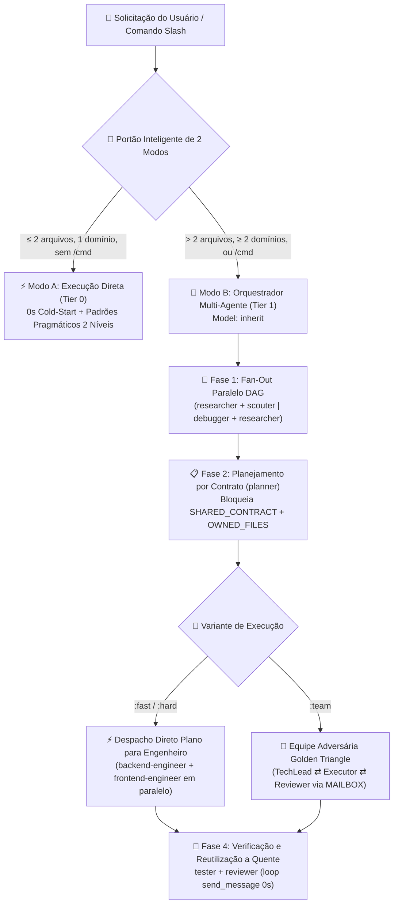

<div align="center">
  <h1>⚡ BoomOpen Workflow Kit v5.5.0</h1>
  <p><strong>Sistema Operacional de Força de Trabalho IA Smart-Hybrid Multiplataforma — 21 Agentes Especialistas, 18 Equipes Triângulo Dourado e Cofre de 1.460+ Habilidades Sob Demanda</strong></p>

  <p>
    <a href="https://github.com/Kennyboom/BoomOpen-Workflow-Kit-Pro/releases"></a>
    <a href="#platforms"></a>
    <a href="#agents"></a>
    <a href="#skills"></a>
    <a href="https://nodejs.org/">=18.0.0" /></a>
    <a href="../LICENSE"></a>
  </p>

  <p>
    <a href="../README.md">🇬🇧 English</a> • <a href="./README.vi.md">🇻🇳 Tiếng Việt</a> • <a href="./README.zh-CN.md">🇨🇳 简体中文</a> • <a href="./README.zh-TW.md">🇹🇼 繁體中文</a> • <a href="./README.ja.md">🇯🇵 日本語</a> • <a href="./README.ko.md">🇰🇷 한국어</a> • <a href="./README.es.md">🇪🇸 Español</a> • <a href="./README.fr.md">🇫🇷 Français</a> • <a href="./README.de.md">🇩🇪 Deutsch</a><br/>
    <b>🇧🇷 Português</b> • <a href="./README.ru.md">🇷🇺 Русский</a> • <a href="./README.hi.md">🇮🇳 हिन्दी</a> • <a href="./README.ar.md">🇸🇦 العربية</a> • <a href="./README.id.md">🇮🇩 Bahasa Indonesia</a> • <a href="./README.th.md">🇹🇭 ไทย</a> • <a href="./README.tr.md">🇹🇷 Türkçe</a> • <a href="./README.it.md">🇮🇹 Italiano</a>
  </p>
</div>

---

## 🎬 Trailer Oficial de Lançamento (Full HD 1080p)

<div align="center">
  <a href="https://github.com/Kennyboom/BoomOpen-Workflow-Kit-Pro/raw/main/assets/media/boomopen_v55_trailer_en.mp4">
    
  </a>
  <p>
    ▶️ <a href="https://github.com/Kennyboom/BoomOpen-Workflow-Kit-Pro/raw/main/assets/media/boomopen_v55_trailer_en.mp4"><b>Clique aqui para assistir / transmitir o Trailer Oficial em Full HD 1080p (MP4 com narração de estúdio)</b></a>
  </p>
</div>

---

## 🌟 O que é o BoomOpen Workflow Kit v5.5?

**BoomOpen Workflow Kit v5.5 (Multi-Platform Unified & Smart-Hybrid Edition)** é um sistema operacional multi-agente de código aberto que transforma um único assistente de programação IA em uma organização de engenharia coordenada composta por **21 agentes especialistas**, **18 equipes adversárias Golden Triangle**, **22 habilidades principais (Core Skills)** e **mais de 1.440 habilidades especializadas (`skills_library`)**.

Ao contrário de templates rígidos ou wrappers pesados que adicionam latência e inchaço de contexto a cada turno, o BoomOpen v5.5 combina o **Portão Proativo de Sub-agentes no Turno 1**, **Roteamento em Linguagem Natural em 17 Idiomas**, **Fragmentação Elástica de Enxame em 4 Níveis (`role#shard`)**, **Autopiloto de Projeto Multi-Sessão (`/autopilot`)** e **Condutor Multi-Engine (`/conduct`)**:
- **🚀 Sub-agentes Paralelos no Turno 1 e Orquestração Modo B**: Exploração aberta de código (`> 2` arquivos), funcionalidades multidomínio (`≥ 2` domínios), intenções de fluxo em linguagem natural em **todos os 17 idiomas suportados** ou comandos `/cmd` explícitos disparam imediatamente shards paralelos (`role#shard`, `<= 3–4 OWNED_FILES`/shard) com **Fan-Out Paralelo DAG**, **Despacho Direto do Plano ao Executor**, **Bloqueios por Contrato (`SHARED_CONTRACT` + `OWNED_FILES`)** e **Reutilização a Quente (`role#shard -> conversationId` via `send_message`)**, além de `/autopilot` (`boomopen ledger`) e conselhos multi-engine `/conduct` (`boomopen conduct`).
- **⚡ Modo A — Execução Micro-Direta em Alvos Conhecidos (0s de Cold-Start)**: Perguntas e respostas simples, explicações de código e microedições em que os **exatos `≤ 2` arquivos-alvo já são conhecidos no Turno 1** (0 exploração, sem `/cmd`) são executadas, testadas e verificadas **diretamente** aplicando os **Padrões de Codificação Pragmáticos de 2 Níveis** e **Testes e Correção Persistente de Bugs**.

- **📚 Cofre Massivo de 1.462 Habilidades com Zero Inchaço de Contexto**: Combina **22 Habilidades Principais (`skills/`)** e **1.440 Habilidades de Biblioteca (`skills_library/`)** pré-compiladas em `matrix-skills/compact-index.json` para busca `O(1)` em 2 etapas — oferecendo domínio imediato em Backend, Frontend, Mobile, Game Dev (Unity/Unreal/Godot), IA/ML, BigQuery/Dados, Cloud/DevOps e Cibersegurança OWASP sem poluir a janela de prompt.

---

## 🏗️ Arquitetura Híbrida-Inteligente (v5.5)



---

<a id="pillars"></a>

## 🧠 Os 6 Pilares Principais da v5.5

1. **🌐 Paridade Unificada em 5 Plataformas (`platforms/*`)**:
   - Instalação nativa de primeira classe para **Google Antigravity 2.0 (Gemini)**, **Claude Code**, **OpenAI Codex**, **Cursor** e **GitHub Copilot** a partir de uma única arquitetura unificada.
2. **📏 Padrões de Codificação Pragmáticos de 2 Níveis (Anti-Fragmentação)**:
   - **Nível 1 — Qualidade e Segurança Estritas (Tolerância Zero)**: Responsabilidade Única (Single Responsibility), **PROIBIDO `any` explícito**, **PROIBIDO deixar `console.log` de depuração** em produção, tratamento de erros tipado com `try/catch` em fronteiras async/API, constantes `SCREAMING_SNAKE_CASE`, DRY (`≥ 3`) e imports organizados.
   - **Nível 2 — Diretrizes Estruturais Flexíveis (Coesão em Primeiro Lugar)**: Arquivos coesos têm meta de `~200–350 linhas` com teto flexível de `~400–450 linhas` (divisão obrigatória apenas acima de `>500 linhas` ou múltiplos domínios; testes, tipos e docs são isentos). Funções lógicas `~20–40 linhas` (`~40–80 linhas` para UI/Handlers).
3. **🎯 Fragmentação Elástica em 4 Níveis (`role#shard`), Despacho Direto do Plano e Reutilização a Quente (`send_message`)**:
   - Assim que `PLAN-{feature}.md` existe, o Orquestrador despacha tarefas **diretamente** para shards de engenheiros de domínio (`backend-engineer#shard-1`, `frontend-engineer#shard-2`, `database-architect#shard-1`, `<= 3–4 OWNED_FILES` cada) sem salto intermediário redundante pelo `tech-lead`.
   - Sub-agentes ativos ficam registrados em um **Registro de Sessões por Shard (`role#shard → conversationId`)** e são reutilizados via `send_message` com **0s de cold-start** e **100% do contexto de arquivos preservado**.
4. **🤝 Despacho Paralelo Baseado em Contratos (`SHARED_CONTRACT` + `OWNED_FILES`)**:
   - Planos multidomínio travam endpoints de API, esquemas DTO e propriedade exclusiva de arquivos (`OWNED_FILES` vs. `READ_ONLY_FILES`) antes de iniciar engenheiros em paralelo, eliminando colisões de escrita.
5. **🔍 Depuração de Causa Raiz 5-Whys (SPIE v3.0) e Árvore Git 100% Limpa**:
   - `debugger` investiga cada bug por meio de 3 hipóteses ranqueadas e uma cadeia causal **5-Whys** (`Por que 1 Sintoma` → `Por que 5 Causa Raiz Sistêmica`). Artefatos transitórios (`PLAN`, `DEBUG`, `TEST`, `REVIEW`, `MAILBOX`) são gravados em `<appDataDir>\brain\<conversation-id>\`, mantendo a árvore Git 100% limpa.
6. **🩺 Diagnóstico CLI Integrado (`research`, `design`, `plan`, `cook`, `ledger`, `conduct`, `check` & `doctor`) e Índice de Habilidades O(1)**:
   - `npm run doctor` valida os 5 pacotes de plataforma, 21 agentes, 72 arquivos de equipe, 84 arquivos de comando (`79` fluxos + `5` em `_ref/`) e `matrix-skills/compact-index.json` (`1.462` habilidades). `boomopen check <dir> [--strict-phase --no-stubs]` audita tamanho dos arquivos, `any` explícito em TypeScript, `console.log` esquecidos, comentários `TODO`/`FIXME` adiados, stubs vazios e burlas em testes. Além disso, `boomopen research`, `boomopen design`, `boomopen plan`, `boomopen cook`, `boomopen ledger` e `boomopen conduct` compilam contratos, pacotes de handoff por onda e conselhos multi-engine.

---

<a id="platforms"></a>

## 💻 Plataformas de IA Suportadas

| Plataforma | Nível de Suporte | Ponto de Entrada Global | Caminho de Instalação do Framework |
|----------|:-------------:|-------------------|------------------------|
| **Antigravity (Gemini)** | ✅ Nativo v5.5 | `~/.gemini/GEMINI.md` | `~/.gemini/config/skills/boomopen-workflow-kit/` |
| **Claude Code** | ✅ Nativo v5.5 | `~/.claude/CLAUDE.md` | `~/.claude/skills/boomopen-workflow-kit/` |
| **OpenAI Codex** | ✅ Nativo v5.5 | `~/.codex/CODEX.md` & `AGENTS.md` | `~/.codex/skills/boomopen-workflow-kit/` |
| **Cursor** | ✅ Nativo v5.5 | `~/.cursor/rules/boomopen-workflow-kit.mdc` | `~/.cursor/skills/boomopen-workflow-kit/` |
| **GitHub Copilot** | ✅ Nativo v5.5 | `~/.copilot/COPILOT.md` | `~/.copilot/skills/boomopen-workflow-kit/` |

---

## 🚀 Início Rápido e Instalação

```bash
# 1. Clonar o repositório
git clone https://github.com/Kennyboom/BoomOpen-Workflow-Kit-Pro.git
cd BoomOpen-Workflow-Kit-Pro

# 2. Instalar para o seu assistente de codificação IA (escolha um ou --all)
npm run install:antigravity   # Google Antigravity 2.0 (Gemini)
npm run install:claude        # Anthropic Claude Code
npm run install:codex         # OpenAI Codex CLI
npm run install:cursor        # Cursor AI Editor
npm run install:copilot       # GitHub Copilot (VS Code)
npm run install:all           # Instalar em todas as 5 plataformas simultaneamente

# 3. Verificar a instalação (somente leitura)
npm run doctor
npm link
boomopen research validate path/to/RESEARCH.md
boomopen design validate path/to/DESIGN.md
boomopen plan validate path/to/PLAN.md
boomopen cook preflight path/to/PLAN.md
boomopen check path/to/your/project --strict-phase --no-stubs
boomopen ledger status
boomopen conduct probe
```

> O kit **não está publicado no npm** — instale-o somente a partir deste repositório. Opcional: `npm link` coloca o comando `boomopen` no seu PATH (sem baixar nada do npm).

---

## 🎛️ Configurações Unificadas e Seleção de Modo (`/settings` Control Center)

O BoomOpen v5.5 inclui um **Centro de Controle Unificado de Latência Zero** que permite alternar modos de execução (`auto`, `mode_a`, `mode_b`, `team`), 4 perfis predefinidos e 20 configurações do sistema (+ 2 limites de linhas) nas **5 plataformas** em `< 10ms` (**0ms de latência no Turno 1**):

| Perfil (`Preset`) | Modo de Execução (`execution.mode`) | Variante Padrão | Pesquisa em Linguagem Natural (`naturalLanguageResearchTrigger`) | Padrões de Código (`codingStandards`) | Melhor Uso |
|:---|:---|:---:|:---:|:---:|:---|
| **⚡ `smart-hybrid`** *(Padrão Recomendado)* | **`auto`** (`≤ 2 arquivos` → Modo A Direto; `> 2 arquivos` ou `/cmd` → Modo B) | `auto` | **`auto_team`** *(Roteia pesquisa/ideação para `/research:team` / `/brainstorm:team` Golden Triangle)* | `pragmatic` (`400/500` linhas) | Engenharia full-stack diária: rápido em tarefas simples, profundo em arquiteturas complexas |
| **🚀 `solo-fast`** | **`mode_a`** *(Força Execução Direta Solo, 0s de latência de sub-agente)* | `fast` | `off` *(Resposta direta no chat, exceto ao digitar `/brainstorm`)* | `relaxed` (`600/800` linhas) | Hotfixes urgentes, prototipagem rápida, scripts e economia máxima de tokens |
| **🧠 `deep-architect`** | **`mode_b`** *(Força Orquestrador Multi-Agente Modo B em todas as tarefas)* | `hard` | `auto_hard` *(Executa automaticamente `/research:hard` / `/brainstorm:hard` de 5 lentes)* | `strict` (`300/400` linhas) | Arquitetura de sistemas complexos, novos projetos e refatorações multi-domínio |
| **🔺 `adversarial-team`** | **`team`** *(Força equipe adversária de 3 agentes Golden Triangle `:team`)* | `team` | **`auto_team`** *(Debate e revisão adversária de 3 agentes via `MAILBOX`)* | `strict` (`300/400` linhas) | Código de produção crítico, auditorias de segurança e entregas sem defeitos |

### Três Formas de Alternar Modos (Chat `/settings`, Painel Web Local e CLI)

```bash
# 1. Comando Slash no Chat (Menu interativo ou comando rápido)
/settings                                     # Abrir menu interativo (ask_question UI)
/settings preset smart-hybrid                 # Alternar para o padrão recomendado (Auto Mode A/B + auto_team)
/settings preset solo-fast                    # Alternar para Execução Direta Rápida (Mode A)
/settings preset deep-architect               # Alternar para Orquestrador Multi-Agente (Mode B)
/settings preset adversarial-team             # Alternar para Equipe Golden Triangle de 3 Agentes (:team)
/settings mode auto | mode_a | mode_b | team  # Substituir diretamente o modo de execução

# 2. Painel Web Local do Centro de Controle (http://127.0.0.1:4567)
boomopen settings --ui

# 3. Terminal CLI (Global ~/.boomopen/settings.json e Projeto ./.boomopen.json)
boomopen settings status
boomopen settings preset adversarial-team
cd path/to/your/project
boomopen settings set execution.mode mode_a --project
boomopen settings reset
```

> `--project` sempre grava `./.boomopen.json` na pasta onde você executa o comando — execute-o dentro do seu projeto, não no clone do kit. Sem `npm link`, troque `boomopen` por `node /path/to/BoomOpen-Workflow-Kit-Pro/cli/install.js`.

---

## 🎯 Referência de Comandos Slash

| Comando | Variantes | Propósito Principal |
|---------|----------|-----------------|
| **`/cook`** | `:fast`, `:hard`, `:team` | Desenvolvimento completo de ponta a ponta (Pesquisa/Scout → Plano → Código Paralelo → Teste → Revisão) |
| **`/code`** | `:fast`, `:hard`, `:team` | Executar implementação diretamente a partir de um `PLAN-{feature}.md` existente |
| **`/plan`** | `:fast`, `:hard`, `:team` | Criar blueprints de implementação com `SHARED_CONTRACT`, `OWNED_FILES` e critérios Given/When/Then |
| **`/fix`** | `:fast`, `:hard`, `:team` | Resolução de bugs na causa raiz com verificação obrigatória por teste de regressão |
| **`/debug`** | `:fast`, `:hard`, `:team` | Investigação de causa raiz com 3 hipóteses + cadeia causal **5-Whys (SPIE v3.0)** (`DEBUG-{issue}.md`) |
| **`/test`** | `:fast`, `:hard`, `:team` | Execução paralela DAG da suíte de testes + busca de casos de borda não cobertos (`tester` + `scouter`) |
| **`/review`** | `:fast`, `:hard`, `:team` | Auditoria paralela em 4 dimensões (Arquitetura, Qualidade de Código, Segurança OWASP, Performance) |
| **`/design`** | `:fast`, `:hard`, `:team` | Arquitetura de sistema, esquema de banco de dados e especificação de UI/UX (`DESIGN.md`) |
| **`/docs`** | `:core`, `:business`, `:audit` | Gerar ou sincronizar documentação estruturada de arquitetura e negócios de 2 níveis (`./documents/`) |
| **`/deploy`** | `:check`, `:preview`, `:production`, `:rollback` | Portões de prontidão pré-deploy, ambientes de preview, rollout em produção e rollback seguro |
| **`/research`** | `:fast`, `:hard`, `:team` | Motor autônomo de pesquisa profunda (triangulação de 4 fontes, busca em 3 ondas e conselho de 3 vetores) |
| **`/brainstorm`** | `:fast`, `:hard`, `:team` | Descoberta socrática de requisitos, análise de trade-offs e ideação |
| **`/report`** | `:fast`, `:hard`, `:team` | Relatórios executivos e técnicos de síntese com métricas e diagramas |
| **`/autopilot`** | `:init`, `:run`, `:audit` | Orquestrador autônomo de projetos multi-sessão com `.boomopen/project-ledger.json` e trava de qualidade em 4 camadas |
| **`/conduct`** | `:council`, `:pipeline` | Maestro multi-engine e conselho paralelo (`boomopen conduct`) com síntese de consenso em 4 partes |
| **`/orchestrate`** | — | Orquestração personalizada de pipelines multi-agente através de múltiplos domínios |
| **`/settings`** | `preset`, `mode`, `set`, `ui` | Centro de Controle Unificado: alternar `Auto` / `Mode A` / `Mode B` / `Team`, presets ou abrir Web UI (`--ui`) |
| **`/save` / `/recap`** | — | Persistir estado da sessão (`SESSION-HANDOVER.md`) e restaurar contexto completo em `< 5s` |

---

<a id="agents"></a>

## 🤖 21 Agentes Especialistas e 18 Equipes Golden Triangle

| Categoria | Agentes Especialistas (`agents/*.md`) | Equipes Golden Triangle (`agents/teams/*-team/`) |
|----------|-----------------------------------|------------------------------------------------|
| **Engenharia e Execução** | `backend-engineer`, `frontend-engineer`, `mobile-engineer`, `game-engineer`, `database-architect`, `devops-engineer` | `backend-team`, `frontend-team`, `fullstack-team`, `mobile-team`, `game-team`, `database-team`, `devops-team` |
| **Arquitetura e Planejamento** | `tech-lead`, `planner`, `brainstormer`, `business-analyst`, `project-manager`, `designer` | `planning-team`, `brainstorm-team`, `project-team`, `design-team` |
| **Qualidade, Segurança e Depuração** | `debugger`, `tester`, `reviewer`, `security-engineer`, `performance-engineer` | `debug-team`, `qa-team`, `security-team`, `performance-team` |
| **Pesquisa e Conhecimento** | `researcher`, `scouter`, `docs-manager`, `reporter` | `research-team`, `docs-team`, `report-team` |

---

<a id="skills"></a>

## 📚 Cofre de 1.460+ Habilidades (22 Principais + 1.440 de Biblioteca)

O BoomOpen traz um dos maiores ecossistemas de habilidades de engenharia do código aberto — projetado para **0 consumo de tokens em repouso** via **Resolução Progressiva O(1) em 2 Etapas** (`<skills>` → `matrix-skills/compact-index.json` → carregamento exato do `SKILL.md` sob demanda):

| Nível / Domínio de Habilidade | Quantidade | Habilidades e Capacidades Representativas | Mecanismo de Carregamento |
|:---|:---:|:---|:---|
| **⚡ Nível 1: Habilidades Principais (`skills/`)** | **22** | `clean-code`, `debugger`, `plan-writing`, `brainstorming`, `frontend-design`, `frontend-architecture`, `design-spec`, `api-patterns`, `database-design`, `testing-patterns`, `skill-seeker` | Pré-indexado em `<skills>` para acesso imediato no Turno 1 |
| **🎨 Design UI/UX, Motion e Design Systems** | **42** | Anti-AI-Slop Visual Craft, paletas OKLCH e Bento Grids, Motion v12 + CSS View Transitions, primitivas headless (`cmdk`/`vaul`/`sonner`), Figma MCP + W3C DTCG Tokens, WCAG 2.2 AA/AAA, iOS 18 HIG e Material 3 Expressive | Sob demanda via `compact-index.json` (`matrix-skills/design.yaml`) |
| **🌐 Web, Backend e Sistemas Distribuídos** | **390+** | Next.js/React 19, FastAPI, NestJS, microsserviços Go/Rust, GraphQL, gRPC, arquitetura orientada a eventos Redis/Kafka, SaaS multi-tenant | Sob demanda via `compact-index.json` (`skills_library/`) |
| **🤖 IA, Agentes LLM e Engenharia de Dados** | **320+** | Pipelines RAG, servidores LangGraph/MCP, engenharia de prompt, Vertex AI, análise BigQuery, dbt, Spark, bancos vetoriais | Sob demanda via `compact-index.json` (`skills_library/`) |
| **☁️ Cloud, DevOps, Kubernetes e Segurança** | **300+** | Terraform/OpenTofu, arquitetura AWS/GCP/Azure, Docker/K8s GitOps, pipelines CI/CD, auditoria OWASP Top 10, autenticação Zero-Trust | Sob demanda via `compact-index.json` (`skills_library/`) |
| **📱 Mobile, Game Engines e Domínios Especializados** | **410+** | iOS Swift/SwiftUI, Android Kotlin, React Native, Flutter, Unity 6, Unreal Engine 5, Godot 4, WebGL/Three.js, Finanças Quantitativas, Web3 | Sob demanda via `compact-index.json` (`skills_library/`) |

---

## 📂 Estrutura do Repositório

```text
BoomOpen-Workflow-Kit-Pro/
├── agents/                  # 21 definições de Agentes Especialistas + 18 Equipes Golden Triangle (54 arquivos de função + 18 _team.md, 72 arquivos)
├── cli/                     # Instalador (install.js), Doctor (doctor.js), Checker (checker.js), Settings (settings.js), research.js, design.js, plan.js, cook.js, Ledger (ledger.js) e Conductor (conductor.js)
├── commands/                # 79 fluxos de comandos Slash (:fast, :hard, :team, :init/:run/:audit, :council/:pipeline) + 5 protocolos _ref/ (84 arquivos)
├── documents/               # Documentação de 2 níveis de Arquitetura, Domínio, Código-Fonte e Padrões
├── i18n/                    # Documentação internacionalizada (16 traduções completas do README)
├── matrix-skills/           # Matrizes YAML de habilidades por domínio + compact-index.json pré-compilado (1.462 habilidades)
├── platforms/               # Templates unificados para as 5 plataformas (antigravity/, claude/, codex/, copilot/, cursor/)
├── rules/                   # Regras sob demanda do Modo B (CORE, PHASES, AGENTS, TEAMS, SKILLS, ERRORS, REFERENCE)
├── scripts/                 # Scripts Python de automação e verificação (checklist.py, verify_all.py, etc.)
├── skills/                  # 22 Habilidades Principais (clean-code, debugger, plan-writing, frontend-design, etc.)
├── skills_library/          # 1.440 habilidades especializadas carregadas sob demanda via busca em 2 etapas
└── GEMINI.md | CLAUDE.md | CODEX.md | COPILOT.md | CURSOR.md | AGENT.md
```

---

## 📄 Licença e Segurança

- **Licença**: Distribuído sob a [Licença MIT](../LICENSE). Copyright © 2026 **BoomOpen Labs**. As skills de terceiros em `skills_library/` mantêm suas licenças originais — veja [THIRD_PARTY_NOTICES.md](../THIRD_PARTY_NOTICES.md).
- **Política de Segurança**: Veja [SECURITY.md](../SECURITY.md) para diretrizes de segurança integradas e relato de vulnerabilidades.
