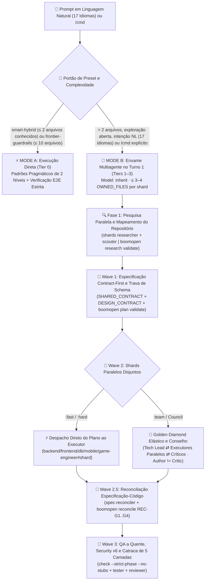

<div align="center">
  <h1>⚡ BoomOpen Workflow Kit Pro v5.5</h1>
  <p><strong>Orquestração multiagente e portões determinísticos de verificação CLI para Antigravity, Claude Code, OpenAI Codex, Cursor e GitHub Copilot.</strong></p>

  <p>
    <a href="https://boomopen.com"></a>
    <a href="https://github.com/Kennyboom/BoomOpen-Workflow-Kit-Pro/releases"></a>
    <a href="#platforms"></a>
    <a href="#cli"></a>
    <a href="#skills"></a>
    <a href="https://nodejs.org/">= 18.0.0" /></a>
    <a href="../LICENSE"></a>
  </p>

  <p>
    <a href="../README.md">English</a> •
    <a href="./README.vi.md">Tiếng Việt</a> •
    <a href="./README.zh-CN.md">简体中文</a> •
    <a href="./README.zh-TW.md">繁體中文</a> •
    <a href="./README.ja.md">日本語</a> •
    <a href="./README.ko.md">한국어</a> •
    <a href="./README.es.md">Español</a> •
    <a href="./README.fr.md">Français</a> •
    <a href="./README.de.md">Deutsch</a><br/>
    <b>Português (BR)</b> •
    <a href="./README.ru.md">Русский</a> •
    <a href="./README.hi.md">हिन्दी</a> •
    <a href="./README.ar.md">العربية</a> •
    <a href="./README.id.md">Bahasa Indonesia</a> •
    <a href="./README.th.md">ไทย</a> •
    <a href="./README.tr.md">Türkçe</a> •
    <a href="./README.it.md">Italiano</a>
  </p>

  <p>
    <a href="https://boomopen.com"><b>🌐 boomopen.com (15 Idiomas)</b></a> •
    <a href="#trailer"><b>🎬 Trailer</b></a> •
    <a href="#why-boomopen"><b>⚡ Por Que BoomOpen</b></a> •
    <a href="#architecture"><b>🏗️ Arquitetura</b></a> •
    <a href="#quickstart"><b>🚀 Início Rápido</b></a> •
    <a href="#cli"><b>🛠️ 14 Portões CLI</b></a> •
    <a href="#settings"><b>🎛️ Presets e Ajustes</b></a> •
    <a href="#commands"><b>🎯 36 Comandos</b></a> •
    <a href="#agents"><b>🤖 22 Agentes e 18 Equipes</b></a> •
    <a href="#skills"><b>📚 1.462 Skills</b></a>
  </p>
</div>

---

<a id="trailer"></a>

## 🎬 Trailer de Lançamento e Explorador Interativo (`boomopen.com`)

<div align="center">
  <a href="https://github.com/Kennyboom/BoomOpen-Workflow-Kit-Pro/raw/main/assets/media/boomopen_v55_trailer_en.mp4">
    
  </a>
  <p>
    ▶️ <a href="https://github.com/Kennyboom/BoomOpen-Workflow-Kit-Pro/raw/main/assets/media/boomopen_v55_trailer_en.mp4"><b>Assistir ao Trailer em Full HD 1080p (MP4 com locução de estúdio)</b></a> • 🌐 <a href="https://boomopen.com"><b>Explorar o Playground CLI de 14 Comandos e os Catálogos em boomopen.com (15 Idiomas)</b></a>
  </p>
</div>

---

<a id="why-boomopen"></a>
<a id="-what-is-boomopen-workflow-kit"></a>

## ⚡ Por Que Usar o BoomOpen Workflow Kit?

**O Limite dos Assistentes de Código Tradicionais:** Sem governança estrutural, agentes únicos degradam assim que uma tarefa atravessa múltiplos arquivos, domínios ou sessões. A leitura sequencial de arquivos satura a janela de contexto principal, subagentes sem coordenação sobrescrevem arquivos compartilhados ou deixam módulos isolados sem integração, o código entregue esconde stubs `TODO` ou escapes `any`, revisões feitas pelo próprio modelo ignoram seus pontos cegos (`Author == Critic`) e implementações em múltiplas fases desviam da especificação original.

**Como o BoomOpen Resolve:** O BoomOpen instala uma camada única de orquestração multiagente e portões determinísticos de verificação CLI no **Antigravity (Gemini)**, **Claude Code**, **OpenAI Codex**, **Cursor** e **GitHub Copilot**, com **zero dependências npm de runtime**. Com o perfil **`smart-hybrid`** ativo por padrão, edições em `≤ 2` arquivos conhecidos executam direto sem sobrecarga, enquanto demandas multiarquivo, pesquisa profunda, planejamento arquitetural e **`36` comandos slash (`93` arquivos)** particionam o trabalho já no Turno 1 entre **22 agentes especialistas** e **18 equipes adversárias de 3 papéis** — validados por **14 portões locais da CLI `boomopen`** e apoiados por **`1.462` skills sob demanda** (`22` Core + `1.440` deduplicadas uma única vez em `~/.agents/skills_library`).

### ⚖️ Sem BoomOpen vs. Com BoomOpen v5.5

| Modo de Falha em Engenharia | Sem BoomOpen (IDE de IA Padrão) | Com BoomOpen Workflow Kit Pro v5.5 |
|:----------------------------|:--------------------------------|:-----------------------------------|
| **Saturação da Janela de Contexto** | O agente principal lê 15–30 arquivos em sequência antes de escrever código | **Enxame Elástico no Turno 1 (`role#shard`)**: Despacha scouts somente leitura e shards por domínio (`≤ 3–4` arquivos/shard) + reuso a quente em `0s` (`send_message`) |
| **Conflitos de Escrita e Fios Soltos** | Agentes paralelos sobrescrevem arquivos comuns, criam rotas `/api` divergentes ou módulos órfãos | **Travas Contract-First + Reconciliação Wave 2.5**: Trava `SHARED_CONTRACT` na Wave 1 + `OWNED_FILES` disjuntos, auditados por `boomopen reconcile` (`REC-G1..G4`) |
| **Pesquisa Rasa e Planos Vagos** | Respostas enviesadas de perspectiva única, afirmações sem fonte e planos em texto livre | **Especificações de 6 Blocos Guiadas por Evidências**: Devil's Advocate `:team` + validadores CLI em `< 50ms` (`boomopen research`, `design`, `plan`) |
| **Stubs Silenciosos, `any` e Testes Falsos** | O agente encerra a tarefa deixando `// TODO`, `any` explícito, `console.log` ou testes `.skip` | **Portão Estático Pragmático de 2 Níveis**: `boomopen check --strict-phase --no-stubs` exige `0` `any`, `0` stubs e arquivos coesos (`400/500` linhas) |
| **Deriva entre Sessões e Regressões** | A compactação de contexto apaga restrições de fases anteriores e quebra funcionalidades prontas | **Catraca de Qualidade de 5 Camadas e Rollback**: `.boomopen/project-ledger.json` com hash SHA-256 contra deriva, `/autopilot`, `/audit` e `rollback --yes` atômico |
| **Pontos Cegos de Modelo Único** | O mesmo modelo escreve e revisa o próprio código (`Author == Critic`) | **Condutor Multi-Engine (`/conduct`)**: Conselhos paralelos e pipelines entre famílias distintas via Claude Code, Codex, Antigravity, Cursor e Copilot |
| **Deriva em 5 IDEs e Git Sujo** | Prompts separados por IDE, gigabytes de skills duplicadas e arquivos temporários no `git status` | **Sincronização Unificada e Git Limpo**: 14 arquivos de entrada sincronizados em `< 10ms`, 1 `~/.agents/skills_library` compartilhada (`0` tokens ociosos) e Brain Artifacts |

---

<a id="architecture"></a>
<a id="-smart-hybrid-architecture-v55"></a>

## 🏗️ Arquitetura Smart-Hybrid (v5.5)



---

<a id="pillars"></a>

## 🧠 6 Pilares de Engenharia

1. **🌐 Compilação Nativa para 5 IDEs e Cofre Deduplicado (`platforms/*`)**:
   - Compila **22 agentes especialistas** e **93 arquivos de comando/referência** no formato nativo de cada IDE: **Antigravity** (bundle `--as-plugin` + `3` scripts Python executáveis via `run_workflow`: `audit_fanout.py`, `review_fanout.py`, `research_fanout.py`), **Claude Code** (shards com `isolation: worktree`, comandos `/plan:hard` e hooks opcionais `PreToolUse` e `Stop`/`PreCompact`), **OpenAI Codex** (`22` perfis TOML com sandboxes de SO `read-only` para scouts/revisores + `87` skills `$boomopen-*`), **Cursor** (regras `.mdc` + hook opcional `beforeShellExecution`) e **GitHub Copilot** (agentes `.agent.md`).
   - Vincula todas as `1.440` skills de biblioteca uma única vez em `~/.agents/skills_library` entre as 5 IDEs (~80% de economia em disco e `0` consumo de tokens no Turno 1).
2. **🎯 Enxame Elástico Dinâmico de 4 Níveis (`role#shard`) e Reuso a Quente**:
   - Escala automaticamente do **Tier 0** (`0` subagentes para `≤ 2` arquivos conhecidos) → **Tier 1** (`2–3` shards) → **Tier 2** (`4–6` shards) → **Tier 3** (`7–8+` shards, configurável até `16`), limitando a carga cognitiva a **`≤ 3–4 OWNED_FILES` por subagente** e reutilizando sessões ativas via `role#shard → conversationId` (`send_message`).
3. **🤝 Execução Contract-First em 3 Waves + Reconciliação Wave 2.5 (`REC-G1..G4`)**:
   - A Wave 1 congela `SHARED_CONTRACT` (schemas de API/DTOs) e `DESIGN_CONTRACT` (CSS `@theme` em OKLCH + props TypeScript) antes de a Wave 2 acionar engenheiros em paralelo. A Wave 2.5 executa `boomopen reconcile` + `spec-reconciler` para detectar módulos isolados sem importação (`REC-G1`), divergências de rotas frontend/backend (`REC-G2`), subcláusulas `[SC-*]` omitidas (`REC-G3`) e chaves ausentes em `.env.example` (`REC-G4`), gerando ondas delta automáticas via `boomopen cook amend-plan`.
4. **🏛️ Autopiloto Multi-Sessão (`/autopilot`) e Auditoria Stateful Multi-Rodada (`/audit`)**:
   - Compila especificações em `.boomopen/project-ledger.json` com detecção de deriva SHA-256, checkpoints Git pré-fase (`boomopen ledger rollback --yes`) e uma **Catraca de Qualidade de 5 Camadas** (`G1 check --strict-phase --no-stubs` → `G2 catraca monotônica de testes` → `G3 reconcile --strict` → `G4 revisão Author != Critic` → `G5 ledger verify`). Após a entrega, `/audit` conduz rodadas controladas pelo desenvolvedor cobrindo matriz RTM, fluxo vertical e Security v6 (`.boomopen/audit-ledger.json` + `boomopen audit rollback --yes`).
5. **🎼 Condutor Multi-Engine e Conselho Paralelo (`boomopen conduct`)**:
   - Orquestra Claude Code, OpenAI Codex, Antigravity, Cursor e Copilot simultaneamente em **Conselhos Paralelos de 6 Tarefas** (`research`, `brainstorm`, `plan`, `design`, `review`, `debug` → `COUNCIL-SYNTHESIS.md` em 4 partes) ou **Pipelines entre Famílias de Modelos**, impedindo que o mesmo modelo avalie o próprio código (`Author != Critic`).
6. **📏 Padrões Pragmáticos de Código em 2 Níveis e Depuração Causa-Raiz SPIE v3.0**:
   - **Nível 1 (Tolerância Zero)**: Responsabilidade única, `0` `any` explícito, `0` `console.log` de depuração em código de produção, fronteiras assíncronas com `try/catch` tipado e constantes `SCREAMING_SNAKE_CASE`. **Nível 2 (Coesão Acima de Cortes Mecânicos)**: Meta de `~200–350` linhas (`400` limite flexível / `500` máximo; testes, tipos e docs isentos). Bugs passam por 3 hipóteses ranqueadas e rastreamento causal **5-Whys (SPIE v3.0)**, gravando artefatos transitórios em Brain Artifacts (`100%` de árvore Git limpa).

---

<a id="platforms"></a>
<a id="-supported-ai-platforms"></a>

## 💻 5 Plataformas de Codificação com IA Suportadas

| Plataforma | Suporte | Arquivo(s) de Entrada Sincronizado(s) | Integração Nativa com a Plataforma |
|:-----------|:-------:|:--------------------------------------|:-----------------------------------|
| **Antigravity (Gemini)** | ✅ v5.5 | `~/.gemini/GEMINI.md` | `invoke_subagent`, fan-out Python `run_workflow`, loop externo `/goal`, bundle `--as-plugin`, `--with-hooks` opcional e Brain Artifacts |
| **Claude Code** | ✅ v5.5 | `~/.claude/CLAUDE.md` | Shards paralelos `Task`/`Agent` (`isolation: worktree`), comandos `/plan:hard` e hooks opcionais `PreToolUse` e `Stop`/`PreCompact` |
| **OpenAI Codex** | ✅ v5.5 | `~/.codex/AGENTS.md` e `CODEX.md` | `22` perfis TOML em `~/.codex/agents/boomopen/` com `sandbox_mode = "read-only"` de SO para scouts/revisores + `87` skills `$boomopen-*` |
| **Cursor** | ✅ v5.5 | `~/.cursor/rules/boomopen-workflow-kit.mdc` | Regras frontmatter `.mdc` sempre ativas, `CURSOR.md`, roteamento de subagentes e `.cursor/hooks.json` opcional (`beforeShellExecution`) |
| **GitHub Copilot** | ✅ v5.5 | `~/.copilot/copilot-instructions.md` | Agente compilado `boomopen-workflow-kit.agent.md` no VS Code, despacho via `runSubagent` e `COPILOT.md` |

---

<a id="quickstart"></a>
<a id="-quick-start--installation"></a>

## 🚀 Início Rápido e Instalação (Via Git — Zero Dependências de Runtime)

```bash
# 1. Clone o repositório (distribuído exclusivamente via GitHub — não publicado no npm)
git clone https://github.com/Kennyboom/BoomOpen-Workflow-Kit-Pro.git
cd BoomOpen-Workflow-Kit-Pro

# 2. Instale para a sua IDE de IA (preset padrão: smart-hybrid) ou nas 5 IDEs de uma vez
npm run install:all                                 # Instala e sincroniza as 5 IDEs + ~/.agents/skills_library compartilhada
npm run install:antigravity                         # Google Antigravity 2.0 (ou adicione --as-plugin / --with-hooks)
node cli/install.js install claude --with-hooks     # Claude Code + hooks opcionais PreToolUse e Stop/PreCompact
npm run install:codex                               # OpenAI Codex CLI + sandboxes read-only de SO para scouts/revisores
npm run install:cursor                              # Cursor (use --with-hooks para guarda beforeShellExecution)
npm run install:copilot                             # GitHub Copilot (.agent.md no VS Code + copilot-instructions.md)

# 3. Verifique a integridade e, opcionalmente, exponha `boomopen` no PATH global
npm run doctor
npm link
boomopen settings status
```

> **Instalação e Desinstalação Não Destrutivas**: Rastreadas por manifestos SHA-256 (`~/.boomopen/manifests/<tool>.json`). Regras pessoais já existentes em `GEMINI.md` / `CLAUDE.md` são preservadas fora dos marcadores do kit com backup automático; `boomopen uninstall <tool|--all>` remove apenas arquivos não modificados do kit e mantém seus arquivos intactos.

---

<a id="cli"></a>

## 🛠️ 14 Subcomandos CLI sem Dependências (`boomopen`)

Execução local em `< 50ms` no Node.js `>= 18`, com **zero dependências npm de runtime** e **zero chamadas de rede**:

| Subcomando | Flags e Sintaxe Principal | Portões Determinísticos e Finalidade |
|:-----------|:--------------------------|:-------------------------------------|
| **`install` / `uninstall` / `list`** | `<tool\|--all> [--with-hooks] [--as-plugin]` | Instalador com manifesto SHA-256, vínculo único de `~/.agents/skills_library`, hooks opcionais e desinstalador limpo |
| **`doctor`** | `[--source-only]` | Auditoria somente leitura de 30 pontos cobrindo os 5 bundles de IDE, `93` comandos, `72` arquivos de equipe, `1.462` skills e configurações |
| **`settings`** | `status \| preset <name> \| set <k> <v> \| --ui` | Gerenciamento dos 5 presets + `22` chaves (`--project` para `./.boomopen.json`) ou interface Web com CSP restrita (`127.0.0.1:4567`) |
| **`research`** | `<validate\|brief> <file.md> [--mode brainstorm]` | Valida **`RES-G1..G4`** (`≥ 4` fontes trianguladas, matriz de contradições, riscos pré-morte) e compila `HANDOFF_BRIEF` |
| **`design`** | `<validate\|contract> <DESIGN.md> [--json]` | Valida **`DESIGN-G1..G4`** (6 blocos, tokens OKLCH, Matriz de UI de 5 Estados, WCAG 2.2 AA) e emite `DESIGN_CONTRACT` |
| **`plan`** | `<validate\|compile> <PLAN.md> [--sync-ledger]` | Valida **`PLAN-G1..G5`** (DAG acíclico, `OWNED_FILES ≤ 4` disjuntos por shard, `SHARED_CONTRACT`) e sincroniza o ledger |
| **`cook`** | `<state\|packets\|verify-wave\|preflight\|amend-plan>` | Aplica **`COOK-G1..G4`**: estado fast-forward de 5 estágios, pacotes de handoff de 5 campos, trava de escrita Git e ondas delta |
| **`reconcile`** | `<dir> [--plan <PLAN.md>] [--strict]` | Wave 2.5 **`REC-G1..G4`**: detecta módulos órfãos, deriva de rotas `/api`, cláusulas `[SC-*]` omitidas e lacunas em `.env.example` |
| **`check`** | `[path] --strict-phase --no-stubs [--ignore <dir>]` | Portão estático de 2 Níveis: orçamentos `400/500` linhas, `0` `any` explícito, `0` `console.log` de debug e `0` stubs/`TODO`/`.skip` |
| **`ledger`** | `<init\|from-plan\|status\|next\|verify\|rollback>` | Máquina de estados DAG multi-sessão (`.boomopen/project-ledger.json`), guarda SHA-256 contra deriva e `rollback --yes` atômico |
| **`audit`** | `<init\|slice\|record\|approve\|verify-fix\|rollback>` | Ledger stateful de auditoria pós-conclusão (`.boomopen/audit-ledger.json`), catraca de burn-down e `rollback --yes` |
| **`conduct`** | `<probe\|council\|dispatch\|status> [--dry-run]` | Condutor entre engines e Conselho Paralelo de 6 tarefas (`Author != Critic` nas 5 IDEs → `COUNCIL-SYNTHESIS.md`) |

---

<a id="settings"></a>
<a id="-unified-settings--mode-selection-settings"></a>

## 🎛️ Central de Controle Unificada e 5 Presets (`/settings`)

Gerencie **`20` chaves enum + `2` limites customizáveis de linhas** globalmente (`~/.boomopen/settings.json`) ou por repositório (`./.boomopen.json`), sincronizados a quente nos 14 arquivos de entrada em `< 10ms`:

| Perfil de Preset | Modo de Execução (`execution.mode`) | `/cmd` Padrão | Roteamento NL em 17 Idiomas (`naturalLanguageResearchTrigger`) | Padrão de Código | Uso Recomendado |
|:-----------------|:------------------------------------|:-------------:|:--------------------------------------------------------------:|:----------------:|:----------------|
| **⚡ `smart-hybrid`** *(Default / Padrão)* | **`auto`** (`≤ 2` arquivos direto; `> 2` arquivos ou `/cmd` → Enxame Modo B) | `auto` | **`auto_team`** *(Roteia pesquisa/ideação/revisão NL para `:team` e fluxos nos 17 idiomas)* | `pragmatic` (`400/500`L) | Experiência padrão pronta para uso: roteamento de intenção natural + particionamento paralelo no Turno 1 |
| **🛡️ `frontier-guardrails`** *(Enxuto Opcional)* | **`mode_a`** (`≤ 10` arquivos direto; entrada `< 2.5 KB` / `~600` tokens) | `auto` | **`off`** *(Apenas `/cmd` explícito — zero interceptação NL)* | `pragmatic` (`400/500`L) | Modo direto diário ultraenxuto (`< 2.5 KB`) com portões 2-Tier e E2E *(suporta alias `carbon-guardrails`)* |
| **🚀 `solo-fast`** | **`mode_a`** (`≤ 10` arquivos direto; máximo conservador de `3` shards) | `fast` | `off` | `relaxed` (`600/800`L) | Prototipagem rápida, scripts pequenos, hotfixes urgentes e consumo mínimo de tokens |
| **🧠 `deep-architect`** | **`mode_b`** *(Orquestrador Modo B estrito; máx. `12` shards)* | `hard` | `auto_hard` + pesquisa `council` / revisão `cross_family` | `strict` (`300/400`L) | Arquitetura de sistemas complexos, projetos greenfield e refatorações entre módulos |
| **🔺 `adversarial-team`** | **`team`** *(Golden Diamond Elástico `:team`; `hyper_swarm` máx. `12`)* | `team` | **`auto_team`** + pesquisa, plano e revisão em `council` | `strict` (`300/400`L) | Releases críticos de produção, auditorias de segurança e consenso multi-engine |

```bash
# Alterne presets ou ajuste chaves via Chat (/settings), Interface Web Local (--ui) ou CLI:
boomopen settings --ui                                      # Abre a Central de Controle Web em http://127.0.0.1:4567
boomopen settings preset smart-hybrid                       # Padrão: Modo A/B automático + roteamento NL em 17 idiomas
boomopen settings preset frontier-guardrails                # Opcional: Modo A enxuto < 2.5 KB (alias: carbon-guardrails)
boomopen settings set engines.reviewer cross_family         # Exige revisor de família distinta (Author != Critic)
cd path/to/your/repo && boomopen settings mode team --project # Sobrescrita por repositório em ./.boomopen.json
boomopen settings reset                                     # Restaura a configuração padrão smart-hybrid
```

---

<a id="commands"></a>
<a id="-slash-commands-reference"></a>

## 🎯 Referência Completa dos 36 Comandos Slash (`93` Arquivos = `87` Fluxos + `6` `_ref/`)

Converse naturalmente em **qualquer um dos 17 idiomas suportados** no perfil `smart-hybrid` ou invoque explicitamente qualquer um dos **36 comandos slash canônicos**:

| Categoria | Comando | Variantes | Finalidade e Entregáveis Determinísticos |
|:----------|:--------|:----------|:-----------------------------------------|
| **Orquestração e Autonomia** | **`/cook`** | `:fast`, `:hard`, `:team` | Construção ponta a ponta de funcionalidades sem plano prévio (Scout → Plano por Contrato → Shards → Wave 2.5 Reconcile → QA) |
| | **`/code`** | `:fast`, `:hard`, `:team` | Executa um `PLAN-{task}.md` aprovado diretamente nos shards das Waves 1–3 sem reexecutar `/plan` |
| | **`/autopilot`** | `:init`, `:run`, `:audit` | Orquestrador multi-sessão da especificação à produção via `.boomopen/project-ledger.json` e **Catraca de 5 Camadas** |
| | **`/conduct`** | `:council`, `:pipeline` | Conselho paralelo multi-engine (`COUNCIL-SYNTHESIS.md`) e pipeline entre famílias nas 5 IDEs (suporta `--dry-run`) |
| | **`/orchestrate`** / **`/auto`** | — | Coordenação customizada de enxame multidomínio (`/orchestrate`) ou execução autônoma ponta a ponta (`/auto`) |
| **Arquitetura, Design e Pesquisa** | **`/plan`** | `:fast`, `:hard`, `:team` | Blueprint `PLAN-{task}.md` com 5 portões: trava `SHARED_CONTRACT`, `OWNED_FILES ≤ 4`/shard e critérios Given/When/Then |
| | **`/architect`** | — | Arquitetura pura de sistema: diagramas C4, ADRs, schemas de banco, contratos de API, telas e cobertura (zero código escrito) |
| | **`/design`** / **`/ui-ux-pro-max`** | `:fast`, `:hard`, `:team` | Especificação UI/UX de 6 blocos `DESIGN-{task}.md` + `DESIGN_CONTRACT` (tokens OKLCH `@theme`, Matriz de 5 Estados e preview HTML) |
| | **`/research`** | `:fast`, `:hard`, `:team` | Pesquisa Profunda de 5 Lentes (`RESEARCH-{topic}.md`, triangulação `RES-G1..G4` com `≥ 4` fontes, contradições e `HANDOFF_BRIEF`) |
| | **`/brainstorm`** / **`/ask`** | `:fast`, `:hard`, `:team` | Ideação estratégica sem bajulação (`BRAINSTORM-{topic}.md` com pré-morte e matriz MCDA) e Q&A baseado em evidências (`/ask`) |
| **Qualidade, Auditoria, Debug e Segurança** | **`/review`** | `:fast`, `:hard`, `:team` | Revisão adversária multilente de código, arquitetura, segurança e performance (`Author != Critic`, avanço direto para `/fix`) |
| | **`/audit`** / **`/deep-audit`** | `:run`, `:fix`, `:auto` | Auditoria pós-build multi-rodada do projeto inteiro (ledger `/audit`) e auditoria lógica pré-código em 10 dimensões (`/deep-audit`) |
| | **`/security-audit`** | — | Varredura OWASP Top 10 + LLM/Agentic Top 10 (`security_scan.py` v6), modelagem de ameaças STRIDE, autenticação e cadeia de suprimentos |
| | **`/debug`** / **`/fix`** | `:fast`, `:hard`, `:team` | Rastreamento de causa-raiz com 3 hipóteses + **5-Whys (SPIE v3.0)** (`DEBUG-{issue}.md`) e correção TDD fail-first (`/fix`) |
| | **`/test`** / **`/performance`** / **`/refactor`** | `:fast`, `:hard`, `:team` | Shards de QA sem manipulação de testes (`/test`), otimização de Core Web Vitals / banco / bundle (`/performance`) e `/refactor` medido |
| **Git, Release, Docs e Sessão** | **`/onboard`** / **`/init`** | — | Mapa somente leitura `ARCHITECTURE-MAP.md` em 60s para repositórios legados (`/onboard`, sem colisão com `/init`) e bootstrap (`/init`) |
| | **`/pr`** / **`/release`** | —, `:review` | Portão pré-PR de qualidade e reconciliação + `gh pr create` / revisão adversária de diff (`/pr:review`) e `/release` semântico |
| | **`/deploy`** / **`/rollback`** | `:check`, `:preview`, `:production`, `:rollback` | Portões de prontidão de deploy, rollouts de preview/produção (`/deploy`) e recuperação de emergência por severidade (`/rollback`) |
| | **`/docs`** / **`/report`** | `:core`, `:business`, `:audit` / `:fast..:team` | Documentação fundamentada no código-fonte em `./documents/` (`/docs`) e relatórios baseados em telemetria CLI real (`/report`) |
| | **`/settings`** / **`/status`** / **`/next`** | — | Central de Controle Unificada (`/settings`), painel de saúde do ledger/enxame (`/status`) e navegador do próximo passo (`/next`) |
| | **`/preview`** / **`/save`** / **`/recap`** | — | Gerenciamento de servidor local de desenvolvimento (`/preview`), persistência de sessão (`/save`) e retomada em `< 5s` (`/recap`) |

### 🌙 Playbook Noturno para Projetos Multi-Fase (`/autopilot` e `/goal`)

| Fluxo de Trabalho | Plataforma e Executor | Continuidade de Contexto | Garantias de Qualidade e Especificação |
|:------------------|:----------------------|:-------------------------|:---------------------------------------|
| **`/autopilot` (+ `--with-hooks`)** | Todas as 5 IDEs (combine com `--with-hooks` no **Claude Code**, **Antigravity** e **Cursor**) | Hooks `Stop` e `PreCompact` (`stop-quality-gate.mjs`) + `.boomopen/project-ledger.json` preservam o cursor entre compactações | Impõe a **Catraca de Qualidade de 5 Camadas** (`G1..G5`), `reconcile` na Wave 2.5 e `boomopen ledger rollback --yes` |
| **`/goal` + `/autopilot` + `/audit`** | Loop externo persistente do **Antigravity 2.0** para especificações extensas em `docs/` | O executor nativo **`/goal`** do Antigravity itera entre fases até que cada fase do ledger atinja `VERIFIED` | Valida cada fase nos 5 portões + reconciliação Wave 2.5 e executa a Rodada 1 do **`/audit`** ao final |

```text
/goal Use /autopilot para ler toda a documentação do projeto em docs/, inicializar .boomopen/project-ledger.json e implementar autonomamente cada fase em sequência (cada fase deve passar pelos 5 portões de verificação e pelo reconcile da Wave 2.5). Quando 100% das fases forem aprovadas, execute a Rodada 1 do /audit e pare apresentando um relatório resumido para minha revisão.
```

---

<a id="agents"></a>
<a id="-22-specialist-agents--18-golden-triangle-teams"></a>

## 🤖 22 Agentes Especialistas e 18 Equipes Adversárias de 3 Papéis

Cada subagente herda o modelo principal da sessão (`Model: "inherit"` — `flash_lite` é estritamente proibido) e opera em **18 equipes Golden Diamond / Triangle** (`Tech Lead` ⇄ `Executores Paralelos de Shard` ⇄ `Revisores/Críticos Independentes`):

| Domínio | Agentes Especialistas (`agents/*.md`, compilados por IDE) | Equipes de Revisão em 3 Papéis (`agents/teams/*-team/`, `72` arquivos) |
|:--------|:----------------------------------------------------------|:-----------------------------------------------------------------------|
| **Engenharia e Execução** | `backend-engineer`, `frontend-engineer`, `mobile-engineer`, `game-engineer`, `database-architect`, `devops-engineer` | `backend-team`, `frontend-team`, `fullstack-team`, `mobile-team`, `game-team`, `database-team`, `devops-team` |
| **Arquitetura e Produto** | `tech-lead`, `planner`, `brainstormer`, `business-analyst`, `project-manager`, `designer` | `planning-team`, `brainstorm-team`, `project-team`, `design-team` |
| **Qualidade, Reconciliação e Segurança** | `debugger`, `tester`, `reviewer`, `spec-reconciler`, `security-engineer`, `performance-engineer` | `debug-team`, `qa-team`, `security-team`, `performance-team` |
| **Pesquisa e Documentação** | `researcher`, `scouter`, `docs-manager`, `reporter` | `research-team`, `docs-team`, `report-team` |

---

<a id="skills"></a>
<a id="-1460-skills-vault-22-core--1440-niche-library-skills"></a>

## 📚 Cofre de 1.462 Skills Sob Demanda (`22` Core + `1.440` Skills de Biblioteca)

Indexadas em **19 domínios de engenharia** em `matrix-skills/compact-index.json`, deduplicadas uma única vez em `~/.agents/skills_library` e carregadas via **Resolução Progressiva O(1) em 2 Etapas** (checagem Core em `skills/` → busca em `compact-index.json` → injeção do `SKILL.md` correspondente apenas no shard designado, `0` tokens ociosos):

| Camada / Domínio de Engenharia | Skills | Capacidades Representativas e Templates | Carregamento |
|:-------------------------------|:------:|:----------------------------------------|:-------------|
| **⚡ Core de Fluxo e Qualidade (`skills/`)** | **22** | `clean-code`, `debugger`, `plan-writing`, `brainstorming`, `deep-research`, `design-spec`, `frontend-design`, `frontend-architecture`, `api-patterns`, `database-design`, `tdd-workflow`, `testing-patterns`, `webapp-testing`, `security-auditor` (`security_scan.py` v6), `app-builder` (**15 templates de projeto** incl. **`mcp-server`**, **`ai-agent-worker`**, `nextjs-saas`, `monorepo-turborepo`, `python-fastapi`, `flutter-app`), `skill-seeker` | Prontas no Turno 1 |
| **🤖 IA, SDKs de Agentes, MCP e Dados** | **340+** | FastMCP (`StreamableHTTP`), OpenAI Agents SDK, Claude Agent SDK, Google ADK, Vercel AI SDK, LangGraph, RAG, BigQuery, dbt | Sob demanda (`compact-index.json`) |
| **🌐 Web, Backend, API e Bancos de Dados** | **380+** | React 19, Next.js 15 RSC, Tailwind CSS v4, TanStack Start/Router/Query, Hono RPC + Zod OpenAPI, Rust Axum/SQLx, Drizzle, Postgres/RLS | Sob demanda (`compact-index.json`) |
| **☁️ Cloud, DevOps, QA e Segurança** | **300+** | Cloudflare Workers/Durable Objects/D1, Docker/K8s, Terraform, Playwright, Vitest + MSW v2, Better Auth (Passkeys), OWASP LLM Top 10 | Sob demanda (`compact-index.json`) |
| **🎨 UI/UX, Motores de Jogos e Mobile** | **420+** | OKLCH Design Tokens, WCAG 2.2 AA, Motion, Unity 6 DOTS/ECS, Godot 4, Unreal 5, WebGPU/Three.js, Phaser/PixiJS, Tauri v2, SwiftUI, Flutter, React Native | Sob demanda (`compact-index.json`) |

---

## 📂 Estrutura do Repositório

```text
BoomOpen-Workflow-Kit-Pro/
├── agents/                  # 22 Agentes Especialistas (compilados por IDE) + 18 Equipes de 3 Papéis (72 arquivos)
├── cli/                     # 14 Subcomandos CLI Node.js sem dependências + 33 suítes de teste node:test
├── commands/                # 36 Comandos Slash em 87 arquivos de fluxo + 6 protocolos em _ref/ (93 arquivos)
├── documents/               # Documentação de arquitetura, domínios, código-base e padrões Pragmáticos de 2 Níveis
├── i18n/                    # 16 READMEs completos traduzidos (17 idiomas no total com o README.md raiz)
├── matrix-skills/           # 19 catálogos YAML de domínio + compact-index.json O(1) (1.462 skills indexadas)
├── platforms/               # 5 bundles de IDE, hooks opcionais, 3 scripts Antigravity run_workflow/*.py e perfis TOML do Codex
├── rules/                   # 7 módulos de regras sob demanda do Modo B (CORE, PHASES, AGENTS, TEAMS, SKILLS, ERRORS, REFERENCE)
├── scripts/                 # Utilitários multiplataforma de verificação e sessão (checklist.py, verify_all.py, auto_preview.py, session_manager.py)
├── skills/                  # 22 Core Skills + 15 templates de projeto app-builder + scripts de auditoria Security v6 / UX / Perf
├── skills_library/          # 1.440 skills de biblioteca vinculadas uma única vez em ~/.agents/skills_library
├── web/                     # Vitrine WebGL em 15 idiomas e catálogos pesquisáveis que alimentam https://boomopen.com
└── GEMINI.md | CLAUDE.md | CODEX.md | COPILOT.md | CURSOR.md | AGENT.md
```

---

## 📄 Licença e Segurança

- **Site Oficial**: [https://boomopen.com](https://boomopen.com)
- **Licença**: O código-fonte do kit, CLI, regras, agentes e documentação são distribuídos sob a [Licença MIT](../LICENSE) (Copyright © 2026 **BoomOpen Labs**). As skills de terceiros em `skills_library/` mantêm suas licenças originais — consulte [THIRD_PARTY_NOTICES.md](../THIRD_PARTY_NOTICES.md).
- **Política de Segurança**: Consulte [SECURITY.md](../SECURITY.md) para detalhes sobre proteção por manifestos SHA-256, sandboxing de hooks opcionais e reporte de vulnerabilidades.
