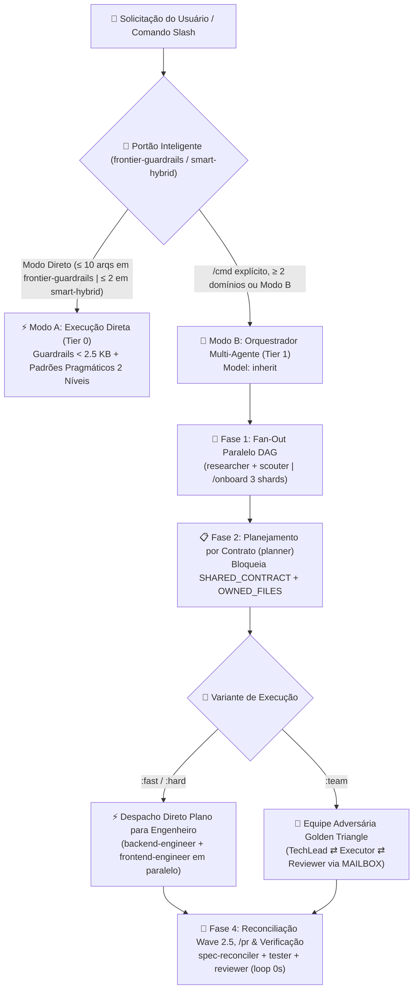

<div align="center">
  <h1>⚡ BoomOpen Workflow Kit v5.5.0</h1>
  <p><strong>Sistema Operacional de Força de Trabalho IA Smart-Hybrid Multiplataforma — 22 Agentes Especialistas, 18 Equipes Triângulo Dourado e Cofre de 1.462 Habilidades Sob Demanda</strong></p>

  <p>
    <a href="https://github.com/Kennyboom/BoomOpen-Workflow-Kit-Pro/releases"></a>
    <a href="#platforms"></a>
    <a href="#agents"></a>
    <a href="#skills"></a>
    <a href="https://nodejs.org/">=18.0.0" /></a>
    <a href="../LICENSE"></a>
  </p>

  <p>
    <a href="../README.md">🇬🇧 English</a> • <a href="./README.vi.md">🇻🇳 Tiếng Việt</a> • <a href="./README.zh-CN.md">🇨🇳 简体中文</a> • <a href="./README.zh-TW.md">🇹🇼 繁體中文</a> • <a href="./README.ja.md">🇯🇵 日本語</a> • <a href="./README.ko.md">🇰🇷 한국어</a> • <a href="./README.es.md">🇪🇸 Español</a> • <a href="./README.fr.md">🇫🇷 Français</a> • <a href="./README.de.md">🇩🇪 Deutsch</a><br/>
    <b>🇧🇷 Português</b> • <a href="./README.ru.md">🇷🇺 Русский</a> • <a href="./README.hi.md">🇮🇳 हिन्दी</a> • <a href="./README.ar.md">🇸🇦 العربية</a> • <a href="./README.id.md">🇮🇩 Bahasa Indonesia</a> • <a href="./README.th.md">🇹🇭 ไทย</a> • <a href="./README.tr.md">🇹🇷 Türkçe</a> • <a href="./README.it.md">🇮🇹 Italiano</a>
  </p>

  <p>
    <a href="https://boomopen.com">🌐 Website</a> •
    <a href="#pillars"><b>🧠 6 Pilares</b></a> •
    <a href="#platforms"><b>💻 5 Plataformas</b></a> •
    <a href="#settings"><b>🎛️ 5 Presets</b></a> •
    <a href="#commands"><b>🎯 36 Comandos</b></a> •
    <a href="#agents"><b>🤖 22 Agentes e 18 Equipes</b></a> •
    <a href="#skills"><b>📚 1.462 Habilidades</b></a>
  </p>
</div>

---

## 🎬 Trailer Oficial de Lançamento (Full HD 1080p)

<div align="center">
  <a href="https://github.com/Kennyboom/BoomOpen-Workflow-Kit-Pro/raw/main/assets/media/boomopen_v55_trailer_en.mp4">
    
  </a>
  <p>
    ▶️ <a href="https://github.com/Kennyboom/BoomOpen-Workflow-Kit-Pro/raw/main/assets/media/boomopen_v55_trailer_en.mp4"><b>Clique aqui para assistir / transmitir o Trailer Oficial em Full HD 1080p (MP4 com narração de estúdio)</b></a>
  </p>
</div>

---

## 🌟 O que é o BoomOpen Workflow Kit v5.5?

**BoomOpen Workflow Kit v5.5 (Multi-Platform Unified & Smart-Hybrid Edition)** é um sistema operacional multi-agente de código aberto que transforma um único assistente de programação IA em uma organização de engenharia coordenada composta por **22 agentes especialistas**, **18 equipes adversárias Golden Triangle (`72` arquivos de equipe)**, **36 comandos slash (`93` arquivos de comando: `87` fluxos + `6` em `_ref/`)**, **14 comandos CLI**, **22 habilidades principais (Core Skills)** e **1.440 habilidades especializadas (`1.462` habilidades deduplicadas via `~/.agents/skills_library`)**.

Ao contrário de templates rígidos ou wrappers pesados que adicionam latência e inchaço de contexto a cada turno, o BoomOpen v5.5 combina guardrails enxutos (`< 2.5 KB`) sob o perfil padrão **`frontier-guardrails`**, **Fragmentação Elástica de Enxame em 4 Níveis (`role#shard`)**, **Onboarding Brownfield em 60s (`/onboard`)**, **Portões de PR e Release (`/pr`, `/pr:review`, `/release`)**, **Reconciliação Automática Spec-to-Code Wave 2.5 (`boomopen reconcile`)**, **Auditoria Pós-Conclusão Multi-Rodada (`/audit` & `boomopen audit`)**, **Autopiloto Multi-Sessão (`/autopilot`)** e **Condutor Multi-Engine (`/conduct`)**:
- **🛡️ Guardrails Frontier Enxutos (`< 2.5 KB`) + Orquestração Modo B Sob Demanda**: Com o perfil padrão **`frontier-guardrails`**, o modelo frontier da sua IDE conduz tarefas diárias diretamente até `≤ 10` arquivos (`mode_a`, zero sequestro de linguagem natural), enquanto comandos `/cmd` explícitos ou o perfil `smart-hybrid` disparam shards paralelos no Turno 1 (`role#shard`, `<= 3–4 OWNED_FILES`/shard) com **Fan-Out Paralelo DAG**, **Despacho Direto do Plano ao Executor**, **Bloqueios por Contrato (`SHARED_CONTRACT` + `OWNED_FILES`)**, **Reconciliação Wave 2.5 (`boomopen reconcile` + `spec-reconciler` + `/cook amend-plan`)** e **Reutilização a Quente (`send_message`)**.
- **🏛️ Autopiloto Multi-Sessão (`/autopilot`), Auditoria Multi-Rodada (`/audit`) e Conselho Multi-Engine (`/conduct`)**: Ingestão de especificações em `.boomopen/project-ledger.json` com proteção SHA-256, trava em 4 camadas (`boomopen check --strict-phase --no-stubs`) e recuperação segura via `boomopen ledger rollback`; auditorias completas pós-conclusão (`/audit`, `boomopen audit rollback`) em `.boomopen/audit-ledger.json` com cobertura RTM, fluxo vertical UI→API→DB e Motor Anti-Vazamento de 2 Camadas (`security_scan.py` v6).
- **🗺️ Ciclo Completo de Engenharia (`/onboard` → `/cook` → `/pr` → `/release`)**: Mapeie qualquer repositório legado em 60 segundos com `/onboard` (`ARCHITECTURE-MAP.md`), valide e abra Pull Requests estruturados com `/pr` e `/pr:review`, e prepare lançamentos SemVer auditados com `/release`.
- **📚 Cofre Deduplicado de 1.462 Habilidades com Zero Inchaço de Contexto**: Combina **22 Habilidades Principais (`skills/`)** e **1.440 Habilidades de Biblioteca** compartilhadas uma única vez em `~/.agents/skills_library` (incluindo templates prontos de `mcp-server` e `ai-agent-worker`), pré-compiladas em `matrix-skills/compact-index.json` para busca `O(1)` em 2 etapas.

---

## 🏗️ Arquitetura Híbrida-Inteligente (v5.5)



---

<a id="pillars"></a>

## 🧠 Os 6 Pilares Principais da v5.5

1. **🌐 Paridade Unificada em 5 Plataformas (`platforms/*`)**:
   - Instalação nativa de primeira classe para **Antigravity (Gemini)**, **Claude Code**, **OpenAI Codex**, **Cursor** e **GitHub Copilot**, com pontos de entrada enxutos (`< 2.5 KB` de guardrails ativos) e cofre compartilhado `~/.agents/skills_library`.
2. **📏 Padrões de Codificação Pragmáticos de 2 Níveis (Anti-Fragmentação)**:
   - **Nível 1 — Tolerância Zero**: Responsabilidade Única, **PROIBIDO `any` explícito**, **PROIBIDO deixar `console.log` de depuração**, `try/catch` + erros tipados em fronteiras async/API, constantes `SCREAMING_SNAKE_CASE`, DRY (`≥ 3`) e imports ordenados.
   - **Nível 2 — Diretrizes Estruturais Flexíveis**: Arquivos coesos visam `~200–350 linhas` com teto flexível `400` e split rígido `>500 linhas` (testes, tipos e docs isentos). Funções lógicas `~20–40 linhas` (`~40–80` para UI/Handlers).
3. **🎯 Fragmentação Elástica em 4 Níveis (`role#shard`), Despacho Direto e Reutilização a Quente (`send_message`)**:
   - Com `PLAN-{feature}.md` pronto, o Orquestrador despacha **diretamente** para shards de domínio (`<= 3–4 OWNED_FILES` cada) sem salto redundante pelo `tech-lead`, reutilizando sessões via `role#shard → conversationId` com **0s de cold-start**.
4. **🤝 Despacho Paralelo por Contrato (`SHARED_CONTRACT` + `OWNED_FILES`) & Wave 2.5 (`spec-reconciler`)**:
   - Trava endpoints, DTOs e posse exclusiva de arquivos antes do código paralelo; na **Wave 2.5**, `boomopen reconcile` + `spec-reconciler` + `/cook amend-plan` verificam `docs/` vs. código real (`REC-G1..G4`), detectando módulos-ilha, divergências de rota/env e lacunas `[SC-*]`.
5. **🔍 Depuração 5-Whys (SPIE v3.0), Auditoria Multi-Rodada (`/audit`) & Git 100% Limpo**:
   - `debugger` investiga 3 hipóteses + cadeia **5-Whys**; `/audit` executa rodadas progressivas com o Motor Anti-Vazamento de 2 Camadas (`security_scan.py` v6) e suporte a `boomopen audit rollback`. Artefatos transitórios vão para `<appDataDir>\brain\<conversation-id>\` (ou `./reports/`).
6. **🩺 Suíte CLI Completa de 14 Comandos & Índice O(1)**:
   - `npm run doctor` valida as 5 plataformas, **22 agentes**, **72 arquivos de equipe** (18 equipes), **93 arquivos de comando** (`87` fluxos para **36 comandos** + `6` em `_ref/`) e `compact-index.json` (`1.462` habilidades). Os **14 comandos CLI** (`research`, `design`, `plan`, `cook`, `reconcile`, `audit`, `ledger`, `conduct`, `check`, `doctor`, `settings`, `install`, `uninstall`, `list` — incluindo `ledger rollback`, `audit rollback` e `install antigravity --as-plugin`) garantem portões determinísticos.

---

<a id="platforms"></a>

## 💻 Plataformas de IA Suportadas e Recursos Nativos 2026

| Plataforma | Suporte | Ponto de Entrada Global | Destaques Nativos 2026 na v5.5 |
|----------|:-------:|-------------------------|--------------------------------|
| **Antigravity (Gemini)** | ✅ Nativo v5.5 | `~/.gemini/GEMINI.md` | Bundle nativo via `install antigravity --as-plugin`, orquestração Python `run_workflow`, loop externo `/goal` e hooks `--with-hooks` |
| **Claude Code** | ✅ Nativo v5.5 | `~/.claude/CLAUDE.md` | Fluxos `/plan:hard`, hooks `PreCompact` + `Stop` de qualidade, guarda `PreToolUse` (`Bash\|PowerShell`) e sub-agentes `Task`/`Explore` |
| **OpenAI Codex** | ✅ Nativo v5.5 | `~/.codex/CODEX.md` & `AGENTS.md` | Agentes TOML em `~/.codex/agents/boomopen/*.toml` com sandbox `read-only` para scouts/revisores e continuidade via hooks `Stop` |
| **Cursor** | ✅ Nativo v5.5 | `~/.cursor/rules/boomopen-workflow-kit.mdc` | Guardrails enxutos `< 2.5 KB`, hook `beforeShellExecution` (`--with-hooks`) e cofre compartilhado `~/.agents/skills_library` |
| **GitHub Copilot** | ✅ Nativo v5.5 | `~/.copilot/COPILOT.md` | Agente customizado `boomopen-workflow-kit.agent.md`, guardrails `< 2.5 KB` e acesso `O(1)` às `1.462` habilidades |

---

## 🚀 Início Rápido e Instalação

```bash
# 1. Clonar e instalar para seu assistente (ou --all para as 5 plataformas)
git clone https://github.com/Kennyboom/BoomOpen-Workflow-Kit-Pro.git
cd BoomOpen-Workflow-Kit-Pro
npm run install:antigravity   # ou: install:claude | install:codex | install:cursor | install:copilot | install:all

# Opções nativas de plugin e hooks de segurança/qualidade (2026):
node cli/install.js install antigravity --as-plugin   # Empacotar como plugin nativo do Antigravity
node cli/install.js install claude --with-hooks       # Registrar guarda Bash|PowerShell + hooks PreCompact/Stop

# 2. Verificar a instalação e usar a suíte CLI de 14 comandos
npm run doctor
npm link
boomopen research validate path/to/RESEARCH.md
boomopen design validate path/to/DESIGN.md
boomopen plan validate path/to/PLAN.md
boomopen cook preflight path/to/PLAN.md
boomopen reconcile path/to/your/project --plan path/to/PLAN.md
boomopen audit init --docs docs/prd.md,docs/arch.md   # Rollback seguro: boomopen audit rollback
boomopen check path/to/your/project --strict-phase --no-stubs
boomopen ledger status                                # Rollback de fase: boomopen ledger rollback
boomopen conduct probe
```

> O kit **não está publicado no npm** — instale-o somente a partir deste repositório (`npm link` adiciona `boomopen` ao seu PATH). Para remover mantendo seus arquivos próprios: `boomopen uninstall <tool>`.

---

<a id="settings"></a>

## 🎛️ Configurações Unificadas e 5 Perfis Predefinidos (`/settings`)

O BoomOpen v5.5 gerencia **20 configurações enum + 2 limites de linhas** nas **5 plataformas** em `< 10ms` (**0ms de latência no Turno 1**), com **`🛡️ frontier-guardrails`** como perfil padrão recomendado:

| Perfil (`Preset`) | Modo (`execution.mode`) | Variante Padrão | Gatilho NL (`naturalLanguageResearchTrigger`) | Padrões de Código | Melhor Uso |
|:---|:---|:---:|:---:|:---:|:---|
| **🛡️ `frontier-guardrails`** *(Padrão Recomendado)* | **`mode_a`** *(Direto até `≤ 10 arquivos`; guardrails enxutos `< 2.5 KB` nas 5 IDEs; alias `carbon-guardrails` suportado)* | `auto` | `off` *(Zero sequestro de NL; workflows apenas com `/cmd` explícito)* | `pragmatic` (`400/500`) | Uso diário em todas as 5 IDEs — deixa o modelo frontier nativo conduzir edições de até 10 arquivos com rigor `strict_e2e` e limites 400/500 |
| **⚡ `smart-hybrid`** | **`auto`** (`≤ 2 arquivos` → Mode A; `> 2` ou `/cmd` → Mode B) | `auto` | **`auto_team`** *(Roteia pesquisa/ideação NL para `/research:team` / `/brainstorm:team`)* | `pragmatic` (`400/500`) | Orquestração proativa em 17 idiomas: ágil em micro-tarefas, enxame automático em features maiores |
| **🚀 `solo-fast`** | **`mode_a`** *(Execução solo direta, 0s de sub-agente)* | `fast` | `off` *(Resposta direta no chat salvo `/brainstorm`)* | `relaxed` (`600/800`) | Hotfixes urgentes, prototipagem rápida, scripts e economia máxima de tokens |
| **🧠 `deep-architect`** | **`mode_b`** *(Orquestrador Multi-Agente em toda tarefa)* | `hard` | `auto_hard` *(Executa `/research:hard` / `/brainstorm:hard` de 5 lentes)* | `strict` (`300/400`) | Arquitetura complexa, projetos greenfield e refatorações multi-domínio |
| **🔺 `adversarial-team`** | **`team`** *(Equipe Golden Triangle de 3 agentes `:team`)* | `team` | **`auto_team`** *(Debate e revisão adversária via `MAILBOX`)* | `strict` (`300/400`) | Produção crítica, auditorias de segurança e entregas zero-defeitos |

```bash
# No Chat (/settings) | Painel Web (boomopen settings --ui) | Terminal CLI
/settings                                     # Menu interativo (ask_question UI)
/settings preset frontier-guardrails          # Padrão Recomendado (< 2.5 KB guardrails; alias: carbon-guardrails)
/settings preset smart-hybrid                 # Orquestração proativa Smart-Hybrid
/settings mode auto | mode_a | mode_b | team  # Substituir modo de execução diretamente
boomopen settings preset frontier-guardrails  # Aplicar globalmente e sincronizar 5 plataformas
boomopen settings set execution.mode mode_a --project   # Escreve ./.boomopen.json no projeto atual
```

---

## 🌙 Guia Noturno para Projetos Multi-Fase (`/autopilot` vs `/goal` + `/autopilot` + `/audit`)

> **Continuidade Nativa por Plataforma**: **`/goal`** é o loop externo nativo do **Antigravity (Gemini)** para execuções autônomas durante a noite, enquanto **`/autopilot` combinado aos hooks `Stop` / `PreCompact`** (`--with-hooks`) sustenta a continuidade multi-sessão no **Claude Code** e no **OpenAI Codex** (com `boomopen ledger rollback` e `boomopen audit rollback` para recuperação segura).

| Estratégia | Escopo de Sessão e Contexto | Controle de Plano e Qualidade | Melhor Cenário |
|:---|:---|:---|:---|
| **`/autopilot` (+ hooks `Stop`/`PreCompact` no Claude Code & Codex)** | No Claude Code/Codex, os hooks preservam o estado antes da compactação e validam portões ao encerrar; sem hooks, encerra limpo em **~70% do contexto** | Mantém `.boomopen/project-ledger.json`, 5 portões, Wave 2.5 `reconcile`, `ledger rollback` e `/audit` | Execução multi-sessão controlada no Claude Code/Codex ou revisão fase a fase |
| **`/goal` + `/autopilot` + `/audit`** *(Nativo no Antigravity)* | **`/goal` atua como loop externo nativo do Antigravity**, avançando múltiplas fases durante a noite entre renovações de contexto | O `/autopilot` impõe `project-ledger.json`, 5 portões, reconciliação Wave 2.5 (`reconcile`) e **Rodada 1 do `/audit`** ao atingir 100% | Projetos grandes multi-documento executados à noite no Antigravity até o relatório completo de auditoria |

**Prompt pronto para copiar (execução noturna no Antigravity):**

```text
/goal Construa todo o projeto de ponta a ponta a partir das especificações em docs/ usando /autopilot.
Inicialize e mantenha .boomopen/project-ledger.json, execute o PLAN por fases sem pular requisitos,
rode a reconciliação Wave 2.5 (boomopen reconcile) e os 5 portões de verificação ao final de cada fase
e, após concluir 100% das fases, execute a Rodada 1 de /audit para gerar o relatório completo para revisão pela manhã.
```

---

<a id="commands"></a>

## 🎯 Referência de Comandos Slash (36 Comandos / 93 Arquivos)

*(Inclui `87` arquivos de workflow em `commands/*.md` para **36 comandos base** — além da tabela principal abaixo, utilitários rápidos como `/ask`, `/status`, `/next`, `/init`, `/auto`, `/architect`, `/refactor`, `/performance`, `/security-audit`, `/deep-audit`, `/preview`, `/rollback`, `/ui-ux-pro-max` — mais `6` protocolos em `commands/_ref/`.)*

| Comando | Variantes | Propósito Principal |
|---------|----------|-----------------|
| **`/onboard`** | — | Onboarding brownfield em 60s: gera `ARCHITECTURE-MAP.md` (stack, entrypoints, fluxo de dados, hotspots e portões, zero colisão com `/init`) |
| **`/cook`** | `:fast`, `:hard`, `:team`, `amend-plan` | Desenvolvimento completo ponta a ponta (Pesquisa/Scout → Plano → Código Paralelo → Wave 2.5 → Revisão) |
| **`/code`** | `:fast`, `:hard`, `:team` | Executar implementação diretamente a partir de um `PLAN-{feature}.md` existente |
| **`/plan`** | `:fast`, `:hard`, `:team` | Criar blueprints com `SHARED_CONTRACT`, `OWNED_FILES` e critérios Given/When/Then (destaque para `/plan:hard` no Claude Code) |
| **`/fix`** | `:fast`, `:hard`, `:team` | Resolução de bugs na causa raiz com verificação obrigatória por teste de regressão |
| **`/debug`** | `:fast`, `:hard`, `:team` | Investigação com 3 hipóteses + cadeia causal **5-Whys (SPIE v3.0)** (`DEBUG-{issue}.md`) |
| **`/test`** | `:fast`, `:hard`, `:team` | Execução paralela DAG de testes + busca de casos de borda (`tester` + `scouter`) |
| **`/review`** | `:fast`, `:hard`, `:team` | Auditoria paralela em 4 dimensões (Arquitetura, Qualidade, Segurança OWASP, Performance) |
| **`/pr`** | `/pr`, `/pr:review` | Portão pré-PR (`boomopen check` + `reconcile` + testes do diff), higiene de branch, criação estruturada `gh pr create` e revisão adversária de PR |
| **`/release`** | — | Preparação de Semantic Release: auditoria Conventional Commits, síntese de `CHANGELOG.md`, portões `doctor`/`check`/`test`/`test:pack` e `gh release create` |
| **`/audit`** | `:run`, `:fix`, `:auto` | Auditoria pós-conclusão multi-rodada (RTM, fluxo UI→API→DB, Anti-Vazamento 2 Camadas v6, `/audit:fix` e `boomopen audit rollback`) |
| **`/design`** | `:fast`, `:hard`, `:team` | Arquitetura de sistema, esquema de banco de dados e especificação UI/UX de 6 blocos (`DESIGN.md`) |
| **`/docs`** | `:core`, `:business`, `:audit` | Gerar ou sincronizar documentação estruturada de arquitetura e negócios (`./documents/`) |
| **`/deploy`** | `:check`, `:preview`, `:production`, `:rollback` | Portões pré-deploy, ambientes de preview, rollout em produção e rollback seguro |
| **`/research`** | `:fast`, `:hard`, `:team` | Motor autônomo de pesquisa profunda (triangulação de 4 fontes, 3 ondas e conselho 3 vetores) |
| **`/brainstorm`** | `:fast`, `:hard`, `:team` | Descoberta socrática de requisitos, análise de trade-offs MCDA e ideação |
| **`/report`** | `:fast`, `:hard`, `:team` | Relatórios executivos e técnicos de síntese com métricas e diagramas |
| **`/autopilot`** | `:init`, `:run`, `:audit` | Orquestrador autônomo multi-sessão via `.boomopen/project-ledger.json`, trava de 4 camadas e `ledger rollback` |
| **`/conduct`** | `:council`, `:pipeline` | Maestro multi-engine e conselho paralelo (`boomopen conduct`) com síntese em 4 partes |
| **`/orchestrate`** | — | Orquestração personalizada de pipelines multi-agente através de múltiplos domínios e shards |
| **`/settings`** | `preset`, `mode`, `set`, `ui` | Centro de Controle Unificado: 20 chaves + 2 limites, **5 presets** (`frontier-guardrails` padrão) ou Web UI (`--ui`) |
| **`/save` / `/recap`** | — | Persistir estado da sessão (`SESSION-HANDOVER.md`) e restaurar contexto completo em `< 5s` |

---

<a id="agents"></a>

## 🤖 22 Agentes Especialistas e 18 Equipes Golden Triangle (`72` Arquivos)

| Categoria | Agentes Especialistas (`agents/*.md`) | Equipes Golden Triangle (`agents/teams/*-team/`) |
|----------|-----------------------------------|------------------------------------------------|
| **Engenharia e Execução** | `backend-engineer`, `frontend-engineer`, `mobile-engineer`, `game-engineer`, `database-architect`, `devops-engineer` | `backend-team`, `frontend-team`, `fullstack-team`, `mobile-team`, `game-team`, `database-team`, `devops-team` |
| **Arquitetura e Planejamento** | `tech-lead`, `planner`, `brainstormer`, `business-analyst`, `project-manager`, `designer` | `planning-team`, `brainstorm-team`, `project-team`, `design-team` |
| **Qualidade, Segurança e Depuração** | `debugger`, `tester`, `reviewer`, **`spec-reconciler`**, `security-engineer`, `performance-engineer` | `debug-team`, `qa-team`, `security-team`, `performance-team` |
| **Pesquisa e Conhecimento** | `researcher`, `scouter`, `docs-manager`, `reporter` | `research-team`, `docs-team`, `report-team` |

---

<a id="skills"></a>

## 📚 Cofre de 1.462 Habilidades (22 Principais + 1.440 Deduplicadas em `~/.agents/skills_library`)

Projetado para **0 consumo de tokens em repouso** e **armazenamento deduplicado entre IDEs** via `~/.agents/skills_library` + **Resolução Progressiva O(1) em 2 Etapas** (`<skills>` → `matrix-skills/compact-index.json` → `SKILL.md` sob demanda):

| Domínio de Habilidade | Quantidade | Capacidades Representativas & Templates 2026 | Carregamento |
|:---|:---:|:---|:---|
| **⚡ Nível 1: Principais (`skills/`)** | **22** | `clean-code`, `debugger`, `plan-writing`, `brainstorming`, `frontend-design`, `design-spec`, `api-patterns`, `database-design`, `testing-patterns`, `skill-seeker` | Pré-indexado em `<skills>` |
| **🎨 Design UI/UX & Motion** | **42** | Anti-AI-Slop Craft, OKLCH, Bento Grids, Motion v12, Figma MCP + W3C DTCG, WCAG 2.2 AA/AAA, iOS 18 HIG & Material 3 | `compact-index.json` |
| **🌐 Web, Backend & Edge** | **390+** | React 19, Next.js 15, Tailwind v4, TanStack, Hono RPC + Zod OpenAPI, Rust Axum, Supabase RLS, Drizzle + Neon/Turso | `~/.agents/skills_library` |
| **🤖 IA, MCP & Agentes Workers** | **320+** | Templates **`mcp-server`** & **`ai-agent-worker`**, FastMCP 2025, OpenAI/Claude/Google ADK, Vercel AI SDK v4, RAG, BigQuery, dbt | `~/.agents/skills_library` |
| **☁️ Cloud, DevOps & Segurança** | **300+** | Cloudflare Workers/D1/R2, Terraform/OpenTofu, Docker/K8s, Vitest + MSW v2, Better Auth, OWASP LLM 2025 | `~/.agents/skills_library` |
| **📱 Mobile, Games & 3D Web** | **410+** | Unity 6 DOTS, Godot 4, WebGPU/Three.js TSL, Colyseus, Tauri v2, SwiftUI, Kotlin, React Native, Flutter | `~/.agents/skills_library` |

---

## 📂 Estrutura do Repositório

```text
BoomOpen-Workflow-Kit-Pro/
├── agents/                  # 22 Agentes Especialistas (incl. spec-reconciler) + 18 Equipes (72 arquivos)
├── cli/                     # 14 comandos CLI: install (--as-plugin/--with-hooks), uninstall, list, doctor, check, settings, research, design, plan, cook, reconcile, audit (rollback), ledger (rollback) & conduct
├── commands/                # 87 fluxos de comandos Slash (36 comandos: /onboard, /pr, /release, /cook, etc.) + 6 protocolos _ref/ (93 arquivos)
├── documents/               # Documentação de 2 níveis (Arquitetura, Domínio, Código-Fonte e Padrões)
├── i18n/                    # 16 traduções completas do README
├── matrix-skills/           # Matrizes YAML + compact-index.json pré-compilado (1.462 habilidades)
├── platforms/               # Templates unificados para 5 plataformas (antigravity/, claude/, codex/, copilot/, cursor/)
├── rules/                   # Regras sob demanda do Modo B (CORE, PHASES, AGENTS, TEAMS, SKILLS, ERRORS, REFERENCE)
├── scripts/                 # Scripts Python de automação e verificação (checklist.py, security_scan.py, etc.)
├── skills/                  # 22 Habilidades Principais
├── skills_library/          # 1.440 habilidades especializadas deduplicadas via ~/.agents/skills_library (incl. mcp-server & ai-agent-worker)
└── GEMINI.md | CLAUDE.md | CODEX.md | COPILOT.md | CURSOR.md | AGENT.md
```

---

## 📄 Licença e Segurança

- **Licença**: Distribuído sob a [Licença MIT](../LICENSE). Copyright © 2026 **BoomOpen Labs**. Skills de terceiros em `skills_library/` mantêm suas licenças originais — veja [THIRD_PARTY_NOTICES.md](../THIRD_PARTY_NOTICES.md).
- **Política de Segurança**: Veja [SECURITY.md](../SECURITY.md) para diretrizes de segurança integradas e relato de vulnerabilidades.
