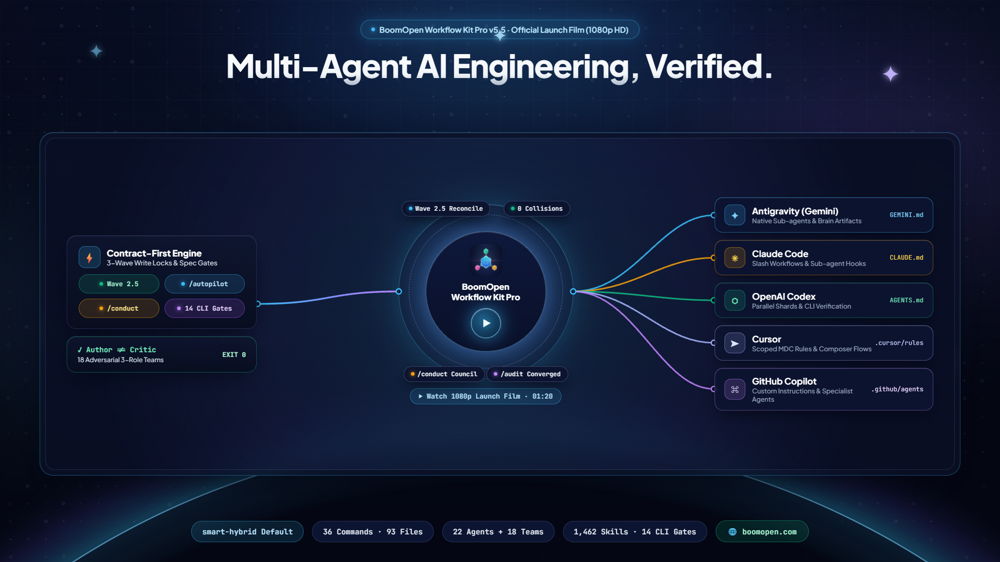
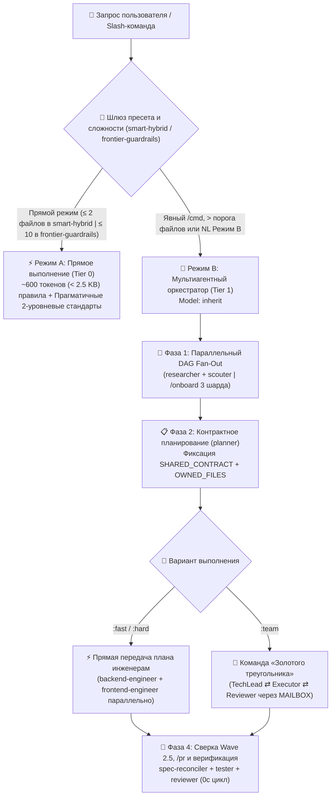

<div align="center">
  <h1>⚡ BoomOpen Workflow Kit v5.5.0</h1>
  <p><strong>Кроссплатформенная Smart-Hybrid ИИ-ОС для разработки — 22 агента-специалиста, 18 команд «Золотого треугольника» и хранилище из 1 462 навыков по требованию</strong></p>

  <p>
    <a href="https://github.com/Kennyboom/BoomOpen-Workflow-Kit-Pro/releases"></a>
    <a href="#platforms"></a>
    <a href="#agents"></a>
    <a href="#skills"></a>
    <a href="https://nodejs.org/">=18.0.0" /></a>
    <a href="../LICENSE"></a>
  </p>

  <p>
    <a href="../README.md">🇬🇧 English</a> • <a href="./README.vi.md">🇻🇳 Tiếng Việt</a> • <a href="./README.zh-CN.md">🇨🇳 简体中文</a> • <a href="./README.zh-TW.md">🇹🇼 繁體中文</a> • <a href="./README.ja.md">🇯🇵 日本語</a> • <a href="./README.ko.md">🇰🇷 한국어</a> • <a href="./README.es.md">🇪🇸 Español</a> • <a href="./README.fr.md">🇫🇷 Français</a> • <a href="./README.de.md">🇩🇪 Deutsch</a><br/>
    <a href="./README.pt-BR.md">🇧🇷 Português</a> • <b>🇷🇺 Русский</b> • <a href="./README.hi.md">🇮🇳 हिन्दी</a> • <a href="./README.ar.md">🇸🇦 العربية</a> • <a href="./README.id.md">🇮🇩 Bahasa Indonesia</a> • <a href="./README.th.md">🇹🇭 ไทย</a> • <a href="./README.tr.md">🇹🇷 Türkçe</a> • <a href="./README.it.md">🇮🇹 Italiano</a>
  </p>

  <p>
    <a href="https://boomopen.com">🌐 Website</a> •
    <a href="#pillars"><b>🧠 6 столпов</b></a> •
    <a href="#platforms"><b>💻 5 платформ</b></a> •
    <a href="#settings"><b>🎛️ 5 пресетов</b></a> •
    <a href="#commands"><b>🎯 36 команд</b></a> •
    <a href="#agents"><b>🤖 22 агента и 18 команд</b></a> •
    <a href="#skills"><b>📚 1 462 навыка</b></a>
  </p>
</div>

---

## 🎬 Официальный релизный трейлер (Full HD 1080p)

<div align="center">
  <a href="https://github.com/Kennyboom/BoomOpen-Workflow-Kit-Pro/raw/main/assets/media/boomopen_v55_trailer_en.mp4">
    
  </a>
  <p>
    ▶️ <a href="https://github.com/Kennyboom/BoomOpen-Workflow-Kit-Pro/raw/main/assets/media/boomopen_v55_trailer_en.mp4"><b>Нажмите здесь, чтобы смотреть / стримить официальный трейлер в Full HD 1080p (MP4 со студийной озвучкой)</b></a>
  </p>
</div>

---

## 🌟 Что такое BoomOpen Workflow Kit v5.5?

**BoomOpen Workflow Kit v5.5 (Frontier-Guardrails & Multi-Platform Smart-Hybrid Edition)** — это мультиагентная операционная система с открытым исходным кодом, превращающая одного ИИ-ассистента по программированию в слаженную инженерную организацию из **22 агентов-специалистов**, **18 состязательных команд «Золотого треугольника» (`72` файла команд)**, **36 slash-команд (`93` файла команд: `87` рабочих процессов + `6` в `_ref/`)**, **14 CLI-команд**, **22 базовых навыков (Core Skills)** и **1 440 узкоспециализированных навыков (`1 462` навыка с дедупликацией через `~/.agents/skills_library`)**.

В отличие от жёстких шаблонов и громоздких обёрток, раздувающих контекст на каждом шаге, при чистой установке BoomOpen v5.5 по умолчанию использует пресет **`⚡ smart-hybrid`** (проактивный эластичный рой с 1-го хода + маршрутизация естественного языка на 17 языках во всех 5 IDE; восстанавливается через `boomopen settings reset`), а также предлагает опциональный тонкий пресет Режима A **`🛡️ frontier-guardrails`** (`< 2.5 KB` / `~600 tokens`, `mode_a <= 10 files`, `naturalLanguageResearchTrigger = off`), открывая **4-уровневое эластичное шардирование роя (`role#shard`)**, **60-секундный онбординг существующего кода (`/onboard`)**, **шлюзы PR и релизов (`/pr`, `/pr:review`, `/release`)**, **Автосверку Spec-to-Code волны Wave 2.5 (`boomopen reconcile`)**, **Многораундовый аудит после завершения (`/audit` и `boomopen audit`)**, **Многосессионный автопилот проекта (`/autopilot`)** и **Кросс-движковый кондуктор (`/conduct`)**:
- **⚡ Пресет по умолчанию `smart-hybrid` — проактивный рой с 1-го хода и маршрутизация на 17 языках**: из коробки микро-правки (`≤ 2` файлов) выполняются напрямую в Режиме A, тогда как многофайловые задачи, глубокие исследования, генерация идей, планирование и явные команды `/cmd` (**`/onboard`**, **`/pr` + `/pr:review`**, **`/release`** и др.) с 1-го хода запускают параллельные шарды (`role#shard`, `<= 3–4 OWNED_FILES` на шард) с **DAG-разветвлением**, **прямой передачей плана исполнителям**, **контрактной блокировкой (`SHARED_CONTRACT` + `OWNED_FILES`)**, **автосверкой Wave 2.5 (`boomopen reconcile` + `spec-reconciler` + `/cook amend-plan`)** и **тёплым переиспользованием сессий (`send_message`)**.
- **🛡️ Опциональный тонкий пресет `frontier-guardrails` (`< 2.5 KB` / `~600 tokens`, Slim Mode A)**: предпочитаете прямую работу нативной модели до `≤ 10` файлов (`mode_a <= 10 files`) с нулевым перехватом естественного языка (`naturalLanguageResearchTrigger = off`)? Переключитесь за `< 10 мс` командой `boomopen settings preset frontier-guardrails` (алиас `carbon-guardrails` сохранён для обратной совместимости).
- **🏛️ Многосессионный автопилот (`/autopilot`), многораундовый аудит (`/audit`) и консилиум (`/conduct`)**: загрузка ТЗ в защищённый SHA-256 журнал `.boomopen/project-ledger.json` с 4-уровневым контролем (`boomopen check --strict-phase --no-stubs`) и безопасным откатом `boomopen ledger rollback`; комплексный пост-релизный аудит (`/audit`, `boomopen audit rollback`) через `.boomopen/audit-ledger.json` с проверкой RTM, сквозных потоков UI→API→DB и 2-уровневым движком анти-утечек (`security_scan.py` v6).
- **🗺️ Полный инженерный цикл (`/onboard` → `/cook` → `/pr` → `/release`)**: стройте карту архитектуры любого проекта за 60 секунд через `/onboard` (`ARCHITECTURE-MAP.md`), проверяйте и создавайте Pull Request через `/pr` и `/pr:review`, и готовьте выверенные SemVer-релизы через `/release`.
- **📚 Дедуплицированное хранилище из 1 462 навыков без раздувания контекста**: объединяет **22 базовых навыка (`skills/`)** и **1 440 библиотечных навыков**, общих для всех установленных IDE в `~/.agents/skills_library` (включая шаблоны `mcp-server` и `ai-agent-worker`), с двухшаговым `O(1)` поиском по `matrix-skills/compact-index.json`.

---

## 🏗️ Архитектура Smart-Hybrid (v5.5)



---

<a id="pillars"></a>

## 🧠 6 ключевых столпов версии v5.5

1. **🌐 Единый паритет на 5 платформах (`platforms/*`)**:
   - Нативная установка для **Antigravity (Gemini)**, **Claude Code**, **OpenAI Codex**, **Cursor** и **GitHub Copilot** с точками входа без задержки на 1-м ходу (`smart-hybrid` по умолчанию + опциональный тонкий пресет `< 2.5 KB` / `~600 tokens` `frontier-guardrails`) и единым дедуплицированным хранилищем `~/.agents/skills_library`.
2. **📏 Прагматичные двухуровневые стандарты кодирования (Анти-фрагментация)**:
   - **Уровень 1 — Нулевая терпимость**: Single Responsibility, **ЗАПРЕТ явного `any`**, **ЗАПРЕТ оставленных `console.log`**, `try/catch` + типизированные ошибки на границах async/API, константы `SCREAMING_SNAKE_CASE`, DRY (`≥ 3`) и упорядоченные импорты.
   - **Уровень 2 — Гибкие структурные ориентиры**: связные файлы нацелены на `~200–350 строк` с мягким пределом `400` и жёстким порогом разделения `>500 строк` (тесты, типы и документы освобождены). Функции логики `~20–40 строк` (`~40–80` для UI/обработчиков).
3. **🎯 4-уровневое шардирование (`role#shard`), прямая передача плана и тёплое переиспользование (`send_message`)**:
   - По готовому `PLAN-{feature}.md` оркестратор направляет задачи **напрямую** шардам инженеров (`<= 3–4 OWNED_FILES` на шард) без лишнего звена `tech-lead`, переиспользуя активные сессии (`role#shard → conversationId`) с **0 с холодного старта**.
4. **🤝 Контрактная разработка (`SHARED_CONTRACT` + `OWNED_FILES`) и Wave 2.5 (`spec-reconciler`)**:
   - До старта кода фиксируются API, DTO и монопольная запись файлов; на волне **Wave 2.5** `boomopen reconcile` + `spec-reconciler` + `/cook amend-plan` сверяют `docs/` с реальным кодом (`REC-G1..G4`), выявляя изолированные «островные» модули, расхождения маршрутов/env и пропуски `[SC-*]`.
5. **🔍 Отладка 5-Whys (SPIE v3.0), многораундовый `/audit` и 100% чистое дерево Git**:
   - `debugger` проверяет 3 гипотезы + цепочку **5-Whys**; `/audit` проводит многораундовую проверку с 2-уровневым движком анти-утечек (`security_scan.py` v6) и откатом `boomopen audit rollback`. Временные артефакты пишутся в `<appDataDir>\brain\<conversation-id>\` (или `./reports/`).
6. **🩺 Набор из 14 CLI-команд и O(1) индекс навыков**:
   - `npm run doctor` проверяет 5 платформ, **22 агента**, **72 файла команд** (18 папок), **93 файла slash-команд** (`87` рабочих процессов для **36 команд** + `6` в `_ref/`) и `compact-index.json` (`1 462` навыка). Все **14 CLI-команд** (`research`, `design`, `plan`, `cook`, `reconcile`, `audit`, `ledger`, `conduct`, `check`, `doctor`, `settings`, `install`, `uninstall`, `list` — включая `ledger rollback`, `audit rollback` и `install antigravity --as-plugin`) обеспечивают строгие детерминированные шлюзы.

---

<a id="platforms"></a>

## 💻 Поддерживаемые ИИ-платформы и нативные возможности 2026

| Платформа | Поддержка | Глобальная точка входа | Нативные возможности 2026 в v5.5 |
|----------|:---------:|------------------------|----------------------------------|
| **Antigravity (Gemini)** | ✅ Нативно v5.5 | `~/.gemini/GEMINI.md` | Нативный плагин `install antigravity --as-plugin`, Python-оркестрация `run_workflow`, внешний цикл `/goal` и хуки `--with-hooks` |
| **Claude Code** | ✅ Нативно v5.5 | `~/.claude/CLAUDE.md` | Архитектурный `/plan:hard`, хуки качества `PreCompact` + `Stop`, защита `PreToolUse` (`Bash\|PowerShell`) и субагенты `Task`/`Explore` |
| **OpenAI Codex** | ✅ Нативно v5.5 | `~/.codex/CODEX.md` & `AGENTS.md` | TOML-роли `~/.codex/agents/boomopen/*.toml` с песочницей `read-only` для разведчиков/ревьюеров и многосессионными хуками `Stop` |
| **Cursor** | ✅ Нативно v5.5 | `~/.cursor/rules/boomopen-workflow-kit.mdc` | Тонкие правила `< 2.5 KB`, хук `beforeShellExecution` (`--with-hooks`) и общее хранилище `~/.agents/skills_library` |
| **GitHub Copilot** | ✅ Нативно v5.5 | `~/.copilot/COPILOT.md` | Агент `boomopen-workflow-kit.agent.md`, правила `< 2.5 KB` и `O(1)` доступ ко всем `1 462` навыкам |

---

## 🚀 Быстрый старт и установка

```bash
# 1. Клонировать репозиторий и установить для вашей платформы (или --all для всех 5)
git clone https://github.com/Kennyboom/BoomOpen-Workflow-Kit-Pro.git
cd BoomOpen-Workflow-Kit-Pro
npm run install:antigravity   # или: install:claude | install:codex | install:cursor | install:copilot | install:all

# Нативный режим плагина и опциональные хуки безопасности/качества (2026):
node cli/install.js install antigravity --as-plugin   # Сборка нативного плагина для Antigravity
node cli/install.js install claude --with-hooks       # Защита Bash|PowerShell + хуки качества PreCompact/Stop

# 2. Проверить установку и использовать 14 CLI-команд
npm run doctor
npm link
boomopen research validate path/to/RESEARCH.md
boomopen design validate path/to/DESIGN.md
boomopen plan validate path/to/PLAN.md
boomopen cook preflight path/to/PLAN.md
boomopen reconcile path/to/your/project --plan path/to/PLAN.md
boomopen audit init --docs docs/prd.md,docs/arch.md   # Безопасный откат: boomopen audit rollback
boomopen check path/to/your/project --strict-phase --no-stubs
boomopen ledger status                                # Откат фазы: boomopen ledger rollback
boomopen conduct probe
```

> Кит **не опубликован в npm** — устанавливайте его только из этого репозитория (`npm link` добавляет `boomopen` в PATH). Для удаления с сохранением ваших собственных файлов: `boomopen uninstall <tool>`.

---

<a id="settings"></a>

## 🎛️ Единый центр настроек и 5 пресетов (`/settings`)

BoomOpen v5.5 управляет **20 перечисляемыми параметрами + 2 лимитами строк** на всех **5 платформах** за `< 10 мс` (**0 мс задержки на 1-м ходу**). При чистой установке по умолчанию активен рекомендуемый пресет **`⚡ smart-hybrid`** (восстанавливается командой `boomopen settings reset`), а **`🛡️ frontier-guardrails`** (`< 2.5 KB` / `~600 tokens`, `mode_a <= 10 files`, `naturalLanguageResearchTrigger = off`, с обратно совместимым алиасом `carbon-guardrails`) доступен как опциональный тонкий пресет Режима A (`boomopen settings preset frontier-guardrails`):

| Профиль (`Preset`) | Режим (`execution.mode`) | Вариант `/cmd` | NL-триггер (`naturalLanguageResearchTrigger`) | Стандарты кода | Когда использовать |
|:---|:---|:---:|:---:|:---:|:---|
| **⚡ `smart-hybrid`** *(Рекомендуется по умолчанию)* | **`auto`** (`≤ 2 файлов` → Mode A; `> 2` или `/cmd` → Mode B) | `auto` | **`auto_team`** *(Авто-маршрутизация ресёрча/идей в `/research:team` / `/brainstorm:team`)* | `pragmatic` (`400/500`) | По умолчанию при чистой установке (`boomopen settings reset`) — проактивная маршрутизация на 17 языках + рой с 1-го хода свыше 2 файлов во всех 5 IDE |
| **🛡️ `frontier-guardrails`** *(Опциональный Slim Mode A)* | **`mode_a`** *(Прямая работа до `≤ 10 файлов`; тонкие правила `< 2.5 KB` / `~600 tokens`; поддерживается алиас `carbon-guardrails`)* | `auto` | **`off`** *(Нулевой перехват NL; процессы только по явному `/cmd`)* | `pragmatic` (`400/500`) | Опциональный тонкий Режим A (`< 2.5 KB` / `~600 tokens`) до 10 файлов при строгих рамках `400/500` строк и `strict_e2e` |
| **🚀 `solo-fast`** | **`mode_a`** *(Прямой одиночный режим, 0 с субагентов)* | `fast` | `off` *(Прямой ответ в чате без `/brainstorm`)* | `relaxed` (`600/800`) | Срочные хотфиксы, прототипы, скрипты и минимальный расход токенов |
| **🧠 `deep-architect`** | **`mode_b`** *(Мультиагентный оркестратор на каждую задачу)* | `hard` | `auto_hard` *(Авто-запуск `/research:hard` / `/brainstorm:hard` по 5 линзам)* | `strict` (`300/400`) | Сложная архитектура, новые проекты и кросс-доменный рефакторинг |
| **🔺 `adversarial-team`** | **`team`** *(Команда Golden Triangle из 3 агентов `:team`)* | `team` | **`auto_team`** *(Перекрёстная проверка 3 агентами через `MAILBOX`)* | `strict` (`300/400`) | Критичный продакшен-код, аудит безопасности и релизы без дефектов |

```bash
# В чате (/settings) | Веб-панель (boomopen settings --ui) | Терминал CLI
/settings                                     # Интерактивное меню (ask_question UI)
/settings preset smart-hybrid                 # Рекомендуемый пресет по умолчанию (Auto Mode A/B + NL на 17 языках)
/settings preset frontier-guardrails          # Опциональный Slim Mode A (< 2.5 KB / ~600 tokens; алиас: carbon-guardrails)
/settings mode auto | mode_a | mode_b | team  # Напрямую задать режим выполнения
boomopen settings preset smart-hybrid         # Применить пресет по умолчанию и синхронизировать 5 платформ
boomopen settings preset frontier-guardrails  # Включить опциональный тонкий режим Slim Mode A (≤ 10 файлов)
boomopen settings set execution.mode mode_a --project   # Записать ./.boomopen.json в текущем проекте
boomopen settings reset                       # Восстановить рекомендуемые настройки по умолчанию (smart-hybrid)
```

---

## 🌙 Ночной режим для крупных многофазных проектов (`/autopilot` vs `/goal` + `/autopilot` + `/audit`)

> **Нативная непрерывность по платформам**: **`/goal`** — это нативный внешний цикл **Antigravity (Gemini)** для ночных многофазных прогонов, тогда как **`/autopilot` в связке с хуками `Stop` и `PreCompact`** (`--with-hooks`) обеспечивает многосессионную непрерывность в **Claude Code** и **OpenAI Codex** (плюс безопасный откат через `boomopen ledger rollback` и `boomopen audit rollback`).

| Подход | Охват сессий и контекст | Контроль плана и качества | Лучший сценарий |
|:---|:---|:---|:---|
| **`/autopilot` (+ хуки `Stop`/`PreCompact` в Claude Code и Codex)** | В Claude Code и Codex хуки сохраняют прогресс перед сжатием контекста и проверяют шлюзы при завершении; без хуков останавливается около **~70% контекста** | Ведёт `.boomopen/project-ledger.json`, 5 шлюзов, Wave 2.5 `reconcile`, `ledger rollback` и `/audit` | Многосессионная сборка в Claude Code/Codex или пошаговый контроль фаз |
| **`/goal` + `/autopilot` + `/audit`** *(Нативно в Antigravity)* | **`/goal` выступает нативным внешним циклом Antigravity**, проводя проект через все фазы за ночь между сбросами контекста | `/autopilot` гарантирует учёт в `project-ledger.json`, 5 шлюзов качества, сверку Wave 2.5 (`reconcile`) и **Раунд 1 `/audit`** при 100% готовности | Крупные многодокументные проекты на ночную автономную сборку в Antigravity |

**Готовый промпт для ночного запуска (Antigravity):**

```text
/goal Построй весь проект целиком по спецификациям в docs/, используя /autopilot.
Инициализируй и веди .boomopen/project-ledger.json, выполняй PLAN по фазам без пропуска требований,
по завершении каждой фазы запускай автосверку Wave 2.5 (boomopen reconcile) и все 5 шлюзов проверки,
а после завершения 100% фаз выполни Раунд 1 /audit и подготовь полный отчёт к утренней проверке.
```

---

<a id="commands"></a>

## 🎯 Справочник Slash-команд (36 команд / 93 файла)

*(Включает `87` файлов сценариев в `commands/*.md` для **36 базовых команд** — помимо основной таблицы ниже доступны быстрые утилиты `/ask`, `/status`, `/next`, `/init`, `/auto`, `/architect`, `/refactor`, `/performance`, `/security-audit`, `/deep-audit`, `/preview`, `/rollback`, `/ui-ux-pro-max` — плюс `6` протоколов в `commands/_ref/`.)*

| Команда | Варианты | Основное назначение |
|---------|----------|-----------------|
| **`/onboard`** | — | 60-секундный brownfield-онбординг: строит карту `ARCHITECTURE-MAP.md` (стек, точки входа, потоки данных, горячие точки и шлюзы без конфликта с `/init`) |
| **`/cook`** | `:fast`, `:hard`, `:team`, `amend-plan` | Полный цикл разработки (Поиск → План → Параллельный код → Wave 2.5 → Ревью) |
| **`/code`** | `:fast`, `:hard`, `:team` | Прямая реализация кода по готовому плану `PLAN-{feature}.md` |
| **`/plan`** | `:fast`, `:hard`, `:team` | Технические планы с `SHARED_CONTRACT`, `OWNED_FILES` и Given/When/Then (включая архитектурный `/plan:hard` в Claude Code) |
| **`/fix`** | `:fast`, `:hard`, `:team` | Устранение первопричины бага с обязательным регрессионным тестом |
| **`/debug`** | `:fast`, `:hard`, `:team` | Расследование по 3 гипотезам + цепочке **5-Whys (SPIE v3.0)** (`DEBUG-{issue}.md`) |
| **`/test`** | `:fast`, `:hard`, `:team` | Параллельный DAG-запуск тестов + поиск непокрытых краевых случаев (`tester` + `scouter`) |
| **`/review`** | `:fast`, `:hard`, `:team` | 4-сторонний параллельный аудит (Архитектура, Качество, Безопасность OWASP, Производительность) |
| **`/pr`** | `/pr`, `/pr:review` | Пред-PR шлюз (`boomopen check` + `reconcile` + diff-тесты), гигиена ветки, создание PR через `gh pr create` и глубокое ревью PR |
| **`/release`** | — | Подготовка SemVer-релиза: аудит Conventional Commits, генерация `CHANGELOG.md`, шлюзы `doctor`/`check`/`test`/`test:pack` и `gh release create` |
| **`/audit`** | `:run`, `:fix`, `:auto` | Многораундовый пост-релизный аудит (RTM, поток UI→API→DB, анти-утечки 2 уровня v6, `/audit:fix` и `boomopen audit rollback`) |
| **`/design`** | `:fast`, `:hard`, `:team` | Системная архитектура, схема БД и 6-блочная спецификация UI/UX (`DESIGN.md`) |
| **`/docs`** | `:core`, `:business`, `:audit` | Генерация и синхронизация двухуровневой документации (`./documents/`) |
| **`/deploy`** | `:check`, `:preview`, `:production`, `:rollback` | Предрелизные проверки, preview, выкатка в продакшен и безопасный откат |
| **`/research`** | `:fast`, `:hard`, `:team` | Автономное глубокое исследование (триангуляция 4 источников, 3 волны, 3-векторный совет) |
| **`/brainstorm`** | `:fast`, `:hard`, `:team` | Сократовское выявление требований, MCDA-анализ компромиссов и генерация идей |
| **`/report`** | `:fast`, `:hard`, `:team` | Итоговые технические и управленческие отчёты с метриками и диаграммами |
| **`/autopilot`** | `:init`, `:run`, `:audit` | Многосессионный автопилот проектов через `.boomopen/project-ledger.json`, 4-уровневый контроль и `ledger rollback` |
| **`/conduct`** | `:council`, `:pipeline` | Кросс-движковый дирижёр и параллельный консилиум (`boomopen conduct`) с 4-частным синтезом |
| **`/orchestrate`** | — | Пользовательская оркестрация мультиагентных конвейеров между доменами и шардами |
| **`/settings`** | `preset`, `mode`, `set`, `ui` | Единый центр управления: 20 ключей + 2 лимита, **5 пресетов** (`smart-hybrid` по умолчанию, опциональный `frontier-guardrails`) или Web UI (`--ui`) |
| **`/save` / `/recap`** | — | Сохранение состояния сессии (`SESSION-HANDOVER.md`) и восстановление контекста за `< 5 с` |

---

<a id="agents"></a>

## 🤖 22 агента-специалиста и 18 команд «Золотого треугольника» (`72` файла)

| Категория | Агенты-специалисты (`agents/*.md`) | Команды «Золотого треугольника» (`agents/teams/*-team/`) |
|----------|-----------------------------------|------------------------------------------------|
| **Инженерия и реализация** | `backend-engineer`, `frontend-engineer`, `mobile-engineer`, `game-engineer`, `database-architect`, `devops-engineer` | `backend-team`, `frontend-team`, `fullstack-team`, `mobile-team`, `game-team`, `database-team`, `devops-team` |
| **Архитектура и планирование** | `tech-lead`, `planner`, `brainstormer`, `business-analyst`, `project-manager`, `designer` | `planning-team`, `brainstorm-team`, `project-team`, `design-team` |
| **Качество, безопасность и отладка** | `debugger`, `tester`, `reviewer`, **`spec-reconciler`**, `security-engineer`, `performance-engineer` | `debug-team`, `qa-team`, `security-team`, `performance-team` |
| **Исследования и знания** | `researcher`, `scouter`, `docs-manager`, `reporter` | `research-team`, `docs-team`, `report-team` |

---

<a id="skills"></a>

## 📚 Хранилище из 1 462 навыков (22 базовых + 1 440 с дедупликацией в `~/.agents/skills_library`)

Спроектировано с **нулевым расходом токенов в простое** и **единой дедупликацией между IDE** через `~/.agents/skills_library` + **двухшаговый O(1) поиск** (`<skills>` → `matrix-skills/compact-index.json` → `SKILL.md` по требованию):

| Домен навыков | Кол-во | Ключевые навыки и шаблоны 2026 | Загрузка |
|:---|:---:|:---|:---|
| **⚡ Уровень 1: Базовые (`skills/`)** | **22** | `clean-code`, `debugger`, `plan-writing`, `brainstorming`, `frontend-design`, `design-spec`, `api-patterns`, `database-design`, `testing-patterns`, `skill-seeker` | В `<skills>` на 1-м ходу |
| **🎨 UI/UX-дизайн и анимация** | **42** | Anti-AI-Slop Craft, OKLCH, Bento Grids, Motion v12, Figma MCP + W3C DTCG, WCAG 2.2 AA/AAA, iOS 18 HIG и Material 3 | `compact-index.json` |
| **🌐 Web, Backend и Edge** | **390+** | React 19, Next.js 15, Tailwind v4, TanStack, Hono RPC + Zod OpenAPI, Rust Axum, Supabase RLS, Drizzle + Neon/Turso | `~/.agents/skills_library` |
| **🤖 ИИ, MCP и агентные воркеры** | **320+** | Шаблоны **`mcp-server`** и **`ai-agent-worker`**, FastMCP 2025, OpenAI/Claude/Google ADK, Vercel AI SDK v4, RAG, BigQuery, dbt | `~/.agents/skills_library` |
| **☁️ Облако, DevOps и защита** | **300+** | Cloudflare Workers/D1/R2, Terraform/OpenTofu, Docker/K8s, Vitest + MSW v2, Better Auth, OWASP LLM 2025 | `~/.agents/skills_library` |
| **📱 Мобайл, игры и 3D Web** | **410+** | Unity 6 DOTS, Godot 4, WebGPU/Three.js TSL, Colyseus, Tauri v2, SwiftUI, Kotlin, React Native, Flutter | `~/.agents/skills_library` |

---

## 📂 Структура репозитория

```text
BoomOpen-Workflow-Kit-Pro/
├── agents/                  # 22 агента-специалиста (вкл. spec-reconciler) + 18 команд (72 файла)
├── cli/                     # 14 CLI-команд: install (--as-plugin/--with-hooks), uninstall, list, doctor, check, settings, research, design, plan, cook, reconcile, audit (rollback), ledger (rollback) & conduct
├── commands/                # 87 сценариев Slash-команд (36 команд: /onboard, /pr, /release, /cook и др.) + 6 протоколов _ref/ (93 файла)
├── documents/               # Двухуровневая документация (архитектура, домены, кодовая база, стандарты)
├── i18n/                    # 16 полных переводов README
├── matrix-skills/           # YAML-матрицы навыков + compact-index.json (1 462 навыка)
├── platforms/               # Унифицированные шаблоны для 5 платформ (antigravity/, claude/, codex/, copilot/, cursor/)
├── rules/                   # Правила Режима B по требованию (CORE, PHASES, AGENTS, TEAMS, SKILLS, ERRORS, REFERENCE)
├── scripts/                 # Python-скрипты автоматизации и проверки (checklist.py, security_scan.py и др.)
├── skills/                  # 22 базовых навыка
├── skills_library/          # 1 440 навыков с дедупликацией в ~/.agents/skills_library (вкл. mcp-server и ai-agent-worker)
└── GEMINI.md | CLAUDE.md | CODEX.md | COPILOT.md | CURSOR.md | AGENT.md
```

---

## 📄 Лицензия и безопасность

- **Лицензия**: Распространяется по [лицензии MIT](../LICENSE). Copyright © 2026 **BoomOpen Labs**. Сторонние навыки в `skills_library/` сохраняют свои исходные лицензии — см. [THIRD_PARTY_NOTICES.md](../THIRD_PARTY_NOTICES.md).
- **Политика безопасности**: См. [SECURITY.md](../SECURITY.md) для информации о встроенной защите и сообщении об уязвимостях.
