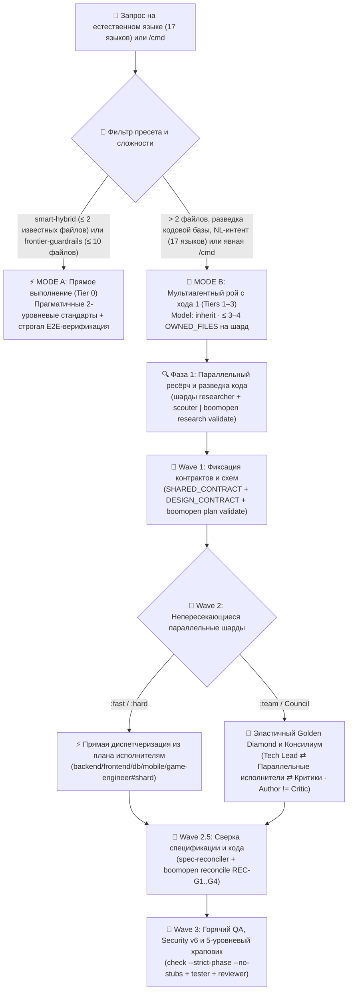

<div align="center">
  <h1>⚡ BoomOpen Workflow Kit Pro v5.5</h1>
  <p><strong>Мультиагентная оркестрация и детерминированные CLI-проверки для Antigravity, Claude Code, OpenAI Codex, Cursor и GitHub Copilot.</strong></p>

  <p>
    <a href="https://boomopen.com"></a>
    <a href="https://github.com/Kennyboom/BoomOpen-Workflow-Kit-Pro/releases"></a>
    <a href="#platforms"></a>
    <a href="#cli"></a>
    <a href="#skills"></a>
    <a href="https://nodejs.org/">= 18.0.0" /></a>
    <a href="../LICENSE"></a>
  </p>

  <p>
    <a href="../README.md">English</a> •
    <a href="./README.vi.md">Tiếng Việt</a> •
    <a href="./README.zh-CN.md">简体中文</a> •
    <a href="./README.zh-TW.md">繁體中文</a> •
    <a href="./README.ja.md">日本語</a> •
    <a href="./README.ko.md">한국어</a> •
    <a href="./README.es.md">Español</a> •
    <a href="./README.fr.md">Français</a> •
    <a href="./README.de.md">Deutsch</a><br/>
    <a href="./README.pt-BR.md">Português (BR)</a> •
    <b>Русский</b> •
    <a href="./README.hi.md">हिन्दी</a> •
    <a href="./README.ar.md">العربية</a> •
    <a href="./README.id.md">Bahasa Indonesia</a> •
    <a href="./README.th.md">ไทย</a> •
    <a href="./README.tr.md">Türkçe</a> •
    <a href="./README.it.md">Italiano</a>
  </p>

  <p>
    <a href="https://boomopen.com"><b>🌐 boomopen.com (15 языков)</b></a> •
    <a href="#trailer"><b>🎬 Видеообзор</b></a> •
    <a href="#why-boomopen"><b>⚡ Зачем BoomOpen</b></a> •
    <a href="#architecture"><b>🏗️ Архитектура</b></a> •
    <a href="#quickstart"><b>🚀 Быстрый старт</b></a> •
    <a href="#cli"><b>🛠️ 14 CLI-проверок</b></a> •
    <a href="#settings"><b>🎛️ Пресеты и настройки</b></a> •
    <a href="#commands"><b>🎯 36 команд</b></a> •
    <a href="#agents"><b>🤖 22 агента и 18 команд</b></a> •
    <a href="#skills"><b>📚 1 462 навыка</b></a>
  </p>
</div>

---

<a id="trailer"></a>

## 🎬 Официальный видеообзор релиза и интерактивный портал (`boomopen.com`)

<div align="center">
  <a href="https://github.com/Kennyboom/BoomOpen-Workflow-Kit-Pro/raw/main/assets/media/boomopen_v55_trailer_en.mp4">
    
  </a>
  <p>
    ▶️ <a href="https://github.com/Kennyboom/BoomOpen-Workflow-Kit-Pro/raw/main/assets/media/boomopen_v55_trailer_en.mp4"><b>Смотреть видеообзор в Full HD 1080p (MP4 со студийной озвучкой)</b></a> • 🌐 <a href="https://boomopen.com"><b>Интерактивная песочница 14 CLI-команд и поиск по каталогам на boomopen.com (15 языков)</b></a>
  </p>
</div>

---

<a id="why-boomopen"></a>
<a id="-what-is-boomopen-workflow-kit"></a>

## ⚡ Зачем нужен BoomOpen Workflow Kit?

**Ограничения штатных AI-ассистентов:** Как только инженерная задача выходит за рамки пары файлов, затрагивает несколько подсистем или растягивается на несколько сессий, одиночный агент теряет управляемость. Последовательное чтение кода забивает основное контекстное окно, несогласованные субагенты перезаписывают общие файлы или оставляют несвязанные модули-"острова", в коде остаются скрытые `TODO`-заглушки и `any`, ревью одной и той же моделью пропускает собственные ошибки (`Author == Critic`), а при многоэтапной разработке реализация расходится с исходной спецификацией.

**Инженерное решение BoomOpen:** BoomOpen разворачивает единый контур мультиагентной оркестрации и детерминированных CLI-проверок для **Antigravity (Gemini)**, **Claude Code**, **OpenAI Codex**, **Cursor** и **GitHub Copilot** **без единой runtime-зависимости npm**. В активном по умолчанию пресете **`smart-hybrid`** правки в `≤ 2` известных файлах выполняются напрямую без накладных расходов, а многофайловая разработка, глубокое исследование, проектирование архитектуры и **`36` слэш-команд (`93` файла)** уже на первом ходу (Turn 1) распределяют работу по шардам между **22 профильными агентами** и **18 состязательными командами из 3 ролей** — под контролем **14 локальных CLI-проверок `boomopen`** и хранилища из **`1 462` подключаемых по запросу навыков** (`22` базовых + `1 440` дедуплицированных в едином каталоге `~/.agents/skills_library`).

### ⚖️ Без BoomOpen и с BoomOpen v5.5

| Типовой сбой разработки | Без BoomOpen (штатная AI IDE) | С BoomOpen Workflow Kit Pro v5.5 |
|:------------------------|:------------------------------|:---------------------------------|
| **Раздувание контекстного окна** | Основной агент последовательно читает 15–30 файлов до написания первой строки кода | **Эластичный рой с первого хода (`role#shard`)**: Разведчики только для чтения и доменные шарды (`≤ 3–4` файла на шард) + горячее переиспользование сессий за `0s` (`send_message`) |
| **Конфликты записи и разрывы интеграции** | Параллельные агенты затирают общие файлы, придумывают несовместимые маршруты `/api` или оставляют мёртвые модули | **Контрактные блокировки + сверка Wave 2.5**: Фиксация `SHARED_CONTRACT` на Wave 1 + непересекающиеся `OWNED_FILES`, проверка через `boomopen reconcile` (`REC-G1..G4`) |
| **Поверхностный ресёрч и размытые планы** | Однобокие ответы без критики, непроверенные допущения и планы в свободной форме | **6-блочные спецификации на базе фактов**: Оппонирование `:team` (Devil's Advocate) + CLI-валидаторы за `< 50ms` (`boomopen research`, `design`, `plan`) |
| **Скрытые заглушки, `any` и обход тестов** | Агент отчитывается о готовности, оставляя `// TODO`, явный `any`, `console.log` или `.skip` в тестах | **Прагматичный 2-уровневый статический контроль**: `boomopen check --strict-phase --no-stubs` требует `0` `any`, `0` заглушек и связные файлы в пределах `400/500` строк |
| **Дрейф между сессиями и регрессии** | Сжатие контекста стирает ограничения прошлых этапов и ломает уже работающий функционал | **5-уровневый храповик качества и атомарный откат**: `.boomopen/project-ledger.json` с SHA-256 контролем спецификаций, `/autopilot`, `/audit` и `rollback --yes` |
| **Слепые зоны одной модели** | Одна и та же модель пишет и проверяет собственный код (`Author == Critic`) | **Межплатформенный кондуктор (`/conduct`)**: Параллельные консилиумы моделей и конвейеры разных семейств через Claude Code, Codex, Antigravity, Cursor и Copilot |
| **Рассинхрон 5 IDE и мусор в Git** | Отдельные промпты под каждую IDE, гигабайты дубликатов навыков и временные отчёты в `git status` | **Единая синхронизация и чистый Git**: 14 входных файлов синхронизируются за `< 10ms`, общая `~/.agents/skills_library` (`0` фоновых токенов) и вывод в Brain Artifacts |

---

<a id="architecture"></a>
<a id="-smart-hybrid-architecture-v55"></a>

## 🏗️ Архитектура Smart-Hybrid (v5.5)



---

<a id="pillars"></a>

## 🧠 6 базовых архитектурных принципов

1. **🌐 Нативная компиляция под 5 IDE и единое хранилище без дубликатов (`platforms/*`)**:
   - Компилирует **22 профильных агента** и **93 файла команд и справочников** в нативные форматы каждой среды: **Antigravity** (пакет `--as-plugin` + `3` исполняемых Python-скрипта `run_workflow`: `audit_fanout.py`, `review_fanout.py`, `research_fanout.py`), **Claude Code** (шарды с `isolation: worktree`, команды `/plan:hard`, опциональные хуки `PreToolUse` и `Stop`/`PreCompact`), **OpenAI Codex** (`22` TOML-роли с системными `read-only` песочницами для разведчиков и ревьюеров + `87` навыков `$boomopen-*`), **Cursor** (правила `.mdc` + опциональный хук `beforeShellExecution`) и **GitHub Copilot** (агенты `.agent.md`).
   - Подключает все `1 440` библиотечных навыков однократно через `~/.agents/skills_library` для всех 5 IDE (~80% экономии диска и `0` лишних токенов на старте).
2. **🎯 4-уровневое эластичное шардирование (`role#shard`) и горячее переиспользование сессий**:
   - Автоматически масштабируется от **Tier 0** (`0` субагентов для `≤ 2` известных файлов) → **Tier 1** (`2–3` шарда) → **Tier 2** (`4–6` шардов) → **Tier 3** (`7–8+` шардов, настраивается до `16`), ограничивая когнитивную нагрузку уровнем **`≤ 3–4 OWNED_FILES` на субагента** и переиспользуя прогретые сессии через `role#shard → conversationId` (`send_message`).
3. **🤝 Контрактное исполнение в 3 волны + сверка спецификации и кода Wave 2.5 (`REC-G1..G4`)**:
   - Wave 1 жестко фиксирует `SHARED_CONTRACT` (API-схемы и DTO) и `DESIGN_CONTRACT` (OKLCH CSS `@theme` + TypeScript-пропсы) до запуска параллельных разработчиков на Wave 2. На этапе Wave 2.5 `boomopen reconcile` + `spec-reconciler` выявляют неподключенные модули-"острова" (`REC-G1`), расхождения маршрутов фронтенда и бэкенда (`REC-G2`), пропущенные требования `[SC-*]` (`REC-G3`) и недостающие ключи в `.env.example` (`REC-G4`), автоматически формируя дельта-волны через `boomopen cook amend-plan`.
4. **🏛️ Многосессионный автопилот (`/autopilot`) и многораундовый аудит с сохранением состояния (`/audit`)**:
   - Компилирует многофайловые ТЗ в `.boomopen/project-ledger.json` с SHA-256 контролем дрейфа спецификаций, предфазовыми Git-точками возврата (`boomopen ledger rollback --yes`) и строгим **5-уровневым храповиком качества фаз** (`G1 check --strict-phase --no-stubs` → `G2 неубывающий порог тестов` → `G3 reconcile --strict` → `G4 ревью Author != Critic` → `G5 ledger verify`). После завершения разработки `/audit` проводит контролируемые человеком раунды проверки матрицы трассировки (RTM), сквозных потоков и Security v6 (`.boomopen/audit-ledger.json` + `boomopen audit rollback --yes`).
5. **🎼 Межплатформенный кондуктор и консилиум моделей (`boomopen conduct`)**:
   - Одновременно координирует Claude Code, OpenAI Codex, Antigravity, Cursor и Copilot в **параллельных консилиумах по 6 типам задач** (`research`, `brainstorm`, `plan`, `design`, `review`, `debug` → 4-частный `COUNCIL-SYNTHESIS.md`) или в **межсемейственных конвейерах ролей**, где ни одна модель не проверяет собственный код (`Author != Critic`).
6. **📏 Прагматичные 2-уровневые стандарты кода и поиск первопричин SPIE v3.0**:
   - **Уровень 1 (нулевая терпимость)**: Единственная ответственность, `0` явных `any`, `0` отладочных `console.log` в коде приложения, типизированная обработка ошибок `try/catch` на границах API и константы в `SCREAMING_SNAKE_CASE`. **Уровень 2 (связность важнее механической нарезки)**: Целевой объём `~200–350` строк (мягкий порог `400` / жёсткий `500`; тесты, типы и документация освобождены). Разбор багов опирается на 3 ранжированные гипотезы и причинно-следственную цепочку **5-Whys (SPIE v3.0)**, а рабочие спецификации направляются в Brain Artifacts (`100%` чистое рабочее дерево Git).

---

<a id="platforms"></a>
<a id="-supported-ai-platforms"></a>

## 💻 5 поддерживаемых AI-платформ разработки

| Платформа | Поддержка | Синхронизируемые точки входа | Нативная интеграция со средой |
|:----------|:---------:|:-----------------------------|:------------------------------|
| **Antigravity (Gemini)** | ✅ v5.5 | `~/.gemini/GEMINI.md` | `invoke_subagent`, Python-оркестрация `run_workflow`, внешний цикл `/goal`, пакет `--as-plugin`, опциональный `--with-hooks`, Brain Artifacts |
| **Claude Code** | ✅ v5.5 | `~/.claude/CLAUDE.md` | Параллельные шарды `Task`/`Agent` (`isolation: worktree`), команды `/plan:hard`, опциональные хуки `PreToolUse` и `Stop`/`PreCompact` |
| **OpenAI Codex** | ✅ v5.5 | `~/.codex/AGENTS.md` и `CODEX.md` | `22` TOML-роли в `~/.codex/agents/boomopen/` с системным `sandbox_mode = "read-only"` для разведчиков и ревьюеров + `87` навыков `$boomopen-*` |
| **Cursor** | ✅ v5.5 | `~/.cursor/rules/boomopen-workflow-kit.mdc` | Постоянно активные frontmatter-правила `.mdc`, `CURSOR.md`, маршрутизация субагентов и опциональный `.cursor/hooks.json` (`beforeShellExecution`) |
| **GitHub Copilot** | ✅ v5.5 | `~/.copilot/copilot-instructions.md` | Скомпилированный агент VS Code `boomopen-workflow-kit.agent.md`, диспетчеризация через `runSubagent` и `COPILOT.md` |

---

<a id="quickstart"></a>
<a id="-quick-start--installation"></a>

## 🚀 Быстрый старт и установка (только через Git — 0 runtime-зависимостей)

```bash
# 1. Клонируйте репозиторий (распространяется исключительно через GitHub — не публикуется в npm)
git clone https://github.com/Kennyboom/BoomOpen-Workflow-Kit-Pro.git
cd BoomOpen-Workflow-Kit-Pro

# 2. Установите для вашей AI IDE (пресет по умолчанию: smart-hybrid) или сразу для всех 5 IDE
npm run install:all                                 # Установка и синхронизация всех 5 IDE + общая ~/.agents/skills_library
npm run install:antigravity                         # Google Antigravity 2.0 (можно добавить --as-plugin / --with-hooks)
node cli/install.js install claude --with-hooks     # Claude Code + опциональные хуки PreToolUse и Stop/PreCompact
npm run install:codex                               # OpenAI Codex CLI + системные read-only песочницы разведчиков/ревьюеров
npm run install:cursor                              # Cursor (добавьте --with-hooks для защиты beforeShellExecution)
npm run install:copilot                             # GitHub Copilot (VS Code .agent.md + copilot-instructions.md)

# 3. Проверьте целостность установки и при желании добавьте `boomopen` в глобальный PATH
npm run doctor
npm link
boomopen settings status
```

> **Безопасная неразрушающая установка и удаление**: Контролируется SHA-256 манифестами (`~/.boomopen/manifests/<tool>.json`). Пользовательские правила в `GEMINI.md` / `CLAUDE.md` вне маркеров комплекта сохраняются с автоматическим резервным копированием, а `boomopen uninstall <tool|--all>` чисто удаляет неизменённые файлы комплекта, не затрагивая ваши данные.

---

<a id="cli"></a>

## 🛠️ 14 подкоманд CLI без внешних зависимостей (`boomopen`)

Выполняется локально за `< 50ms` на Node.js `>= 18` с **нулевыми runtime-зависимостями npm** и **без сетевых запросов**:

| Подкоманда | Основные флаги и синтаксис | Детерминированные проверки и назначение |
|:-----------|:---------------------------|:----------------------------------------|
| **`install` / `uninstall` / `list`** | `<tool\|--all> [--with-hooks] [--as-plugin]` | Установка по SHA-256 манифестам, линковка общей `~/.agents/skills_library`, опциональные защитные хуки и чистое удаление |
| **`doctor`** | `[--source-only]` | 30-пунктовая read-only диагностика пакетов для 5 IDE, `93` файлов команд, `72` файлов команд ролей, `1 462` навыков и настроек |
| **`settings`** | `status \| preset <name> \| set <k> <v> \| --ui` | Управление 5 пресетами + `22` параметрами (`--project` для `./.boomopen.json`) или локальный Web UI с защитой CSP (`127.0.0.1:4567`) |
| **`research`** | `<validate\|brief> <file.md> [--mode brainstorm]` | Проверяет **`RES-G1..G4`** (`≥ 4` независимых источника, матрица противоречий, pre-mortem риски) и собирает `HANDOFF_BRIEF` |
| **`design`** | `<validate\|contract> <DESIGN.md> [--json]` | Проверяет **`DESIGN-G1..G4`** (6 блоков, OKLCH-токены, матрица из 5 состояний UI, WCAG 2.2 AA) и генерирует `DESIGN_CONTRACT` |
| **`plan`** | `<validate\|compile> <PLAN.md> [--sync-ledger]` | Проверяет **`PLAN-G1..G5`** (ациклический DAG, непересекающиеся `OWNED_FILES ≤ 4`/шард, `SHARED_CONTRACT`) и синхронизирует реестр |
| **`cook`** | `<state\|packets\|verify-wave\|preflight\|amend-plan>` | Контролирует **`COOK-G1..G4`**: 5 стадий готовности, 5-польные пакеты передачи задач, Git-блокировки записи и дельта-волны |
| **`reconcile`** | `<dir> [--plan <PLAN.md>] [--strict]` | Wave 2.5 **`REC-G1..G4`**: находит неподключенные модули-"острова", рассинхрон маршрутов `/api`, пропуски `[SC-*]` и ключей `.env.example` |
| **`check`** | `[path] --strict-phase --no-stubs [--ignore <dir>]` | 2-уровневый статический контроль: лимиты `400/500` строк, `0` явных `any`, `0` отладочных `console.log`, `0` заглушек/`TODO`/`.skip` |
| **`ledger`** | `<init\|from-plan\|status\|next\|verify\|rollback>` | Многосессионный DAG-реестр `.boomopen/project-ledger.json`, SHA-256 защита от дрейфа ТЗ и атомарный откат `rollback --yes` |
| **`audit`** | `<init\|slice\|record\|approve\|verify-fix\|rollback>` | Реестр многораундового постаудита проекта (`.boomopen/audit-ledger.json`), контроль устранения дефектов и `rollback --yes` |
| **`conduct`** | `<probe\|council\|dispatch\|status> [--dry-run]` | Межплатформенный кондуктор и параллельный консилиум по 6 задачам (`Author != Critic` между 5 IDE → `COUNCIL-SYNTHESIS.md`) |

---

<a id="settings"></a>
<a id="-unified-settings--mode-selection-settings"></a>

## 🎛️ Единый центр управления и 5 пресетов (`/settings`)

Управляйте **`20` перечислимыми параметрами + `2` пользовательскими лимитами строк** глобально (`~/.boomopen/settings.json`) или на уровне репозитория (`./.boomopen.json`) с горячей синхронизацией всех 14 входных файлов IDE за `< 10ms`:

| Профиль пресета | Режим исполнения (`execution.mode`) | `/cmd` по умолч. | NL-маршрутизация на 17 языках (`naturalLanguageResearchTrigger`) | Стандарты кода | Оптимальный сценарий |
|:----------------|:------------------------------------|:----------------:|:----------------------------------------------------------------:|:--------------:|:---------------------|
| **⚡ `smart-hybrid`** *(Default / По умолч.)* | **`auto`** (`≤ 2` файлов напрямую; `> 2` файлов или `/cmd` → рой Mode B) | `auto` | **`auto_team`** *(Направляет NL-ресёрч/идеи/ревью в `:team` и воркфлоу на 17 языках)* | `pragmatic` (`400/500`L) | Режим по умолчанию из коробки: распознавание намерений + параллельное шардирование с первого хода |
| **🛡️ `frontier-guardrails`** *(Компактный)* | **`mode_a`** (`≤ 10` файлов напрямую; входной файл `< 2.5 KB` / `~600` токенов) | `auto` | **`off`** *(Только явные `/cmd` — без перехвата естественного языка)* | `pragmatic` (`400/500`L) | Ультракомпактный (`< 2.5 KB`) прямой режим на каждый день с 2-Tier и E2E проверками *(алиас `carbon-guardrails`)* |
| **🚀 `solo-fast`** | **`mode_a`** (`≤ 10` файлов напрямую; консервативный лимит до `3` шардов) | `fast` | `off` | `relaxed` (`600/800`L) | Быстрое прототипирование, небольшие скрипты, срочные хотфиксы и экономия токенов |
| **🧠 `deep-architect`** | **`mode_b`** *(Строгий оркестратор Mode B; до `12` шардов)* | `hard` | `auto_hard` + `council` ресёрч / `cross_family` ревью | `strict` (`300/400`L) | Сложная системная архитектура, проектирование с нуля и межмодульный рефакторинг |
| **🔺 `adversarial-team`** | **`team`** *(Эластичный Golden Diamond `:team`; `hyper_swarm` до `12`)* | `team` | **`auto_team`** + `council` ресёрч, планирование и ревью | `strict` (`300/400`L) | Критически важные релизы в продакшен, аудит безопасности и консенсус нескольких моделей |

```bash
# Переключение пресетов и тонкая настройка через чат (/settings), локальный Web UI (--ui) или CLI:
boomopen settings --ui                                      # Запустить локальный Web-центр управления на http://127.0.0.1:4567
boomopen settings preset smart-hybrid                       # По умолчанию: авто Mode A/B + NL-маршрутизация на 17 языках
boomopen settings preset frontier-guardrails                # Опционально: компактный Mode A < 2.5 KB (алиас: carbon-guardrails)
boomopen settings set engines.reviewer cross_family         # Принудительное ревью другой моделью (Author != Critic)
cd path/to/your/repo && boomopen settings mode team --project # Переопределение настроек для репозитория в ./.boomopen.json
boomopen settings reset                                     # Сброс к заводской конфигурации smart-hybrid
```

---

<a id="commands"></a>
<a id="-slash-commands-reference"></a>

## 🎯 Справочник по всем 36 слэш-командам (`93` файла = `87` воркфлоу + `6` `_ref/`)

Формулируйте задачи свободно на **любом из 17 поддерживаемых языков** в режиме `smart-hybrid` или вызывайте любую из **36 канонических слэш-команд** напрямую:

| Категория | Команда | Варианты | Назначение и проверяемые артефакты |
|:----------|:--------|:---------|:-----------------------------------|
| **Оркестрация и автономность** | **`/cook`** | `:fast`, `:hard`, `:team` | Сквозная разработка фичи без готового плана (Разведка → Контрактный план → Параллельные шарды → Сверка Wave 2.5 → QA) |
| | **`/code`** | `:fast`, `:hard`, `:team` | Прямое исполнение утверждённого `PLAN-{task}.md` по шардам волн 1–3 без повторного запуска `/plan` |
| | **`/autopilot`** | `:init`, `:run`, `:audit` | Многосессионная реализация проекта по ТЗ через `.boomopen/project-ledger.json` и **5-уровневый храповик качества** |
| | **`/conduct`** | `:council`, `:pipeline` | Параллельный консилиум моделей (`COUNCIL-SYNTHESIS.md`) и конвейер разных семейств между 5 IDE (поддержка `--dry-run`) |
| | **`/orchestrate`** / **`/auto`** | — | Пользовательская координация мультидоменного роя (`/orchestrate`) или полностью автономный цикл (`/auto`) |
| **Архитектура, дизайн и ресёрч** | **`/plan`** | `:fast`, `:hard`, `:team` | План `PLAN-{task}.md` с 5 проверками: фиксация `SHARED_CONTRACT`, `OWNED_FILES ≤ 4`/шард и критерии Given/When/Then |
| | **`/architect`** | — | Чистое архитектурное проектирование: C4-диаграммы, ADR, схемы БД, API-контракты, экраны и аудит покрытия (без написания кода) |
| | **`/design`** / **`/ui-ux-pro-max`** | `:fast`, `:hard`, `:team` | 6-блочная спецификация `DESIGN-{task}.md` + `DESIGN_CONTRACT` (OKLCH-токены `@theme`, матрица 5 состояний UI, 50+ стилей и HTML-превью) |
| | **`/research`** | `:fast`, `:hard`, `:team` | 5-ракурсное глубокое исследование (`RESEARCH-{topic}.md`, триангуляция `RES-G1..G4` от `≥ 4` источников, противоречия и `HANDOFF_BRIEF`) |
| | **`/brainstorm`** / **`/ask`** | `:fast`, `:hard`, `:team` | Критическая проработка идей без поддакивания (`BRAINSTORM-{topic}.md` с pre-mortem и MCDA-матрицей) и ответы по фактам (`/ask`) |
| **Качество, аудит, отладка и ИБ** | **`/review`** | `:fast`, `:hard`, `:team` | Многопрофильное независимое ревью кода, архитектуры, безопасности и производительности (`Author != Critic`, переход в `/fix`) |
| | **`/audit`** / **`/deep-audit`** | `:run`, `:fix`, `:auto` | Многораундовый аудит готового проекта (`/audit`) и предкодовый логический аудит спецификаций по 10 измерениям (`/deep-audit`) |
| | **`/security-audit`** | — | Сканирование OWASP Top 10 + LLM/Agentic Top 10 (`security_scan.py` v6), моделирование угроз STRIDE, аудит авторизации и зависимостей |
| | **`/debug`** / **`/fix`** | `:fast`, `:hard`, `:team` | Поиск первопричины через 3 гипотезы + **5-Whys (SPIE v3.0)** (`DEBUG-{issue}.md`) и TDD-исправление с воспроизведением бага (`/fix`) |
| | **`/test`** / **`/performance`** / **`/refactor`** | `:fast`, `:hard`, `:team` | QA-шарды без фиктивных тестов (`/test`), оптимизация Core Web Vitals / БД / бандла (`/performance`) и измеримый `/refactor` |
| **Git, релизы, документация и сессии** | **`/onboard`** / **`/init`** | — | 60-секундная read-only карта существующего репозитория `ARCHITECTURE-MAP.md` (`/onboard`, без конфликта с `/init`) и старт нового (`/init`) |
| | **`/pr`** / **`/release`** | —, `:review` | Пред-PR проверка качества и сверки + `gh pr create` / критическое ревью диффа (`/pr:review`) и семантический `/release` |
| | **`/deploy`** / **`/rollback`** | `:check`, `:preview`, `:production`, `:rollback` | Проверки готовности к выкатке, деплой в preview/production (`/deploy`) и аварийный откат по уровню критичности (`/rollback`) |
| | **`/docs`** / **`/report`** | `:core`, `:business`, `:audit` / `:fast..:team` | Документация `./documents/` строго по исходному коду (`/docs`) и достоверные отчёты по телеметрии CLI (`/report`) |
| | **`/settings`** / **`/status`** / **`/next`** | — | Единый центр настроек (`/settings`), сводка состояния реестра и шардов (`/status`) и навигатор следующего шага (`/next`) |
| | **`/preview`** / **`/save`** / **`/recap`** | — | Управление локальным dev-сервером (`/preview`), сохранение состояния сессии (`/save`) и восстановление контекста за `< 5s` (`/recap`) |

### 🌙 Сценарий автономной многофазной разработки (`/autopilot` и `/goal`)

| Сценарий | Целевая платформа и раннер | Непрерывность контекста | Гарантии качества и соответствия ТЗ |
|:---------|:---------------------------|:------------------------|:------------------------------------|
| **`/autopilot` (+ `--with-hooks`)** | Все 5 IDE (рекомендуется с `--with-hooks` в **Claude Code**, **Antigravity** и **Cursor**) | Хуки `Stop` и `PreCompact` (`stop-quality-gate.mjs`) + `.boomopen/project-ledger.json` сохраняют прогресс при сжатии контекста | Применяет **5-уровневый храповик качества фаз** (`G1..G5`), сверку Wave 2.5 `reconcile` и `boomopen ledger rollback --yes` |
| **`/goal` + `/autopilot` + `/audit`** | Внешний цикл **Antigravity 2.0** для объёмных спецификаций в `docs/` | Штатный раннер **`/goal`** в Antigravity последовательно ведёт фазы до статуса `VERIFIED` по всему реестру | Проводит каждую фазу через все 5 проверок + сверку Wave 2.5, а затем запускает Раунд 1 **`/audit`** |

```text
/goal Используй /autopilot, чтобы изучить всю проектную документацию в docs/, инициализировать .boomopen/project-ledger.json и автономно реализовать все фазы по очереди (каждая фаза обязана пройти все 5 проверок верификации и сверку Wave 2.5 reconcile). Когда 100% фаз будут закрыты, запусти Раунд 1 /audit и остановись со сводным отчётом для моего ревью.
```

---

<a id="agents"></a>
<a id="-22-specialist-agents--18-golden-triangle-teams"></a>

## 🤖 22 профильных агента и 18 состязательных команд из 3 ролей

Каждый субагент наследует основную модель сессии (`Model: "inherit"` — использование `flash_lite` строго запрещено) и объединяется в **18 команд Golden Diamond / Triangle** (`Tech Lead` ⇄ `Параллельные исполнители шардов` ⇄ `Независимые ревьюеры/критики`):

| Направление | Профильные агенты (`agents/*.md`, компилируются под IDE) | Команды ревью из 3 ролей (`agents/teams/*-team/`, `72` файла) |
|:------------|:---------------------------------------------------------|:--------------------------------------------------------------|
| **Разработка и инфраструктура** | `backend-engineer`, `frontend-engineer`, `mobile-engineer`, `game-engineer`, `database-architect`, `devops-engineer` | `backend-team`, `frontend-team`, `fullstack-team`, `mobile-team`, `game-team`, `database-team`, `devops-team` |
| **Архитектура и продукт** | `tech-lead`, `planner`, `brainstormer`, `business-analyst`, `project-manager`, `designer` | `planning-team`, `brainstorm-team`, `project-team`, `design-team` |
| **Качество, сверка и безопасность** | `debugger`, `tester`, `reviewer`, `spec-reconciler`, `security-engineer`, `performance-engineer` | `debug-team`, `qa-team`, `security-team`, `performance-team` |
| **Исследования и документация** | `researcher`, `scouter`, `docs-manager`, `reporter` | `research-team`, `docs-team`, `report-team` |

---

<a id="skills"></a>
<a id="-1460-skills-vault-22-core--1440-niche-library-skills"></a>

## 📚 Хранилище из 1 462 навыков по запросу (`22` Core + `1 440` библиотечных)

Индексировано по **19 инженерным доменам** в `matrix-skills/compact-index.json`, однократно дедуплицировано в `~/.agents/skills_library` и подгружается через **2-шаговый O(1) поиск** (проверка базовых `skills/` → поиск в `compact-index.json` → загрузка нужного `SKILL.md` строго в назначенный шард, `0` фоновых токенов):

| Уровень / Инженерный домен | Навыки | Ключевые технологии и шаблоны | Загрузка |
|:---------------------------|:------:|:------------------------------|:---------|
| **⚡ Базовые процессы и качество (`skills/`)** | **22** | `clean-code`, `debugger`, `plan-writing`, `brainstorming`, `deep-research`, `design-spec`, `frontend-design`, `frontend-architecture`, `api-patterns`, `database-design`, `tdd-workflow`, `testing-patterns`, `webapp-testing`, `security-auditor` (`security_scan.py` v6), `app-builder` (**15 шаблонов проектов**, включая **`mcp-server`**, **`ai-agent-worker`**, `nextjs-saas`, `monorepo-turborepo`, `python-fastapi`, `flutter-app`), `skill-seeker` | Готовы с хода 1 |
| **🤖 AI, агентные SDK, MCP и данные** | **340+** | FastMCP (`StreamableHTTP`), OpenAI Agents SDK, Claude Agent SDK, Google ADK, Vercel AI SDK, LangGraph, RAG, BigQuery, dbt | По запросу (`compact-index.json`) |
| **🌐 Web, Backend, API и базы данных** | **380+** | React 19, Next.js 15 RSC, Tailwind CSS v4, TanStack Start/Router/Query, Hono RPC + Zod OpenAPI, Rust Axum/SQLx, Drizzle, Postgres/RLS | По запросу (`compact-index.json`) |
| **☁️ Облака, DevOps, QA и безопасность** | **300+** | Cloudflare Workers/Durable Objects/D1, Docker/K8s, Terraform, Playwright, Vitest + MSW v2, Better Auth (Passkeys), OWASP LLM Top 10 | По запросу (`compact-index.json`) |
| **🎨 UI/UX, игровые движки и Mobile** | **420+** | OKLCH Design Tokens, WCAG 2.2 AA, Motion, Unity 6 DOTS/ECS, Godot 4, Unreal 5, WebGPU/Three.js, Phaser/PixiJS, Tauri v2, SwiftUI, Flutter, React Native | По запросу (`compact-index.json`) |

---

## 📂 Структура репозитория

```text
BoomOpen-Workflow-Kit-Pro/
├── agents/                  # 22 профильных агента (под каждую IDE) + 18 команд из 3 ролей (72 файла)
├── cli/                     # 14 подкоманд Node.js CLI без зависимостей + 33 тестовых набора node:test
├── commands/                # 36 слэш-команд в 87 файлах воркфлоу + 6 протоколов в _ref/ (93 файла)
├── documents/               # Архитектурная, доменная документация и прагматичные 2-уровневые стандарты кода
├── i18n/                    # 16 полных локализованных README (всего 17 языков вместе с корневым README.md)
├── matrix-skills/           # 19 доменных YAML-каталогов + O(1) индекс compact-index.json (1 462 навыка)
├── platforms/               # Пакеты для 5 IDE, опциональные хуки, 3 скрипта Antigravity run_workflow/*.py и TOML-роли Codex
├── rules/                   # 7 подключаемых по требованию модулей правил Mode B (CORE, PHASES, AGENTS, TEAMS, SKILLS, ERRORS, REFERENCE)
├── scripts/                 # Кроссплатформенные утилиты проверки и сессий (checklist.py, verify_all.py, auto_preview.py, session_manager.py)
├── skills/                  # 22 базовых навыка + 15 шаблонов проектов app-builder + скрипты аудита Security v6 / UX / Perf
├── skills_library/          # 1 440 библиотечных навыков с единой линковкой в ~/.agents/skills_library
├── web/                     # 15-язычный WebGL-портал и интерактивные каталоги для https://boomopen.com
└── GEMINI.md | CLAUDE.md | CODEX.md | COPILOT.md | CURSOR.md | AGENT.md
```

---

## 📄 Лицензия и безопасность

- **Официальный сайт**: [https://boomopen.com](https://boomopen.com)
- **Лицензия**: Исходный код комплекта, CLI, правила, агенты и документация распространяются по [лицензии MIT](../LICENSE) (Copyright © 2026 **BoomOpen Labs**). Сторонние навыки в каталоге `skills_library/` сохраняют оригинальные лицензии авторов — подробности в [THIRD_PARTY_NOTICES.md](../THIRD_PARTY_NOTICES.md).
- **Политика безопасности**: Защита установочных манифестов SHA-256, изоляция опциональных хуков и порядок сообщения об уязвимостях описаны в [SECURITY.md](../SECURITY.md).
