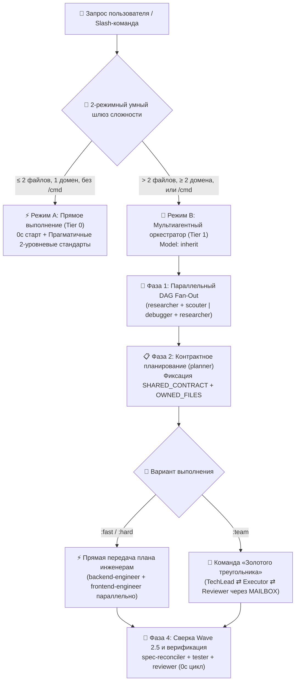

<div align="center">
  <h1>⚡ BoomOpen Workflow Kit v5.5.0</h1>
  <p><strong>Кроссплатформенная Smart-Hybrid ИИ-ОС для разработки — 22 агента-специалиста, 18 команд «Золотого треугольника» и хранилище из 1 460+ навыков по требованию</strong></p>

  <p>
    <a href="https://github.com/Kennyboom/BoomOpen-Workflow-Kit-Pro/releases"></a>
    <a href="#platforms"></a>
    <a href="#agents"></a>
    <a href="#skills"></a>
    <a href="https://nodejs.org/">=18.0.0" /></a>
    <a href="../LICENSE"></a>
  </p>

  <p>
    <a href="../README.md">🇬🇧 English</a> • <a href="./README.vi.md">🇻🇳 Tiếng Việt</a> • <a href="./README.zh-CN.md">🇨🇳 简体中文</a> • <a href="./README.zh-TW.md">🇹🇼 繁體中文</a> • <a href="./README.ja.md">🇯🇵 日本語</a> • <a href="./README.ko.md">🇰🇷 한국어</a> • <a href="./README.es.md">🇪🇸 Español</a> • <a href="./README.fr.md">🇫🇷 Français</a> • <a href="./README.de.md">🇩🇪 Deutsch</a><br/>
    <a href="./README.pt-BR.md">🇧🇷 Português</a> • <b>🇷🇺 Русский</b> • <a href="./README.hi.md">🇮🇳 हिन्दी</a> • <a href="./README.ar.md">🇸🇦 العربية</a> • <a href="./README.id.md">🇮🇩 Bahasa Indonesia</a> • <a href="./README.th.md">🇹🇭 ไทย</a> • <a href="./README.tr.md">🇹🇷 Türkçe</a> • <a href="./README.it.md">🇮🇹 Italiano</a>
  </p>
</div>

---

## 🎬 Официальный релизный трейлер (Full HD 1080p)

<div align="center">
  <a href="https://github.com/Kennyboom/BoomOpen-Workflow-Kit-Pro/raw/main/assets/media/boomopen_v55_trailer_en.mp4">
    
  </a>
  <p>
    ▶️ <a href="https://github.com/Kennyboom/BoomOpen-Workflow-Kit-Pro/raw/main/assets/media/boomopen_v55_trailer_en.mp4"><b>Нажмите здесь, чтобы смотреть / стримить официальный трейлер в Full HD 1080p (MP4 со студийной озвучкой)</b></a>
  </p>
</div>

---

## 🌟 Что такое BoomOpen Workflow Kit v5.5?

**BoomOpen Workflow Kit v5.5 (Multi-Platform Unified & Smart-Hybrid Edition)** — это мультиагентная операционная система с открытым исходным кодом, превращающая одного ИИ-ассистента по программированию в слаженную инженерную организацию из **22 агентов-специалистов**, **18 состязательных команд «Золотого треугольника» (`72` файла команд)**, **33 slash-команд (`89` файлов сценариев и протоколов)**, **14 CLI-команд**, **22 базовых навыков (Core Skills)** и **1 440 узкоспециализированных навыков (`skills_library/`)**.

В отличие от жёстких шаблонов и громоздких обёрток, раздувающих контекст на каждом шаге, BoomOpen v5.5 объединяет **Проактивный шлюз субагентов с 1-го хода**, **Маршрутизацию естественного языка на 17 языках**, **4-уровневое эластичное шардирование роя (`role#shard`)**, **Автосверку Spec-to-Code волны Wave 2.5 (`boomopen reconcile`)**, **Многораундовый аудит после завершения (`/audit` и `boomopen audit`)**, **Многосессионный автопилот проекта (`/autopilot`)** и **Кросс-движковый кондуктор (`/conduct`)**:
- **🚀 Параллельные субагенты с 1-го хода, Wave 2.5 и оркестрация Режима B**: исследование кодовой базы (`> 2` файлов), мультидоменные задачи (`≥ 2` домена), запросы на **всех 17 поддерживаемых языках** или явные команды `/cmd` мгновенно запускают параллельные шарды (`role#shard`, `<= 3–4 OWNED_FILES` на шард) с **DAG-разветвлением**, **прямой передачей плана исполнителям**, **контрактной блокировкой (`SHARED_CONTRACT` + `OWNED_FILES`)**, **автосверкой Wave 2.5 (`boomopen reconcile` + `spec-reconciler` + `/cook amend-plan`)** и **тёплым переиспользованием сессий (`role#shard -> conversationId` через `send_message`)**.
- **🏛️ Многосессионный автопилот (`/autopilot`), многораундовый аудит (`/audit`) и консилиум (`/conduct`)**: загрузка ТЗ в защищённый SHA-256 журнал `.boomopen/project-ledger.json` с 4-уровневым контролем (`boomopen check --strict-phase --no-stubs`); комплексный пост-релизный аудит в несколько раундов (`/audit` → `/audit:fix` → `/audit:round2` через `.boomopen/audit-ledger.json`) с проверкой RTM, сквозных потоков UI→API→DB и 2-уровневым движком защиты от утечек (`security_scan.py` v6).
- **⚡ Режим A — Микро-прямое выполнение для известных файлов (0 с холодного старта)**: простые вопросы, объяснение кода и точечные правки, когда **точные `≤ 2` целевых файла уже известны на 1-м ходу**, выполняются напрямую по **Прагматичным двухуровневым стандартам кодирования** и **Настойчивому тестированию и исправлению ошибок**.
- **📚 Массивное хранилище из 1 462 навыков без раздувания контекста**: объединяет **22 базовых навыка (`skills/`)** и **1 440 библиотечных навыков (`skills_library/`)** в `matrix-skills/compact-index.json` для двухшагового `O(1)` поиска без засорения окна промпта.

---

## 🏗️ Архитектура Smart-Hybrid (v5.5)



---

<a id="pillars"></a>

## 🧠 6 ключевых столпов версии v5.5

1. **🌐 Единый паритет на 5 платформах (`platforms/*`)**:
   - Нативная установка из единой архитектуры для **Google Antigravity 2.0 (Gemini)**, **Claude Code**, **OpenAI Codex**, **Cursor** и **GitHub Copilot**.
2. **📏 Прагматичные двухуровневые стандарты кодирования (Анти-фрагментация)**:
   - **Уровень 1 — Нулевая терпимость**: Single Responsibility, **ЗАПРЕТ явного `any`**, **ЗАПРЕТ оставленных `console.log`**, `try/catch` + типизированные ошибки на границах async/API, константы `SCREAMING_SNAKE_CASE`, DRY (`≥ 3`) и упорядоченные импорты.
   - **Уровень 2 — Гибкие структурные ориентиры**: связные файлы нацелены на `~200–350 строк` с мягким пределом `400` и жёстким порогом разделения `>500 строк` (тесты, типы и документы освобождены). Функции логики `~20–40 строк` (`~40–80` для UI/обработчиков).
3. **🎯 4-уровневое шардирование (`role#shard`), прямая передача плана и тёплое переиспользование (`send_message`)**:
   - По готовому `PLAN-{feature}.md` оркестратор направляет задачи **напрямую** шардам инженеров (`<= 3–4 OWNED_FILES` на шард) без лишнего звена `tech-lead`, переиспользуя активные сессии (`role#shard → conversationId`) с **0 с холодного старта**.
4. **🤝 Контрактная разработка (`SHARED_CONTRACT` + `OWNED_FILES`) и Wave 2.5 (`spec-reconciler`)**:
   - До старта кода фиксируются API, DTO и монопольная запись файлов; на волне **Wave 2.5** команда `boomopen reconcile`, агент `spec-reconciler` и `/cook amend-plan` сверяют требования `docs/` с реальным кодом, выявляя «островные» модули, расхождения маршрутов/env и пропуски `[SC-*]`.
5. **🔍 Отладка 5-Whys (SPIE v3.0), многораундовый `/audit` и 100% чистое дерево Git**:
   - `debugger` проверяет 3 гипотезы + цепочку **5-Whys**; `/audit` проводит прогрессивную многораундовую проверку с 2-уровневым движком анти-утечек (`security_scan.py` v6). Временные артефакты пишутся в `<appDataDir>\brain\<conversation-id>\`.
6. **🩺 Набор из 14 CLI-команд и O(1) индекс навыков**:
   - `npm run doctor` проверяет 5 платформ, **22 агента**, **72 файла команд** (18 папок), **89 файлов slash-команд** (`83` рабочих процесса + `6` в `_ref/`) и `compact-index.json` (`1 462` навыков). 14 CLI-команд (`research`, `design`, `plan`, `cook`, `reconcile`, `audit`, `ledger`, `conduct`, `check`, `doctor`, `settings`, `install`, `uninstall`, `list`) обеспечивают детерминированную компиляцию и строгие шлюзы.

---

## 🔍 Автосверка Wave 2.5 и многораундовый аудит (`/audit`)

- **🔄 Wave 2.5 — Автосверка Spec-to-Code (`boomopen reconcile` + `spec-reconciler` + `/cook amend-plan`)**: перед закрытием фазы или волны `spec-reconciler` сопоставляет требования из `docs/` и `PLAN` с фактической реализацией (`REC-G1..G4`), выявляет пропущенные требования `[SC-*]`, изолированные шарды и несоответствия маршрутов/env, формируя доработки через `/cook amend-plan`.
- **🛡️ Многораундовый аудит после завершения (`/audit`) и 2-уровневый движок анти-утечек v6**:
  1. **Раунд 1 (`/audit` или `/autopilot:audit`)**: полный аудит в режиме только чтения (покрытие RTM, сквозные потоки UI→API→DB и статический/семантический скан `security_scan.py` v6 на утечки секретов, PII и инъекции).
  2. **Проверка пользователем**: вы изучаете отчёт `AUDIT-{project}-r1.md` и утверждаете исправления.
  3. **Исправление и Раунд 2 (`/audit:fix` → `/audit:round2`)**: бесконфликтные шарды исправляют одобренные замечания с блокировкой регрессионных тестов и запускают `/audit:round2` вплоть до **0 замечаний** в `.boomopen/audit-ledger.json`.

---

<a id="platforms"></a>

## 💻 Поддерживаемые ИИ-платформы

| Платформа | Уровень поддержки | Глобальная точка входа | Путь установки фреймворка |
|----------|:-------------:|-------------------|------------------------|
| **Antigravity (Gemini)** | ✅ Нативно v5.5 | `~/.gemini/GEMINI.md` | `~/.gemini/config/skills/boomopen-workflow-kit/` |
| **Claude Code** | ✅ Нативно v5.5 | `~/.claude/CLAUDE.md` | `~/.claude/skills/boomopen-workflow-kit/` |
| **OpenAI Codex** | ✅ Нативно v5.5 | `~/.codex/CODEX.md` & `AGENTS.md` | `~/.codex/skills/boomopen-workflow-kit/` |
| **Cursor** | ✅ Нативно v5.5 | `~/.cursor/rules/boomopen-workflow-kit.mdc` | `~/.cursor/skills/boomopen-workflow-kit/` |
| **GitHub Copilot** | ✅ Нативно v5.5 | `~/.copilot/COPILOT.md` | `~/.copilot/skills/boomopen-workflow-kit/` |

---

## 🚀 Быстрый старт и установка

```bash
# 1. Клонировать репозиторий и установить для вашей платформы (или --all для всех 5)
git clone https://github.com/Kennyboom/BoomOpen-Workflow-Kit-Pro.git
cd BoomOpen-Workflow-Kit-Pro
npm run install:antigravity   # или: install:claude | install:codex | install:cursor | install:copilot | install:all

# 2. Проверить установку и использовать 14 CLI-команд
npm run doctor
npm link
boomopen research validate path/to/RESEARCH.md
boomopen design validate path/to/DESIGN.md
boomopen plan validate path/to/PLAN.md
boomopen cook preflight path/to/PLAN.md
boomopen reconcile path/to/your/project --plan path/to/PLAN.md
boomopen audit init --docs docs/prd.md,docs/arch.md
boomopen check path/to/your/project --strict-phase --no-stubs
boomopen ledger status
boomopen conduct probe
```

> Кит **не опубликован в npm** — устанавливайте его только из этого репозитория (`npm link` добавляет `boomopen` в PATH). Для удаления: `boomopen uninstall <tool>`.

---

## 🎛️ Единый центр настроек и 5 пресетов (`/settings`)

BoomOpen v5.5 управляет **20 перечисляемыми параметрами + 2 лимитами строк** на всех **5 платформах** за `< 10 мс` (**0 мс задержки на 1-м ходу**), предлагая **5 пресетов в один клик**:

| Профиль (`Preset`) | Режим (`execution.mode`) | Вариант `/cmd` | NL-триггер (`naturalLanguageResearchTrigger`) | Стандарты кода | Когда использовать |
|:---|:---|:---:|:---:|:---:|:---|
| **⚡ `smart-hybrid`** *(По умолчанию)* | **`auto`** (`≤ 2 файлов` → Mode A; `> 2` или `/cmd` → Mode B) | `auto` | **`auto_team`** *(Авто-маршрутизация ресёрча/идей в `/research:team` / `/brainstorm:team`)* | `pragmatic` (`400/500`) | Ежедневная full-stack разработка: быстро на малых правках, глубоко в архитектуре |
| **🛡️ `carbon-guardrails`** | **`mode_a`** *(Antigravity Carbon ведёт напрямую до `≤ 10 файлов`)* | `auto` | `off` *(Нулевой перехват NL; процессы BoomOpen только по явному `/cmd`)* | `pragmatic` (`400/500`) | **Antigravity Orchestrator Carbon** ведёт повседневный поиск и правки, а BoomOpen строго держит лимиты `400/500` строк, `strict_e2e` и правила `/cmd` |
| **🚀 `solo-fast`** | **`mode_a`** *(Прямой одиночный режим, 0 с субагентов)* | `fast` | `off` *(Прямой ответ в чате без `/brainstorm`)* | `relaxed` (`600/800`) | Срочные хотфиксы, прототипы, скрипты и экономия токенов |
| **🧠 `deep-architect`** | **`mode_b`** *(Мультиагентный оркестратор на каждую задачу)* | `hard` | `auto_hard` *(Авто-запуск `/research:hard` / `/brainstorm:hard` по 5 линзам)* | `strict` (`300/400`) | Сложная архитектура, новые проекты и кросс-доменный рефакторинг |
| **🔺 `adversarial-team`** | **`team`** *(Команда Golden Triangle из 3 агентов `:team`)* | `team` | **`auto_team`** *(Перекрёстная проверка 3 агентами через `MAILBOX`)* | `strict` (`300/400`) | Критичный продакшен-код, аудит безопасности и релизы без дефектов |

```bash
# В чате (/settings) | Веб-панель (boomopen settings --ui) | Терминал CLI
/settings                                     # Интерактивное меню (ask_question UI)
/settings preset carbon-guardrails            # Включить режим Carbon + страховка BoomOpen
/settings preset smart-hybrid                 # Стандартный режим Smart-Hybrid
/settings mode auto | mode_a | mode_b | team  # Напрямую задать режим выполнения
boomopen settings preset carbon-guardrails    # Применить глобально и синхронизировать 5 платформ
boomopen settings set execution.mode mode_a --project   # Записать ./.boomopen.json в текущем проекте
```

---

## 🌙 Ночной режим для крупных многофазных проектов (`/autopilot` vs `/goal` + `/autopilot` + `/audit`)

| Подход | Охват сессий и контекст | Контроль плана и качества | Лучший сценарий |
|:---|:---|:---|:---|
| **Только `/autopilot`** | Одна сессия — корректно останавливается около **~70% контекста** и **делает паузу на утверждении начального `PLAN`** | Ведёт `.boomopen/project-ledger.json`, 5 шлюзов, Wave 2.5 `reconcile` и `/audit`, но требует ручного продолжения между фазами | Средние проекты или пошаговая работа с ручным контролем каждой фазы |
| **`/goal` + `/autopilot` + `/audit`** *(Для запуска на ночь)* | **`/goal` автономно ведёт проект через несколько фаз всю ночь**, переживая обновления контекста без преждевременной остановки | `/autopilot` гарантирует неизменяемый учёт в `project-ledger.json`, 5 шлюзов качества, сверку Wave 2.5 (`reconcile`) и **Раунд 1 `/audit`** в финале | Крупные многодокументные проекты на ночную автономную сборку до полного аудита |

**Готовый промпт для ночного запуска:**

```text
/goal Построй весь проект целиком по спецификациям в docs/, используя /autopilot.
Инициализируй и веди .boomopen/project-ledger.json, утверди и выполняй PLAN по фазам без пропуска требований,
по завершении каждой фазы запускай автосверку Wave 2.5 (boomopen reconcile) и все шлюзы проверки,
а после завершения всех фаз выполни Раунд 1 /audit и подготовь полный отчёт к утренней проверке.
```

---

## 🎯 Справочник Slash-команд (33 команды / 89 файлов)

| Команда | Варианты | Основное назначение |
|---------|----------|-----------------|
| **`/cook`** | `:fast`, `:hard`, `:team`, `amend-plan` | Полный цикл разработки (Поиск → План → Параллельный код → Wave 2.5 → Ревью) |
| **`/code`** | `:fast`, `:hard`, `:team` | Прямая реализация кода по готовому плану `PLAN-{feature}.md` |
| **`/plan`** | `:fast`, `:hard`, `:team` | Технические планы с `SHARED_CONTRACT`, `OWNED_FILES` и критериями Given/When/Then |
| **`/fix`** | `:fast`, `:hard`, `:team` | Устранение первопричины бага с обязательным регрессионным тестом |
| **`/debug`** | `:fast`, `:hard`, `:team` | Расследование по 3 гипотезам + цепочке **5-Whys (SPIE v3.0)** (`DEBUG-{issue}.md`) |
| **`/test`** | `:fast`, `:hard`, `:team` | Параллельный DAG-запуск тестов + поиск непокрытых краевых случаев (`tester` + `scouter`) |
| **`/review`** | `:fast`, `:hard`, `:team` | 4-сторонний параллельный аудит (Архитектура, Качество, Безопасность OWASP, Производительность) |
| **`/audit`** | `:run`, `:fix`, `:round2`, `:auto` | Многораундовый пост-релизный аудит (RTM, поток UI→API→DB, анти-утечки 2 уровня v6, правки `/audit:fix` и перепроверка `/audit:round2` до 0 замечаний) |
| **`/design`** | `:fast`, `:hard`, `:team` | Системная архитектура, схема БД и спецификация UI/UX (`DESIGN.md`) |
| **`/docs`** | `:core`, `:business`, `:audit` | Генерация и синхронизация двухуровневой документации (`./documents/`) |
| **`/deploy`** | `:check`, `:preview`, `:production`, `:rollback` | Предрелизные проверки, preview, выкатка в продакшен и безопасный откат |
| **`/research`** | `:fast`, `:hard`, `:team` | Автономное глубокое исследование (триангуляция 4 источников, 3 волны, 3-векторный совет) |
| **`/brainstorm`** | `:fast`, `:hard`, `:team` | Сократовское выявление требований, анализ компромиссов и генерация идей |
| **`/report`** | `:fast`, `:hard`, `:team` | Итоговые технические и управленческие отчёты с метриками и диаграммами |
| **`/autopilot`** | `:init`, `:run`, `:audit` | Многосессионный автопилот проектов через `.boomopen/project-ledger.json` и 4-уровневый контроль |
| **`/conduct`** | `:council`, `:pipeline` | Кросс-движковый дирижёр и параллельный консилиум (`boomopen conduct`) с 4-частным синтезом |
| **`/orchestrate`** | — | Пользовательская оркестрация мультиагентных конвейеров между доменами |
| **`/settings`** | `preset`, `mode`, `set`, `ui` | Единый центр управления: 20 ключей + 2 лимита, **5 пресетов** или Web UI (`--ui`) |
| **`/save` / `/recap`** | — | Сохранение состояния сессии (`SESSION-HANDOVER.md`) и восстановление контекста за `< 5 с` |

---

<a id="agents"></a>

## 🤖 22 агента-специалиста и 18 команд «Золотого треугольника» (`72` файла)

| Категория | Агенты-специалисты (`agents/*.md`) | Команды «Золотого треугольника» (`agents/teams/*-team/`) |
|----------|-----------------------------------|------------------------------------------------|
| **Инженерия и реализация** | `backend-engineer`, `frontend-engineer`, `mobile-engineer`, `game-engineer`, `database-architect`, `devops-engineer` | `backend-team`, `frontend-team`, `fullstack-team`, `mobile-team`, `game-team`, `database-team`, `devops-team` |
| **Архитектура и планирование** | `tech-lead`, `planner`, `brainstormer`, `business-analyst`, `project-manager`, `designer` | `planning-team`, `brainstorm-team`, `project-team`, `design-team` |
| **Качество, безопасность и отладка** | `debugger`, `tester`, `reviewer`, **`spec-reconciler`**, `security-engineer`, `performance-engineer` | `debug-team`, `qa-team`, `security-team`, `performance-team` |
| **Исследования и знания** | `researcher`, `scouter`, `docs-manager`, `reporter` | `research-team`, `docs-team`, `report-team` |

---

<a id="skills"></a>

## 📚 Хранилище из 1 462 навыков (22 базовых + 1 440 библиотечных)

Спроектировано с **нулевым расходом токенов в простое** через **двухшаговый O(1) поиск** (`<skills>` → `matrix-skills/compact-index.json` → `SKILL.md` по требованию):

| Домен навыков | Кол-во | Ключевые навыки и возможности | Загрузка |
|:---|:---:|:---|:---|
| **⚡ Уровень 1: Базовые (`skills/`)** | **22** | `clean-code`, `debugger`, `plan-writing`, `brainstorming`, `frontend-design`, `design-spec`, `api-patterns`, `database-design`, `testing-patterns`, `skill-seeker` | В `<skills>` на 1-м ходу |
| **🎨 UI/UX-дизайн и анимация** | **42** | Anti-AI-Slop Craft, OKLCH, Bento Grids, Motion v12, Figma MCP + W3C DTCG, WCAG 2.2 AA/AAA, iOS 18 HIG и Material 3 | `compact-index.json` |
| **🌐 Web, Backend и Edge** | **390+** | React 19, Next.js 15, Tailwind v4, TanStack, Hono RPC + Zod OpenAPI, Rust Axum, Supabase RLS, Drizzle + Neon/Turso | `skills_library/` |
| **🤖 ИИ, LLM-агенты и данные** | **320+** | FastMCP 2025, OpenAI/Claude/Google ADK, Vercel AI SDK v4, RAG, BigQuery, dbt, Spark | `skills_library/` |
| **☁️ Облако, DevOps и защита** | **300+** | Cloudflare Workers/D1/R2, Terraform/OpenTofu, Docker/K8s, Vitest + MSW v2, Better Auth, OWASP LLM 2025 | `skills_library/` |
| **📱 Мобайл, игры и 3D Web** | **410+** | Unity 6 DOTS, Godot 4, WebGPU/Three.js TSL, Colyseus, Tauri v2, SwiftUI, Kotlin, React Native, Flutter | `skills_library/` |

---

## 📂 Структура репозитория

```text
BoomOpen-Workflow-Kit-Pro/
├── agents/                  # 22 агента-специалиста (вкл. spec-reconciler) + 18 команд (72 файла)
├── cli/                     # 14 CLI-команд: install, doctor, checker, settings, research, design, plan, cook, reconcile, audit, ledger & conductor
├── commands/                # 83 сценария Slash-команд (33 команды) + 6 протоколов _ref/ (89 файлов)
├── documents/               # Двухуровневая документация (архитектура, домены, кодовая база, стандарты)
├── i18n/                    # 16 полных переводов README
├── matrix-skills/           # YAML-матрицы навыков + compact-index.json (1 462 навыка)
├── platforms/               # Унифицированные шаблоны для 5 платформ (antigravity/, claude/, codex/, copilot/, cursor/)
├── rules/                   # Правила Режима B по требованию (CORE, PHASES, AGENTS, TEAMS, SKILLS, ERRORS, REFERENCE)
├── scripts/                 # Python-скрипты автоматизации и проверки (checklist.py, verify_all.py и др.)
├── skills/                  # 22 базовых навыка
├── skills_library/          # 1 440 специализированных навыков по требованию
└── GEMINI.md | CLAUDE.md | CODEX.md | COPILOT.md | CURSOR.md | AGENT.md
```

---

## 📄 Лицензия и безопасность

- **Лицензия**: Распространяется по [лицензии MIT](../LICENSE). Copyright © 2026 **BoomOpen Labs**. Сторонние навыки в `skills_library/` сохраняют свои исходные лицензии — см. [THIRD_PARTY_NOTICES.md](../THIRD_PARTY_NOTICES.md).
- **Политика безопасности**: См. [SECURITY.md](../SECURITY.md) для информации о встроенной защите и сообщении об уязвимостях.
