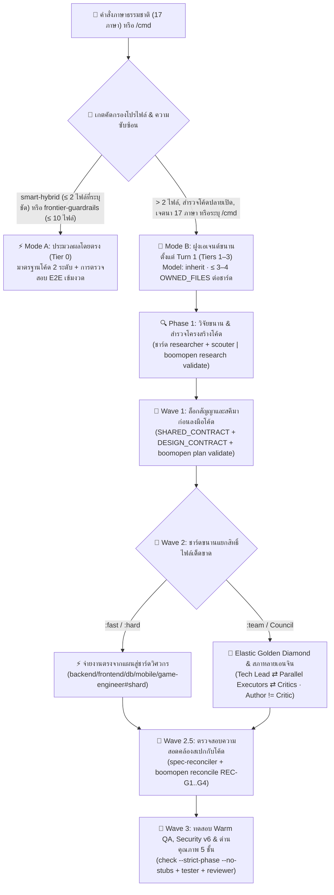

<div align="center">
  <h1>⚡ BoomOpen Workflow Kit Pro v5.5</h1>
  <p><strong>การประสานงานเวิร์กโฟลว์แบบหลายเอเจนต์และเกตตรวจสอบ CLI แบบกำหนดผลลัพธ์ตายตัวสำหรับ Antigravity, Claude Code, OpenAI Codex, Cursor และ GitHub Copilot</strong></p>

  <p>
    <a href="https://boomopen.com"></a>
    <a href="https://github.com/Kennyboom/BoomOpen-Workflow-Kit-Pro/releases"></a>
    <a href="#platforms"></a>
    <a href="#cli"></a>
    <a href="#skills"></a>
    <a href="https://nodejs.org/">= 18.0.0" /></a>
    <a href="../LICENSE"></a>
  </p>

  <p>
    <a href="../README.md">English</a> •
    <a href="./README.vi.md">Tiếng Việt</a> •
    <a href="./README.zh-CN.md">简体中文</a> •
    <a href="./README.zh-TW.md">繁體中文</a> •
    <a href="./README.ja.md">日本語</a> •
    <a href="./README.ko.md">한국어</a> •
    <a href="./README.es.md">Español</a> •
    <a href="./README.fr.md">Français</a> •
    <a href="./README.de.md">Deutsch</a><br/>
    <a href="./README.pt-BR.md">Português (BR)</a> •
    <a href="./README.ru.md">Русский</a> •
    <a href="./README.hi.md">हिन्दी</a> •
    <a href="./README.ar.md">العربية</a> •
    <a href="./README.id.md">Bahasa Indonesia</a> •
    <b>ไทย</b> •
    <a href="./README.tr.md">Türkçe</a> •
    <a href="./README.it.md">Italiano</a>
  </p>

  <p>
    <a href="https://boomopen.com"><b>🌐 boomopen.com (15 ภาษา)</b></a> •
    <a href="#trailer"><b>🎬 วิดีโอเปิดตัว</b></a> •
    <a href="#why-boomopen"><b>⚡ ทำไมต้อง BoomOpen</b></a> •
    <a href="#architecture"><b>🏗️ สถาปัตยกรรม</b></a> •
    <a href="#quickstart"><b>🚀 เริ่มต้นใช้งาน</b></a> •
    <a href="#cli"><b>🛠️ 14 เกต CLI</b></a> •
    <a href="#settings"><b>🎛️ โปรไฟล์ &amp; การตั้งค่า</b></a> •
    <a href="#commands"><b>🎯 36 คำสั่ง</b></a> •
    <a href="#agents"><b>🤖 22 เอเจนต์ &amp; 18 ทีม</b></a> •
    <a href="#skills"><b>📚 1,462 ทักษะ</b></a>
  </p>
</div>

---

<a id="trailer"></a>

## 🎬 วิดีโอตัวอย่างการเปิดตัวและเว็บสำรวจแบบโต้ตอบ (`boomopen.com`)

<div align="center">
  <a href="https://github.com/Kennyboom/BoomOpen-Workflow-Kit-Pro/raw/main/assets/media/boomopen_v55_trailer_en.mp4">
    
  </a>
  <p>
    ▶️ <a href="https://github.com/Kennyboom/BoomOpen-Workflow-Kit-Pro/raw/main/assets/media/boomopen_v55_trailer_en.mp4"><b>สตรีมวิดีโอเปิดตัว Full HD 1080p (ไฟล์ MP4 พร้อมเสียงพากย์สตูดิโอ)</b></a> • 🌐 <a href="https://boomopen.com"><b>ทดลองสนามจำลอง CLI 14 คำสั่งและค้นหาคลังข้อมูลสดได้ที่ boomopen.com (15 ภาษา)</b></a>
  </p>
</div>

---

<a id="why-boomopen"></a>
<a id="-what-is-boomopen-workflow-kit"></a>

## ⚡ ทำไมต้องใช้ BoomOpen Workflow Kit?

**ข้อจำกัดของผู้ช่วยเขียนโค้ด AI แบบดั้งเดิม:** เครื่องมือเขียนโค้ดแบบเอเจนต์เดี่ยวทั่วไปมักเริ่มรวนทันทีที่งานวิศวกรรมขยายข้ามหลายไฟล์ หลายโดเมน หรือหลายเซสชัน การไล่อ่านไฟล์ทีละไฟล์ทำให้ Context Window หลักบวม ซับเอเจนต์ที่ขาดการประสานงานมักเขียนทับไฟล์ร่วมหรือทิ้งโมดูลลอยตัว ("island" modules) ที่ไม่ได้เชื่อมต่อ โค้ดที่สร้างออกมามี `TODO` stub หรือหลบไทป์ด้วย `any` การรีวิวด้วยโมเดลตัวเดียวกับผู้เขียน (`Author == Critic`) มองข้ามจุดบอดของตัวเอง และโปรเจกต์หลายเฟสมักหลุดออกจากสเปกตั้งต้น

**วิธีที่ BoomOpen แก้ปัญหานี้:** BoomOpen ติดตั้งชุดควบคุมการประสานงานและการตรวจสอบมาตรฐานเดียวกันบน **Antigravity (Gemini)**, **Claude Code**, **OpenAI Codex**, **Cursor** และ **GitHub Copilot** โดย **ไม่มี runtime npm dependency แม้แต่ตัวเดียว** ด้วยโปรไฟล์เริ่มต้น **`smart-hybrid`** งานแก้โค้ดขนาด `≤ 2` ไฟล์จะรันตรงทันทีโดยไม่มี overhead ส่วนงานสร้างฟีเจอร์หลายไฟล์ งานวิจัยเชิงลึก การวางแผนสถาปัตยกรรม และ **`36` คำสั่ง slash (`93` ไฟล์)** จะถูกแบ่งงานขนานตั้งแต่ Turn 1 ไปยัง **22 เอเจนต์เฉพาะทาง** และ **18 ทีมตรวจสอบถ่วงดุล 3 บทบาท** — กำกับด้วย **14 เกต CLI `boomopen` ในเครื่อง** และคลังทักษะ **`1,462` รายการแบบโหลดตามต้องการ** (`22` Core + `1,440` ทักษะไลบรารีที่เชื่อมโยงครั้งเดียวใน `~/.agents/skills_library`)

### ⚖️ เปรียบเทียบเมื่อไม่ใช้ BoomOpen กับเมื่อใช้ BoomOpen v5.5

| โหมดความล้มเหลวทางวิศวกรรม | เมื่อไม่ใช้ BoomOpen (AI IDE ทั่วไป) | เมื่อใช้ BoomOpen Workflow Kit Pro v5.5 |
|:-------------------------|:------------------------------|:------------------------------------|
| **Context Window บวม** | เอเจนต์หลักไล่อ่านไฟล์ 15–30 ไฟล์เรียงลำดับก่อนเริ่มเขียนโค้ดบรรทัดแรก | **Turn-1 Elastic Swarm (`role#shard`)**: กระจายตัวสำรวจแบบ read-only และชาร์ดตามโดเมน (`≤ 3–4` ไฟล์/ชาร์ด) + ใช้เซสชันซ้ำทันที `0s` (`send_message`) |
| **เขียนทับไฟล์ขนาน & เชื่อมต่อหลุด** | เอเจนต์ขนานเขียนทับไฟล์ซ้ำกัน ตั้งชื่อ `/api` route ไม่ตรงกัน หรือทิ้งไฟล์ตายไว้ในโปรเจกต์ | **Contract-First Locks + Wave 2.5 Reconcile**: ล็อก `SHARED_CONTRACT` ใน Wave 1 + แยกสิทธิ์ `OWNED_FILES` ไม่ซ้อนทับ ตรวจซ้ำด้วย `boomopen reconcile` (`REC-G1..G4`) |
| **งานวิจัยตื้นเขิน & แผนงานคลุมเครือ** | คำตอบคล้อยตามมุมเดียว ("ไอเดียดีมาก!") ข้อกล่าวอ้างไร้หลักฐาน และแผนงานแบบเรียงความ | **สเปก 6 บล็อกที่บังคับหลักฐาน**: ทีม `:team` ถ่วงดุลแบบ Devil's Advocate + ตัวตรวจ CLI `< 50ms` (`boomopen research`, `design`, `plan`) |
| **ทิ้ง Stub เงียบๆ, `any` & โกงเทสต์** | เอเจนต์แจ้งว่าเสร็จงานแต่ทิ้ง `// TODO`, `any`, `console.log` หรือใส่ `.skip` ข้ามเทสต์ | **เกตตรวจโค้ดแบบสแตติก 2 ระดับ**: `boomopen check --strict-phase --no-stubs` บังคับ `0` `any`, `0` stub และคุมขนาดไฟล์ `400/500` บรรทัดอย่างสมดุล |
| **งานเพี้ยนข้ามเซสชัน & Regression** | การบีบอัดบริบทลบข้อกำหนดเดิมของเฟสก่อนหน้า ทำฟีเจอร์ที่เคยผ่านพังซ้ำ | **กลไกคุมคุณภาพ 5 ชั้น & Rollback**: `.boomopen/project-ledger.json` ตรวจสเปกเพี้ยนด้วย SHA-256, `/autopilot`, `/audit` และ `rollback --yes` แบบอะตอมมิก |
| **จุดบอดของโมเดลเดี่ยว** | โมเดลตัวเดียวกันเป็นทั้งคนเขียนโค้ดและคนตรวจงานตัวเอง (`Author == Critic`) | **Cross-Engine Conductor (`/conduct`)**: ประชุมสภาหลายเอนจินขนานและไปป์ไลน์ข้ามตระกูลโมเดลระหว่าง Claude Code, Codex, Antigravity, Cursor และ Copilot |
| **ตั้งค่า 5 IDE ไม่ตรงกัน & Git รก** | ต้องแยกไฟล์กฎตามแต่ละ IDE คัดลอกทักษะซ้ำหลายกิกะไบต์ และไฟล์ร่างปะปนใน `git status` | **ซิงก์รวมศูนย์ & Git สะอาด**: ซิงก์ 14 ไฟล์เริ่มต้นใน `< 10ms`, ใช้คลังเดียว `~/.agents/skills_library` (`0` โทเค็นขณะว่าง) และแยกไฟล์ร่างไปที่ Brain Artifacts |

---

<a id="architecture"></a>
<a id="-smart-hybrid-architecture-v55"></a>

## 🏗️ สถาปัตยกรรม Smart-Hybrid (v5.5)



---

<a id="pillars"></a>

## 🧠 6 เสาหลักทางวิศวกรรม

1. **🌐 คอมไพล์แบบ Native ครบ 5 IDE และคลังทักษะไร้ความซ้ำซ้อน (`platforms/*`)**:
   - คอมไพล์ **22 เอเจนต์เฉพาะทาง** และ **93 ไฟล์คำสั่ง/อ้างอิง** ให้เป็นรูปแบบ Native ของแต่ละ IDE: **Antigravity** (ชุดปลั๊กอิน `--as-plugin` + `3` สคริปต์ Python `run_workflow`: `audit_fanout.py`, `review_fanout.py`, `research_fanout.py`), **Claude Code** (ชาร์ดแยก `isolation: worktree`, คำสั่งโคลอน `/plan:hard`, ฮุกเสริม `PreToolUse` และ `Stop`/`PreCompact`), **OpenAI Codex** (`22` บทบาท TOML พร้อมแซนด์บ็อกซ์ระดับ OS แบบ `read-only` สำหรับผู้สำรวจ/ผู้ตรวจ + `87` ทักษะ `$boomopen-*`), **Cursor** (กฎ `.mdc` + ฮุกเสริม `beforeShellExecution`) และ **GitHub Copilot** (เอเจนต์ `.agent.md`)
   - เชื่อมโยงทักษะไลบรารีทั้ง `1,440` รายการเพียงครั้งเดียวไปยัง `~/.agents/skills_library` ร่วมกันทั้ง 5 IDE (ประหยัดพื้นที่ดิสก์ ~80% และใช้โทเค็น Turn 1 เป็น `0`)
2. **🎯 ฝูงเอเจนต์ยืดหยุ่น 4 ระดับ (`role#shard`) และการใช้เซสชันอุ่นซ้ำตามขอบเขตงาน**:
   - ขยายขนาดอัตโนมัติจาก **Tier 0** (`0` ซับเอเจนต์สำหรับงาน `≤ 2` ไฟล์ที่ทราบพิกัด) → **Tier 1** (`2–3` ชาร์ด) → **Tier 2** (`4–6` ชาร์ด) → **Tier 3** (`7–8+` ชาร์ด ปรับได้สูงสุด `16`) จำกัดภาระงานต่อซับเอเจนต์ไว้ที่ **`≤ 3–4 OWNED_FILES`** และนำเซสชันที่เปิดอยู่กลับมาใช้ซ้ำผ่าน `role#shard → conversationId` (`send_message`)
3. **🤝 การดำเนินงาน 3 ระลอกยึดสัญญาเป็นศูนย์กลาง + การตรวจสอบ Wave 2.5 (`REC-G1..G4`)**:
   - Wave 1 ล็อก `SHARED_CONTRACT` (สคีมา API/DTO) และ `DESIGN_CONTRACT` (`@theme` CSS ระบบสี OKLCH + TypeScript props) ก่อนที่ Wave 2 จะกระจายงานให้วิศวกรขนาน จากนั้น Wave 2.5 จะรัน `boomopen reconcile` คู่กับ `spec-reconciler` เพื่อจับไฟล์ลอยตัวที่ยังไม่ถูกเรียกใช้ (`REC-G1`), พาธ frontend/backend ไม่ตรงกัน (`REC-G2`), ข้อย่อย `[SC-*]` ที่ตกหล่น (`REC-G3`) และคีย์ใน `.env.example` ที่ขาดหาย (`REC-G4`) พร้อมสร้าง delta wave อัตโนมัติผ่าน `boomopen cook amend-plan`
4. **🏛️ ระบบขับเคลื่อนโปรเจกต์หลายเซสชัน (`/autopilot`) และการตรวจรับหลายรอบแบบมีสถานะ (`/audit`)**:
   - แปลงเอกสารสเปกหลายไฟล์เป็น `.boomopen/project-ledger.json` พร้อมตรวจจับสเปกเพี้ยนด้วย SHA-256 จุดย้อนกลับ Git ก่อนเริ่มเฟส (`boomopen ledger rollback --yes`) และ **ด่านคุมคุณภาพเฟส 5 ชั้น** (`G1 check --strict-phase --no-stubs` → `G2` จำนวนเทสต์ผ่านต้องไม่ลดลง → `G3 reconcile --strict` → `G4` รีวิว `Author != Critic` → `G5 ledger verify`) หลังพัฒนาเสร็จ `/audit` จะรันการตรวจสอบ RTM, vertical flow และ Security v6 หลายรอบโดยรออนุมัติจากผู้ใช้ (`.boomopen/audit-ledger.json` + `boomopen audit rollback --yes`)
5. **🎼 ตัวควบคุมข้ามเอนจินและสภาหลายโมเดล (`boomopen conduct`)**:
   - ประสานงาน Claude Code, OpenAI Codex, Antigravity, Cursor และ Copilot พร้อมกันใน **สภาขนาน 6 ประเภทงาน** (`research`, `brainstorm`, `plan`, `design`, `review`, `debug` → สรุป 4 ส่วนใน `COUNCIL-SYNTHESIS.md`) หรือ **ไปป์ไลน์แบ่งบทบาทข้ามตระกูลโมเดล** เพื่อไม่ให้โมเดลใดตรวจงานของตัวเอง (`Author != Critic`)
6. **📏 มาตรฐานโค้ดเชิงปฏิบัติ 2 ระดับ และการสืบหาต้นตอปัญหา SPIE v3.0**:
   - **ระดับที่ 1 (ไม่ผ่อนปรน)**: หนึ่งความรับผิดชอบต่อไฟล์/ฟังก์ชัน, `0` `any` แบบระบุตรง, `0` `console.log` ดีบักในโค้ดแอป, ดัก `try/catch` แบบระบุไทป์ที่ขอบเขต API/async และค่าคงที่แบบ `SCREAMING_SNAKE_CASE` **ระดับที่ 2 (ยึดความต่อเนื่องของโค้ด)**: เป้าหมาย `~200–350` บรรทัด (เพดานอ่อน `400` / แยกไฟล์ที่ `500`; ยกเว้นเทสต์/ไทป์/เอกสาร) การดีบักใช้สมมติฐานจัดอันดับ 3 ข้อและสายโซ่สาเหตุ **5-Whys (SPIE v3.0)** โดยเก็บไฟล์สเปกชั่วคราวไว้ใน Brain Artifacts เพื่อให้ Git working tree สะอาด `100%`

---

<a id="platforms"></a>
<a id="-supported-ai-platforms"></a>

## 💻 5 แพลตฟอร์ม AI Coding ที่รองรับ

| แพลตฟอร์ม | การรองรับ | ไฟล์เริ่มต้นที่ซิงก์ | การเชื่อมต่อแบบ Native ของแต่ละแพลตฟอร์ม |
|:---------|:-------:|:---------------------|:----------------------------|
| **Antigravity (Gemini)** | ✅ v5.5 | `~/.gemini/GEMINI.md` | `invoke_subagent`, กระจายงาน Python ด้วย `run_workflow`, ลูปชั้นนอก `/goal`, ชุดปลั๊กอิน `--as-plugin`, ฮุกเสริม `--with-hooks`, Brain Artifacts |
| **Claude Code** | ✅ v5.5 | `~/.claude/CLAUDE.md` | ชาร์ด `Task`/`Agent` ขนาน (`isolation: worktree`), คำสั่งโคลอน `/plan:hard`, ฮุกเสริม `PreToolUse` และ `Stop`/`PreCompact` |
| **OpenAI Codex** | ✅ v5.5 | `~/.codex/AGENTS.md` & `CODEX.md` | `22` บทบาท TOML ใน `~/.codex/agents/boomopen/` พร้อม OS `sandbox_mode = "read-only"` สำหรับผู้สำรวจ/ผู้รีวิว + `87` ทักษะ `$boomopen-*` |
| **Cursor** | ✅ v5.5 | `~/.cursor/rules/boomopen-workflow-kit.mdc` | กฎ `.mdc` frontmatter เปิดใช้งานตลอดเวลา, `CURSOR.md`, การส่งงานซับเอเจนต์ & ฮุกเสริม `.cursor/hooks.json` (`beforeShellExecution`) |
| **GitHub Copilot** | ✅ v5.5 | `~/.copilot/copilot-instructions.md` | เอเจนต์ `boomopen-workflow-kit.agent.md` สำหรับ VS Code, การจ่ายงานผ่าน `runSubagent` & `COPILOT.md` |

---

<a id="quickstart"></a>
<a id="-quick-start--installation"></a>

## 🚀 เริ่มต้นใช้งานและการติดตั้ง (ผ่าน Git เท่านั้น — ไม่มี Runtime Dependency)

```bash
# 1. โคลนรีโพซิทอรี (แจกจ่ายผ่าน GitHub เท่านั้น — ไม่เคยเผยแพร่บน npm)
git clone https://github.com/Kennyboom/BoomOpen-Workflow-Kit-Pro.git
cd BoomOpen-Workflow-Kit-Pro

# 2. ติดตั้งสำหรับ AI IDE ที่ใช้อยู่ (โปรไฟล์เริ่มต้น: smart-hybrid) หรือติดตั้งพร้อมกันทั้ง 5 IDE
npm run install:all                                 # ติดตั้งและซิงก์ครบ 5 IDE + คลังร่วม ~/.agents/skills_library
npm run install:antigravity                         # Google Antigravity 2.0 (เพิ่ม --as-plugin / --with-hooks ได้)
node cli/install.js install claude --with-hooks     # Claude Code + ฮุกเสริม PreToolUse และ Stop/PreCompact
npm run install:codex                               # OpenAI Codex CLI + แซนด์บ็อกซ์ read-only สำหรับผู้สำรวจ/ผู้รีวิว
npm run install:cursor                              # Cursor (ส่ง --with-hooks เพื่อเปิดการ์ดป้องกัน beforeShellExecution)
npm run install:copilot                             # GitHub Copilot (ไฟล์ .agent.md สำหรับ VS Code + copilot-instructions.md)

# 3. ตรวจสอบความสมบูรณ์และผูกคำสั่ง `boomopen` เข้ากับ Global PATH (ทางเลือก)
npm run doctor
npm link
boomopen settings status
```

> **ติดตั้งและถอนการติดตั้งอย่างปลอดภัยโดยไม่ทำลายไฟล์เดิม**: ติดตามทุกไฟล์ด้วย SHA-256 manifest (`~/.boomopen/manifests/<tool>.json`) กฎส่วนตัวที่มีอยู่เดิมใน `GEMINI.md` / `CLAUDE.md` นอกมาร์กเกอร์ของชุดเครื่องมือจะถูกคงไว้และสำรองข้อมูลให้อัตโนมัติ ส่วนคำสั่ง `boomopen uninstall <tool|--all>` จะลบเฉพาะไฟล์ของชุดเครื่องมือที่ไม่ถูกแก้ไขโดยไม่แตะต้องไฟล์ของคุณ

---

<a id="cli"></a>

## 🛠️ 14 คำสั่งย่อย CLI แบบไร้ Dependency (`boomopen`)

ทำงานในเครื่องภายใน `< 50ms` บน Node.js `>= 18` โดย **ไม่มี npm runtime dependency** และ **ไม่มีการเรียกเครือข่ายภายนอก**:

| คำสั่งย่อย | แฟล็กและรูปแบบคำสั่งหลัก | เกตตรวจสอบแบบกำหนดผลลัพธ์ตายตัว & หน้าที่ |
|:-----------|:-------------------|:------------------------------|
| **`install` / `uninstall` / `list`** | `<tool\|--all> [--with-hooks] [--as-plugin]` | ตัวติดตั้งพร้อม SHA-256 manifest, ตัวเชื่อมคลังร่วม `~/.agents/skills_library`, ฮุกความปลอดภัยเสริม และตัวถอนการติดตั้งสะอาด |
| **`doctor`** | `[--source-only]` | ตรวจสอบแบบอ่านอย่างเดียว 30 รายการครอบคลุมชุดแพ็กเกจ 5 IDE, `93` ไฟล์คำสั่ง, `72` ไฟล์ทีม, `1,462` ทักษะ และการซิงก์การตั้งค่า |
| **`settings`** | `status \| preset <name> \| set <k> <v> \| --ui` | จัดการ 5 โปรไฟล์ + `22` คีย์ตั้งค่า (`--project` สำหรับ `./.boomopen.json`) หรือเปิด Web UI ที่ป้องกันด้วย CSP (`127.0.0.1:4567`) |
| **`research`** | `<validate\|brief> <file.md> [--mode brainstorm]` | บังคับเกต **`RES-G1..G4`** (แหล่งอ้างอิงสอบทาน `≥ 4` แหล่ง, ตารางข้อขัดแย้ง, ความเสี่ยง pre-mortem) และสร้าง `HANDOFF_BRIEF` |
| **`design`** | `<validate\|contract> <DESIGN.md> [--json]` | บังคับเกต **`DESIGN-G1..G4`** (สเปก 6 บล็อก, โทเค็นสี OKLCH, เมทริกซ์ UI 5 สถานะ, WCAG 2.2 AA) และส่งออก `DESIGN_CONTRACT` |
| **`plan`** | `<validate\|compile> <PLAN.md> [--sync-ledger]` | บังคับเกต **`PLAN-G1..G5`** (กราฟ DAG ไร้วงจร, แยก `OWNED_FILES ≤ 4`/ชาร์ด, `SHARED_CONTRACT`) และซิงก์สมุดบัญชี |
| **`cook`** | `<state\|packets\|verify-wave\|preflight\|amend-plan>` | บังคับเกต **`COOK-G1..G4`**: สถานะลัด 5 ขั้นตอน, Wave Handoff Packets 5 ช่องข้อมูล, ตรวจล็อกการเขียน Git และ delta wave |
| **`reconcile`** | `<dir> [--plan <PLAN.md>] [--strict]` | เกต Wave 2.5 **`REC-G1..G4`**: ตรวจจับโมดูลลอยตัวที่ไม่ได้เชื่อม, `/api` route เพี้ยน, เงื่อนไข `[SC-*]` ที่ตกหล่น และคีย์ `.env.example` ที่ขาด |
| **`check`** | `[path] --strict-phase --no-stubs [--ignore <dir>]` | เกตสแตติก 2 ระดับ: งบบรรทัด `400/500`, `0` `any` ระบุตรง, `0` `console.log` ดีบัก, `0` stub/`TODO`/`.skip` |
| **`ledger`** | `<init\|from-plan\|status\|next\|verify\|rollback>` | เครื่องสถานะ DAG ข้ามเซสชัน `.boomopen/project-ledger.json`, การ์ด SHA-256 กันสเปกเพี้ยน และ `rollback --yes` แบบอะตอมมิก |
| **`audit`** | `<init\|slice\|record\|approve\|verify-fix\|rollback>` | สมุดบัญชีตรวจรับหลายรอบหลังพัฒนาเสร็จ (`.boomopen/audit-ledger.json`), กลไกลดยอดข้อบกพร่อง และ `rollback --yes` |
| **`conduct`** | `<probe\|council\|dispatch\|status> [--dry-run]` | ตัวควบคุมข้ามเอนจินและสภาหลายเอนจินขนาน 6 งาน (`Author != Critic` ข้าม 5 IDE → `COUNCIL-SYNTHESIS.md`) |

---

<a id="settings"></a>
<a id="-unified-settings--mode-selection-settings"></a>

## 🎛️ ศูนย์ควบคุมรวมศูนย์และ 5 โปรไฟล์สำเร็จรูป (`/settings`)

จัดการ **`20` คีย์ตัวเลือก + `2` คีย์เพดานบรรทัดกำหนดเอง** ได้ทั้งระดับ Global (`~/.boomopen/settings.json`) หรือระดับรีโพซิทอรี (`./.boomopen.json`) ซิงก์ทันทีครบทั้ง 14 ไฟล์เริ่มต้นของ IDE ภายใน `< 10ms`:

| โปรไฟล์ตั้งต้น | โหมดประมวลผล (`execution.mode`) | ค่าเริ่มต้น `/cmd` | การนำทางภาษาธรรมชาติ 17 ภาษา (`naturalLanguageResearchTrigger`) | มาตรฐานโค้ด | เหมาะสำหรับ |
|:---------------|:----------------------------------|:--------------:|:---------------------------------------------------------:|:----------------:|:--------------|
| **⚡ `smart-hybrid`** *(Default)* | **`auto`** (`≤ 2` ไฟล์รันตรง; `> 2` ไฟล์หรือ `/cmd` → ฝูงเอเจนต์ Mode B) | `auto` | **`auto_team`** *(ส่งคำขอวิจัย/ระดมสมอง/รีวิวเป็นภาษาธรรมชาติไปยัง `:team` และเวิร์กโฟลว์ครบ 17 ภาษา)* | `pragmatic` (`400/500`L) | ค่าเริ่มต้นพร้อมใช้งานทันที: นำทางตามเจตนาภาษาธรรมชาติ + แบ่งชาร์ดขนานตั้งแต่ Turn 1 อัตโนมัติ |
| **🛡️ `frontier-guardrails`** *(Slim Opt-In)* | **`mode_a`** (`≤ 10` ไฟล์รันตรง; ไฟล์เริ่มต้นขนาดเล็ก `< 2.5 KB` / `~600` โทเค็น) | `auto` | **`off`** *(ทำงานเมื่อพิมพ์ `/cmd` ชัดเจนเท่านั้น — ไม่ดักภาษาธรรมชาติ)* | `pragmatic` (`400/500`L) | โหมดรันตรงประจำวันขนาดจิ๋ว `< 2.5 KB` พร้อมเกต 2 ระดับและ E2E เข้มงวด *(รองรับชื่อพ้อง `carbon-guardrails`)* |
| **🚀 `solo-fast`** | **`mode_a`** (`≤ 10` ไฟล์รันตรง; จำกัดสูงสุด `3` ชาร์ด) | `fast` | `off` | `relaxed` (`600/800`L) | ทำต้นแบบรวดเร็ว สคริปต์ขนาดเล็ก แก้บั๊กเร่งด่วน และประหยัดโทเค็นสูงสุด |
| **🧠 `deep-architect`** | **`mode_b`** *(บังคับตัวประสานงาน Mode B; สูงสุด `12` ชาร์ด)* | `hard` | `auto_hard` + วิจัยแบบ `council` / รีวิวแบบ `cross_family` | `strict` (`300/400`L) | ออกแบบสถาปัตยกรรมระบบซับซ้อน โปรเจกต์เริ่มใหม่ และการรีแฟกเตอร์ข้ามโมดูล |
| **🔺 `adversarial-team`** | **`team`** *(Elastic Golden Diamond `:team`; `hyper_swarm` สูงสุด `12`)* | `team` | **`auto_team`** + `council` สำหรับวิจัย วางแผน และรีวิว | `strict` (`300/400`L) | งานปล่อยระบบโปรดักชันความสำคัญสูง การตรวจสอบความปลอดภัย และฉันทามติหลายเอนจิน |

```bash
# สลับโปรไฟล์หรือปรับแต่งคีย์ผ่านแชท (/settings), หน้า Web UI ในเครื่อง (--ui) หรือ CLI:
boomopen settings --ui                                      # เปิดหน้า Web Control Center ในเครื่องที่ http://127.0.0.1:4567
boomopen settings preset smart-hybrid                       # ค่าเริ่มต้น: Auto Mode A/B + นำทางเวิร์กโฟลว์ภาษาธรรมชาติ 17 ภาษา
boomopen settings preset frontier-guardrails                # ทางเลือกเสริม: Mode A ขนาดสลิม < 2.5 KB (ชื่อพ้อง: carbon-guardrails)
boomopen settings set engines.reviewer cross_family         # บังคับผู้รีวิวคนละตระกูลโมเดล (Author != Critic)
cd path/to/your/repo && boomopen settings mode team --project # เขียนทับเฉพาะรีโพซิทอรีลงใน ./.boomopen.json
boomopen settings reset                                     # คืนค่าการตั้งค่าเริ่มต้น smart-hybrid
```

---

<a id="commands"></a>
<a id="-slash-commands-reference"></a>

## 🎯 ตารางอ้างอิงคำสั่ง Slash ทั้ง 36 คำสั่ง (`93` ไฟล์ = `87` เวิร์กโฟลว์ + `6` `_ref/`)

สั่งงานด้วยภาษาธรรมชาติได้ใน **17 ภาษาที่รองรับ** ภายใต้โปรไฟล์ `smart-hybrid` หรือเรียกใช้ **36 คำสั่ง slash มาตรฐาน** โดยตรง:

| หมวดหมู่ | คำสั่ง | ตัวเลือกย่อย | วัตถุประสงค์ & ผลลัพธ์ที่ตรวจสอบได้ |
|:---------|:--------|:---------|:-------------------------------------|
| **การประสานงาน & งานอัตโนมัติ** | **`/cook`** | `:fast`, `:hard`, `:team` | สร้างฟีเจอร์ครบวงจรเมื่อยังไม่มีแผน (Scout → Contract Plan → Parallel Shards → Wave 2.5 Reconcile → QA) |
| | **`/code`** | `:fast`, `:hard`, `:team` | ลงมือพัฒนาตาม `PLAN-{task}.md` ที่อนุมัติแล้วข้ามชาร์ด Wave 1–3 ทันทีโดยไม่รัน `/plan` ซ้ำ |
| | **`/autopilot`** | `:init`, `:run`, `:audit` | ตัวขับเคลื่อนโปรเจกต์ข้ามเซสชันจากสเปกสู่โปรดักชันผ่าน `.boomopen/project-ledger.json` และ **ด่านคุมคุณภาพเฟส 5 ชั้น** |
| | **`/conduct`** | `:council`, `:pipeline` | สภาขนานหลายเอนจิน (`COUNCIL-SYNTHESIS.md`) และไปป์ไลน์ข้ามตระกูลโมเดลครบ 5 IDE (รองรับ `--dry-run`) |
| | **`/orchestrate`** / **`/auto`** | — | ประสานงานฝูงเอเจนต์ข้ามหลายโดเมนแบบกำหนดเอง (`/orchestrate`) หรือรันอัตโนมัติตั้งแต่ต้นจนจบ (`/auto`) |
| **สถาปัตยกรรม, การออกแบบ & การวิจัย** | **`/plan`** | `:fast`, `:hard`, `:team` | พิมพ์เขียว `PLAN-{task}.md` ผ่านเกต 5 ข้อ ล็อก `SHARED_CONTRACT`, แยก `OWNED_FILES ≤ 4`/ชาร์ด และเกณฑ์ Given/When/Then |
| | **`/architect`** | — | พิมพ์เขียวออกแบบระบบล้วนๆ: แผนภาพ C4, ADR, สคีมา DB, สัญญา API, สเปกหน้าจอ และตรวจความครอบคลุม (ไม่เขียนโค้ด) |
| | **`/design`** / **`/ui-ux-pro-max`** | `:fast`, `:hard`, `:team` | สเปก UI/UX 6 บล็อก `DESIGN-{task}.md` + `DESIGN_CONTRACT` (`@theme` OKLCH, เมทริกซ์ 5 สถานะ, 50+ สไตล์ & พรีวิว HTML สด) |
| | **`/research`** | `:fast`, `:hard`, `:team` | วิจัยเชิงลึก 5 มุมมอง (`RESEARCH-{topic}.md`, เกต `RES-G1..G4` สอบทาน `≥ 4` แหล่ง, ตารางข้อขัดแย้ง & `HANDOFF_BRIEF`) |
| | **`/brainstorm`** / **`/ask`** | `:fast`, `:hard`, `:team` | ระดมสมองเชิงกลยุทธ์ไม่อวยตามผู้ถาม (`BRAINSTORM-{topic}.md` พร้อม pre-mortem & ตาราง MCDA) และถาม-ตอบอิงหลักฐาน (`/ask`) |
| **คุณภาพ, การตรวจรับ, ดีบัก & ความปลอดภัย** | **`/review`** | `:fast`, `:hard`, `:team` | รีวิวโค้ด สถาปัตยกรรม ความปลอดภัย และประสิทธิภาพแบบถ่วงดุลหลายมิติ (`Author != Critic`, ส่งต่อ `/fix` ได้ในคลิกเดียว) |
| | **`/audit`** / **`/deep-audit`** | `:run`, `:fix`, `:auto` | ตรวจรับทั้งโปรเจกต์หลายรอบหลังพัฒนาเสร็จ (สมุดบัญชี `/audit`) และตรวจตรรกะสเปก 10 มิติก่อนเริ่มเขียนโค้ด (`/deep-audit`) |
| | **`/security-audit`** | — | สแกน OWASP Top 10 + LLM/Agentic Top 10 (`security_scan.py` v6), วิเคราะห์ภัยคุกคาม STRIDE, ระบบยืนยันตัวตน และ supply chain |
| | **`/debug`** / **`/fix`** | `:fast`, `:hard`, `:team` | สืบหาสาเหตุรากเหง้าด้วย 3 สมมติฐาน + **5-Whys (SPIE v3.0)** (`DEBUG-{issue}.md`) และแก้บั๊กแบบ TDD เขียนเทสต์ให้ตกก่อน (`/fix`) |
| | **`/test`** / **`/performance`** / **`/refactor`** | `:fast`, `:hard`, `:team` | ชาร์ด QA ป้องกันการโกงเทสต์ (`/test`), ปรับจูน Core Web Vitals / DB / ขนาด bundle (`/performance`) และ `/refactor` ที่ยืนยันด้วยตัวชี้วัด |
| **Git, รีลีส, เอกสาร & จัดการเซสชัน** | **`/onboard`** / **`/init`** | — | สร้างแผนที่สถาปัตยกรรมโค้ดเดิม `ARCHITECTURE-MAP.md` แบบอ่านอย่างเดียวใน 60 วินาที (`/onboard` ไม่ชน `/init`) และตั้งต้นโปรเจกต์ใหม่ (`/init`) |
| | **`/pr`** / **`/release`** | —, `:review` | เกตตรวจคุณภาพและ reconcile ก่อนเปิด PR + `gh pr create` / รีวิว diff เชิงลึก (`/pr:review`) และออกรีลีส SemVer ที่ตรวจความตรงกันแล้ว (`/release`) |
| | **`/deploy`** / **`/rollback`** | `:check`, `:preview`, `:production`, `:rollback` | เกตตรวจความพร้อมก่อนดีพลอย, ปล่อยระบบสู่ preview/production (`/deploy`) และกู้คืนฉุกเฉินตามระดับความรุนแรง (`/rollback`) |
| | **`/docs`** / **`/report`** | `:core`, `:business`, `:audit` / `:fast..:team` | ชุดเอกสาร `./documents/` อ้างอิงจากซอร์สโค้ดจริง (`/docs`) และรายงานสถานะจากข้อมูลจริงของ CLI โดยไม่แต่งเรื่อง (`/report`) |
| | **`/settings`** / **`/status`** / **`/next`** | — | ศูนย์ควบคุมรวมศูนย์ (`/settings`), กระดานสถานะสมุดบัญชีและฝูงเอเจนต์สด (`/status`) และตัวแนะนำก้าวถัดไป (`/next`) |
| | **`/preview`** / **`/save`** / **`/recap`** | — | จัดการวงจรชีวิต dev server ในเครื่อง (`/preview`), บันทึกสถานะเซสชัน (`/save`) และกู้คืนบริบทภายใน `< 5s` (`/recap`) |

### 🌙 คู่มือรันโปรเจกต์หลายเฟสข้ามคืน (`/autopilot` & `/goal`)

| เวิร์กโฟลว์ | แพลตฟอร์มเป้าหมาย & ตัวรัน | ความต่อเนื่องของบริบท | การรับประกันคุณภาพและสเปก |
|:---------|:-------------------------|:-------------------|:--------------------------|
| **`/autopilot` (+ `--with-hooks`)** | ทั้ง 5 IDE (แนะนำใช้คู่กับ `--with-hooks` บน **Claude Code**, **Antigravity** และ **Cursor**) | ฮุก `Stop` และ `PreCompact` (`stop-quality-gate.mjs`) + `.boomopen/project-ledger.json` รักษาตำแหน่งงานข้ามการบีบอัดบริบท | บังคับ **ด่านคุมคุณภาพเฟส 5 ชั้น** (`G1..G5`), การตรวจ Wave 2.5 `reconcile` และ `boomopen ledger rollback --yes` |
| **`/goal` + `/autopilot` + `/audit`** | ลูปชั้นนอกต่อเนื่องของ **Antigravity 2.0** สำหรับสเปกขนาดใหญ่ใน `docs/` | ตัวรัน **`/goal`** แบบ Native ของ Antigravity วนรันข้ามเฟสต่อเนื่องจนกว่าทุกเฟสในสมุดบัญชีจะมีสถานะ `VERIFIED` | ส่งทุกเฟสผ่านครบทั้ง 5 เกต + การตรวจ Wave 2.5 แล้วรัน **`/audit`** รอบที่ 1 ทันที |

```text
/goal ใช้ /autopilot อ่านเอกสารโปรเจกต์ทั้งหมดใน docs/ สร้างไฟล์ .boomopen/project-ledger.json และลงมือพัฒนาทุกเฟสตามลำดับโดยอัตโนมัติ (ทุกเฟสต้องผ่านเกตตรวจสอบทั้ง 5 ชั้นและ Wave 2.5 reconcile) เมื่อผ่านครบ 100% ของทุกเฟสแล้ว ให้รัน /audit รอบที่ 1 และหยุดพร้อมรายงานสรุปเพื่อให้ฉันตรวจสอบ
```

---

<a id="agents"></a>
<a id="-22-specialist-agents--18-golden-triangle-teams"></a>

## 🤖 22 เอเจนต์เฉพาะทาง & 18 ทีมถ่วงดุล 3 บทบาท

ซับเอเจนต์ทุกตัวสืบทอดโมเดลเดียวกับเซสชันหลักของคุณ (`Model: "inherit"` — ห้ามลดระดับเป็น `flash_lite` โดยเด็ดขาด) และจับคู่ทำงานใน **18 ทีม Golden Diamond / Triangle** (`Tech Lead` ⇄ `Parallel Shard Executors` ⇄ `Independent Reviewers/Critics`):

| โดเมน | เอเจนต์เฉพาะทาง (`agents/*.md`, คอมไพล์ตามแต่ละ IDE) | ทีมรีวิว 3 บทบาท (`agents/teams/*-team/`, `72` ไฟล์) |
|:-------|:----------------------------------------------------|:---------------------------------------------------------|
| **วิศวกรรมและการพัฒนา** | `backend-engineer`, `frontend-engineer`, `mobile-engineer`, `game-engineer`, `database-architect`, `devops-engineer` | `backend-team`, `frontend-team`, `fullstack-team`, `mobile-team`, `game-team`, `database-team`, `devops-team` |
| **สถาปัตยกรรมและผลิตภัณฑ์** | `tech-lead`, `planner`, `brainstormer`, `business-analyst`, `project-manager`, `designer` | `planning-team`, `brainstorm-team`, `project-team`, `design-team` |
| **คุณภาพ, Reconcile & ความปลอดภัย** | `debugger`, `tester`, `reviewer`, `spec-reconciler`, `security-engineer`, `performance-engineer` | `debug-team`, `qa-team`, `security-team`, `performance-team` |
| **การวิจัยและเอกสาร** | `researcher`, `scouter`, `docs-manager`, `reporter` | `research-team`, `docs-team`, `report-team` |

---

<a id="skills"></a>
<a id="-1460-skills-vault-22-core--1440-niche-library-skills"></a>

## 📚 คลังทักษะ 1,462 รายการแบบโหลดตามต้องการ (`22` Core + `1,440` ทักษะไลบรารี)

จัดทำดัชนีครอบคลุม **19 โดเมนวิศวกรรม** ใน `matrix-skills/compact-index.json` เชื่อมโยงโดยไม่ซ้ำซ้อนเพียงครั้งเดียวใน `~/.agents/skills_library` และโหลดผ่าน **การค้นหาแบบก้าวหน้า 2 ขั้นตอนระดับ O(1)** (เช็ก Core ใน `skills/` → ค้นหาใน `compact-index.json` → โหลดเฉพาะไฟล์ `SKILL.md` ที่ตรงงานเข้าสู่ชาร์ดที่รับผิดชอบ กินโทเค็นขณะว่าง `0` โทเค็น):

| ระดับ / โดเมนวิศวกรรม | จำนวนทักษะ | ความสามารถเด่น & เทมเพลตตั้งต้น | การโหลด |
|:--------------------------|:------:|:----------------------------------------|:--------|
| **⚡ เวิร์กโฟลว์หลัก & คุณภาพ (`skills/`)** | **22** | `clean-code`, `debugger`, `plan-writing`, `brainstorming`, `deep-research`, `design-spec`, `frontend-design`, `frontend-architecture`, `api-patterns`, `database-design`, `tdd-workflow`, `testing-patterns`, `webapp-testing`, `security-auditor` (`security_scan.py` v6), `app-builder` (**15 เทมเพลตโปรเจกต์** รวมถึง **`mcp-server`**, **`ai-agent-worker`**, `nextjs-saas`, `monorepo-turborepo`, `python-fastapi`, `flutter-app`), `skill-seeker` | พร้อมใช้งานตั้งแต่ Turn 1 |
| **🤖 AI, Agentic SDKs, MCP & ข้อมูล** | **340+** | FastMCP (`StreamableHTTP`), OpenAI Agents SDK, Claude Agent SDK, Google ADK, Vercel AI SDK, LangGraph, RAG, BigQuery, dbt | โหลดตามต้องการ (`compact-index.json`) |
| **🌐 เว็บ, แบ็กเอนด์, API & ฐานข้อมูล** | **380+** | React 19, Next.js 15 RSC, Tailwind CSS v4, TanStack Start/Router/Query, Hono RPC + Zod OpenAPI, Rust Axum/SQLx, Drizzle, Postgres/RLS | โหลดตามต้องการ (`compact-index.json`) |
| **☁️ คลาวด์, DevOps, QA & ความปลอดภัย** | **300+** | Cloudflare Workers/Durable Objects/D1, Docker/K8s, Terraform, Playwright, Vitest + MSW v2, Better Auth (Passkeys), OWASP LLM Top 10 | โหลดตามต้องการ (`compact-index.json`) |
| **🎨 UI/UX, เกมเอนจิน & โมบายล์** | **420+** | โทเค็นสี OKLCH, WCAG 2.2 AA, Motion, Unity 6 DOTS/ECS, Godot 4, Unreal 5, WebGPU/Three.js, Phaser/PixiJS, Tauri v2, SwiftUI, Flutter, React Native | โหลดตามต้องการ (`compact-index.json`) |

---

## 📂 โครงสร้างรีโพซิทอรี

```text
BoomOpen-Workflow-Kit-Pro/
├── agents/                  # 22 เอเจนต์เฉพาะทาง (คอมไพล์ตามแต่ละ IDE) + 18 ทีม 3 บทบาท (72 ไฟล์)
├── cli/                     # 14 คำสั่งย่อย Node.js CLI ไร้ dependency + 33 ชุดทดสอบ node:test
├── commands/                # 36 คำสั่ง slash กระจายใน 87 ไฟล์เวิร์กโฟลว์ + 6 โปรโตคอล _ref/ (93 ไฟล์)
├── documents/               # เอกสารสถาปัตยกรรม โดเมน โครงสร้างซอร์สโค้ด และมาตรฐานโค้ด 2 ระดับ
├── i18n/                    # ไฟล์ README แปลครบ 16 ภาษา (รวมเป็น 17 ภาษาเมื่อนับ README.md หลัก)
├── matrix-skills/           # แค็ตตาล็อก YAML 19 โดเมน + ดัชนี O(1) compact-index.json (1,462 ทักษะ)
├── platforms/               # ชุดแพ็กเกจ 5 IDE, ฮุกความปลอดภัยเสริม, 3 สคริปต์ Antigravity run_workflow/*.py & บทบาท Codex TOML
├── rules/                   # โมดูลกฎ Mode B โหลดตามต้องการ 7 ไฟล์ (CORE, PHASES, AGENTS, TEAMS, SKILLS, ERRORS, REFERENCE)
├── scripts/                 # สคริปต์ตรวจสอบและจัดการเซสชันข้ามแพลตฟอร์ม (checklist.py, verify_all.py, auto_preview.py, session_manager.py)
├── skills/                  # 22 ทักษะหลัก + 15 เทมเพลตโปรเจกต์ app-builder + สคริปต์ตรวจ Security v6 / UX / Perf
├── skills_library/          # 1,440 ทักษะไลบรารีที่เชื่อมโยงครั้งเดียวไปยังคลังร่วม ~/.agents/skills_library
├── web/                     # เว็บโชว์เคส Cosmic WebGL 15 ภาษาและระบบค้นหาแค็ตตาล็อกเบื้องหลัง https://boomopen.com
└── GEMINI.md | CLAUDE.md | CODEX.md | COPILOT.md | CURSOR.md | AGENT.md
```

---

## 📄 สัญญาอนุญาตและนโยบายความปลอดภัย

- **เว็บไซต์ทางการ**: [https://boomopen.com](https://boomopen.com)
- **สัญญาอนุญาต**: ซอร์สโค้ดของชุดเครื่องมือ, CLI, กฎ, เอเจนต์ และเอกสารเผยแพร่ภายใต้ [สัญญาอนุญาต MIT](../LICENSE) (Copyright © 2026 **BoomOpen Labs**) ส่วนทักษะจากบุคคลที่สามใน `skills_library/` ยังคงใช้สัญญาอนุญาตต้นทางเดิม — ดูรายละเอียดที่ [THIRD_PARTY_NOTICES.md](../THIRD_PARTY_NOTICES.md)
- **นโยบายความปลอดภัย**: ดูรายละเอียดการปกป้องไฟล์ด้วย SHA-256 manifest, การจำกัดสิทธิ์ฮุกเสริม และช่องทางแจ้งช่องโหว่ได้ที่ [SECURITY.md](../SECURITY.md)
