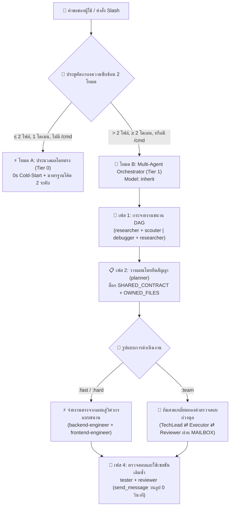

<div align="center">
  <h1>⚡ BoomOpen Workflow Kit v5.5.0</h1>
  <p><strong>ระบบปฏิบัติการ AI อัจฉริยะแบบผสมผสาน (Smart-Hybrid) ข้ามแพลตฟอร์ม — 21 เอเจนต์ผู้เชี่ยวชาญ, 18 ทีมสามเหลี่ยมทองคำ และคลังทักษะ 1,460+ รายการแบบเรียกใช้ตามต้องการ</strong></p>

  <p>
    <a href="https://github.com/Kennyboom/BoomOpen-Workflow-Kit-Pro/releases"></a>
    <a href="#platforms"></a>
    <a href="#agents"></a>
    <a href="#skills"></a>
    <a href="https://nodejs.org/">=18.0.0" /></a>
    <a href="../LICENSE"></a>
  </p>

  <p>
    <a href="../README.md">🇬🇧 English</a> • <a href="./README.vi.md">🇻🇳 Tiếng Việt</a> • <a href="./README.zh-CN.md">🇨🇳 简体中文</a> • <a href="./README.zh-TW.md">🇹🇼 繁體中文</a> • <a href="./README.ja.md">🇯🇵 日本語</a> • <a href="./README.ko.md">🇰🇷 한국어</a> • <a href="./README.es.md">🇪🇸 Español</a> • <a href="./README.fr.md">🇫🇷 Français</a> • <a href="./README.de.md">🇩🇪 Deutsch</a><br/>
    <a href="./README.pt-BR.md">🇧🇷 Português</a> • <a href="./README.ru.md">🇷🇺 Русский</a> • <a href="./README.hi.md">🇮🇳 हिन्दी</a> • <a href="./README.ar.md">🇸🇦 العربية</a> • <a href="./README.id.md">🇮🇩 Bahasa Indonesia</a> • <b>🇹🇭 ไทย</b> • <a href="./README.tr.md">🇹🇷 Türkçe</a> • <a href="./README.it.md">🇮🇹 Italiano</a>
  </p>
</div>

---

## 🎬 วิดีโอเปิดตัวทางการ (Full HD 1080p)

<div align="center">
  <a href="https://github.com/Kennyboom/BoomOpen-Workflow-Kit-Pro/raw/main/assets/media/boomopen_v55_trailer_en.mp4">
    
  </a>
  <p>
    ▶️ <a href="https://github.com/Kennyboom/BoomOpen-Workflow-Kit-Pro/raw/main/assets/media/boomopen_v55_trailer_en.mp4"><b>คลิกที่นี่เพื่อรับชม / สตรีมวิดีโอเปิดตัวทางการความละเอียด Full HD 1080p (MP4 พร้อมเสียงพากย์สตูดิโอ)</b></a>
  </p>
</div>

---

## 🌟 BoomOpen Workflow Kit v5.5 คืออะไร?

**BoomOpen Workflow Kit v5.5 (Multi-Platform Unified & Smart-Hybrid Edition)** คือระบบปฏิบัติการแบบหลายเอเจนต์ (Multi-Agent) โอเพนซอร์สที่เปลี่ยนผู้ช่วยเขียนโค้ด AI เดี่ยวๆ ให้กลายเป็นองค์กรวิศวกรรมซอฟต์แวร์ที่ทำงานประสานกันประกอบด้วย **เอเจนต์ผู้เชี่ยวชาญ 21 บทบาท (Specialist Agents)**, **ทีมตรวจสอบถ่วงดุลสามเหลี่ยมทองคำ 18 ทีม (Golden Triangle Teams)**, **ทักษะหลัก 22 รายการ (Core Skills)** และ **คลังทักษะเฉพาะทางกว่า 1,440 รายการ (`skills_library`)**

แตกต่างจากเทมเพลตแบบตายตัวหรือเฟรมเวิร์กขนาดใหญ่ที่ทำให้เกิดความหน่วงและเปลืองบริบทในทุกรอบ BoomOpen v5.5 ผสาน **ประตูเรียกใช้ซับเอเจนต์เชิงรุกตั้งแต่เทิร์นที่ 1 (Proactive Sub-agent First Gate)**, **การนำทางคำสั่งภาษาธรรมชาติ 17 ภาษา**, **การแบ่งส่วนฝูงเอเจนต์แบบยืดหยุ่น 4 ระดับ (`role#shard`)**, **ระบบขับเคลื่อนโปรเจกต์อัตโนมัติหลายเซสชัน (`/autopilot`)** และ **ตัวควบคุมข้ามเอนจิน (`/conduct`)**:
- **🚀 ซับเอเจนต์ขนานตั้งแต่เทิร์นที่ 1 และการประสานงานโหมด B**: การสำรวจโค้ดที่ยังไม่ระบุไฟล์ชัดเจน (`> 2` ไฟล์), ฟีเจอร์หลายโดเมน (`≥ 2` โดเมน), คำขอเวิร์กโฟลว์ด้วยภาษาธรรมชาติใน **ทั้ง 17 ภาษาที่รองรับ** หรือการเรียก `/cmd` จะเปิดซับเอเจนต์แบบแบ่งส่วนขนานทันทีในเทิร์นที่ 1 (`role#shard`, ไม่เกิน `3–4 OWNED_FILES`/shard) พร้อม **DAG Parallel Fan-Out**, **การจ่ายงานตรงจากแผนสู่วิศวกร**, **การล็อกไฟล์ตามสัญญา (`SHARED_CONTRACT` + `OWNED_FILES`)**, **การนำเซสชันอุ่นกลับมาใช้ซ้ำ (`role#shard -> conversationId` ผ่าน `send_message`)** รวมถึง `/autopilot` (`boomopen ledger`) และสภาหลายเอนจิน `/conduct` (`boomopen conduct`)
- **⚡ โหมด A — ประมวลผลตรงระดับไมโครเมื่อทราบไฟล์เป้าหมาย (Cold-Start 0 วินาที)**: คำถามทั่วไป (Q&A), การอธิบายโค้ด และการแก้ไขเล็กน้อยที่ **ทราบไฟล์เป้าหมายชัดเจน `≤ 2` ไฟล์ตั้งแต่เทิร์นที่ 1** (ไม่ต้องสำรวจเพิ่ม และไม่มี `/cmd`) จะถูกดำเนินการและตรวจสอบ **โดยตรง** ภายใต้ **มาตรฐานการเขียนโค้ดเชิงปฏิบัติ 2 ระดับ** และ **การทดสอบและแก้ไขบั๊กอย่างต่อเนื่อง**

- **📚 คลังทักษะขนาดใหญ่ 1,462 รายการโดยไม่เปลืองบริบท (Zero Context Bloat)**: ผสาน **22 ทักษะหลัก (`skills/`)** และ **1,440 ทักษะเฉพาะทาง (`skills_library/`)** ที่คอมไพล์ล่วงหน้าไว้ใน `matrix-skills/compact-index.json` เพื่อการค้นหาแบบ 2 ขั้นตอน `O(1)` ช่วยให้ AI มีความเชี่ยวชาญทันทีทั้ง Backend, Frontend, Mobile, Game Dev (Unity/Unreal/Godot), AI/ML, BigQuery/Data, Cloud/DevOps และความปลอดภัย OWASP โดยไม่ทำให้หน้าต่างพรอมต์เต็ม

---

## 🏗️ สถาปัตยกรรม Smart-Hybrid (v5.5)



---

<a id="pillars"></a>

## 🧠 6 เสาหลักสำคัญของ v5.5

1. **🌐 รองรับ 5 แพลตฟอร์มอย่างสมบูรณ์แบบ (`platforms/*`)**:
   - ติดตั้งแบบ Native ชั้นหนึ่งสำหรับ **Google Antigravity 2.0 (Gemini)**, **Claude Code**, **OpenAI Codex**, **Cursor** และ **GitHub Copilot** จากสถาปัตยกรรมเดียวที่รวมเป็นหนึ่ง
2. **📏 มาตรฐานการเขียนโค้ดเชิงปฏิบัติ 2 ระดับ (ป้องกันการหั่นไฟล์แบบไร้เหตุผล)**:
   - **ระดับที่ 1 — กฎคุณภาพและความปลอดภัยที่เข้มงวด (Zero Tolerance)**: หนึ่งไฟล์หรือฟังก์ชันรับผิดชอบหนึ่งหน้าที่ (Single Responsibility), **ห้ามใช้ `any` โดยเด็ดขาด**, **ห้ามทิ้ง `console.log` ดีบักไว้ในโค้ด Production**, ต้องมี `try/catch` และจัดการชนิดข้อผิดพลาดที่ขอบเขต async/API, ค่าคงที่ใช้ `SCREAMING_SNAKE_CASE`, DRY (`≥ 3`) และจัดเรียง import ให้สะอาด
   - **ระดับที่ 2 — แนวทางโครงสร้างที่ยืดหยุ่น (เน้นความสอดคล้อง)**: ไฟล์ที่ทำงานหน้าที่เดียวอย่างสมบูรณ์มีเป้าหมายที่ `~200–350 บรรทัด` และยืดหยุ่นได้ถึง `~400–450 บรรทัด` (บังคับแยกเฉพาะเมื่อเกิน `>500 บรรทัด` หรือปนหลายโดเมน; ยกเว้นไฟล์ Test, Types/Schema และเอกสาร) ฟังก์ชันลอจิก `~20–40 บรรทัด` (`~40–80 บรรทัด` สำหรับ UI/Handler)
3. **🎯 การแบ่งส่วนฝูงเอเจนต์ยืดหยุ่น 4 ระดับ (`role#shard`), จ่ายงานตรงจากแผน & ใช้ซ้ำเซสชันอุ่น (`send_message`)**:
   - เมื่อมี `PLAN-{feature}.md` แล้ว Orchestrator จะจ่ายงาน **โดยตรง** ไปยังชาร์ดของวิศวกรประจำโดเมน (`backend-engineer#shard-1`, `frontend-engineer#shard-2`, `database-architect#shard-1` ชาร์ดละ `<= 3–4 OWNED_FILES`) โดยไม่ต้องผ่าน `tech-lead` ซ้ำซ้อน
   - ซับเอเจนต์ที่ทำงานอยู่จะถูกบันทึกใน **ทะเบียนเซสชันตามชาร์ด (`role#shard → conversationId`)** และเรียกใช้ซ้ำผ่าน `send_message` ด้วย **เวลาเริ่มต้น 0 วินาที** และ **รักษาบริบทไฟล์ไว้ 100%**
4. **🤝 การทำงานขนานโดยยึดสัญญาเป็นหลัก (`SHARED_CONTRACT` + `OWNED_FILES`)**:
   - แผนงานข้ามโดเมนจะล็อก API endpoints, โครงสร้าง DTO และแบ่งสิทธิ์การเขียนไฟล์อย่างชัดเจน (`OWNED_FILES` เทียบกับ `READ_ONLY_FILES`) ก่อนสั่งรันวิศวกรพร้อมกัน เพื่อป้องกันการเขียนทับไฟล์โดยสมบูรณ์
5. **🔍 การวิเคราะห์รากเหง้าของปัญหาด้วย 5-Whys (SPIE v3.0) & Git Tree สะอาด 100%**:
   - `debugger` วิเคราะห์บั๊กผ่านสมมติฐานอย่างน้อย 3 ข้อและห่วงโซ่สาเหตุ **5-Whys** (`ทำไมที่ 1 อาการเริ่มต้น` → `ทำไมที่ 5 รากเหง้าเชิงระบบ`) ไฟล์รายงานชั่วคราว (`PLAN`, `DEBUG`, `TEST`, `REVIEW`, `MAILBOX`) จะถูกบันทึกไว้ที่ `<appDataDir>\brain\<conversation-id>\` เพื่อให้ Git working tree สะอาด 100%
6. **🩺 เครื่องมือวินิจฉัย CLI ในตัว (`research`, `design`, `plan`, `cook`, `ledger`, `conduct`, `check` & `doctor`) & ดัชนีทักษะความเร็ว O(1)**:
   - `npm run doctor` ตรวจสอบทั้ง 5 แพลตฟอร์ม, 21 เอเจนต์, 72 ไฟล์ทีม, 84 ไฟล์คำสั่ง (`79` เวิร์กโฟลว์ + `5` ใน `_ref/`) และ `matrix-skills/compact-index.json` (`1,462` ทักษะ) `boomopen check <dir> [--strict-phase --no-stubs]` ตรวจสอบความยาวไฟล์, `any` แบบระบุชัดใน TypeScript, `console.log` ที่หลงเหลือ, คอมเมนต์ `TODO`/`FIXME` ที่ค้างไว้, โค้ดจำลองที่ว่างเปล่า (stubs) และการโกงผลทดสอบ นอกจากนี้ `boomopen research`, `boomopen design`, `boomopen plan`, `boomopen cook`, `boomopen ledger` และ `boomopen conduct` ยังช่วยคอมไพล์สัญญา ชุดส่งมอบงานแต่ละรอบ และสภาหลายเอนจิน

---

<a id="platforms"></a>

## 💻 แพลตฟอร์ม AI ที่รองรับ

| แพลตฟอร์ม | ระดับการรองรับ | ไฟล์เริ่มต้นระดับ Global | พาธติดตั้งเฟรมเวิร์ก |
|----------|:-------------:|-------------------|------------------------|
| **Antigravity (Gemini)** | ✅ Native v5.5 | `~/.gemini/GEMINI.md` | `~/.gemini/config/skills/boomopen-workflow-kit/` |
| **Claude Code** | ✅ Native v5.5 | `~/.claude/CLAUDE.md` | `~/.claude/skills/boomopen-workflow-kit/` |
| **OpenAI Codex** | ✅ Native v5.5 | `~/.codex/CODEX.md` & `AGENTS.md` | `~/.codex/skills/boomopen-workflow-kit/` |
| **Cursor** | ✅ Native v5.5 | `~/.cursor/rules/boomopen-workflow-kit.mdc` | `~/.cursor/skills/boomopen-workflow-kit/` |
| **GitHub Copilot** | ✅ Native v5.5 | `~/.copilot/COPILOT.md` | `~/.copilot/skills/boomopen-workflow-kit/` |

---

## 🚀 เริ่มต้นอย่างรวดเร็วและการติดตั้ง

```bash
# 1. โคลนรีพอสิทอรี
git clone https://github.com/Kennyboom/BoomOpen-Workflow-Kit-Pro.git
cd BoomOpen-Workflow-Kit-Pro

# 2. ติดตั้งสำหรับผู้ช่วย AI ของคุณ (เลือกหนึ่งรายการ หรือ --all สำหรับทั้งหมด)
npm run install:antigravity   # Google Antigravity 2.0 (Gemini)
npm run install:claude        # Anthropic Claude Code
npm run install:codex         # OpenAI Codex CLI
npm run install:cursor        # Cursor AI Editor
npm run install:copilot       # GitHub Copilot (VS Code)
npm run install:all           # ติดตั้งพร้อมกันทั้ง 5 แพลตฟอร์ม

# 3. ตรวจสอบการติดตั้ง (อ่านอย่างเดียว)
npm run doctor
npm link
boomopen research validate path/to/RESEARCH.md
boomopen design validate path/to/DESIGN.md
boomopen plan validate path/to/PLAN.md
boomopen cook preflight path/to/PLAN.md
boomopen check path/to/your/project --strict-phase --no-stubs
boomopen ledger status
boomopen conduct probe
```

> ชุดเครื่องมือนี้ **ไม่ได้เผยแพร่บน npm** — ติดตั้งจากรีโพซิทอรีนี้เท่านั้น ทางเลือก: `npm link` จะเพิ่มคำสั่ง `boomopen` ลงใน PATH (ไม่มีการดาวน์โหลดจาก npm)

---

## 🎛️ ศูนย์ควบคุมการตั้งค่าและการเลือกโหมด (`/settings` Control Center)

BoomOpen v5.5 มาพร้อม **ศูนย์ควบคุมแบบรวมศูนย์ไร้ความหน่วง (Zero-Latency Control Center)** ให้คุณสลับโหมดการทำงาน (`auto`, `mode_a`, `mode_b`, `team`), 4 โปรไฟล์สำเร็จรูป และ 20 การตั้งค่าระบบ (+ 2 ค่าจำกัดบรรทัด)ครบทั้ง **5 แพลตฟอร์ม** ภายใน `< 10ms` (**ความหน่วงเทิร์นแรก 0ms**):

| โปรไฟล์ (`Preset`) | โหมดการทำงาน (`execution.mode`) | ค่าเริ่มต้น `/cmd` | การวิจัยด้วยภาษาธรรมชาติ (`naturalLanguageResearchTrigger`) | มาตรฐานโค้ด (`codingStandards`) | เหมาะสำหรับ |
|:---|:---|:---:|:---:|:---:|:---|
| **⚡ `smart-hybrid`** *(ค่าเริ่มต้นแนะนำ)* | **`auto`** (`≤ 2 ไฟล์` → Mode A ทันที; `> 2 ไฟล์` หรือ `/cmd` → Mode B) | `auto` | **`auto_team`** *(ส่งงานวิจัย/ระดมสมองไปยัง `/research:team` / `/brainstorm:team` Golden Triangle อัตโนมัติ)* | `pragmatic` (`400/500` บรรทัด) | งานพัฒนา Full-Stack ประจำวัน: เร็วในงานเล็ก ลึกซึ้งในสถาปัตยกรรมที่ซับซ้อน |
| **🚀 `solo-fast`** | **`mode_a`** *(บังคับรันตรงแบบเดี่ยว ความหน่วงซับเอเจนต์ 0 วินาที)* | `fast` | `off` *(ตอบกลับในแชททันทีเว้นแต่พิมพ์ `/brainstorm`)* | `relaxed` (`600/800` บรรทัด) | งานแก้บั๊กด่วน (Hotfix), ทำต้นแบบไว, สคริปต์สั้นๆ และประหยัดโทเค็นสูงสุด |
| **🧠 `deep-architect`** | **`mode_b`** *(บังคับใช้ Multi-Agent Mode B ในทุกภารกิจ)* | `hard` | `auto_hard` *(รันการวิจัยเชิงลึก 5 มิติ `/research:hard` / `/brainstorm:hard` อัตโนมัติ)* | `strict` (`300/400` บรรทัด) | ออกแบบสถาปัตยกรรมระบบซับซ้อน โปรเจกต์ใหม่ และการรีแฟกเตอร์ข้ามโดเมน |
| **🔺 `adversarial-team`** | **`team`** *(บังคับใช้ทีมสามเหลี่ยมทองคำ 3 เอเจนต์ `:team` ทุกเวิร์กโฟลว์)* | `team` | **`auto_team`** *(3 เอเจนต์ถกเถียงและตรวจสอบข้ามกันผ่าน `MAILBOX`)* | `strict` (`300/400` บรรทัด) | ระบบโปรดักชันสำคัญยิ่งยวด งานตรวจสอบความปลอดภัย และการส่งมอบไร้ข้อผิดพลาด |

### 3 วิธีในการสลับโหมด (พิมพ์ `/settings` ในแชท, หน้าเว็บ 로컬 UI และ CLI)

```bash
# 1. คำสั่ง Slash ในแชท (เมนูโต้ตอบหรือคำสั่งบรรทัดเดียว)
/settings                                     # เปิดเมนูเลือกแบบโต้ตอบ (ask_question UI)
/settings preset smart-hybrid                 # สลับเป็นโหมดแนะนำเริ่มต้น (Auto Mode A/B + auto_team)
/settings preset solo-fast                    # สลับเป็น Mode A รันตรงแบบเดี่ยวความเร็วสูง
/settings preset deep-architect               # สลับเป็น Mode B ระบบประสานงานหลายเอเจนต์
/settings preset adversarial-team             # สลับเป็นทีมสามเหลี่ยมทองคำ 3 เอเจนต์ (:team)
/settings mode auto | mode_a | mode_b | team  # กำหนดโหมดการทำงาน (execution.mode) โดยตรง

# 2. เปิดหน้าแดชบอร์ด Web Control Center ในเครื่อง (http://127.0.0.1:4567)
boomopen settings --ui

# 3. คำสั่ง Terminal CLI (ระดับ Global ~/.boomopen/settings.json และระดับโปรเจกต์ ./.boomopen.json)
boomopen settings status
boomopen settings preset adversarial-team
cd path/to/your/project
boomopen settings set execution.mode mode_a --project
boomopen settings reset
```

> `--project` จะเขียน `./.boomopen.json` ในโฟลเดอร์ที่คุณรันคำสั่งเสมอ จึงต้องรันภายในโปรเจกต์ของคุณ ไม่ใช่ในโฟลเดอร์ที่โคลนชุดเครื่องมือ หากไม่ได้ใช้ `npm link` ให้แทน `boomopen` ด้วย `node /path/to/BoomOpen-Workflow-Kit-Pro/cli/install.js`

---

## 🎯 ตารางอ้างอิงคำสั่ง Slash

| คำสั่ง | ตัวเลือกย่อย (Variants) | วัตถุประสงค์หลัก |
|---------|----------|-----------------|
| **`/cook`** | `:fast`, `:hard`, `:team` | พัฒนาฟีเจอร์ครบวงจร (วิจัย/สำรวจ → วางแผน → เขียนโค้ดแบบขนาน → ทดสอบ → รีวิว) |
| **`/code`** | `:fast`, `:hard`, `:team` | ลงมือเขียนโค้ดโดยตรงจากแผน `PLAN-{feature}.md` ที่มีอยู่ |
| **`/plan`** | `:fast`, `:hard`, `:team` | สร้างพิมพ์เขียวการพัฒนาพร้อม `SHARED_CONTRACT`, `OWNED_FILES` และเกณฑ์ Given/When/Then |
| **`/fix`** | `:fast`, `:hard`, `:team` | แก้ไขบั๊กที่ต้นตอพร้อมบังคับตรวจสอบด้วย Regression Test |
| **`/debug`** | `:fast`, `:hard`, `:team` | สืบสวนหาสาเหตุรากเหง้าด้วย 3 สมมติฐาน + ห่วงโซ่ **5-Whys (SPIE v3.0)** (`DEBUG-{issue}.md`) |
| **`/test`** | `:fast`, `:hard`, `:team` | รันชุดทดสอบแบบขนาน DAG + ค้นหากรณีขอบเขตที่ยังไม่ได้ทดสอบ (`tester` + `scouter`) |
| **`/review`** | `:fast`, `:hard`, `:team` | ตรวจสอบโค้ดแบบขนาน 4 มิติ (สถาปัตยกรรม, คุณภาพโค้ด, ความปลอดภัย OWASP, ประสิทธิภาพ) |
| **`/design`** | `:fast`, `:hard`, `:team` | ออกแบบสถาปัตยกรรมระบบ โครงสร้างฐานข้อมูล และข้อกำหนด UI/UX (`DESIGN.md`) |
| **`/docs`** | `:core`, `:business`, `:audit` | สร้างหรือซิงค์เอกสารสถาปัตยกรรมและเอกสารธุรกิจแบบ 2 ระดับ (`./documents/`) |
| **`/deploy`** | `:check`, `:preview`, `:production`, `:rollback` | ตรวจสอบความพร้อมก่อนดีพลอย, สภาพแวดล้อมพรีวิว, การขึ้นระบบจริง และการย้อนกลับอย่างปลอดภัย |
| **`/research`** | `:fast`, `:hard`, `:team` | เอ็นจินวิจัยเชิงลึกอัตโนมัติ (ตรวจสอบ 4 แหล่งข้อมูล, ค้นหา 3 ระลอก และสภา 3 เวกเตอร์) |
| **`/brainstorm`** | `:fast`, `:hard`, `:team` | ค้นหาความต้องการด้วยวิธีโสกราตีส วิเคราะห์ข้อดีข้อเสีย และระดมสมอง |
| **`/report`** | `:fast`, `:hard`, `:team` | สร้างรายงานสรุปเชิงบริหารและเชิงเทคนิคพร้อมตัวชี้วัดและแผนภาพ |
| **`/autopilot`** | `:init`, `:run`, `:audit` | ตัวประสานงานโปรเจกต์อัตโนมัติข้ามเซสชันด้วย `.boomopen/project-ledger.json` และด่านคุณภาพ 4 ชั้น |
| **`/conduct`** | `:council`, `:pipeline` | ตัวควบคุมข้ามเอนจินและสภาหลายเอนจินแบบขนาน (`boomopen conduct`) พร้อมรายงานสังเคราะห์ฉันทามติ 4 ส่วน |
| **`/orchestrate`** | — | ประสานงานไปป์ไลน์ Multi-Agent แบบกำหนดเองข้ามหลายโดเมน |
| **`/settings`** | `preset`, `mode`, `set`, `ui` | ศูนย์ควบคุมรวมศูนย์: สลับโหมด `Auto` / `Mode A` / `Mode B` / `Team`, เลือก Preset หรือเปิด Web UI (`--ui`) |
| **`/save` / `/recap`** | — | บันทึกสถานะเซสชัน (`SESSION-HANDOVER.md`) และกู้คืนบริบททั้งหมดภายใน `< 5 วินาที` |

---

<a id="agents"></a>

## 🤖 21 เอเจนต์ผู้เชี่ยวชาญ & 18 ทีมสามเหลี่ยมทองคำ

| หมวดหมู่ | เอเจนต์ผู้เชี่ยวชาญ (`agents/*.md`) | ทีมสามเหลี่ยมทองคำ (`agents/teams/*-team/`) |
|----------|-----------------------------------|------------------------------------------------|
| **วิศวกรรมและการลงมือปฏิบัติ** | `backend-engineer`, `frontend-engineer`, `mobile-engineer`, `game-engineer`, `database-architect`, `devops-engineer` | `backend-team`, `frontend-team`, `fullstack-team`, `mobile-team`, `game-team`, `database-team`, `devops-team` |
| **สถาปัตยกรรมและการวางแผน** | `tech-lead`, `planner`, `brainstormer`, `business-analyst`, `project-manager`, `designer` | `planning-team`, `brainstorm-team`, `project-team`, `design-team` |
| **คุณภาพ ความปลอดภัย และการดีบัก** | `debugger`, `tester`, `reviewer`, `security-engineer`, `performance-engineer` | `debug-team`, `qa-team`, `security-team`, `performance-team` |
| **การวิจัยและจัดการความรู้** | `researcher`, `scouter`, `docs-manager`, `reporter` | `research-team`, `docs-team`, `report-team` |

---

<a id="skills"></a>

## 📚 คลังทักษะ 1,460+ รายการ (22 ทักษะหลัก + 1,440 ทักษะไลบรารี)

BoomOpen มาพร้อมกับหนึ่งในระบบนิเวศทักษะวิศวกรรมซอฟต์แวร์ที่ใหญ่ที่สุดในโอเพนซอร์ส ออกแบบให้ **ใช้โทเค็นขณะว่างเป็น 0** ผ่าน **การค้นหาทักษะแบบก้าวหน้า 2 ขั้นตอน O(1)** (`<skills>` → `matrix-skills/compact-index.json` → โหลดเฉพาะไฟล์ `SKILL.md` ที่ต้องการ):

| ระดับ / หมวดหมู่ทักษะ | จำนวน | ทักษะและความสามารถเด่น | กลไกการโหลด |
|:---|:---:|:---|:---|
| **⚡ ระดับ 1: ทักษะหลัก (`skills/`)** | **22** | `clean-code`, `debugger`, `plan-writing`, `brainstorming`, `frontend-design`, `frontend-architecture`, `design-spec`, `api-patterns`, `database-design`, `testing-patterns`, `skill-seeker` | จัดทำดัชนีล่วงหน้าใน `<skills>` พร้อมใช้ทันทีใน Turn 1 |
| **🎨 การออกแบบ UI/UX, Motion และ Design Systems** | **42** | Anti-AI-Slop Visual Craft, ระบบสี OKLCH & Bento Grids, Motion v12 + CSS View Transitions, Headless Primitives (`cmdk`/`vaul`/`sonner`), Figma MCP + W3C DTCG Tokens, WCAG 2.2 AA/AAA, iOS 18 HIG & Material 3 Expressive | โหลดตามต้องการผ่าน `compact-index.json` (`matrix-skills/design.yaml`) |
| **🌐 เว็บ, แบ็กเอนด์ และระบบกระจายศูนย์** | **390+** | Next.js/React 19, FastAPI, NestJS, ไมโครเซอร์วิส Go/Rust, GraphQL, gRPC, สถาปัตยกรรมขับเคลื่อนด้วยอีเวนต์ Redis/Kafka, Multi-tenant SaaS | โหลดตามต้องการผ่าน `compact-index.json` (`skills_library/`) |
| **🤖 AI, เอเจนต์ LLM และวิศวกรรมข้อมูล** | **320+** | ไปป์ไลน์ RAG, เซิร์ฟเวอร์ LangGraph/MCP, Prompt Engineering, Vertex AI, การวิเคราะห์ BigQuery, dbt, Spark, ฐานข้อมูลเวกเตอร์ | โหลดตามต้องการผ่าน `compact-index.json` (`skills_library/`) |
| **☁️ คลาวด์, DevOps, Kubernetes และความปลอดภัย** | **300+** | Terraform/OpenTofu, สถาปัตยกรรม AWS/GCP/Azure, Docker/K8s GitOps, ไปป์ไลน์ CI/CD, การตรวจสอบ OWASP Top 10, Zero-Trust Auth | โหลดตามต้องการผ่าน `compact-index.json` (`skills_library/`) |
| **📱 โมบายล์, เกมเอนจิน และโดเมนเฉพาะทาง** | **410+** | iOS Swift/SwiftUI, Android Kotlin, React Native, Flutter, Unity 6, Unreal Engine 5, Godot 4, WebGL/Three.js, การเงินเชิงปริมาณ, Web3 | โหลดตามต้องการผ่าน `compact-index.json` (`skills_library/`) |

---

## 📂 โครงสร้างรีพอสิทอรี

```text
BoomOpen-Workflow-Kit-Pro/
├── agents/                  # คำนิยามเอเจนต์ผู้เชี่ยวชาญ 21 บทบาท + 18 ทีมสามเหลี่ยมทองคำ (54 ไฟล์บทบาท + 18 _team.md รวม 72 ไฟล์)
├── cli/                     # ตัวติดตั้ง (install.js), Doctor (doctor.js), Checker (checker.js), Settings (settings.js), research.js, design.js, plan.js, cook.js, Ledger (ledger.js) และ Conductor (conductor.js)
├── commands/                # เวิร์กโฟลว์คำสั่ง Slash 79 รายการ (:fast, :hard, :team, :init/:run/:audit, :council/:pipeline) + 5 โปรโตคอล _ref/ (84 ไฟล์)
├── documents/               # เอกสารสถาปัตยกรรม โดเมน โครงสร้างโค้ด และมาตรฐานการเขียนโค้ดแบบ 2 ระดับ
├── i18n/                    # เอกสารหลายภาษา (คำแปล README ฉบับสมบูรณ์ใน 16 ภาษาหลัก)
├── matrix-skills/           # เมทริกซ์ทักษะ YAML ตามโดเมน + compact-index.json ที่คอมไพล์ล่วงหน้า (1,462 ทักษะ)
├── platforms/               # เทมเพลตรวมสำหรับทั้ง 5 แพลตฟอร์ม (antigravity/, claude/, codex/, copilot/, cursor/)
├── rules/                   # กฎโหมด B โหลดตามความต้องการ (CORE, PHASES, AGENTS, TEAMS, SKILLS, ERRORS, REFERENCE)
├── scripts/                 # สคริปต์ Python สำหรับทำงานอัตโนมัติและตรวจสอบ (checklist.py, verify_all.py ฯลฯ)
├── skills/                  # ทักษะหลัก 22 รายการ (clean-code, debugger, plan-writing, frontend-design ฯลฯ)
├── skills_library/          # คลังทักษะเฉพาะทาง 1,440 รายการที่โหลดตามความต้องการด้วยการค้นหา 2 ขั้นตอน
└── GEMINI.md | CLAUDE.md | CODEX.md | COPILOT.md | CURSOR.md | AGENT.md
```

---

## 📄 สัญญาอนุญาตและความปลอดภัย

- **สัญญาอนุญาต**: เผยแพร่ภายใต้ [สัญญาอนุญาต MIT](../LICENSE) ลิขสิทธิ์ © 2026 **BoomOpen Labs** สกิลของบุคคลที่สามใน `skills_library/` ยังคงใช้สัญญาอนุญาตต้นฉบับ — ดู [THIRD_PARTY_NOTICES.md](../THIRD_PARTY_NOTICES.md)
- **นโยบายความปลอดภัย**: โปรดดู [SECURITY.md](../SECURITY.md) สำหรับระบบป้องกันความปลอดภัยในตัวและแนวทางการรายงานช่องโหว่
