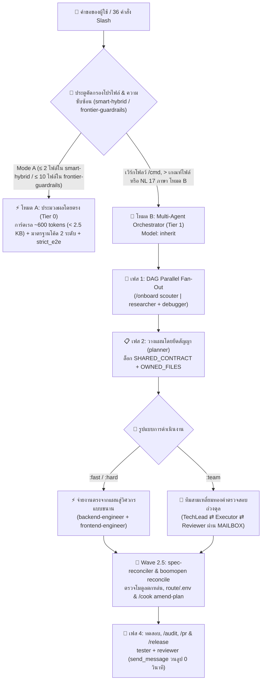

<div align="center">
  <h1>⚡ BoomOpen Workflow Kit v5.5.0</h1>
  <p><strong>ระบบปฏิบัติการ AI อัจฉริยะแบบผสมผสาน (Smart-Hybrid) ข้ามแพลตฟอร์ม — 22 เอเจนต์ผู้เชี่ยวชาญ, 18 ทีมสามเหลี่ยมทองคำ และคลังทักษะ 1,462 รายการแบบเรียกใช้ตามต้องการ</strong></p>

  <p>
    <a href="https://github.com/Kennyboom/BoomOpen-Workflow-Kit-Pro/releases"></a>
    <a href="#platforms"></a>
    <a href="#agents"></a>
    <a href="#skills"></a>
    <a href="https://nodejs.org/">=18.0.0" /></a>
    <a href="../LICENSE"></a>
  </p>

  <p>
    <a href="../README.md">🇬🇧 English</a> • <a href="./README.vi.md">🇻🇳 Tiếng Việt</a> • <a href="./README.zh-CN.md">🇨🇳 简体中文</a> • <a href="./README.zh-TW.md">🇹🇼 繁體中文</a> • <a href="./README.ja.md">🇯🇵 日本語</a> • <a href="./README.ko.md">🇰🇷 한국어</a> • <a href="./README.es.md">🇪🇸 Español</a> • <a href="./README.fr.md">🇫🇷 Français</a> • <a href="./README.de.md">🇩🇪 Deutsch</a><br/>
    <a href="./README.pt-BR.md">🇧🇷 Português</a> • <a href="./README.ru.md">🇷🇺 Русский</a> • <a href="./README.hi.md">🇮🇳 हिन्दी</a> • <a href="./README.ar.md">🇸🇦 العربية</a> • <a href="./README.id.md">🇮🇩 Bahasa Indonesia</a> • <b>🇹🇭 ไทย</b> • <a href="./README.tr.md">🇹🇷 Türkçe</a> • <a href="./README.it.md">🇮🇹 Italiano</a>
  </p>

  <p>
    <a href="https://boomopen.com">🌐 Website</a> •
    <a href="#pillars"><b>🧠 6 เสาหลัก</b></a> •
    <a href="#platforms"><b>💻 5 แพลตฟอร์ม</b></a> •
    <a href="#settings"><b>🎛️ 5 โปรไฟล์</b></a> •
    <a href="#commands"><b>🎯 36 คำสั่ง Slash</b></a> •
    <a href="#agents"><b>🤖 22 เอเจนต์ &amp; 18 ทีม</b></a> •
    <a href="#skills"><b>📚 1,462 ทักษะ</b></a>
  </p>
</div>

---

## 🎬 วิดีโอเปิดตัวทางการ (Full HD 1080p)

<div align="center">
  <a href="https://github.com/Kennyboom/BoomOpen-Workflow-Kit-Pro/raw/main/assets/media/boomopen_v55_trailer_en.mp4">
    
  </a>
  <p>
    ▶️ <a href="https://github.com/Kennyboom/BoomOpen-Workflow-Kit-Pro/raw/main/assets/media/boomopen_v55_trailer_en.mp4"><b>คลิกที่นี่เพื่อรับชม / สตรีมวิดีโอเปิดตัวทางการความละเอียด Full HD 1080p (MP4 พร้อมเสียงพากย์สตูดิโอ)</b></a>
  </p>
</div>

---

## 🌟 BoomOpen Workflow Kit v5.5 คืออะไร?

**BoomOpen Workflow Kit v5.5 (Frontier-Guardrails & Multi-Platform Smart-Hybrid Edition)** คือระบบปฏิบัติการแบบหลายเอเจนต์ (Multi-Agent) โอเพนซอร์สที่เปลี่ยนผู้ช่วยเขียนโค้ด AI เดี่ยวๆ ให้กลายเป็นองค์กรวิศวกรรมซอฟต์แวร์ที่ทำงานประสานกันประกอบด้วย **22 เอเจนต์ผู้เชี่ยวชาญ** (รวมถึง `spec-reconciler`), **18 ทีมสามเหลี่ยมทองคำ (`72` ไฟล์ทีม)**, **36 คำสั่ง Slash (`93` ไฟล์คำสั่ง = `87` เวิร์กโฟลว์ + `6` โปรโตคอล `_ref/`)**, **14 คำสั่ง CLI**, **22 ทักษะหลัก (Core Skills)** และ **1,440 ทักษะไลบรารีเฉพาะทาง (`skills_library/`)** (ดัชนีรวม **1,462 ทักษะ** ลดความซ้ำซ้อนร่วมกันผ่าน `~/.agents/skills_library` บน **5 แพลตฟอร์ม**)

แตกต่างจากเทมเพลตแบบตายตัวหรือเฟรมเวิร์กขนาดใหญ่ที่สร้างความหน่วงและกินบริบทในทุกรอบ BoomOpen v5.5 มาพร้อมค่าเริ่มต้น **`⚡ smart-hybrid`** (การแยกชาร์ดฝูงเอเจนต์เชิงรุกตั้งแต่เทิร์น 1 + ระบบนำทางภาษาธรรมชาติ 17 ภาษาครบทั้ง 5 IDE) ทันทีเมื่อติดตั้งใหม่ — พร้อมโปรไฟล์ทางเลือกโหมดสลิม **`🛡️ frontier-guardrails`** (`< 2.5 KB` / `~600 tokens` Mode A) — ปลดล็อก **การแบ่งส่วนฝูงเอเจนต์แบบยืดหยุ่น 4 ระดับ (`role#shard`)**, **การสำรวจสถาปัตยกรรมโค้ดเดิมภายใน 60 วินาที (`/onboard`)**, **เกตตรวจคุณภาพก่อนเปิด PR & เตรียมรีลีส (`/pr`, `/release`)**, **การปรับเทียบสเปกกับโค้ดอัตโนมัติ Wave 2.5 (`boomopen reconcile`)**, **การตรวจสอบโครงการหลายรอบหลังพัฒนาเสร็จ (`/audit`)**, **ระบบขับเคลื่อนโปรเจกต์อัตโนมัติหลายเซสชัน (`/autopilot`)** และ **ตัวควบคุมข้ามเอนจิน (`/conduct`)**:
- **⚡ ค่าเริ่มต้น `smart-hybrid` — ฝูงเอเจนต์เชิงรุกเทิร์น 1 + การนำทาง 17 ภาษา**: ทันทีที่ติดตั้งใหม่ (และคืนค่าได้ด้วย `boomopen settings reset`) งานแก้ไขขนาดเล็กที่รู้ไฟล์ชัดเจน (`≤ 2` ไฟล์) จะรันตรงในโหมด A ทันที ส่วนงานหลายไฟล์ งานวิจัยเชิงลึก การระดมสมอง การวางแผน และการเรียกเวิร์กโฟลว์ `/cmd` (**`/onboard`**, **`/pr` + `/pr:review`**, **`/release`** ฯลฯ) จะแยกชาร์ดซับเอเจนต์ขนานในเทิร์น 1 อัตโนมัติ (`role#shard`, ไม่เกิน `3–4 OWNED_FILES`/shard) พร้อม **DAG Parallel Fan-Out**, **การล็อกสัญญา (`SHARED_CONTRACT` + `OWNED_FILES`)**, **Wave 2.5 Spec-to-Code Auto-Reconciliation (`boomopen reconcile` + `/cook amend-plan`)** และ **การใช้เซสชันอุ่นซ้ำ (`send_message`)**
- **🛡️ โปรไฟล์ทางเลือกโหมดสลิม `frontier-guardrails` (`< 2.5 KB` / `~600 tokens` Mode A)**: หากต้องการให้เอเจนต์หลักของ IDE ลุยงานประจำวันโดยตรงสูงสุด `≤ 10` ไฟล์ (`mode_a`) โดยปิดการดักจับภาษาธรรมชาติ (`naturalLanguageResearchTrigger = off`) สามารถสลับได้ภายใน `< 10ms` ด้วย `boomopen settings preset frontier-guardrails` (รองรับชื่อพ้อง `carbon-guardrails` เพื่อความเข้ากันได้ย้อนหลัง) พร้อมคงมาตรฐานโค้ด 2 ระดับและเกต `strict_e2e`
- **🗺️ วงจรวิศวกรรมครบวงจร (`/onboard`, `/pr`, `/release`, `/autopilot`, `/audit`, `/conduct`)**: สร้างแผนที่สถาปัตยกรรมโค้ดเบสเดิม `ARCHITECTURE-MAP.md` ใน 60 วินาทีด้วย **`/onboard`** (ไม่ชนกับ `/init` และไม่สร้างไฟล์รกในรีโพ); บังคับเกตก่อนส่งโค้ดและรีวิว PR ด้วย **`/pr`** (`/pr:review`); เตรียม Semantic Release และ `CHANGELOG.md` ด้วย **`/release`**; ขับเคลื่อนโปรเจกต์หลายเฟสด้วย `.boomopen/project-ledger.json` (`ledger rollback`), ตรวจสอบหลายรอบด้วย `.boomopen/audit-ledger.json` (`audit rollback` + `security_scan.py` v6) และประชุมสภาหลายเอนจินผ่าน `/conduct`
- **📚 คลังทักษะ 1,462 รายการไร้ภาระบริบท + เทมเพลตพร้อมใช้งาน**: คอมไพล์ล่วงหน้าใน `matrix-skills/compact-index.json` เพื่อค้นหาแบบ `O(1)` 2 ขั้นตอน และแชร์คลังเดียวที่ `~/.agents/skills_library` โดยไม่คัดลอกซ้ำข้าม IDE พร้อมเทมเพลตตั้งต้นระดับโปรดักชันอย่าง **`mcp-server`** และ **`ai-agent-worker`**

---

## 🏗️ สถาปัตยกรรม Smart-Hybrid & Frontier-Guardrails (v5.5)



---

<a id="pillars"></a>

## 🧠 6 เสาหลักสำคัญของ v5.5

1. **🌐 รองรับ 5 แพลตฟอร์มพร้อมฟีเจอร์ Native ปี 2026 (`platforms/*`)**:
   - ติดตั้งแบบ Native สำหรับ **Antigravity (Gemini)** (`--as-plugin` & Python `run_workflow`), **Claude Code** (`/plan:hard`, ฮุกคุณภาพ `PreCompact`/`Stop` & การ์ดป้องกันคำสั่ง `Bash|PowerShell`), **OpenAI Codex** (ซับเอเจนต์ `.toml` พร้อมแซนด์บ็อกซ์ `read-only`), **Cursor** และ **GitHub Copilot** พร้อมแชร์คลังทักษะ `~/.agents/skills_library` ร่วมกัน
2. **📏 มาตรฐานการเขียนโค้ดเชิงปฏิบัติ 2 ระดับ (ป้องกันการหั่นไฟล์ไร้เหตุผล)**:
   - **ระดับที่ 1 (Zero Tolerance)**: Single Responsibility, **ห้ามใช้ `any` โดยเด็ดขาด**, **ห้ามทิ้ง `console.log` ดีบัก**, บังคับ `try/catch` + typed error ที่ขอบเขต async/API, ค่าคงที่ `SCREAMING_SNAKE_CASE`, DRY (`≥ 3`) และจัดเรียง import
   - **ระดับที่ 2 (Cohesion First)**: ไฟล์เป้าหมาย `~200–350 บรรทัด` เพดานอ่อน `~400–450 บรรทัด` (`>500 บรรทัด` หรือปนหลายโดเมนจึงแยก; ยกเว้น Test/Types/Docs) ฟังก์ชันลอจิก `~20–40 บรรทัด` (`~40–80` สำหรับ UI/Handler)
3. **🎯 การแบ่งส่วนฝูงเอเจนต์ 4 ระดับ (`role#shard`), จ่ายงานตรงจากแผน & ใช้ซ้ำเซสชันอุ่น (`send_message`)**:
   - เมื่อมี `PLAN-{feature}.md` Orchestrator จะจ่ายงาน **โดยตรง** ไปยังชาร์ดวิศวกรประจำโดเมน (ชาร์ดละ `<= 3–4 OWNED_FILES`) และบันทึกในทะเบียนเซสชันเพื่อใช้ซ้ำผ่าน `send_message` ด้วย **ความหน่วง 0 วินาที**
4. **🤝 การทำงานขนานยึดสัญญา (`SHARED_CONTRACT` + `OWNED_FILES`) & Wave 2.5 Spec-to-Code Auto-Reconciliation**:
   - ล็อก API/DTO และสิทธิ์การเขียนไฟล์ก่อนรันขนาน จากนั้น Wave 2.5 รัน `boomopen reconcile` + `spec-reconciler` (`REC-G1..G4`) เพื่อจับโมดูลโดดเดี่ยว (island shards), route/`.env` ไม่ตรงกัน และเงื่อนไข `[SC-*]` ที่ตกหล่น พร้อมสร้าง delta wave ด้วย `/cook amend-plan`
5. **🔍 5-Whys (SPIE v3.0), Multi-Round `/audit`, Git Checkpoints & 2-Layer Security Engine v6**:
   - `debugger` สืบสวนด้วย 3 สมมติฐาน + 5-Whys; `/audit` (`R1` → ผู้ใช้อนุมัติ → `/audit:fix` → `/audit:round2`) ผสาน `security_scan.py` v6, รองรับจุดย้อนกลับปลอดภัย (`boomopen ledger rollback`, `boomopen audit rollback`) และเก็บอาร์ติแฟกต์ชั่วคราวใน `<appDataDir>\brain\<conversation-id>\` เพื่อรักษา Git Tree ให้สะอาด 100%
6. **🩺 ชุดคำสั่ง CLI 14 คำสั่ง (`research`, `design`, `plan`, `cook`, `reconcile`, `audit`, `ledger`, `conduct`, `check`, `doctor`, `settings`, `install`, `uninstall`, `list`) & ดัชนีทักษะ O(1)**:
   - `npm run doctor` ตรวจสอบ 5 แพลตฟอร์ม, **22 เอเจนต์**, **18 ทีม (`72` ไฟล์ทีม)**, **36 คำสั่ง (`93` ไฟล์ = `87` เวิร์กโฟลว์ + `6` `_ref/`)** และ `matrix-skills/compact-index.json` (`1,462` ทักษะ) ส่วน `reconcile`, `audit` (พร้อม `audit rollback`), `ledger` (พร้อม `ledger rollback`), `check --strict-phase --no-stubs`, `install antigravity --as-plugin` และ `conduct` บังคับคุณภาพเชิงกำหนดตลอดวงจรพัฒนา

---

<a id="platforms"></a>

## 💻 แพลตฟอร์ม AI ที่รองรับ & จุดเด่น Native ปี 2026

| แพลตฟอร์ม | ระดับการรองรับ | ไฟล์เริ่มต้นระดับ Global | พาธติดตั้งเฟรมเวิร์ก & ฟีเจอร์เด่นปี 2026 |
|----------|:-------------:|-------------------|------------------------|
| **Antigravity (Gemini)** | ✅ Native v5.5 | `~/.gemini/GEMINI.md` | `~/.gemini/config/skills/boomopen-workflow-kit/` • โหมดปลั๊กอิน `--as-plugin`, ออร์เคสเตรชัน Python `run_workflow` & ลูป `/goal` |
| **Claude Code** | ✅ Native v5.5 | `~/.claude/CLAUDE.md` | `~/.claude/skills/boomopen-workflow-kit/` • `/plan:hard`, ฮุกคุณภาพ `PreCompact`/`Stop` & การ์ดป้องกัน `Bash\|PowerShell` (`--with-hooks`) |
| **OpenAI Codex** | ✅ Native v5.5 | `~/.codex/CODEX.md` & `AGENTS.md` | `~/.codex/skills/boomopen-workflow-kit/` • ลงทะเบียน 22 เอเจนต์ `.toml` พร้อมแซนด์บ็อกซ์ `read-only` สำหรับชาร์ดวิจัย/รีวิว |
| **Cursor** | ✅ Native v5.5 | `~/.cursor/rules/boomopen-workflow-kit.mdc` | `~/.cursor/skills/boomopen-workflow-kit/` • กฎ `.mdc` ขนาดเล็ก `< 2.5 KB`, ฮุก `--with-hooks` & แชร์คลัง `~/.agents/skills_library` |
| **GitHub Copilot** | ✅ Native v5.5 | `~/.copilot/COPILOT.md` | `~/.copilot/skills/boomopen-workflow-kit/` • โปรไฟล์ `.agent.md` แบบ Native & แชร์คลังทักษะ `~/.agents/skills_library` |

---

## 🚀 เริ่มต้นอย่างรวดเร็วและการติดตั้ง

```bash
# 1. โคลนรีโพสิทอรี
git clone https://github.com/Kennyboom/BoomOpen-Workflow-Kit-Pro.git
cd BoomOpen-Workflow-Kit-Pro

# 2. ติดตั้งสำหรับผู้ช่วย AI ของคุณ (แชร์คลัง ~/.agents/skills_library อัตโนมัติ)
npm run install:antigravity                        # Google Antigravity 2.0 (Gemini)
node cli/install.js install antigravity --as-plugin # ทางเลือก: ติดตั้งเป็นปลั๊กอิน Native ของ Antigravity
node cli/install.js install claude --with-hooks    # Anthropic Claude Code (+ ฮุก PreCompact/Stop & Bash|PowerShell guard)
npm run install:codex                              # OpenAI Codex CLI (+ 22 เอเจนต์ & แซนด์บ็อกซ์ read-only)
npm run install:cursor                             # Cursor AI Editor
npm run install:copilot                            # GitHub Copilot (VS Code)
npm run install:all                                # ติดตั้งพร้อมกันทั้ง 5 แพลตฟอร์ม

# 3. ตรวจสอบการติดตั้งและใช้งาน 14 คำสั่ง CLI
npm run doctor
npm link
boomopen research validate path/to/RESEARCH.md
boomopen design validate path/to/DESIGN.md
boomopen plan validate path/to/PLAN.md
boomopen cook preflight path/to/PLAN.md
boomopen reconcile path/to/your/project --plan path/to/PLAN.md   # ปรับเทียบ Wave 2.5 (REC-G1..G4)
boomopen audit init --docs docs/prd.md,docs/arch.md              # เริ่มสมุดบัญชีตรวจสอบ (รองรับ boomopen audit rollback)
boomopen check path/to/your/project --strict-phase --no-stubs
boomopen ledger status                                           # ตรวจสถานะเฟส (รองรับ boomopen ledger rollback)
boomopen conduct probe
```

> ชุดเครื่องมือนี้ **ไม่ได้เผยแพร่บน npm** — ติดตั้งจากรีโพซิทอรีนี้เท่านั้น ทางเลือก: `npm link` จะเพิ่มคำสั่ง `boomopen` ลงใน PATH (ไม่มีการดาวน์โหลดจาก npm)

---

<a id="settings"></a>

## 🎛️ ศูนย์ควบคุมการตั้งค่าและการเลือกโหมด (`/settings` Control Center)

BoomOpen v5.5 มาพร้อม **ศูนย์ควบคุมแบบรวมศูนย์ไร้ความหน่วง (Zero-Latency Control Center)** ให้คุณสลับโหมดการทำงาน, **5 โปรไฟล์สำเร็จรูป (Presets)** (โดยมี **`⚡ smart-hybrid`** เป็นค่าเริ่มต้นเมื่อติดตั้งใหม่ และคืนค่าได้ด้วย `boomopen settings reset`) และ 20 การตั้งค่า (+ 2 ค่าจำกัดบรรทัด) ครบทั้ง **5 แพลตฟอร์ม** ภายใน `< 10ms` (**ความหน่วงเทิร์นแรก 0ms** ผ่าน AOT `<!-- BOOMOPEN-SETTINGS-START -->`):

| โปรไฟล์ (`Preset`) | โหมดการทำงาน (`execution.mode`) | ค่าเริ่มต้น `/cmd` | การวิจัยภาษาธรรมชาติ (`naturalLanguageResearchTrigger`) | มาตรฐานโค้ด (`codingStandards`) | เหมาะสำหรับ |
|:---|:---|:---:|:---:|:---:|:---|
| **⚡ `smart-hybrid`** *(ค่าเริ่มต้นแนะนำ)* | **`auto`** (`≤ 2 ไฟล์` → Mode A รันตรง; `> 2 ไฟล์` หรือ `/cmd` → Mode B) | `auto` | **`auto_team`** *(ส่งงานวิจัย/ระดมสมองไป `/research:team` / `/brainstorm:team` อัตโนมัติ)* | `pragmatic` (`400/500` บรรทัด) | ค่าเริ่มต้นเมื่อติดตั้งใหม่ (`boomopen settings reset`): นำทางภาษาธรรมชาติ 17 ภาษา + แยกชาร์ดซับเอเจนต์อัตโนมัติตั้งแต่เทิร์น 1 เมื่อเกิน 2 ไฟล์ครบทั้ง 5 IDE |
| **🛡️ `frontier-guardrails`** *(โหมดสลิม Mode A ทางเลือก)* | **`mode_a`** *(รันตรงสูงสุด `≤ 10 ไฟล์`; การ์ดเรลสลิม `< 2.5 KB` / `~600 tokens` + `strict_e2e`)* | `auto` | **`off`** *(ใช้เฉพาะ `/cmd` ที่พิมพ์เอง — ไม่ดักจับภาษาธรรมชาติ)* | `pragmatic` (`400/500` บรรทัด) | โหมดสลิมทางเลือก `< 2.5 KB` (`~600 tokens`) ให้เอเจนต์หลักลุยงานประจำวันโดยตรงเร็วสุดพร้อมเกต `strict_e2e` *(รองรับชื่อพ้อง `carbon-guardrails` ย้อนหลัง)* |
| **🚀 `solo-fast`** | **`mode_a`** *(บังคับรันตรงแบบเดี่ยว ความหน่วงซับเอเจนต์ 0 วินาที)* | `fast` | `off` *(ตอบกลับในแชททันทีเว้นแต่พิมพ์ `/brainstorm`)* | `relaxed` (`600/800` บรรทัด) | งานแก้บั๊กด่วน (Hotfix), ทำต้นแบบไว, สคริปต์สั้นๆ และประหยัดโทเค็นสูงสุด |
| **🧠 `deep-architect`** | **`mode_b`** *(บังคับใช้ Multi-Agent Mode B ในทุกภารกิจ)* | `hard` | `auto_hard` *(รัน `/research:hard` / `/brainstorm:hard` เชิงลึกอัตโนมัติ)* | `strict` (`300/400` บรรทัด) | ออกแบบสถาปัตยกรรมระบบซับซ้อน โปรเจกต์ใหม่ และการรีแฟกเตอร์ข้ามโดเมน |
| **🔺 `adversarial-team`** | **`team`** *(บังคับใช้ทีมสามเหลี่ยมทองคำ 3 เอเจนต์ `:team` ทุกเวิร์กโฟลว์)* | `team` | **`auto_team`** *(3 เอเจนต์ถกเถียงและตรวจสอบข้ามกันผ่าน `MAILBOX`)* | `strict` (`300/400` บรรทัด) | ระบบโปรดักชันสำคัญยิ่งยวด งานตรวจสอบความปลอดภัย และการส่งมอบไร้ข้อผิดพลาด |

### 3 วิธีในการสลับโหมด (พิมพ์ `/settings` ในแชท, หน้าเว็บ UI และ CLI)

```bash
# 1. คำสั่ง Slash ในแชท (เมนูโต้ตอบหรือคำสั่งบรรทัดเดียว)
/settings                                     # เปิดเมนูเลือกแบบโต้ตอบ (ask_question UI)
/settings preset smart-hybrid                 # ค่าเริ่มต้นแนะนำ (Auto Mode A/B + นำทางภาษาธรรมชาติ 17 ภาษา)
/settings preset frontier-guardrails          # โหมดสลิมทางเลือก Mode A ≤10 ไฟล์, <2.5 KB / ~600 tokens (alias: carbon-guardrails)
/settings preset solo-fast                    # สลับเป็น Mode A รันตรงแบบเดี่ยวความเร็วสูง
/settings preset deep-architect               # สลับเป็น Mode B ระบบประสานงานหลายเอเจนต์
/settings preset adversarial-team             # สลับเป็นทีมสามเหลี่ยมทองคำ 3 เอเจนต์ (:team)
/settings mode auto | mode_a | mode_b | team  # กำหนดโหมดการทำงาน (execution.mode) โดยตรง

# 2. เปิดหน้าแดชบอร์ด Web Control Center ในเครื่อง (http://127.0.0.1:4567)
boomopen settings --ui

# 3. คำสั่ง Terminal CLI (ระดับ Global ~/.boomopen/settings.json และระดับโปรเจกต์ ./.boomopen.json)
boomopen settings status
boomopen settings preset smart-hybrid         # ตั้งค่าเริ่มต้นแนะนำระดับ Global และซิงค์ครบ 5 แพลตฟอร์ม
boomopen settings preset frontier-guardrails  # สลับเป็นโปรไฟล์ทางเลือกโหมดสลิม Mode A (< 2.5 KB / ~600 tokens)
cd path/to/your/project
boomopen settings set execution.mode mode_a --project
boomopen settings reset                       # คืนค่าเริ่มต้นแนะนำ (smart-hybrid)
```

> `--project` จะเขียน `./.boomopen.json` ในโฟลเดอร์ที่คุณรันคำสั่งเสมอ จึงต้องรันภายในโปรเจกต์ของคุณ ไม่ใช่ในโฟลเดอร์ที่โคลนชุดเครื่องมือ หากไม่ได้ใช้ `npm link` ให้แทน `boomopen` ด้วย `node /path/to/BoomOpen-Workflow-Kit-Pro/cli/install.js`

---

## 🌙 คู่มือรันโปรเจกต์ขนาดใหญ่หลายเฟสข้ามคืน (`/autopilot` vs `/goal` + `/autopilot` + `/audit`)

> **หมายเหตุความเข้ากันได้ตามแพลตฟอร์ม**: **`/goal`** คือลูปชั้นนอกแบบ Native ของ **Antigravity (Gemini)** สำหรับรันงานยาวอัตโนมัติ ส่วนบน **Claude Code** และ **OpenAI Codex** ความต่อเนื่องข้ามหลายเซสชันจะขับเคลื่อนด้วย **`/autopilot`** ร่วมกับฮุกคุณภาพ **`Stop` / `PreCompact`** (`--with-hooks`) และสมุดบัญชี `.boomopen/project-ledger.json`!

| เกณฑ์เปรียบเทียบ | `/autopilot` (+ ฮุก `Stop`/`PreCompact` บน Claude Code & Codex) | `/goal` + `/autopilot` + `/audit` *(ลูปชั้นนอก Native บน Antigravity)* |
|:---|:---|:---|
| **การอ่านสเปก & สมุดบัญชี** | แปลง `docs/` เป็น `project-ledger.json` + `PLAN` พร้อมเช็คแฮช SHA-256 และ `ledger rollback` | เหมือนกันทุกประการ โดย `/goal` ทำหน้าที่เป็นตัวรันชั้นนอกของ Antigravity ข้ามทุกเฟสจนจบ |
| **ความต่อเนื่องข้ามเซสชัน** | ฮุก `PreCompact`/`Stop` บังคับตรวจเกตและส่งต่อสถานะจาก `project-ledger.json` อัตโนมัติ | รีเซ็ตและสานต่อบริบทอัตโนมัติเมื่อใกล้เต็ม รัน `reconcile` จนกว่า `project-ledger.json` ครบ 100% |
| **การตรวจรับ & ความปลอดภัย** | รัน `check --strict-phase --no-stubs` และ `/autopilot:audit` เมื่อปิดแต่ละเฟส | จบด้วยวงจร `/audit` เต็มรูปแบบ (Round 1 → รอคุณอนุมัติ → `/audit:fix` → `/audit:round2` + Security v6) |

### พรอมต์พร้อมคัดลอกสำหรับรันโปรเจกต์ขนาดใหญ่ข้ามคืน

```text
/goal ใช้ /autopilot เพื่ออ่านเอกสารสเปกทั้งหมดใน docs/ และสร้างโปรเจกต์ให้เสร็จสมบูรณ์ครบทุกเฟส:
1. สร้างและตรวจสอบ project-ledger.json กับแผนงาน PLAN ให้ครอบคลุมความต้องการ 100%
2. พัฒนาทีละเฟสด้วยชาร์ดขนาน รันการทดสอบจริง และตรวจ Wave 2.5 ด้วย reconcile + spec-reconciler ทุกครั้งหลังจบเฟส
3. เมื่อครบทุกเฟสแล้ว ให้รัน /audit (Round 1 + Security v6) เพื่อสรุปรายการตรวจพบทั้งหมดในรายงานเพื่อรอการอนุมัติจากฉันก่อนแก้ไขโค้ด
```

---

<a id="commands"></a>

## 🎯 ตารางอ้างอิงคำสั่ง Slash (36 คำสั่ง / 93 ไฟล์)

| คำสั่ง | ตัวเลือกย่อย (Variants) | วัตถุประสงค์หลัก |
|---------|----------|-----------------|
| **`/onboard`** | — | สำรวจโค้ดเบสเดิมภายใน 60 วินาที สร้าง `ARCHITECTURE-MAP.md` (จุดเริ่มต้นระบบ, data flow, จุดเสี่ยง & เกตทดสอบ โดยไม่ชน `/init`) |
| **`/cook`** | `:fast`, `:hard`, `:team`, `amend-plan` | พัฒนาฟีเจอร์ครบวงจร (วิจัย/สำรวจ → วางแผน → เขียนโค้ดขนาน → Wave 2.5 `reconcile` → ทดสอบ → รีวิว) |
| **`/code`** | `:fast`, `:hard`, `:team` | ลงมือเขียนโค้ดโดยตรงจากแผน `PLAN-{feature}.md` ที่มีอยู่ |
| **`/plan`** | `:fast`, `:hard`, `:team` | สร้างพิมพ์เขียวการพัฒนาพร้อม `SHARED_CONTRACT`, `OWNED_FILES` และเกณฑ์ Given/When/Then (รองรับ `/plan:hard` บน Claude Code) |
| **`/fix`** | `:fast`, `:hard`, `:team` | แก้ไขบั๊กที่ต้นตอพร้อมบังคับตรวจสอบด้วย Regression Test |
| **`/debug`** | `:fast`, `:hard`, `:team` | สืบสวนหาสาเหตุรากเหง้าด้วย 3 สมมติฐาน + ห่วงโซ่ **5-Whys (SPIE v3.0)** (`DEBUG-{issue}.md`) |
| **`/test`** | `:fast`, `:hard`, `:team` | รันชุดทดสอบแบบขนาน DAG + ค้นหากรณีขอบเขตที่ยังไม่ได้ทดสอบ (`tester` + `scouter`) |
| **`/review`** | `:fast`, `:hard`, `:team` | ตรวจสอบโค้ดแบบขนาน 4 มิติ (สถาปัตยกรรม, คุณภาพโค้ด, ความปลอดภัย OWASP, ประสิทธิภาพ) |
| **`/pr`** | `create`, `:review` (`/pr:review`) | ด่านตรวจคุณภาพเข้มงวดก่อนเปิด PR (`check`, `reconcile`, diff tests), ตรวจสุขอนามัยกิ่ง/คอมมิต & สร้าง `gh pr create` หรือรีวิว PR |
| **`/audit`** | `:run`, `:round2`, `:fix`, `:auto` | ตรวจสอบทั้งโปรเจกต์หลายรอบหลังทำเสร็จ: Round 1 → ผู้ใช้อนุมัติ → `/audit:fix` → `/audit:round2` (Security v6, RTM & `audit rollback`) |
| **`/design`** | `:fast`, `:hard`, `:team` | ออกแบบสถาปัตยกรรมระบบ โครงสร้างฐานข้อมูล และข้อกำหนด UI/UX (`DESIGN.md`) |
| **`/docs`** | `:core`, `:business`, `:audit` | สร้างหรือซิงค์เอกสารสถาปัตยกรรมและเอกสารธุรกิจแบบ 2 ระดับ (`./documents/`) |
| **`/release`** | `patch`, `minor`, `major` | เตรียม Semantic Release: ตรวจ Conventional Commits, สังเคราะห์ `CHANGELOG.md`, รันเกต (`doctor`, `check`, `test`, `test:pack`) & เช็กลิสต์ `gh release create` |
| **`/deploy`** | `:check`, `:preview`, `:production`, `:rollback` | ตรวจสอบความพร้อมก่อนดีพลอย, สภาพแวดล้อมพรีวิว, การขึ้นระบบจริง และการย้อนกลับอย่างปลอดภัย |
| **`/research`** | `:fast`, `:hard`, `:team` | เอ็นจินวิจัยเชิงลึกอัตโนมัติ (ตรวจสอบ 4 แหล่งข้อมูล, ค้นหา 3 ระลอก และสภา 3 เวกเตอร์) |
| **`/brainstorm`** | `:fast`, `:hard`, `:team` | ค้นหาความต้องการด้วยวิธีโสกราตีส วิเคราะห์ข้อดีข้อเสีย และระดมสมอง |
| **`/report`** | `:fast`, `:hard`, `:team` | สร้างรายงานสรุปเชิงบริหารและเชิงเทคนิคพร้อมตัวชี้วัดและแผนภาพ |
| **`/autopilot`** | `:init`, `:run`, `:audit` | ตัวประสานงานโปรเจกต์อัตโนมัติข้ามเซสชันด้วย `.boomopen/project-ledger.json`, ด่านคุณภาพ 4 ชั้น และ `ledger rollback` |
| **`/conduct`** | `:council`, `:pipeline` | ตัวควบคุมข้ามเอนจินและสภาหลายเอนจินแบบขนาน (`boomopen conduct`) พร้อมรายงานสังเคราะห์ฉันทามติ 4 ส่วน |
| **`/orchestrate`** | — | ประสานงานไปป์ไลน์ Multi-Agent แบบกำหนดเองข้ามหลายโดเมน |
| **`/settings`** | `preset`, `mode`, `set`, `ui` | ศูนย์ควบคุมรวมศูนย์: สลับโหมด, เลือก **5 Presets** (ค่าเริ่มต้น `smart-hybrid` ฯลฯ) หรือเปิด Web UI (`--ui`) |
| **`/save` / `/recap`** | — | บันทึกสถานะเซสชัน (`SESSION-HANDOVER.md`) และกู้คืนบริบททั้งหมดภายใน `< 5 วินาที` |

---

<a id="agents"></a>

## 🤖 22 เอเจนต์ผู้เชี่ยวชาญ & 18 ทีมสามเหลี่ยมทองคำ (72 ไฟล์)

| หมวดหมู่ | เอเจนต์ผู้เชี่ยวชาญ (`agents/*.md`) | ทีมสามเหลี่ยมทองคำ (`agents/teams/*-team/`) |
|----------|-----------------------------------|------------------------------------------------|
| **วิศวกรรมและการลงมือปฏิบัติ** | `backend-engineer`, `frontend-engineer`, `mobile-engineer`, `game-engineer`, `database-architect`, `devops-engineer` | `backend-team`, `frontend-team`, `fullstack-team`, `mobile-team`, `game-team`, `database-team`, `devops-team` |
| **สถาปัตยกรรมและการวางแผน** | `tech-lead`, `planner`, `brainstormer`, `business-analyst`, `project-manager`, `designer` | `planning-team`, `brainstorm-team`, `project-team`, `design-team` |
| **คุณภาพ ความปลอดภัย การดีบัก & ปรับเทียบ** | `debugger`, `tester`, `reviewer`, `spec-reconciler`, `security-engineer`, `performance-engineer` | `debug-team`, `qa-team`, `security-team`, `performance-team` |
| **การวิจัยและจัดการความรู้** | `researcher`, `scouter`, `docs-manager`, `reporter` | `research-team`, `docs-team`, `report-team` |

---

<a id="skills"></a>

## 📚 คลังทักษะ 1,462 รายการ (22 ทักษะหลัก + 1,440 ทักษะไลบรารี)

BoomOpen มาพร้อมระบบนิเวศทักษะ **1,462 รายการ** ที่ลดความซ้ำซ้อนบนดิสก์ผ่านคลังกลาง **`~/.agents/skills_library`** และออกแบบให้ **ใช้โทเค็นขณะว่างเป็น 0** ผ่าน **การค้นหาทักษะแบบก้าวหน้า 2 ขั้นตอน O(1)** (`<skills>` → `matrix-skills/compact-index.json` → โหลดเฉพาะไฟล์ `SKILL.md` ที่ต้องการ):

| ระดับ / หมวดหมู่ทักษะ | จำนวน | ทักษะและความสามารถเด่น | กลไกการโหลด |
|:---|:---:|:---|:---|
| **⚡ ระดับ 1: ทักษะหลัก (`skills/`)** | **22** | `clean-code`, `debugger`, `plan-writing`, `brainstorming`, `frontend-design`, `frontend-architecture`, `design-spec`, `api-patterns`, `database-design`, `testing-patterns`, `skill-seeker` | จัดทำดัชนีล่วงหน้าใน `<skills>` พร้อมใช้ทันทีใน Turn 1 |
| **🎨 การออกแบบ UI/UX, Motion และ Design Systems** | **42** | Anti-AI-Slop Visual Craft, ระบบสี OKLCH & Bento Grids, Motion v12 + CSS View Transitions, Headless Primitives (`cmdk`/`vaul`/`sonner`), Figma MCP + W3C DTCG Tokens, WCAG 2.2 AA/AAA, iOS 18 HIG & Material 3 Expressive | โหลดตามต้องการผ่าน `compact-index.json` (`matrix-skills/design.yaml`) |
| **🌐 เว็บ, แบ็กเอนด์ และระบบกระจายศูนย์** | **390+** | Next.js 15/React 19, Hono RPC, FastAPI, NestJS, Go/Rust Axum, GraphQL, gRPC, Redis/Kafka, Supabase RLS, Multi-tenant SaaS | โหลดตามต้องการผ่าน `~/.agents/skills_library` |
| **🤖 AI, เอเจนต์ LLM, MCP และวิศวกรรมข้อมูล** | **320+** | เทมเพลต **`mcp-server`** & **`ai-agent-worker`**, MCP FastMCP (`StreamableHTTP`), OpenAI/Claude/Google ADK, ไปป์ไลน์ RAG, LangGraph, BigQuery, dbt | โหลดตามต้องการผ่าน `~/.agents/skills_library` |
| **☁️ คลาวด์, DevOps, Kubernetes และความปลอดภัย** | **300+** | Cloudflare Workers/D1/R2/DO, Terraform/OpenTofu, AWS/GCP/Azure, Docker/K8s GitOps, 2-Layer Security v6 & OWASP LLM Top 10 | โหลดตามต้องการผ่าน `~/.agents/skills_library` |
| **📱 โมบายล์, เกมเอนจิน และโดเมนเฉพาะทาง** | **410+** | Tauri v2, SwiftUI, Kotlin, React Native, Flutter, Unity 6 DOTS, Unreal Engine 5, Godot 4, WebGPU/Three.js TSL, Colyseus | โหลดตามต้องการผ่าน `~/.agents/skills_library` |

---

## 📂 โครงสร้างรีโพสิทอรี

```text
BoomOpen-Workflow-Kit-Pro/
├── agents/                  # 22 เอเจนต์ผู้เชี่ยวชาญ + 18 ทีมสามเหลี่ยมทองคำ (54 ไฟล์บทบาท + 18 _team.md = 72 ไฟล์)
├── cli/                     # ชุดคำสั่ง CLI 14 คำสั่ง: install, uninstall, list, doctor, check, settings, research, design, plan, cook, reconcile, audit, ledger & conduct
├── commands/                # 36 คำสั่ง Slash (87 ไฟล์เวิร์กโฟลว์ รวม /onboard, /pr, /pr:review, /release, /audit, /autopilot, /conduct) + 6 _ref/ (รวม 93 ไฟล์)
├── documents/               # เอกสารสถาปัตยกรรม โดเมน โครงสร้างโค้ด และมาตรฐานการเขียนโค้ดแบบ 2 ระดับ
├── i18n/                    # เอกสารหลายภาษา (คำแปล README ฉบับสมบูรณ์ใน 16 ภาษาหลัก)
├── matrix-skills/           # เมทริกซ์ทักษะ YAML ตามโดเมน + compact-index.json ที่คอมไพล์ล่วงหน้า (1,462 ทักษะ)
├── platforms/               # เทมเพลตรวมสำหรับทั้ง 5 แพลตฟอร์ม (antigravity/, claude/, codex/, copilot/, cursor/) + ฮุกและปลั๊กอิน
├── rules/                   # กฎโหมด B โหลดตามความต้องการ (CORE, PHASES, AGENTS, TEAMS, SKILLS, ERRORS, REFERENCE)
├── scripts/                 # สคริปต์ Python สำหรับทำงานอัตโนมัติและตรวจสอบ (checklist.py, verify_all.py, security_scan.py ฯลฯ)
├── skills/                  # ทักษะหลัก 22 รายการ (clean-code, debugger, plan-writing, frontend-design ฯลฯ)
├── skills_library/          # คลังทักษะเฉพาะทาง 1,440 รายการ (แชร์ผ่าน ~/.agents/skills_library รวมเทมเพลต mcp-server & ai-agent-worker)
└── GEMINI.md | CLAUDE.md | CODEX.md | COPILOT.md | CURSOR.md | AGENT.md
```

---

## 📄 สัญญาอนุญาตและความปลอดภัย

- **สัญญาอนุญาต**: เผยแพร่ภายใต้ [สัญญาอนุญาต MIT](../LICENSE) ลิขสิทธิ์ © 2026 **BoomOpen Labs** สกิลของบุคคลที่สามใน `skills_library/` ยังคงใช้สัญญาอนุญาตต้นฉบับ — ดู [THIRD_PARTY_NOTICES.md](../THIRD_PARTY_NOTICES.md)
- **นโยบายความปลอดภัย**: โปรดดู [SECURITY.md](../SECURITY.md) สำหรับระบบป้องกันความปลอดภัยในตัวและแนวทางการรายงานช่องโหว่
