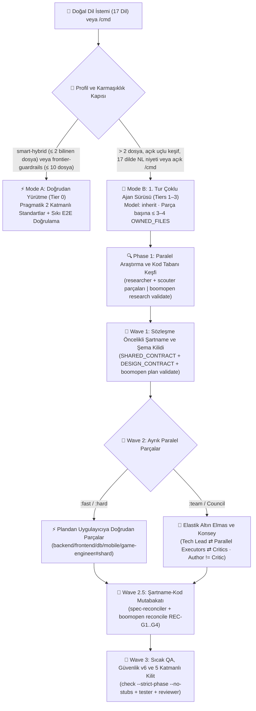

<div align="center">
  <h1>⚡ BoomOpen Workflow Kit Pro v5.5</h1>
  <p><strong>Antigravity, Claude Code, OpenAI Codex, Cursor ve GitHub Copilot genelinde çoklu ajan iş akışı orkestrasyonu ve deterministik CLI doğrulama kapıları.</strong></p>

  <p>
    <a href="https://boomopen.com"></a>
    <a href="https://github.com/Kennyboom/BoomOpen-Workflow-Kit-Pro/releases"></a>
    <a href="#platforms"></a>
    <a href="#cli"></a>
    <a href="#skills"></a>
    <a href="https://nodejs.org/">= 18.0.0" /></a>
    <a href="../LICENSE"></a>
  </p>

  <p>
    <a href="../README.md">English</a> •
    <a href="./README.vi.md">Tiếng Việt</a> •
    <a href="./README.zh-CN.md">简体中文</a> •
    <a href="./README.zh-TW.md">繁體中文</a> •
    <a href="./README.ja.md">日本語</a> •
    <a href="./README.ko.md">한국어</a> •
    <a href="./README.es.md">Español</a> •
    <a href="./README.fr.md">Français</a> •
    <a href="./README.de.md">Deutsch</a><br/>
    <a href="./README.pt-BR.md">Português (BR)</a> •
    <a href="./README.ru.md">Русский</a> •
    <a href="./README.hi.md">हिन्दी</a> •
    <a href="./README.ar.md">العربية</a> •
    <a href="./README.id.md">Bahasa Indonesia</a> •
    <a href="./README.th.md">ไทย</a> •
    <b>Türkçe</b> •
    <a href="./README.it.md">Italiano</a>
  </p>

  <p>
    <a href="https://boomopen.com"><b>🌐 boomopen.com (15 Dil)</b></a> •
    <a href="#trailer"><b>🎬 Lansman Videosu</b></a> •
    <a href="#why-boomopen"><b>⚡ Neden BoomOpen</b></a> •
    <a href="#architecture"><b>🏗️ Mimari</b></a> •
    <a href="#quickstart"><b>🚀 Hızlı Başlangıç</b></a> •
    <a href="#cli"><b>🛠️ 14 CLI Kapısı</b></a> •
    <a href="#settings"><b>🎛️ Profiller &amp; Ayarlar</b></a> •
    <a href="#commands"><b>🎯 36 Komut</b></a> •
    <a href="#agents"><b>🤖 22 Ajan &amp; 18 Ekip</b></a> •
    <a href="#skills"><b>📚 1.462 Yetenek</b></a>
  </p>
</div>

---

<a id="trailer"></a>

## 🎬 Resmi Lansman Videosu ve Etkileşimli Web Gezgini (`boomopen.com`)

<div align="center">
  <a href="https://github.com/Kennyboom/BoomOpen-Workflow-Kit-Pro/raw/main/assets/media/boomopen_v55_trailer_en.mp4">
    
  </a>
  <p>
    ▶️ <a href="https://github.com/Kennyboom/BoomOpen-Workflow-Kit-Pro/raw/main/assets/media/boomopen_v55_trailer_en.mp4"><b>Full HD 1080p Lansman Videosunu Oynatın (Stüdyo Seslendirmeli MP4)</b></a> • 🌐 <a href="https://boomopen.com"><b>boomopen.com Üzerinde Canlı 14 Komutlu CLI Oyun Alanını ve Aranabilir Katalogları Keşfedin (15 Dil)</b></a>
  </p>
</div>

---

<a id="why-boomopen"></a>
<a id="-what-is-boomopen-workflow-kit"></a>

## ⚡ Neden BoomOpen Workflow Kit?

**Ham Yapay Zeka Kodlama Asistanlarının Sorunu:** Tek ajanlı kodlama araçları, mühendislik işi birden fazla dosyaya, alana veya oturuma yayıldığında hızla bozulur. Sıralı dosya okuma birincil bağlam penceresini şişirir; koordinesiz alt ajanlar ortak dosyaların üzerine yazar veya bağlantısız "ada" modüller bırakır; üretilen kod sessiz `TODO` stub'ları ya da `any` tip kaçamaklarıyla çıkar; tek modelli incelemeler kendi kör noktalarını kaçırır (`Author == Critic`) ve çok fazlı geliştirmeler başlangıçtaki şartnameden sapar.

**BoomOpen Bunu Nasıl Çözer:** BoomOpen, **sıfır çalışma zamanı npm bağımlılığıyla** **Antigravity (Gemini)**, **Claude Code**, **OpenAI Codex**, **Cursor** ve **GitHub Copilot** üzerinde tek bir birleşik orkestrasyon ve doğrulama katmanı kurar. Varsayılan **`smart-hybrid`** profili etkinken `≤ 2` dosyalık düzenlemeler sıfır ek yükle doğrudan çalışır; çok dosyalı geliştirmeler, derin araştırma, mimari planlama ve **`36` slash komutu (`93` dosya)** ise daha 1. turda işi **22 uzman ajan** ve **18 çapraz denetimli 3 rollü ekip** arasında otomatik parçalar — **14 yerel `boomopen` CLI kapısı** ile doğrulanır ve **`1.462` isteğe bağlı yetenek** (`22` Çekirdek + `~/.agents/skills_library` içinde tekilleştirilmiş `1.440` kütüphane yeteneği) ile desteklenir.

### ⚖️ BoomOpen Olmadan vs. BoomOpen v5.5 İle

| Mühendislik Hata Modu | BoomOpen Olmadan (Ham AI IDE) | BoomOpen Workflow Kit Pro v5.5 İle |
|:-------------------------|:------------------------------|:------------------------------------|
| **Bağlam Penceresi Şişkinliği** | Ana ajan tek satır kod yazmadan önce sırayla 15–30 dosyayı okur | **1. Tur Elastik Sürü (`role#shard`)**: Salt okunur keşif ajanları ve alan parçaları (`≤ 3–4` dosya/parça) + `0s` Sıcak Yeniden Kullanım (`send_message`) |
| **Paralel Üzerine Yazma & Kopuk Bağlantılar** | Paralel ajanlar ortak dosyaları ezer, uyumsuz `/api` rotaları uydurur veya ölü modüller bırakır | **Sözleşme Öncelikli Kilitler + Dalga 2.5 Mutabakatı**: Dalga 1'de `SHARED_CONTRACT` + ayrık `OWNED_FILES` kilitler, `boomopen reconcile` (`REC-G1..G4`) ile doğrular |
| **Yüzeysel Araştırma & Muğlak Planlar** | Tek bakış açılı yanıtlar ("harika fikir!"), doğrulanmamış iddialar, serbest metin planlar | **Kanıt Kapılı 6 Bloklu Şartnameler**: Çapraz denetimli `:team` Şeytanın Avukatı + `< 50ms` CLI doğrulayıcıları (`boomopen research`, `design`, `plan`) |
| **Sessiz Stub'lar, `any` & Test Hileleri** | Ajan `// TODO`, açık `any`, `console.log` veya `.skip` testler bırakıp işi tamamlandı sayar | **Pragmatik 2 Katmanlı Statik Kapı**: `boomopen check --strict-phase --no-stubs` ile `0` `any`, `0` stub ve bütünlüklü `400/500` satırlık dosyalar zorlanır |
| **Çok Oturumlu Sapma & Regresyon** | Bağlam sıkıştırması önceki faz kısıtlarını siler ve çalışan özellikleri bozar | **5 Katmanlı Faz Kilidi & Rollback**: `.boomopen/project-ledger.json` SHA-256 sapma koruması, `/autopilot`, `/audit` ve atomik `rollback --yes` |
| **Tek Modelli Kör Noktalar** | Aynı model kendi yazdığı kodu yine kendisi inceler (`Author == Critic`) | **Çapraz Motor Orkestra Şefi (`/conduct`)**: Claude Code, Codex, Antigravity, Cursor ve Copilot arasında paralel Çoklu Motor Konseyleri ve çapraz aile iş hatları |
| **5 IDE Yapılandırma Sapması & Kirli Git** | Her IDE için ayrı kural dosyaları, gigabaytlarca kopya yetenek, `git status` kirleten geçici dosyalar | **Birleşik Senkronizasyon & Temiz Git**: `< 10ms` içinde senkronize 14 giriş dosyası, 1 ortak `~/.agents/skills_library` (`0` boşta token) ve Brain Artifacts yönlendirmesi |

---

<a id="architecture"></a>
<a id="-smart-hybrid-architecture-v55"></a>

## 🏗️ Smart-Hybrid Mimarisi (v5.5)



---

<a id="pillars"></a>

## 🧠 6 Temel Mühendislik Sütunu

1. **🌐 5 IDE Yerel Derlemesi ve Tekilleştirilmiş Kasa (`platforms/*`)**:
   - **22 uzman ajanı** ve **93 komut/referans dosyasını** her IDE'nin kendi yerel biçimine derler: **Antigravity** (`--as-plugin` paketi + `3` çalıştırılabilir `run_workflow` Python betiği: `audit_fanout.py`, `review_fanout.py`, `research_fanout.py`), **Claude Code** (`isolation: worktree` parçaları, `/plan:hard` iki noktalı komutlar, isteğe bağlı `PreToolUse` ve `Stop`/`PreCompact` kancaları), **OpenAI Codex** (keşif/eleştirmen için işletim sistemi düzeyinde `read-only` kum havuzlu `22` TOML rolü + `87` `$boomopen-*` yeteneği), **Cursor** (`.mdc` kuralları + isteğe bağlı `beforeShellExecution` kancası) ve **GitHub Copilot** (`.agent.md` istem ajanları).
   - Tüm `1.440` kütüphane yeteneğini 5 IDE genelinde `~/.agents/skills_library` dizinine tek seferde bağlar (~%80 disk tasarrufu, 1. turda `0` token şişkinliği).
2. **🎯 4 Katmanlı Dinamik Elastik Sürü (`role#shard`) ve Kapsamlı Sıcak Yeniden Kullanım**:
   - **Katman 0** (`≤ 2` bilinen dosya için `0` alt ajan) → **Katman 1** (`2–3` parça) → **Katman 2** (`4–6` parça) → **Katman 3** (`7–8+` parça, `16`'ya kadar yapılandırılabilir) arasında otomatik ölçeklenir; bilişsel yükü alt ajan başına **`≤ 3–4 OWNED_FILES`** ile sınırlar ve aktif oturumları `role#shard → conversationId` (`send_message`) üzerinden yeniden kullanır.
3. **🤝 3 Dalgalı Sözleşme Öncelikli Yürütme + Dalga 2.5 Mutabakatı (`REC-G1..G4`)**:
   - Dalga 1, Dalga 2 paralel mühendisleri görevlendirmeden önce `SHARED_CONTRACT` (API şemaları/DTO'lar) ve `DESIGN_CONTRACT` (OKLCH `@theme` CSS + TypeScript prop'ları) sözleşmelerini kilitler. Dalga 2.5'te `boomopen reconcile` + `spec-reconciler`, bağlanmamış ada dosyalarını (`REC-G1`), frontend/backend rota uyuşmazlıklarını (`REC-G2`), atlanmış `[SC-*]` alt maddelerini (`REC-G3`) ve eksik `.env.example` anahtarlarını (`REC-G4`) yakalayarak `boomopen cook amend-plan` ile otomatik delta dalgaları ekler.
4. **🏛️ Çok Oturumlu Otopilot (`/autopilot`) ve Durum Bilgili Çok Turlu Denetim (`/audit`)**:
   - Çok belgeli şartnameleri SHA-256 sapma tespiti, faz öncesi Git kontrol noktaları (`boomopen ledger rollback --yes`) ve sıkı **5 Katmanlı Faz Kalite Kilidi** (`G1 check --strict-phase --no-stubs` → `G2` monotonik test kilidi → `G3 reconcile --strict` → `G4 Author != Critic` incelemesi → `G5 ledger verify`) ile `.boomopen/project-ledger.json` dosyasına derler. Geliştirme sonrasında `/audit`, insan onaylı çok turlu RTM, dikey akış ve Güvenlik v6 denetimlerini yürütür (`.boomopen/audit-ledger.json` + `boomopen audit rollback --yes`).
5. **🎼 Çapraz Motor Orkestra Şefi ve Çoklu Motor Konseyi (`boomopen conduct`)**:
   - Claude Code, OpenAI Codex, Antigravity, Cursor ve Copilot'u eşzamanlı olarak **6 Görevli Paralel Konseylerde** (`research`, `brainstorm`, `plan`, `design`, `review`, `debug` → 4 bölümlü `COUNCIL-SYNTHESIS.md`) veya hiçbir modelin kendi çıktısını notlamadığı **Çapraz Aile Rol İş Hatlarında** (`Author != Critic`) koordine eder.
6. **📏 Pragmatik 2 Katmanlı Kodlama Standartları ve SPIE v3.0 Kök Neden Hata Ayıklama**:
   - **Katman 1 (Sıfır Tolerans)**: Tek sorumluluk, `0` açık `any`, uygulama kodunda `0` debug `console.log`, tipli `try/catch` sınırları, `SCREAMING_SNAKE_CASE` sabitler. **Katman 2 (Önce Bütünlük)**: `~200–350` satır hedefi (`400` esnek / `500` kesin bölme sınırı; testler/tipler/dokümanlar muaf). Hatalar 3 sıralı hipotez ve **5-Whys (SPIE v3.0)** nedensellik izinden geçerken geçici şartnameler Brain Artifacts dizinine yönlendirilir (`%100` temiz Git çalışma ağacı).

---

<a id="platforms"></a>
<a id="-supported-ai-platforms"></a>

## 💻 Desteklenen 5 Yapay Zeka Kodlama Platformu

| Platform | Destek | Senkronize Giriş Dosyaları | Yerel Platform Entegrasyonu |
|:---------|:-------:|:---------------------|:----------------------------|
| **Antigravity (Gemini)** | ✅ v5.5 | `~/.gemini/GEMINI.md` | `invoke_subagent`, `run_workflow` Python dağıtımı, `/goal` dış döngüsü, `--as-plugin` paketi, isteğe bağlı `--with-hooks`, Brain Artifacts |
| **Claude Code** | ✅ v5.5 | `~/.claude/CLAUDE.md` | Paralel `Task`/`Agent` parçaları (`isolation: worktree`), `/plan:hard` iki noktalı komutlar, isteğe bağlı `PreToolUse` ve `Stop`/`PreCompact` kancaları |
| **OpenAI Codex** | ✅ v5.5 | `~/.codex/AGENTS.md` ve `CODEX.md` | `~/.codex/agents/boomopen/` altında keşif/inceleme için işletim sistemi `sandbox_mode = "read-only"` korumalı `22` TOML rolü + `87` `$boomopen-*` yeteneği |
| **Cursor** | ✅ v5.5 | `~/.cursor/rules/boomopen-workflow-kit.mdc` | Her zaman aktif `.mdc` frontmatter kuralları, `CURSOR.md`, alt ajan yönlendirmesi ve isteğe bağlı `.cursor/hooks.json` (`beforeShellExecution`) |
| **GitHub Copilot** | ✅ v5.5 | `~/.copilot/copilot-instructions.md` | VS Code için derlenmiş `boomopen-workflow-kit.agent.md` istem ajanı, `runSubagent` görevlendirmesi ve `COPILOT.md` |

---

<a id="quickstart"></a>
<a id="-quick-start--installation"></a>

## 🚀 Hızlı Başlangıç ve Kurulum (Yalnızca Git — Sıfır Çalışma Zamanı Bağımlılığı)

```bash
# 1. Depoyu klonlayın (yalnızca GitHub üzerinden dağıtılır — npm üzerinde kesinlikle yayımlanmaz)
git clone https://github.com/Kennyboom/BoomOpen-Workflow-Kit-Pro.git
cd BoomOpen-Workflow-Kit-Pro

# 2. Kullandığınız AI IDE için (varsayılan profil: smart-hybrid) veya 5 IDE'nin tamamına tek seferde kurun
npm run install:all                                 # Tüm 5 IDE'yi kur ve senkronize et + ortak ~/.agents/skills_library
npm run install:antigravity                         # Google Antigravity 2.0 (veya --as-plugin / --with-hooks ekleyin)
node cli/install.js install claude --with-hooks     # Claude Code + isteğe bağlı PreToolUse ve Stop/PreCompact kancaları
npm run install:codex                               # OpenAI Codex CLI + OS salt okunur keşif/inceleme kum havuzları
npm run install:cursor                              # Cursor (beforeShellExecution koruması için --with-hooks geçin)
npm run install:copilot                             # GitHub Copilot (VS Code .agent.md + copilot-instructions.md)

# 3. Sistem sağlığını doğrulayın ve isteğe bağlı olarak `boomopen` komutunu global PATH'e bağlayın
npm run doctor
npm link
boomopen settings status
```

> **Güvenli ve Tahribatsız Kurulum / Kaldırma**: SHA-256 manifestoları (`~/.boomopen/manifests/<tool>.json`) ile izlenir. `GEMINI.md` / `CLAUDE.md` içindeki mevcut kişisel kurallarınız kit işaretleyicilerinin dışında korunur ve otomatik yedeklenir; `boomopen uninstall <tool|--all>` kendi dosyalarınıza dokunmadan yalnızca değiştirilmemiş kit dosyalarını temiz biçimde kaldırır.

---

<a id="cli"></a>

## 🛠️ Bağımlılıksız 14 CLI Alt Komutu (`boomopen`)

Node.js `>= 18` üzerinde **sıfır npm çalışma zamanı bağımlılığı** ve **sıfır ağ çağrısı** ile yerel olarak `< 50ms` içinde çalışır:

| Alt Komut | Temel Bayraklar ve Sözdizimi | Deterministik Kapılar ve Mühendislik Amacı |
|:-----------|:-------------------|:------------------------------|
| **`install` / `uninstall` / `list`** | `<tool\|--all> [--with-hooks] [--as-plugin]` | SHA-256 manifestolu kurucu, ortak `~/.agents/skills_library` bağlayıcısı, isteğe bağlı güvenlik kancaları ve temiz kaldırıcı |
| **`doctor`** | `[--source-only]` | Tüm 5 IDE paketini, `93` komut dosyasını, `72` ekip dosyasını, `1.462` yeteneği ve senkronize ayarları kapsayan 30 maddelik salt okunur denetim |
| **`settings`** | `status \| preset <name> \| set <k> <v> \| --ui` | 5 hazır profili + `22` yapılandırma anahtarını yönetin (`./.boomopen.json` için `--project`) veya CSP korumalı Web UI'yi (`127.0.0.1:4567`) açın |
| **`research`** | `<validate\|brief> <file.md> [--mode brainstorm]` | **`RES-G1..G4`** kapılarını (`≥ 4` çapraz doğrulanmış kaynak, çelişki matrisi, pre-mortem riskler) zorlar ve `HANDOFF_BRIEF` derler |
| **`design`** | `<validate\|contract> <DESIGN.md> [--json]` | **`DESIGN-G1..G4`** kapılarını (6 bloklu şartname, OKLCH token'ları, 5 durumlu UI matrisi, WCAG 2.2 AA) zorlar ve `DESIGN_CONTRACT` üretir |
| **`plan`** | `<validate\|compile> <PLAN.md> [--sync-ledger]` | **`PLAN-G1..G5`** kapılarını (döngüsüz DAG, parça başına ayrık `OWNED_FILES ≤ 4`, `SHARED_CONTRACT`) zorlar ve defteri senkronize eder |
| **`cook`** | `<state\|packets\|verify-wave\|preflight\|amend-plan>` | **`COOK-G1..G4`** kapılarını uygular: 5 aşamalı hızlı geçiş durumu, 5 alanlı Dalga Devir Paketleri, git yazma kilidi kontrolleri ve delta dalgaları |
| **`reconcile`** | `<dir> [--plan <PLAN.md>] [--strict]` | Dalga 2.5 **`REC-G1..G4`**: bağlanmamış ada modülleri, `/api` rota sapmalarını, atlanan `[SC-*]` maddelerini ve `.env.example` eksiklerini yakalar |
| **`check`** | `[path] --strict-phase --no-stubs [--ignore <dir>]` | Pragmatik 2 Katmanlı statik kapı: `400/500` satır bütçesi, `0` açık `any`, `0` debug `console.log`, `0` stub/`TODO`/`.skip` |
| **`ledger`** | `<init\|from-plan\|status\|next\|verify\|rollback>` | Çok oturumlu `.boomopen/project-ledger.json` DAG durum makinesi, SHA-256 şartname sapma koruması ve atomik `rollback --yes` |
| **`audit`** | `<init\|slice\|record\|approve\|verify-fix\|rollback>` | Tamamlama sonrası durum bilgili çok turlu denetim defteri (`.boomopen/audit-ledger.json`), bulgu eritme kilidi ve `rollback --yes` |
| **`conduct`** | `<probe\|council\|dispatch\|status> [--dry-run]` | Çapraz motor orkestra şefi ve 6 görevli paralel Çoklu Motor Konseyi (5 IDE genelinde `Author != Critic` → `COUNCIL-SYNTHESIS.md`) |

---

<a id="settings"></a>
<a id="-unified-settings--mode-selection-settings"></a>

## 🎛️ Birleşik Kontrol Merkezi ve 5 Hazır Profil (`/settings`)

Küresel olarak (`~/.boomopen/settings.json`) veya depo bazında (`./.boomopen.json`) **`20` enum anahtarını + `2` özel satır sınırı anahtarını** yönetin; tüm 14 IDE giriş dosyasına `< 10ms` içinde anında senkronize edilir:

| Hazır Profil | Yürütme Modu (`execution.mode`) | Varsayılan `/cmd` | 17 Dilde NL Yönlendirmesi (`naturalLanguageResearchTrigger`) | Kodlama Standartları | En Uygun Kullanım |
|:---------------|:----------------------------------|:--------------:|:---------------------------------------------------------:|:----------------:|:--------------|
| **⚡ `smart-hybrid`** *(Default)* | **`auto`** (`≤ 2` dosya doğrudan; `> 2` dosya veya `/cmd` → Mode B Sürüsü) | `auto` | **`auto_team`** *(17 dilde doğal dil araştırma/fikir/inceleme isteklerini `:team` ve iş akışlarına yönlendirir)* | `pragmatic` (`400/500`L) | Kutudan çıktığı haliyle varsayılan deneyim: doğal dil niyet yönlendirmesi + otomatik 1. tur paralel parçalama |
| **🛡️ `frontier-guardrails`** *(Slim Opt-In)* | **`mode_a`** (`≤ 10` dosya doğrudan; `< 2.5 KB` / `~600` token giriş dosyası) | `auto` | **`off`** *(Yalnızca açık `/cmd` — sıfır doğal dil müdahalesi)* | `pragmatic` (`400/500`L) | Sıkı 2 Katmanlı ve E2E kapılarıyla ultra hafif `< 2.5 KB` günlük doğrudan mod *(`carbon-guardrails` takma adı desteklenir)* |
| **🚀 `solo-fast`** | **`mode_a`** (`≤ 10` dosya doğrudan; temkinli maksimum `3` parça) | `fast` | `off` | `relaxed` (`600/800`L) | Hızlı prototipleme, küçük betikler, acil hotfix'ler ve minimum token harcaması |
| **🧠 `deep-architect`** | **`mode_b`** *(Sıkı Mode B Orkestratörü; maksimum `12` parça)* | `hard` | `auto_hard` + `council` araştırma / `cross_family` inceleme | `strict` (`300/400`L) | Karmaşık sistem mimarisi, sıfırdan tasarım ve modüller arası refaktör |
| **🔺 `adversarial-team`** | **`team`** *(Elastik Altın Elmas `:team`; `hyper_swarm` maksimum `12`)* | `team` | **`auto_team`** + `council` araştırma, planlama ve inceleme | `strict` (`300/400`L) | Kritik prodüksiyon sürümleri, güvenlik denetimleri ve çoklu motor uzlaşısı |

```bash
# Sohbet (/settings), Yerel Web UI (--ui) veya CLI üzerinden profil değiştirin ya da anahtarları özelleştirin:
boomopen settings --ui                                      # http://127.0.0.1:4567 adresinde Yerel Web Kontrol Merkezini başlat
boomopen settings preset smart-hybrid                       # Varsayılan: Auto Mode A/B + 17 dilde NL iş akışı yönlendirmesi
boomopen settings preset frontier-guardrails                # İsteğe bağlı: < 2.5 KB ince Mode A (takma ad: carbon-guardrails)
boomopen settings set engines.reviewer cross_family         # Farklı model ailesinden Reviewer zorla (Author != Critic)
cd path/to/your/repo && boomopen settings mode team --project # Depo kapsamlı ./.boomopen.json geçersiz kılması
boomopen settings reset                                     # Varsayılan smart-hybrid yapılandırmasını geri yükle
```

---

<a id="commands"></a>
<a id="-slash-commands-reference"></a>

## 🎯 Tüm 36 Slash Komutu Başvuru Rehberi (`93` Dosya = `87` İş Akışı + `6` `_ref/`)

`smart-hybrid` altında **desteklenen 17 dilden herhangi birinde** doğal biçimde yazın veya **36 standart slash komutundan** istediğinizi doğrudan çağırın:

| Kategori | Komut | Varyantlar | Amaç ve Deterministik Çıktılar |
|:---------|:--------|:---------|:-------------------------------------|
| **Orkestrasyon ve Otonomi** | **`/cook`** | `:fast`, `:hard`, `:team` | Henüz plan yokken uçtan uca özellik geliştirici (Keşif → Sözleşmeli Plan → Paralel Parçalar → Dalga 2.5 Mutabakatı → QA) |
| | **`/code`** | `:fast`, `:hard`, `:team` | Onaylanmış bir `PLAN-{task}.md` dosyasını `/plan` komutunu yeniden çalıştırmadan doğrudan Dalga 1–3 parçalarında uygular |
| | **`/autopilot`** | `:init`, `:run`, `:audit` | `.boomopen/project-ledger.json` ve **5 Katmanlı Faz Kalite Kilidi** üzerinden çok oturumlu şartnameden prodüksiyona orkestratör |
| | **`/conduct`** | `:council`, `:pipeline` | 5 IDE genelinde çoklu motor paralel konseyi (`COUNCIL-SYNTHESIS.md`) ve çapraz aile rol iş hattı (`--dry-run` hazır) |
| | **`/orchestrate`** / **`/auto`** | — | Özel çok alanlı sürü koordinasyonu (`/orchestrate`) veya uçtan uca tam otonom yürütme (`/auto`) |
| **Mimari, Tasarım ve Araştırma** | **`/plan`** | `:fast`, `:hard`, `:team` | `SHARED_CONTRACT`, parça başına ayrık `OWNED_FILES ≤ 4` ve Given/When/Then kriterlerini kilitleyen 5 kapılı `PLAN-{task}.md` planı |
| | **`/architect`** | — | Yalnızca tasarım odaklı sistem planı: C4 diyagramları, ADR'ler, DB şemaları, API sözleşmeleri, ekran şartnameleri ve kapsam denetimi (sıfır kod yazar) |
| | **`/design`** / **`/ui-ux-pro-max`** | `:fast`, `:hard`, `:team` | 6 bloklu UI/UX `DESIGN-{task}.md` + `DESIGN_CONTRACT` (`@theme` OKLCH token'ları, 5 durumlu UI matrisi, 50+ stil ve canlı HTML önizleme) |
| | **`/research`** | `:fast`, `:hard`, `:team` | 5 mercekli Derin Araştırma (`RESEARCH-{topic}.md`, `RES-G1..G4` ≥ 4 kaynaklı üçgenleme, çelişki tablosu ve `HANDOFF_BRIEF`) |
| | **`/brainstorm`** / **`/ask`** | `:fast`, `:hard`, `:team` | Dalkavukluk karşıtı stratejik fikir üretimi (pre-mortem ve MCDA matrisli `BRAINSTORM-{topic}.md`) ve kanıt kapılı soru-cevap (`/ask`) |
| **Kalite, Denetim, Hata Ayıklama ve Güvenlik** | **`/review`** | `:fast`, `:hard`, `:team` | Çok mercekli çapraz kod, mimari, güvenlik ve performans incelemesi (`Author != Critic`, tek tıkla `/fix` geçişi) |
| | **`/audit`** / **`/deep-audit`** | `:run`, `:fix`, `:auto` | Geliştirme sonrası çok turlu tam proje denetimi (`/audit` defteri) ve kod öncesi 10 boyutlu şartname mantık denetimi (`/deep-audit`) |
| | **`/security-audit`** | — | OWASP Top 10 + LLM/Agentic Top 10 taraması (`security_scan.py` v6), STRIDE tehdit modellemesi, kimlik doğrulama ve tedarik zinciri raporu |
| | **`/debug`** / **`/fix`** | `:fast`, `:hard`, `:team` | 3 hipotez + **5-Whys (SPIE v3.0)** kök neden izi (`DEBUG-{issue}.md`) ve önce başarısız test yazan TDD hata çözümü (`/fix`) |
| | **`/test`** / **`/performance`** / **`/refactor`** | `:fast`, `:hard`, `:team` | Test hilesine izin vermeyen QA parçaları (`/test`), Core Web Vitals / DB / paket boyutu iyileştirmesi (`/performance`) ve metrik doğrulanmış `/refactor` |
| **Git, Sürüm, Dokümantasyon ve Oturum İşlemleri** | **`/onboard`** / **`/init`** | — | Mevcut projeler için 60 saniyede salt okunur `ARCHITECTURE-MAP.md` (`/onboard`, sıfır `/init` çakışması) ve yeni proje kurulumu (`/init`) |
| | **`/pr`** / **`/release`** | —, `:review` | PR öncesi kalite ve mutabakat kapısı + `gh pr create` / çapraz diff incelemesi (`/pr:review`) ve eşlik kapılı semantik `/release` |
| | **`/deploy`** / **`/rollback`** | `:check`, `:preview`, `:production`, `:rollback` | Dağıtım hazırlık kapıları, önizleme/prodüksiyon geçişleri (`/deploy`) ve önem dereceli acil geri alma (`/rollback`) |
| | **`/docs`** / **`/report`** | `:core`, `:business`, `:audit` / `:fast..:team` | Kaynak koda dayalı `./documents/` dokümantasyon paketleri (`/docs`) ve kurgu içermeyen gerçek CLI telemetri durum raporları (`/report`) |
| | **`/settings`** / **`/status`** / **`/next`** | — | Birleşik Kontrol Merkezi (`/settings`), canlı defter/sürü sağlık panosu (`/status`) ve akıllı sonraki adım kılavuzu (`/next`) |
| | **`/preview`** / **`/save`** / **`/recap`** | — | Yerel geliştirme sunucusu yaşam döngüsü yöneticisi (`/preview`), oturum durumu kaydı (`/save`) ve `< 5s` bağlam geri yükleme (`/recap`) |

### 🌙 Gece Boyu Çok Fazlı Proje Oyun Kitabı (`/autopilot` & `/goal`)

| İş Akışı | Hedef Platform ve Çalıştırıcı | Bağlam Sürekliliği | Kalite ve Şartname Garantileri |
|:---------|:-------------------------|:-------------------|:--------------------------|
| **`/autopilot` (+ `--with-hooks`)** | Tüm 5 IDE (**Claude Code**, **Antigravity** ve **Cursor** üzerinde `--with-hooks` ile eşleştirin) | `Stop` ve `PreCompact` kancaları (`stop-quality-gate.mjs`) + `.boomopen/project-ledger.json` bağlam sıkıştırmaları boyunca imleci korur | **5 Katmanlı Faz Kalite Kilidi** (`G1..G5`), Dalga 2.5 `reconcile` ve `boomopen ledger rollback --yes` uygular |
| **`/goal` + `/autopilot` + `/audit`** | Büyük `docs/` şartnameleri için **Antigravity 2.0** kalıcı dış döngüsü | Antigravity'nin yerel **`/goal`** çalıştırıcısı defterdeki her faz `VERIFIED` olana dek fazlar boyunca döner | Her fazı 5 kapının tamamından + Dalga 2.5 mutabakatından geçirir, ardından **`/audit`** 1. Turunu çalıştırır |

```text
/goal docs/ içindeki tüm proje dokümantasyonunu okumak, .boomopen/project-ledger.json dosyasını başlatmak ve her fazı sırayla otonom biçimde uygulamak için /autopilot kullan (her faz tüm 5 doğrulama kapısını ve Dalga 2.5 reconcile kontrolünü geçmelidir). Fazların %100'ü geçtiğinde /audit 1. Turunu çalıştır ve incelemem için özet raporla dur.
```

---

<a id="agents"></a>
<a id="-22-specialist-agents--18-golden-triangle-teams"></a>

## 🤖 22 Uzman Ajan ve 18 Çapraz Denetimli 3 Rollü Ekip

Her alt ajan oturum modelinizi devralır (`Model: "inherit"` — `flash_lite` kesinlikle yasaktır) ve **18 Altın Elmas / Üçgen ekibi** (`Tech Lead` ⇄ `Parallel Shard Executors` ⇄ `Independent Reviewers/Critics`) halinde eşleşir:

| Alan | Uzman Ajanlar (`agents/*.md`, her IDE için derlenir) | 3 Rollü İnceleme Ekipleri (`agents/teams/*-team/`, `72` dosya) |
|:-------|:----------------------------------------------------|:---------------------------------------------------------|
| **Mühendislik ve Uygulama** | `backend-engineer`, `frontend-engineer`, `mobile-engineer`, `game-engineer`, `database-architect`, `devops-engineer` | `backend-team`, `frontend-team`, `fullstack-team`, `mobile-team`, `game-team`, `database-team`, `devops-team` |
| **Mimari ve Ürün** | `tech-lead`, `planner`, `brainstormer`, `business-analyst`, `project-manager`, `designer` | `planning-team`, `brainstorm-team`, `project-team`, `design-team` |
| **Kalite, Mutabakat ve Güvenlik** | `debugger`, `tester`, `reviewer`, `spec-reconciler`, `security-engineer`, `performance-engineer` | `debug-team`, `qa-team`, `security-team`, `performance-team` |
| **Araştırma ve Dokümantasyon** | `researcher`, `scouter`, `docs-manager`, `reporter` | `research-team`, `docs-team`, `report-team` |

---

<a id="skills"></a>
<a id="-1460-skills-vault-22-core--1440-niche-library-skills"></a>

## 📚 1.462 Yeteneklik İsteğe Bağlı Kasa (`22` Çekirdek + `1.440` Kütüphane Yeteneği)

`matrix-skills/compact-index.json` içinde **19 mühendislik alanında** indekslenir, `~/.agents/skills_library` dizininde tek seferde tekilleştirilir ve **2 Adımlı O(1) Aşamalı Çözümleme** (`skills/` Çekirdek kontrolü → `compact-index.json` sorgusu → eşleşen `SKILL.md` dosyasını yalnızca görevlendirilen parçaya yükleme, boşta `0` token) ile yüklenir:

| Katman / Mühendislik Alanı | Yetenek | Temsili Yetkinlikler ve Proje İskeletleri | Yükleme |
|:--------------------------|:------:|:----------------------------------------|:--------|
| **⚡ Çekirdek İş Akışı ve Kalite (`skills/`)** | **22** | `clean-code`, `debugger`, `plan-writing`, `brainstorming`, `deep-research`, `design-spec`, `frontend-design`, `frontend-architecture`, `api-patterns`, `database-design`, `tdd-workflow`, `testing-patterns`, `webapp-testing`, `security-auditor` (`security_scan.py` v6), `app-builder` (**`mcp-server`**, **`ai-agent-worker`**, `nextjs-saas`, `monorepo-turborepo`, `python-fastapi`, `flutter-app` dahil **15 proje şablonu**), `skill-seeker` | 1. Turda Hazır |
| **🤖 Yapay Zeka, Ajan SDK'ları, MCP ve Veri** | **340+** | FastMCP (`StreamableHTTP`), OpenAI Agents SDK, Claude Agent SDK, Google ADK, Vercel AI SDK, LangGraph, RAG, BigQuery, dbt | İsteğe bağlı (`compact-index.json`) |
| **🌐 Web, Backend, API ve Veritabanları** | **380+** | React 19, Next.js 15 RSC, Tailwind CSS v4, TanStack Start/Router/Query, Hono RPC + Zod OpenAPI, Rust Axum/SQLx, Drizzle, Postgres/RLS | İsteğe bağlı (`compact-index.json`) |
| **☁️ Bulut, DevOps, QA ve Güvenlik** | **300+** | Cloudflare Workers/Durable Objects/D1, Docker/K8s, Terraform, Playwright, Vitest + MSW v2, Better Auth (Passkeys), OWASP LLM Top 10 | İsteğe bağlı (`compact-index.json`) |
| **🎨 UI/UX, Oyun Motorları ve Mobil** | **420+** | OKLCH Tasarım Token'ları, WCAG 2.2 AA, Motion, Unity 6 DOTS/ECS, Godot 4, Unreal 5, WebGPU/Three.js, Phaser/PixiJS, Tauri v2, SwiftUI, Flutter, React Native | İsteğe bağlı (`compact-index.json`) |

---

## 📂 Depo Yapısı

```text
BoomOpen-Workflow-Kit-Pro/
├── agents/                  # 22 Uzman Ajan (her IDE için derlenir) + 18 3 Rollü Ekip (72 dosya)
├── cli/                     # Bağımlılıksız 14 Node.js CLI Alt Komutu + 33 node:test test paketi
├── commands/                # 87 iş akışı dosyasında 36 Slash Komutu + 6 _ref/ protokolü (93 dosya)
├── documents/               # Mimari, alan, kaynak kod tabanı ve Pragmatik 2 Katmanlı kodlama standartları belgeleri
├── i18n/                    # Tamamı yerelleştirilmiş 16 README (kök README.md ile birlikte toplam 17 dil)
├── matrix-skills/           # 19 alan YAML kataloğu + O(1) compact-index.json (indekslenmiş 1.462 yetenek)
├── platforms/               # 5 IDE paketi, isteğe bağlı koruma kancaları, 3 Antigravity run_workflow/*.py ve Codex TOML rolleri
├── rules/                   # İsteğe bağlı yüklenen 7 Mode B kural modülü (CORE, PHASES, AGENTS, TEAMS, SKILLS, ERRORS, REFERENCE)
├── scripts/                 # Çapraz platform doğrulama ve oturum yardımcıları (checklist.py, verify_all.py, auto_preview.py, session_manager.py)
├── skills/                  # 22 Çekirdek Yetenek + 15 app-builder proje şablonu + Güvenlik v6 / UX / Perf denetim betikleri
├── skills_library/          # Ortak ~/.agents/skills_library dizinine tek seferde bağlanan 1.440 kütüphane yeteneği
├── web/                     # https://boomopen.com adresine güç veren 15 dilli Cosmic WebGL vitrini ve aranabilir kataloglar
└── GEMINI.md | CLAUDE.md | CODEX.md | COPILOT.md | CURSOR.md | AGENT.md
```

---

## 📄 Lisans ve Güvenlik

- **Resmi Web Sitesi**: [https://boomopen.com](https://boomopen.com)
- **Lisans**: Kit kaynak kodu, CLI, kurallar, ajanlar ve dokümantasyon [MIT Lisansı](../LICENSE) altında yayımlanmaktadır (Telif Hakkı © 2026 **BoomOpen Labs**). `skills_library/` içindeki üçüncü taraf yetenekler kendi orijinal üst kaynak lisanslarını korur — bkz. [THIRD_PARTY_NOTICES.md](../THIRD_PARTY_NOTICES.md).
- **Güvenlik Politikası**: SHA-256 manifesto korumaları, isteğe bağlı kanca kum havuzu izolasyonu ve güvenlik açığı bildirimi için [SECURITY.md](../SECURITY.md) dosyasına bakın.
