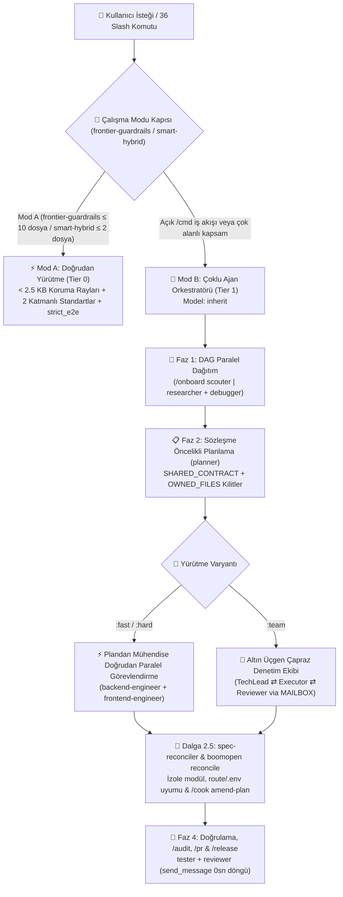

<div align="center">
  <h1>⚡ BoomOpen Workflow Kit v5.5.0</h1>
  <p><strong>Çok Platformlu Smart-Hybrid Yapay Zeka İş Gücü İS — 22 Uzman Ajan, 18 Altın Üçgen Ekibi ve 1.462 İsteğe Bağlı Yetenek Kasası</strong></p>

  <p>
    <a href="https://github.com/Kennyboom/BoomOpen-Workflow-Kit-Pro/releases"></a>
    <a href="#platforms"></a>
    <a href="#agents"></a>
    <a href="#skills"></a>
    <a href="https://nodejs.org/">=18.0.0" /></a>
    <a href="../LICENSE"></a>
  </p>

  <p>
    <a href="../README.md">🇬🇧 English</a> • <a href="./README.vi.md">🇻🇳 Tiếng Việt</a> • <a href="./README.zh-CN.md">🇨🇳 简体中文</a> • <a href="./README.zh-TW.md">🇹🇼 繁體中文</a> • <a href="./README.ja.md">🇯🇵 日本語</a> • <a href="./README.ko.md">🇰🇷 한국어</a> • <a href="./README.es.md">🇪🇸 Español</a> • <a href="./README.fr.md">🇫🇷 Français</a> • <a href="./README.de.md">🇩🇪 Deutsch</a><br/>
    <a href="./README.pt-BR.md">🇧🇷 Português</a> • <a href="./README.ru.md">🇷🇺 Русский</a> • <a href="./README.hi.md">🇮🇳 हिन्दी</a> • <a href="./README.ar.md">🇸🇦 العربية</a> • <a href="./README.id.md">🇮🇩 Bahasa Indonesia</a> • <a href="./README.th.md">🇹🇭 ไทย</a> • <b>🇹🇷 Türkçe</b> • <a href="./README.it.md">🇮🇹 Italiano</a>
  </p>

  <p>
    <a href="https://boomopen.com">🌐 Website</a> •
    <a href="#pillars"><b>🧠 6 Temel Sütun</b></a> •
    <a href="#platforms"><b>💻 5 Platform</b></a> •
    <a href="#settings"><b>🎛️ 5 Hazır Profil</b></a> •
    <a href="#commands"><b>🎯 36 Slash Komutu</b></a> •
    <a href="#agents"><b>🤖 22 Ajan &amp; 18 Ekip</b></a> •
    <a href="#skills"><b>📚 1.462 Yetenek</b></a>
  </p>
</div>

---

## 🎬 Resmi Lansman Fragmanı (Full HD 1080p)

<div align="center">
  <a href="https://github.com/Kennyboom/BoomOpen-Workflow-Kit-Pro/raw/main/assets/media/boomopen_v55_trailer_en.mp4">
    
  </a>
  <p>
    ▶️ <a href="https://github.com/Kennyboom/BoomOpen-Workflow-Kit-Pro/raw/main/assets/media/boomopen_v55_trailer_en.mp4"><b>Full HD 1080p Resmi Lansman Fragmanını izlemek / oynatmak için buraya tıklayın (Stüdyo seslendirmeli MP4)</b></a>
  </p>
</div>

---

## 🌟 BoomOpen Workflow Kit v5.5 Nedir?

**BoomOpen Workflow Kit v5.5 (Multi-Platform Unified & Frontier-Guardrails Edition)**, tek bir yapay zeka kodlama asistanını **22 uzman ajan** (`spec-reconciler` dahil), **18 çapraz denetimli Altın Üçgen ekibi (`72` ekip dosyası)**, **36 slash komutu (`93` komut dosyası = `87` iş akışı + `6` `_ref/` protokolü)**, **14 CLI komutu**, **22 temel yetenek (`skills/`)** ve **1.440 niş kütüphane yeteneğinden (`skills_library/`)** oluşan koordine bir mühendislik organizasyonuna dönüştüren açık kaynaklı bir çoklu ajan işletim sistemidir (`~/.agents/skills_library` üzerinden tekilleştirilmiş toplam **1.462** yetenek, `1,462` indeks kaydı, **5 platform**).

Her turda soğuk başlatma gecikmesine ve bağlam şişkinliğine yol açan hantal sarmalayıcıların aksine BoomOpen v5.5; **`< 2.5 KB` İnce Koruma Rayları (`frontier-guardrails`)**, **4 Katmanlı Dinamik Elastik Sürü Parçalama (`role#shard`)**, **60 Saniyede Mevcut Kod Tabanı Mimari Haritalama (`/onboard`)**, **PR Öncesi Kalite Kapıları ve Sürüm Hazırlığı (`/pr`, `/release`)**, **Dalga 2.5 Spec-to-Code Otomatik Mutabakatı (`boomopen reconcile`)**, **Çok Turlu Proje Denetimi (`/audit`)**, **Çok Oturumlu Proje Otopilotu (`/autopilot`)** ve **Çapraz Motor Orkestra Şefini (`/conduct`)** birleştirir:
- **🛡️ Frontier-Guardrails (`mode_a` ≤ 10 dosya) ve Mod B Paralel Orkestrasyon**: Varsayılan önerilen **`frontier-guardrails`** profili, 5 IDE'nin tamamında yerel ajanın günlük görevleri `≤ 10` dosyaya kadar doğrudan yürütmesine izin verirken `< 2.5 KB` ince koruma kurallarını ve `strict_e2e` doğrulamasını uygular; açık `/cmd` iş akışlarında veya Mod B/Smart-Hybrid modunda **DAG Paralel Dağıtım**, **Sözleşme Kilitleri (`SHARED_CONTRACT` + `OWNED_FILES`)**, **Dalga 2.5 Otomatik Mutabakat (`boomopen reconcile` + `/cook amend-plan`)** ve **Sıcak Oturum Yeniden Kullanımı (`send_message`)** ile paralel alt ajan parçaları (`role#shard`, parça başına `<= 3–4 OWNED_FILES`) başlatır.
- **🗺️ Uçtan Uca Mühendislik Yaşam Döngüsü (`/onboard`, `/pr`, `/release`, `/autopilot`, `/audit`, `/conduct`)**: **`/onboard`** ile mevcut projeler için 60 saniyede `ARCHITECTURE-MAP.md` üretir (`/init` çakışması yok, depo kirliliği sıfır); **`/pr`** (`/pr:review`) ile PR öncesi kapıları ve incelemeleri çalıştırır; **`/release`** ile semantik sürüm ve `CHANGELOG.md` hazırlar; `.boomopen/project-ledger.json` (`ledger rollback`), `.boomopen/audit-ledger.json` (`audit rollback` + `security_scan.py` v6) ve `/conduct` ile büyük projeleri güvenle yönetir.
- **📚 Sıfır Bağlam Şişkinliği ile 1.462 Yetenek Kasası ve Hazır Şablonlar**: `matrix-skills/compact-index.json` ile 2 adımlı `O(1)` arama sunar ve tüm IDE'ler arasında `~/.agents/skills_library` üzerinden tekilleştirilir; üretime hazır **`mcp-server`** ve **`ai-agent-worker`** şablonlarını içerir.

---

## 🏗️ Akıllı-Hibrit & Frontier-Guardrails Mimarisi (v5.5)



---

<a id="pillars"></a>

## 🧠 v5.5 Sürümünün 6 Temel Sütunu

1. **🌐 5 Platformda 2026 Yerel Özellik Uyumu (`platforms/*`)**:
   - **Antigravity (Gemini)** (`--as-plugin` paketleme & Python `run_workflow`), **Claude Code** (`/plan:hard`, `PreCompact`/`Stop` kalite kancaları & `Bash|PowerShell` güvenlik koruması), **OpenAI Codex** (`read-only` kum havuzlu `.toml` ajanları), **Cursor** ve **GitHub Copilot** için tek mimariden yerel kurulum ve ortak `~/.agents/skills_library` kasası.
2. **📏 Pragmatik 2 Katmanlı Kodlama Standartları (Parçalanmayı Önleme)**:
   - **Katman 1 (Sıfır Tolerans)**: Tek Sorumluluk, **açık `any` YASAK**, **üretim kodunda unutulmuş `console.log` YASAK**, async/API sınırlarında `try/catch` + tipli hata yönetimi, `SCREAMING_SNAKE_CASE` sabitler, DRY (`≥ 3`) ve sıralı importlar.
   - **Katman 2 (Bütünlük Öncelikli)**: Dosyalar `~200–350 satır` hedefler, `~400–450 satır` esnek tavan (`>500 satır` veya çoklu alan bölünür; test/tip/doküman muaf). Fonksiyonlar `~20–40 satır` (UI/Handler `~40–80 satır`).
3. **🎯 4 Katmanlı Dinamik Elastik Sürü Parçalama (`role#shard`), Doğrudan Plan Görevlendirme ve Sıcak Yeniden Kullanım (`send_message`)**:
   - `PLAN-{feature}.md` sonrası görevler parça başına `<= 3–4 OWNED_FILES` ile **doğrudan** alan mühendisi parçalarına iletilir; aktif alt ajanlar oturum kayıt defterinden `send_message` ile **0 sn** gecikmeyle yeniden kullanılır.
4. **🤝 Sözleşme Öncelikli Görevlendirme (`SHARED_CONTRACT` + `OWNED_FILES`) ve Dalga 2.5 Otomatik Mutabakat**:
   - Paralel yürütmeden önce API/DTO ve dosya sahipliği kilitlenir; ardından Dalga 2.5'te `boomopen reconcile` ve `spec-reconciler` (`REC-G1..G4`), bağlanmamış ada modülleri, route/`.env` uyuşmazlıklarını ve eksik `[SC-*]` koşullarını yakalayarak `/cook amend-plan` ile otomatik delta dalgası üretir.
5. **🔍 5-Whys (SPIE v3.0), Çok Turlu `/audit`, Git Geri Alma Noktaları ve 2 Katmanlı Güvenlik Motoru v6**:
   - `debugger` 3 hipotez + 5-Whys zinciriyle kök nedene iner; `/audit` (`R1` → kullanıcı onayı → `/audit:fix` → `/audit:round2`) **2 Katmanlı Güvenlik Motoru v6 (`security_scan.py` v6)** ile sızıntıları yakalar, `boomopen ledger rollback` ve `boomopen audit rollback` ile güvenli geri dönüş sağlar ve `<appDataDir>\brain\<conversation-id>\` yönlendirmesiyle Git ağacını %100 temiz tutar.
6. **🩺 Yerleşik 14 Komutlu CLI Paketi (`research`, `design`, `plan`, `cook`, `reconcile`, `audit`, `ledger`, `conduct`, `check`, `doctor`, `settings`, `install`, `uninstall`, `list`) ve O(1) İndeks**:
   - `npm run doctor` tüm 5 platformu, **22 ajanı**, **18 ekibi (`72` dosya)**, **36 komutu (`93` dosya = `87` iş akışı + `6` `_ref/`)** ve `matrix-skills/compact-index.json` (`1,462` yetenek) indeksini doğrular. `reconcile`, `audit` (`audit rollback`), `ledger` (`ledger rollback`), `check --strict-phase --no-stubs`, `install antigravity --as-plugin` ve `conduct` tüm yaşam döngüsünde deterministik kapılar uygular.

---

<a id="platforms"></a>

## 💻 Desteklenen Yapay Zeka Platformları & 2026 Yerel Özellikleri

| Platform | Destek Düzeyi | Küresel Giriş (`< 2.5 KB`) | Framework Kurulum Yolu & 2026 Yerel Yetenekleri |
|----------|:-------------:|-------------------|------------------------|
| **Antigravity (Gemini)** | ✅ Yerel v5.5 | `~/.gemini/GEMINI.md` | `~/.gemini/config/skills/boomopen-workflow-kit/` • `--as-plugin` paketleme, Python `run_workflow` orkestrasyonu & yerel `/goal` döngüsü |
| **Claude Code** | ✅ Yerel v5.5 | `~/.claude/CLAUDE.md` | `~/.claude/skills/boomopen-workflow-kit/` • `/plan:hard`, `PreCompact`/`Stop` kalite kancaları & `Bash\|PowerShell` koruması (`--with-hooks`) |
| **OpenAI Codex** | ✅ Yerel v5.5 | `~/.codex/CODEX.md` & `AGENTS.md` | `~/.codex/skills/boomopen-workflow-kit/` • 22 uzman `.toml` ajan kaydı & keşif/inceleme parçaları için `read-only` kum havuzu |
| **Cursor** | ✅ Yerel v5.5 | `~/.cursor/rules/boomopen-workflow-kit.mdc` | `~/.cursor/skills/boomopen-workflow-kit/` • `< 2.5 KB` ince `.mdc` kuralları, `--with-hooks` & ortak `~/.agents/skills_library` |
| **GitHub Copilot** | ✅ Yerel v5.5 | `~/.copilot/COPILOT.md` | `~/.copilot/skills/boomopen-workflow-kit/` • Yerel `.agent.md` profili & ortak `~/.agents/skills_library` tekilleştirmesi |

---

## 🚀 Hızlı Başlangıç ve Kurulum

```bash
# 1. Depoyu klonlayın
git clone https://github.com/Kennyboom/BoomOpen-Workflow-Kit-Pro.git
cd BoomOpen-Workflow-Kit-Pro

# 2. Yapay zeka kodlama asistanınız için kurun (~/.agents/skills_library otomatik paylaşılır)
npm run install:antigravity                        # Google Antigravity 2.0 (Gemini)
node cli/install.js install antigravity --as-plugin # İsteğe bağlı: yerel Antigravity eklentisi olarak kur
node cli/install.js install claude --with-hooks    # Anthropic Claude Code (+ PreCompact/Stop & Bash|PowerShell guard)
npm run install:codex                              # OpenAI Codex CLI (+ 22 ajan & read-only kum havuzu)
npm run install:cursor                             # Cursor AI Editor
npm run install:copilot                            # GitHub Copilot (VS Code)
npm run install:all                                # Tüm 5 platform için tek seferde kurulum

# 3. Kurulumu doğrulayın ve 14 CLI komutunu kullanın
npm run doctor
npm link
boomopen research validate path/to/RESEARCH.md
boomopen design validate path/to/DESIGN.md
boomopen plan validate path/to/PLAN.md
boomopen cook preflight path/to/PLAN.md
boomopen reconcile path/to/your/project --plan path/to/PLAN.md   # Dalga 2.5 mutabakatı (REC-G1..G4)
boomopen audit init --docs docs/prd.md,docs/arch.md              # Çok turlu denetim defteri (boomopen audit rollback destekli)
boomopen check path/to/your/project --strict-phase --no-stubs
boomopen ledger status                                           # Faz defterini incele (boomopen ledger rollback destekli)
boomopen conduct probe
```

> Kit **npm'de yayımlanmamıştır** — yalnızca bu depodan kurun. İsteğe bağlı: `npm link`, `boomopen` komutunu PATH'inize ekler (npm'den hiçbir şey indirilmez).

---

<a id="settings"></a>

## 🎛️ Birleşik Ayarlar ve Mod Seçimi (`/settings` Kontrol Merkezi)

BoomOpen v5.5, çalışma modlarını, **5 hazır profili (Preset)** ve 20 sistem ayarını (+ 2 satır sınırı) **5 platformun** tamamında `< 10ms` içinde (**Turn-1 gecikmesi 0ms**) değiştirmenizi sağlayan **Sıfır Gecikmeli Birleşik Kontrol Merkezi** içerir:

| Hazır Profil (`Preset`) | Çalışma Modu (`execution.mode`) | Varsayılan Varyant | Doğal Dil Araştırması (`naturalLanguageResearchTrigger`) | Kod Standartları (`codingStandards`) | En Uygun Kullanım |
|:---|:---|:---:|:---:|:---:|:---|
| **🛡️ `frontier-guardrails`** *(Varsayılan Önerilen)* | **`mode_a`** *(`≤ 10 dosya` doğrudan; 5 IDE genelinde `< 2.5 KB` ince koruma rayları + `strict_e2e`; `carbon-guardrails` takma adı desteklenir)* | `auto` | `off` *(Yalnızca açık `/cmd` ile tetiklenir — doğal dil müdahalesi sıfır)* | `pragmatic` (`400/500` satır) | 5 IDE'nin tamamı için önerilen varsayılan: günlük işleri yerel ajan hızla yürütür, BoomOpen `strict_e2e` kapılarını korur |
| **⚡ `smart-hybrid`** | **`auto`** (`≤ 2 dosya` → Mode A; `> 2 dosya` veya `/cmd` → Mode B) | `auto` | **`auto_team`** *(Araştırma/fikirleri otomatik `/research:team` / `/brainstorm:team` ekibine yönlendirir)* | `pragmatic` (`400/500` satır) | 1. tur proaktif alt ajan orkestrasyonu ve 17 dilde doğal dil yönlendirmesi isteyen full-stack mühendislik |
| **🚀 `solo-fast`** | **`mode_a`** *(Doğrudan tekli çalışmayı zorlar, 0 sn alt-ajan gecikmesi)* | `fast` | `off` *(`/brainstorm` yazılmadıkça sohbette doğrudan yanıt verir)* | `relaxed` (`600/800` satır) | Acil hotfix'ler, hızlı prototipleme, betikler ve maksimum token tasarrufu |
| **🧠 `deep-architect`** | **`mode_b`** *(Her görevde Mode B Çoklu-Ajan Orkestrasyonunu zorlar)* | `hard` | `auto_hard` *(Otomatik `/research:hard` / `/brainstorm:hard` araştırması çalıştırır)* | `strict` (`300/400` satır) | Karmaşık sistem mimarisi, sıfırdan tasarım ve çoklu-alan refaktör |
| **🔺 `adversarial-team`** | **`team`** *(Tüm iş akışlarında 3-Ajanlı Golden Triangle `:team` modunu zorlar)* | `team` | **`auto_team`** *(`MAILBOX` üzerinden 3-Ajanlı çapraz inceleme ve tartışma)* | `strict` (`300/400` satır) | Kritik prodüksiyon kodu, güvenlik denetimleri ve sıfır hatalı sürümler |

### Mod Değiştirmenin 3 Yolu (Sohbet İçi `/settings`, Yerel Web Paneli ve CLI)

```bash
# 1. Sohbet İçi Slash Komutu (Etkileşimli menü veya tek satır komut)
/settings                                     # Etkileşimli seçim menüsünü aç (ask_question UI)
/settings preset frontier-guardrails          # Varsayılan önerilen mod (Mode A ≤10 dosya, <2.5 KB; carbon-guardrails alias)
/settings preset smart-hybrid                 # Smart-Hybrid moduna geç (Auto Mode A/B + auto_team)
/settings preset solo-fast                    # Mode A Doğrudan Hızlı Çalıştırma moduna geç
/settings preset deep-architect               # Mode B Çoklu-Ajan Orkestratör moduna geç
/settings preset adversarial-team             # Golden Triangle 3-Ajanlı Ekip (:team) moduna geç
/settings mode auto | mode_a | mode_b | team  # Çalışma modunu doğrudan değiştir

# 2. Yerel Web Kontrol Merkezi Paneli (http://127.0.0.1:4567)
boomopen settings --ui

# 3. Terminal CLI (Global ~/.boomopen/settings.json ve Proje ./.boomopen.json)
boomopen settings status
boomopen settings preset frontier-guardrails
cd path/to/your/project
boomopen settings set execution.mode mode_a --project
boomopen settings reset
```

> `--project`, `./.boomopen.json` dosyasını her zaman komutu çalıştırdığınız klasöre yazar; bu yüzden onu kit klonunda değil, kendi projenizde çalıştırın. `npm link` kullanmıyorsanız `boomopen` yerine `node /path/to/BoomOpen-Workflow-Kit-Pro/cli/install.js` yazın.

---

## 🌙 Gece Boyu Büyük Çok Fazlı Proje Rehberi (`/autopilot` vs `/goal` + `/autopilot` + `/audit`)

> **Platform Süreklilik Notu**: **`/goal`**, **Antigravity (Gemini)** platformunun yerleşik dış döngüsüdür (native outer loop); **Claude Code** ve **OpenAI Codex** üzerinde ise çok oturumlu gece boyu süreklilik, **`/autopilot`** ile **`Stop` / `PreCompact`** kalite kancaları (`--with-hooks`) ve `.boomopen/project-ledger.json` tarafından sağlanır!

| Karşılaştırma | `/autopilot` (+ Claude Code & Codex üzerinde `Stop`/`PreCompact` kancaları) | `/goal` + `/autopilot` + `/audit` *(Antigravity Yerel Dış Döngüsü)* |
|:---|:---|:---|
| **Belge Alımı & Defter** | `docs/` belgelerini SHA-256 korumalı `project-ledger.json` + `PLAN` içine derler (`ledger rollback` destekli) | Aynı defter ve `PLAN` yapısını korur; `/goal` tüm fazlar bitene kadar dış döngüyü sürdürür |
| **Çok Oturumlu Süreklilik** | `PreCompact`/`Stop` kancaları bağlam sıkıştırmasında kalite kapılarını ve kaldığı fazı otomatik korur | Bağlam ~%70 dolduğunda otomatik sıfırlayıp devam eder; `project-ledger.json` %100 olana dek `reconcile` çalıştırır |
| **Tamamlama Sonrası Doğrulama** | Faz kapanışında `check --strict-phase --no-stubs` ve `/autopilot:audit` uygular | Tam `/audit` döngüsüyle biter (Round 1 → onay için rapor → `/audit:fix` → `/audit:round2` + Güvenlik v6) |

### Gece Boyu Çok Fazlı Proje İçin Kopyalanabilir Hazır İstem

```text
/goal /autopilot kullanarak docs/ altındaki tüm spesifikasyon belgelerini oku ve projeyi baştan sona tüm fazlarıyla tamamla:
1. Gereksinimlerin %100 kapsandığından emin olmak için project-ledger.json ve PLAN dosyalarını oluşturup doğrula.
2. Her fazı paralel parçalarla uygula, gerçek testleri çalıştır ve her faz sonunda reconcile + spec-reconciler ile Dalga 2.5 mutabakatını doğrula.
3. Tüm fazlar tamamlandığında /audit (Round 1 + Güvenlik v6) çalıştır; kodda düzeltme yapmadan önce tüm bulguları onaylamam için raporu sun.
```

---

<a id="commands"></a>

## 🎯 Slash Komutları Başvuru Tablosu (36 Komut / 93 Dosya)

| Komut | Varyantlar | Temel Amaç |
|---------|----------|-----------------|
| **`/onboard`** | — | 60 saniyede mevcut kod tabanı mimari haritası (`ARCHITECTURE-MAP.md`: giriş noktaları, veri akışı, risk odakları & test kapıları; sıfır `/init` çakışması) |
| **`/cook`** | `:fast`, `:hard`, `:team`, `amend-plan` | Uçtan uca özellik geliştirme (Keşif → Plan → Paralel Kod → Dalga 2.5 `reconcile` → Test → İnceleme) |
| **`/code`** | `:fast`, `:hard`, `:team` | Mevcut bir `PLAN-{feature}.md` üzerinden doğrudan kodlama ve doğrulama yürütme |
| **`/plan`** | `:fast`, `:hard`, `:team` | `SHARED_CONTRACT`, `OWNED_FILES` ve Given/When/Then kriterleriyle uygulama planları (Claude Code `/plan:hard` dahil) |
| **`/fix`** | `:fast`, `:hard`, `:team` | Zorunlu regresyon testi doğrulamasıyla kök neden hata çözümü |
| **`/debug`** | `:fast`, `:hard`, `:team` | 3 Hipotez + **5-Whys (SPIE v3.0)** nedensellik zinciriyle kök neden araştırması (`DEBUG-{issue}.md`) |
| **`/test`** | `:fast`, `:hard`, `:team` | DAG Paralel Fan-Out test yürütme + kapsanmayan uç durumların keşfi (`tester` + `scouter`) |
| **`/review`** | `:fast`, `:hard`, `:team` | 4 yönlü paralel kod denetimi (Mimari, Kod Kalitesi, OWASP Güvenliği, Performans) |
| **`/pr`** | `create`, `:review` (`/pr:review`) | PR öncesi sıkı kalite kapısı (`check`, `reconcile`, diff testleri), dal/commit hijyeni & yapılandırılmış `gh pr create` veya PR incelemesi |
| **`/audit`** | `:run`, `:round2`, `:fix`, `:auto` | Tamamlama sonrası çok turlu proje denetimi: Round 1 → kullanıcı onayı → `/audit:fix` → `/audit:round2` (Güvenlik v6, RTM & `audit rollback`) |
| **`/design`** | `:fast`, `:hard`, `:team` | Sistem mimarisi, veritabanı şeması ve UI/UX teknik şartnamesi (`DESIGN.md`) |
| **`/docs`** | `:core`, `:business`, `:audit` | 2 katmanlı yapılandırılmış mimari ve iş dokümantasyonu oluşturma veya senkronize etme (`./documents/`) |
| **`/release`** | `patch`, `minor`, `major` | Semantik sürüm hazırlığı: Conventional Commit denetimi, `CHANGELOG.md` sentezi, sürüm kapıları (`doctor`, `check`, `test`, `test:pack`) & `gh release create` |
| **`/deploy`** | `:check`, `:preview`, `:production`, `:rollback` | Dağıtım öncesi hazırlık kapıları, önizleme ortamları, canlıya alma ve güvenli geri alma (rollback) |
| **`/research`** | `:fast`, `:hard`, `:team` | Otonom Derin Araştırma Motoru (4 kaynaklı üçgenleme, 3 dalgalı arama ve 3 vektörlü konsey) |
| **`/brainstorm`** | `:fast`, `:hard`, `:team` | Sokratik gereksinim keşfi, ödünleşim (trade-off) analizi ve fikir geliştirme |
| **`/report`** | `:fast`, `:hard`, `:team` | Metrikler ve diyagramlar içeren yönetici ve teknik sentez raporları |
| **`/autopilot`** | `:init`, `:run`, `:audit` | `.boomopen/project-ledger.json`, 4 katmanlı kalite kilidi ve `ledger rollback` ile çok oturumlu otonom proje orkestratörü |
| **`/conduct`** | `:council`, `:pipeline` | Motorlar arası orkestratör ve paralel çoklu motor konseyi (`boomopen conduct`) ile 4 bölümlü uzlaşı sentezi |
| **`/orchestrate`** | — | Birden fazla alanda özel çoklu ajan iş hattı orkestrasyonu |
| **`/settings`** | `preset`, `mode`, `set`, `ui` | Birleşik Kontrol Merkezi: mod geçişi, **5 hazır profil** (`frontier-guardrails` vb.) veya Web UI (`--ui`) |
| **`/save` / `/recap`** | — | Oturum durumunu (`SESSION-HANDOVER.md`) kaydetme ve `< 5 sn` içinde tüm bağlamı geri yükleme |

---

<a id="agents"></a>

## 🤖 22 Uzman Ajan ve 18 Altın Üçgen Ekibi (72 Dosya)

| Kategori | Uzman Ajanlar (`agents/*.md`) | Altın Üçgen Ekipleri (`agents/teams/*-team/`) |
|----------|-----------------------------------|------------------------------------------------|
| **Mühendislik ve Uygulama** | `backend-engineer`, `frontend-engineer`, `mobile-engineer`, `game-engineer`, `database-architect`, `devops-engineer` | `backend-team`, `frontend-team`, `fullstack-team`, `mobile-team`, `game-team`, `database-team`, `devops-team` |
| **Mimari ve Planlama** | `tech-lead`, `planner`, `brainstormer`, `business-analyst`, `project-manager`, `designer` | `planning-team`, `brainstorm-team`, `project-team`, `design-team` |
| **Kalite, Güvenlik, Hata Ayıklama & Mutabakat** | `debugger`, `tester`, `reviewer`, `spec-reconciler`, `security-engineer`, `performance-engineer` | `debug-team`, `qa-team`, `security-team`, `performance-team` |
| **Araştırma ve Bilgi Yönetimi** | `researcher`, `scouter`, `docs-manager`, `reporter` | `research-team`, `docs-team`, `report-team` |

---

<a id="skills"></a>

## 📚 1.462 Yetenek Kasası (22 Çekirdek + 1.440 Kütüphane Yeteneği)

BoomOpen, tüm IDE'ler arasında ortak **`~/.agents/skills_library`** diziniyle tekilleştirilen **1.462 indekslenmiş yeteneği** (`1,462` kayıt), **2 Adımlı O(1) Aşamalı Yetenek Çözümlemesi** (`<skills>` → `matrix-skills/compact-index.json` → yalnızca gereken `SKILL.md` dosyasını yükleme) ile **boşta 0 token maliyetiyle** sunar:

| Yetenek Katmanı / Alanı | Sayı | Temsili Yetenekler ve Yetkinlikler | Yükleme Mekanizması |
|:---|:---:|:---|:---|
| **⚡ Katman 1: Çekirdek Yetenekler (`skills/`)** | **22** | `clean-code`, `debugger`, `plan-writing`, `brainstorming`, `frontend-design`, `frontend-architecture`, `design-spec`, `api-patterns`, `database-design`, `testing-patterns`, `skill-seeker` | Turn 1'de anında erişim için `<skills>` içinde önceden indekslenmiştir |
| **🎨 UI/UX Tasarımı, Motion & Tasarım Sistemleri** | **42** | Anti-AI-Slop Visual Craft, OKLCH renk paletleri & Bento Grid, Motion v12 + CSS View Transitions, headless bileşenler (`cmdk`/`vaul`/`sonner`), Figma MCP + W3C DTCG Tokens, WCAG 2.2 AA/AAA, iOS 18 HIG & Material 3 Expressive | `compact-index.json` üzerinden isteğe bağlı (`matrix-skills/design.yaml`) |
| **🌐 Web, Backend & Dağıtık Sistemler** | **390+** | Next.js 15/React 19, Hono RPC, FastAPI, NestJS, Go/Rust Axum, GraphQL, gRPC, Redis/Kafka, Supabase RLS, çok kiracılı SaaS | `~/.agents/skills_library` üzerinden isteğe bağlı |
| **🤖 Yapay Zeka, LLM Ajanları, MCP & Veri** | **320+** | **`mcp-server`** & **`ai-agent-worker`** şablonları, MCP FastMCP (`StreamableHTTP`), OpenAI/Claude/Google ADK, RAG hatları, LangGraph, BigQuery, dbt | `~/.agents/skills_library` üzerinden isteğe bağlı |
| **☁️ Bulut, DevOps, Kubernetes & Güvenlik** | **300+** | Cloudflare Workers/D1/R2/DO, Terraform/OpenTofu, AWS/GCP/Azure, Docker/K8s GitOps, 2 Katmanlı Güvenlik v6 & OWASP LLM Top 10 | `~/.agents/skills_library` üzerinden isteğe bağlı |
| **📱 Mobil, Oyun Motorları & Özel Alanlar** | **410+** | Tauri v2, SwiftUI, Kotlin, React Native, Flutter, Unity 6 DOTS, Unreal Engine 5, Godot 4, WebGPU/Three.js TSL, Colyseus | `~/.agents/skills_library` üzerinden isteğe bağlı |

---

## 📂 Depo Yapısı

```text
BoomOpen-Workflow-Kit-Pro/
├── agents/                  # 22 Uzman Ajan tanımı + 18 Altın Üçgen Ekibi (54 rol dosyası + 18 _team.md = 72 dosya)
├── cli/                     # 14 Komutlu CLI Paketi: install, uninstall, list, doctor, check, settings, research, design, plan, cook, reconcile, audit, ledger & conduct
├── commands/                # 36 Slash komutu (87 iş akışı: /onboard, /pr, /pr:review, /release, /audit, /autopilot, /conduct vb.) + 6 _ref/ protokolü (93 dosya)
├── documents/               # 2 katmanlı Mimari, Alan, Kaynak Kod ve Kodlama Standartları dokümantasyonu
├── i18n/                    # Çok dilli dokümantasyon (16 dilde eksiksiz README çevirisi)
├── matrix-skills/           # Alan bazlı YAML yetenek matrisleri + önceden derlenmiş compact-index.json (1.462 yetenek)
├── platforms/               # 5 platform için birleşik şablonlar (antigravity/, claude/, codex/, copilot/, cursor/) + kanca ve eklenti paketleri
├── rules/                   # İsteğe bağlı yüklenen Mod B kuralları (CORE, PHASES, AGENTS, TEAMS, SKILLS, ERRORS, REFERENCE)
├── scripts/                 # Python otomasyon ve doğrulama betikleri (checklist.py, verify_all.py, security_scan.py vb.)
├── skills/                  # 22 Temel Yetenek (clean-code, debugger, plan-writing, frontend-design vb.)
├── skills_library/          # ~/.agents/skills_library ile tekilleştirilen 1.440 niş yetenek (mcp-server & ai-agent-worker şablonları dahil)
└── GEMINI.md | CLAUDE.md | CODEX.md | COPILOT.md | CURSOR.md | AGENT.md
```

---

## 📄 Lisans ve Güvenlik

- **Lisans**: [MIT Lisansı](../LICENSE) altında dağıtılmaktadır. Telif Hakkı © 2026 **BoomOpen Labs**. `skills_library/` içindeki üçüncü taraf skill'ler kendi orijinal lisanslarını korur — bkz. [THIRD_PARTY_NOTICES.md](../THIRD_PARTY_NOTICES.md).
- **Güvenlik Politikası**: Yerleşik güvenlik korumaları ve güvenlik açığı bildirim yönergeleri için [SECURITY.md](../SECURITY.md) dosyasına bakın.
