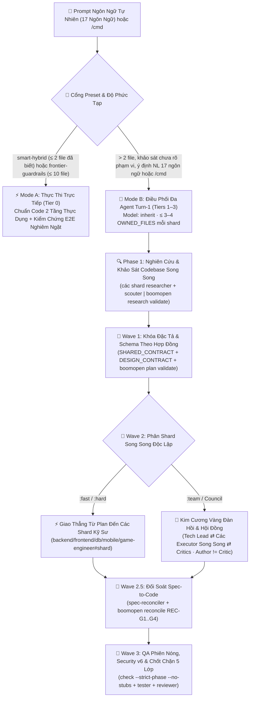

<div align="center">
  <h1>⚡ BoomOpen Workflow Kit Pro v5.5</h1>
  <p><strong>Điều phối workflow multi-agent và cổng kiểm chứng CLI tất định trên Antigravity, Claude Code, OpenAI Codex, Cursor và GitHub Copilot.</strong></p>

  <p>
    <a href="https://boomopen.com"></a>
    <a href="https://github.com/Kennyboom/BoomOpen-Workflow-Kit-Pro/releases"></a>
    <a href="#platforms"></a>
    <a href="#cli"></a>
    <a href="#skills"></a>
    <a href="https://nodejs.org/">= 18.0.0" /></a>
    <a href="../LICENSE"></a>
  </p>

  <p>
    <a href="../README.md">English</a> •
    <b>Tiếng Việt</b> •
    <a href="./README.zh-CN.md">简体中文</a> •
    <a href="./README.zh-TW.md">繁體中文</a> •
    <a href="./README.ja.md">日本語</a> •
    <a href="./README.ko.md">한국어</a> •
    <a href="./README.es.md">Español</a> •
    <a href="./README.fr.md">Français</a> •
    <a href="./README.de.md">Deutsch</a><br/>
    <a href="./README.pt-BR.md">Português (BR)</a> •
    <a href="./README.ru.md">Русский</a> •
    <a href="./README.hi.md">हिन्दी</a> •
    <a href="./README.ar.md">العربية</a> •
    <a href="./README.id.md">Bahasa Indonesia</a> •
    <a href="./README.th.md">ไทย</a> •
    <a href="./README.tr.md">Türkçe</a> •
    <a href="./README.it.md">Italiano</a>
  </p>

  <p>
    <a href="https://boomopen.com"><b>🌐 boomopen.com (15 ngôn ngữ)</b></a> •
    <a href="#trailer"><b>🎬 Video Ra Mắt</b></a> •
    <a href="#why-boomopen"><b>⚡ Vì Sao Cần BoomOpen</b></a> •
    <a href="#architecture"><b>🏗️ Kiến Trúc</b></a> •
    <a href="#quickstart"><b>🚀 Cài Đặt Nhanh</b></a> •
    <a href="#cli"><b>🛠️ 14 Cổng CLI</b></a> •
    <a href="#settings"><b>🎛️ Presets &amp; Cài Đặt</b></a> •
    <a href="#commands"><b>🎯 36 Lệnh Slash</b></a> •
    <a href="#agents"><b>🤖 22 Agents &amp; 18 Teams</b></a> •
    <a href="#skills"><b>📚 1,462 Skills</b></a>
  </p>
</div>

---

<a id="trailer"></a>

## 🎬 Video Ra Mắt Chính Thức & Trình Khám Phá Tương Tác (`boomopen.com`)

<div align="center">
  <a href="https://github.com/Kennyboom/BoomOpen-Workflow-Kit-Pro/raw/main/assets/media/boomopen_v55_trailer_vi.mp4">
    
  </a>
  <p>
    ▶️ <a href="https://github.com/Kennyboom/BoomOpen-Workflow-Kit-Pro/raw/main/assets/media/boomopen_v55_trailer_vi.mp4"><b>Xem Trực Tuyến Video Ra Mắt Full HD 1080p (MP4 Thuyết Minh Studio)</b></a> • 🌐 <a href="https://boomopen.com"><b>Trải Nghiệm CLI Playground 14 Lệnh &amp; Tra Cứu Danh Mục Tại boomopen.com (15 Ngôn Ngữ)</b></a>
  </p>
</div>

---

<a id="why-boomopen"></a>
<a id="-what-is-boomopen-workflow-kit"></a>

## ⚡ Vì Sao Cần BoomOpen Workflow Kit?

**Giới hạn của AI Coding Assistant thuần túy:** Khi để mặc định, các công cụ lập trình đơn agent nhanh chóng hụt hơi ngay khi tác vụ trải rộng qua nhiều file, nhiều domain hoặc kéo dài nhiều phiên làm việc. Việc đọc dò tuần tự từng file làm loãng context window chính; các sub-agent chạy tự phát dễ ghi đè lên nhau hoặc bỏ lại những module "ốc đảo" không được nối dây; code sinh ra lẫn lộn `TODO` stub hoặc lách kiểu bằng `any`; một model vừa viết vừa tự chấm (`Author == Critic`) bỏ lọt điểm mù của chính nó; và các dự án nhiều phase dần trượt khỏi tài liệu đặc tả ban đầu.

**Cách BoomOpen giải quyết:** BoomOpen cài đặt một khung điều phối và kiểm chứng thống nhất trên **Antigravity (Gemini)**, **Claude Code**, **OpenAI Codex**, **Cursor** và **GitHub Copilot** với **0 runtime dependency từ npm**. Với preset mặc định **`smart-hybrid`**, các thay đổi nhỏ `≤ 2` file được thực thi trực tiếp không phát sinh độ trễ, trong khi các tác vụ đa file, nghiên cứu chuyên sâu, thiết kế kiến trúc và **`36` lệnh slash (`93` file)** tự động chia shard ngay từ Turn 1 qua **22 agent chuyên trách** và **18 team đối kháng 3 vai trò** — được kiểm soát chặt bằng **14 cổng CLI `boomopen` chạy cục bộ** cùng **`1,462` skill nạp theo nhu cầu** (`22` Core + `1,440` skill thư viện dùng chung một bản duy nhất tại `~/.agents/skills_library`).

### ⚖️ Khi Chưa Dùng BoomOpen vs. Khi Có BoomOpen v5.5

| Điểm Gãy Kỹ Thuật | AI IDE Thuần Túy (Chưa Có BoomOpen) | Có BoomOpen Workflow Kit Pro v5.5 |
|:------------------|:------------------------------------|:----------------------------------|
| **Phình Context Window** | Agent chính đọc tuần tự 15–30 file trước khi viết nổi dòng code đầu tiên | **Turn-1 Elastic Swarm (`role#shard`)**: Phân luồng scout chỉ đọc & các shard theo domain (`≤ 3–4` file/shard) + tái sử dụng phiên nóng `0s` (`send_message`) |
| **Ghi Đè Song Song & Đứt Kết Nối** | Các agent chạy song song đè file chung, tự bịa route `/api` lệch nhau hoặc để sót module chết | **Khóa Hợp Đồng Trước + Đối Soát Wave 2.5**: Khóa `SHARED_CONTRACT` ở Wave 1 + tách rời `OWNED_FILES`, kiểm chứng bằng `boomopen reconcile` (`REC-G1..G4`) |
| **Nghiên Cứu Nông & Kế Hoạch Mơ Hồ** | Trả lời một chiều kiểu chiều lòng, nhận định thiếu kiểm chứng, bản kế hoạch viết xuôi tự do | **Đặc Tả 6 Khối Có Bằng Chứng**: Phản biện `:team` Devil's Advocate + trình kiểm định CLI `< 50ms` (`boomopen research`, `design`, `plan`) |
| **Stub Ngầm, `any` & Gian Lận Test** | Agent báo hoàn thành nhưng để lại `// TODO`, `any` tường minh, `console.log` hoặc test `.skip` | **Cổng Tĩnh 2 Tầng Thực Dụng**: `boomopen check --strict-phase --no-stubs` ép chặt `0` `any`, `0` stub và ngưỡng file mạch lạc `400/500` dòng |
| **Trượt Spec Đa Phiên & Lỗi Hồi Quy** | Nén context làm mất ràng buộc giữa các phase, làm hỏng tính năng đã pass trước đó | **Chốt Chặn Chất Lượng 5 Lớp & Rollback**: Chống trượt spec bằng SHA-256 trên `.boomopen/project-ledger.json`, `/autopilot`, `/audit` và `rollback --yes` nguyên tử |
| **Điểm Mù Đơn Model** | Cùng một model vừa viết code vừa tự review kết quả của chính mình (`Author == Critic`) | **Điều Phối Đa Engine (`/conduct`)**: Hội đồng đa model song song & pipeline chéo họ model giữa Claude Code, Codex, Antigravity, Cursor & Copilot |
| **Lệch Cấu Hình 5 IDE & Bẩn Git Tree** | Mỗi IDE một bộ prompt riêng, hàng GB skill nhân bản, file nháp làm rác `git status` | **Đồng Bộ Thống Nhất & Sạch Git**: Đồng bộ 14 file entrypoint trong `< 10ms`, 1 kho `~/.agents/skills_library` dùng chung (`0` token chờ) & định tuyến Brain Artifacts |

---

<a id="architecture"></a>
<a id="-smart-hybrid-architecture-v55"></a>

## 🏗️ Kiến Trúc Smart-Hybrid (v5.5)



---

<a id="pillars"></a>

## 🧠 6 Trụ Cột Kỹ Thuật Cốt Lõi

1. **🌐 Biên Dịch Chuẩn Gốc Cho 5 IDE & Kho Skill Chống Trùng Lặp (`platforms/*`)**:
   - Biên dịch **22 agent chuyên trách** và **93 file lệnh/tham chiếu** sang đúng định dạng gốc của từng IDE: **Antigravity** (gói `--as-plugin` + `3` script Python `run_workflow` thực thi trực tiếp: `audit_fanout.py`, `review_fanout.py`, `research_fanout.py`), **Claude Code** (shard `isolation: worktree`, lệnh dấu hai chấm `/plan:hard`, hook tùy chọn `PreToolUse` & `Stop`/`PreCompact`), **OpenAI Codex** (`22` vai trò TOML kèm sandbox `read-only` cấp hệ điều hành cho scout/critic + `87` skill `$boomopen-*`), **Cursor** (rule `.mdc` + hook tùy chọn `beforeShellExecution`), và **GitHub Copilot** (prompt agent `.agent.md`).
   - Liên kết toàn bộ `1,440` skill thư viện một lần duy nhất vào `~/.agents/skills_library` cho cả 5 IDE (tiết kiệm ~80% dung lượng đĩa, `0` token dư thừa ở Turn 1).
2. **🎯 Swarm Đàn Hồi Động 4 Tầng (`role#shard`) & Tái Sử Dụng Phiên Nóng Có Phạm Vi**:
   - Tự động co giãn từ **Tier 0** (`0` sub-agent cho `≤ 2` file đã biết) → **Tier 1** (`2–3` shard) → **Tier 2** (`4–6` shard) → **Tier 3** (`7–8+` shard, cấu hình tối đa tới `16`), giới hạn tải nhận thức ở mức **`≤ 3–4 OWNED_FILES` mỗi sub-agent** và tái sử dụng phiên đang mở qua ánh xạ `role#shard → conversationId` (`send_message`).
3. **🤝 Thực Thi 3 Wave Khóa Hợp Đồng Trước + Đối Soát Wave 2.5 (`REC-G1..G4`)**:
   - Wave 1 khóa cứng `SHARED_CONTRACT` (API schema/DTO) và `DESIGN_CONTRACT` (CSS `@theme` OKLCH + TypeScript props) trước khi Wave 2 phân việc cho các kỹ sư chạy song song. Wave 2.5 chạy `boomopen reconcile` + `spec-reconciler` để bắt file ốc đảo chưa được import (`REC-G1`), lệch route frontend/backend (`REC-G2`), bỏ sót điều khoản `[SC-*]` (`REC-G3`) và thiếu biến trong `.env.example` (`REC-G4`), đồng thời tự động bổ sung wave bù qua `boomopen cook amend-plan`.
4. **🏛️ Tự Hành Đa Phiên (`/autopilot`) & Kiểm Toán Đa Vòng Có Trạng Thái (`/audit`)**:
   - Biên dịch bộ tài liệu đặc tả thành `.boomopen/project-ledger.json` với kiểm tra trượt spec bằng SHA-256, tạo checkpoint Git trước mỗi phase (`boomopen ledger rollback --yes`) và ép qua **Chốt Chặn Chất Lượng Phase 5 Lớp** (`G1 check --strict-phase --no-stubs` → `G2 chốt chặn số test đơn điệu tăng` → `G3 reconcile --strict` → `G4 review độc lập Author != Critic` → `G5 ledger verify`). Sau khi build xong, `/audit` chạy kiểm toán nhiều vòng có bước duyệt của người dùng cho ma trận RTM, luồng dọc và Security v6 (`.boomopen/audit-ledger.json` + `boomopen audit rollback --yes`).
5. **🎼 Điều Phối Đa Engine & Hội Đồng Đa Model (`boomopen conduct`)**:
   - Phối hợp đồng thời Claude Code, OpenAI Codex, Antigravity, Cursor và Copilot trong **Hội Đồng Song Song 6 Tác Vụ** (`research`, `brainstorm`, `plan`, `design`, `review`, `debug` → tổng hợp `COUNCIL-SYNTHESIS.md` 4 phần) hoặc **Pipeline Chéo Họ Model**, đảm bảo không model nào tự chấm bài của chính nó (`Author != Critic`).
6. **📏 Chuẩn Code 2 Tầng Thực Dụng & Gỡ Lỗi Gốc Rễ SPIE v3.0**:
   - **Tầng 1 (Không Khoan Nhượng)**: Đơn trách nhiệm, `0` `any` tường minh, `0` `console.log` gỡ lỗi trong code ứng dụng, bắt buộc `try/catch` có kiểu tại biên I/O, hằng số `SCREAMING_SNAKE_CASE`. **Tầng 2 (Ưu Tiên Tính Mạch Lạc)**: Mục tiêu `~200–350` dòng (`400` ngưỡng mềm / `500` ngưỡng tách cứng; miễn trừ test/types/docs). Mọi lỗi đều đi qua 3 giả thuyết xếp hạng và truy vết nhân quả **5-Whys (SPIE v3.0)**, trong khi các bản đặc tả tạm thời được đưa vào Brain Artifacts (giữ sạch `100%` Git working tree).

---

<a id="platforms"></a>
<a id="-supported-ai-platforms"></a>

## 💻 5 Nền Tảng Lập Trình AI Được Hỗ Trợ

| Nền Tảng | Hỗ Trợ | Entrypoint Đồng Bộ | Tích Hợp Chuẩn Gốc Theo Nền Tảng |
|:---------|:------:|:-------------------|:---------------------------------|
| **Antigravity (Gemini)** | ✅ v5.5 | `~/.gemini/GEMINI.md` | `invoke_subagent`, fan-out Python `run_workflow`, vòng lặp ngoài `/goal`, gói `--as-plugin`, tùy chọn `--with-hooks`, Brain Artifacts |
| **Claude Code** | ✅ v5.5 | `~/.claude/CLAUDE.md` | Shard `Task`/`Agent` song song (`isolation: worktree`), lệnh dấu hai chấm `/plan:hard`, hook tùy chọn `PreToolUse` & `Stop`/`PreCompact` |
| **OpenAI Codex** | ✅ v5.5 | `~/.codex/AGENTS.md` & `CODEX.md` | `22` vai trò TOML tại `~/.codex/agents/boomopen/` với `sandbox_mode = "read-only"` cấp OS cho scout/reviewer + `87` skill `$boomopen-*` |
| **Cursor** | ✅ v5.5 | `~/.cursor/rules/boomopen-workflow-kit.mdc` | Rule frontmatter `.mdc` luôn bật, `CURSOR.md`, định tuyến sub-agent & tùy chọn `.cursor/hooks.json` (`beforeShellExecution`) |
| **GitHub Copilot** | ✅ v5.5 | `~/.copilot/copilot-instructions.md` | Prompt agent biên dịch sẵn `boomopen-workflow-kit.agent.md` cho VS Code, điều phối `runSubagent` & `COPILOT.md` |

---

<a id="quickstart"></a>
<a id="-quick-start--installation"></a>

## 🚀 Cài Đặt Nhanh (Chỉ Qua Git — Không Phụ Thuộc Runtime)

```bash
# 1. Clone repository (chỉ phân phối qua GitHub — không phát hành lên npm)
git clone https://github.com/Kennyboom/BoomOpen-Workflow-Kit-Pro.git
cd BoomOpen-Workflow-Kit-Pro

# 2. Cài cho IDE AI đang dùng (preset mặc định: smart-hybrid) hoặc đồng loạt cả 5 IDE
npm run install:all                                 # Cài & đồng bộ cả 5 IDE + kho chung ~/.agents/skills_library
npm run install:antigravity                         # Google Antigravity 2.0 (có thể thêm --as-plugin / --with-hooks)
node cli/install.js install claude --with-hooks     # Claude Code + bật hook PreToolUse & Stop/PreCompact
npm run install:codex                               # OpenAI Codex CLI + sandbox read-only cấp OS cho scout/reviewer
npm run install:cursor                              # Cursor (thêm --with-hooks để bật rào chắn beforeShellExecution)
npm run install:copilot                             # GitHub Copilot (VS Code .agent.md + copilot-instructions.md)

# 3. Kiểm tra trạng thái hệ thống & tùy chọn gắn lệnh `boomopen` vào PATH toàn cục
npm run doctor
npm link
boomopen settings status
```

> **Cài Đặt & Gỡ Cài Đặt An Toàn Không Phá Hủy**: Theo dõi bằng manifest SHA-256 (`~/.boomopen/manifests/<tool>.json`). Các rule cá nhân có sẵn trong `GEMINI.md` / `CLAUDE.md` nằm ngoài vùng đánh dấu của kit được giữ nguyên và tự động sao lưu; lệnh `boomopen uninstall <tool|--all>` chỉ gỡ các file gốc của kit chưa bị sửa đổi, bảo toàn tuyệt đối file riêng của bạn.

---

<a id="cli"></a>

## 🛠️ 14 Lệnh Con CLI Không Phụ Thuộc (`boomopen`)

Chạy cục bộ trong `< 50ms` trên Node.js `>= 18` với **0 runtime dependency từ npm** và **0 kết nối mạng**:

| Lệnh Con | Cờ & Cú Pháp Chính | Cổng Tất Định & Chức Năng |
|:---------|:-------------------|:--------------------------|
| **`install` / `uninstall` / `list`** | `<tool\|--all> [--with-hooks] [--as-plugin]` | Trình cài đặt theo manifest SHA-256, liên kết `~/.agents/skills_library`, gắn hook an toàn tùy chọn & gỡ cài đặt sạch |
| **`doctor`** | `[--source-only]` | Kiểm định chỉ đọc 30 hạng mục cho cả 5 gói IDE, `93` file lệnh, `72` file team, `1,462` skill & trạng thái đồng bộ cài đặt |
| **`settings`** | `status \| preset <name> \| set <k> <v> \| --ui` | Quản lý 5 preset + `22` khóa cấu hình (`--project` cho `./.boomopen.json`) hoặc mở Web UI bọc CSP (`127.0.0.1:4567`) |
| **`research`** | `<validate\|brief> <file.md> [--mode brainstorm]` | Kiểm tra **`RES-G1..G4`** (đối chiếu chéo `≥ 4` nguồn, ma trận mâu thuẫn, rủi ro pre-mortem) & biên dịch `HANDOFF_BRIEF` |
| **`design`** | `<validate\|contract> <DESIGN.md> [--json]` | Kiểm tra **`DESIGN-G1..G4`** (đặc tả 6 khối, token OKLCH, ma trận UI 5 trạng thái, WCAG 2.2 AA) & xuất `DESIGN_CONTRACT` |
| **`plan`** | `<validate\|compile> <PLAN.md> [--sync-ledger]` | Kiểm tra **`PLAN-G1..G5`** (DAG không chu trình, `OWNED_FILES ≤ 4`/shard không giao nhau, `SHARED_CONTRACT`) & đồng bộ sổ cái |
| **`cook`** | `<state\|packets\|verify-wave\|preflight\|amend-plan>` | Kiểm tra **`COOK-G1..G4`**: trạng thái nhảy cóc 5 bước, gói giao việc 5 trường theo Wave, khóa ghi Git & chèn wave bù |
| **`reconcile`** | `<dir> [--plan <PLAN.md>] [--strict]` | Wave 2.5 **`REC-G1..G4`**: phát hiện module ốc đảo chưa nối dây, lệch route `/api`, bỏ sót mục `[SC-*]` & thiếu khóa `.env.example` |
| **`check`** | `[path] --strict-phase --no-stubs [--ignore <dir>]` | Cổng tĩnh 2 tầng thực dụng: trần dòng `400/500`, `0` `any` tường minh, `0` `console.log` debug, `0` stub/`TODO`/`.skip` |
| **`ledger`** | `<init\|from-plan\|status\|next\|verify\|rollback>` | Máy trạng thái DAG đa phiên `.boomopen/project-ledger.json`, khóa chống trượt spec SHA-256 & `rollback --yes` nguyên tử |
| **`audit`** | `<init\|slice\|record\|approve\|verify-fix\|rollback>` | Sổ cái kiểm toán đa vòng sau hoàn thiện (`.boomopen/audit-ledger.json`), chốt chặn giảm dần lỗi tồn đọng & `rollback --yes` |
| **`conduct`** | `<probe\|council\|dispatch\|status> [--dry-run]` | Điều phối đa engine & Hội đồng 6 tác vụ song song (`Author != Critic` xuyên 5 IDE → `COUNCIL-SYNTHESIS.md`) |

---

<a id="settings"></a>
<a id="-unified-settings--mode-selection-settings"></a>

## 🎛️ Trung Tâm Điều Khiển Thống Nhất & 5 Preset (`/settings`)

Quản lý **`20` khóa enum + `2` khóa giới hạn dòng tùy chỉnh** ở cấp toàn cục (`~/.boomopen/settings.json`) hoặc theo từng repo (`./.boomopen.json`), đồng bộ nóng sang toàn bộ 14 file entrypoint IDE trong `< 10ms`:

| Hồ Sơ Preset | Chế Độ Thực Thi (`execution.mode`) | Mặc Định `/cmd` | Định Tuyến NL 17 Ngôn Ngữ (`naturalLanguageResearchTrigger`) | Chuẩn Code | Phù Hợp Nhất Cho |
|:-------------|:-----------------------------------|:---------------:|:------------------------------------------------------------:|:----------:|:-----------------|
| **⚡ `smart-hybrid`** *(Mặc định)* | **`auto`** (`≤ 2` file chạy thẳng; `> 2` file hoặc `/cmd` → Mode B Swarm) | `auto` | **`auto_team`** *(Định tuyến nghiên cứu/ý tưởng/review tự nhiên sang `:team` & workflow trên 17 ngôn ngữ)* | `pragmatic` (`400/500`L) | Trải nghiệm mặc định ngay khi cài: bắt ý định ngôn ngữ tự nhiên + tự động chia shard song song ở Turn 1 |
| **🛡️ `frontier-guardrails`** *(Tùy chọn gọn nhẹ)* | **`mode_a`** (`≤ 10` file chạy thẳng; entrypoint `< 2.5 KB` / `~600` token) | `auto` | **`off`** *(Chỉ kích hoạt khi gõ `/cmd` tường minh — không bắt NL)* | `pragmatic` (`400/500`L) | Chế độ trực tiếp hàng ngày siêu gọn `< 2.5 KB` kèm cổng kiểm định 2 tầng & E2E *(hỗ trợ bí danh `carbon-guardrails`)* |
| **🚀 `solo-fast`** | **`mode_a`** (`≤ 10` file chạy thẳng; tối đa `3` shard tiết kiệm) | `fast` | `off` | `relaxed` (`600/800`L) | Dựng prototype nhanh, viết script nhỏ, vá lỗi khẩn cấp & tối ưu chi phí token |
| **🧠 `deep-architect`** | **`mode_b`** *(Ép chạy Mode B Orchestrator; tối đa `12` shard)* | `hard` | `auto_hard` + nghiên cứu `council` / review `cross_family` | `strict` (`300/400`L) | Kiến trúc hệ thống phức tạp, thiết kế dự án mới từ đầu & refactor liên module |
| **🔺 `adversarial-team`** | **`team`** *(Kim Cương Vàng Đàn Hồi `:team`; `hyper_swarm` tối đa `12`)* | `team` | **`auto_team`** + `council` cho nghiên cứu, lập kế hoạch & review | `strict` (`300/400`L) | Bản phát hành production trọng yếu, kiểm toán bảo mật & đồng thuận đa engine |

```bash
# Chuyển đổi preset hoặc tinh chỉnh từng khóa qua khung Chat (/settings), Local Web UI (--ui) hoặc CLI:
boomopen settings --ui                                      # Mở Local Web Control Center tại http://127.0.0.1:4567
boomopen settings preset smart-hybrid                       # Mặc định: Auto Mode A/B + định tuyến workflow NL 17 ngôn ngữ
boomopen settings preset frontier-guardrails                # Tùy chọn: Mode A gọn nhẹ < 2.5 KB (bí danh: carbon-guardrails)
boomopen settings set engines.reviewer cross_family         # Bắt buộc Reviewer khác họ model (Author != Critic)
cd path/to/your/repo && boomopen settings mode team --project # Ghi cấu hình riêng cho repo tại ./.boomopen.json
boomopen settings reset                                     # Khôi phục cấu hình mặc định smart-hybrid
```

---

<a id="commands"></a>
<a id="-slash-commands-reference"></a>

## 🎯 Tham Chiếu Đầy Đủ 36 Lệnh Slash (`93` File = `87` Workflow + `6` `_ref/`)

Trao đổi tự nhiên bằng **bất kỳ ngôn ngữ nào trong 17 ngôn ngữ được hỗ trợ** dưới chế độ `smart-hybrid`, hoặc gọi tường minh một trong **36 lệnh slash chuẩn**:

| Nhóm Chức Năng | Lệnh | Biến Thể | Mục Đích & Đầu Ra Tất Định |
|:---------------|:-----|:---------|:---------------------------|
| **Điều Phối & Tự Hành** | **`/cook`** | `:fast`, `:hard`, `:team` | Xây dựng tính năng trọn gói khi chưa có plan (Scout → Contract Plan → Parallel Shards → Wave 2.5 Reconcile → QA) |
| | **`/code`** | `:fast`, `:hard`, `:team` | Thực thi trực tiếp bản kế hoạch `PLAN-{task}.md` đã duyệt qua các shard Wave 1–3 mà không chạy lại `/plan` |
| | **`/autopilot`** | `:init`, `:run`, `:audit` | Điều phối đa phiên từ đặc tả tới production qua `.boomopen/project-ledger.json` & **Chốt Chặn Chất Lượng 5 Lớp** |
| | **`/conduct`** | `:council`, `:pipeline` | Hội đồng song song đa engine (`COUNCIL-SYNTHESIS.md`) & pipeline phân vai chéo họ model trên 5 IDE (hỗ trợ `--dry-run`) |
| | **`/orchestrate`** / **`/auto`** | — | Phối hợp swarm đa domain tùy chỉnh (`/orchestrate`) hoặc chạy tự hành khép kín từ đầu đến cuối (`/auto`) |
| **Kiến Trúc, Thiết Kế & Nghiên Cứu** | **`/plan`** | `:fast`, `:hard`, `:team` | Bản thiết kế `PLAN-{task}.md` qua 5 cổng: khóa `SHARED_CONTRACT`, tách rời `OWNED_FILES ≤ 4`/shard & tiêu chí Given/When/Then |
| | **`/architect`** | — | Bản vẽ kiến trúc thuần thiết kế: sơ đồ C4, ADR, DB schema, hợp đồng API, đặc tả màn hình & kiểm tra độ phủ (không sửa code) |
| | **`/design`** / **`/ui-ux-pro-max`** | `:fast`, `:hard`, `:team` | Đặc tả UI/UX 6 khối `DESIGN-{task}.md` + `DESIGN_CONTRACT` (token OKLCH `@theme`, ma trận UI 5 trạng thái, 50+ phong cách & bản xem trước HTML) |
| | **`/research`** | `:fast`, `:hard`, `:team` | Nghiên cứu sâu 5 góc nhìn (`RESEARCH-{topic}.md`, đối chiếu `≥ 4` nguồn `RES-G1..G4`, bảng mâu thuẫn & `HANDOFF_BRIEF`) |
| | **`/brainstorm`** / **`/ask`** | `:fast`, `:hard`, `:team` | Phản biện chiến lược chống chiều lòng (`BRAINSTORM-{topic}.md` kèm pre-mortem & ma trận MCDA) và hỏi đáp có dẫn chứng (`/ask`) |
| **Chất Lượng, Kiểm Toán, Debug & Bảo Mật** | **`/review`** | `:fast`, `:hard`, `:team` | Review đối kháng đa chiều về code, kiến trúc, bảo mật & hiệu năng (`Author != Critic`, chuyển thẳng sang `/fix` bằng 1 bước) |
| | **`/audit`** / **`/deep-audit`** | `:run`, `:fix`, `:auto` | Kiểm toán toàn dự án đa vòng sau khi build (`/audit` ledger) & kiểm toán logic đặc tả 10 chiều trước khi viết code (`/deep-audit`) |
| | **`/security-audit`** | — | Quét OWASP Top 10 + LLM/Agentic Top 10 (`security_scan.py` v6), mô hình hóa mối đe dọa STRIDE, kiểm tra xác thực & chuỗi cung ứng |
| | **`/debug`** / **`/fix`** | `:fast`, `:hard`, `:team` | Truy vết nguyên nhân gốc theo 3 giả thuyết + **5-Whys (SPIE v3.0)** (`DEBUG-{issue}.md`) & sửa lỗi TDD tái hiện lỗi trước (`/fix`) |
| | **`/test`** / **`/performance`** / **`/refactor`** | `:fast`, `:hard`, `:team` | Các shard QA chống gian lận test (`/test`), tối ưu Core Web Vitals / DB / bundle (`/performance`) & `/refactor` có đo kiểm chỉ số |
| **Git, Phát Hành, Tài Liệu & Vận Hành Phiên** | **`/onboard`** / **`/init`** | — | Lập bản đồ codebase sẵn có chỉ đọc trong 60 giây `ARCHITECTURE-MAP.md` (`/onboard`, không đụng lệnh `/init`) & khởi tạo dự án mới (`/init`) |
| | **`/pr`** / **`/release`** | —, `:review` | Cổng chất lượng & reconcile trước PR + `gh pr create` / review phản biện từng vùng diff (`/pr:review`) & phát hành SemVer đồng bộ phiên bản (`/release`) |
| | **`/deploy`** / **`/rollback`** | `:check`, `:preview`, `:production`, `:rollback` | Cổng kiểm tra sẵn sàng triển khai, rollout preview/production (`/deploy`) & khôi phục khẩn cấp phân cấp mức độ (`/rollback`) |
| | **`/docs`** / **`/report`** | `:core`, `:business`, `:audit` / `:fast..:team` | Bộ tài liệu `./documents/` bám sát mã nguồn thực tế (`/docs`) & báo cáo trạng thái trích xuất số liệu CLI trung thực (`/report`) |
| | **`/settings`** / **`/status`** / **`/next`** | — | Trung tâm điều khiển thống nhất (`/settings`), bảng theo dõi sức khỏe ledger/swarm (`/status`) & gợi ý bước tiếp theo (`/next`) |
| | **`/preview`** / **`/save`** / **`/recap`** | — | Quản lý vòng đời dev-server cục bộ (`/preview`), lưu trạng thái phiên (`/save`) & khôi phục ngữ cảnh trong `< 5s` (`/recap`) |

### 🌙 Cẩm Nang Chạy Dự Án Đa Phase Xuyên Đêm (`/autopilot` & `/goal`)

| Quy Trình | Nền Tảng & Cơ Chế Chạy | Duy Trì Ngữ Cảnh Liên Phiên | Bảo Đảm Chất Lượng & Đặc Tả |
|:----------|:-----------------------|:----------------------------|:----------------------------|
| **`/autopilot` (+ `--with-hooks`)** | Cả 5 IDE (kết hợp `--with-hooks` trên **Claude Code**, **Antigravity** & **Cursor**) | Hook `Stop` & `PreCompact` (`stop-quality-gate.mjs`) + `.boomopen/project-ledger.json` giữ nguyên con trỏ tiến độ qua các đợt nén context | Cưỡng chế **Chốt Chặn Chất Lượng 5 Lớp** (`G1..G5`), đối soát `reconcile` Wave 2.5 và `boomopen ledger rollback --yes` |
| **`/goal` + `/autopilot` + `/audit`** | Vòng lặp ngoài bền bỉ của **Antigravity 2.0** cho các bộ đặc tả lớn trong `docs/` | Trình chạy **`/goal`** gốc của Antigravity tự động lặp qua từng phase cho đến khi toàn bộ sổ cái đạt trạng thái `VERIFIED` | Đưa từng phase qua đủ 5 cổng kiểm định + đối soát Wave 2.5, sau đó chạy Vòng 1 của **`/audit`** |

```text
/goal Dùng /autopilot đọc toàn bộ tài liệu dự án trong docs/, khởi tạo .boomopen/project-ledger.json và tự động triển khai tuần tự từng phase (mỗi phase bắt buộc vượt qua đủ 5 cổng kiểm chứng và đối soát Wave 2.5 reconcile). Khi 100% các phase hoàn tất, chạy Vòng 1 của /audit rồi dừng lại kèm báo cáo tổng hợp để tôi review.
```

---

<a id="agents"></a>
<a id="-22-specialist-agents--18-golden-triangle-teams"></a>

## 🤖 22 Agent Chuyên Trách & 18 Team Đối Kháng 3 Vai Trò

Mỗi sub-agent kế thừa nguyên vẹn model của phiên hiện tại (`Model: "inherit"` — tuyệt đối cấm hạ xuống `flash_lite`) và ghép thành **18 team Kim Cương Vàng / Tam Giác Vàng** (`Tech Lead` ⇄ `Các Shard Executor Song Song` ⇄ `Reviewer/Critic Độc Lập`):

| Mảng Chuyên Môn | Agent Chuyên Trách (`agents/*.md`, biên dịch theo từng IDE) | Team Phản Biện 3 Vai Trò (`agents/teams/*-team/`, `72` file) |
|:----------------|:------------------------------------------------------------|:-------------------------------------------------------------|
| **Kỹ Thuật & Thực Thi** | `backend-engineer`, `frontend-engineer`, `mobile-engineer`, `game-engineer`, `database-architect`, `devops-engineer` | `backend-team`, `frontend-team`, `fullstack-team`, `mobile-team`, `game-team`, `database-team`, `devops-team` |
| **Kiến Trúc & Sản Phẩm** | `tech-lead`, `planner`, `brainstormer`, `business-analyst`, `project-manager`, `designer` | `planning-team`, `brainstorm-team`, `project-team`, `design-team` |
| **Chất Lượng, Đối Soát & Bảo Mật** | `debugger`, `tester`, `reviewer`, `spec-reconciler`, `security-engineer`, `performance-engineer` | `debug-team`, `qa-team`, `security-team`, `performance-team` |
| **Nghiên Cứu & Tài Liệu** | `researcher`, `scouter`, `docs-manager`, `reporter` | `research-team`, `docs-team`, `report-team` |

---

<a id="skills"></a>
<a id="-1460-skills-vault-22-core--1440-niche-library-skills"></a>

## 📚 Kho 1,462 Skill Nạp Theo Nhu Cầu (`22` Core + `1,440` Library Skills)

Được đánh chỉ mục trên **19 mảng kỹ thuật** trong `matrix-skills/compact-index.json`, khử trùng lặp một lần duy nhất vào `~/.agents/skills_library` và nạp qua cơ chế **Phân Giải Tiệm Tiến 2 Bước O(1)** (kiểm tra Core `skills/` → tra `compact-index.json` → chỉ nạp đúng `SKILL.md` khớp yêu cầu vào shard được giao, `0` token nhàn rỗi):

| Phân Tầng / Mảng Kỹ Thuật | Số Skill | Năng Lực & Khung Khởi Tạo Tiêu Biểu | Cơ Chế Nạp |
|:--------------------------|:--------:|:------------------------------------|:-----------|
| **⚡ Quy Trình Lõi & Chất Lượng (`skills/`)** | **22** | `clean-code`, `debugger`, `plan-writing`, `brainstorming`, `deep-research`, `design-spec`, `frontend-design`, `frontend-architecture`, `api-patterns`, `database-design`, `tdd-workflow`, `testing-patterns`, `webapp-testing`, `security-auditor` (`security_scan.py` v6), `app-builder` (**15 mẫu dự án** gồm **`mcp-server`**, **`ai-agent-worker`**, `nextjs-saas`, `monorepo-turborepo`, `python-fastapi`, `flutter-app`), `skill-seeker` | Sẵn sàng ngay Turn 1 |
| **🤖 AI, Agentic SDK, MCP & Dữ Liệu** | **340+** | FastMCP (`StreamableHTTP`), OpenAI Agents SDK, Claude Agent SDK, Google ADK, Vercel AI SDK, LangGraph, RAG, BigQuery, dbt | Theo nhu cầu (`compact-index.json`) |
| **🌐 Web, Backend, API & Cơ Sở Dữ Liệu** | **380+** | React 19, Next.js 15 RSC, Tailwind CSS v4, TanStack Start/Router/Query, Hono RPC + Zod OpenAPI, Rust Axum/SQLx, Drizzle, Postgres/RLS | Theo nhu cầu (`compact-index.json`) |
| **☁️ Cloud, DevOps, QA & Bảo Mật** | **300+** | Cloudflare Workers/Durable Objects/D1, Docker/K8s, Terraform, Playwright, Vitest + MSW v2, Better Auth (Passkeys), OWASP LLM Top 10 | Theo nhu cầu (`compact-index.json`) |
| **🎨 UI/UX, Game Engine & Mobile** | **420+** | OKLCH Design Tokens, WCAG 2.2 AA, Motion, Unity 6 DOTS/ECS, Godot 4, Unreal 5, WebGPU/Three.js, Phaser/PixiJS, Tauri v2, SwiftUI, Flutter, React Native | Theo nhu cầu (`compact-index.json`) |

---

## 📂 Cấu Trúc Repository

```text
BoomOpen-Workflow-Kit-Pro/
├── agents/                  # 22 Agent chuyên trách (biên dịch theo IDE) + 18 Team 3 vai trò (72 file)
├── cli/                     # 14 lệnh con Node.js CLI không dependency + 33 bộ test node:test
├── commands/                # 36 lệnh Slash trên 87 file workflow + 6 giao thức _ref/ (93 file)
├── documents/               # Tài liệu kiến trúc, domain, nền tảng mã nguồn & chuẩn code 2 tầng thực dụng
├── i18n/                    # 16 bản README bản địa hóa đầy đủ (tổng 17 ngôn ngữ cùng README.md gốc)
├── matrix-skills/           # 19 danh mục YAML theo domain + compact-index.json O(1) (1,462 skill)
├── platforms/               # 5 gói nền tảng IDE, hook bảo vệ tùy chọn, 3 script Antigravity run_workflow/*.py & vai trò TOML cho Codex
├── rules/                   # 7 mô-đun quy tắc Mode B nạp theo nhu cầu (CORE, PHASES, AGENTS, TEAMS, SKILLS, ERRORS, REFERENCE)
├── scripts/                 # Công cụ kiểm chứng & quản lý phiên đa nền tảng (checklist.py, verify_all.py, auto_preview.py, session_manager.py)
├── skills/                  # 22 Core Skill + 15 mẫu dự án app-builder + script kiểm toán Security v6 / UX / Perf
├── skills_library/          # 1,440 skill thư viện liên kết một lần duy nhất vào ~/.agents/skills_library
├── web/                     # Chuyên trang WebGL 15 ngôn ngữ & danh mục tra cứu trực tuyến tại https://boomopen.com
└── GEMINI.md | CLAUDE.md | CODEX.md | COPILOT.md | CURSOR.md | AGENT.md
```

---

## 📄 Giấy Phép & Chính Sách Bảo Mật

- **Website Chính Thức**: [https://boomopen.com](https://boomopen.com)
- **Giấy Phép**: Mã nguồn bộ kit, CLI, bộ quy tắc, agent và tài liệu được phát hành theo [Giấy phép MIT](../LICENSE) (Bản quyền © 2026 **BoomOpen Labs**). Các skill của bên thứ ba trong `skills_library/` giữ nguyên giấy phép gốc từ upstream — xem chi tiết tại [THIRD_PARTY_NOTICES.md](../THIRD_PARTY_NOTICES.md).
- **Chính Sách Bảo Mật**: Xem [SECURITY.md](../SECURITY.md) để nắm cơ chế bảo vệ bằng manifest SHA-256, cơ chế cô lập hook tùy chọn và quy trình báo cáo lỗ hổng bảo mật.
