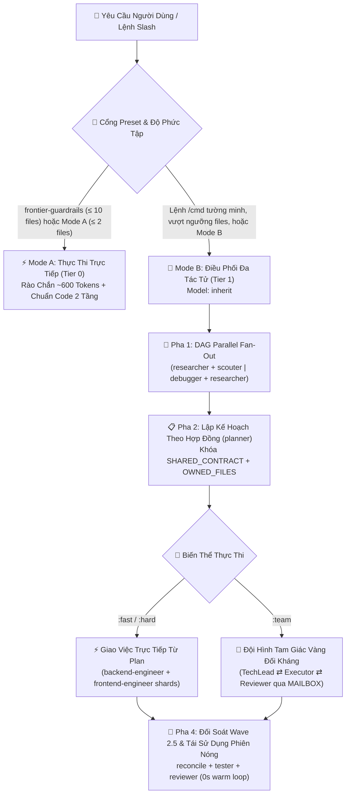

<div align="center">
  <h1>⚡ BoomOpen Workflow Kit v5.5.0</h1>
  <p><strong>Hệ Điều Hành Nhân Sự AI Đa Nền Tảng (Frontier-Guardrails &amp; Smart-Hybrid) — 22 Đặc Vụ Chuyên Gia, 18 Đội Hình Tam Giác Vàng, 36 Lệnh Slash &amp; Kho 1.462 Kỹ Năng Chuyên Sâu</strong></p>

  <p>
    <a href="https://boomopen.com"></a>
    <a href="https://github.com/Kennyboom/BoomOpen-Workflow-Kit-Pro/releases"></a>
    <a href="#-các-nền-tảng-ai-được-hỗ-trợ"></a>
    <a href="#-22-đặc-vụ-chuyên-gia--18-đội-hình-tam-giác-vàng"></a>
    <a href="#-kho-hơn-1460-kỹ-năng-chuyên-sâu-22-kỹ-năng-lõi--1440-kỹ-năng-thư-viện"></a>
    <a href="https://nodejs.org/">=18.0.0" /></a>
    <a href="../LICENSE"></a>
  </p>

  <p>
    <a href="../README.md">🇬🇧 English</a> •
    <b>🇻🇳 Tiếng Việt</b> •
    <a href="./README.zh-CN.md">🇨🇳 简体中文</a> •
    <a href="./README.zh-TW.md">🇹🇼 繁體中文</a> •
    <a href="./README.ja.md">🇯🇵 日本語</a> •
    <a href="./README.ko.md">🇰🇷 한국어</a> •
    <a href="./README.es.md">🇪🇸 Español</a> •
    <a href="./README.fr.md">🇫🇷 Français</a> •
    <a href="./README.de.md">🇩🇪 Deutsch</a><br/>
    <a href="./README.pt-BR.md">🇧🇷 Português</a> •
    <a href="./README.ru.md">🇷🇺 Русский</a> •
    <a href="./README.hi.md">🇮🇳 हिन्दी</a> •
    <a href="./README.ar.md">🇸🇦 العربية</a> •
    <a href="./README.id.md">🇮🇩 Bahasa Indonesia</a> •
    <a href="./README.th.md">🇹🇭 ไทย</a> •
    <a href="./README.tr.md">🇹🇷 Türkçe</a> •
    <a href="./README.it.md">🇮🇹 Italiano</a>
  </p>

  <p>
    <a href="https://boomopen.com"><b>🌐 Trang Chủ Live</b></a> •
    <a href="#-video-giới-thiệu-chính-thức-full-hd-1080p"><b>🎬 Video Giới Thiệu</b></a> •
    <a href="#-boomopen-workflow-kit-v55-là-gì"><b>🌟 Tổng Quan</b></a> •
    <a href="#-kiến-trúc-smart-hybrid-v55"><b>🏗️ Kiến Trúc</b></a> •
    <a href="#-cài-đặt-nhanh--kiểm-định"><b>🚀 Cài Đặt Nhanh</b></a> •
    <a href="#-hướng-dẫn-lựa-chọn-chế-độ--bảng-cài-đặt-settings-control-center"><b>🎛️ Chế Độ &amp; Cài Đặt</b></a> •
    <a href="#-bảng-tham-chiếu-lệnh-slash"><b>🎯 Lệnh Slash</b></a> •
    <a href="#-22-đặc-vụ-chuyên-gia--18-đội-hình-tam-giác-vàng"><b>🤖 22 Agents &amp; 18 Teams</b></a> •
    <a href="#-kho-hơn-1460-kỹ-năng-chuyên-sâu-22-kỹ-năng-lõi--1440-kỹ-năng-thư-viện"><b>📚 Kho 1.460+ Kỹ Năng</b></a>
  </p>
</div>

---

## 🎬 Video Giới Thiệu Chính Thức (Full HD 1080p)

<div align="center">
  <a href="https://github.com/Kennyboom/BoomOpen-Workflow-Kit-Pro/raw/main/assets/media/boomopen_v55_trailer_vi.mp4">
    
  </a>
  <p>
    ▶️ <a href="https://github.com/Kennyboom/BoomOpen-Workflow-Kit-Pro/raw/main/assets/media/boomopen_v55_trailer_vi.mp4"><b>Bấm Vào Đây Để Xem / Tải Video Giới Thiệu Chính Thức (Full HD 1080p — Thuyết Minh Studio)</b></a> • 🌐 <a href="https://boomopen.com"><b>Trải Nghiệm Live Showcase Tại boomopen.com</b></a>
  </p>
</div>

---

## 🌟 BoomOpen Workflow Kit v5.5 là gì?

**BoomOpen Workflow Kit v5.5 (Frontier-Guardrails & Multi-Platform Smart-Hybrid Edition)** là hệ điều hành đa tác tử (Multi-Agent) mã nguồn mở biến một AI Coding Assistant đơn lẻ thành một tổ chức kỹ thuật hoàn chỉnh gồm **22 Đặc vụ Chuyên gia biên dịch riêng cho từng IDE**, **18 Đội hình Tam Giác Vàng (`72` files)**, **36 lệnh Slash (`93` file quy trình & tham chiếu: `87` workflows + `6` `_ref/`)**, **14 lệnh CLI tiền định**, **22 Kỹ năng Lõi (`skills/`)** và **Kho 1.440 Kỹ Năng Chuyên Sâu (`1.462` kỹ năng hợp nhất một lần vào `~/.agents/skills_library`)**.

Khác với các bộ prompt cứng nhắc hay wrapper nặng nề làm phình ngữ cảnh ở mọi lượt hội thoại, ngay khi cài mới BoomOpen v5.5 mặc định kích hoạt **`⚡ smart-hybrid` (Bầy Đàn Đàn Hồi Chủ Động Turn 1 + Định Tuyến Ngôn Ngữ Tự Nhiên 17 Thứ Tiếng trên cả 5 IDE)** — đồng thời cung cấp chế độ tùy chọn siêu gọn **`🛡️ frontier-guardrails` (`< 2.5 KB` / `~600 tokens` cho Mode A)** — mở khóa trọn vẹn **Phân Mảnh Bầy Đàn Đàn Hồi 4 Tầng (`role#shard`)**, **Đối Soát Spec-to-Code Wave 2.5 (`boomopen reconcile`)**, **Kiểm Toán Toàn Diện Dự Án Nhiều Vòng (`/audit` & `boomopen audit`)**, **Điều Hành Dự Án Tự Hành Nhiều Phiên (`/autopilot`)**, và **Nhạc Trưởng Đa Mô Hình (`/conduct`)**:
- **⚡ Mặc Định `smart-hybrid` — Bầy Đàn Chủ Động Turn 1 + Định Tuyến 17 Ngôn Ngữ**: Ngay sau khi cài đặt, các chỉnh sửa nhỏ đã rõ đích (`≤ 2` files) chạy trực tiếp qua Mode A, trong khi tác vụ đa file, nghiên cứu sâu, lên ý tưởng, lập kế hoạch hoặc gọi tường minh một trong **36 lệnh `/cmd`** (**`/onboard`**, **`/pr` + `/pr:review`**, **`/release`**, v.v.) tự động chia mảnh sub-agent song song ngay Turn 1 (`role#shard`, tối đa `3–4 OWNED_FILES`/shard) kết hợp **Khóa Hợp Đồng (`SHARED_CONTRACT` + `OWNED_FILES`)**, **Đối Soát Spec-to-Code Wave 2.5 (`boomopen reconcile` + `cook amend-plan`)**, và **Tái Sử Dụng Phiên Nóng (`send_message`)**.
- **🛡️ Tùy Chọn Siêu Gọn `frontier-guardrails` (`< 2.5 KB` — Slim Mode A)**: Muốn mô hình gốc xử lý trực tiếp tối đa `≤ 10` files (`mode_a <= 10 files`) và tắt hoàn toàn tự động bắt luồng ngôn ngữ tự nhiên (`naturalLanguageResearchTrigger = off`)? Chuyển ngay trong `< 10ms` bằng `boomopen settings preset frontier-guardrails` (`carbon-guardrails` được giữ làm bí danh tương thích ngược).
- **🏛️ Tự Hành Đa Phiên (`/autopilot`), Kiểm Toán Toàn Dự Án (`/audit`) & Hội Đồng Đa Mô Hình (`/conduct`)**: Biên dịch tài liệu đặc tả thành sổ cái `.boomopen/project-ledger.json` kèm khóa SHA-256, khôi phục mốc an toàn (`boomopen ledger rollback --yes`) và Cổng 4 Lớp (`boomopen check --strict-phase --no-stubs`); chạy kiểm toán nhiều vòng có duyệt người dùng (`/audit` & `boomopen audit`, hỗ trợ `boomopen audit rollback --yes`) trên độ phủ RTM, luồng dọc UI->API->DB & **Bảo mật 2 lớp (`security_scan.py` v6)**; hoặc điều phối Claude Code, OpenAI Codex, Antigravity, Cursor và Copilot qua `boomopen conduct` (có `--dry-run`).
- **📚 Kho 1.462 Kỹ Năng Chống Trùng Lặp & 15 Mẫu `app-builder` (0% Phình Ngữ Cảnh)**: Lưu trữ duy nhất một bản tại `~/.agents/skills_library` dùng chung cho cả 5 IDE, tra cứu `O(1)` qua `matrix-skills/compact-index.json` (`22` Core + `1.440` Library, tích hợp **15 mẫu dự án `app-builder`** gồm cả **`mcp-server`** & **`ai-agent-worker`**).

---

<a id="-kiến-trúc-smart-hybrid-v55"></a>

## 🏗️ Kiến Trúc Smart-Hybrid (v5.5)



---

## 🧠 6 Trụ Cột Cốt Lõi Của v5.5

1. **🌐 Đồng Bộ 5 Nền Tảng & Nâng Cấp Lifecycle Hooks Gốc 2026 (`platforms/*`)**:
   - Biên dịch riêng **22 Đặc vụ Chuyên gia** chuẩn gốc cho **Antigravity (Gemini)**, **Claude Code**, **OpenAI Codex**, **Cursor** và **GitHub Copilot**, dùng chung kho `~/.agents/skills_library` không trùng lặp dung lượng.
   - Tích hợp công nghệ nền tảng 2026: **Chế độ Plugin gốc Antigravity** (`boomopen install antigravity --as-plugin`) + **điều phối Python `run_workflow`** (`platforms/antigravity/workflows/*.py`), **Claude Code `isolation: worktree`** + lệnh dấu hai chấm (`/plan:hard`, `/pr:review`) + hooks `PreCompact`/`Stop` (`stop-quality-gate.mjs`) + rào chắn `Bash|PowerShell` (`validate-tool-call.mjs` khi cài `--with-hooks`), và **sandbox `read-only` cấp hệ điều hành trên OpenAI Codex** (`platforms/codex/config.toml`).
2. **📏 Chuẩn Code Thực Dụng 2 Tầng (Pragmatic 2-Tier Coding Standards — Chống Cắt Vụn File)**:
   - **Tầng 1 — Bắt Buộc Tuyệt Đối (Zero Tolerance)**: Single Responsibility, **CẤM `any` tường minh**, **CẤM để sót `console.log` tạm** trong ứng dụng production, bắt buộc `try/catch` + typed error ở biên async/API, hằng số `SCREAMING_SNAKE_CASE`, DRY (`≥ 3`) và sắp xếp imports sạch sẽ.
   - **Tầng 2 — Ngưỡng Cấu Trúc Linh Hoạt (Ưu Tiên Tính Mạch Lạc)**: File gắn kết hướng tới `~200–350 dòng`, trần mềm `~400–450 dòng` (chỉ tách khi `>500 dòng` hoặc trộn nhiều domain; miễn trừ Test, Schema/Types, Docs). Hàm logic `~20–40 dòng` (`~40–80 dòng` cho UI/Handlers).
3. **🎯 Phân Mảnh Bầy Đàn Đàn Hồi 4 Tầng (`role#shard`), Giao Việc Trực Tiếp & Tái Sử Dụng Phiên Nóng (`send_message`)**:
   - Khi đã có `PLAN-{feature}.md`, Orchestrator giao việc **trực tiếp** cho các phân mảnh kỹ sư (`backend-engineer#shard-1`, `frontend-engineer#shard-2`,... tối đa `3–4 OWNED_FILES`/shard) không qua trung gian `tech-lead`, giữ nguyên ngữ cảnh qua `role#shard → conversationId`.
4. **🤝 Giao Việc Song Song Theo Hợp Đồng (`SHARED_CONTRACT` + `OWNED_FILES`)**:
   - Khóa trước API endpoints, DTO schemas và quyền ghi file độc lập (`OWNED_FILES` vs. `READ_ONLY_FILES`), kết hợp `boomopen reconcile` Wave 2.5 (`REC-G1..G4`) chặn đứng module ốc đảo và lệch route/env.
5. **🔍 Truy Nguyên Nhân Gốc Rễ 5-Whys (SPIE v3.0) & Giữ Sạch Git Tree 100%**:
   - `debugger` kiểm chứng 3 giả thuyết (`debugger#hyp-1..N`) và chuỗi nhân quả **5-Whys**. Tài liệu trung gian (`PLAN`, `DEBUG`, `TEST`, `REVIEW`, `MAILBOX`) ghi vào `<appDataDir>\brain\<conversation-id>\` (hoặc `./reports/`) giữ sạch cây Git 100%.
6. **🩺 Bộ Công Cụ CLI 14 Lệnh Tích Hợp (`research`, `design`, `plan`, `cook`, `reconcile`, `audit`, `ledger`, `conduct`, `check`, `doctor`, `settings`, `install`, `uninstall`, `list`)**:
   - `npm run doctor` kiểm định toàn bộ 5 nền tảng, 22 agents, 72 file đội hình (18 thư mục team), 93 file lệnh trong `commands/**/*.md` (`87` workflows của `36` lệnh + `6` `_ref/`) và `matrix-skills/compact-index.json` (`1.462` kỹ năng). Hỗ trợ đầy đủ các trình biên dịch quy trình tiền định cùng khôi phục an toàn `boomopen ledger rollback --yes`, `boomopen audit rollback --yes` và chạy thử `boomopen conduct --dry-run`.

---

## 💻 Các Nền Tảng AI Được Hỗ Trợ

| Nền Tảng | Mức Hỗ Trợ | Entrypoint Toàn Cục | Đường Dẫn Framework, Plugin & Hooks |
|----------|:-------------:|-------------------|-------------------------------------|
| **Antigravity (Gemini)** | ✅ Native v5.5 | `~/.gemini/GEMINI.md` | `~/.gemini/config/skills/boomopen-workflow-kit/` *(hoặc `--as-plugin` → `~/.gemini/config/plugins/boomopen-workflow-kit/`)* |
| **Claude Code** | ✅ Native v5.5 | `~/.claude/CLAUDE.md` | `~/.claude/skills/boomopen-workflow-kit/` + `~/.claude/agents/` (`isolation: worktree` + `PreCompact`/`Stop` hooks) |
| **OpenAI Codex** | ✅ Native v5.5 | `~/.codex/CODEX.md` & `AGENTS.md` | `~/.codex/skills/boomopen-workflow-kit/` + `config.toml` (OS `read-only` sandbox) |
| **Cursor** | ✅ Native v5.5 | `~/.cursor/rules/boomopen-workflow-kit.mdc` | `~/.cursor/skills/boomopen-workflow-kit/` + tùy chọn `.cursor/hooks.json` |
| **GitHub Copilot** | ✅ Native v5.5 | `~/.copilot/COPILOT.md` | `~/.copilot/skills/boomopen-workflow-kit/` + `~/.copilot/agents/` |

> **Kho Kỹ Năng Chống Trùng Lặp**: Toàn bộ `1.440` kỹ năng thư viện được lưu một lần duy nhất tại `~/.agents/skills_library/` và liên kết sang từng IDE.

---

## 🚀 Cài Đặt Nhanh & Kiểm Định

```bash
# 1. Clone kho mã nguồn
git clone https://github.com/Kennyboom/BoomOpen-Workflow-Kit-Pro.git
cd BoomOpen-Workflow-Kit-Pro

# 2. Cài đặt cho trợ lý lập trình AI (chọn 1, thêm --with-hooks / --as-plugin, hoặc --all)
npm run install:antigravity                        # Google Antigravity 2.0 (Gemini)
node cli/install.js install antigravity --as-plugin # Cài dạng Plugin gốc của Antigravity
node cli/install.js install claude --with-hooks    # Claude Code kèm PreToolUse & Stop/PreCompact hooks
npm run install:codex                              # OpenAI Codex CLI (kèm sandbox read-only)
npm run install:cursor                             # Cursor AI Editor
npm run install:copilot                            # GitHub Copilot (VS Code)
npm run install:all                                # Cài đặt đồng loạt cho cả 5 nền tảng

# 3. Kiểm tra cài đặt & chạy các cổng CLI tiền định (tùy chọn `npm link` để gắn lệnh `boomopen` vào PATH)
npm run doctor
npm link
boomopen research validate path/to/RESEARCH.md                  # Kiểm định RESEARCH-* / BRAINSTORM-* & xuất brief
boomopen design validate path/to/DESIGN.md                      # Kiểm định DESIGN-* 6 khối & xuất DESIGN_CONTRACT
boomopen plan validate path/to/PLAN.md                          # Kiểm định PLAN-* & biên dịch .boomopen/project-ledger.json
boomopen cook preflight path/to/PLAN.md                         # Xuất gói giao việc 5 trường theo Wave & khóa OWNED_FILES
boomopen reconcile path/to/your/project --plan path/to/PLAN.md  # Đối soát Spec-to-Code Wave 2.5 (REC-G1..G4)
boomopen audit init --docs docs/prd.md,docs/arch.md             # Khởi tạo sổ cái kiểm toán dự án nhiều vòng
boomopen audit rollback --yes                                   # Rollback về checkpoint Git trước đợt sửa audit
boomopen check path/to/your/project --strict-phase --no-stubs   # Kiểm định độ dài file, `any`, console.log, 0 stubs/TODOs
boomopen ledger status                                          # Xem sổ cái đa phiên (hoặc `boomopen ledger rollback --yes`)
boomopen conduct council plan "Thiết kế Auth" --dry-run         # Xem trước điều phối hội đồng đa mô hình (--dry-run)
```

> Bộ kit **không phát hành trên npm** — chỉ cài từ repository này (`boomopen uninstall <tool>` gỡ sạch kit và giữ nguyên file cá nhân của bạn).

---

<a id="-hướng-dẫn-lựa-chọn-chế-độ--bảng-cài-đặt-settings-control-center"></a>

## 🎛️ Hướng Dẫn Lựa Chọn Chế Độ & Bảng Cài Đặt (`/settings` Control Center)

Mặc định ngay khi cài đặt mới, BoomOpen v5.5 kích hoạt cấu hình **Mặc định Khuyên dùng (`⚡ smart-hybrid`)** lưu tại `~/.boomopen/settings.json` và đồng bộ trực tiếp vào cả **5 nền tảng** trong `< 10ms` (**độ trễ Turn 1 = 0ms**). Bạn có thể chuyển đổi giữa **5 Chế Độ Vận Hành (Presets)** hoặc tinh chỉnh **20 thông số enum + 2 giới hạn dòng** qua 3 cách:

### 1️⃣ Bảng 5 Chế Độ Vận Hành (`smart-hybrid` Mặc Định Khuyên Dùng)

| Bộ Cấu Hình (`Preset`) | Chế Độ Thực Thi (`execution.mode`) | Biến Thể Mặc Định | Định Tuyến Tự Nhiên (`naturalLanguageResearchTrigger`) | Chuẩn Code (`codingStandards`) | Khi Nào Nên Dùng? |
|:-----------------------|:-----------------------------------|:-----------------:|:------------------------------------------------------:|:------------------------------:|:------------------|
| **⚡ `smart-hybrid`** *(Mặc định Khuyên dùng)* | **`auto`** (`≤ 2 files` chạy **Mode A**; `> 2 files` hoặc `/cmd` chạy **Mode B Multi-Agent**) | `auto` | **`auto_team`** *(Tự động định tuyến nghiên cứu/ý tưởng NL sang hội đồng `:team` Golden Triangle)* | `pragmatic` (`400/500` dòng) | Mặc định khi cài mới trên cả 5 IDE: định tuyến ngôn ngữ tự nhiên 17 thứ tiếng + tự chia bầy đàn sub-agent ở Turn 1 khi vượt 2 files |
| **🛡️ `frontier-guardrails`** *(Tùy chọn Slim Mode A)* | **`mode_a`** *(Trực tiếp tối đa `≤ 10 files`; rào chắn siêu gọn `< 2.5 KB` / `~600 tokens`)* | `auto` | **`off`** *(Không tự bắt luồng NL; chỉ kích hoạt khi gõ `/cmd`)* | `pragmatic` (`400/500` dòng) | Tùy chọn Mode A siêu gọn `< 2.5 KB` (`boomopen settings preset frontier-guardrails`) giữ chặt chuẩn code & kiểm thử E2E *(`carbon-guardrails` được giữ làm bí danh tương thích ngược)* |
| **🚀 `solo-fast`** | **`mode_a`** *(Ép chạy trực tiếp 1 Agent, tắt gọi sub-agent)* | `fast` | `off` *(Trả lời trực tiếp trừ khi gõ `/brainstorm`)* | `relaxed` (`600/800` dòng) | Sửa gấp hotfix, làm prototype nhanh, viết script nhỏ & tiết kiệm tối đa token |
| **🧠 `deep-architect`** | **`mode_b`** *(Luôn bật điều phối Đa Tác Tử Mode B cho mọi tác vụ)* | `hard` | `auto_hard` *(Tự động chạy `/research:hard` / `/brainstorm:hard`)* | `strict` (`300/400` dòng) | Thiết kế kiến trúc hệ thống phức tạp, dự án mới hoặc refactor đa tầng |
| **🔺 `adversarial-team`** | **`team`** *(Luôn bật hội đồng 3-Agent đối kháng Golden Triangle `:team`)* | `team` | **`auto_team`** *(Hội đồng 3-Agent phản biện chéo qua `MAILBOX`)* | `strict` (`300/400` dòng) | Dự án trọng điểm đòi hỏi kiểm duyệt chéo, bảo mật & chất lượng tuyệt đối |

### 2️⃣ Ba Cách Chuyển Đổi Chế Độ (Chat, Web UI, CLI)

1. **💬 Cách 1 — Gõ trực tiếp `/settings` ngay trong khung Chat**:
   ```text
   /settings                                     # Mở bảng trạng thái + Menu chọn tương tác (ask_question UI)
   /settings preset smart-hybrid                 # Chuyển về Mặc định Khuyên dùng (Auto Mode A/B + định tuyến NL 17 ngôn ngữ)
   /settings preset frontier-guardrails          # Bật tùy chọn Slim <2.5KB Mode A (bí danh tương thích: carbon-guardrails)
   /settings preset solo-fast                    # Chuyển sang Mode A (Chạy trực tiếp siêu nhanh)
   /settings preset deep-architect               # Chuyển sang Mode B (Chuyên sâu Multi-Agent)
   /settings preset adversarial-team             # Chuyển sang Golden Triangle 3-Agent (:team)
   /settings mode auto | mode_a | mode_b | team  # Đổi riêng chế độ thực thi (Execution Mode)
   /settings ui                                  # Khởi chạy giao diện Web Control Center trên trình duyệt
   ```
2. **🌐 Cách 2 — Mở Bảng Điều Khiển Giao Diện Web (`http://127.0.0.1:4567`)**:
   ```bash
   boomopen settings --ui   # hoặc: node ~/.claude/skills/boomopen-workflow-kit/cli/install.js settings --ui
   ```
3. **⌨️ Cách 3 — Chạy lệnh Terminal CLI (Global `~/.boomopen/settings.json` & Project `./.boomopen.json`)**:
   ```bash
   boomopen settings status                                  # Xem bảng cấu hình & trạng thái đồng bộ 5 IDE
   boomopen settings preset smart-hybrid                     # Áp dụng preset mặc định smart-hybrid toàn cục & đồng bộ 5 IDE
   boomopen settings preset frontier-guardrails              # Chuyển sang tùy chọn Slim <2.5KB Mode A (bí danh: carbon-guardrails)
   cd path/to/your/project && boomopen settings set execution.mode mode_a --project
   boomopen settings reset                                   # Khôi phục mặc định khuyên dùng (smart-hybrid)
   ```
   `--project` ghi `./.boomopen.json` vào đúng thư mục dự án bạn đang đứng. Nếu chưa `npm link`, thay `boomopen` bằng `node /path/to/BoomOpen-Workflow-Kit-Pro/cli/install.js`.

---

## 🎯 Bảng Tham Chiếu Lệnh Slash

| Lệnh | Biến Thể | Mục Đích Chính |
|---------|----------|-----------------|
| **`/onboard`** | — | Khảo sát codebase có sẵn trong 60 giây chỉ đọc (`ARCHITECTURE-MAP.md`: kiến trúc, entrypoints, luồng dữ liệu, điểm nóng rủi ro & lệnh build/test; không đụng độ `/init`) |
| **`/cook`** | `:fast`, `:hard`, `:team` | Phát triển tính năng trọn vẹn (Research/Scout → Plan → Code song song → Đối soát Wave 2.5 → Test → Review) |
| **`/code`** | `:fast`, `:hard`, `:team` | Thực thi lập trình trực tiếp từ bản kế hoạch `PLAN-{feature}.md` đã có |
| **`/plan`** | `:fast`, `:hard`, `:team` | Thiết lập bản vẽ kỹ thuật với `SHARED_CONTRACT`, `OWNED_FILES` & tiêu chí Given/When/Then |
| **`/fix`** | `:fast`, `:hard`, `:team` | Sửa lỗi tận gốc kèm kiểm thử hồi quy bắt buộc |
| **`/debug`** | `:fast`, `:hard`, `:team` | Điều tra nguyên nhân gốc rễ theo 3 giả thuyết + chuỗi nhân quả **5-Whys (SPIE v3.0)** (`DEBUG-{issue}.md`) |
| **`/test`** | `:fast`, `:hard`, `:team` | Chạy DAG Parallel Fan-Out bộ test hiện có + rà soát edge-case chưa phủ (`tester` + `scouter`) |
| **`/review`** | `:fast`, `:hard`, `:team` | Kiểm định 4 chiều song song (Kiến trúc, Chất lượng Code, Bảo mật OWASP, Hiệu năng) |
| **`/pr`** | —, `:review` | Cổng chất lượng trước khi mở PR (`boomopen check`, `reconcile` & diff tests) + `gh pr create`, hoặc phản biện hunk PR 3 góc độ (`/pr:review`) |
| **`/release`** | — | Chuẩn bị phát hành SemVer: kiểm toán Conventional Commits từ tag gần nhất, tổng hợp `CHANGELOG.md`, chạy bộ cổng (`doctor`, `check`, `test`, `test:pack`) & `gh release create` có xác nhận |
| **`/audit`** | `:run`, `:fix`, `:auto` | Kiểm toán toàn diện dự án nhiều vòng sau hoàn thiện (Độ phủ RTM, luồng dọc UI->API->DB, Bảo mật 2 lớp & sửa lỗi phân mảnh theo duyệt người dùng qua `boomopen audit`) |
| **`/design`** | `:fast`, `:hard`, `:team` | Thiết kế kiến trúc hệ thống, lược đồ CSDL và đặc tả UI/UX 6 khối (`DESIGN.md` + `DESIGN_CONTRACT`) |
| **`/docs`** | `:core`, `:business`, `:audit` | Khởi tạo và đồng bộ tài liệu kiến trúc & nghiệp vụ chuẩn 2 tầng (`./documents/`) |
| **`/deploy`** | `:check`, `:preview`, `:production`, `:rollback` | Kiểm tra điều kiện triển khai, môi trường preview, rollout production & rollback an toàn |
| **`/research`** | `:fast`, `:hard`, `:team` | Động cơ Nghiên cứu Chuyên sâu Tự hành (Tam giác 4 nguồn, tìm kiếm 3 làn sóng & Hội đồng 3-Vector) |
| **`/brainstorm`** | `:fast`, `:hard`, `:team` | Khám phá yêu cầu theo phương pháp Socratic, phân tích đánh đổi & chấm điểm MCDA |
| **`/report`** | `:fast`, `:hard`, `:team` | Tổng hợp báo cáo kỹ thuật và điều hành kèm số liệu & sơ đồ |
| **`/autopilot`** | `:init`, `:run`, `:audit` | Điều hành dự án tự hành nhiều phiên qua sổ cái `.boomopen/project-ledger.json` & Cổng Chất Lượng 4 Lớp |
| **`/conduct`** | `:council`, `:pipeline` | Nhạc trưởng điều phối đa công cụ & Hội đồng đa mô hình song song (`boomopen conduct`, có `--dry-run`) |
| **`/orchestrate`** | — | Điều phối đường ống đa tác tử tùy chỉnh xuyên suốt nhiều miền (domains) & phân mảnh (`role#shard`) |
| **`/settings`** | `preset`, `mode`, `set`, `ui` | Trung tâm điều khiển: cấu hình 20 thông số + 2 giới hạn dòng, chọn Preset, hoặc mở Web UI (`--ui`) |
| **`/save` / `/recap`** | — | Lưu trạng thái phiên (`SESSION-HANDOVER.md`) và khôi phục ngữ cảnh trong `< 5 giây` *(cùng `/git`, `/migrate`, `/perf`, `/preview`, `/refactor`, `/security-audit`, `/skill`, `/status`, `/team`, `/tdd`, `/worktree` — đủ `36` lệnh)* |

### 🌙 Hướng Dẫn Chạy Dự Án Lớn Nhiều Phase (`/autopilot` vs. `/goal` + `/autopilot` + `/audit`)

| Quy Trình | Nền Tảng & Phạm Vi Phù Hợp | Duy Trì Liên Tục Qua Các Phiên (`~70%` Context) | Bảo Đảm Chất Lượng & Đối Soát |
|:----------|:---------------------------|:------------------------------------------------|:------------------------------|
| **`/autopilot` (+ `--with-hooks`)** | Chạy đơn phiên, hoặc đa phiên trên **Claude Code / OpenAI Codex** cài kèm `--with-hooks` | Trên Claude Code / Codex, hooks `Stop` & `PreCompact` (`stop-quality-gate.mjs`) tự bảo toàn tiến độ sổ cái `.boomopen/project-ledger.json` qua các đợt nén context | Khóa `.boomopen/project-ledger.json`, ép đủ 5 cổng kiểm định, hỗ trợ `boomopen ledger rollback --yes` & đối soát Wave 2.5 |
| **`/goal` + `/autopilot` + `/audit`** | Dự án lớn chạy xuyên đêm trên **Antigravity 2.0** có `docs/` (**`/goal`** là trình chạy bền bỉ gốc của Antigravity 2.0) | Vòng lặp **`/goal`** gốc của Antigravity tự động reset/tiếp nối xuyên suốt các phase khi context chạm `~70%` | **`/autopilot`** giữ sổ cái, ép đủ 5 cổng kiểm tra & reconcile 100% spec từng phase, rồi kích hoạt **`/audit`** nhiều vòng khi đạt 100% |

**Prompt mẫu copy-paste chạy xuyên đêm (trên Antigravity 2.0 dùng `/goal`; trên Claude Code / Codex cài `--with-hooks` thì bỏ chữ `/goal` ở đầu):**

```text
/goal Dùng /autopilot đọc toàn bộ tài liệu dự án trong thư mục docs/, khởi tạo project-ledger và tự động triển khai tuần tự hết tất cả các phase từ đầu đến cuối (bỏ qua bước chờ duyệt PLAN đầu tiên, mỗi phase bắt buộc qua đủ 5 cổng kiểm tra và reconcile 100% tài liệu). Sau khi hoàn thành 100% các phase thì chạy Vòng 1 của /audit và dừng lại báo cáo để tôi review.
```

---

## 🤖 22 Đặc Vụ Chuyên Gia & 18 Đội Hình Tam Giác Vàng

| Nhóm Chuyên Môn | Đặc Vụ Chuyên Gia (`agents/*.md`, biên dịch riêng theo IDE) | Đội Hình Tam Giác Vàng (`agents/teams/*-team/`, `72` files) |
|----------|-------------------------------------------------------------|-------------------------------------------------------------|
| **Kỹ Thuật & Thực Thi** | `backend-engineer`, `frontend-engineer`, `mobile-engineer`, `game-engineer`, `database-architect`, `devops-engineer` | `backend-team`, `frontend-team`, `fullstack-team`, `mobile-team`, `game-team`, `database-team`, `devops-team` |
| **Kiến Trúc & Hoạch Định** | `tech-lead`, `planner`, `brainstormer`, `business-analyst`, `project-manager`, `designer` | `planning-team`, `brainstorm-team`, `project-team`, `design-team` |
| **Chất Lượng, Bảo Mật & Gỡ Lỗi** | `debugger`, `tester`, `reviewer`, `spec-reconciler`, `security-engineer`, `performance-engineer` | `debug-team`, `qa-team`, `security-team`, `performance-team` |
| **Nghiên Cứu & Tri Thức** | `researcher`, `scouter`, `docs-manager`, `reporter` | `research-team`, `docs-team`, `report-team` |

---

## 📚 Kho Hơn 1.460+ Kỹ Năng Chuyên Sâu (22 Kỹ Năng Lõi + 1.440 Kỹ Năng Thư Viện)

BoomOpen tích hợp `1.462` kỹ năng trên 19 domains — được chống trùng lặp một lần duy nhất vào `~/.agents/skills_library` với **chi phí token nhàn rỗi bằng 0** nhờ **Tra Cứu Kỹ Năng 2 Bước O(1)** (Kiểm tra `<skills>` Lõi → Tra `matrix-skills/compact-index.json` → Nạp đúng `SKILL.md` cần thiết):

| Phân Tầng / Miền Kỹ Năng | Số Lượng | Kỹ Năng & Năng Lực Tiêu Biểu (Chuẩn Công Nghệ 2026) | Cơ Chế Nạp Ngữ Cảnh |
|:-------------------------|:--------:|:----------------------------------------------------|:--------------------|
| **⚡ Tầng 1: Kỹ Năng Lõi (`skills/`)** | **22** | `clean-code`, `debugger`, `plan-writing`, `brainstorming`, `app-builder` (**15 templates** gồm cả **`mcp-server`** & **`ai-agent-worker`**), `frontend-design`, `frontend-architecture`, `design-spec`, `api-patterns`, `database-design`, `testing-patterns`, `skill-seeker` | Nạp sẵn chỉ mục trong `<skills>`, truy cập tức thì ở Turn 1 |
| **🎨 Thiết Kế UI/UX, Motion & Design Systems** | **42** | Anti-AI-Slop Visual Craft, Hệ màu OKLCH & Bento Grid, Motion v12 + CSS View Transitions & Scroll-Driven Animations, AI-Native Generative UI UX, Headless Primitives (`cmdk`/`vaul`/`sonner`), Figma MCP + W3C DTCG Tokens, WCAG 2.2 AA/AAA, iOS 18 HIG & Material 3 Expressive | Nạp theo yêu cầu qua `compact-index.json` (`matrix-skills/design.yaml`) |
| **🌐 Web, Backend & Edge Data Stack** | **390+** | React 19 & Next.js 15 RSC, Tailwind v4 + `shadcn/ui`, TanStack Start/Router/Query, SaaS Dashboards & TanStack Table v8, Hono RPC + Zod OpenAPI, Rust Axum/Tokio/SQLx, Supabase RLS/Realtime, Drizzle + Neon/Turso | Nạp theo yêu cầu qua `compact-index.json` (`~/.agents/skills_library/`) |
| **🤖 AI, Agentic SDKs, MCP & Dữ Liệu** | **320+** | MCP FastMCP 2025 (`StreamableHTTP`), OpenAI Agents SDK, Claude Agent SDK, Google ADK (Gemini), Vercel AI SDK v4 & Mastra, AI IDE Plugin Authoring, RAG, BigQuery, dbt | Nạp theo yêu cầu qua `compact-index.json` (`~/.agents/skills_library/`) |
| **☁️ Cloud, DevOps, Kiểm Thử & Bảo Mật** | **300+** | Cloudflare Workers/D1/R2/Durable Objects, Terraform/OpenTofu, Docker/K8s GitOps, kiểm thử Vitest + MSW v2, Better Auth (Passkeys/2FA), OWASP Top 10 cho LLM & Agentic Apps 2025 | Nạp theo yêu cầu qua `compact-index.json` (`~/.agents/skills_library/`) |
| **🎮 Game Engines, 3D Web & Mobile** | **410+** | Unity 6 DOTS/ECS & `.asmdef`, Godot 4 GDScript/Shaders, WebGPU/WGSL & Three.js TSL, React Three Fiber + Rapier 3D, Colyseus Multiplayer Netcode, PixiJS v8/Phaser, Tauri v2 (Rust Desktop/Mobile), SwiftUI, Kotlin, React Native, Flutter | Nạp theo yêu cầu qua `compact-index.json` (`~/.agents/skills_library/`) |

---

## 📂 Cấu Trúc Kho Mã Nguồn

```text
BoomOpen-Workflow-Kit-Pro/
├── agents/                  # 22 Đặc vụ Chuyên gia (biên dịch riêng theo IDE) + 18 Đội hình Tam Giác Vàng (54 file vai trò + 18 _team.md, 72 files)
├── cli/                     # Bộ CLI 14 lệnh: install (--as-plugin/--with-hooks), uninstall, list, doctor, check, settings, research, design, plan, cook, reconcile, audit, ledger & conduct
├── commands/                # 87 quy trình lệnh Slash (36 lệnh, gồm cả /onboard, /pr + /pr:review, /release) + 6 giao thức _ref/ (93 files)
├── documents/               # Tài liệu Kiến trúc, Domain, Source-Base & Chuẩn Code 2 tầng
├── i18n/                    # Tài liệu đa ngôn ngữ (16 bản dịch đầy đủ cho các ngôn ngữ phổ biến)
├── matrix-skills/           # Ma trận kỹ năng YAML theo miền + chỉ mục nén compact-index.json (1.462 kỹ năng)
├── platforms/               # Bản mẫu 5 nền tảng, hooks (stop-quality-gate.mjs, validate-tool-call.mjs), Antigravity workflows/*.py & Codex sandboxes
├── rules/                   # Quy tắc Mode B nạp theo yêu cầu (CORE, PHASES, AGENTS, TEAMS, SKILLS, ERRORS, REFERENCE)
├── scripts/                 # Các script Python tự động hóa & kiểm định (checklist.py, verify_all.py, security_scan.py,...)
├── skills/                  # 22 Kỹ năng Lõi (gồm app-builder với 15 mẫu dự án: mcp-server, ai-agent-worker,...)
├── skills_library/          # 1.440 kỹ năng chuyên sâu hợp nhất một lần vào ~/.agents/skills_library khi cài đặt
└── GEMINI.md | CLAUDE.md | CODEX.md | COPILOT.md | CURSOR.md | AGENT.md
```

---

## 📄 Giấy Phép & Bảo Mật

- **Website Chính Thức**: [https://boomopen.com](https://boomopen.com)
- **Giấy phép**: Phân phối theo [Giấy phép MIT](../LICENSE). Bản quyền © 2026 **BoomOpen Labs**. Các skill bên thứ ba trong `skills_library/` giữ nguyên giấy phép gốc — xem [THIRD_PARTY_NOTICES.md](../THIRD_PARTY_NOTICES.md).
- **Chính sách Bảo mật**: Xem chi tiết tại [SECURITY.md](../SECURITY.md) về các rào chắn bảo mật tích hợp và quy trình báo cáo lỗ hổng.
