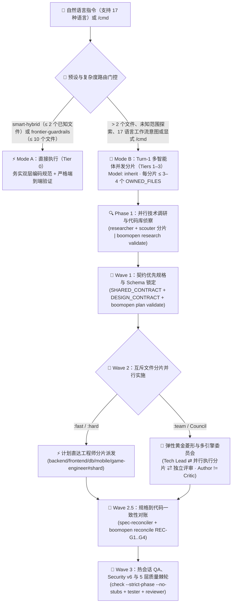

<div align="center">
  <h1>⚡ BoomOpen Workflow Kit Pro v5.5</h1>
  <p><strong>跨 Antigravity、Claude Code、OpenAI Codex、Cursor 与 GitHub Copilot 的多智能体工作流编排框架与确定性 CLI 质量门禁。</strong></p>

  <p>
    <a href="https://boomopen.com"></a>
    <a href="https://github.com/Kennyboom/BoomOpen-Workflow-Kit-Pro/releases"></a>
    <a href="#platforms"></a>
    <a href="#cli"></a>
    <a href="#skills"></a>
    <a href="https://nodejs.org/">= 18.0.0" /></a>
    <a href="../LICENSE"></a>
  </p>

  <p>
    <a href="../README.md">English</a> •
    <a href="./README.vi.md">Tiếng Việt</a> •
    <b>简体中文</b> •
    <a href="./README.zh-TW.md">繁體中文</a> •
    <a href="./README.ja.md">日本語</a> •
    <a href="./README.ko.md">한국어</a> •
    <a href="./README.es.md">Español</a> •
    <a href="./README.fr.md">Français</a> •
    <a href="./README.de.md">Deutsch</a><br/>
    <a href="./README.pt-BR.md">Português (BR)</a> •
    <a href="./README.ru.md">Русский</a> •
    <a href="./README.hi.md">हिन्दी</a> •
    <a href="./README.ar.md">العربية</a> •
    <a href="./README.id.md">Bahasa Indonesia</a> •
    <a href="./README.th.md">ไทย</a> •
    <a href="./README.tr.md">Türkçe</a> •
    <a href="./README.it.md">Italiano</a>
  </p>

  <p>
    <a href="https://boomopen.com"><b>🌐 boomopen.com（15 种语言）</b></a> •
    <a href="#trailer"><b>🎬 发布宣传片</b></a> •
    <a href="#why-boomopen"><b>⚡ 为什么需要 BoomOpen</b></a> •
    <a href="#architecture"><b>🏗️ 架构设计</b></a> •
    <a href="#quickstart"><b>🚀 快速开始</b></a> •
    <a href="#cli"><b>🛠️ 14 道 CLI 门禁</b></a> •
    <a href="#settings"><b>🎛️ 预设与配置</b></a> •
    <a href="#commands"><b>🎯 36 个斜杠命令</b></a> •
    <a href="#agents"><b>🤖 22 智能体与 18 团队</b></a> •
    <a href="#skills"><b>📚 1,462 项按需技能</b></a>
  </p>
</div>

---

<a id="trailer"></a>

## 🎬 官方发布宣传片与交互式在线演练场 (`boomopen.com`)

<div align="center">
  <a href="https://github.com/Kennyboom/BoomOpen-Workflow-Kit-Pro/raw/main/assets/media/boomopen_v55_trailer_en.mp4">
    
  </a>
  <p>
    ▶️ <a href="https://github.com/Kennyboom/BoomOpen-Workflow-Kit-Pro/raw/main/assets/media/boomopen_v55_trailer_en.mp4"><b>在线播放 Full HD 1080p 官方宣传片（MP4 专业配音版）</b></a> • 🌐 <a href="https://boomopen.com"><b>前往 boomopen.com 体验 14 命令在线 CLI 演练场与技能目录检索（支持 15 种语言）</b></a>
  </p>
</div>

---

<a id="why-boomopen"></a>
<a id="-what-is-boomopen-workflow-kit"></a>

## ⚡ 为什么需要 BoomOpen Workflow Kit？

**原生 AI 编程助手的工程瓶颈：** 开箱即用的单智能体编程工具一旦面对跨多文件、跨领域或跨会话的复杂研发任务，交付质量便会迅速劣化：串行翻阅文件污染主会话上下文窗口；缺乏协同的子智能体互相覆盖共享文件，或留下未挂载的“孤岛”模块；生成代码暗藏 `TODO` 桩代码与显式 `any` 类型逃逸；单一模型既写代码又做评审（`Author == Critic`）难以察觉自身盲区；多阶段长周期开发更会在上下文压缩后偏离原始技术规格。

**BoomOpen 的解决思路：** BoomOpen 在 **Antigravity (Gemini)**、**Claude Code**、**OpenAI Codex**、**Cursor** 和 **GitHub Copilot** 之上构建了一套**零运行时 npm 依赖**的统一多智能体编排与确定性验证底座。默认启用 **`smart-hybrid`** 配置后，`≤ 2` 个文件的明确微改直接零开销执行；而跨文件特性开发、深度技术调研、架构规划以及 **`36` 个斜杠命令（`93` 个工作流与协议文件）** 则会在首轮（Turn 1）自动按领域分片调度 **22 位专业智能体** 与 **18 支三角色对抗评审团队**，全程由 **14 个本地 `boomopen` CLI 确定性质量门禁** 强约束，并按需挂载 **`1,462` 项工程技能**（`22` 项核心技能 + 单次去重存储于 `~/.agents/skills_library` 的 `1,440` 项扩展技能）。

### ⚖️ 原生 AI IDE vs. 接入 BoomOpen v5.5 对比

| 典型工程失效模式 | 未接入 BoomOpen（原生 AI IDE） | 接入 BoomOpen Workflow Kit Pro v5.5 |
|:-----------------|:-------------------------------|:------------------------------------|
| **上下文窗口膨胀** | 主智能体串行读取 15–30 个文件后才开始写第一行代码 | **Turn-1 弹性分片蜂群 (`role#shard`)**：并发派发只读侦察与领域分片（每分片 `≤ 3–4` 个文件）+ `0s` 热会话复用（`send_message`） |
| **并发覆盖与链路断层** | 并行子任务互相覆盖公共文件、前后端自造不一致的 `/api` 路由或遗留死模块 | **契约优先文件锁 + Wave 2.5 对账**：Wave 1 锁定 `SHARED_CONTRACT` 与互斥 `OWNED_FILES`，经 `boomopen reconcile`（`REC-G1..G4`）自动核验 |
| **浅层调研与空泛计划** | 单一视角迎合式回答、未经核实的论断、散文式无约束计划文档 | **证据门控 6 模块规格书**：`:team` 反方辩手对抗质询 + `< 50ms` 本地 CLI 校验器（`boomopen research`、`design`、`plan`） |
| **隐式桩代码、`any` 与测试作弊** | 智能体宣称完工，实则遗留 `// TODO`、显式 `any`、调试 `console.log` 或 `.skip` 测试 | **务实双层静态质量门禁**：`boomopen check --strict-phase --no-stubs` 强制执行 `0` `any`、`0` 桩代码及 `400/500` 行内聚上限 |
| **跨会话规格漂移与回归故障** | 上下文压缩冲掉阶段约束，后续改动破坏原本已通过的功能 | **5 层阶段质量棘轮与原子回滚**：`.boomopen/project-ledger.json` SHA-256 规格防漂移校验、`/autopilot`、`/audit` 与 `rollback --yes` |
| **单一模型认知盲区** | 同一模型既负责实现又负责代码审查（`Author == Critic`） | **跨引擎指挥官 (`/conduct`)**：跨 Claude Code、Codex、Antigravity、Cursor 与 Copilot 并行召开多引擎委员会与跨模型家族流水线 |
| **5 大 IDE 配置割裂与 Git 脏工作区** | 各 IDE 维护独立提示词、重复占用数 GB 技能目录、临时规格书污染 `git status` | **毫秒级统一同步与洁净 Git**：`< 10ms` 同步 14 个入口文件，共享单一 `~/.agents/skills_library`（`0` 空闲 Token），过程产物路由至 Brain Artifacts |

---

<a id="architecture"></a>
<a id="-smart-hybrid-architecture-v55"></a>

## 🏗️ 智能混合架构设计 (v5.5)



---

<a id="pillars"></a>

## 🧠 6 大核心工程支柱

1. **🌐 5 大 IDE 原生格式编译与单实例去重技能库 (`platforms/*`)**：
   - 将 **22 位专业智能体** 与 **93 个命令及参考协议文件** 编译为各 IDE 的原生形态：**Antigravity**（`--as-plugin` 插件包 + `3` 个可执行 `run_workflow` Python 并发脚本：`audit_fanout.py`、`review_fanout.py`、`research_fanout.py`）、**Claude Code**（`isolation: worktree` 隔离分片、`/plan:hard` 冒号命令、可选 `PreToolUse` 与 `Stop`/`PreCompact` 生命周期钩子）、**OpenAI Codex**（`22` 个 TOML 角色定义，为侦察与评审角色启用操作系统级 `read-only` 沙箱 + `87` 项 `$boomopen-*` 技能）、**Cursor**（`.mdc` 规则 + 可选 `beforeShellExecution` 拦截钩子）以及 **GitHub Copilot**（`.agent.md` 原生智能体）。
   - 全部 `1,440` 项扩展技能单次去重链接至 `~/.agents/skills_library` 供 5 大 IDE 共用（节省约 80% 磁盘占用，Turn-1 零额外 Token 开销）。
2. **🎯 4 层动态弹性分片蜂群 (`role#shard`) 与作用域热会话复用**：
   - 按任务规模自动从 **Tier 0**（`≤ 2` 个已知文件时不启动子智能体）弹性扩展至 **Tier 1**（`2–3` 分片）→ **Tier 2**（`4–6` 分片）→ **Tier 3**（`7–8+` 分片，最高可配置至 `16`），严格限制单个子智能体的认知负载不超过 **`≤ 3–4` 个 `OWNED_FILES`**，并通过 `role#shard → conversationId`（`send_message`）复用活跃上下文。
3. **🤝 三波次契约优先执行 + Wave 2.5 自动对账 (`REC-G1..G4`)**：
   - Wave 1 先行锁定 `SHARED_CONTRACT`（API Schema/DTO）与 `DESIGN_CONTRACT`（OKLCH `@theme` CSS 令牌 + TypeScript 组件属性），随后 Wave 2 再并发派发各领域工程师。Wave 2.5 运行 `boomopen reconcile` 与 `spec-reconciler`，精准拦截未挂载的孤岛文件（`REC-G1`）、前后端路由不匹配（`REC-G2`）、遗漏的 `[SC-*]` 验收子条款（`REC-G3`）及 `.env.example` 缺失环境变量（`REC-G4`），并通过 `boomopen cook amend-plan` 自动追加增量修复波次。
4. **🏛️ 跨会话项目自动驾驶 (`/autopilot`) 与有状态多轮全量审计 (`/audit`)**：
   - 将多文档规格书编译为带 SHA-256 漂移检测的 `.boomopen/project-ledger.json`，在每个阶段前自动打下 Git 检查点（支持 `boomopen ledger rollback --yes`），并强制通过 **5 层阶段质量棘轮**（`G1 check --strict-phase --no-stubs` → `G2 测试用例单调递增棘轮` → `G3 reconcile --strict` → `G4 Author != Critic 独立审查` → `G5 ledger verify`）。项目开发完成后，`/audit` 基于状态账本（`.boomopen/audit-ledger.json` + `boomopen audit rollback --yes`）执行人工门控的多轮 RTM 需求矩阵、全栈垂直链路及 Security v6 深度审计。
5. **🎼 跨引擎指挥官与多引擎并行委员会 (`boomopen conduct`)**：
   - 同时调度 Claude Code、OpenAI Codex、Antigravity、Cursor 与 Copilot 组建 **6 类任务并行委员会**（`research`、`brainstorm`、`plan`、`design`、`review`、`debug` → 输出四段式 `COUNCIL-SYNTHESIS.md` 共识报告）或 **跨模型家族角色流水线**，确保任何模型都不会既当作者又当裁判（`Author != Critic`）。
6. **📏 务实双层编码规范与 SPIE v3.0 根因调试体系**：
   - **第一层（红线零容忍）**：单一职责、`0` 显式 `any`、业务代码 `0` 调试 `console.log`、异步/I/O 边界强类型 `try/catch`、配置常量采用 `SCREAMING_SNAKE_CASE`。**第二层（内聚优先）**：单文件目标 `~200–350` 行（`400` 行软上限 / `500` 行硬拆分线；测试、类型定义与文档豁免）。缺陷排查强制经过 3 项优先级假设验证与 **5-Whys (SPIE v3.0)** 因果链推导，临时规格产物统一写入 Brain Artifacts 以保持 Git 工作区 `100%` 洁净。

---

<a id="platforms"></a>
<a id="-supported-ai-platforms"></a>

## 💻 支持的 5 大 AI 编程平台

| 平台 | 支持版本 | 同步入口文件 | 平台原生集成能力 |
|:-----|:--------:|:-------------|:-----------------|
| **Antigravity (Gemini)** | ✅ v5.5 | `~/.gemini/GEMINI.md` | `invoke_subagent`、`run_workflow` Python 并发扇出、`/goal` 持久外层循环、`--as-plugin` 插件包、可选 `--with-hooks`、Brain Artifacts |
| **Claude Code** | ✅ v5.5 | `~/.claude/CLAUDE.md` | 并行 `Task`/`Agent` 分片（`isolation: worktree`）、`/plan:hard` 冒号命令、可选 `PreToolUse` 与 `Stop`/`PreCompact` 钩子 |
| **OpenAI Codex** | ✅ v5.5 | `~/.codex/AGENTS.md` & `CODEX.md` | `~/.codex/agents/boomopen/` 下 `22` 个 TOML 角色（侦察/评审启用 OS 级 `sandbox_mode = "read-only"`）+ `87` 项 `$boomopen-*` 技能 |
| **Cursor** | ✅ v5.5 | `~/.cursor/rules/boomopen-workflow-kit.mdc` | 常驻 `.mdc` Frontmatter 规则、`CURSOR.md`、子智能体路由与可选 `.cursor/hooks.json`（`beforeShellExecution`） |
| **GitHub Copilot** | ✅ v5.5 | `~/.copilot/copilot-instructions.md` | VS Code 编译版 `boomopen-workflow-kit.agent.md` 提示词智能体、`runSubagent` 分发与 `COPILOT.md` |

---

<a id="quickstart"></a>
<a id="-quick-start--installation"></a>

## 🚀 快速开始与安装（仅限 Git 仓库分发 — 零运行时依赖）

```bash
# 1. 克隆代码仓库（仅通过 GitHub 分发 —— 从未发布至 npm）
git clone https://github.com/Kennyboom/BoomOpen-Workflow-Kit-Pro.git
cd BoomOpen-Workflow-Kit-Pro

# 2. 为单个 AI IDE 安装（默认预设：smart-hybrid）或一键同步全部 5 大 IDE
npm run install:all                                 # 安装并同步全部 5 大 IDE + 共享 ~/.agents/skills_library
npm run install:antigravity                         # Google Antigravity 2.0（可附加 --as-plugin / --with-hooks）
node cli/install.js install claude --with-hooks     # Claude Code + 启用可选 PreToolUse 与 Stop/PreCompact 钩子
npm run install:codex                               # OpenAI Codex CLI + OS 级只读侦察/评审沙箱
npm run install:cursor                              # Cursor（附加 --with-hooks 启用 beforeShellExecution 命令守卫）
npm run install:copilot                             # GitHub Copilot（VS Code .agent.md + copilot-instructions.md）

# 3. 运行健康检查，并可选将 `boomopen` 软链接至全局 PATH
npm run doctor
npm link
boomopen settings status
```

> **非破坏性安全安装与卸载**：全程通过 SHA-256 清单（`~/.boomopen/manifests/<tool>.json`）追踪文件变更。`GEMINI.md` / `CLAUDE.md` 标记块之外的个人自定义规则会完整保留并自动备份；执行 `boomopen uninstall <tool|--all>` 仅精准移除未修改的套件文件，绝不误删用户自有配置。

---

<a id="cli"></a>

## 🛠️ 14 个零依赖 CLI 子命令 (`boomopen`)

基于 Node.js `>= 18` 本地运行，单次执行 `< 50ms`，**零 npm 运行时依赖**、**零外部网络请求**：

| 子命令 | 核心参数与语法 | 确定性质量门禁与工程职责 |
|:-------|:---------------|:-------------------------|
| **`install` / `uninstall` / `list`** | `<tool\|--all> [--with-hooks] [--as-plugin]` | SHA-256 清单安装器、共享 `~/.agents/skills_library` 链接器、可选安全钩子注入与无残留卸载 |
| **`doctor`** | `[--source-only]` | 30 项只读完整性自检：覆盖 5 大 IDE 产物、`93` 个命令文件、`72` 个团队文件、`1,462` 项技能与配置同步状态 |
| **`settings`** | `status \| preset <name> \| set <k> <v> \| --ui` | 管理 5 套预设 + `22` 项配置键（`--project` 写入 `./.boomopen.json`），或启动带 CSP 防护的本地 Web 面板（`127.0.0.1:4567`） |
| **`research`** | `<validate\|brief> <file.md> [--mode brainstorm]` | 校验 **`RES-G1..G4`**（`≥ 4` 信源交叉三角验证、矛盾矩阵、事前验尸风险）并提炼 `HANDOFF_BRIEF` |
| **`design`** | `<validate\|contract> <DESIGN.md> [--json]` | 校验 **`DESIGN-G1..G4`**（6 模块设计规格、OKLCH 色彩令牌、5 状态 UI 矩阵、WCAG 2.2 AA）并生成 `DESIGN_CONTRACT` |
| **`plan`** | `<validate\|compile> <PLAN.md> [--sync-ledger]` | 校验 **`PLAN-G1..G5`**（无环 DAG、互斥 `OWNED_FILES ≤ 4`/分片、`SHARED_CONTRACT`）并同步项目账本 |
| **`cook`** | `<state\|packets\|verify-wave\|preflight\|amend-plan>` | 校验 **`COOK-G1..G4`**：5 阶段快进状态检测、5 字段波次交接包编译、Git 写锁核验与增量波次修订 |
| **`reconcile`** | `<dir> [--plan <PLAN.md>] [--strict]` | Wave 2.5 **`REC-G1..G4`**：检测未挂载孤岛模块、`/api` 前后端路由偏差、遗漏 `[SC-*]` 条款及 `.env.example` 缺口 |
| **`check`** | `[path] --strict-phase --no-stubs [--ignore <dir>]` | 务实双层静态门禁：`400/500` 行预算、`0` 显式 `any`、`0` 调试 `console.log`、`0` 桩代码/`TODO`/`.skip` |
| **`ledger`** | `<init\|from-plan\|status\|next\|verify\|rollback>` | 跨会话 `.boomopen/project-ledger.json` DAG 状态机、SHA-256 规格防漂移守卫与原子级 `rollback --yes` |
| **`audit`** | `<init\|slice\|record\|approve\|verify-fix\|rollback>` | 完工后有状态多轮审计账本（`.boomopen/audit-ledger.json`）、问题收敛棘轮与 `rollback --yes` |
| **`conduct`** | `<probe\|council\|dispatch\|status> [--dry-run]` | 跨引擎指挥官与 6 类任务并行多引擎委员会（跨 5 大 IDE 落实 `Author != Critic` → `COUNCIL-SYNTHESIS.md`） |

---

<a id="settings"></a>
<a id="-unified-settings--mode-selection-settings"></a>

## 🎛️ 统一控制中心与 5 套预设 (`/settings`)

支持全局（`~/.boomopen/settings.json`）或仓库级（`./.boomopen.json`）管理 **`20` 项枚举配置键 + `2` 项自定义行数上限**，并在 `< 10ms` 内热同步至全部 14 个 IDE 入口文件：

| 预设档位 | 执行模式 (`execution.mode`) | 默认 `/cmd` | 17 语言自然语言路由 (`naturalLanguageResearchTrigger`) | 编码规范 | 适用工程场景 |
|:---------|:----------------------------|:-----------:|:------------------------------------------------------:|:--------:|:-------------|
| **⚡ `smart-hybrid`** *（默认）* | **`auto`**（`≤ 2` 个文件直连执行；`> 2` 个文件或 `/cmd` → Mode B 蜂群） | `auto` | **`auto_team`** *（将 17 种语言的调研/构思/审查意图自动路由至 `:team` 与对应工作流）* | `pragmatic` (`400/500`L) | 默认开箱体验：自然语言工作流意图识别 + Turn-1 自动并发分片 |
| **🛡️ `frontier-guardrails`** *（可选极简档）* | **`mode_a`**（`≤ 10` 个文件直连；`< 2.5 KB` / `~600` Token 入口） | `auto` | **`off`** *（仅响应显式 `/cmd` —— 零自然语言拦截）* | `pragmatic` (`400/500`L) | `< 2.5 KB` 超轻量日常直连模式，保留双层规范与端到端门禁 *（兼容别名 `carbon-guardrails`）* |
| **🚀 `solo-fast`** | **`mode_a`**（`≤ 10` 个文件直连；保守上限 `3` 分片） | `fast` | `off` | `relaxed` (`600/800`L) | 快速原型验证、小型脚本编写、紧急热修复与低 Token 消耗场景 |
| **🧠 `deep-architect`** | **`mode_b`** *（强制启用 Mode B 编排器；最高 `12` 分片）* | `hard` | `auto_hard` + `council` 调研 / `cross_family` 审查 | `strict` (`300/400`L) | 复杂系统架构设计、全新项目搭建与跨模块大规模重构 |
| **🔺 `adversarial-team`** | **`team`** *（弹性黄金菱形 `:team`；`hyper_swarm` 最高 `12` 分片）* | `team` | **`auto_team`** + `council` 调研、规划与审查 | `strict` (`300/400`L) | 核心生产环境发布、高敏安全审计与多引擎交叉共识评审 |

```bash
# 可通过聊天框 (/settings)、本地可视化面板 (--ui) 或终端 CLI 切换预设与配置项：
boomopen settings --ui                                      # 启动本地 Web 控制中心 http://127.0.0.1:4567
boomopen settings preset smart-hybrid                       # 默认：Auto Mode A/B + 17 语言自然语言工作流路由
boomopen settings preset frontier-guardrails                # 可选：< 2.5 KB 极简 Mode A（兼容别名：carbon-guardrails）
boomopen settings set engines.reviewer cross_family         # 强制启用跨模型家族独立评审（Author != Critic）
cd path/to/your/repo && boomopen settings mode team --project # 写入仓库级 ./.boomopen.json 覆盖配置
boomopen settings reset                                     # 恢复默认 smart-hybrid 配置
```

---

<a id="commands"></a>
<a id="-slash-commands-reference"></a>

## 🎯 全部 36 个斜杠命令参考手册（`93` 个文件 = `87` 个工作流 + `6` 个 `_ref/`）

在 `smart-hybrid` 下可直接使用 **17 种支持语言中的任意一种** 自然对话触发，也可显式调用以下 **36 个标准斜杠命令**：

| 分类 | 命令 | 支持变体 | 核心职责与确定性交付物 |
|:-----|:-----|:---------|:-----------------------|
| **编排与自主执行** | **`/cook`** | `:fast`, `:hard`, `:team` | 无现成计划时的端到端特性构建（侦察 → 契约规划 → 并行分片开发 → Wave 2.5 对账 → QA） |
| | **`/code`** | `:fast`, `:hard`, `:team` | 直接按已审批的 `PLAN-{task}.md` 派发 Wave 1–3 分片编码，无需重复执行 `/plan` |
| | **`/autopilot`** | `:init`, `:run`, `:audit` | 基于 `.boomopen/project-ledger.json` 与 **5 层阶段质量棘轮** 的跨会话全自动规格交付引擎 |
| | **`/conduct`** | `:council`, `:pipeline` | 跨 5 大 IDE 的多引擎并行委员会（`COUNCIL-SYNTHESIS.md`）与跨模型家族流水线（支持 `--dry-run`） |
| | **`/orchestrate`** / **`/auto`** | — | 自定义跨领域蜂群协同编排（`/orchestrate`）或端到端全自动闭环执行（`/auto`） |
| **架构、设计与深度调研** | **`/plan`** | `:fast`, `:hard`, `:team` | 经 5 道门禁校验的 `PLAN-{task}.md` 实施蓝图：锁定 `SHARED_CONTRACT`、互斥 `OWNED_FILES ≤ 4`/分片与 Given/When/Then 验收标准 |
| | **`/architect`** | — | 纯架构设计蓝图：C4 架构图、ADR 决策记录、数据库表结构、API 契约、界面规格与覆盖率核查（零业务代码改动） |
| | **`/design`** / **`/ui-ux-pro-max`** | `:fast`, `:hard`, `:team` | 6 模块 `DESIGN-{task}.md` + `DESIGN_CONTRACT`（`@theme` OKLCH 令牌、5 状态 UI 矩阵、50+ 视觉风格与实时 HTML 预览） |
| | **`/research`** | `:fast`, `:hard`, `:team` | 5 视角深度技术调研（`RESEARCH-{topic}.md`、`RES-G1..G4` ≥ 4 信源三角验证、矛盾仲裁表与 `HANDOFF_BRIEF`） |
| | **`/brainstorm`** / **`/ask`** | `:fast`, `:hard`, `:team` | 反迎合战略构思（含事前验尸与 MCDA 决策矩阵的 `BRAINSTORM-{topic}.md`）及基于代码证据的问答（`/ask`） |
| **质量、审计、调试与安全** | **`/review`** | `:fast`, `:hard`, `:team` | 多维度对抗式代码、架构、安全与性能审查（`Author != Critic`，支持一键衔接 `/fix`） |
| | **`/audit`** / **`/deep-audit`** | `:run`, `:fix`, `:auto` | 完工后多轮全仓库对账审计（`/audit` 状态账本）与编码前 10 维度规格逻辑预审（`/deep-audit`） |
| | **`/security-audit`** | — | OWASP Top 10 + LLM/智能体 Top 10 安全扫描（`security_scan.py` v6）、STRIDE 威胁建模、认证鉴权与供应链报告 |
| | **`/debug`** / **`/fix`** | `:fast`, `:hard`, `:team` | 3 假设验证 + **5-Whys (SPIE v3.0)** 根因追踪（`DEBUG-{issue}.md`）与失败测试先行的 TDD 缺陷修复（`/fix`） |
| | **`/test`** / **`/performance`** / **`/refactor`** | `:fast`, `:hard`, `:team` | 零作弊测试分片生成与执行（`/test`）、Core Web Vitals / 数据库 / 包体积调优（`/performance`）及指标可验证的 `/refactor` |
| **Git、发布、文档与会话运维** | **`/onboard`** / **`/init`** | — | 60 秒只读存量代码库全景测绘 `ARCHITECTURE-MAP.md`（`/onboard`，与内置 `/init` 零冲突）及新项目脚手架初始化（`/init`） |
| | **`/pr`** / **`/release`** | —, `:review` | PR 提交前质量与对账门禁 + `gh pr create` / 差异块对抗审查（`/pr:review`），以及版本一致性校验的语义化发布（`/release`） |
| | **`/deploy`** / **`/rollback`** | `:check`, `:preview`, `:production`, `:rollback` | 部署就绪门禁核查、预览/生产环境上线（`/deploy`）与按故障等级执行的紧急回滚（`/rollback`） |
| | **`/docs`** / **`/report`** | `:core`, `:business`, `:audit` / `:fast..:team` | 严格忠于源码的 `./documents/` 双层文档体系（`/docs`）与基于真实 CLI 遥测数据的状态报告（`/report`） |
| | **`/settings`** / **`/status`** / **`/next`** | — | 统一控制中心（`/settings`）、账本与蜂群实时健康看板（`/status`）及下一步行动智能导航（`/next`） |
| | **`/preview`** / **`/save`** / **`/recap`** | — | 本地开发服务器生命周期管理（`/preview`）、会话交接状态持久化（`/save`）与 `< 5s` 上下文快速恢复（`/recap`） |

### 🌙 过夜多阶段大型项目实战指南 (`/autopilot` & `/goal`)

| 工作流组合 | 适用平台与运行机制 | 跨会话上下文连续性 | 质量与规格一致性保障 |
|:-----------|:-------------------|:-------------------|:---------------------|
| **`/autopilot`（配合 `--with-hooks`）** | 全部 5 大 IDE（推荐在 **Claude Code**、**Antigravity** 与 **Cursor** 上开启 `--with-hooks`） | `Stop` 与 `PreCompact` 钩子（`stop-quality-gate.mjs`）配合 `.boomopen/project-ledger.json` 在上下文压缩后精准保留执行游标 | 强制执行 **5 层阶段质量棘轮**（`G1..G5`）、Wave 2.5 `reconcile` 对账以及 `boomopen ledger rollback --yes` |
| **`/goal` + `/autopilot` + `/audit`** | **Antigravity 2.0** 面向大型 `docs/` 规格书的持久外层循环运行器 | Antigravity 原生 **`/goal`** 循环跨阶段持续推进，直至账本中所有阶段均达到 `VERIFIED` 状态 | 每个阶段均通过全部 5 道验证门禁与 Wave 2.5 对账，全部完成后自动启动第 1 轮 **`/audit`** |

```text
/goal 使用 /autopilot 读取 docs/ 目录下的全部项目文档，初始化 .boomopen/project-ledger.json，并按顺序自主实现每一个阶段（每个阶段都必须通过全部 5 道验证门禁与 Wave 2.5 reconcile 对账）。当 100% 阶段通过后，运行第 1 轮 /audit 并停下输出汇总报告供我审查。
```

---

<a id="agents"></a>
<a id="-22-specialist-agents--18-golden-triangle-teams"></a>

## 🤖 22 位专业智能体与 18 支三角色对抗团队

所有子智能体均继承当前会话主模型（`Model: "inherit"` —— 严禁降级使用 `flash_lite`），并按领域编组为 **18 支黄金菱形 / 黄金三角团队**（`Tech Lead` ⇄ `并行分片执行工程师` ⇄ `独立审查员/反方辩手`）：

| 工程领域 | 专业智能体（`agents/*.md`，按 IDE 原生编译） | 三角色对抗审查团队（`agents/teams/*-team/`，共 `72` 个文件） |
|:---------|:---------------------------------------------|:-------------------------------------------------------------|
| **工程研发与交付** | `backend-engineer`, `frontend-engineer`, `mobile-engineer`, `game-engineer`, `database-architect`, `devops-engineer` | `backend-team`, `frontend-team`, `fullstack-team`, `mobile-team`, `game-team`, `database-team`, `devops-team` |
| **系统架构与产品规划** | `tech-lead`, `planner`, `brainstormer`, `business-analyst`, `project-manager`, `designer` | `planning-team`, `brainstorm-team`, `project-team`, `design-team` |
| **质量保障、对账与安全** | `debugger`, `tester`, `reviewer`, `spec-reconciler`, `security-engineer`, `performance-engineer` | `debug-team`, `qa-team`, `security-team`, `performance-team` |
| **技术调研与文档体系** | `researcher`, `scouter`, `docs-manager`, `reporter` | `research-team`, `docs-team`, `report-team` |

---

<a id="skills"></a>
<a id="-1460-skills-vault-22-core--1440-niche-library-skills"></a>

## 📚 1,462 项按需加载技能库（`22` 项核心技能 + `1,440` 项扩展技能）

统一索引于涵盖 **19 个工程领域** 的 `matrix-skills/compact-index.json`，单次去重链接至 `~/.agents/skills_library`，通过 **两步 O(1) 渐进式解析**（检索核心 `skills/` → 查询 `compact-index.json` → 仅向对应分片注入匹配的 `SKILL.md`，空闲状态 `0` Token 消耗）：

| 层级 / 工程领域 | 技能数 | 代表性技术栈与脚手架能力 | 加载时机 |
|:----------------|:------:|:-------------------------|:---------|
| **⚡ 核心工作流与质量底座 (`skills/`)** | **22** | `clean-code`, `debugger`, `plan-writing`, `brainstorming`, `deep-research`, `design-spec`, `frontend-design`, `frontend-architecture`, `api-patterns`, `database-design`, `tdd-workflow`, `testing-patterns`, `webapp-testing`, `security-auditor`（`security_scan.py` v6）, `app-builder`（内置 **`mcp-server`**、**`ai-agent-worker`**、`nextjs-saas`、`monorepo-turborepo`、`python-fastapi`、`flutter-app` 等 **15 套项目模板**）, `skill-seeker` | Turn 1 即刻可用 |
| **🤖 AI、智能体 SDK、MCP 与数据工程** | **340+** | FastMCP (`StreamableHTTP`)、OpenAI Agents SDK、Claude Agent SDK、Google ADK、Vercel AI SDK、LangGraph、RAG、BigQuery、dbt | 按需加载 (`compact-index.json`) |
| **🌐 Web、后端服务、API 与数据库** | **380+** | React 19、Next.js 15 RSC、Tailwind CSS v4、TanStack Start/Router/Query、Hono RPC + Zod OpenAPI、Rust Axum/SQLx、Drizzle、Postgres/RLS | 按需加载 (`compact-index.json`) |
| **☁️ 云原生、DevOps、QA 与网络安全** | **300+** | Cloudflare Workers/Durable Objects/D1、Docker/K8s、Terraform、Playwright、Vitest + MSW v2、Better Auth (Passkeys)、OWASP LLM Top 10 | 按需加载 (`compact-index.json`) |
| **🎨 UI/UX 设计、游戏引擎与移动端** | **420+** | OKLCH 设计令牌、WCAG 2.2 AA、Motion、Unity 6 DOTS/ECS、Godot 4、Unreal 5、WebGPU/Three.js、Phaser/PixiJS、Tauri v2、SwiftUI、Flutter、React Native | 按需加载 (`compact-index.json`) |

---

## 📂 仓库目录结构

```text
BoomOpen-Workflow-Kit-Pro/
├── agents/                  # 22 个专业智能体（按 IDE 原生编译）+ 18 支三角色团队（共 72 个文件）
├── cli/                     # 14 个零依赖 Node.js CLI 子命令 + 33 套 node:test 自动化测试套件
├── commands/                # 36 个斜杠命令，涵盖 87 个工作流文件 + 6 个 _ref/ 共享协议（共 93 个文件）
├── documents/               # 系统架构、领域模型、源码底座与务实双层编码规范文档
├── i18n/                    # 16 份完整本地化 README（连同根目录 README.md 共支持 17 种语言）
├── matrix-skills/           # 19 个领域 YAML 目录 + O(1) compact-index.json（索引全部 1,462 项技能）
├── platforms/               # 5 大 IDE 平台适配包、可选安全钩子、3 个 Antigravity run_workflow/*.py 与 Codex TOML 角色
├── rules/                   # 7 个 Mode B 按需加载规则模块 (CORE, PHASES, AGENTS, TEAMS, SKILLS, ERRORS, REFERENCE)
├── scripts/                 # 跨平台校验与会话辅助脚本 (checklist.py, verify_all.py, auto_preview.py, session_manager.py)
├── skills/                  # 22 项核心技能 + 15 套 app-builder 项目模板 + Security v6 / UX / 性能审计脚本
├── skills_library/          # 1,440 项扩展技能库，安装时单次去重链接至共享目录 ~/.agents/skills_library
├── web/                     # 驱动 https://boomopen.com 的 15 语言 Cosmic WebGL 交互展示站与可检索目录
└── GEMINI.md | CLAUDE.md | CODEX.md | COPILOT.md | CURSOR.md | AGENT.md
```

---

## 📄 开源许可与安全策略

- **官方网站**：[https://boomopen.com](https://boomopen.com)
- **开源许可**：本套件源码、CLI 工具、规则、智能体定义与文档基于 [MIT 许可证](../LICENSE) 发布（Copyright © 2026 **BoomOpen Labs**）。`skills_library/` 目录下的第三方技能保留其各自的上游开源许可证，详见 [THIRD_PARTY_NOTICES.md](../THIRD_PARTY_NOTICES.md)。
- **安全策略**：有关 SHA-256 清单防篡改保护、可选钩子沙箱机制及安全漏洞上报流程，请参阅 [SECURITY.md](../SECURITY.md)。
