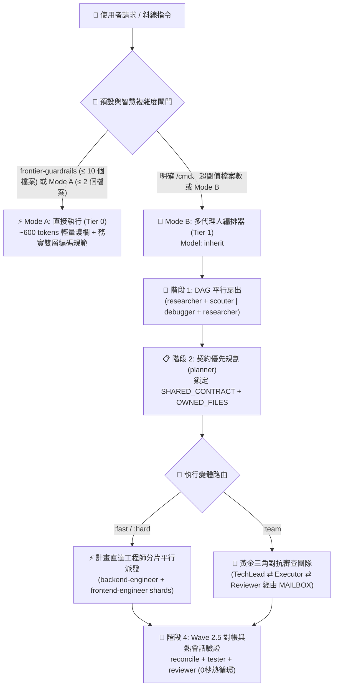

<div align="center">
  <h1>⚡ BoomOpen Workflow Kit v5.5.0</h1>
  <p><strong>跨平台前沿護欄 (Frontier-Guardrails) 與智慧混合 AI 研發作業系統 — 22 位專家級代理人、18 支黃金三角團隊、36 個斜線指令與 1,462 項按需技能寶庫</strong></p>

  <p>
    <a href="https://boomopen.com"></a>
    <a href="https://github.com/Kennyboom/BoomOpen-Workflow-Kit-Pro/releases"></a>
    <a href="#platforms"></a>
    <a href="#agents"></a>
    <a href="#skills"></a>
    <a href="https://nodejs.org/">=18.0.0" /></a>
    <a href="../LICENSE"></a>
  </p>

  <p>
    <a href="../README.md">🇬🇧 English</a> • <a href="./README.vi.md">🇻🇳 Tiếng Việt</a> • <a href="./README.zh-CN.md">🇨🇳 简体中文</a> • <b>🇹🇼 繁體中文</b> • <a href="./README.ja.md">🇯🇵 日本語</a> • <a href="./README.ko.md">🇰🇷 한국어</a> • <a href="./README.es.md">🇪🇸 Español</a> • <a href="./README.fr.md">🇫🇷 Français</a> • <a href="./README.de.md">🇩🇪 Deutsch</a><br/>
    <a href="./README.pt-BR.md">🇧🇷 Português</a> • <a href="./README.ru.md">🇷🇺 Русский</a> • <a href="./README.hi.md">🇮🇳 हिन्दी</a> • <a href="./README.ar.md">🇸🇦 العربية</a> • <a href="./README.id.md">🇮🇩 Bahasa Indonesia</a> • <a href="./README.th.md">🇹🇭 ไทย</a> • <a href="./README.tr.md">🇹🇷 Türkçe</a> • <a href="./README.it.md">🇮🇹 Italiano</a>
  </p>

  <p>
    <a href="https://boomopen.com"><b>🌐 官方網站 (boomopen.com)</b></a> •
    <a href="#pillars"><b>🧠 6 大核心支柱</b></a> •
    <a href="#platforms"><b>💻 5 大支援平台</b></a> •
    <a href="#agents"><b>🤖 22 代理人 &amp; 18 團隊</b></a> •
    <a href="#skills"><b>📚 1,462 技能寶庫</b></a>
  </p>
</div>

---

## 🎬 官方發佈宣傳片 (Full HD 1080p)

<div align="center">
  <a href="https://github.com/Kennyboom/BoomOpen-Workflow-Kit-Pro/raw/main/assets/media/boomopen_v55_trailer_en.mp4">
    
  </a>
  <p>
    ▶️ <a href="https://github.com/Kennyboom/BoomOpen-Workflow-Kit-Pro/raw/main/assets/media/boomopen_v55_trailer_en.mp4"><b>點擊此處線上觀看 / 播放 Full HD 1080p 官方宣傳片 (MP4 專業配音版)</b></a> • 🌐 <a href="https://boomopen.com"><b>造訪互動展示網站 boomopen.com</b></a>
  </p>
</div>

---

## 🌟 什麼是 BoomOpen Workflow Kit v5.5？

**BoomOpen Workflow Kit v5.5（前沿護欄 Frontier-Guardrails 與跨平台智慧混合版）** 是一套開源的多代理人（Multi-Agent）研發作業系統，能將單一 AI 程式設計助手升級為由 **22 位依 IDE 原生編譯的專家級代理人**、**18 支黃金三角對抗團隊（`72` 個檔案）**、**36 個斜線指令（`93` 個指令與協定檔案：`87` 個工作流 + `6` 個 `_ref/`）**、**14 個確定性 CLI 子指令**、**22 項核心技能** 以及 **1,440 項專業領域技能庫（共 `1,462` 項技能，單次去重安裝至 `~/.agents/skills_library`）** 組成的協同工程團隊。

不同於每輪對話都會造成上下文膨脹的笨重代理封裝，BoomOpen v5.5 全新安裝預設啟用跨五大 IDE 的 **`⚡ smart-hybrid`（Turn-1 主動彈性蜂群 + 17 種語言自然語言意圖路由）**，同時提供可選的 **`🛡️ frontier-guardrails`（`< 2.5 KB` / `~600 tokens` 超輕量 Mode A 預設）**，開箱即釋放 **4 層動態彈性蜂群分片（`role#shard`）**、**Wave 2.5 規格到程式碼自動對帳（`boomopen reconcile`）**、**多輪次全專案審計（`/audit` & `boomopen audit`）**、**多工作階段專案自動駕駛（`/autopilot`）** 與 **跨引擎指揮官（`/conduct`）**：
- **⚡ 預設 `smart-hybrid` 主動彈性蜂群 + 17 語言意圖路由**：開箱即用，已知目標微幅修改（`≤ 2` 個檔案）直接走 Mode A 極速執行；而跨多檔案任務、深度調研、腦力激盪、架構規劃以及明確呼叫 **36 個 `/cmd` 指令**（含 **`/onboard`**、**`/pr` + `/pr:review`**、**`/release`** 等）會自動在 Turn 1 平行啟動子代理人分片（`role#shard`，每分片 `<= 3–4` 個 `OWNED_FILES`），結合 **契約優先檔案鎖（`SHARED_CONTRACT` + `OWNED_FILES`）**、**Wave 2.5 規格對帳（`boomopen reconcile` + `cook amend-plan`）** 與 **熱會話重用（`send_message`）**。
- **🛡️ 可選超輕量 `frontier-guardrails`（`< 2.5 KB` Slim Mode A）**：偏好在 `≤ 10` 個檔案以內維持原生直接 Mode A（`mode_a <= 10 files`）並關閉自然語言自動觸發（`naturalLanguageResearchTrigger = off`）？只需執行 `boomopen settings preset frontier-guardrails` 即可在 `< 10ms` 內切換（保留 `carbon-guardrails` 作為向後相容別名）。
- **🏛️ 多工作階段自動駕駛 (`/autopilot`)、多輪全專案審計 (`/audit`) 與跨引擎委員會 (`/conduct`)**：將需求文件編譯為含 SHA-256 防漂移校驗的 `.boomopen/project-ledger.json` 帳本，支援安全回滾（`boomopen ledger rollback --yes`）與 4 層階段門禁（`boomopen check --strict-phase --no-stubs`）；透過 `/audit` 與 `boomopen audit`（支援 `boomopen audit rollback --yes`）執行 RTM 需求覆蓋、UI->API->DB 垂直鏈路與 **2 層安全防洩漏掃描（`security_scan.py` v6）**；或透過 `boomopen conduct`（含 `--dry-run` 預演）調度五大引擎平行委員會。
- **📚 1,462 去重共享技能庫與 15 套 `app-builder` 範本（零上下文膨脹）**：單次安裝至 `~/.agents/skills_library` 供全部 5 大 IDE 共享，經由 `matrix-skills/compact-index.json` 實現 `O(1)` 兩步按需檢索（`22` 核心 + `1,440` 領域技能，含 **`mcp-server`** 與 **`ai-agent-worker`** 在內的 **15 套 `app-builder` 專案範本**）。

---

## 🏗️ 智慧混合架構圖 (v5.5)



---

<a id="pillars"></a>

## 🧠 v5.5 的 6 大核心支柱

1. **🌐 五大平台統一架構與 2026 原生生命週期鉤子 (`platforms/*`)**：
   - 為 **Antigravity (Gemini)**、**Claude Code**、**OpenAI Codex**、**Cursor** 與 **GitHub Copilot** 依各 IDE 原生格式編譯 **22 位專家代理人**，並共享同一份去重技能庫 `~/.agents/skills_library`。
   - 深度整合 2026 平台原生能力：**Antigravity 原生外掛模式**（`boomopen install antigravity --as-plugin`）與 **`run_workflow` Python 編排腳本**（`platforms/antigravity/workflows/*.py`）、**Claude Code `isolation: worktree`** 獨立工作樹 + 冒號指令（`/plan:hard`、`/pr:review`）+ `PreCompact`/`Stop` 品質門禁鉤子（`stop-quality-gate.mjs`）+ `Bash|PowerShell` 指令安全守衛（`validate-tool-call.mjs`，透過 `--with-hooks` 啟用），以及 **OpenAI Codex 作業系統級 `read-only` 沙箱**（`platforms/codex/config.toml`）。
2. **📏 務實雙層編碼規範（Pragmatic 2-Tier Coding Standards — 拒絕機械式切碎檔案）**：
   - **第一層（Tier 1 — 嚴格品質與安全底線，零容忍）**：單一職責原則、**嚴禁顯式 `any`**、**嚴禁在正式環境程式碼遺留除錯 `console.log`**、非同步與 API 邊界強制 `try/catch` 與強型別錯誤處理、常數 `SCREAMING_SNAKE_CASE`、DRY（≥ 3）與匯入排序。
   - **第二層（Tier 2 — 彈性結構指南，內聚優先）**：單一檔案軟目標 `~200–350 行`，軟上限 `~400–450 行`（僅當 `>500 行` 或混雜多領域職責時強制拆分；測試、Schema/Types 與文件豁免）。邏輯函式 `~20–40 行`（UI/處理函式 `~40–80 行`）。
3. **🎯 4 層動態彈性蜂群分片（`role#shard`）、計畫直達派發 & 熱會話重用 (`send_message`)**：
   - 一旦產出 `PLAN-{feature}.md`，編排器會將任務**直接派發**給領域工程師分片（每分片 `<= 3–4` 個 `OWNED_FILES`），消除多餘 `tech-lead` 中轉，並透過 `role#shard → conversationId` 實現 0 秒熱重用。
4. **🤝 契約優先平行派發 (`SHARED_CONTRACT` + `OWNED_FILES`)**：
   - 平行開發前預先鎖定 API 契約、DTO 結構與互斥寫入所有權（`OWNED_FILES` vs. `READ_ONLY_FILES`），配合 Wave 2.5 `boomopen reconcile`（`REC-G1..G4`）自動消除孤島模組與路由偏差。
5. **🔍 5-Whys (SPIE v3.0) 根因除錯與 100% 潔淨 Git 樹**：
   - `debugger` 透過 3 假設驗證與 **5-Whys 因果鏈**定位系統根因。暫態產物（`PLAN`、`DEBUG`、`TEST`、`REVIEW`、`MAILBOX`）預設寫入 `<appDataDir>\brain\<conversation-id>\`（或 `./reports/`），保持專案 Git 工作區 100% 潔淨。
6. **🩺 內建 14 指令 CLI 套件 (`research`, `design`, `plan`, `cook`, `reconcile`, `audit`, `ledger`, `conduct`, `check`, `doctor`, `settings`, `install`, `uninstall`, `list`)**：
   - `npm run doctor` 檢驗五大平台配置、22 個代理人、72 個團隊檔案（18 個團隊目錄）、`commands/**/*.md` 中的 **93 個指令檔案**（`87` 個工作流 + `6` 個 `_ref/`）及 `matrix-skills/compact-index.json`（`1,462` 項技能）。內建確定性工作流編譯器，並支援 `boomopen ledger rollback --yes`、`boomopen audit rollback --yes` 與 `boomopen conduct --dry-run`。

---

<a id="platforms"></a>

## 💻 支援的 AI 程式設計平台

| 平台名稱 | 支援級別 | 全域入口檔案 | 框架、外掛與鉤子安裝路徑 |
|----------|:-------------:|-------------------|------------------------|
| **Antigravity (Gemini)** | ✅ 原生 v5.5 | `~/.gemini/GEMINI.md` | `~/.gemini/config/skills/boomopen-workflow-kit/` *（或 `--as-plugin` → `~/.gemini/config/plugins/boomopen-workflow-kit/`）* |
| **Claude Code** | ✅ 原生 v5.5 | `~/.claude/CLAUDE.md` | `~/.claude/skills/boomopen-workflow-kit/` + `~/.claude/agents/`（`isolation: worktree` + `PreCompact`/`Stop` 鉤子） |
| **OpenAI Codex** | ✅ 原生 v5.5 | `~/.codex/CODEX.md` & `AGENTS.md` | `~/.codex/skills/boomopen-workflow-kit/` + `config.toml`（OS `read-only` 沙箱） |
| **Cursor** | ✅ 原生 v5.5 | `~/.cursor/rules/boomopen-workflow-kit.mdc` | `~/.cursor/skills/boomopen-workflow-kit/` + 可選 `.cursor/hooks.json` |
| **GitHub Copilot** | ✅ 原生 v5.5 | `~/.copilot/COPILOT.md` | `~/.copilot/skills/boomopen-workflow-kit/` + `~/.copilot/agents/` |

> **單次去重技能庫**：全部 `1,440` 項領域技能僅安裝一份於 `~/.agents/skills_library/` 並跨平台連結，徹底告別多 IDE 重複佔用磁碟空間。

---

## 🚀 快速開始與安裝指南

```bash
# 1. 複製程式碼儲存庫
git clone https://github.com/Kennyboom/BoomOpen-Workflow-Kit-Pro.git
cd BoomOpen-Workflow-Kit-Pro

# 2. 為您的 AI 程式設計助手安裝（任選其一，可附加 --with-hooks / --as-plugin，或 --all）
npm run install:antigravity                        # Google Antigravity 2.0 (Gemini)
node cli/install.js install antigravity --as-plugin # 原生 Antigravity 外掛包模式安裝
node cli/install.js install claude --with-hooks    # Claude Code 並註冊 PreToolUse & Stop/PreCompact 鉤子
npm run install:codex                              # OpenAI Codex CLI（含 OS 級 read-only 沙箱設定）
npm run install:cursor                             # Cursor AI Editor
npm run install:copilot                            # GitHub Copilot (VS Code)
npm run install:all                                # 一鍵安裝全部 5 大平台

# 3. 檢驗安裝結果與確定性 CLI 門禁（可選 npm link 將 boomopen 加入 PATH）
npm run doctor
npm link
boomopen research validate path/to/RESEARCH.md
boomopen design validate path/to/DESIGN.md
boomopen plan validate path/to/PLAN.md
boomopen cook preflight path/to/PLAN.md
boomopen reconcile path/to/your/project --plan path/to/PLAN.md
boomopen audit init --docs docs/prd.md,docs/arch.md
boomopen audit rollback --yes                                   # 一鍵回滾至審計修復前的 Git 檢查點
boomopen check path/to/your/project --strict-phase --no-stubs
boomopen ledger status                                          # 檢視多階段帳本（或 boomopen ledger rollback --yes）
boomopen conduct council plan "認證架構重構" --dry-run            # 預演跨引擎委員會調度 (--dry-run)
```

> 本套件**未發佈到 npm**，請僅從本儲存庫安裝（`boomopen uninstall <tool>` 可乾淨移除套件並保留您的個人檔案）。

---

## 🎛️ 統一設定與執行模式選擇 (`/settings` 控制中心)

BoomOpen v5.5 內建**零延遲統一控制中心**（全新安裝預設啟用 **`⚡ smart-hybrid`**），支援在 `< 10ms` 內跨全部 **5 大平台**同步 20 項枚舉設定 + 2 項行數上限（首輪對話延遲 **0ms**）：

### 1️⃣ 5 套一鍵預設配置（預設推薦 `smart-hybrid`）

| 預設配置 (`Preset`) | 執行模式 (`execution.mode`) | 預設變體 | 自然語言工作流路由 (`naturalLanguageResearchTrigger`) | 程式碼規範 (`codingStandards`) | 適用場景 |
|:---|:---|:---:|:---:|:---:|:---|
| **⚡ `smart-hybrid`** *(預設推薦)* | **`auto`**（`≤ 2 個檔案` 走 Mode A 直接執行；`> 2 個檔案` 或 `/cmd` 走 Mode B 多代理） | `auto` | **`auto_team`** *(自動路由自然語言調研/構思至 `:team` 黃金三角)* | `pragmatic` (`400/500` 行) | 全新安裝預設設定：跨全部 5 大 IDE 支援 17 語言自然語言工作流路由 + 超過 2 個檔案自動 Turn-1 蜂群分片 |
| **🛡️ `frontier-guardrails`** *(可選輕量 Mode A)* | **`mode_a`** *（`≤ 10 個檔案` 直接執行；`< 2.5 KB` / `~600 tokens` 超輕量護欄）* | `auto` | **`off`** *（零自然語言劫持；僅回應明確 `/cmd`）* | `pragmatic` (`400/500` 行) | 可選 `< 2.5 KB` 極速直連 Mode A 預設（`boomopen settings preset frontier-guardrails`），兼顧嚴格編碼與 E2E 門禁 *（保留 `carbon-guardrails` 作為向後相容別名）* |
| **🚀 `solo-fast`** | **`mode_a`** *(強制單一代理直接執行，0 秒子代理開銷)* | `fast` | `off` *(直接回覆，除非明確輸入 `/brainstorm`)* | `relaxed` (`600/800` 行) | 緊急熱修復、快速原型驗證、小型腳本與極致節省 Token |
| **🧠 `deep-architect`** | **`mode_b`** *(所有任務強制啟用 Mode B 多代理編排)* | `hard` | `auto_hard` *(自動執行 `/research:hard` / `/brainstorm:hard`)* | `strict` (`300/400` 行) | 複雜系統架構設計、從零新建專案與跨領域重構 |
| **🔺 `adversarial-team`** | **`team`** *(所有工作流強制啟用 3 代理黃金三角 `:team`)* | `team` | **`auto_team`** *(3 代理經由 `MAILBOX` 交叉對抗評審)* | `strict` (`300/400` 行) | 核心正式環境系統、金融級安全審計與零缺陷交付 |

### 三種切換方式（聊天框 `/settings`、本地 Web 面板、終端機 CLI）

```bash
# 1. 聊天框內直接輸入斜線指令（彈出互動式選單或單行速設）
/settings                                     # 開啟互動式選單 (ask_question UI)
/settings preset smart-hybrid                 # 切換為預設推薦模式（Auto Mode A/B + 17 語言自動路由）
/settings preset frontier-guardrails          # 切換為可選輕量 <2.5KB Mode A 模式（相容別名：carbon-guardrails）
/settings preset solo-fast                    # 切換為 Mode A 極速單一代理直接執行
/settings preset deep-architect               # 切換為 Mode B 多代理深度編排
/settings preset adversarial-team             # 切換為黃金三角 3 代理對抗團隊 (:team)
/settings mode auto | mode_a | mode_b | team  # 單獨覆寫執行模式 (execution.mode)

# 2. 啟動本地 Web 視覺化控制中心 (http://127.0.0.1:4567)
boomopen settings --ui

# 3. 終端機 CLI 指令（支援全域 ~/.boomopen/settings.json 與專案級 ./.boomopen.json）
boomopen settings status
boomopen settings preset smart-hybrid         # 全域套用預設推薦 smart-hybrid 並同步五大 IDE
boomopen settings preset frontier-guardrails  # 切換為可選超輕量 <2.5KB Mode A 預設（別名：carbon-guardrails）
cd path/to/your/project && boomopen settings set execution.mode mode_a --project
boomopen settings reset                       # 恢復為預設推薦設定 (smart-hybrid)
```

> `--project` 會在目前執行的專案目錄寫入 `./.boomopen.json`。未執行 `npm link` 時，請將 `boomopen` 換成 `node /path/to/BoomOpen-Workflow-Kit-Pro/cli/install.js`。

---

## 🎯 斜線指令參考手冊

| 指令 | 支援變體 | 核心用途說明 |
|---------|----------|-----------------|
| **`/onboard`** | — | 60 秒唯讀既有程式碼庫快速導覽（產出 `ARCHITECTURE-MAP.md`：技術棧、入口點、資料流、高風險熱點與建置測試門禁，零 `/init` 衝突） |
| **`/cook`** | `:fast`, `:hard`, `:team` | 端到端功能研發全流程（調研/偵察 → 規劃 → 平行編碼 → Wave 2.5 對帳 → 測試 → 審查） |
| **`/code`** | `:fast`, `:hard`, `:team` | 基於現有 `PLAN-{feature}.md` 直接執行程式碼實作與驗證 |
| **`/plan`** | `:fast`, `:hard`, `:team` | 產生包含 `SHARED_CONTRACT`、`OWNED_FILES` 與 Given/When/Then 驗收標準的實作藍圖 |
| **`/fix`** | `:fast`, `:hard`, `:team` | 根因錯誤修復並強制執行回歸測試驗證 |
| **`/debug`** | `:fast`, `:hard`, `:team` | 基於 3 假設驗證 + **5-Whys (SPIE v3.0)** 因果鏈的深度根因調查（`DEBUG-{issue}.md`） |
| **`/test`** | `:fast`, `:hard`, `:team` | DAG 平行扇出執行測試套件 + 掃描未覆蓋邊界情境（`tester` + `scouter`） |
| **`/review`** | `:fast`, `:hard`, `:team` | 四維平行程式碼審計（架構合規、程式碼品質、OWASP 安全、效能瓶頸） |
| **`/pr`** | —, `:review` | PR 提交前嚴格品質門禁（`boomopen check`、`reconcile` 與差異測試）及結構化 `gh pr create`，或三視角對抗式 PR Hunk 審查（`/pr:review`） |
| **`/release`** | — | 語意化版本發佈準備：審計上次 Tag 以來的 Conventional Commits、合成 `CHANGELOG.md`、執行全套門禁（`doctor`、`check`、`test`、`test:pack`）與人工確認 `gh release create` |
| **`/audit`** | `:run`, `:fix`, `:auto` | 基於狀態帳本的多輪次全專案完工審計（RTM 規格覆蓋、UI->API->DB 垂直鏈路、2 層安全防洩漏掃描及使用者審批分片修復） |
| **`/design`** | `:fast`, `:hard`, `:team` | 系統架構、資料庫結構與 6 模組 UI/UX 設計規範生成（`DESIGN.md` + `DESIGN_CONTRACT`） |
| **`/docs`** | `:core`, `:business`, `:audit` | 產生或同步雙層結構化架構文件與業務文件（`./documents/`） |
| **`/deploy`** | `:check`, `:preview`, `:production`, `:rollback` | 部署前品質閘門檢查、預覽環境發佈、正式環境上線與安全回滾 |
| **`/research`** | `:fast`, `:hard`, `:team` | 自主深度研究引擎（4 源三角驗證、3 波次迭代搜尋與 3 向量黃金三角委員會） |
| **`/brainstorm`** | `:fast`, `:hard`, `:team` | 蘇格拉底式需求釐清、架構權衡分析與 MCDA 評分決策 |
| **`/report`** | `:fast`, `:hard`, `:team` | 產生包含指標統計與架構圖表的技術及管理總結報告 |
| **`/autopilot`** | `:init`, `:run`, `:audit` | 跨工作階段多階段專案自動駕駛儀（基於 `.boomopen/project-ledger.json` 帳本與 4 層零遺漏棘輪門禁） |
| **`/conduct`** | `:council`, `:pipeline` | 跨引擎指揮官與多引擎平行委員會（`boomopen conduct`，支援 `--dry-run` 預演與 4 部分共識報告） |
| **`/orchestrate`** | — | 跨多個領域的自訂多代理人管線協同編排 |
| **`/settings`** | `preset`, `mode`, `set`, `ui` | 統一控制中心：配置 20 項枚舉 + 2 項行數上限、切換預設或開啟本地 Web 介面 (`--ui`) |
| **`/save` / `/recap`** | — | 儲存工作階段交接狀態（`SESSION-HANDOVER.md`）並在 `< 5秒` 內恢復上下文 *（另含 `/git`、`/migrate`、`/perf`、`/preview`、`/refactor`、`/security-audit`、`/skill`、`/status`、`/team`、`/tdd`、`/worktree` — 共 `36` 個指令）* |

### 🌙 過夜大型多階段專案指南 (`/autopilot` vs. `/goal` + `/autopilot` + `/audit`)

| 工作流方案 | 適用平台與範圍 | 跨工作階段上下文連續性 (`~70%`) | 品質與規格保障 |
|:-----------|:---------------|:--------------------------------|:---------------|
| **`/autopilot`（配合 `--with-hooks`）** | 單一工作階段建置，或 **Claude Code / OpenAI Codex** 啟用 `--with-hooks` 的跨工作階段多階段建置 | 在 Claude Code / Codex 上，`Stop` 與 `PreCompact` 鉤子（`stop-quality-gate.mjs`）跨上下文壓縮保持 `.boomopen/project-ledger.json` 帳本連續續跑 | 維護 `.boomopen/project-ledger.json`、強制執行 5 道驗證門禁、支援 `boomopen ledger rollback --yes` 與 Wave 2.5 對帳 |
| **`/goal` + `/autopilot` + `/audit`** | **Antigravity 2.0** 包含 `docs/` 的過夜大型多階段專案（**`/goal`** 為 Antigravity 2.0 原生持久外層執行器） | Antigravity 原生 **`/goal`** 外層循環在上下文接近 `~70%` 時自動重設並無縫銜接下一階段 | **`/autopilot`** 強制每階段通過 5 道驗證門禁與 Wave 2.5 規格對帳，並在 100% 完工後觸發多輪 **`/audit`** |

**可直接複製使用的過夜提示詞（Antigravity 2.0 使用 `/goal`；Claude Code / Codex 啟用 `--with-hooks` 時去掉開頭的 `/goal`）：**

```text
/goal 使用 /autopilot 讀取 docs/ 目錄下的全部專案文件，初始化 project-ledger.json，並從頭到尾依序自主實作每一個 phase（跳過初始 PLAN 審批暫停；每個 phase 都必須通過全部 5 道驗證門禁並與規格文件 100% reconcile 對齊）。在 100% 完成所有 phase 後，執行第 1 輪 /audit 並停止，輸出審計報告供我審查。
```

---

<a id="agents"></a>

## 🤖 22 位專家級代理人 & 18 支黃金三角團隊

| 領域分類 | 專家級代理人 (`agents/*.md`，依 IDE 原生編譯) | 黃金三角對抗團隊 (`agents/teams/*-team/`，`72` 個檔案) |
|----------|-----------------------------------------------|--------------------------------------------------------|
| **工程實作與交付** | `backend-engineer`, `frontend-engineer`, `mobile-engineer`, `game-engineer`, `database-architect`, `devops-engineer` | `backend-team`, `frontend-team`, `fullstack-team`, `mobile-team`, `game-team`, `database-team`, `devops-team` |
| **架構設計與規劃** | `tech-lead`, `planner`, `brainstormer`, `business-analyst`, `project-manager`, `designer` | `planning-team`, `brainstorm-team`, `project-team`, `design-team` |
| **品質、安全與除錯** | `debugger`, `tester`, `reviewer`, `spec-reconciler`, `security-engineer`, `performance-engineer` | `debug-team`, `qa-team`, `security-team`, `performance-team` |
| **技術調研與知識管理** | `researcher`, `scouter`, `docs-manager`, `reporter` | `research-team`, `docs-team`, `report-team` |

---

<a id="skills"></a>

## 📚 1,460+ 專業技能寶庫（22 項核心技能 + 1,440 項領域技能）

BoomOpen 內建 `1,462` 項跨 19 大領域的工程技能，安裝時單次去重至 `~/.agents/skills_library`，透過 **兩步 O(1) 漸進式檢索**（`<skills>` 核心匹配 → `matrix-skills/compact-index.json` 索引檢索 → 按需載入 `SKILL.md`）實現 **0 閒置 Token 消耗**：

| 技能層級 / 領域 | 數量 | 代表性技能與核心能力 | 載入機制 |
|:---|:---:|:---|:---|
| **⚡ Tier 1：核心技能 (`skills/`)** | **22** | `clean-code`, `debugger`, `plan-writing`, `brainstorming`, `app-builder`（含 **`mcp-server`** 與 **`ai-agent-worker`** 等 **15 套專案範本**）, `frontend-design`, `frontend-architecture`, `design-spec`, `api-patterns`, `database-design`, `testing-patterns`, `skill-seeker` | 預載入於 `<skills>`，首輪零延遲呼叫 |
| **🎨 UI/UX 視覺工藝、動效與設計系統** | **42** | Anti-AI-Slop 視覺工藝、OKLCH 感知色彩與 Bento 網格、Motion v12 + CSS View Transitions、無頭原語 (`cmdk`/`vaul`/`sonner`)、Figma MCP + W3C DTCG 設計令牌、WCAG 2.2 AA/AAA、iOS 18 HIG 與 Material 3 Expressive | 經由 `compact-index.json` 按需載入 (`matrix-skills/design.yaml`) |
| **🌐 Web、後端與分散式系統** | **390+** | Next.js 15/React 19、Tailwind v4、Hono RPC、FastAPI、NestJS、Go/Rust Axum 微服務、Supabase RLS、Drizzle + Neon/Turso | 經由 `compact-index.json` 按需載入 (`~/.agents/skills_library/`) |
| **🤖 AI、LLM 智慧體與資料工程** | **320+** | MCP FastMCP 2025 (`StreamableHTTP`)、OpenAI/Claude/Google ADK 智慧體 SDK、Vercel AI SDK v4、RAG 管線、BigQuery、dbt | 經由 `compact-index.json` 按需載入 (`~/.agents/skills_library/`) |
| **☁️ 雲端原生、DevOps、測試與資安** | **300+** | Cloudflare Workers/D1/R2/DO、Terraform/OpenTofu、Docker/K8s GitOps、Vitest + MSW v2、Better Auth、OWASP LLM 2025 資安稽核 | 經由 `compact-index.json` 按需載入 (`~/.agents/skills_library/`) |
| **📱 行動端、遊戲引擎與 3D Web** | **410+** | Unity 6 DOTS/ECS、Godot 4、WebGPU/Three.js TSL、Colyseus 多人同步、Tauri v2、SwiftUI、Kotlin、React Native、Flutter | 經由 `compact-index.json` 按需載入 (`~/.agents/skills_library/`) |

---

## 📂 儲存庫目錄結構

```text
BoomOpen-Workflow-Kit-Pro/
├── agents/                  # 22 個專家代理人（依 IDE 原生編譯）+ 18 支黃金三角團隊（54 個角色檔案 + 18 個 _team.md，共 72 個檔案）
├── cli/                     # 14 指令 CLI 套件：install (--as-plugin/--with-hooks), uninstall, list, doctor, check, settings, research, design, plan, cook, reconcile, audit, ledger 與 conduct
├── commands/                # 87 個斜線指令工作流（36 個指令，含 /onboard, /pr + /pr:review, /release）+ 6 個 _ref/ 協定（共 93 個檔案）
├── documents/               # 雙層架構、領域模型、原始碼底座與編碼規範文件
├── i18n/                    # 多語言國際化文件目錄（包含 16 種主流語言的完整譯本）
├── matrix-skills/           # 領域技能矩陣 YAML + 預編譯 compact-index.json (1,462 項技能)
├── platforms/               # 五大平台統一範本、生命週期鉤子 (stop-quality-gate.mjs, validate-tool-call.mjs)、Antigravity workflows/*.py 與 Codex 沙箱
├── rules/                   # Mode B 按需載入核心規則 (CORE, PHASES, AGENTS, TEAMS, SKILLS, ERRORS, REFERENCE)
├── scripts/                 # Python 自動化檢驗與輔助腳本 (checklist.py, verify_all.py, security_scan.py 等)
├── skills/                  # 22 項核心技能（含擁有 15 套範本的 app-builder：mcp-server, ai-agent-worker 等）
├── skills_library/          # 1,440 項專業領域按需技能庫（安裝時單次去重至 ~/.agents/skills_library）
└── GEMINI.md | CLAUDE.md | CODEX.md | COPILOT.md | CURSOR.md | AGENT.md
```

---

## 📄 開源授權與安全政策

- **官方網站**：[https://boomopen.com](https://boomopen.com)
- **開源授權**：本專案基於 [MIT 授權條款](../LICENSE) 開源發布。版權所有 © 2026 **BoomOpen Labs**。`skills_library/` 中的第三方技能沿用其上游授權，詳見 [THIRD_PARTY_NOTICES.md](../THIRD_PARTY_NOTICES.md)。
- **安全政策**：請參閱 [SECURITY.md](../SECURITY.md) 了解內建安全防護機制及漏洞私密通報流程。
