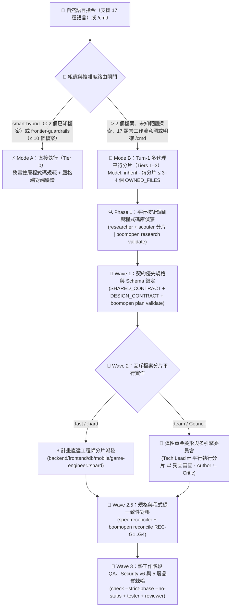

<div align="center">
  <h1>⚡ BoomOpen Workflow Kit Pro v5.5</h1>
  <p><strong>橫跨 Antigravity、Claude Code、OpenAI Codex、Cursor 與 GitHub Copilot 的多代理工作流編排框架與確定性 CLI 品質把關。</strong></p>

  <p>
    <a href="https://boomopen.com"></a>
    <a href="https://github.com/Kennyboom/BoomOpen-Workflow-Kit-Pro/releases"></a>
    <a href="#platforms"></a>
    <a href="#cli"></a>
    <a href="#skills"></a>
    <a href="https://nodejs.org/">= 18.0.0" /></a>
    <a href="../LICENSE"></a>
  </p>

  <p>
    <a href="../README.md">English</a> •
    <a href="./README.vi.md">Tiếng Việt</a> •
    <a href="./README.zh-CN.md">简体中文</a> •
    <b>繁體中文</b> •
    <a href="./README.ja.md">日本語</a> •
    <a href="./README.ko.md">한국어</a> •
    <a href="./README.es.md">Español</a> •
    <a href="./README.fr.md">Français</a> •
    <a href="./README.de.md">Deutsch</a><br/>
    <a href="./README.pt-BR.md">Português (BR)</a> •
    <a href="./README.ru.md">Русский</a> •
    <a href="./README.hi.md">हिन्दी</a> •
    <a href="./README.ar.md">العربية</a> •
    <a href="./README.id.md">Bahasa Indonesia</a> •
    <a href="./README.th.md">ไทย</a> •
    <a href="./README.tr.md">Türkçe</a> •
    <a href="./README.it.md">Italiano</a>
  </p>

  <p>
    <a href="https://boomopen.com"><b>🌐 boomopen.com（15 種語言）</b></a> •
    <a href="#trailer"><b>🎬 發布宣傳片</b></a> •
    <a href="#why-boomopen"><b>⚡ 為何需要 BoomOpen</b></a> •
    <a href="#architecture"><b>🏗️ 架構設計</b></a> •
    <a href="#quickstart"><b>🚀 快速開始</b></a> •
    <a href="#cli"><b>🛠️ 14 道 CLI 把關</b></a> •
    <a href="#settings"><b>🎛️ 預設組態與設定</b></a> •
    <a href="#commands"><b>🎯 36 個斜線指令</b></a> •
    <a href="#agents"><b>🤖 22 代理與 18 團隊</b></a> •
    <a href="#skills"><b>📚 1,462 項隨選技能</b></a>
  </p>
</div>

---

<a id="trailer"></a>

## 🎬 官方發布宣傳片與互動式線上體驗場 (`boomopen.com`)

<div align="center">
  <a href="https://github.com/Kennyboom/BoomOpen-Workflow-Kit-Pro/raw/main/assets/media/boomopen_v55_trailer_en.mp4">
    
  </a>
  <p>
    ▶️ <a href="https://github.com/Kennyboom/BoomOpen-Workflow-Kit-Pro/raw/main/assets/media/boomopen_v55_trailer_en.mp4"><b>線上播放 Full HD 1080p 官方宣傳片（MP4 錄音室配音版）</b></a> • 🌐 <a href="https://boomopen.com"><b>前往 boomopen.com 體驗 14 指令互動式 CLI 練習場與技能目錄檢索（支援 15 種語言）</b></a>
  </p>
</div>

---

<a id="why-boomopen"></a>
<a id="-what-is-boomopen-workflow-kit"></a>

## ⚡ 為何需要 BoomOpen Workflow Kit？

**原生 AI 程式開發助手的工程瓶頸：** 單一代理（Single-Agent）開發工具一旦面對跨多檔案、跨領域或跨工作階段的專案任務，穩定度便會急遽下滑：循序翻找檔案會嚴重污染主對話的上下文視窗；缺乏協調的子代理彼此覆寫共用檔案，或留下未串接的「孤島」模組；產出的程式碼常夾帶未實作的 `TODO` 骨架與顯式 `any` 型別漏洞；同一個模型身兼實作與審查（`Author == Critic`）難以抓出自身盲點；多階段大型開發更會在上下文壓縮後逐漸偏離原先的系統規格。

**BoomOpen 的解決方案：** BoomOpen 在 **Antigravity (Gemini)**、**Claude Code**、**OpenAI Codex**、**Cursor** 與 **GitHub Copilot** 之上建立了一套**零執行期 npm 相依套件**的統一多代理編排與驗證框架。在預設啟用的 **`smart-hybrid`** 組態下，`≤ 2` 個檔案的明確微調會直接以零額外開銷執行；而跨檔案功能實作、深度技術調研、架構規劃以及 **`36` 個斜線指令（`93` 個工作流與協定檔案）** 則會在第一輪（Turn 1）自動依領域分片調度 **22 位專業代理人** 與 **18 支三角色對抗審查團隊**，全程由 **14 道本機 `boomopen` CLI 確定性品質把關** 嚴格檢驗，並隨選掛載 **`1,462` 項工程技能**（`22` 項核心技能 + 單次去重集中存放於 `~/.agents/skills_library` 的 `1,440` 項擴充技能）。

### ⚖️ 原生 AI IDE vs. 導入 BoomOpen v5.5 對照

| 常見工程失效情境 | 未導入 BoomOpen（原生 AI IDE） | 導入 BoomOpen Workflow Kit Pro v5.5 |
|:-----------------|:-------------------------------|:------------------------------------|
| **上下文視窗膨脹** | 主代理循序讀取 15–30 個檔案後才開始寫第一行程式碼 | **Turn-1 彈性分片蜂群 (`role#shard`)**：平行派發唯讀偵察與領域分片（每分片 `≤ 3–4` 個檔案）+ `0s` 熱工作階段重用（`send_message`） |
| **平行覆寫與串接斷裂** | 平行子代理互相覆蓋共用檔案、前後端各自定義對不攏的 `/api` 路由或留下死模組 | **契約優先鎖定 + Wave 2.5 規格比對**：Wave 1 鎖定 `SHARED_CONTRACT` 與互斥 `OWNED_FILES`，並由 `boomopen reconcile`（`REC-G1..G4`）自動對帳 |
| **淺層調研與空泛計畫** | 單一視角討好式回覆、未經查證的推論、缺乏結構的散文式開發計畫 | **證據把關的 6 區塊規格書**：`:team` 反方魔鬼代言人質詢 + `< 50ms` 本機 CLI 驗證器（`boomopen research`、`design`、`plan`） |
| **殘留 `TODO` 骨架、`any` 與測試作弊** | 代理回報完工，實際卻留下 `// TODO`、顯式 `any`、除錯用 `console.log` 或 `.skip` 測試 | **務實雙層靜態品質把關**：`boomopen check --strict-phase --no-stubs` 強制把關 `0` `any`、`0` 未實作骨架及 `400/500` 行內聚上限 |
| **跨工作階段規格偏移與回歸錯誤** | 上下文壓縮洗掉階段限制，導致後續修改弄壞先前已通過的功能 | **5 層階段品質棘輪與原子級回滾**：`.boomopen/project-ledger.json` SHA-256 規格偏移防護、`/autopilot`、`/audit` 與 `rollback --yes` |
| **單一模型審查盲點** | 同一模型自己寫程式碼又自己審核（`Author == Critic`） | **跨引擎指揮官 (`/conduct`)**：跨 Claude Code、Codex、Antigravity、Cursor 與 Copilot 平行召開多引擎委員會與跨模型家族管線 |
| **5 大 IDE 設定分歧與髒 Git 工作區** | 各 IDE 維護獨立提示詞、重複複製數 GB 技能檔、暫存規格檔弄亂 `git status` | **毫秒級統一同步與潔淨 Git**：`< 10ms` 同步 14 個入口檔案，共用單一 `~/.agents/skills_library`（`0` 閒置 Token），暫態檔案導向 Brain Artifacts |

---

<a id="architecture"></a>
<a id="-smart-hybrid-architecture-v55"></a>

## 🏗️ 智慧混合架構設計 (v5.5)



---

<a id="pillars"></a>

## 🧠 6 大核心工程支柱

1. **🌐 5 大 IDE 原生格式編譯與去重共用技能庫 (`platforms/*`)**：
   - 將 **22 位專業代理人** 與 **93 個指令與參考協定檔案** 編譯為各 IDE 的原生格式：**Antigravity**（`--as-plugin` 外掛套件 + `3` 支可直接執行的 `run_workflow` Python 腳本：`audit_fanout.py`、`review_fanout.py`、`research_fanout.py`）、**Claude Code**（`isolation: worktree` 獨立工作樹分片、`/plan:hard` 冒號指令、選用 `PreToolUse` 與 `Stop`/`PreCompact` 生命週期掛鉤）、**OpenAI Codex**（`22` 組 TOML 角色設定，為偵察與審查角色啟用作業系統層級 `read-only` 沙箱 + `87` 項 `$boomopen-*` 技能）、**Cursor**（`.mdc` 規則檔 + 選用 `beforeShellExecution` 攔截掛鉤）以及 **GitHub Copilot**（`.agent.md` 原生提示代理）。
   - 將全部 `1,440` 項擴充技能單次連結至 `~/.agents/skills_library` 供 5 大 IDE 共用（節省約 80% 磁碟空間，Turn 1 零額外 Token 負擔）。
2. **🎯 4 層動態彈性分片蜂群 (`role#shard`) 與具範圍熱工作階段重用**：
   - 依任務規模自動從 **Tier 0**（`≤ 2` 個已知檔案時不啟動子代理）彈性擴展至 **Tier 1**（`2–3` 分片）→ **Tier 2**（`4–6` 分片）→ **Tier 3**（`7–8+` 分片，最高可設定至 `16`），將單一子代理的認知負載控制在 **`≤ 3–4` 個 `OWNED_FILES`**，並透過 `role#shard → conversationId`（`send_message`）重用既有工作階段。
3. **🤝 三波次契約優先執行 + Wave 2.5 規格對帳 (`REC-G1..G4`)**：
   - Wave 1 先鎖定 `SHARED_CONTRACT`（API Schema/DTO）與 `DESIGN_CONTRACT`（OKLCH `@theme` CSS 設計標記 + TypeScript 元件型別），再由 Wave 2 派發各領域工程師平行實作。Wave 2.5 執行 `boomopen reconcile` 與 `spec-reconciler`，自動抓出未串接的孤島檔案（`REC-G1`）、前後端路由落差（`REC-G2`）、遺漏的 `[SC-*]` 驗收子條款（`REC-G3`）及 `.env.example` 缺少的環境變數（`REC-G4`），並透過 `boomopen cook amend-plan` 自動補入差異修正波次。
4. **🏛️ 跨工作階段專案自動駕駛 (`/autopilot`) 與具狀態多輪全專案稽核 (`/audit`)**：
   - 將多份規格文件編譯為具備 SHA-256 偏移偵測的 `.boomopen/project-ledger.json`，於每個階段前自動建立 Git 檢查點（支援 `boomopen ledger rollback --yes`），並強制通過 **5 層階段品質棘輪**（`G1 check --strict-phase --no-stubs` → `G2 測試數量單調遞增棘輪` → `G3 reconcile --strict` → `G4 Author != Critic 獨立審查` → `G5 ledger verify`）。建置完成後，`/audit` 依據狀態帳本（`.boomopen/audit-ledger.json` + `boomopen audit rollback --yes`）執行人工簽核把關的多輪 RTM 需求追蹤矩陣、垂直資料流與 Security v6 資安稽核。
5. **🎼 跨引擎指揮官與多引擎平行委員會 (`boomopen conduct`)**：
   - 同步調度 Claude Code、OpenAI Codex、Antigravity、Cursor 與 Copilot 組成 **6 大任務平行委員會**（`research`、`brainstorm`、`plan`、`design`、`review`、`debug` → 產出四段式 `COUNCIL-SYNTHESIS.md` 共識報告）或 **跨模型家族角色管線**，確保沒有任何模型球員兼裁判（`Author != Critic`）。
6. **📏 務實雙層程式碼規範與 SPIE v3.0 根因除錯機制**：
   - **第一層（零容忍底線）**：單一職責、`0` 顯式 `any`、正式應用程式碼 `0` 除錯 `console.log`、非同步與 API 邊界強制型別化 `try/catch`、常數採用 `SCREAMING_SNAKE_CASE`。**第二層（內聚優先）**：單檔目標 `~200–350` 行（`400` 行軟上限 / `500` 行硬拆分線；測試、型別定義與文件豁免）。所有臭蟲皆須經過 3 項排序假設檢證與 **5-Whys (SPIE v3.0)** 因果追溯，並將暫態規格檔寫入 Brain Artifacts 以維持 `100%` 乾淨的 Git 工作樹。

---

<a id="platforms"></a>
<a id="-supported-ai-platforms"></a>

## 💻 支援的 5 大 AI 程式開發平台

| 平台 | 支援版本 | 同步入口檔案 | 平台原生整合能力 |
|:-----|:--------:|:-------------|:-----------------|
| **Antigravity (Gemini)** | ✅ v5.5 | `~/.gemini/GEMINI.md` | `invoke_subagent`、`run_workflow` Python 平行扇出、`/goal` 持久外層迴圈、`--as-plugin` 外掛封裝、選用 `--with-hooks`、Brain Artifacts |
| **Claude Code** | ✅ v5.5 | `~/.claude/CLAUDE.md` | 平行 `Task`/`Agent` 分片（`isolation: worktree`）、`/plan:hard` 冒號指令、選用 `PreToolUse` 與 `Stop`/`PreCompact` 掛鉤 |
| **OpenAI Codex** | ✅ v5.5 | `~/.codex/AGENTS.md` & `CODEX.md` | `~/.codex/agents/boomopen/` 內 `22` 組 TOML 角色（偵察/審查啟用 OS 級 `sandbox_mode = "read-only"`）+ `87` 項 `$boomopen-*` 技能 |
| **Cursor** | ✅ v5.5 | `~/.cursor/rules/boomopen-workflow-kit.mdc` | 常駐 `.mdc` Frontmatter 規則、`CURSOR.md`、子代理路由與選用 `.cursor/hooks.json`（`beforeShellExecution`） |
| **GitHub Copilot** | ✅ v5.5 | `~/.copilot/copilot-instructions.md` | VS Code 編譯版 `boomopen-workflow-kit.agent.md` 提示代理、`runSubagent` 派發與 `COPILOT.md` |

---

<a id="quickstart"></a>
<a id="-quick-start--installation"></a>

## 🚀 快速開始與安裝（僅透過 Git 發布 — 零執行期相依套件）

```bash
# 1. 複製儲存庫（僅透過 GitHub 發布 —— 從未上架至 npm）
git clone https://github.com/Kennyboom/BoomOpen-Workflow-Kit-Pro.git
cd BoomOpen-Workflow-Kit-Pro

# 2. 為單一 AI IDE 安裝（預設組態：smart-hybrid）或一次同步全部 5 大 IDE
npm run install:all                                 # 安裝並同步全部 5 大 IDE + 共用 ~/.agents/skills_library
npm run install:antigravity                         # Google Antigravity 2.0（可加上 --as-plugin / --with-hooks）
node cli/install.js install claude --with-hooks     # Claude Code + 啟用選用 PreToolUse 與 Stop/PreCompact 掛鉤
npm run install:codex                               # OpenAI Codex CLI + OS 級唯讀偵察/審查沙箱
npm run install:cursor                              # Cursor（加上 --with-hooks 啟用 beforeShellExecution 指令防護）
npm run install:copilot                             # GitHub Copilot（VS Code .agent.md + copilot-instructions.md）

# 3. 執行健康檢查，並可選擇將 `boomopen` 連結至全域 PATH
npm run doctor
npm link
boomopen settings status
```

> **非破壞性安全安裝與移除**：透過 SHA-256 清單（`~/.boomopen/manifests/<tool>.json`）精準追蹤檔案狀態。`GEMINI.md` / `CLAUDE.md` 標記區塊外的個人自訂規則會完整保留並自動備份；執行 `boomopen uninstall <tool|--all>` 僅會移除未經修改的套件檔案，確保您的個人檔案毫髮無傷。

---

<a id="cli"></a>

## 🛠️ 14 個零相依 CLI 子指令 (`boomopen`)

於 Node.js `>= 18` 本機執行僅需 `< 50ms`，**零執行期 npm 相依套件**、**零外部網路連線**：

| 子指令 | 主要參數與語法 | 確定性品質把關與核心用途 |
|:-------|:---------------|:-------------------------|
| **`install` / `uninstall` / `list`** | `<tool\|--all> [--with-hooks] [--as-plugin]` | SHA-256 清單安裝器、共用 `~/.agents/skills_library` 連結器、選用安全掛鉤安裝與乾淨移除工具 |
| **`doctor`** | `[--source-only]` | 30 項唯讀健康檢查：涵蓋 5 大 IDE 封裝、`93` 個指令檔、`72` 個團隊檔、`1,462` 項技能與設定同步狀態 |
| **`settings`** | `status \| preset <name> \| set <k> <v> \| --ui` | 管理 5 組預設組態 + `22` 個設定鍵（`--project` 寫入 `./.boomopen.json`），或啟動具 CSP 防護的本機 Web 介面（`127.0.0.1:4567`） |
| **`research`** | `<validate\|brief> <file.md> [--mode brainstorm]` | 檢驗 **`RES-G1..G4`**（`≥ 4` 來源交叉三角驗證、矛盾對照矩陣、事前驗屍風險）並彙編 `HANDOFF_BRIEF` |
| **`design`** | `<validate\|contract> <DESIGN.md> [--json]` | 檢驗 **`DESIGN-G1..G4`**（6 區塊規格、OKLCH 色彩標記、5 狀態 UI 矩陣、WCAG 2.2 AA）並輸出 `DESIGN_CONTRACT` |
| **`plan`** | `<validate\|compile> <PLAN.md> [--sync-ledger]` | 檢驗 **`PLAN-G1..G5`**（無環 DAG、互斥 `OWNED_FILES ≤ 4`/分片、`SHARED_CONTRACT`）並同步專案帳本 |
| **`cook`** | `<state\|packets\|verify-wave\|preflight\|amend-plan>` | 檢驗 **`COOK-G1..G4`**：5 階段快轉狀態偵測、5 欄位波次交接封包、Git 寫入鎖檢查與差異波次增補 |
| **`reconcile`** | `<dir> [--plan <PLAN.md>] [--strict]` | Wave 2.5 **`REC-G1..G4`**：偵測未串接孤島模組、`/api` 前後端路由落差、遺漏 `[SC-*]` 子條款及 `.env.example` 缺漏 |
| **`check`** | `[path] --strict-phase --no-stubs [--ignore <dir>]` | 務實雙層靜態把關：`400/500` 行上限、`0` 顯式 `any`、`0` 除錯 `console.log`、`0` 未實作骨架/`TODO`/`.skip` |
| **`ledger`** | `<init\|from-plan\|status\|next\|verify\|rollback>` | 跨工作階段 `.boomopen/project-ledger.json` DAG 狀態機、SHA-256 規格偏移防護與原子級 `rollback --yes` |
| **`audit`** | `<init\|slice\|record\|approve\|verify-fix\|rollback>` | 完工後具狀態多輪稽核帳本（`.boomopen/audit-ledger.json`）、問題收斂棘輪與 `rollback --yes` |
| **`conduct`** | `<probe\|council\|dispatch\|status> [--dry-run]` | 跨引擎指揮官與 6 大任務平行多引擎委員會（跨 5 大 IDE 落實 `Author != Critic` → `COUNCIL-SYNTHESIS.md`） |

---

<a id="settings"></a>
<a id="-unified-settings--mode-selection-settings"></a>

## 🎛️ 統一控制中心與 5 組預設組態 (`/settings`)

支援全域（`~/.boomopen/settings.json`）或個別儲存庫（`./.boomopen.json`）管理 **`20` 個列舉設定鍵 + `2` 個自訂行數上限**，並在 `< 10ms` 內熱同步至全部 14 個 IDE 入口檔案：

| 預設組態 | 執行模式 (`execution.mode`) | 預設 `/cmd` | 17 語言自然語言路由 (`naturalLanguageResearchTrigger`) | 程式碼規範 | 最佳適用情境 |
|:---------|:----------------------------|:-----------:|:------------------------------------------------------:|:----------:|:-------------|
| **⚡ `smart-hybrid`** *（預設）* | **`auto`**（`≤ 2` 個檔案直接執行；`> 2` 個檔案或 `/cmd` → Mode B 蜂群） | `auto` | **`auto_team`** *（將 17 種語言的調研/構思/審查意圖自動導向 `:team` 與對應工作流）* | `pragmatic` (`400/500`L) | 開箱預設體驗：自然語言工作流意圖辨識 + Turn 1 自動平行分片 |
| **🛡️ `frontier-guardrails`** *（選用精簡組態）* | **`mode_a`**（`≤ 10` 個檔案直接執行；`< 2.5 KB` / `~600` Token 入口） | `auto` | **`off`** *（僅回應明確 `/cmd` —— 零自然語言攔截）* | `pragmatic` (`400/500`L) | `< 2.5 KB` 極簡日常直連模式，兼具雙層規範與端對端把關 *（支援相容別名 `carbon-guardrails`）* |
| **🚀 `solo-fast`** | **`mode_a`**（`≤ 10` 個檔案直接執行；保守上限 `3` 分片） | `fast` | `off` | `relaxed` (`600/800`L) | 快速原型開發、小型腳本撰寫、緊急熱修補與節省 Token 支出 |
| **🧠 `deep-architect`** | **`mode_b`** *（強制啟用 Mode B 編排器；上限 `12` 分片）* | `hard` | `auto_hard` + `council` 調研 / `cross_family` 審查 | `strict` (`300/400`L) | 複雜系統架構規劃、全新專案建置與跨模組大規模重構 |
| **🔺 `adversarial-team`** | **`team`** *（彈性黃金菱形 `:team`；`hyper_swarm` 上限 `12` 分片）* | `team` | **`auto_team`** + `council` 調研、規劃與審查 | `strict` (`300/400`L) | 關鍵正式環境發布、嚴格資安稽核與多引擎交叉共識審查 |

```bash
# 可透過對話視窗 (/settings)、本機 Web 介面 (--ui) 或終端機 CLI 切換組態與個別設定值：
boomopen settings --ui                                      # 啟動本機 Web 控制中心 http://127.0.0.1:4567
boomopen settings preset smart-hybrid                       # 預設：Auto Mode A/B + 17 語言自然語言工作流路由
boomopen settings preset frontier-guardrails                # 選用：< 2.5 KB 精簡 Mode A（相容別名：carbon-guardrails）
boomopen settings set engines.reviewer cross_family         # 強制啟用跨模型家族獨立審查（Author != Critic）
cd path/to/your/repo && boomopen settings mode team --project # 寫入儲存庫專屬 ./.boomopen.json 覆寫設定
boomopen settings reset                                     # 還原為預設 smart-hybrid 設定
```

---

<a id="commands"></a>
<a id="-slash-commands-reference"></a>

## 🎯 全部 36 個斜線指令參考手冊（`93` 個檔案 = `87` 個工作流 + `6` 個 `_ref/`）

在 `smart-hybrid` 模式下可直接以 **17 種支援語言中的任一種** 自然對話觸發，或明確呼叫以下 **36 個標準斜線指令**：

| 類別 | 指令 | 支援變體 | 核心用途與確定性產出 |
|:-----|:-----|:---------|:---------------------|
| **編排與自主執行** | **`/cook`** | `:fast`, `:hard`, `:team` | 尚無計畫時的端對端功能建置（偵察 → 契約規劃 → 平行分片實作 → Wave 2.5 對帳 → QA） |
| | **`/code`** | `:fast`, `:hard`, `:team` | 直接依據已核准的 `PLAN-{task}.md` 派發 Wave 1–3 分片實作，無須重跑 `/plan` |
| | **`/autopilot`** | `:init`, `:run`, `:audit` | 透過 `.boomopen/project-ledger.json` 與 **5 層階段品質棘輪** 驅動跨工作階段規格到正式環境交付 |
| | **`/conduct`** | `:council`, `:pipeline` | 橫跨 5 大 IDE 的多引擎平行委員會（`COUNCIL-SYNTHESIS.md`）與跨模型家族管線（支援 `--dry-run`） |
| | **`/orchestrate`** / **`/auto`** | — | 自訂跨領域蜂群協同編排（`/orchestrate`）或全自動端對端閉環執行（`/auto`） |
| **架構、設計與深度調研** | **`/plan`** | `:fast`, `:hard`, `:team` | 通過 5 道把關的 `PLAN-{task}.md` 實作藍圖：鎖定 `SHARED_CONTRACT`、互斥 `OWNED_FILES ≤ 4`/分片與 Given/When/Then 驗收條件 |
| | **`/architect`** | — | 純設計系統架構藍圖：C4 架構圖、ADR 決策紀錄、資料庫結構、API 契約、畫面規格與覆蓋率檢核（不改動任何程式碼） |
| | **`/design`** / **`/ui-ux-pro-max`** | `:fast`, `:hard`, `:team` | 6 區塊 `DESIGN-{task}.md` + `DESIGN_CONTRACT`（`@theme` OKLCH 標記、5 狀態 UI 矩陣、50+ 視覺風格與即時 HTML 預覽） |
| | **`/research`** | `:fast`, `:hard`, `:team` | 5 視角深度技術調研（`RESEARCH-{topic}.md`、`RES-G1..G4` ≥ 4 來源三角驗證、矛盾對照表與 `HANDOFF_BRIEF`） |
| | **`/brainstorm`** / **`/ask`** | `:fast`, `:hard`, `:team` | 反討好策略構思（含事前驗屍與 MCDA 決策矩陣的 `BRAINSTORM-{topic}.md`）及具佐證的程式碼問答（`/ask`） |
| **品質、稽核、除錯與資安** | **`/review`** | `:fast`, `:hard`, `:team` | 多視角對抗式程式碼、架構、資安與效能審查（`Author != Critic`，可一鍵銜接 `/fix`） |
| | **`/audit`** / **`/deep-audit`** | `:run`, `:fix`, `:auto` | 建置後多輪全專案對帳稽核（`/audit` 帳本）與寫碼前 10 維度規格邏輯預審（`/deep-audit`） |
| | **`/security-audit`** | — | OWASP Top 10 + LLM/代理型應用 Top 10 資安掃描（`security_scan.py` v6）、STRIDE 威脅建模、驗證授權與供應鏈報告 |
| | **`/debug`** / **`/fix`** | `:fast`, `:hard`, `:team` | 3 假設檢證 + **5-Whys (SPIE v3.0)** 根因追蹤（`DEBUG-{issue}.md`）與失敗測試先行的 TDD 錯誤修復（`/fix`） |
| | **`/test`** / **`/performance`** / **`/refactor`** | `:fast`, `:hard`, `:team` | 零作弊 QA 測試分片（`/test`）、Core Web Vitals / 資料庫 / 打包體積調校（`/performance`）與具指標驗證的 `/refactor` |
| **Git、發布、文件與工作階段維運** | **`/onboard`** / **`/init`** | — | 60 秒唯讀既有程式碼庫導覽 `ARCHITECTURE-MAP.md`（`/onboard`，不與內建 `/init` 衝突）及全新專案初始化（`/init`） |
| | **`/pr`** / **`/release`** | —, `:review` | PR 送出前品質與對帳把關 + `gh pr create` / 差異區塊對抗審查（`/pr:review`），以及版本一致性把關的語意化發布（`/release`） |
| | **`/deploy`** / **`/rollback`** | `:check`, `:preview`, `:production`, `:rollback` | 部署就緒檢查、預覽/正式環境推出（`/deploy`）與依嚴重度分級的緊急復原回滾（`/rollback`） |
| | **`/docs`** / **`/report`** | `:core`, `:business`, `:audit` / `:fast..:team` | 嚴格對應原始碼的 `./documents/` 文件集（`/docs`）與基於真實 CLI 遙測數據的狀態報告（`/report`） |
| | **`/settings`** / **`/status`** / **`/next`** | — | 統一控制中心（`/settings`）、帳本與蜂群即時健康狀態板（`/status`）及下一步行動導航（`/next`） |
| | **`/preview`** / **`/save`** / **`/recap`** | — | 本機開發伺服器生命週期管理（`/preview`）、工作階段狀態保存（`/save`）與 `< 5s` 快速脈絡恢復（`/recap`） |

### 🌙 跨夜多階段大型專案實戰手冊 (`/autopilot` & `/goal`)

| 工作流搭配 | 目標平台與執行機制 | 跨工作階段脈絡延續性 | 品質與規格一致性保障 |
|:-----------|:-------------------|:---------------------|:---------------------|
| **`/autopilot`（搭配 `--with-hooks`）** | 全部 5 大 IDE（建議於 **Claude Code**、**Antigravity** 與 **Cursor** 加上 `--with-hooks`） | `Stop` 與 `PreCompact` 掛鉤（`stop-quality-gate.mjs`）搭配 `.boomopen/project-ledger.json` 在上下文壓縮後完整保留執行進度游標 | 強制通過 **5 層階段品質棘輪**（`G1..G5`）、Wave 2.5 `reconcile` 對帳與 `boomopen ledger rollback --yes` |
| **`/goal` + `/autopilot` + `/audit`** | **Antigravity 2.0** 針對大型 `docs/` 規格文件的持久外層迴圈 | Antigravity 原生 **`/goal`** 執行器自動跨階段持續推進，直到帳本中每個階段皆達成 `VERIFIED` | 每個階段皆須通過全部 5 道驗證把關與 Wave 2.5 對帳，100% 完成後自動啟動第 1 輪 **`/audit`** |

```text
/goal 使用 /autopilot 讀取 docs/ 目錄下的所有專案規格文件，初始化 .boomopen/project-ledger.json，並依序自主實作每一個階段（每個階段皆須通過全部 5 道驗證把關與 Wave 2.5 reconcile 對帳）。當 100% 階段皆通過後，執行第 1 輪 /audit 並停下來產出總結報告供我審閱。
```

---

<a id="agents"></a>
<a id="-22-specialist-agents--18-golden-triangle-teams"></a>

## 🤖 22 位專業代理人與 18 支三角色對抗團隊

每位子代理皆繼承目前工作階段的主模型（`Model: "inherit"` —— 嚴禁降級使用 `flash_lite`），並依領域編組為 **18 支黃金菱形 / 黃金三角團隊**（`Tech Lead` ⇄ `平行分片執行工程師` ⇄ `獨立審查員/反方評論者`）：

| 專業領域 | 專業代理人（`agents/*.md`，依 IDE 原生編譯） | 三角色對抗審查團隊（`agents/teams/*-team/`，共 `72` 個檔案） |
|:---------|:---------------------------------------------|:-------------------------------------------------------------|
| **工程實作與交付** | `backend-engineer`, `frontend-engineer`, `mobile-engineer`, `game-engineer`, `database-architect`, `devops-engineer` | `backend-team`, `frontend-team`, `fullstack-team`, `mobile-team`, `game-team`, `database-team`, `devops-team` |
| **系統架構與產品規劃** | `tech-lead`, `planner`, `brainstormer`, `business-analyst`, `project-manager`, `designer` | `planning-team`, `brainstorm-team`, `project-team`, `design-team` |
| **品質把關、對帳與資安** | `debugger`, `tester`, `reviewer`, `spec-reconciler`, `security-engineer`, `performance-engineer` | `debug-team`, `qa-team`, `security-team`, `performance-team` |
| **技術調研與文件管理** | `researcher`, `scouter`, `docs-manager`, `reporter` | `research-team`, `docs-team`, `report-team` |

---

<a id="skills"></a>
<a id="-1460-skills-vault-22-core--1440-niche-library-skills"></a>

## 📚 1,462 項隨選載入技能庫（`22` 項核心技能 + `1,440` 項擴充技能）

完整索引於涵蓋 **19 大工程領域** 的 `matrix-skills/compact-index.json`，單次去重連結至 `~/.agents/skills_library`，並透過 **兩步 O(1) 漸進式解析** 載入（先檢查核心 `skills/` → 查詢 `compact-index.json` → 僅將符合的 `SKILL.md` 載入受指派的分片，閒置時 `0` Token 消耗）：

| 層級 / 工程領域 | 技能數 | 代表性技術能力與專案範本 | 載入時機 |
|:----------------|:------:|:-------------------------|:---------|
| **⚡ 核心工作流與品質基礎 (`skills/`)** | **22** | `clean-code`, `debugger`, `plan-writing`, `brainstorming`, `deep-research`, `design-spec`, `frontend-design`, `frontend-architecture`, `api-patterns`, `database-design`, `tdd-workflow`, `testing-patterns`, `webapp-testing`, `security-auditor`（`security_scan.py` v6）, `app-builder`（內建 **`mcp-server`**、**`ai-agent-worker`**、`nextjs-saas`、`monorepo-turborepo`、`python-fastapi`、`flutter-app` 等 **15 套專案範本**）, `skill-seeker` | Turn 1 立即可用 |
| **🤖 AI、代理型 SDK、MCP 與資料工程** | **340+** | FastMCP (`StreamableHTTP`)、OpenAI Agents SDK、Claude Agent SDK、Google ADK、Vercel AI SDK、LangGraph、RAG、BigQuery、dbt | 隨選載入 (`compact-index.json`) |
| **🌐 Web、後端服務、API 與資料庫** | **380+** | React 19、Next.js 15 RSC、Tailwind CSS v4、TanStack Start/Router/Query、Hono RPC + Zod OpenAPI、Rust Axum/SQLx、Drizzle、Postgres/RLS | 隨選載入 (`compact-index.json`) |
| **☁️ 雲端原生、DevOps、QA 與資安** | **300+** | Cloudflare Workers/Durable Objects/D1、Docker/K8s、Terraform、Playwright、Vitest + MSW v2、Better Auth (Passkeys)、OWASP LLM Top 10 | 隨選載入 (`compact-index.json`) |
| **🎨 UI/UX 設計、遊戲引擎與行動應用** | **420+** | OKLCH 設計標記、WCAG 2.2 AA、Motion、Unity 6 DOTS/ECS、Godot 4、Unreal 5、WebGPU/Three.js、Phaser/PixiJS、Tauri v2、SwiftUI、Flutter、React Native | 隨選載入 (`compact-index.json`) |

---

## 📂 儲存庫目錄結構

```text
BoomOpen-Workflow-Kit-Pro/
├── agents/                  # 22 位專業代理人（依 IDE 原生編譯）+ 18 支三角色團隊（共 72 個檔案）
├── cli/                     # 14 個零相依 Node.js CLI 子指令 + 33 組 node:test 自動化測試套件
├── commands/                # 36 個斜線指令，涵蓋 87 個工作流檔案 + 6 個 _ref/ 共用協定（共 93 個檔案）
├── documents/               # 系統架構、領域模型、原始碼基底與務實雙層程式碼規範文件
├── i18n/                    # 16 份完整在地化 README（連同根目錄 README.md 共支援 17 種語言）
├── matrix-skills/           # 19 個領域 YAML 目錄 + O(1) compact-index.json（索引全部 1,462 項技能）
├── platforms/               # 5 大 IDE 平台封裝、選用安全掛鉤、3 支 Antigravity run_workflow/*.py 與 Codex TOML 角色
├── rules/                   # 7 個 Mode B 隨選載入規則模組 (CORE, PHASES, AGENTS, TEAMS, SKILLS, ERRORS, REFERENCE)
├── scripts/                 # 跨平台驗證與工作階段輔助腳本 (checklist.py, verify_all.py, auto_preview.py, session_manager.py)
├── skills/                  # 22 項核心技能 + 15 套 app-builder 專案範本 + Security v6 / UX / 效能稽核腳本
├── skills_library/          # 1,440 項擴充技能庫，安裝時單次去重連結至共用目錄 ~/.agents/skills_library
├── web/                     # 驅動 https://boomopen.com 的 15 語言 Cosmic WebGL 互動展示站與可檢索目錄
└── GEMINI.md | CLAUDE.md | CODEX.md | COPILOT.md | CURSOR.md | AGENT.md
```

---

## 📄 授權條款與資安政策

- **官方網站**：[https://boomopen.com](https://boomopen.com)
- **開源授權**：本套件原始碼、CLI 工具、規則、代理人定義與文件均以 [MIT 授權條款](../LICENSE) 釋出（Copyright © 2026 **BoomOpen Labs**）。`skills_library/` 目錄下的第三方技能維持其原有的上游授權條款，請參閱 [THIRD_PARTY_NOTICES.md](../THIRD_PARTY_NOTICES.md)。
- **資安政策**：關於 SHA-256 清單完整性保護、選用掛鉤沙箱隔離機制與資安漏洞通報流程，請參閱 [SECURITY.md](../SECURITY.md)。
