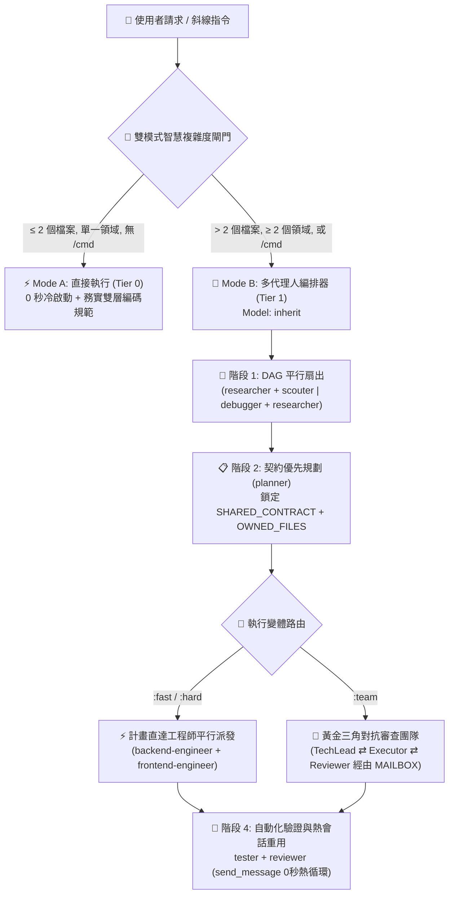

<div align="center">
  <h1>⚡ BoomOpen Workflow Kit v5.5.0</h1>
  <p><strong>跨平台智慧混合 (Smart-Hybrid) AI 研發作業系統 — 22 位專家級代理人、18 支黃金三角團隊與 1,460+ 按需技能寶庫</strong></p>

  <p>
    <a href="https://github.com/Kennyboom/BoomOpen-Workflow-Kit-Pro/releases"></a>
    <a href="#platforms"></a>
    <a href="#agents"></a>
    <a href="#skills"></a>
    <a href="https://nodejs.org/">=18.0.0" /></a>
    <a href="../LICENSE"></a>
  </p>

  <p>
    <a href="../README.md">🇬🇧 English</a> • <a href="./README.vi.md">🇻🇳 Tiếng Việt</a> • <a href="./README.zh-CN.md">🇨🇳 简体中文</a> • <b>🇹🇼 繁體中文</b> • <a href="./README.ja.md">🇯🇵 日本語</a> • <a href="./README.ko.md">🇰🇷 한국어</a> • <a href="./README.es.md">🇪🇸 Español</a> • <a href="./README.fr.md">🇫🇷 Français</a> • <a href="./README.de.md">🇩🇪 Deutsch</a><br/>
    <a href="./README.pt-BR.md">🇧🇷 Português</a> • <a href="./README.ru.md">🇷🇺 Русский</a> • <a href="./README.hi.md">🇮🇳 हिन्दी</a> • <a href="./README.ar.md">🇸🇦 العربية</a> • <a href="./README.id.md">🇮🇩 Bahasa Indonesia</a> • <a href="./README.th.md">🇹🇭 ไทย</a> • <a href="./README.tr.md">🇹🇷 Türkçe</a> • <a href="./README.it.md">🇮🇹 Italiano</a>
  </p>
</div>

---

## 🎬 官方發佈宣傳片 (Full HD 1080p)

<div align="center">
  <a href="https://github.com/Kennyboom/BoomOpen-Workflow-Kit-Pro/raw/main/assets/media/boomopen_v55_trailer_en.mp4">
    
  </a>
  <p>
    ▶️ <a href="https://github.com/Kennyboom/BoomOpen-Workflow-Kit-Pro/raw/main/assets/media/boomopen_v55_trailer_en.mp4"><b>點擊此處線上觀看 / 播放 Full HD 1080p 官方宣傳片 (MP4 專業配音版)</b></a>
  </p>
</div>

---

## 🌟 什麼是 BoomOpen Workflow Kit v5.5？

**BoomOpen Workflow Kit v5.5（跨平台統一與智慧混合版）** 是一套開源的多代理人（Multi-Agent）研發作業系統，能將單一 AI 程式設計助手升級為由 **22 位專家級代理人（Specialist Agents）**、**18 支黃金三角對抗團隊（Golden Triangle Teams）**、**33 個斜線指令（`89` 個指令與協定檔案）**、**22 項核心技能（Core Skills）** 以及 **1,440 項專業領域技能庫（`skills_library/`）** 組成的協同工程團隊。

不同於每輪對話都會產生冷啟動延遲與上下文膨脹的笨重代理封裝，BoomOpen v5.5 融合了 **Turn-1 子代理人優先閘門（Proactive Sub-agent First Gate）**、**17 語言自然語言工作流路由**、**4 層動態彈性蜂群分片（`role#shard`）**、**Wave 2.5 規格到程式碼自動對帳（`boomopen reconcile`）**、**基於狀態帳本的多輪次全專案審計（`/audit` & `boomopen audit`）**、**多會話專案自動駕駛（`/autopilot`）** 與 **跨引擎指揮官（`/conduct`）**：
- **🚀 Turn-1 零稅平行子代理人、Wave 2.5 對帳與 Mode B 多代理人編排**：範圍未知的程式碼庫探索（`> 2` 個檔案）、跨領域功能（`≥ 2` 個領域）、**全部 17 種支援語言**的自然語言工作流意圖或明確 `/cmd` 指令，均在 Turn 1 立即平行啟動子代理人分片（`role#shard`，每分片 `<= 3–4` 個 `OWNED_FILES`），結合 **DAG 平行扇出**、**計畫直達執行者派發**、**契約優先檔案鎖（`SHARED_CONTRACT` + `OWNED_FILES`）**、**Wave 2.5 規格對帳（`boomopen reconcile` + `cook amend-plan`，自動捕獲孤島模組、路由/環境變數偏差與 `[SC-*]` 遺漏）**，以及 **分片級熱會話重用（`role#shard -> conversationId`，透過 `send_message`）**。
- **🏛️ 多會話自動駕駛 (`/autopilot`)、多輪全專案審計 (`/audit`) 與跨引擎委員會 (`/conduct`)**：將多份需求文件編譯為含 SHA-256 防漂移校驗的不可變 `.boomopen/project-ledger.json` 帳本及 4 層零遺漏階段門禁（`boomopen check --strict-phase --no-stubs`）；完工後透過 `/audit` 與 `boomopen audit`（寫入 `.boomopen/audit-ledger.json`）執行涵蓋 RTM 需求追蹤、UI->API->DB 垂直鏈路連續性、**2 層安全與防洩漏掃描（`security_scan.py` v6）** 及使用者審批分片修復的多輪審計；或透過 `/conduct` 調度 Claude Code、OpenAI Codex、Antigravity、Cursor 與 Copilot 組成 **多引擎平行委員會** 與 **角色分工管線（`Author != Critic`）**。
- **⚡ Mode A — 已知目標微直接執行（0 秒冷啟動）**：簡單問答、程式碼解釋以及 **在 Turn 1 已明確知曉精確 `≤ 2` 個目標檔案**的微小修改（0 探索、無 `/cmd`），由主代理人嚴格遵循 **務實雙層編碼規範** 與 **持續測試與除錯** **直接**完成並驗證。
- **📚 1,462 巨型專業技能庫（零上下文膨脹）**：包含 **22 項核心技能 (`skills/`)** 與 **1,440 項垂直領域技能 (`skills_library/`)**，預編譯至 `matrix-skills/compact-index.json` 實現 `O(1)` 兩步按需載入，讓 AI 瞬間掌握後端、前端、行動端、遊戲開發 (Unity/Unreal/Godot)、AI/ML、BigQuery/資料工程、雲端原生/DevOps 與 OWASP 資安，且絕不污染提示詞視窗。

---

## 🏗️ 智慧混合架構圖 (v5.5)



---

<a id="pillars"></a>

## 🧠 v5.5 的 6 大核心支柱

1. **🌐 五大平台 100% 統一支援 (`platforms/*`)**：
   - 基於統一架構原生支援 **Google Antigravity 2.0 (Gemini)**、**Claude Code**、**OpenAI Codex**、**Cursor** 與 **GitHub Copilot** 五大主流 AI 研發工具。
2. **📏 務實雙層編碼規範（Pragmatic 2-Tier Coding Standards — 拒絕機械式切碎檔案）**：
   - **第一層（Tier 1 — 嚴格品質與安全底線，零容忍）**：單一職責原則（Single Responsibility）、**嚴禁顯式 `any`**、**嚴禁在正式環境程式碼遺留除錯 `console.log`**、非同步與 API 邊界必須包含 `try/catch` 與強型別錯誤處理、常數採用 `SCREAMING_SNAKE_CASE`、DRY（重複 ≥ 3 次抽離）、清理並排序匯入語句。
   - **第二層（Tier 2 — 彈性結構指南，內聚優先）**：單一檔案軟目標為 `~200–350 行`，高內聚模組軟上限可達 `~400–450 行`（僅當 `>500 行` 或混雜多個領域職責時才強制拆分；測試、Schema/Types 與文件免除行數限制）。邏輯函式目標 `~20–40 行`（UI/處理函式 `~40–80 行`）。
3. **🎯 4 層動態彈性蜂群分片（`role#shard`）、計畫直達派發 & 熱會話重用 (`send_message`)**：
   - 一旦產出 `PLAN-{feature}.md`，編排器會將任務**直接派發**給領域工程師分片（`backend-engineer#shard-1`、`frontend-engineer#shard-2`、`database-architect#shard-1` 等，每分片 `<= 3–4` 個 `OWNED_FILES`），徹底消除多餘的 `tech-lead` 中轉步驟。
   - 活動子代理人按分片記錄在 **分片會話註冊表 (`role#shard → conversationId`)** 中，後續迭代透過 `send_message` 直接喚醒，實現 **0 秒冷啟動** 與 **100% 上下文保留**。
4. **🤝 契約優先平行派發 (`SHARED_CONTRACT` + `OWNED_FILES`)**：
   - 跨領域計畫在啟動平行開發前，預先鎖定 API 介面契約、DTO 資料結構及互斥的檔案寫入所有權（`OWNED_FILES` 與 `READ_ONLY_FILES`），徹底杜絕平行覆寫衝突與介面不匹配。
5. **🔍 5-Whys (SPIE v3.0) 根因除錯與 100% 潔淨 Git 樹**：
   - `debugger` 透過 3 個優先級假設與 **5-Whys 因果鏈**（`Why 1 直接症狀` → `Why 5 系統性根因`）定位問題。所有暫態產物（`PLAN`、`DEBUG`、`TEST`、`REVIEW`、`MAILBOX`）預設寫入 `<appDataDir>\brain\<conversation-id>\`，保持專案 Git 工作區 100% 潔淨。
6. **🩺 內建 14 指令 CLI 套件 (`research`, `design`, `plan`, `cook`, `reconcile`, `audit`, `ledger`, `conduct`, `check`, `doctor`, `settings`, `install`, `uninstall`, `list`) 與 O(1) 技能索引**：
   - `npm run doctor` 自動檢驗五大平台配置、22 個代理人、72 個團隊檔案（18 個團隊目錄）、89 個指令檔案（`commands/**/*.md`，含 83 個工作流 + 6 個 `_ref/` 協定）及 `matrix-skills/compact-index.json`（索引 `1,462` 項技能）。確定性工作流編譯器（`boomopen research`、`boomopen design`、`boomopen plan`、`boomopen cook`、`boomopen reconcile` 與 `boomopen audit <init|slice|record|approve|verify-fix|status>`）提供上游產物檢驗、Wave 2.5 跨分片聯動對帳（`REC-G1..G4`）以及多輪次全專案審計帳本（`.boomopen/audit-ledger.json`）。`boomopen check <dir> [--strict-phase --no-stubs]` 靜態審計檔案行數、顯式 TypeScript `any`、遺留 `console.log`、推遲的 `TODO`/`FIXME` 註解、空殼樁程式碼（stubs）及測試作弊行為；`boomopen ledger` 管理多工作階段階段門禁；`boomopen conduct` 編排跨引擎派發與 6 類多引擎委員會任務（`research|brainstorm|plan|design|review|debug`）。

---

<a id="platforms"></a>

## 💻 支援的 AI 程式設計平台

| 平台名稱 | 支援級別 | 全域入口檔案 | 框架安裝路徑 |
|----------|:-------------:|-------------------|------------------------|
| **Antigravity (Gemini)** | ✅ 原生 v5.5 | `~/.gemini/GEMINI.md` | `~/.gemini/config/skills/boomopen-workflow-kit/` |
| **Claude Code** | ✅ 原生 v5.5 | `~/.claude/CLAUDE.md` | `~/.claude/skills/boomopen-workflow-kit/` |
| **OpenAI Codex** | ✅ 原生 v5.5 | `~/.codex/CODEX.md` & `AGENTS.md` | `~/.codex/skills/boomopen-workflow-kit/` |
| **Cursor** | ✅ 原生 v5.5 | `~/.cursor/rules/boomopen-workflow-kit.mdc` | `~/.cursor/skills/boomopen-workflow-kit/` |
| **GitHub Copilot** | ✅ 原生 v5.5 | `~/.copilot/COPILOT.md` | `~/.copilot/skills/boomopen-workflow-kit/` |

---

## 🚀 快速開始與安裝指南

```bash
# 1. 複製程式碼儲存庫
git clone https://github.com/Kennyboom/BoomOpen-Workflow-Kit-Pro.git
cd BoomOpen-Workflow-Kit-Pro

# 2. 為您使用的 AI 程式設計助手安裝（任選其一或使用 --all 全部安裝）
npm run install:antigravity   # Google Antigravity 2.0 (Gemini)
npm run install:claude        # Anthropic Claude Code
npm run install:codex         # OpenAI Codex CLI
npm run install:cursor        # Cursor AI Editor
npm run install:copilot       # GitHub Copilot (VS Code)
npm run install:all           # 一鍵安裝全部 5 大平台

# 3. 檢驗安裝結果（唯讀）
npm run doctor
npm link
boomopen research validate path/to/RESEARCH.md
boomopen design validate path/to/DESIGN.md
boomopen plan validate path/to/PLAN.md
boomopen cook preflight path/to/PLAN.md
boomopen reconcile path/to/your/project --plan path/to/PLAN.md
boomopen audit init --docs docs/prd.md,docs/arch.md
boomopen check path/to/your/project --strict-phase --no-stubs
boomopen ledger status
boomopen conduct probe
```

> 本套件**未發佈到 npm**，請僅從本儲存庫安裝。可選：`npm link` 會把 `boomopen` 指令加入 PATH（不會從 npm 下載任何內容）。

---

## 🎛️ 統一設定與執行模式選擇 (`/settings` 控制中心)

BoomOpen v5.5 內建**零延遲統一控制中心**，支援在 `< 10ms` 內跨全部 **5 大平台**切換執行模式（`auto`、`mode_a`、`mode_b`、`team`）、5 套一鍵預設與 20 項系統參數（+ 2 項行數上限設定）（首輪對話延遲為 **0ms**）：

### 1️⃣ 5 套一鍵預設配置與執行模式

| 預設配置 (`Preset`) | 執行模式 (`execution.mode`) | 預設變體 | 自然語言深度調研 (`naturalLanguageResearchTrigger`) | 程式碼規範 (`codingStandards`) | 適用場景 |
|:---|:---|:---:|:---:|:---:|:---|
| **⚡ `smart-hybrid`** *(預設推薦)* | **`auto`**（`≤ 2 個檔案` 走 Mode A 極速直連；`> 2 個檔案` 或 `/cmd` 走 Mode B 多代理） | `auto` | **`auto_team`** *(自動路由至 `/research:team` / `/brainstorm:team` 黃金三角三人組)* | `pragmatic` (`400/500` 行) | 日常全端研發首選：小任務零延遲，大架構深度協同 |
| **🛡️ `carbon-guardrails`** | **`mode_a`** *（`≤ 10 個檔案` 直接執行 — Carbon 主導編排，BoomOpen 守衛護欄）* | `auto` | `off` *（零自然語言劫持；僅回應顯式 `/cmd`）* | `pragmatic` (`400/500` 行) | 配合 Antigravity Orchestrator Carbon：由 Carbon 驅動日常任務，同時強制執行嚴格的編碼規範與端對端驗證門禁 |
| **🚀 `solo-fast`** | **`mode_a`** *(強制單一代理直接執行，0 秒子代理開銷)* | `fast` | `off` *(直接回覆，除非顯式輸入 `/brainstorm`)* | `relaxed` (`600/800` 行) | 緊急熱修復、快速原型驗證、小型腳本與極致節省 Token |
| **🧠 `deep-architect`** | **`mode_b`** *(所有任務強制啟用 Mode B 多代理編排)* | `hard` | `auto_hard` *(自動執行 `/research:hard` / `/brainstorm:hard` 五維深度調研)* | `strict` (`300/400` 行) | 複雜系統架構設計、從零新建專案與跨領域重構 |
| **🔺 `adversarial-team`** | **`team`** *(所有工作流強制啟用 3 代理黃金三角 `:team`)* | `team` | **`auto_team`** *(3 代理經由 `MAILBOX` 交叉對抗評審)* | `strict` (`300/400` 行) | 核心生產系統、金融級安全審計與零缺陷交付 |

### 三種切換方式（聊天框 `/settings`、本地 Web 面板、終端機 CLI）

```bash
# 1. 聊天框內直接輸入斜線命令（彈出互動式選單或單行速設）
/settings                                     # 開啟互動式選單 (ask_question UI)
/settings preset smart-hybrid                 # 切換為預設推薦模式 (Auto Mode A/B + auto_team)
/settings preset carbon-guardrails            # 切換為 Carbon-Guardrails（Carbon 主導，BoomOpen 守衛）
/settings preset solo-fast                    # 切換為 Mode A 極速單一代理直接執行
/settings preset deep-architect               # 切換為 Mode B 多代理深度編排
/settings preset adversarial-team             # 切換為黃金三角 3 代理對抗團隊 (:team)
/settings mode auto | mode_a | mode_b | team  # 單獨覆寫執行模式 (execution.mode)

# 2. 啟動本地 Web 視覺化控制中心 (http://127.0.0.1:4567)
boomopen settings --ui

# 3. 終端機 CLI 命令（支援全域 ~/.boomopen/settings.json 與專案級 ./.boomopen.json）
boomopen settings status
boomopen settings preset adversarial-team
cd path/to/your/project
boomopen settings set execution.mode mode_a --project
boomopen settings reset
```

> `--project` 一律在你執行指令的資料夾寫入 `./.boomopen.json`，請在你的專案目錄中執行，而非套件的 clone 目錄。未執行 `npm link` 時，請把 `boomopen` 換成 `node /path/to/BoomOpen-Workflow-Kit-Pro/cli/install.js`。

---

## 🎯 斜線指令參考手冊

| 指令 | 支援變體 | 核心用途說明 |
|---------|----------|-----------------|
| **`/cook`** | `:fast`, `:hard`, `:team` | 端到端功能研發全流程（調研/偵察 → 規劃 → 平行編碼 → 測試 → 審查） |
| **`/code`** | `:fast`, `:hard`, `:team` | 基於現有 `PLAN-{feature}.md` 直接執行程式碼實作與驗證 |
| **`/plan`** | `:fast`, `:hard`, `:team` | 產生包含 `SHARED_CONTRACT`、`OWNED_FILES` 與 Given/When/Then 驗收標準的實作藍圖 |
| **`/fix`** | `:fast`, `:hard`, `:team` | 根因錯誤修復並強制執行回歸測試驗證 |
| **`/debug`** | `:fast`, `:hard`, `:team` | 基於 3 假設驗證 + **5-Whys (SPIE v3.0)** 因果鏈的深度根因調查（`DEBUG-{issue}.md`） |
| **`/test`** | `:fast`, `:hard`, `:team` | DAG 平行扇出執行測試套件 + 掃描未覆蓋邊界情境（`tester` + `scouter`） |
| **`/review`** | `:fast`, `:hard`, `:team` | 四維平行程式碼審計（架構合規、程式碼品質、OWASP 安全、效能瓶頸） |
| **`/audit`** | `:run`, `:fix`, `:auto` | 基於狀態帳本的多輪次全專案完工審計（RTM 規格覆蓋、UI->API->DB 垂直鏈路、2 層安全與防洩漏掃描，以及透過 `boomopen audit` 進行使用者審批的分片修復） |
| **`/design`** | `:fast`, `:hard`, `:team` | 系統架構、資料庫結構與 UI/UX 設計規範生成（`DESIGN.md`） |
| **`/docs`** | `:core`, `:business`, `:audit` | 產生或同步雙層結構化架構文件與業務文件（`./documents/`） |
| **`/deploy`** | `:check`, `:preview`, `:production`, `:rollback` | 部署前品質閘門檢查、預覽環境發布、正式環境上線與安全回滾 |
| **`/research`** | `:fast`, `:hard`, `:team` | 自主深度研究引擎（4 源三角驗證、3 波次迭代搜尋與 3 向量黃金三角委員會） |
| **`/brainstorm`** | `:fast`, `:hard`, `:team` | 蘇格拉底式需求釐清、架構權衡分析與方案腦力激盪 |
| **`/report`** | `:fast`, `:hard`, `:team` | 產生包含指標統計與架構圖表的技術及管理總結報告 |
| **`/autopilot`** | `:init`, `:run`, `:audit` | 跨工作階段多階段專案自動駕駛儀（基於 `.boomopen/project-ledger.json` 帳本與 4 層零遺漏棘輪門禁） |
| **`/conduct`** | `:council`, `:pipeline` | 跨引擎指揮官與多引擎並行委員會（`boomopen conduct`，產生 4 部分共識綜合報告） |
| **`/orchestrate`** | — | 跨多個領域的自訂多代理人管線協同編排 |
| **`/settings`** | `preset`, `mode`, `set`, `ui` | 統一控制中心：配置 20 項枚舉 + 2 項行數上限、切換 5 套預設或開啟本地 Web 介面 (`--ui`) |
| **`/save` / `/recap`** | — | 儲存會話交接狀態（`SESSION-HANDOVER.md`）並在 `< 5秒` 內快速恢復專案上下文 |

### 🌙 過夜大型多階段專案指南 (`/autopilot` vs. `/goal` + `/autopilot` + `/audit`)

| 工作流方案 | 適用範圍 | 上下文閾值處理 (`~70%`) | 品質與規格保障 |
|:-----------|:---------|:------------------------|:---------------|
| **僅用 `/autopilot`** | 單一會話或中小型建置（`< 70%` 上下文） | 在單一會話內執行；上下文占滿後需手動恢復 | 初始化 `.boomopen/project-ledger.json`，執行 5 道驗證門禁與 Wave 2.5 對帳 |
| **`/goal` + `/autopilot` + `/audit`** | 包含 `docs/` 的大型多階段專案（過夜全自動執行） | **`/goal`** 作為持久外層調度器，在上下文接近 `~70%` 時自動重設並銜接下一階段 | **`/autopilot`** 維護 `project-ledger.json`、強制每階段通過 5 道驗證門禁與 Wave 2.5 規格對帳，並在 100% 完工後觸發多輪 **`/audit`** |

**可直接複製使用的過夜提示詞：**

```text
/goal 使用 /autopilot 讀取 docs/ 目錄下的全部專案文件，初始化 project-ledger.json，並從頭到尾依序自主實作每一個 phase（跳過初始 PLAN 審批暫停；每個 phase 都必須通過全部 5 道驗證門禁並與規格文件 100% reconcile 對齊）。在 100% 完成所有 phase 後，執行第 1 輪 /audit 並停止，輸出審計報告供我審查。
```

---

<a id="agents"></a>

## 🤖 22 位專家級代理人 & 18 支黃金三角團隊

| 領域分類 | 專家級代理人 (`agents/*.md`) | 黃金三角對抗團隊 (`agents/teams/*-team/`) |
|----------|-----------------------------------|------------------------------------------------|
| **工程實作與交付** | `backend-engineer`, `frontend-engineer`, `mobile-engineer`, `game-engineer`, `database-architect`, `devops-engineer` | `backend-team`, `frontend-team`, `fullstack-team`, `mobile-team`, `game-team`, `database-team`, `devops-team` |
| **架構設計與規劃** | `tech-lead`, `planner`, `brainstormer`, `business-analyst`, `project-manager`, `designer` | `planning-team`, `brainstorm-team`, `project-team`, `design-team` |
| **品質、安全與除錯** | `debugger`, `tester`, `reviewer`, `spec-reconciler`, `security-engineer`, `performance-engineer` | `debug-team`, `qa-team`, `security-team`, `performance-team` |
| **技術調研與知識管理** | `researcher`, `scouter`, `docs-manager`, `reporter` | `research-team`, `docs-team`, `report-team` |

---

<a id="skills"></a>

## 📚 1,460+ 專業技能寶庫（22 項核心技能 + 1,440 項領域技能）

BoomOpen 內建開源界規模最大的 AI 工程技能矩陣之一，透過 **兩步 O(1) 漸進式檢索**（`<skills>` 核心匹配 → `matrix-skills/compact-index.json` 索引檢索 → 按需載入 `SKILL.md`）實現 **0 閒置 Token 消耗**：

| 技能層級 / 領域 | 數量 | 代表性技能與核心能力 | 載入機制 |
|:---|:---:|:---|:---|
| **⚡ Tier 1：核心技能 (`skills/`)** | **22** | `clean-code`, `debugger`, `plan-writing`, `brainstorming`, `frontend-design`, `frontend-architecture`, `design-spec`, `api-patterns`, `database-design`, `testing-patterns`, `skill-seeker` | 預載入於 `<skills>`，首輪零延遲呼叫 |
| **🎨 UI/UX 視覺工藝、動效與設計系統** | **42** | Anti-AI-Slop 視覺工藝、OKLCH 感知色彩與 Bento 網格、Motion v12 + CSS View Transitions、無頭原語 (`cmdk`/`vaul`/`sonner`)、Figma MCP + W3C DTCG 設計令牌、WCAG 2.2 AA/AAA、iOS 18 HIG 與 Material 3 Expressive | 經由 `compact-index.json` 按需載入 (`matrix-skills/design.yaml`) |
| **🌐 Web、後端與分散式系統** | **390+** | Next.js/React 19、FastAPI、NestJS、Go/Rust 微服務、GraphQL、gRPC、Redis/Kafka 事件驅動架構、多租戶 SaaS | 經由 `compact-index.json` 按需載入 (`skills_library/`) |
| **🤖 AI、LLM 智慧體與資料工程** | **320+** | RAG 管線、LangGraph/MCP 伺服器、提示詞工程、Vertex AI、BigQuery 分析、dbt、Spark、向量資料庫 | 經由 `compact-index.json` 按需載入 (`skills_library/`) |
| **☁️ 雲端原生、DevOps、K8s 與資安** | **300+** | Terraform/OpenTofu、AWS/GCP/Azure 架構、Docker/K8s GitOps、CI/CD 管線、OWASP Top 10 資安稽核、零信任驗證 | 經由 `compact-index.json` 按需載入 (`skills_library/`) |
| **📱 行動端、遊戲引擎與垂直產業** | **410+** | iOS Swift/SwiftUI、Android Kotlin、React Native、Flutter、Unity 6、Unreal Engine 5、Godot 4、WebGL/Three.js、量化金融、Web3 | 經由 `compact-index.json` 按需載入 (`skills_library/`) |

---

## 📂 儲存庫目錄結構

```text
BoomOpen-Workflow-Kit-Pro/
├── agents/                  # 22 個專家代理人定義 + 18 支黃金三角團隊（54 個角色檔案 + 18 個 _team.md，共 72 個檔案）
├── cli/                     # 14 指令 CLI 套件：install.js, doctor.js, checker.js, settings.js, research.js, design.js, plan.js, cook.js, reconcile.js, audit.js, ledger.js 與 conductor.js
├── commands/                # 83 個斜線指令工作流（33 個指令：:fast, :hard, :team, :run/:fix/:auto, :init/:run/:audit, :council/:pipeline）+ 6 個 _ref/ 共享協定（共 89 個檔案）
├── documents/               # 雙層架構、領域模型、原始碼底座與編碼規範文件
├── i18n/                    # 多語言國際化文件目錄（包含 16 種主流語言的完整譯本）
├── matrix-skills/           # 領域技能矩陣 YAML + 預編譯 compact-index.json (1,462 項技能)
├── platforms/               # 五大平台統一配置範本 (antigravity/, claude/, codex/, copilot/, cursor/)
├── rules/                   # Mode B 按需載入核心規則 (CORE, PHASES, AGENTS, TEAMS, SKILLS, ERRORS, REFERENCE)
├── scripts/                 # Python 自動化檢驗與輔助腳本 (checklist.py, verify_all.py 等)
├── skills/                  # 22 項核心技能 (clean-code, debugger, plan-writing, frontend-design 等)
├── skills_library/          # 1,440 項專業領域按需載入技能庫（透過兩步快速檢索載入）
└── GEMINI.md | CLAUDE.md | CODEX.md | COPILOT.md | CURSOR.md | AGENT.md
```

---

## 📄 開源授權與安全政策

- **開源授權**：本專案基於 [MIT 授權條款](../LICENSE) 開源發布。版權所有 © 2026 **BoomOpen Labs**。`skills_library/` 中的第三方技能沿用其上游授權，詳見 [THIRD_PARTY_NOTICES.md](../THIRD_PARTY_NOTICES.md)。
- **安全政策**：請參閱 [SECURITY.md](../SECURITY.md) 了解內建安全防護機制及漏洞私密通報流程。
