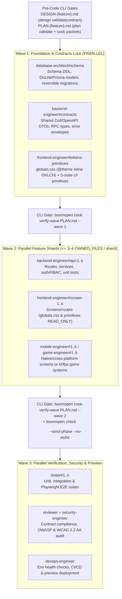

# Agent Coordination — 3-Wave Contract-First Execution Topology (v5.5)

> How `app-builder`, `/cook`, and `/code` orchestrate canonical specialist agents (`agents/*.md`) in parallel waves without file-lock collisions or sequential bottlenecks.

---

## 1. Pre-Code Deterministic Gates (Mandatory Before Wave 1)

Never dispatch coding agents against vague prose. Lock contracts first:

1. **UI/UX Gate (When UI is Touched)**:
   - Author `<appDataDir>\brain\<conversation-id>\DESIGN-{feature}.md` (`<= 500` lines, `ArtifactMetadata.RequestFeedback: true`).
   - Validate & extract contract:
     ```bash
     node ~/.{TOOL}/skills/boomopen-workflow-kit/cli/install.js design validate "<DESIGN-path>"
     node ~/.{TOOL}/skills/boomopen-workflow-kit/cli/install.js design contract "<DESIGN-path>"
     ```
2. **Plan & Handoff Packet Gate**:
   - Author `<appDataDir>\brain\<conversation-id>\PLAN-{feature}.md` embedding `SHARED_CONTRACT` (plus `DESIGN_CONTRACT`), disjoint `OWNED_FILES` (`<= 3–4` files/shard), `READ_ONLY_FILES`, `Test Files`, and `Verify`.
   - Validate plan & compile per-shard 5-Field Handoff Packets:
     ```bash
     node ~/.{TOOL}/skills/boomopen-workflow-kit/cli/install.js plan validate "<PLAN-path>"
     node ~/.{TOOL}/skills/boomopen-workflow-kit/cli/install.js cook packets "<PLAN-path>"
     ```

---

## 2. 3-Wave Contract-First Execution DAG



---

## 3. Wave Execution Matrix & Shard Ownership Rules

| Wave / Stage | Canonical Agent Shard(s) | Parallel? | `OWNED_FILES` / Lock Rule | Deterministic Gate (`Verify`) |
|:------------:|--------------------------|:---------:|---------------------------|-------------------------------|
| **Pre-Code** | `scouter#1..k`, `designer`, `planner` | ✅ (Scout) | Brain artifacts (`SCOUT`, `DESIGN`, `PLAN`) | `boomopen design validate` + `boomopen plan validate` + `boomopen cook packets` |
| **Wave 1** | `database-architect#schema`, `backend-engineer#contracts`, `frontend-engineer#tokens-primitives` | ✅ **YES** | Each shard owns `<= 3–4` foundational files (`schema.ts`, `contracts.ts`, `globals.css` + `components/ui/*`) | `boomopen cook verify-wave <PLAN.md> --wave 1` |
| **Wave 2** | `backend-engineer#api-1..k`, `frontend-engineer#screen-1..k`, `mobile-engineer#1..k`, `game-engineer#1..k` | ✅ **YES** | Disjoint `<= 3–4` feature files/shard; Wave 1 contracts, `globals.css`, and existing regression tests locked in `READ_ONLY_FILES` | `boomopen cook verify-wave <PLAN.md> --wave 2` + `boomopen check <dir> --strict-phase --no-stubs` |
| **Wave 3** | `tester`, `reviewer`, `security-engineer`, `devops-engineer` | ✅ **YES** | Test suites (`tests/**`), Brain `TEST`/`REVIEW` reports, preview/deploy configs | `python ~/.{TOOL}/skills/boomopen-workflow-kit/scripts/checklist.py <dir>` |

> 🔴 **CRITICAL RULES**:
> 1. **Never Run Backend and Frontend Sequentially Once Wave 1 Locks Contracts**: Because `SHARED_CONTRACT` and `DESIGN_CONTRACT` are materialized in Wave 1, `backend-engineer#api-1..k` and `frontend-engineer#screen-1..k` run **simultaneously in Wave 2**!
> 2. **Warm Sub-Agent Session Reuse (`role#shard -> conversationId`)**: Record every spawned shard's `conversationId` and route any Wave 2/3 test or review fixes directly via `send_message(Recipient: conversationId)` without cold re-spawning.
