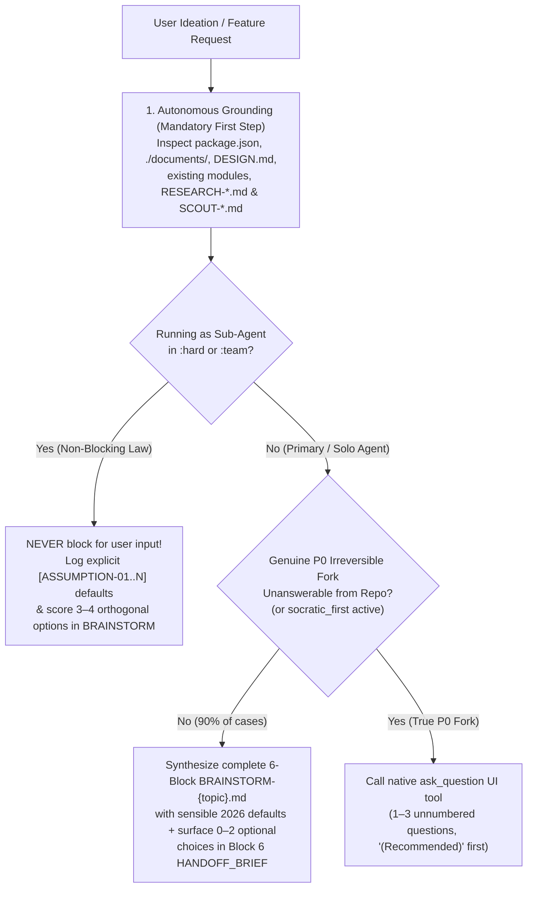
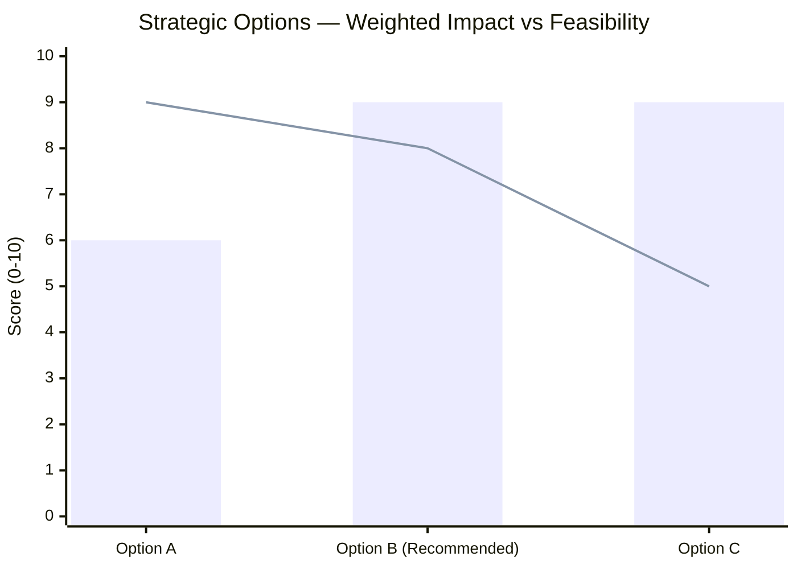

# 💡 Brainstorming, Strategic Ideation & `autonomous_first` Clarification Protocol (v5.5.0)

> **GROUND FIRST. CHALLENGE PREMISES. SCORE ORTHOGONAL OPTIONS.**
> Never ambush the user on Turn 1 with lazy generic questions that can be answered by reading `package.json`, `./documents/`, or existing source files. Follow the **`autonomous_first` Grounding & Anti-Sycophancy Protocol** and validate every `BRAINSTORM-{topic}.md` artifact with `boomopen research validate --mode brainstorm`.

---

## 1. The `autonomous_first` Grounding & Clarification Gate

Respect the active `clarification.style` setting (`autonomous_first` default in `GEMINI.md` vs. `socratic_first` / `ask_first`):



### Native `ask_question` UI Rules (When Triggered in Solo / Primary Agent)
Read [dynamic-questioning.md](dynamic-questioning.md) for 2026 architecture trade-off matrices. When calling `ask_question`:
1. **Ask `1–3` crisp consequence-driven questions maximum** — delete any question that does not eliminate a concrete architectural or business fork!
2. **Put the recommended option first**, prefixed with `(Recommended)` and backed by 1-line cost/complexity impact.
3. **Keep options unnumbered and omit `'Other'`** — the Antigravity 2.0 UI adds numbering and `'Other'` automatically.

---

## 2. Anti-Sycophancy & Orthogonal Option Architecture

Avoid generic "AI-slop" feature lists and sycophantic agreement with flawed premises:

| Anti-Pattern (Forbidden) | v5.5 SOTA Ideation Requirement |
|--------------------------|--------------------------------|
| Proposing 10 shallow bullet ideas with zero trade-offs | Architect **`3–4` genuinely orthogonal strategic options** (`Conservative Baseline` / `Pragmatic Recommended` / `Ambitious Wedge` / optional `Moonshot`) |
| Agreeing blindly with an over-engineered or tarpit premise | Include a **Devil's Advocate 6-Month Pre-Mortem** (*"Why this failed 6 months after launch"*) |
| Hiding bad ideas silently | Include an explicit **Tarpit & AI-Slop Idea Kill-List** (`2–3` tempting ideas rejected with concrete unit-economic, UX, or latency proof) |
| Picking a winner by gut feel | Score options in a **Weighted MCDA Decision Matrix** (Impact, Stack Fit, Time-to-MVP, Unit Economics, Moat) + Mermaid chart |
| Leaving MVP scope unbounded | Enforce a hard **Day-1 MVP (`MUST`) vs. V1/V2 (`DEFER`) cutline** |

---

## 3. Canonical 6-Block `BRAINSTORM-{topic}.md` Blueprint (`<= 500` Lines)

- **Default Brain Artifact Path**: `<appDataDir>\brain\<conversation-id>\BRAINSTORM-{topic}.md`
- **Mandatory `ArtifactMetadata`**:
  `ArtifactMetadata: { Summary: "6-Block strategic ideation & MCDA blueprint for {topic}", UserFacing: true, RequestFeedback: true }` (renders Antigravity 2.0's 1-click **"Proceed"** button to transition into `/plan` or `/design`).
  *(When parallel ideation shards `brainstormer#v1..k` write intermediate drafts `BRAINSTORM-{topic}-v{k}.md`, pass `UserFacing: false, RequestFeedback: false`.)*
- **Single Cohesive File Law**: Keep `BRAINSTORM-{topic}.md` as **1 single cohesive file (`<= 500` lines)** — NEVER split into `{name}/00-index.md` folders!
- **Deterministic CLI Validation Gate (Mandatory Before Completion)**:
  ```bash
  node ~/.{TOOL}/skills/boomopen-workflow-kit/cli/install.js research validate "<path-to-BRAINSTORM-topic.md>" --mode brainstorm
  ```

### Required 6-Block Structure

```markdown
# 💡 Strategic Product & Architecture Blueprint: {Topic}

> **Grounding**: `RESEARCH-{topic}.md` + `SCOUT-{topic}.md` | **Recommended Option**: `{Option B — Name}`

## 1. Autonomous Codebase & Constraint Grounding
- **Repo & Manifest Constraints (`Tier 1`)**: {Pinned framework versions, auth/DB stack, design tokens}
- **Market / Technical Evidence (`RESEARCH`)**: {JTBD persona, 4-Forces friction, competitor blind spots}
- **Explicit Assumptions (`autonomous_first`)**:
  - `ASSUMPTION-01`: {Chosen default + evidence rationale}

## 2. Orthogonal Strategic Options (3–4 Distinct Paths)
- **Option A — Conservative / Lean Baseline**: {Fastest low-risk path reusing existing repo stack}
- **Option B — Pragmatic Recommended ⭐**: {Optimal differentiation, retention loop & unit economics}
- **Option C — Ambitious Differentiation Wedge**: {Category-defining capability + engineering cost}
- **Option D (Optional) — Moonshot**: {High-upside bet + hard technical prerequisites}

## 3. Devil's Advocate 6-Month Pre-Mortem & Tarpit Kill-List
- **6-Month Failure Pre-Mortem Table**: `Failure Mode | Trigger | Impact | Structural Countermeasure`
- **🚫 Tarpit & AI-Slop Idea Kill-List**: `2–3` tempting ideas explicitly rejected with cost/UX/latency proof

## 4. Weighted MCDA Decision Matrix & Trade-Off Visualization
| Criterion (Weight) | Option A | Option B (Winner) | Option C | Evidence |
| ------------------ | :------: | :---------------: | :------: | -------- |
| User/Business Impact (30%) | 6 | **9** | 9 | `RESEARCH` |
| Stack Fit & Feasibility (25%) | **9** | **8** | 5 | `SCOUT` |
| Time-to-MVP (15%) | **9** | **8** | 4 | Scope |
| Unit Economics @ 10k DAU (15%) | 8 | **9** | 6 | Cost math |
| Moat & Retention Loop (15%) | 4 | **8** | **9** | Wedge |
| **Weighted Total (`/10`)** | **7.20** | **8.45** ✅ | **6.85** | **Option B** |



## 5. Winning Option Deep-Dive (MVP vs. V1/V2 Cutline)
- **Core Loop (Micro → Daily → Macro & Viral K-Factor)**: {Step-by-step user/system mechanics}
- **Killer Features & Domain Entities**: {Core entities, state transitions, anti-abuse & token-cost caps}
- **Scope Cutline**: **Day-1 MVP (`MUST`)** vs. **V1/V2 (`DEFER`)**

## 6. Downstream Handoff Brief (HANDOFF_BRIEF)
```yaml
HANDOFF_BRIEF:
  mode: brainstorm
  selected_option: "{Option B — Name}"
  seed_requirements: ["REQ-101: {Core MVP slice 1}", "REQ-102: {Core MVP slice 2}"]
  pinned_stack_and_skills: ["{pkg@vX.Y.Z}", "skills_library/{skill-id}/SKILL.md"]
  mvp_cutline_in: ["{Day-1 deliverables}"]
  deferred_to_v2: ["{Explicitly deferred scope}"]
  open_decisions: ["{0–2 optional user decisions}"]
```
```

---

## 4. Multi-Engine Council Ideation (`/conduct:council`)

When `engines.researcher = "council"` is enabled or multi-engine ideation is requested, combine creative perspectives from `claude,codex,antigravity` via:
```bash
node ~/.{TOOL}/skills/boomopen-workflow-kit/cli/install.js conduct council --task brainstorm --prompt "<topic>"
```
and synthesize unanimous insights, unique blind-spot ideas, and arbitrated trade-offs directly into Blocks 2–4.
