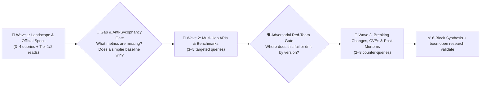
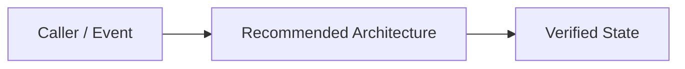

# 🔬 Autonomous Deep-Research Engine (v5.5.0 — 6-Block CLI-Validated SOTA)

> **Zero-Guesswork, Anti-Sycophancy Multi-Hop Research Protocol**
> Never rely on stale training-cutoff memory, single-pass search summaries, or sycophantic premise confirmation. Triangulate across workspace manifests, the `1,462` local skills vault, live official vendor documentation (`search_web`), and empirical production benchmarks — then validate the resulting single-file 6-Block `RESEARCH-{topic}.md` via `boomopen research validate`.

---

## 1. When to Activate & Artifact Routing Rules

Activate `deep-research` for `/research` (`:fast`, `:hard`, `:team`), Stage 1 discovery in `/brainstorm` / `/plan` / `/design`, unfamiliar 2025–2026 SDK/RFC/CVE investigations, and high-stakes architecture evaluations.

| Execution Context | Target Brain Artifact Path | Mandatory `ArtifactMetadata` | Size & Cohesion Rule |
|-------------------|----------------------------|------------------------------|----------------------|
| **Parallel Vector Shard (`researcher#v1..k`, `k > 1`)** | `<appDataDir>\brain\<conversation-id>\RESEARCH-{topic}-v{1..k}.md` | `{ Summary: "...", UserFacing: false, RequestFeedback: false }` | Disjoint per-vector file (`<= 350` lines) — never overwrite sibling shards! |
| **Standalone `/research` Master Report** | `<appDataDir>\brain\<conversation-id>\RESEARCH-{topic}.md` | `{ Summary: "...", UserFacing: true, RequestFeedback: true }` | **1 single cohesive file (`<= 500` lines)** — NEVER split into `{name}/` folders! |
| **Stage 1 Input Inside `/plan` or `/brainstorm`** | `<appDataDir>\brain\<conversation-id>\RESEARCH-{topic}.md` | `{ Summary: "...", UserFacing: true, RequestFeedback: false }` | **1 single cohesive file (`<= 500` lines)** consumed by Stage 2 synthesizer |

> **⚠️ Antigravity 2.0 Sub-Agent Rule**: Built-in `TypeName: "research"` has **NO `search_web` and NO `write_file`**. Always spawn research shards via `invoke_subagent(TypeName: "self", Model: "inherit")`.

---

## 2. Engine 1: The 4-Source Triangulation Protocol & Claim Confidence Law

Every investigation MUST triangulate across four authoritative evidence tiers:

| Tier | Source Category | How to Inspect / Query | Purpose |
|:----:|-----------------|------------------------|---------|
| **Tier 1** | **Workspace Manifests & `./documents/`** | Read `package.json`, `tsconfig.json`, `pyproject.toml`, `Cargo.toml`, `go.mod`, `./documents/*.md` | Pin installed versions, runtime targets, and repo constraints first. |
| **Tier 2** | **`1,462` Local Skills Vault** | Search `~/.{TOOL}/skills/boomopen-workflow-kit/matrix-skills/compact-index.json` → read top `1–3` `SKILL.md` files | Harvest curated 2026 architecture blueprints and anti-patterns. |
| **Tier 3** | **Official Docs, `/llms.txt`, RFCs & Changelogs** | `search_web` with vendor `domain` filter (`llms.txt`, `llms-full.txt`, GitHub `/releases`) | Verify ground-truth APIs, exact config schemas, deprecations, and `2025`/`2026` versions. |
| **Tier 4** | **Empirical Benchmarks, CVEs & Post-Mortems** | `search_web` targeting TechEmpower, Artificial Analysis, GHSA/CVEs, GitHub Issues, post-mortems | Validate real-world `p95/p99` latency, memory, `$/1k DAU` cost, and production failure modes. |

- **Inline Claim-Evidence-Confidence Tagging Law**:
  - `[Confidence: HIGH]` — Corroborated by `>= 2` independent tiers including `Tier 1` or `Tier 3` primary proof.
  - `[Confidence: MEDIUM]` — Backed by `1` authoritative tier or secondary benchmarks with minor version/env caveats.
  - `[Confidence: LOW]` — Single-source community report or unverified extrapolation (never base a `MUST` decision solely on `LOW`).

---

## 3. Engine 2: The 3-Wave Iterative Multi-Hop Search & Anti-Sycophancy Loop



1. **Wave 1 — Landscape, Version Pinning & Official Spec Discovery (`3–4` queries)**:
   - Pin latest `2025`/`2026` stable release, `/llms.txt`, and workspace manifest compatibility.
2. **🧠 Gap Reflection & Anti-Sycophancy Premise Gate (Mandatory Checkpoint)**:
   - Identify missing API signatures, schemas, or `p95`/cost metrics.
   - **Null-Hypothesis Red-Team Check**: Actively test whether the user's proposed library/architecture is overkill, deprecated, or inferior to a simpler baseline (e.g., native platform API, existing repo dependency, single Postgres instance vs. premature distributed stack).
3. **Wave 2 — Multi-Hop Internals, Schemas & Quantitative Benchmarks (`3–5` queries)**:
   - Extract exact TypeScript/Python/Rust/Go signatures, configuration blueprints, and `p50/p95/p99` + cost numbers.
4. **Wave 3 — Adversarial Counter-Evidence, Breaking Changes & CVEs (`2–3` queries)**:
   - Query `"{tech}" ("breaking changes" OR "memory leak" OR "rate limit" OR "limitations") 2025 2026`, `"{tech A}" vs "{tech B}" ("switched from" OR "post-mortem")`, and `"{tech}" (CVE OR GHSA OR vulnerability)`.

---

## 4. Engine 3: Elastic STORM Sharding (`researcher#v1..k`) & Multi-Engine Council

- **Turn-1 Parallel Vector Sharding**: In `/research:hard` and `/research:team`, decompose into `3–6` orthogonal vectors (`researcher#v1` Official Specs/Architecture, `researcher#v2` SDK/Codebase/Vault Blueprints, `researcher#v3` Adversarial Benchmarks/CVEs/Post-Mortems, plus optional `researcher#v4..6` per competitor cluster or subsystem), writing disjoint `RESEARCH-{topic}-v{1..k}.md` files (`UserFacing: false`) and reusing warm `conversationId`s via `send_message`.
- **Cross-Engine Parallel Council (`boomopen conduct council`)**: When `engines.researcher = "council"` or `/conduct:council` is invoked, run:
  ```bash
  node ~/.{TOOL}/skills/boomopen-workflow-kit/cli/install.js conduct council --task research --prompt "<research mission>"
  ```
  and merge the 4-Part Consensus Synthesis (`Unanimous Consensus`, `Unique Blind-Spot Insights`, `Contradictions & Arbitration`, `Final Verdict`) into Block 1 & Block 3.

---

## 5. Engine 4: Dual-Track 5-Lens Analytical Framework

- **Track A — Product, Market, SaaS & Game Ideation**:
  - **A1**: Core Loop & Behavioral Hook (Trigger → Action → Variable Reward → Investment; D1/D7/D30 retention)
  - **A2**: Target Audience, JTBD & 4-Forces Switching Analysis
  - **A3**: Competitive Landscape Matrix (`>= 5` real benchmarks, fatal user complaints & differentiation wedge)
  - **A4**: Monetization & Unit Economics at Scale (`1k CCU / 10k DAU` → `100k` server + bandwidth + AI token math)
  - **A5**: Execution Risks, Distribution (`K-factor`) & Day-1 MVP Cutline
- **Track B — Deep Technical, SDK & System Architecture**:
  - **B1**: Core Architecture, Internals & Execution Model (data flow, concurrency, wire protocol)
  - **B2**: Official API Surface, Pinned Version Matrix & Compilable Code Blueprints
  - **B3**: Empirical Performance, `p50/p95/p99` Latency, Memory & Cost Profile
  - **B4**: Workspace Integration, Auth/OWASP/CVE Posture & Zero-Downtime Migration Path
  - **B5**: Day-2 Operations, OpenTelemetry Observability, Testability & Lock-In Exit Cost

---

## 6. Canonical 6-Block `RESEARCH-{topic}.md` Schema & CLI Gate (`<= 500` Lines)

Every master `RESEARCH-{topic}.md` MUST include all **6 Blocks** in a single cohesive file (`<= 500` lines) and pass deterministic CLI validation before completion:

```bash
node ~/.{TOOL}/skills/boomopen-workflow-kit/cli/install.js research validate "<path-to-RESEARCH-topic.md>" --mode research
```

```markdown
# 🔬 Deep Research Report: {Topic}

> **Track**: {Track A | Track B | Hybrid} | **Overall Confidence**: {HIGH | MEDIUM | LOW} | **Pinned Target**: `{pkg@vX.Y.Z}`

## 1. Executive Verdict & Scope
- **Primary Verdict**: {Clear recommendation + quantitative justification} `[Confidence: HIGH]` `[Tier 1, Tier 3]`
- **Pinned Version Matrix** (`Workspace Tier 1` vs `Latest Stable Tier 3`) + **Research Execution Audit Log** (`Waves 1–3`, `>= 6` verified sources)

## 2. 5-Lens Findings
### Lens 1 .. Lens 5
- {Detailed findings with inline `[Confidence: HIGH|MEDIUM|LOW]` + `[Tier 1..4]` tags and verified `2025`/`2026` code/config snippets}

## 3. Contradiction Arbitration, Comparison Matrix & Architecture Diagram
### Contradiction & Version-Drift Arbitration Table
| Disputed Claim / Drift | Source A (`Tier`) | Source B (`Tier`) | Arbitrated Truth & Version Scope |
| ---------------------- | ----------------- | ----------------- | -------------------------------- |
| `{Claim conflict}`     | `{Vendor docs}`   | `{GitHub issue}`  | `{Verified resolution}`          |

### Weighted Comparison Matrix (`>= 2` Rows; `>= 3` Track B / `>= 5` Track A)
| Option / Competitor | Version | Perf / Latency | Cost at Scale | Repo Fit | Key Trade-Off | Verdict |
| ------------------- | ------- | -------------- | ------------- | -------- | ------------- | ------- |
| **Option A**        | `vX.Y`  | `...`          | `...`         | `High`   | `...`         | ✅ Win  |
| **Option B**        | `vA.B`  | `...`          | `...`         | `Medium` | `...`         | ❌ Skip |



## 4. Anti-Sycophancy "When NOT to Use" & Failure Modes
- **When NOT to Use (Premise Red-Team)**: {Concrete conditions where the simpler baseline or alternative wins}
- **Failure Modes, Breaking Changes & Mitigations Table** (`Failure Mode | Trigger | Impact | Countermeasure`)

## 5. Clickable Citation Registry
1. [{Source Title}](https://...) — `{Version/Date, extracted fact}` (`Tier 3/4`)
2. [{Workspace File}](file:///...) — `{Local version/pattern}` (`Tier 1/2`)

## 6. Downstream Handoff Brief (HANDOFF_BRIEF)
```yaml
HANDOFF_BRIEF:
  mode: research
  recommended_decision: "{Winning choice}"
  pinned_packages: ["{pkg@vX.Y.Z}"]
  matched_vault_skills: ["skills_library/{skill-id}/SKILL.md"]
  candidate_shared_contract: "{Core types / schemas / tokens for Wave 1}"
  hard_constraints_and_bans: ["{Deprecated APIs or anti-patterns to block}"]
  open_decisions: ["{0–2 high-leverage questions if any}"]
```
```
