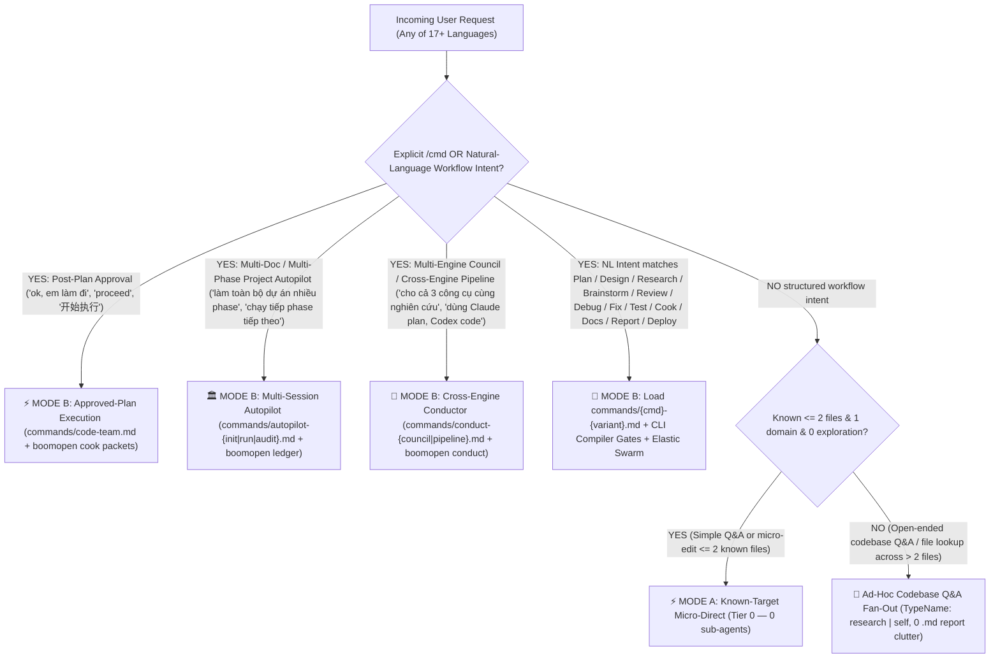

# 🧭 Intelligent Multilingual Intent-to-Workflow & Elastic Swarm Router (v5.5.0)

**Purpose**: Deterministically classify incoming user requests — whether typed with an explicit `/cmd` or spoken in **natural language across all 17 BoomOpen supported languages** (`en`, `vi`, `zh-CN`, `zh-TW`, `ja`, `ko`, `es`, `fr`, `de`, `pt-BR`, `ru`, `hi`, `ar`, `id`, `th`, `tr`, `it` + semantic intent matching for any other language) — and route them to the exact `commands/{cmd}-{variant}.md` workflow, **Fast-Forward Artifact Continuation (`boomopen cook state`)**, **Multi-Session Project Autopilot (`commands/autopilot-{init|run|audit}.md`)**, **Cross-Engine Conductor & Multi-Engine Council (`commands/conduct-{council|pipeline}.md`)**, **Approved-Plan Execution (`commands/code-team.md` / `Direct Plan-to-Executor Dispatch`)**, **Ad-Hoc Codebase Q&A Fan-Out**, or **Mode A Known-Target Micro-Direct (`≤ 2` known files)**.

---

## 1. Proactive Sub-agent First Gate & Artifact-Aware Fast-Forward Routing

> ⛔ **CRITICAL ANTI-BYPASS RULE**: When a user speaks in natural language (without typing `/cmd`) in ANY language and expresses a structured workflow intent (`Plan`, `Design UI/UX`, `Research`, `Brainstorm`, `Review/Audit`, `Debug`, `Fix`, `Test`, `Build Feature End-to-End / Cook`, `Execute Approved Plan / Code`, `Multi-Session Project Autopilot`, `Cross-Engine Conductor / Multi-Engine Council`, `Write Docs`, `Status Report`, `Deploy Check`), the primary agent **MUST NOT** fall into unguided ad-hoc sub-agents! Instead, it **MUST automatically route to Mode B and load the corresponding `commands/{cmd}-{variant}.md` workflow on Turn 1** so all required Brain Artifacts and deterministic CLI gates are enforced.

### 🔑 Four Routing Paths & Deterministic CLI Compiler Chain (Evaluate in Order on Turn 1)

1. **Path 1 — Approved-Plan & Fast-Forward Continuation (`/code` + `boomopen cook state`)**:
   - **Trigger**: A `PLAN-{feature}.md` has **already** been presented and the user approves execution (*"ok, em làm đi"*, *"tiến hành đi"*, *"proceed"*, *"go ahead"*, *"implement the plan"*, *"开始执行"*, *"実行して"*, *"진행해"*), OR `/cook` is invoked when upstream Brain Artifacts (`RESEARCH-*.md`, `BRAINSTORM-*.md`, `DESIGN-*.md`, `PLAN-*.md`) already exist. *(If `.boomopen/project-ledger.json` exists and the user asks for the next phase, route to `/autopilot:run`).*
   - **Action**: **DO NOT re-run `/plan` or redundant discovery!** Run `node ~/.{TOOL}/skills/boomopen-workflow-kit/cli/install.js cook state --artifact-dir "<appDataDir>/brain/<conversation-id>"` to detect existing validated artifacts, compile wave handoff packets via `cook packets`, and dispatch directly to parallel `<role>#<shard>` executors (`≤ 3–4 OWNED_FILES`/shard), gating each wave with `cook verify-wave`.
2. **Path 2 — Multilingual Natural-Language Workflow Routing (`Mode B` → `commands/{cmd}-{variant}.md`)**:
   - **Trigger**: User's natural-language request expresses one of the **14 structured workflow intents** in Section 2 (and exceeds Mode A `≤ 2` known files when editing/fixing code).
   - **Action**: Route to **Mode B**, read `commands/{cmd}-{variant}.md` AND launch Phase 1 sub-agent shards (`TypeName: "self"`, `Model: "inherit"`) in the **same Turn-1 tool batch**, enforcing the **4 Deterministic CLI Artifact Compilers**:
     - **Research & Brainstorm (`boomopen research`)**: `research validate <file> [--mode brainstorm]` (`RES-G1..G4`) → `research brief <file>` (`HANDOFF_BRIEF`).
     - **UI/UX Design (`boomopen design`)**: `design validate <file>` (`DESIGN-G1..G4`) → `design contract <file>` (`DESIGN_CONTRACT` CSS `@theme` + TS Props).
     - **Implementation Plan (`boomopen plan`)**: `plan validate <file>` (`PLAN-G1..G5`) → `plan compile <file> [--sync-ledger]` (`.boomopen/project-ledger.json`).
     - **Feature Execution (`boomopen cook`)**: `cook state` (fast-forward) → `cook packets` (5-Field Shard Packets) → `cook verify-wave` (`COOK-G1..G4` post-wave gate).
3. **Path 3 — Known-Target Micro-Direct (`Mode A` — Tier 0, `0` Sub-agents)**:
   - **Trigger**: Simple factual Q&A, code explanation, or micro-edit where the **exact `≤ 2` target files are already known on Turn 1**, `1` domain, `0` exploration needed, no `/cmd` typed, and no workflow intent.
   - **Action**: Execute, test, and verify directly under **Pragmatic 2-Tier Coding Standards** (`boomopen check <dir> --strict-phase --no-stubs`).
4. **Path 4 — Ad-Hoc Codebase Q&A / File Lookup Fan-Out (`Without /cmd` — Pure Lookup Only)**:
   - **Trigger**: Open-ended codebase Q&A or file lookups across `> 2` files (*"where is X defined?"*, *"how does module Y work?"*) that **do NOT** match any structured workflow intent.
   - **Action**: Spawn read-only parallel scouters (`TypeName: "research"`, `Role: "scouter#shard-1..N"`, `Model: "inherit"`) on Turn 1 with `0` mandatory `.md` report clutter and answer directly.

---

## 2. Complete 14-Workflow Multilingual Trigger Matrix (All 17 BoomOpen Languages)

> **Supported Languages (`17` + Semantic Fallback)**: `en`, `vi`, `zh-CN`, `zh-TW`, `ja`, `ko`, `es`, `fr`, `de`, `pt-BR`, `ru`, `hi`, `ar`, `id`, `th`, `tr`, `it`. Match mixed or unlisted languages by **semantic intent**.

### 2.1 Quick Dispatch Summary Table (14 Core Workflow Intents & CLI Gates)

| # | Workflow Intent | Target Command & File (`defaultVariant = auto`) | Phase 1 Turn-1 Sub-Agents / Team (`Model: "inherit"`) | Deliverable & CLI Verification Gate |
|:-:|-----------------|-------------------------------------------------|-------------------------------------------------------|-------------------------------------|
| **1** | **Planning & Architecture (`/plan`)** | `/plan:hard` (`commands/plan-hard.md`) or `/plan:team` (`commands/plan-team.md`) | `planning-team`: `scouter#1..N` + `researcher#1..M` → `planner` (+ `tech-lead` critic) | `PLAN-{feature}.md` (`boomopen plan validate`) |
| **2** | **UI/UX & Design Spec (`/design`)** | `/design:hard` (`commands/design-hard.md`) or `/design:team` (`commands/design-team.md`) | `design-team`: `scouter` + `researcher` → `designer` (+ `frontend-engineer` critic) | `DESIGN-{feature}.md` (`boomopen design validate`) |
| **3** | **Deep Research (`/research`)** | `/research:team` (`commands/research-team.md`, `auto_team`) or `/research:hard` | `research-team`: `researcher#v1..v3` + `tech-lead` red-team critic | `RESEARCH-{topic}.md` (`boomopen research validate`) |
| **4** | **Ideation & Brainstorming (`/brainstorm`)** | `/brainstorm:team` (`commands/brainstorm-team.md`, `auto_team`) or `/brainstorm:hard` | `brainstorm-team`: `researcher` + `scouter` → `brainstormer` + `tech-lead` tarpit critic | `BRAINSTORM-{topic}.md` (`boomopen research validate --mode brainstorm`) |
| **5** | **Code / Arch / Security Review (`/review`)** | `/review:team` (`commands/review-team.md`) or `/review:hard` (`commands/review-hard.md`) | `review-team`: `tech-lead` + `reviewer#1..N` + `security-engineer` + `performance-engineer` | `REVIEW-{scope}.md` + `boomopen check --strict-phase --no-stubs` |
| **6** | **Root-Cause Debugging (`/debug`)** | `/debug:hard` (`commands/debug-hard.md`) or `/debug:team` (`commands/debug-team.md`) | `debug-team`: `debugger#hyp-1..N` + `scouter` (+ `tech-lead` critic) | `DEBUG-{issue}.md` (5 Whys + Fishbone RCA) |
| **7** | **Multi-File / Unscoped Bug Fix (`/fix`)** | `/fix:hard` (`commands/fix-hard.md`) or `/fix:team` (`commands/fix-team.md`) *(> 2 files / unknown scope)* | `debugger` + `scouter` → `<engineer>#shard-1..N` → `tester` | `DEBUG-{issue}.md` + Verified Fix + `TEST-{issue}.md` |
| **8** | **Testing & QA Verification (`/test`)** | `/test:hard` (`commands/test-hard.md`) or `/test:team` (`commands/test-team.md`) | `testing-team`: `tester#unit` + `tester#e2e` (+ `security-engineer` in `:team`) | `TEST-{feature}.md` + `test_runner.py` |
| **9** | **End-to-End Feature Build (`/cook`)** | `/cook:hard` (`commands/cook-hard.md`) or `/cook:team` (`commands/cook-team.md`) | `cook state` fast-forward → `planner` → `<engineer>#shard-1..N` → `tester` + `reviewer` | `PLAN` + Sharded Code (`boomopen cook verify-wave`) |
| **10** | **Approved-Plan Execution (`/code`)** | `/code:team` (`commands/code-team.md`) or **Direct Plan-to-Executor Dispatch** | `coding-team`: `<engineer>#shard-1..N` (`≤ 3–4 OWNED_FILES`/shard) + `tester` + `reviewer` | Sharded Code (`boomopen cook packets` + `verify-wave`) |
| **11** | **Project Documentation (`/docs`)** | `/docs:core` (`commands/docs-core.md`), `/docs:business`, or `/docs:audit` | `docs-team`: `scouter#1..N` → `docs-manager#shard-1..M` + `reviewer` | `./documents/knowledge-*/` or `README.md` |
| **12** | **Status Report & Deploy Check (`/report`, `/deploy`)** | `/report:hard` (`commands/report-hard.md`) or `/deploy:check` (`commands/deploy-check.md`) | `report-team` (`scouter` → `reporter`) OR `devops-team` (`devops-engineer` + `security-engineer`) | `REPORT-{type}-{date}.md` or Deploy Readiness Report |
| **13** | **Multi-Session Project Autopilot (`/autopilot`)** | `commands/autopilot.md` → `autopilot-init.md` \| `autopilot-run.md` \| `autopilot-audit.md` | `scouter#doc-1..N` → `planner` → `reviewer#spec-auditor`; Elastic Golden Diamond (`run`) | `.boomopen/project-ledger.json` (`boomopen ledger verify\|audit`) |
| **14** | **Cross-Engine Conductor & Council (`/conduct`)** | `commands/conduct.md` → `conduct-council.md` \| `conduct-pipeline.md` | `boomopen conduct council` (`claude,codex,antigravity`) OR `boomopen conduct dispatch` | `.boomopen/conductor/runs/<runId>-COUNCIL-SYNTHESIS.md` |

---

### 2.2 Detailed 17-Language Natural-Language Trigger Phrases per Workflow

#### 1. 📋 Planning & Architecture (`/plan` → `commands/plan-hard.md` | `commands/plan-team.md`)
- **When**: User asks for an implementation plan, architectural blueprint, task breakdown, or phased roadmap **before** coding.
- **17-Language Triggers**:
  - `en`: *"plan"*, *"create a plan"*, *"implementation plan"*, *"architectural plan"*, *"break down tasks"* | `vi`: *"lên kế hoạch"*, *"lập kế hoạch"*, *"kế hoạch triển khai"*, *"phân rã task"*, *"lên phương án kiến trúc"*
  - `zh-CN`: *"制定计划"*, *"实施方案"*, *"架构规划"*, *"任务拆解"* | `zh-TW`: *"制定計劃"*, *"實施方案"*, *"架構規劃"*, *"任務拆解"*
  - `ja`: *"計画を立てて"*, *"実装計画"*, *"アーキテクチャ設計計画"* | `ko`: *"계획 세워줘"*, *"구현 계획"*, *"작업 분할"*
  - `es`: *"planificar"*, *"plan de implementación"* | `fr`: *"planifier"*, *"plan d'implémentation"* | `de`: *"Plan erstellen"*, *"Implementierungsplan"* | `pt-BR`: *"criar um plano"*, *"plano de implementação"*
  - `ru`: *"составь план"*, *"план реализации"* | `hi`: *"योजना बनाएं"*, *"कार्यान्वयन योजना"* | `ar`: *"ضع خطة"*, *"خطة التنفيذ"* | `id`: *"buat rencana"*, *"rencana implementasi"*
  - `th`: *"วางแผน"*, *"แผนการดำเนินงาน"* | `tr`: *"plan yap"*, *"uygulama planı"* | `it`: *"crea un piano"*, *"piano di implementazione"*

#### 2. 🎨 UI/UX & Design Spec (`/design` → `commands/design-hard.md` | `commands/design-team.md`)
- **When**: User asks for UI/UX design, design tokens (`DESIGN-{task}.md`), wireframes, OKLCH palettes, typography, or layout redesign.
- **17-Language Triggers**:
  - `en`: *"design UI/UX"*, *"create design spec"*, *"design system"*, *"wireframe"*, *"redesign interface"* | `vi`: *"thiết kế giao diện"*, *"thiết kế UI/UX"*, *"lên design system"*, *"spec giao diện"*
  - `zh-CN`: *"设计界面"*, *"UI/UX设计"*, *"设计规范"* | `zh-TW`: *"設計介面"*, *"UI/UX設計"*, *"設計系統"* | `ja`: *"UI/UXデザイン"*, *"画面設計"* | `ko`: *"UI/UX 디자인"*, *"화면 설계"*
  - `es`: *"diseñar interfaz"*, *"diseño UI/UX"* | `fr`: *"concevoir l'interface"*, *"système de design"* | `de`: *"UI/UX entwerfen"*, *"Design-System"* | `pt-BR`: *"projetar interface"*, *"design UI/UX"*
  - `ru`: *"дизайн интерфейса"*, *"дизайн-система"* | `hi`: *"UI/UX डिज़ाइन करें"* | `ar`: *"تصميم واجهة المستخدم"* | `id`: *"desain antarmuka"*, *"desain UI/UX"*
  - `th`: *"ออกแบบหน้าจอ"*, *"ออกแบบ UI/UX"* | `tr`: *"arayüz tasarımı"*, *"UI/UX tasarla"* | `it`: *"progettare interfaccia"*, *"design UI/UX"*

#### 3. 🔬 Deep Research & Investigation (`/research` → `commands/research-team.md` | `commands/research-hard.md`)
- **When**: User asks to research a topic, compare SDKs/competitors, verify official docs, or run a deep technical/market study.
- **17-Language Triggers**:
  - `en`: *"research"*, *"deep dive"*, *"investigate"*, *"analyze deeply"*, *"compare libraries"* | `vi`: *"nghiên cứu"*, *"tìm hiểu sâu"*, *"phân tích chuyên sâu"*, *"đánh giá so sánh"*
  - `zh-CN`: *"深入研究"*, *"深度调研"*, *"对比分析"* | `zh-TW`: *"深入研究"*, *"深度調研"*, *"對比分析"* | `ja`: *"徹底調査して"*, *"深掘り分析"* | `ko`: *"심층 조사"*, *"리서치"*, *"비교 조사"*
  - `es`: *"investigar a fondo"*, *"análisis profundo"* | `fr`: *"rechercher en profondeur"*, *"étude comparative"* | `de`: *"tiefgehend recherchieren"*, *"Tiefenanalyse"* | `pt-BR`: *"pesquisar a fundo"*, *"análise profunda"*
  - `ru`: *"исследуй глубоко"*, *"глубокий анализ"* | `hi`: *"गहन शोध करें"*, *"विस्तृत विश्लेषण"* | `ar`: *"بحث معمق"*, *"تحليل شامل"* | `id`: *"riset mendalam"*, *"analisis mendalam"*
  - `th`: *"วิจัยเชิงลึก"*, *"ค้นคว้าข้อมูล"* | `tr`: *"derinlemesine araştır"* | `it`: *"ricerca approfondita"*, *"analisi dettagliata"*

#### 4. 💡 Ideation & Brainstorming (`/brainstorm` → `commands/brainstorm-team.md` | `commands/brainstorm-hard.md`)
- **When**: User asks to brainstorm ideas, propose product features, explore orthogonal options, or stress-test directions via `brainstorm-team`.
- **17-Language Triggers**:
  - `en`: *"brainstorm"*, *"propose ideas"*, *"explore options"*, *"suggest features"* | `vi`: *"khám phá ý tưởng"*, *"đề xuất ý tưởng"*, *"brainstorm"*, *"gợi ý tính năng"*, *"tư vấn hướng đi"*
  - `zh-CN`: *"头脑风暴"*, *"构思方案"*, *"推荐功能"* | `zh-TW`: *"頭腦風暴"*, *"腦力激盪"*, *"提出點子"* | `ja`: *"ブレインストーミング"*, *"アイデアを出して"* | `ko`: *"브레인스토밍"*, *"아이디어 제안"*
  - `es`: *"lluvia de ideas"*, *"proponer ideas"* | `fr`: *"brainstorming"*, *"proposer des idées"* | `de`: *"Brainstorming"*, *"Ideen vorschlagen"* | `pt-BR`: *"propor ideias"*, *"sugerir funcionalidades"*
  - `ru`: *"мозговой штурм"*, *"предложи идеи"* | `hi`: *"विचार-मंथन"*, *"नए विचार सुझाएं"* | `ar`: *"عصف ذهني"*, *"اقترح أفكاراً"* | `id`: *"curah pendapat"*, *"usulkan ide"*
  - `th`: *"ระดมสมอง"*, *"เสนอไอเดีย"* | `tr`: *"beyin fırtınası"*, *"fikir öner"* | `it`: *"brainstorming"*, *"proporre idee"*

#### 5. 🛡️ Code, Architecture & Security Review (`/review` → `commands/review-team.md` | `commands/review-hard.md`)
- **When**: User asks to review code, audit architecture/security/quality, inspect a PR, or find repo blind spots.
- **17-Language Triggers**:
  - `en`: *"review code"*, *"audit codebase"*, *"security/architecture review"* | `vi`: *"review code"*, *"đánh giá code"*, *"audit hệ thống"*, *"rà soát lỗi/bảo mật"*
  - `zh-CN`: *"代码审查"*, *"审计代码"*, *"安全评估"* | `zh-TW`: *"程式碼審查"*, *"審計代碼"* | `ja`: *"コードレビュー"*, *"コード監査"* | `ko`: *"코드 리뷰"*, *"코드 감사"*
  - `es`: *"revisar código"*, *"auditar código"* | `fr`: *"revue de code"*, *"auditer le code"* | `de`: *"Code-Review"*, *"Architektur-Audit"* | `pt-BR`: *"revisar código"*, *"auditoria de código"*
  - `ru`: *"ревью кода"*, *"аудит кода"* | `hi`: *"कोड रिव्यू करें"*, *"कोड ऑडिट"* | `ar`: *"مراجعة الكود"*, *"تدقيق الكود"* | `id`: *"tinjau kode"*, *"audit kode"*
  - `th`: *"รีวิวโค้ด"*, *"ออดิทระบบ"* | `tr`: *"kod incelemesi"*, *"kod denetimi"* | `it`: *"revisione del codice"*, *"audit del codice"*

#### 6. 🔍 Root-Cause Debugging (`/debug` → `commands/debug-hard.md` | `commands/debug-team.md`)
- **When**: User asks to investigate why a bug/crash/race condition occurs (RCA) before patching.
- **17-Language Triggers**:
  - `en`: *"debug"*, *"find root cause"*, *"why is this failing"* | `vi`: *"debug"*, *"tìm nguyên nhân gốc"*, *"tại sao bị lỗi"*, *"điều tra lỗi"*
  - `zh-CN`: *"调试"*, *"排查原因"*, *"根因分析"* | `zh-TW`: *"除錯"*, *"排查原因"*, *"根因分析"* | `ja`: *"デバッグ"*, *"原因究明"* | `ko`: *"디버깅"*, *"원인 파악"*
  - `es`: *"depurar"*, *"encontrar causa raíz"* | `fr`: *"déboguer"*, *"trouver la cause racine"* | `de`: *"debuggen"*, *"Ursache finden"* | `pt-BR`: *"depurar"*, *"encontrar causa raiz"*
  - `ru`: *"отладить"*, *"найти первопричину"* | `hi`: *"डीबग करें"*, *"मूल कारण खोजें"* | `ar`: *"تصحيح الأخطاء"*, *"تحليل السبب الجذري"* | `id`: *"debug"*, *"cari akar masalah"*
  - `th`: *"ดีบัก"*, *"หาสาเหตุของบั๊ก"* | `tr`: *"hata ayıkla"*, *"kök nedeni bul"* | `it`: *"debuggare"*, *"trovare la causa principale"*

#### 7. 🔧 Multi-File / Unscoped Bug Fixing (`/fix` → `commands/fix-hard.md` | `commands/fix-team.md`)
- **When**: User asks to fix a bug or failing build/tests across `> 2` files or unknown scope. *(If `≤ 2` known files, use Mode A).*
- **17-Language Triggers**:
  - `en`: *"fix this bug"*, *"resolve the error"*, *"fix until there are no errors"* | `vi`: *"sửa lỗi"*, *"fix bug"*, *"khắc phục sự cố"*, *"sửa hết các lỗi"*
  - `zh-CN`: *"修复bug"*, *"解决报错"* | `zh-TW`: *"修復bug"*, *"解決報錯"* | `ja`: *"バグを修正して"*, *"不具合修正"* | `ko`: *"버그 수정해줘"*, *"오류 해결"*
  - `es`: *"corregir el error"*, *"arreglar el bug"* | `fr`: *"corriger le bug"*, *"résoudre l'erreur"* | `de`: *"Bug beheben"*, *"Fehler korrigieren"* | `pt-BR`: *"corrigir o bug"*, *"consertar o erro"*
  - `ru`: *"исправь баг"*, *"устрани ошибку"* | `hi`: *"बग ठीक करें"*, *"त्रुटि सुधारें"* | `ar`: *"إصلاح الخطأ"*, *"حل المشكلة"* | `id`: *"perbaiki bug"*, *"atasi error"*
  - `th`: *"แก้บั๊ก"*, *"แก้ไขข้อผิดพลาด"* | `tr`: *"hatayı düzelt"*, *"sorunu çöz"* | `it`: *"correggere il bug"*, *"risolvere l'errore"*

#### 8. 🧪 Testing & QA Verification (`/test` → `commands/test-hard.md` | `commands/test-team.md`)
- **When**: User asks to write unit/integration/E2E tests, verify coverage, or run a comprehensive QA suite.
- **17-Language Triggers**:
  - `en`: *"write tests"*, *"run QA suite"*, *"add unit/E2E tests"* | `vi`: *"viết test"*, *"kiểm thử"*, *"chạy test toàn diện"*, *"test E2E"*
  - `zh-CN`: *"编写测试"*, *"运行测试"* | `zh-TW`: *"編寫測試"*, *"執行測試"* | `ja`: *"テストを書いて"*, *"QA検証"* | `ko`: *"테스트 작성"*, *"품질 검증"*
  - `es`: *"escribir pruebas"*, *"ejecutar tests"* | `fr`: *"écrire des tests"* | `de`: *"Tests schreiben"* | `pt-BR`: *"escrever testes"*
  - `ru`: *"напиши тесты"*, *"проверь тестами"* | `hi`: *"टेस्ट लिखें"*, *"परीक्षण करें"* | `ar`: *"كتابة اختبارات"*, *"تشغيل الاختبارات"* | `id`: *"tulis tes"*, *"uji coba"*
  - `th`: *"เขียนเทส"*, *"ทดสอบระบบ"* | `tr`: *"test yaz"*, *"testleri çalıştır"* | `it`: *"scrivere test"*, *"eseguire test"*

#### 9. 🍳 End-to-End Feature Implementation (`/cook` → `commands/cook-hard.md` | `commands/cook-team.md`)
- **When**: User asks to build a new feature or full-stack capability end-to-end (`boomopen cook state` automatically fast-forwards over any existing `RESEARCH` / `DESIGN` / `PLAN` artifacts!).
- **17-Language Triggers**:
  - `en`: *"build feature"*, *"implement new module"*, *"create full-stack feature"* | `vi`: *"xây dựng tính năng"*, *"làm tính năng mới"*, *"phát triển module"*
  - `zh-CN`: *"开发新功能"*, *"实现功能模块"* | `zh-TW`: *"開發新功能"*, *"實現功能模組"* | `ja`: *"新機能を実装して"*, *"機能開発"* | `ko`: *"새 기능 구현"*, *"기능 개발해줘"*
  - `es`: *"construir funcionalidad"*, *"implementar nueva función"* | `fr`: *"développer la fonctionnalité"* | `de`: *"Feature entwickeln"* | `pt-BR`: *"construir funcionalidade"*
  - `ru`: *"реализуй фичу"*, *"разработай модуль"* | `hi`: *"नया फ़ीचर बनाएं"* | `ar`: *"بناء ميزة جديدة"* | `id`: *"bangun fitur baru"*
  - `th`: *"สร้างฟีเจอร์ใหม่"*, *"พัฒนาระบบงาน"* | `tr`: *"yeni özellik geliştir"* | `it`: *"sviluppare funzionalità"*

#### 10. ⚡ Approved-Plan Execution (`/code` → `commands/code-team.md` | `Direct Plan-to-Executor Dispatch`)
- **When**: A `PLAN-{feature}.md` was **already** presented and the user approves implementation. **NEVER re-run `/plan`!**
- **17-Language Triggers**:
  - `en`: *"proceed"*, *"go ahead"*, *"implement the plan"*, *"start coding"* | `vi`: *"ok, em làm đi"*, *"tiến hành đi"*, *"triển khai theo kế hoạch đi"*, *"bắt đầu code đi"*
  - `zh-CN`: *"开始执行"*, *"按计划实施"* | `zh-TW`: *"開始執行"*, *"按計劃實施"* | `ja`: *"実行して"*, *"計画通り進めて"* | `ko`: *"진행해"*, *"계획대로 구현해"*
  - `es`: *"adelante"*, *"implementa el plan"* | `fr`: *"vas-y"*, *"implémente le plan"* | `de`: *"leg los"*, *"Plan umsetzen"* | `pt-BR`: *"pode prosseguir"*, *"implemente o plano"*
  - `ru`: *"приступай"*, *"выполняй план"* | `hi`: *"आगे बढ़ें"*, *"योजना लागू करें"* | `ar`: *"ابدأ التنفيذ"*, *"نفذ الخطة"* | `id`: *"lanjutkan"*, *"eksekusi rencananya"*
  - `th`: *"ลุยเลย"*, *"ดำเนินการตามแผน"* | `tr`: *"devam et"*, *"planı uygula"* | `it`: *"procedi"*, *"implementa il piano"*

#### 11. 📚 Project Documentation (`/docs` → `commands/docs-core.md` | `commands/docs-business.md` | `commands/docs-audit.md`)
- **When**: User asks to generate, update, or audit repository documentation (`./documents/`, `README.md`, BRD/PRD).
- **17-Language Triggers**:
  - `en`: *"write documentation"*, *"update README/docs"*, *"audit documentation"* | `vi`: *"viết tài liệu"*, *"cập nhật tài liệu / README"*, *"kiểm tra tài liệu"*
  - `zh-CN`: *"编写文档"*, *"更新文档"* | `zh-TW`: *"編寫文件"*, *"更新說明文件"* | `ja`: *"ドキュメント作成"* | `ko`: *"문서 작성"*, *"기술 문서 업데이트"*
  - `es`: *"escribir documentación"* | `fr`: *"rédiger la documentation"* | `de`: *"Dokumentation schreiben"* | `pt-BR`: *"escrever documentação"*
  - `ru`: *"напиши документацию"* | `hi`: *"दस्तावेज़ीकरण लिखें"* | `ar`: *"كتابة التوثيق"* | `id`: *"tulis dokumentasi"* | `th`: *"เขียนเอกสาร"* | `tr`: *"dokümantasyon yaz"* | `it`: *"scrivere documentazione"*

#### 12. 📊 Status Reports & Deployment Readiness (`/report` → `commands/report-hard.md`, `/deploy` → `commands/deploy-check.md`)
- **When**: User asks for an executive status report, metrics summary, or pre-deployment readiness check.
- **17-Language Triggers**:
  - `en`: *"generate status report"*, *"check deployment readiness"* | `vi`: *"tạo báo cáo tiến độ"*, *"kiểm tra sẵn sàng deploy"*
  - `zh-CN`: *"生成进度报告"*, *"部署检查"* | `zh-TW`: *"生成進度報告"*, *"部署檢查"* | `ja`: *"進捗レポート作成"*, *"デプロイ確認"* | `ko`: *"진행 보고서 작성"*, *"배포 준비 점검"*
  - `es`: *"informe de estado"*, *"verificar despliegue"* | `fr`: *"rapport d'avancement"*, *"vérifier le déploiement"* | `de`: *"Statusbericht"*, *"Deployment prüfen"* | `pt-BR`: *"relatório de status"*, *"verificar deploy"*
  - `ru`: *"отчет о статусе"*, *"проверка перед деплоем"* | `hi`: *"स्थिति रिपोर्ट"*, *"डिप्लॉयमेंट जांच"* | `ar`: *"تقرير الحالة"*, *"فحص جاهزية النشر"* | `id`: *"laporan status"*, *"cek kesiapan deploy"*
  - `th`: *"สรุปรายงานความคืบหน้า"*, *"ตรวจสอบความพร้อมก่อน Deploy"* | `tr`: *"durum raporu"*, *"dağıtım kontrolü"* | `it`: *"report di stato"*, *"verifica del deploy"*

#### 13. 🏛️ Multi-Session Autonomous Project Orchestrator (`/autopilot` → `commands/autopilot-{init|run|audit}.md`)
- **When**: User wants to initialize a Spec-to-Phase Ledger from docs (`:init`), continue the next phase across chat sessions (`:run`), or audit 100% RTM spec coverage (`:audit`).
- **17-Language Triggers**:
  - `en`: *"autopilot"*, *"run multi-phase project from docs"*, *"continue next phase"*, *"audit missing features"* | `vi`: *"điều hành code qua nhiều phiên"*, *"làm toàn bộ dự án nhiều phase"*, *"chạy tiếp phase tiếp theo"*, *"kiểm tra còn sót chức năng nào không"*
  - `zh-CN`: *"多阶段项目自动驾驶"*, *"继续下一阶段"* | `zh-TW`: *"多階段專案自動駕駛"*, *"繼續下一階段"* | `ja`: *"フェーズ自動実行"*, *"次のフェーズを進めて"* | `ko`: *"다단계 프로젝트 오토파일럿"*, *"다음 페이즈 진행해"*
  - `es`: *"piloto automático del proyecto"*, *"continuar siguiente fase"* | `fr`: *"pilote automatique multi-phases"* | `de`: *"Projekt-Autopilot"*, *"nächste Phase ausführen"* | `pt-BR`: *"piloto automático multi-fases"*
  - `ru`: *"автопилот многофазного проекта"* | `hi`: *"मल्टी-फ़ेज़ प्रोजेक्ट ऑटोपायलट"* | `ar`: *"التشغيل التلقائي للمشروع متعدد المراحل"* | `id`: *"autopilot proyek multi-fase"*
  - `th`: *"ออโต้ไพลอตโปรเจกต์หลายเฟส"* | `tr`: *"çok aşamalı proje otopilotu"* | `it`: *"autopilota progetto multi-fase"*

#### 14. 🎼 Cross-Engine Conductor & Multi-Engine Council (`/conduct` → `commands/conduct-{council|pipeline}.md`)
- **When**: User wants multiple CLI engines (`Claude Code`, `Codex`, `Antigravity`) running in parallel for a 4-Part Consensus Matrix (`:council`) or assigned distinct `Author != Critic` roles (`:pipeline`).
- **17-Language Triggers**:
  - `en`: *"multi-engine council"*, *"run Claude, Codex, and Antigravity in parallel"*, *"cross-engine pipeline"* | `vi`: *"cho cả 3 công cụ cùng nghiên cứu rồi tổng hợp"*, *"hội đồng đa công cụ"*, *"dùng Claude lên kế hoạch, Codex code"*
  - `zh-CN`: *"多引擎并行研究汇总"*, *"用Claude做计划，Codex写代码"* | `zh-TW`: *"多引擎並行研究匯總"*, *"跨平台分工協作"* | `ja`: *"マルチエンジン合議"*, *"Claudeで設計しCodexで実装"* | `ko`: *"멀티 엔진 동시 분석"*, *"Claude로 기획하고 Codex로 코딩"*
  - `es`: *"consejo multi-motor en paralelo"* | `fr`: *"conseil multi-moteurs en parallèle"* | `de`: *"Multi-Engine-Rat parallel ausführen"* | `pt-BR`: *"conselho multi-engine em paralelo"*
  - `ru`: *"мульти-движковый консилиум"* | `hi`: *"मल्टी-इंजन काउंसिल"* | `ar`: *"مجلس متعدد المحركات"* | `id`: *"dewan multi-engine paralel"* | `th`: *"ให้หลายเครื่องมือวิเคราะห์พร้อมกัน"* | `tr`: *"çoklu motor konseyi"* | `it`: *"consiglio multi-motore"*

---

## 3. Canonical 21 Specialist Agents, 18 Teams & 4-Tier Dynamic Elastic Swarm

### 3.1 Canonical Agent & Team Selection Matrix (Default `Model: "inherit"`)

| Primary Intent / Domain | Canonical Agent(s) (`role#shard`) | Adversarial `:team` (`18` Teams / `72` Files) |
|-------------------------|-----------------------------------|-----------------------------------------------|
| **Architecture & Phased Planning** | `planner` (fed by `scouter#1..N` + `researcher#1..M`) | `planning-team`, `architecture-team` |
| **System Architecture & `:team` Arbitration** | `tech-lead` (`tech-lead#1`) | Lead / Critic across `:team` & `/autopilot:run` |
| **API / Server / Microservices** | `backend-engineer#shard-1..N` | `coding-team` |
| **Web UI / Components / State** | `frontend-engineer#shard-1..N` | `coding-team`, `design-team` |
| **Schema / Migrations / Analytics** | `database-architect#shard-1..N` | `data-team`, `coding-team` |
| **iOS / Android / React Native / Flutter / Tauri** | `mobile-engineer#shard-1..N` | `mobile-team` |
| **Game Engines / ECS / Physics / Shaders** | `game-engineer#shard-1..N` | `game-team` |
| **UI/UX Design Systems & Tokens** | `designer` (`designer#lead`, `designer#tokens`) | `design-team` |
| **Multi-Vector External & SDK Research** | `researcher#vector-1..N` (`TypeName: "self"`) | `research-team` |
| **Codebase Mapping & Multi-Doc Scouting** | `scouter#module-1..N` (`TypeName: "self"` or `"research"`) | `research-team`, `planning-team`, `brainstorm-team` |
| **Evidence-Grounded Ideation & Discovery** | `brainstormer` (grounded in `RESEARCH` + `SCOUT`) | `brainstorm-team` |
| **Root-Cause Debugging (5 Whys / Fishbone)** | `debugger#hyp-1..N` | `debug-team` |
| **Unit, Integration & E2E Testing** | `tester#unit`, `tester#int`, `tester#e2e` | `testing-team` |
| **Adversarial Code, Spec & Contract Review** | `reviewer#code`, `reviewer#spec-auditor` | `review-team` |
| **OWASP / STRIDE / LLM-Agent Security** | `security-engineer#sec` | `security-team` |
| **Profiling, Latency & Load Optimization** | `performance-engineer#perf` | `performance-team` |
| **CI/CD, Containers & Cloud Deployment** | `devops-engineer#infra` | `devops-team` |
| **Technical & Architecture Documentation** | `docs-manager#shard-1..N` | `docs-team` |
| **BRD, User Stories & Acceptance Criteria** | `business-analyst#req-1..N` | `project-team`, `docs-team` |
| **Roadmaps, Risk Registers & Delivery** | `project-manager` | `project-team` |
| **Executive Summaries & Metrics Reports** | `reporter` | `report-team` |

### 3.2 Cognitive Load Sharding Law & Warm Session Reuse

$$N_{\text{agents}} = \min\!\left(\text{maxParallelSubagents},\; \max\!\left(\left\lceil \frac{\text{Total Target Files}}{3.5} \right\rceil,\; \text{Distinct Domains},\; \text{Research Vectors}\right)\right)$$

- **Tier 0 (`0` sub-agents)**: `≤ 2` known files, `1` domain, `0` exploration, no `/cmd` or workflow intent.
- **Tier 1 (`2–3` sub-agents)**: `3–5` files or `2` domains/vectors.
- **Tier 2 (`4–6` sub-agents)**: `6–12` files or `3–5` domains/vectors (`≤ 3–4` disjoint `OWNED_FILES` per shard).
- **Tier 3 (`7–10+` sub-agents)**: `13+` files, repo-wide audits, or multi-module overhauls (capped at `execution.maxParallelSubagents`).
- **Scoped Warm Session Reuse (`role#shard -> conversationId`)**: Track every active shard in `active_subagents` and reuse via `send_message(Recipient: conversationId)` across implementation waves, review fixes, and `:team` debate rounds.
