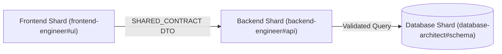

# 📋 Plan Writing (v5.5 — 6-Block Machine-Verifiable & Contract-First DAG Edition)

## Overview
This skill defines the canonical methodology for decomposing features, refactors, and epics into **machine-verifiable, contract-first execution plans (`PLAN-{task}.md`)** that parallel sub-agent shards (`role#shard`) can execute concurrently with zero file-lock collisions and `< 50ms` deterministic CLI validation (`boomopen plan validate`).

---

## 1. 3-Tier Adaptive Complexity Ceremony

Scale planning depth and ceremony dynamically to match the target scope (aligned 1-to-1 with the Cognitive Load Sharding Law):

$$N_{\text{agents}} = \min\!\left(\text{maxParallelSubagents},\; \max\!\left(\left\lceil \frac{\text{Total Target Files}}{3.5} \right\rceil,\; \text{Distinct Domains},\; \text{Research Vectors}\right)\right)$$

| Planning Tier | Scope & File Count | Target Workflow | Discovery Ceremony | Plan Ceremony & CLI Gate |
|---------------|--------------------|-----------------|--------------------|--------------------------|
| **Tier 1 — Micro / Small** | `1–5` files, `1–2` domains, `1` wave | `/plan:fast` | `1` fast `scouter` scan (`0` `BRAINSTORM`/`RESEARCH` clutter) | Compact `≤ 100`-line 1-Wave plan with `SHARED_CONTRACT`, disjoint `OWNED_FILES`, `READ_ONLY_FILES`, `Test Files`, and `Verify`. Gated by `boomopen plan validate <plan.md>`. |
| **Tier 2 — Medium Feature** | `6–12` files, `2–3` waves, `2–3` domains | `/plan:hard` | Turn-1 parallel `scouter#1..k` + `researcher#1..k` (`2–4` shards) | Full 6-Block single-file `PLAN-{task}.md` (`120–350` lines): Executive Summary, Mermaid Diagram, compilable `SHARED_CONTRACT` code blocks, `Wave 1..3` sharded tasks (`≤ 3–4` files/shard), `Given/When/Then` + `≥ 5` Edge Cases, and 3-Part Blast-Radius Pre-Mortem. Gated by `boomopen plan validate <plan.md>`. |
| **Tier 3 — Large Epic** | `13+` files, `≥ 3` waves/phases, or multi-session | `/plan:team` or `/autopilot` | 2-Stage Elastic Golden Diamond (+ optional `boomopen conduct council --task plan`) | Full 6-Block `PLAN-{task}.md` (`≤ 500` lines) **compiled automatically into `.boomopen/project-ledger.json` + `.boomopen/contracts/SHARED_CONTRACT.md`** via `boomopen plan validate <plan.md> --sync-ledger` (or `boomopen ledger from-plan <plan.md>`). |

---

## 2. Cohesive Single-File Rule & Antigravity 2.0 Native "Proceed" Button

### 1. Single Cohesive File Up to 500 Lines (Never Split at 150 Lines!)
- Keep `PLAN-{task}.md` as **ONE cohesive single file up to `500` lines** (aligned with Pragmatic Tier 2 file limits).
- **⛔ NEVER** shatter a `150–450` line `PLAN-{task}.md` into a chunked folder (`PLAN-{task}/00-index.md`, `01-*.md`), as splitting breaks Antigravity 2.0's Artifact preview and native **"Proceed"** button.
- When an epic exceeds `13+` files or `3+` phases, compile `PLAN-{task}.md` into `.boomopen/project-ledger.json` via `boomopen ledger from-plan <plan.md>`.

### 2. Exclusive `ArtifactMetadata.RequestFeedback: true` on `PLAN-{task}.md`
- **On `PLAN-{task}.md` (`write_file` / `edit_file`)**: Always pass `ArtifactMetadata` with `RequestFeedback: true` so Antigravity 2.0 renders the native 1-click **"Proceed"** button:
  ```json
  "ArtifactMetadata": {
    "Summary": "Implementation Plan for {task}: {W} parallel waves, {N} role#shard executors (<=3-4 OWNED_FILES/shard), locked SHARED_CONTRACT, and 5-gate CLI verification.",
    "UserFacing": true,
    "RequestFeedback": true
  }
  ```
- **On Supporting Artifacts (`SCOUT-{task}.md`, `RESEARCH-{task}.md`, `BRAINSTORM-{task}.md`)**: Always pass `UserFacing: true, RequestFeedback: false` (and `UserFacing: false, RequestFeedback: false` on `MAILBOX-{date}.md`) so premature "Proceed" buttons never appear on intermediate files.

---

## 3. Contract-First Parallel DAG Waves & Canonical Task Schema

### 1. Compilable Code-Block `SHARED_CONTRACT` (Enable Same-Wave Parallelism)
- **Stop Sequential Waterfall Planning**: Do **NOT** serialize phases as `Phase 1: Backend → Phase 2: Frontend → Phase 3: Tests` when contracts can be locked upfront!
- Define literal, copy-pasteable TypeScript interfaces/DTOs, Zod schemas, OpenAPI routes, or SQL DDL inside fenced code blocks (`ts`, `sql`, `json`, `yaml`) under `## 🤝 Shared Interface Contracts (SHARED_CONTRACT)`.
- Once `SHARED_CONTRACT` is locked, `database-architect#schema`, `backend-engineer#api`, `frontend-engineer#ui`, and `tester#unit` can execute **in parallel within the same Wave** against the shared contract!

### 2. Canonical Machine-Parseable Wave & Task Fields
Every wave and task in `PLAN-{task}.md` MUST use these exact labels so `boomopen plan validate` and `boomopen ledger from-plan` parse 100% of fields deterministically:

```markdown
## Wave 1: {Wave Name}
- **Parallelizable**: Yes | No
- **Depends On**: None

### Task 1.1 (REQ-101): {Task Title}
- **Agent**: `{canonical-agent}#{shard}`
- **Acceptance**: AC1, AC2
- **OWNED_FILES**: `path/to/file1.ts`, `path/to/file2.ts`
- **READ_ONLY_FILES**: `path/to/contract.ts`, `path/to/existing.test.ts`
- **Test Files**: `path/to/file1.test.ts`
- **Verify**: `node --test path/to/file1.test.js && node ~/.{TOOL}/skills/boomopen-workflow-kit/cli/install.js check <dir> --strict-phase --no-stubs`
```

---

## 4. 5-Gate Deterministic CLI Verification (`boomopen plan validate`)

Before presenting `PLAN-{task}.md` to the user or dispatching `/code` / `/autopilot`, run:
```bash
node ~/.{TOOL}/skills/boomopen-workflow-kit/cli/install.js plan validate <path/to/PLAN-{task}.md>
# For Tier 3 Epics (13+ files or >= 3 waves), also compile into .boomopen/project-ledger.json:
node ~/.{TOOL}/skills/boomopen-workflow-kit/cli/install.js plan validate <path/to/PLAN-{task}.md> --sync-ledger
```

| Gate ID | Rule Enforced by `boomopen plan validate` (`< 50ms`) | Failure Condition (Exit Code `1`) |
|:-------:|------------------------------------------------------|-----------------------------------|
| **`PLAN-G1`** | **Required Sections & 6 Task Fields** | Missing `User Request`, `Acceptance Criteria`, `SHARED_CONTRACT` (when `≥ 2` domains), `Wave`/`Phase` sections, or `Rollback`; or any task missing `Agent` (`role#shard`), `Acceptance`, `OWNED_FILES`, `READ_ONLY_FILES`, `Test Files`, or executable `Verify`. |
| **`PLAN-G2`** | **Cognitive Load Sharding Law (`≤ 4 OWNED_FILES`)** | Any task shard declares `> 4` files in `OWNED_FILES` (preventing sub-agent context overload and hollow stubs). |
| **`PLAN-G3`** | **Zero File-Lock Collisions in Parallel Waves** | Within any wave marked `Parallelizable: Yes`, two different tasks share an exact path or directory/glob prefix in `OWNED_FILES`. |
| **`PLAN-G4`** | **Valid Acyclic Wave / Phase DAG** | Any wave `Depends On` references an unknown wave/phase ID or forms a dependency cycle. |
| **`PLAN-G5`** | **100% Acceptance Criteria Traceability (`AC1..N`)** | Any `AC1..ACN` defined in the Acceptance Criteria table is not linked by at least one task's `Acceptance` field. |

### Project-Specific Verification Commands Reference

| Domain | Verification Command / Script |
|--------|-------------------------------|
| **Plan Static Validation** | `node ~/.{TOOL}/skills/boomopen-workflow-kit/cli/install.js plan validate <plan.md> [--sync-ledger]` |
| **Plan-to-Ledger Compilation** | `node ~/.{TOOL}/skills/boomopen-workflow-kit/cli/install.js ledger from-plan <plan.md>` |
| **All Source Code** | `node ~/.{TOOL}/skills/boomopen-workflow-kit/cli/install.js check <dir> --strict-phase --no-stubs` + project build/test |
| **Multi-Phase Ledger (`/autopilot`)** | `node ~/.{TOOL}/skills/boomopen-workflow-kit/cli/install.js ledger verify --phase <phase-id> --passed-tests <N>` |
| **Frontend / API / DB Audits** | `python ~/.{TOOL}/skills/frontend-design/scripts/ux_audit.py <path>` \| `api_validator.py` \| `schema_validator.py` |

---

## 5. Canonical 6-Block `PLAN-{task}.md` Blueprint (`≤ 500` Lines Single File)

````markdown
# 📋 Implementation Plan: {Task Name}

> [!IMPORTANT]
> **1-Click Execution Ready**: Click the **"Proceed"** button on this artifact (or reply `"proceed"` / `"ok, em làm đi"` / `"/code"`) to dispatch the parallel executor waves below.

## 1. 📌 User Request (VERBATIM) & Executive Summary
> {Exact user request verbatim}

| Metric | Value |
|--------|-------|
| **Planning Tier & Scope** | `Tier {1|2|3}` — `{TotalFiles} files` across `{TotalWaves} waves` (`{TotalShards} role#shard` executors) |
| **Coding Standards** | Pragmatic 2-Tier (`~200–350` lines/file target, `≤ 400` soft / `500` hard ceiling, `0` explicit `any`, `0` stubs) |
| **Estimated Effort** | `{X}h raw × 1.5 buffer = {Y}h` |

## 2. 🏗️ Architecture, Data Flow & Key Decisions (ADR)

- **Architecture & Constraints (from `SCOUT` / `RESEARCH`)**: `{Key module boundaries, reusable utilities, and ADR rationale}`

## 3. 🤝 Shared Interface Contracts (`SHARED_CONTRACT`)
> **LOCKED CONTRACT**: Parallel shards MUST implement against these exact TypeScript interfaces, DTOs, routes, and schemas.

```ts
// Exact shared DTOs / interfaces / Zod schemas / error envelopes
export interface FeatureRequestDto {
  readonly id: string;
}
export interface FeatureResponseDto {
  readonly data: { readonly id: string; readonly status: 'ACTIVE' | 'ARCHIVED' };
}
```
- **Endpoints / Signatures**: `{Exact HTTP METHOD /path or function signatures}`
- **Error Format**: `{Exact status codes 400/401/403/404/409 and error JSON structure}`

## 4. 🎯 Acceptance Criteria & Edge Cases
| ID | Given | When | Then | Verify |
|----|-------|------|------|--------|
| AC1 | {precondition} | {action} | {expected outcome} | {exact test command} |
| AC2 | {precondition} | {action} | {expected outcome} | {exact test command} |

### Edge Cases (Minimum 5 for `:hard` / `:team`)
| # | Category | Trigger Condition | Expected System Behavior | Handled By Shard |
|:-:|----------|-------------------|--------------------------|------------------|
| 1 | Empty / Null State | {condition} | {graceful empty state / 400 guard} | `{role#shard}` |
| 2 | Network / DB Error | {condition} | {typed try/catch error envelope} | `{role#shard}` |
| 3 | Boundary / Max Limit | {condition} | {pagination / 413 / rate guard} | `{role#shard}` |
| 4 | Unauthorized / Role | {condition} | {401/403 rejection} | `{role#shard}` |
| 5 | Concurrent Mutation | {condition} | {idempotency / transaction lock} | `{role#shard}` |

## 5. 🌊 Wave-by-Wave Parallel Tasks (`≤ 3–4 OWNED_FILES` per Shard)

## Wave 1: {Foundation & Parallel Core Implementation}
- **Parallelizable**: Yes
- **Depends On**: None

### Task 1.1 (REQ-101): {Specific atomic backend action}
- **Agent**: `backend-engineer#api`
- **Acceptance**: AC1
- **OWNED_FILES**: `src/api/feature.controller.ts`, `src/api/feature.service.ts`
- **READ_ONLY_FILES**: `src/types/shared.ts`, `tests/api/existing.test.ts`
- **Test Files**: `tests/api/feature.test.ts`
- **Verify**: `npm test -- tests/api/feature.test.ts && node ~/.{TOOL}/skills/boomopen-workflow-kit/cli/install.js check src/api --strict-phase --no-stubs`

### Task 1.2 (REQ-102): {Specific atomic frontend action}
- **Agent**: `frontend-engineer#ui`
- **Acceptance**: AC2
- **OWNED_FILES**: `src/components/FeatureView.tsx`, `src/hooks/useFeature.ts`
- **READ_ONLY_FILES**: `src/types/shared.ts`
- **Test Files**: `tests/components/FeatureView.test.tsx`
- **Verify**: `npm test -- tests/components/FeatureView.test.tsx && node ~/.{TOOL}/skills/boomopen-workflow-kit/cli/install.js check src/components --strict-phase --no-stubs`

## 6. 💥 Blast-Radius Pre-Mortem & Rollback Manifest
- **Impacted Downstream Callers (from `SCOUT`)**: `{exact file:line imports that call modified exports, or "None (additive)"}`
- **Locked Existing Regression Tests (`READ_ONLY_FILES`)**: `{existing test files that MUST remain 100% green and unmodified}`
- **Stateful / DB Migration Reversibility**: `{Expand-Contract additive strategy + exact down-migration command}`

| Risk | Impact | Pre-Emptive Mitigation | Exact Rollback Command |
|------|--------|------------------------|------------------------|
| {risk} | H/M/L | {contract/test mitigation} | `git checkout -- {files}` / `{migrate:down}` |
````
